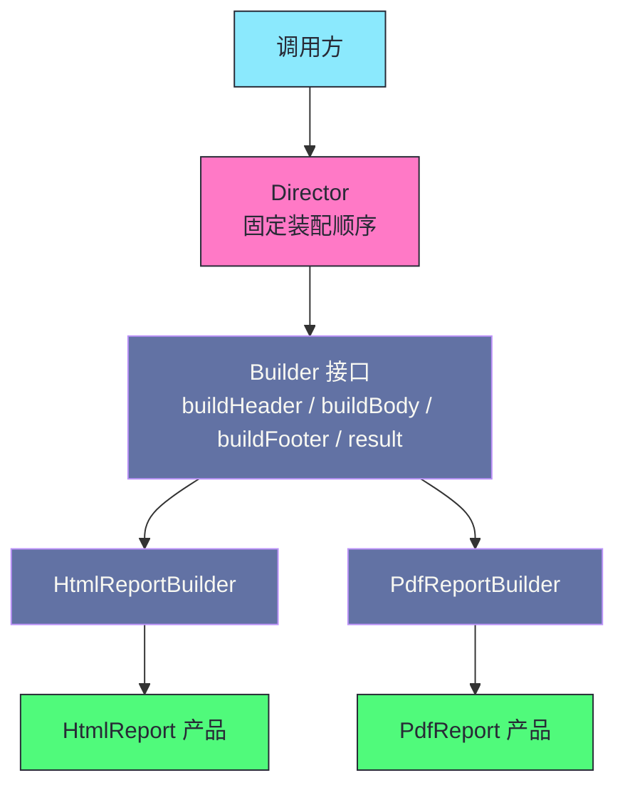
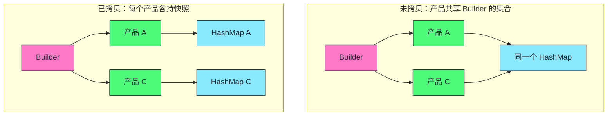
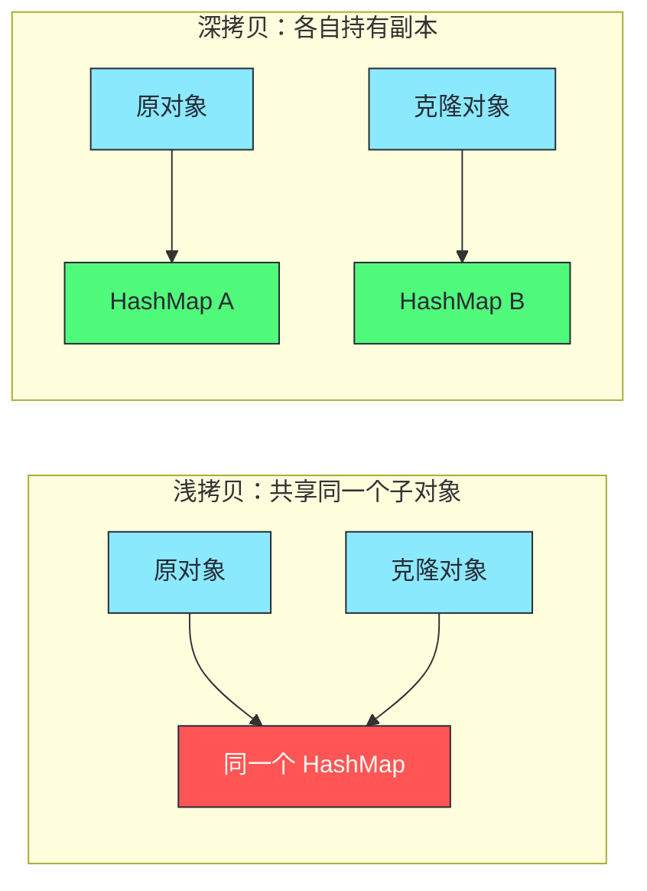
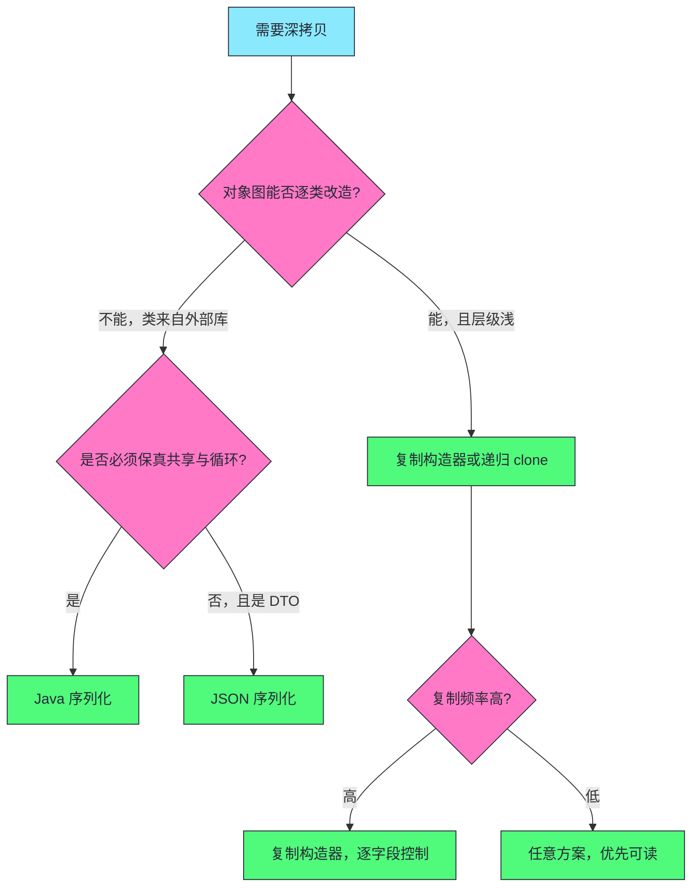
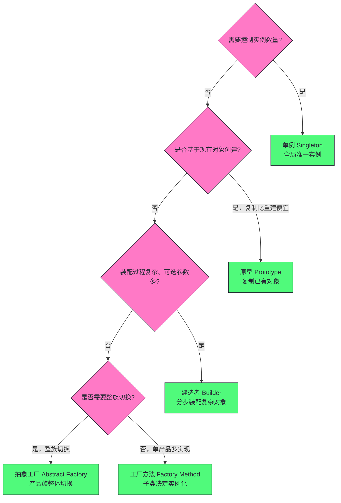

# 创建型模式（下）——建造者与原型模式

**摘要：**

建造者与原型在创建型模式里最容易被简化成两个动作：一个是给类加个注解，一个是调一次 `clone()`。前者处理的是"对象由多少个可选部分构成、这些部分按什么顺序装配"，后者处理的是"对象能不能复制、复制出来还是不是原来那个东西"。本文沿三条线索展开。其一是形态与判据：GoF 的 Builder 加 Director、无导演的链式 Builder、Lombok 生成的 Builder 三者差别很大，是否需要 Director 取决于装配顺序是否已经固化成可复用的工艺知识。其二是可变中间体的代价：`build()` 之后 Builder 能否复用，取决于产品有没有做防御性拷贝；校验的权威位置只能是产品构造器，把它放在链上只是为了提早失败。其三是浅拷贝与深拷贝的机制边界：`Object.clone()` 做的是字段逐位复制，`Cloneable` 这个标记接口的作用是给父类方法开权限，深拷贝四条路径各有前置约束与量级不同的代价。落点部分遍历 `ArrayList` 与 `HashMap` 的 clone、`System.arraycopy` 一族复制原语、Spring 的 `BeanUtils.copyProperties` 与 MapStruct 的分野；反例部分把最容易写错的两处单独拆开——用 `clone()` 当深拷贝、`@Builder` 类缺无参构造器导致 Jackson 反序列化失败。

---

## 第 1 章 参数爆炸与半构建状态

### 1.1 伸缩式构造器的组合爆炸

对象创建的麻烦，很少来自"创建一个对象"这个动作本身，而来自"这个对象到底需要哪些部分才算完整"。当一个类有十来个字段、其中只有两三个是必选的时候，最直觉的写法是为可能的组合提供一串重载构造器，Joshua Bloch 在《Effective Java》第 2 条里把它叫作伸缩式构造器（telescoping constructor）。

```java
public class HttpRequest {
    private final String url;
    private final String method;
    private final Map<String, String> headers;
    private final String body;
    private final int connectTimeout;
    private final int readTimeout;
    private final int maxRetries;
    private final boolean followRedirects;

    public HttpRequest(String url, String method) {
        this(url, method, new HashMap<>(), null, 3000, 5000, 3, true);
    }

    public HttpRequest(String url, String method, Map<String, String> headers) {
        this(url, method, headers, null, 3000, 5000, 3, true);
    }

    public HttpRequest(String url, String method, String body) {
        this(url, method, new HashMap<>(), body, 3000, 5000, 3, true);
    }

    // 枚举到这里就进行不下去了：8 个参数、6 个可选，子集有 64 种
    public HttpRequest(String url, String method, Map<String, String> headers,
                       String body, int connectTimeout, int readTimeout,
                       int maxRetries, boolean followRedirects) {
        this.url = url;
        this.method = method;
        this.headers = headers;
        this.body = body;
        this.connectTimeout = connectTimeout;
        this.readTimeout = readTimeout;
        this.maxRetries = maxRetries;
        this.followRedirects = followRedirects;
    }
}
```

这段代码的失败不只是"重载太多"。真正麻烦的地方在于，一旦参数表长到需要数位置，编译器就再也帮不上忙了。`new HttpRequest(url, method, headers, body, 3000, 5000, 3, true)` 与 `new HttpRequest(url, method, headers, body, 5000, 3000, 3, true)` 在语法上都合法，把连接超时和读取超时填反了，编译器不会报错，测试也未必覆盖得到，最后表现为线上偶发的读超时。相邻参数类型相同时，位置错误的代价是静默的，而这恰好是伸缩式构造器最常见的形态。

### 1.2 JavaBean 模式：把错误从编译期推迟到运行期

第二种直觉写法是无参构造器加 setter，也就是 JavaBean 模式。它把可选参数问题解决了，却把"对象何时完整"这个问题交给了调用方自己负责。

```java
HttpRequest request = new HttpRequest();
request.setUrl("http://api.example.com/users");
request.setMethod("POST");
request.setBody("{\"name\": \"Alice\"}");
request.setConnectTimeout(5000);
// 若此处发生异常，request 已经是一个半成品
```

半成品对象的危险不在于它字段为空，而在于它字段不全却看起来完全正常。`setUrl()` 执行完到最后一个 setter 执行完之间，这个对象处于一种既不能被判定为无效、也不能被判定为有效的中态（intermediate state）。单线程里它只是难看，多线程里它就是一个"已经发布但尚未初始化完成"的对象——其它线程完全可能拿到这个中态实例并据此做出错误决策。

JavaBean 模式还有两个更隐蔽的代价。其一是对象无法做成不可变：字段必须有 setter 才能被赋值，而只要有 setter，对象在生命周期内就可能被改写，`final` 语义带来的安全发布保证也就没有了。其二是把可变对象用作哈希表的键会失效：先 `put(k, v)` 再 `k.setXxx(...)`，`hashCode` 变化之后，这个键就从桶里"消失"了，`get` 再也找不到它。

### 1.3 为什么语言层不救场

有人会问，既然参数太多是语言层面的问题，为什么不在语言里解决。Kotlin 有具名实参与默认参数，Scala 有具名实参与 case class 的默认值，C# 有具名实参与可选参数，调用点可以写成 `HttpRequest(url = u, method = "POST", readTimeout = 10000)`，参数爆炸这个问题从根上就消失了。Java 到 Java 21 LTS 仍然没有把具名实参与默认参数纳入语言，这不是疏忽，而是受制于向后兼容的语法与重载解析规则——一旦允许跳过中间参数，重载解析与二进制兼容的边界都会变得难以界定。

`record` 的引入改变了另一半图景。record 让"数据载体"这件事变便宜了：一行声明换来构造器、访问器、`equals`、`hashCode`、`toString`，紧凑构造器（compact constructor）还能把校验集中在唯一入口。但 record 并不解决可选参数：你要么写一串重载，要么把所有参数都变成必填，要么在外面再套一层 Builder。这也是为什么在 Java 里建造者是事实标准，而在 Kotlin 里它只是一个可选的语法糖——语言没给的表达能力，最终都要由某个类来补。

### 1.4 建造者交换了什么

把上面两种写法摆在一起看，建造者的定位就清楚了：它引入一个**可变中间体**（Builder）承担"分步装配"，在最后一步一次性产出不可变的产品。装配过程是可变、独占、短命的；产品是不可变、可共享、长命的。

用一个比喻说，Builder 像车间里的工装夹具加装配工单：零件一件件往上装，夹具随时可调，装配完成、检验合格之后才封箱出厂；JavaBean 则是把半成品直接摆在货架上，谁路过都能改一改。代价也很直接——类数量翻倍、每次构建多一次分配、Builder 自己是可变的（因此不是线程安全的）、必选字段在链式形态下无法由编译器强制。这些代价是否值得，取决于第 3 章的判据。

---

## 第 2 章 建造者的三种形态与判据

同样是"建造者"，在 Java 生态里其实存在三种差别很大的东西：GoF 书里带导演的 Builder、社区里流行的无导演链式 Builder、以及 Lombok 在编译期生成的 Builder。它们的类图相似，适用判据却完全不同。

### 2.1 GoF 形态：Builder 与 Director

GoF 的建造者模式有两个角色缺一不可：Builder 接口定义装配步骤，Director 负责按固定顺序调用这些步骤。产品的差异被收敛到"换一个具体 Builder"这一个动作上，装配顺序则被固定在 Director 里。两个角色与它们产出的产品之间的对应关系，可以用下面这张图概括。



```java
public interface ReportBuilder {
    void buildHeader();
    void buildBody();
    void buildFooter();
    Report result();
}

public class ReportDirector {
    public Report construct(ReportBuilder builder) {
        builder.buildHeader();
        builder.buildBody();
        builder.buildFooter();
        return builder.result();
    }
}

// 同一套装配顺序，换 Builder 就换产品表示
Report html = new ReportDirector().construct(new HtmlReportBuilder(data));
Report pdf  = new ReportDirector().construct(new PdfReportBuilder(data));
```

这里的价值主张不是"参数太多"，而是"装配流程本身是一种可复用的知识"。报表要先表头、再表体、最后表尾，这个顺序与具体输出格式无关；把它抽到 Director 里，等于把工艺卡从工人手里收到工艺科。代价是 Director 与 Builder 接口之间多了一层协议：新增一个装配步骤要同时改接口、所有实现、以及 Director，接口一旦变宽，所有具体 Builder 都要跟着动。

### 2.2 链式 Builder：把导演的职责交给调用点

现代 Java 代码里更常见的是没有 Director 的链式 Builder：每个 setter 返回 `this`，`build()` 收口。装配顺序不再由某个类固定，而是由调用点即席决定。

```java
public final class HttpRequest {
    private final String url;
    private final String method;
    private final Map<String, String> headers;
    private final int readTimeout;

    private HttpRequest(Builder b) {
        this.url = b.url;
        this.method = b.method;
        // 关键：拷贝而不是持有 builder 的集合
        this.headers = Map.copyOf(b.headers);
        this.readTimeout = b.readTimeout;
    }

    public static Builder builder(String url, String method) {
        return new Builder(url, method);
    }

    public static final class Builder {
        private final String url;
        private final String method;
        private final Map<String, String> headers = new LinkedHashMap<>();
        private int readTimeout = 5000;

        private Builder(String url, String method) {
            if (url == null || url.isBlank()) throw new IllegalArgumentException("url");
            this.url = url;
            this.method = method;
        }

        public Builder header(String name, String value) {
            headers.put(name, value);
            return this;
        }

        public Builder readTimeout(int millis) {
            if (millis <= 0) throw new IllegalArgumentException("readTimeout");
            this.readTimeout = millis;
            return this;
        }

        public HttpRequest build() {
            if ("POST".equals(method) && headers.isEmpty()) {
                throw new IllegalStateException("POST 需要至少一个 header");
            }
            return new HttpRequest(this);
        }
    }
}
```

链式 Builder 与流式 API 经常被混为一谈，其实两者是相反的东西。`Stream` 的每一步都返回新的流对象，原流不变，整个链条是惰性、无副作用的；Builder 的每一步都在修改同一个中间体，返回 `this` 只是为了让语法连贯。把 Builder 当流去并行处理，或者把 Stream 的每一步当 Builder 去复用同一个对象，都会得到难以解释的结果。链式只是语法形态，它既不保证不可变，也不保证线程安全。

### 2.3 Lombok @Builder 的生成物

`@Builder` 把上面那段样板代码搬到了编译期。它在语义上做的正是"生成一个与产品同构的可变中间体，再生成一个 `build()` 把它一次性搬运成产品"，理解这一点比记住注解参数更重要。

```java
@Builder
@Getter
public final class HttpConfig {
    private final String host;
    @Builder.Default private final int port = 8080;
    private final boolean keepAlive;
}
```

它大致等价于下面这段手写代码（真实生成物还有 `toString`、`equals` 等细节）：

```java
public final class HttpConfig {
    private final String host;
    private final int port;
    private final boolean keepAlive;

    HttpConfig(String host, int port, boolean keepAlive) {
        this.host = host;
        this.port = port;
        this.keepAlive = keepAlive;
    }

    public static HttpConfigBuilder builder() {
        return new HttpConfigBuilder();
    }

    public static final class HttpConfigBuilder {
        private String host;
        private int port = 8080;       // @Builder.Default 的初始化搬到了这里
        private boolean keepAlive;

        public HttpConfigBuilder host(String host) { this.host = host; return this; }
        public HttpConfigBuilder port(int port) { this.port = port; return this; }
        public HttpConfigBuilder keepAlive(boolean v) { this.keepAlive = v; return this; }

        public HttpConfig build() {
            return new HttpConfig(host, port, keepAlive);
        }
    }
}
```

生成物里有几个点值得单独记下，因为它们决定了踩坑的位置。

其一是构造器。`@Builder` 标在类上时，Lombok 会额外生成一个包私有的全参构造器供 `build()` 调用；如果类里已经显式写了构造器，它就不再生成，于是 `build()` 找不到可调用的目标而编译失败。这也解释了为什么 `@Builder` 与 `@NoArgsConstructor` 经常不能直接共存——后者把全参构造器挤掉了，需要再补一个 `@AllArgsConstructor`。

其二是 `@Builder.Default` 的实现方式。初始化表达式并没有留在字段上，而是被搬到 Builder 的字段初始化里；如果没有 `@Builder.Default`，未在链上设置的字段会取 Java 默认值（对象为 `null`，`int` 为 0，`boolean` 为 `false`），而不是类上写的那个初始值。把手写构造器与 `@Builder.Default` 混用时，一旦初始化表达式被挪走而 Builder 又没生成，默认值就会静默丢失。

其三是继承。子类的 Builder 默认只认子类自己的字段，父类字段不会出现在链上；要跨层装配就得用 `@SuperBuilder`，并且父子两层都要标注。

其四是集合字段。用 `@Singular` 可以让链上出现 `header(name, value)` 这种逐个追加的方法，生成物内部先用可变集合累积，`build()` 时再包装成不可变集合——这一点恰好与第 4 章的防御性拷贝呼应：不包装的话，产品与 Builder 之间就会出现集合别名。

### 2.4 什么时候真的需要 Director

Director 不是"更正式的写法"，它是一份被复用的装配工艺。判据是：装配顺序是否已经固化为领域知识，并且有多个调用点需要同一份知识。下面这张表把常见的信号整理在一起。

| 观察到的信号 | 倾向 |
| --- | --- |
| 同一套装配步骤在三个以上调用点重复出现，顺序不能变 | 抽 Director，把顺序收进一个类 |
| 同一套步骤要产出多种表示（HTML、PDF、Markdown 报表） | 抽 Builder 接口 + Director，产品差异下沉到具体 Builder |
| 步骤之间存在调用方难以自觉遵守的前置依赖 | 抽 Director，把依赖顺序从调用方手里拿走 |
| 装配过程中需要横切逻辑（计时、审计、复用预计算） | 抽 Director 或模板方法，不要散落在链式调用里 |
| 只有一个调用点，链式调用本身就是最好的文档 | 不要 Director，多一层只会让构建过程变得不透明 |
| 步骤线性、无顺序约束、每个字段相互独立 | 不要 Director，链式或参数对象即可 |

从这个判据看，Director 在业务代码里少见是正常的：业务对象的装配顺序大多不是领域知识，只是某个调用方当下的顺手写法。反过来，凡是"格式族"的场景——导出报表、生成文档、序列化中间表示——Director 的价值会立刻显现，因为那里确实存在一份与产品无关的工艺卡。

---

## 第 3 章 建造者、静态工厂与参数对象

参数太多时，至少有三种正当解法，它们解决的问题彼此部分重叠，取舍点也不在同一处。

### 3.1 三条路的分工

静态工厂方法（Effective Java 第 1 条）把 `new` 换成有名字的静态方法：`Duration.ofSeconds(5)`、`List.of(...)`、`Optional.ofNullable(x)`。它的强项是命名、缓存、返回子类型、隐藏实现类，但参数仍然按位置传递，参数一多，可读性问题原样存在。

参数对象（introduce parameter object）把一组相关参数打包成一个对象，构造器只收一个参数。`record HttpOptions(String url, String method, Map<String, String> headers, int readTimeout)` 是最直接的形态，配合紧凑构造器可以把校验集中在唯一入口。它特别适合"这组参数本身就是一个领域概念"的场景，比如"连接参数""渲染选项"。

建造者则专门解决"可选部分多、且希望产品不可变"的场景。它和参数对象并不互斥：参数对象可以充当 Builder 的必选部分（`HttpRequest.newBuilder(uri)` 就是静态工厂 + Builder 的组合），也可以充当 `build()` 的产物。

| 维度 | 建造者 | 静态工厂 | 参数对象 / record |
| --- | --- | --- | --- |
| 表达可选参数 | 强（缺省即默认值） | 弱（仍靠重载） | 中（靠重载或嵌套） |
| 调用点可读性 | 强（方法名即语义） | 中（方法名解释用途，参数仍按位） | 强（字段名即语义） |
| 产品可否不可变 | 可以，且是主要目的 | 可以 | 可以，且天然 |
| 是否强制必选字段 | 链式形态下不能，分阶段 Builder 才能 | 可以 | 可以（构造器参数即必选） |
| 额外成本 | 多一个类、可变的中间体、一次拷贝 | 几乎没有 | 多一个类型 |
| 典型落点 | 配置对象、请求对象、Protobuf 消息 | `List.of`、`Duration.ofSeconds`、`Optional.of` | 领域值对象、方法参数聚合 |

### 3.2 判据与过度设计

把三种解法放到一条判据线上，可以这样问自己：如果这个对象的参数个数在三到四个以内、全是必选、又没有默认值，那么构造器本身就是最好的 API，Builder 只是增加了分配次数和一个需要维护的类。`new Point(3, 4)` 永远比 `Point.builder().x(3).y(4).build()` 更好读；`new File(parent, "app.log")` 也不需要建造者，两个参数的类型与语义都足够清楚。

真正需要建造者的是三种情况的叠加：可选字段明显多于必选字段、存在跨字段一致性约束、产品希望做成不可变。三者缺一，往往有更轻的解法：只有"可选多"可以用参数对象加重载；只有"跨字段约束"可以放在构造器里校验；只有"想不可变"用 record 或全参构造器就行。

> [!warning] 分阶段 Builder 的代价
> 如果想在编译期强制必选字段，可以做成"分阶段 Builder"：每个必选字段对应一个接口，只有按顺序实现完这些接口才能拿到 `build()`。这在 API 库和公共 SDK 里值得，在业务代码里通常不值得——接口数量随字段线性增长，自动补全提示会变得冗长，而收益只是把一次运行期异常提前成编译错误。

---

## 第 4 章 可变中间体的代价

只要承认 Builder 是一个可变的中间体，就必须回答两个随之而来的问题：`build()` 之后这个中间体还能不能继续用，以及参数校验应该放在哪一步。这两个问题在代码里都不会报错，只会在某个并发场景或某次看似无害的复用时暴露出来。

### 4.1 build() 之后 Builder 还能不能复用

复用 Builder 本身没有错，错的是让产品和 Builder 共享可变状态。看下面这段：

```java
HttpRequest.Builder b = HttpRequest.builder("http://api.example.com", "GET")
        .header("Accept", "application/json");

HttpRequest a = b.build();
HttpRequest c = b.header("Accept", "text/plain").build();
```

如果 `HttpRequest` 的构造器里写的是 `this.headers = b.headers`，那么 `a` 与 `c` 会指向同一个 `HashMap`，后面那行对 header 的改动会同时改掉已经"构建完成"的 `a`。产品的不可变性只写在字段的 `final` 上，实际却被 Builder 这个后门绕过了。反过来，如果构造器里做了 `Map.copyOf(b.headers)`，`a` 与 `c` 就各自持有一份快照，Builder 复用完全无害。

用两张对象图对照这层差别：不拷贝时，两个产品共用同一张字段表；拷贝之后，Builder 退化成一次性的脚手架，产品各有各的集合。



差别只在构造器里那一次拷贝，但这行拷贝决定了"Builder 能不能复用"这个问题的答案。

对 Builder 复用这件事，JDK 给出了两种相反但都很清楚的答案。`java.net.http.HttpRequest.Builder`（Java 11）不打算让你复用，它提供了 `copy()`：需要基于已有请求改几个字段时，用 `builder.copy()` 拿到一个新 Builder，或者用 `HttpRequest.newBuilder(existing, filter)` 重新取一个，而不是把旧的那个再拿出来改。`java.util.stream.Stream.Builder`（Java 8）则走得更彻底——`build()` 之后这个 Builder 就被消耗掉了，再调 `add()` 会抛 `IllegalStateException`。两者都比"靠文档约定不要复用"更可靠：把状态约束写进类型或者写进运行期检查，让错误在第一次发生时就被发现。

### 4.2 防御性拷贝

产品构造器对每个可变的引用字段做**防御性拷贝**，这是让 Builder 复用以至于让产品真正不可变的前提。关键判据不是字段类型是不是集合，而是这个字段指向的对象在构建之后还能不能被别人改。

```java
private HttpRequest(Builder b) {
    this.url = b.url;
    this.method = b.method;
    this.headers = Map.copyOf(b.headers);        // 元素是 String，浅拷贝就够
    this.tags = List.copyOf(b.tags);             // List.copyOf 同时拒绝 null 元素
    this.retryPolicy = new RetryPolicy(b.retryPolicy);   // 元素可变，必须深一层
}
```

拷贝的深度要跟着元素的可变性走：`List<String>` 浅拷贝就够了，`List<Date>` 或 `List<RetryPolicy>` 只拷贝容器仍然会把可变元素暴露出去。这一点在复制构造器和原型模式里是同一个问题，第 6、7 章会从 clone 的角度再讲一遍。

### 4.3 校验放在哪一步

校验位置是 Builder 设计里最容易含糊的地方，因为可选位置有三个：字段级 setter、`build()`、产品构造器。

| 校验位置 | 能覆盖的约束 | 问题 |
| --- | --- | --- |
| Builder 的 setter | 单字段取值范围、非空 | 跨字段约束无处安放；在链上抛异常时留下一个半构建的 Builder |
| `build()` | 跨字段一致性、必选字段是否齐备 | 绕过 Builder 的路径（反射、反序列化、子类）不受保护 |
| 产品构造器 | 全部约束的权威位置 | 报错时机最晚，调用点离出错点最远 |
| 产品构造器 + Builder 前置 | 权威校验 + 尽早失败 | 校验逻辑写两遍，需要保证两处一致 |

结论是：校验的权威位置只能是产品构造器，因为它是唯一无法被绕过的入口。Builder 里的校验是"提早失败"的优化，不是约束的来源。这也解释了为什么很多团队在 `build()` 里只做跨字段检查，而把字段级检查同时放在 Builder 与产品构造器里——前者为了报错早，后者为了不漏。

还有一个反直觉的后果：如果字段级校验放在 setter 里，并且它依赖另一个字段的当前值，那么链式调用的顺序就会影响成败。`readTimeout()` 里检查"必须先设置 connectTimeout"这种做法，会让 `a().b()` 与 `b().a()` 的行为不同，这已经不再是装配，而是把状态机的顺序约束藏进了方法调用顺序里。跨字段的校验因此必须推迟到 `build()`。

---

## 第 5 章 原型模式与 clone 的机制

原型模式（Prototype）的主张只有一句：用一个已经存在的实例当模板，复制出新的实例，而不是从零构造。这句话成立需要两个前提——复制确实比重建便宜，以及复制得干净。前者是收益，后者是成本，而 Java 的 `clone()` 把成本藏得比收益深得多。

### 5.1 复制比重建便宜在哪

"创建成本高"这个说法经常被误解成"字段多"。字段多只会让构造器长，`new` 加赋值的成本是常数级的；真正让创建变贵的是三类外部依赖：

- 需要读磁盘或网络：加载几十 MB 的配置、拉一次远程字典、解析一个大 JSON；
- 需要重计算：地形生成、索引构建、复杂规则预编译；
- 需要等待外部状态：连接建立、握手、鉴权。

只有这三类场景里，"克隆一个现成实例"才可能把毫秒级甚至秒级的开销压到可忽略。如果创建只是 `new` 加若干次赋值，原型模式是纯粹的负优化：多一次分配，还要背上一整套复制正确性的责任。

> [!info] 原型与不可变对象复用的边界
> 如果对象是不可变的，根本不需要克隆——直接共享同一个实例就是最优解。`String`、`Integer`、`LocalDateTime`、`List.of(...)` 产生的不可变集合都属于这一类。原型模式的价值只在"对象必须可变，但它的初始状态可以被重复使用"时才成立；一旦对象可以做成不可变，原型就退化为"模板参数"，用构造器传不同的配置就够了。

### 5.2 Object.clone() 到底做了什么

`java.lang.Object` 上的 `clone()` 是一个 `protected native` 方法，它做的事情比大多数人以为的要少：

```java
protected native Object clone() throws CloneNotSupportedException;
```

它的语义可以拆成四步。第一步，检查 `this instanceof Cloneable`，不满足就抛 `CloneNotSupportedException`——这个检查发生在运行期，编译期完全看不到。第二步，按运行时类型（`getClass()`，而不是声明类型）分配一块新内存。第三步，把原对象的每个字段**逐位复制**过去：基本类型复制值，引用类型复制地址，仅此一层。第四步，返回一个声明类型为 `Object` 的副本。

这四步里没有任何一步调用了构造器。字段初始化器不会执行，构造器里的校验、注册、缓存预热都不会执行，对象就这样被"凭空"复制出来。说 `super.clone()` 是浅拷贝，不是因为它懒，而是因为逐位复制本身就是浅的：它复制的是一张字段表，不是对象图。

`Cloneable` 这个接口则是一个纯标记接口，里面没有任何方法。它的全部作用是在运行期改变 `Object.clone()` 的行为——实现了就允许复制，没实现就抛异常。这种做法把"接口"当成了"给父类方法开权限的开关"，与接口本来的语义（声明一组能力）完全不同，也是它后来被反复批评的根源。

数组是这套机制里唯一的特例：数组类型在语言层面就实现了 `Cloneable` 与 `Serializable`，`array.clone()` 直接可用，而且返回的确实是数组类型。`int[]`、`String[]` 的 `clone()` 都是浅拷贝——对引用数组来说，复制的是元素引用。

### 5.3 原型模式的原意：用实例做工厂

GoF 引入原型，本来是为了对付工厂方法的子类爆炸。设想一个系统需要通过名字在运行期产出多种产品，用工厂方法就得为每种产品写一个工厂子类，产品一多，工厂层次比产品层次还厚。原型的解法是把"样板实例"登记在一个**原型注册表**里，`create(name)` 时取出对应样板并 `clone()`。产品的种类由数据（注册表里有什么）决定，而不是由类型层次决定。

注册表本身的实现很朴素，它把"产品种类"从类型系统挪到了数据里：

```java
public final class ShapeRegistry {
    private final Map<String, Shape> prototypes = new HashMap<>();

    public void register(String name, Shape prototype) {
        prototypes.put(name, prototype);
    }

    public Shape create(String name) {
        Shape prototype = prototypes.get(name);
        if (prototype == null) throw new IllegalArgumentException(name);
        return prototype.copy();          // 复制模板，而不是 new 某个具体类
    }
}
```

这里的 `copy()` 通常就是第 7 章的复制构造器，而不是 `Cloneable`。注册表范式今天仍然在用，只是名字换了——Kubernetes 的 Pod 模板、Spring 的 `BeanDefinition`、Protobuf 的 `getDefaultInstance()`，本质都是"留一份样板，需要时按样板生成"，区别只在生成走复制还是重新构造。

这个原意在 Java 里被两件事冲淡了。一是 `new` 很便宜，动态创建产品很少再需要专门的注册表；二是 `Cloneable` 的语义太别扭，除非万不得已，开发者不愿让领域类去实现一个只为了让 `super.clone()` 放行的空接口。今天还活着的原型形态，基本是"配置模板"这一类：容器里放一个初始化完毕的样板 Bean，需要时基于它派生新实例。Spring 的 `prototype` scope 常被拿来当原型模式的例子，但它其实是"每次按 BeanDefinition 重新创建"，走的是反射构造而不是克隆——思想同源，机制不同。

### 5.4 一条容易被忽略的成本线

原型还有一个隐性成本：产品类的每一个引用字段都必须对"复制是否安全"负责。这意味着原型的正确性不是封装在一个工厂里的，而是分散在整条对象图的每一个类上——任何一层忘了深拷贝，整个复制就漏了。这也是为什么深拷贝在工程上更常见的做法是集中式的序列化复制，而不是让每个类各自实现 `clone()`：集中式做法把正确性收在一处，代价是性能与类型约束。

---

## 第 6 章 浅拷贝的三个坑

### 6.1 坑一：引用字段共享

浅拷贝的第一个后果是克隆对象与原对象共享同一个子对象。对不可变子对象（`String`、包装类、`LocalDateTime`）这没有问题；对可变子对象，这就等于两个对象共用一个后门。

```java
public class RequestConfig implements Cloneable {
    private String url;
    private int timeout;
    private Map<String, String> headers = new HashMap<>();

    @Override
    public RequestConfig clone() {
        try {
            return (RequestConfig) super.clone();   // 浅拷贝：headers 只是地址复制
        } catch (CloneNotSupportedException e) {
            throw new AssertionError(e);
        }
    }
}
```

```java
RequestConfig base = new RequestConfig();
base.getHeaders().put("Authorization", "Bearer base-token");

RequestConfig user = base.clone();
user.getHeaders().put("Authorization", "Bearer user-token");

System.out.println(base.getHeaders().get("Authorization"));  // Bearer user-token
```

用对象图看更清楚：浅拷贝复制了两条指向同一个 `HashMap` 的箭头，深拷贝复制的是两个独立的 `HashMap`。



### 6.2 坑二：final 字段

第二个坑更隐蔽，因为它出现在你想修第一个坑的时候。既然 `headers` 被共享了，那就在 clone 里换成新的——但如果 `headers` 声明为 `final`，这行代码编译不过。

```java
public class Order implements Cloneable {
    private final List<Item> items;   // 有意设计成不可变

    @Override
    public Order clone() {
        Order copy = (Order) super.clone();
        // copy.items = new ArrayList<>(items);   // 编译错误：final 字段不可赋值
        return copy;
    }
}
```

这是 `clone()` 机制与不可变设计之间一处结构性冲突：`super.clone()` 已经按字段把 `final` 引用复制过去了，而深拷贝恰恰需要在副本上替换这个引用，两者无法在同一个方法里共存。绕开的办法只有三个：用反射改字段（脆弱且违背语义）、让字段类型本身不可变（`List.copyOf` 之后再也不能改，但元素仍可能可变）、或者干脆不用 `clone()`，改用**复制构造器**——复制构造器是一次全新的对象构造，`final` 字段可以在其中被正常赋值。

### 6.3 坑三：把"看起来不可变"当成不可变

第三个坑来自类型名的欺骗性。以下几种字段都常被误认为不需要拷贝：

| 字段类型 | 实际语义 | 是否需要拷贝 |
| --- | --- | --- |
| `String`、`Integer`、`LocalDateTime` | 真正不可变 | 不需要，共享安全 |
| `Collections.unmodifiableMap(m)` | 只是视图，底层 Map 仍可被原持有者修改 | 需要，而且拷贝后仍要防止外部持有底层引用 |
| `Arrays.asList(array)` | 定长但可 `set`，且与底层数组互相可见 | 需要 |
| `List.of(...)`、`List.copyOf(...)` | 不可变容器，但元素仍可能是可变的 | 容器不必拷，元素视情况 |
| `Date`、`Calendar` | 完全可变 | 需要 |
| 自定义 POJO | 取决于它自己的不可变性 | 需要（或对它做深拷贝） |

`Collections.unmodifiableMap` 的坑值得多说一句：它返回的是一个包装对象，所有写操作被转发成异常，但底层 Map 的引用还在别人手里。持有底层 Map 的代码只要改一次，包装对象的内容就跟着变。因此"给字段套一层 unmodifiable"只能防止使用者误写，不能提供不可变性。

### 6.4 共享子对象与循环引用

还有一类浅拷贝问题不发生在容器层，而发生在对象图的结构上。当两个对象共享同一个子对象时，深拷贝必须决定：复制一份共享结构，还是复制两份独立结构。

```java
static Node copy(Node node, Map<Node, Node> seen) {
    if (node == null) return null;
    Node existing = seen.get(node);
    if (existing != null) return existing;          // 已复制过，保持共享
    Node copy = new Node(node.name);
    seen.put(node, copy);                           // 先登记再递归，才能处理环
    for (Node child : node.children) {
        copy.children.add(copy(child, seen));
    }
    return copy;
}
```

两个细节缺一不可。`seen` 表保证同一个原对象只被复制一次，从而保住"共享"这一结构信息；"先登记再递归"保证环不会把递归打爆。如果去掉 `seen`，一个带环的对象图会让深拷贝无限递归直到栈溢出，一个菱形结构（DAG）会被复制成两份互不相干的子树——后者的错误更隐蔽，因为对象看起来"能用"，只是原本的共享关系被悄悄改成了复制关系，而共享关系有时正是业务语义的一部分（比如两个订单项指向同一个商品对象）。

---

## 第 7 章 深拷贝的四种实现与代价

Java 没有内置的深拷贝原语，能用的只有四条路，每条都有自己的适用边界。

选哪条路取决于三个条件：对象图能不能逐类改造、是否必须保真共享与循环结构、以及复制发生在什么频率上。这三个条件串起来，就是一条判断顺序。



这棵树不是教条。对象图可控而复制频繁时，逐字段的复制构造器几乎没有对手；对象来自第三方库、又必须保真结构时，序列化是最省事的一条路。真正的错误是反过来用——在不清楚对象图结构的情况下先挑工具，再让工具去决定语义。

### 7.1 递归 clone

在 `clone()` 里对每个引用字段分别克隆，是最直观的做法：容器的拷贝用 `new HashMap<>(...)`，元素类型自己实现 `clone()` 并递归。它的问题不在写法，而在覆盖面——对象图上的每一个类都必须实现 `Cloneable` 并正确覆写 `clone()`，任何一层漏了，深拷贝就在那一层断掉，而且断掉的地方在运行期不会报错。再叠上第 6 章的 `final` 字段约束与第 6.4 节的共享结构问题，递归 clone 只适合对象图浅、层级固定的场景。

### 7.2 序列化

把对象序列化成字节流再反序列化回来，可以得到一份完全独立的对象图：

```java
@SuppressWarnings("unchecked")
public static <T extends Serializable> T deepCopy(T source) {
    try (ByteArrayOutputStream bos = new ByteArrayOutputStream();
         ObjectOutputStream oos = new ObjectOutputStream(bos)) {
        oos.writeObject(source);
        try (ObjectInputStream ois =
                     new ObjectInputStream(new ByteArrayInputStream(bos.toByteArray()))) {
            return (T) ois.readObject();
        }
    } catch (IOException | ClassNotFoundException e) {
        throw new IllegalStateException("深拷贝失败", e);
    }
}
```

这条路的价值在于它对对象图结构的保真：`ObjectOutputStream` 内部维护句柄表，同一个对象第二次出现时只写一个引用标记，因此共享结构原样保留，环也不会打爆。代价同样明确——整条对象图都必须 `Serializable`，`transient` 字段会被置空，没有无参构造器的类需要特殊处理，而且开销比直接字段复制高出一个量级：它要写类描述符、字段名与类型元数据，要做类型校验，还要经过两块缓冲区。具体倍数随对象图深度与字段类型浮动，不宜当作定值引用，但"比手工字段复制慢一个数量级以上"这个判断在多数对象图上是稳的。

工程里很少有人手写这段代码，因为 Apache Commons Lang 的 `SerializationUtils.clone(T)` 已经把它封成了一行调用，Spring 的 `org.springframework.util.SerializationUtils` 则提供 `serialize` 与 `deserialize` 两步。封装带来的便利不改变代价：这些工具同样要求整条对象图可序列化，同样会让 `transient` 字段留下空洞，也同样绕不过那一个量级的开销。把它当作"低频、对象图小、必须保真"场景下的兜底手段，比把它当作通用工具更合适。

### 7.3 复制构造器与复制工厂

《Effective Java》给出的替代方案是一个接收同类型参数的构造器，或一个静态复制工厂：

```java
public final class RequestConfig {
    private final String url;
    private final int timeout;
    private final Map<String, String> headers;
    private final RetryPolicy retryPolicy;

    public RequestConfig(RequestConfig source) {
        this.url = source.url;                      // 不可变，直接共享
        this.timeout = source.timeout;              // 基本类型
        this.headers = Map.copyOf(source.headers);  // 容器浅拷贝
        this.retryPolicy = source.retryPolicy.copy(); // 可变元素显式深一层
    }

    public RequestConfig copy() {
        return new RequestConfig(this);
    }
}
```

它的优势在于把**复制语义**从语言机制变成了普通代码：`final` 字段可以正常赋值、校验可以复跑、深浅由作者逐字段决定、类型由编译器保证、没有受检异常。代价是每个类都要写一遍，而且继承层次上要逐层委托——子类的复制构造器得先调父类的复制构造器，否则父类字段会漏。这个代价换来的是可读与可控，所以在领域模型里，复制构造器通常比 `clone()` 更值得。

### 7.4 JSON 序列化

用 Jackson 之类的库把对象转成 JSON 再读回来，是一种不要求 `Serializable` 的通用复制方式。它在 DTO 层很顺手，在领域层则要小心：泛型与多态的类型信息会丢（`Object` 字段、接口字段读回来变成 `LinkedHashMap`），`LocalDateTime` 之类需要注册模块，循环引用要用注解处理，而且性能介于手工复制与 Java 序列化之间。把它当"临时工具"没问题，把它当"深拷贝的标准实现"就会在类型边界上反复踩坑。

| 方案 | 前置约束 | 循环与共享结构 | 性能 | 类型保真 | 代码侵入 |
| --- | --- | --- | --- | --- | --- |
| 递归 clone | 每个类实现 Cloneable | 需手写 identity map，否则破坏结构或栈溢出 | 高 | 完全 | 高，分散在所有类 |
| Java 序列化 | 全图 Serializable | 自动保真（句柄表） | 低，比手工复制高一个量级以上 | 高 | 低，但要求接口 |
| 复制构造器 | 无 | 由作者逐字段决定 | 最高 | 完全 | 中，每类一份 |
| JSON 序列化 | 无（需可反序列化） | 需注解配合 | 中 | 泛型与多态易丢 | 低 |

---

## 第 8 章 clone() 的五个设计缺陷

### 8.1 五条缺陷

《Effective Java》第 13 条建议"谨慎地覆盖 clone"，理由不是它难写，而是它的设计把若干本应由编译器承担的责任交给了实现者。把这些缺陷逐条摊开，比记住"不要用 clone"更有用——因为有些缺陷会以变体形式出现在其它复制方案里。

**缺陷一**：不调用构造器。`Object.clone()` 分配对象后直接复制字段，绕过了所有构造器。产品类在构造器里做的校验、注册、缓存初始化、`final` 字段之外的规范化处理，统统不会在副本上发生。一个在构造器里把 `null` 转成空串、把小写统一成小写的类，`clone()` 出来的副本可能保留着未规范化的原始值——副本"看起来是同类"，却可能不满足类的不变量。

**缺陷二**：Cloneable 的语义错位。一个没有任何方法的接口，作用却是给父类的 `protected` 方法开权限。于是"这个类能不能被克隆"这件事既不在类型系统里表达，也不在方法签名里表达，而是藏在 `instanceof` 的运行期检查里。更麻烦的是继承链：父类实现了 `Cloneable`、子类没有，子类仍然能被克隆；父类没实现、子类实现了，父类的 `clone()` 调用又会失败。这类契约无法通过阅读接口声明得到。

**缺陷三**：返回类型是 Object。`clone()` 的声明返回 `Object`，调用方必须强转，强转错误在运行期才暴露。Java 5 之后可以用协变返回类型覆写成具体类型，但这只是给每个实现类增加一次样板声明，并不能改变父类签名。

**缺陷四**：final 字段无法在副本上替换。第 6.2 节已经说明：深拷贝需要在副本上给引用字段换一个新对象，而 `final` 字段不允许在 `clone()` 里赋值。这意味着"不可变类"与"可深拷贝的 clone"在类型层面互斥。想要两者兼得，只能让字段本身不可变，或者放弃 `clone()`。

**缺陷五**：受检异常的错配。`CloneNotSupportedException` 是受检异常，但它对调用方几乎没有可恢复的语义——实现了 `Cloneable` 的类里它永远不抛，没实现的类里它是编程错误。结果是每个 `clone()` 实现都要写一遍 `try/catch` 并把它转成 `AssertionError` 或 `InternalError`，JDK 自己的 `ArrayList.clone()` 就是这么处理的：捕获 `CloneNotSupportedException` 后抛 `InternalError`。样板代码本身不是大问题，问题是它掩盖了真正该被检查的东西。

还有一条不在 Bloch 的五条之列，但在并发场景里很致命：`clone()` 没有同步语义。`super.clone()` 的字段复制是逐字段进行的，如果此时另一个线程正在修改原对象，副本就可能拿到一个"撕裂"的状态——一半字段是旧值，一半是新值。这个副本既不是快照，也不是原对象，任何基于它的判断都不可靠。

五个缺陷之外，还有一条与继承直接相关：`clone()` 需要在继承链上逐层委托。父类的 `clone()` 若用 `new` 而不是 `super.clone()` 分配实例，子类克隆出来的对象就会在类型上悄悄退化成父类，子类新增的字段要么丢失，要么在强转时抛 `ClassCastException`。要让这条链正确，每个中间类都必须规规矩矩调用 `super.clone()`，并对新增的引用字段补一次拷贝。于是"这个类能不能被正确克隆"不再由类的作者单方面决定，而取决于整条继承链上每一位作者是否都守规矩——把正确性建立在跨作者的约定上，是这套机制最脆弱的地方。

### 8.2 替代路径

> [!note] Bloch 的替代方案
> 结论是三条：实现了 `Cloneable` 的类应当提供一个正确工作的 `public clone()`；不可变类不应提供 `clone()`（它只会鼓励无意义的分配）；更好的做法是复制构造器或复制静态工厂。判断标准可以简化成一句——如果复制语义需要逐字段思考，就把它写成代码，而不是托付给一个 `native` 方法。

---

## 第 9 章 Java 落点：集合、框架与工具链

### 9.1 ArrayList 与 HashMap 的 clone

JDK 集合的 `clone()` 是理解"浅拷贝"最好的样本，因为它们把"容器结构独立、元素共享"这个语义演得很清楚。

`ArrayList.clone()` 的实现是先用 `super.clone()` 拿到浅副本，再把 `elementData` 换成 `Arrays.copyOf` 的新数组，最后把 `modCount` 归零：

```java
public Object clone() {
    try {
        ArrayList<?> v = (ArrayList<?>) super.clone();
        v.elementData = Arrays.copyOf(elementData, size);
        v.modCount = 0;
        return v;
    } catch (CloneNotSupportedException e) {
        throw new InternalError(e);
    }
}
```

所以克隆出来的 `ArrayList` 有自己的数组，`add`、`remove`、`set` 互不影响；但里面装的对象是同一批引用，改其中一个元素的内部状态，两个列表都会看到。

`HashMap.clone()` 走的是另一条路：`super.clone()` 之后调用 `reinitialize()` 清空桶数组与视图缓存，再通过 `putMapEntries(this, false)` 把原表的键值逐条重新插入。结果是新表拥有全新的桶数组（红黑树节点也是新建的），但键对象与值对象的引用原样带过去。因此对 `HashMap` 做 clone 后，`put`/`remove` 互不影响，修改某个 value 的内部状态却会互相影响。

`HashSet` 的 clone 只是把内部的 `HashMap` 再 clone 一次，语义与 `HashMap` 一致。而 `Collections.unmodifiableList(...)` 返回的包装对象不提供 `clone()`，想要副本只能 `new ArrayList<>(list)` 或 `List.copyOf(list)`——前者可变，后者不可变，但两者都是浅拷贝。

### 9.2 复制原语：arraycopy、copyOf 与 copy

Java 里有一组名字相近、层次完全不同的复制 API，混用它们会得到意料之外的结果。

| API | 层次 | 语义 | 典型用途 |
| --- | --- | --- | --- |
| `System.arraycopy` | 最底层，`native` | 数组区间复制，浅拷贝，正确处理重叠区间 | 高性能数组搬运、序列化实现、扩容 |
| `Arrays.copyOf` | 封装 `arraycopy` | 创建新数组并复制，可改变长度 | 扩容、截断、`ArrayList.clone` 内部 |
| `Arrays.copyOfRange` | 封装 `arraycopy` | 复制指定区间到新数组 | 切片 |
| `Collections.copy(dest, src)` | 逐元素 `set` | 把 `src` 写进已存在的 `dest`，要求 `dest` 足够长 | 复用已分配的列表 |
| `List.copyOf(src)` | 创建不可变副本 | 新建不可变列表，浅拷贝，拒绝 `null` | 防御性拷贝 |

`System.arraycopy` 是唯一的原语，其余都是它的封装或另一种思路。`Collections.copy` 与 `new ArrayList<>(src)` 的区别常被忽略：前者不创建容器，只是把元素逐个写进目标列表，因此目标列表必须已经有足够长度，否则抛 `IndexOutOfBoundsException`；后者创建新容器。所有这些都是容器层复制，没有任何一个会复制元素对象本身。

`System.arraycopy` 的两个异常值得单独说。`IndexOutOfBoundsException` 来自越界，另一个是 `ArrayStoreException`——源数组的元素在运行期与目标数组的组件类型不兼容时抛出。后者是数组协变的代价：`Object[] src = new Object[]{1}; String[] dst = new String[3]; System.arraycopy(src, 0, dst, 0, 1);` 在编译期完全合法，运行期才炸。对象数组的复制因此不是"把地址搬过去"这么简单，JVM 会逐元素做类型检查。`Arrays.copyOf` 另有一个带 `newType` 参数的重载，用来在复制的同时改变组件类型；它内部同样是先分配、再 `arraycopy`，类型不兼容时同样抛 `ArrayStoreException`。

### 9.3 Spring 的 BeanUtils.copyProperties

Spring 的 `BeanUtils.copyProperties(source, target)` 用 JavaBeans 内省拿到属性描述符，再逐个反射调用 getter 与 setter。它有三处值得记住的特性。

第一，它是**浅拷贝**。嵌套对象、集合字段都是直接赋值引用，复制完两个对象仍然共享同一批子对象。

第二，它不跳过 `null`。源对象的 `null` 值会覆盖目标对象已有的值，这在"部分字段更新"的语义下几乎总是错的——典型事故是用一个只填了两个字段的表单对象覆盖数据库实体，其余字段全被清空。Spring 没有提供 `ignoreNull` 开关，需要自己按属性判断，或者改用 MapStruct。

第三，参数顺序与 Apache Commons 的同名方法相反：Spring 是 `copyProperties(source, target)`，Commons 是 `copyProperties(dest, orig)`。两个 `BeanUtils` 混着用，或者从一段代码抄到另一段，很容易把源和目标写反，而且写反之后类型不匹配时才会抛 `FatalBeanException`，类型兼容时则静默地把数据写反。

一个跳过 `null` 的手写实现大致是这样：

```java
public static void copyNonNull(Object source, Object target) {
    BeanWrapper src = new BeanWrapperImpl(source);
    BeanWrapper dst = new BeanWrapperImpl(target);
    for (PropertyDescriptor pd : src.getPropertyDescriptors()) {
        String name = pd.getName();
        if ("class".equals(name) || !dst.isWritableProperty(name)) continue;
        Object value = src.getPropertyValue(name);
        if (value != null) dst.setPropertyValue(name, value);
    }
}
```

至于性能，内省本身有 `CachedIntrospectionResults` 缓存，属性描述符不会每次重算，但每个属性的 getter/setter 仍然是一次反射调用。单次复制的开销还可以接受，放进循环里就是"对象数 × 字段数"次反射调用，在热路径上会立刻显形。

`BeanUtils` 还提供了带 `ignoreProperties` 的重载，用来跳过密码、创建时间这类不应被外部覆盖的属性。这条重载解决的是"不该被覆盖的属性"，与"值为空的属性"是两个不同的问题：前者靠白名单思路，后者只能靠自定义逻辑或换工具。两者混在一处写，很容易漏掉某一类。嵌套对象与集合字段就更没有余地了——`BeanUtils` 一律按引用复制，不递归，也没有开关可以改变这个行为。

### 9.4 MapStruct 的编译期生成

MapStruct 走的是另一条路：注解处理器在**编译期**为每个 `@Mapper` 接口生成实现类，属性赋值是普通的方法调用，没有反射。三个后果很直接——性能与手写代码同级；类型不匹配在编译期报错，而不是运行期抛 `FatalBeanException`；生成的代码可读、可调试。

复制语义上，MapStruct 比 `BeanUtils` 更接近深拷贝：集合字段会创建新集合并逐元素映射，存在映射方法的嵌套对象会生成新实例。但它仍不是严格意义上的深拷贝——没有声明映射的引用类型字段会被直接赋值，叶子对象仍然共享。另外，`unmappedTargetPolicy` 的默认值只产生编译期警告、不会让构建失败，字段名对不上时映射就被跳过；把它调成 `ReportingPolicy.ERROR` 能让"漏映射"直接变成编译错误，这是团队引入 MapStruct 时最值得先改的一个默认值。

### 9.5 JDK 里的建造者

JDK 自己也用 Builder，而且用得很克制。`java.net.http.HttpRequest`（Java 11）没有公开构造器，只能通过 `newBuilder()` 或 `newBuilder(URI)` 得到 Builder，`build()` 时会校验 URI 必填、方法合法；Builder 不可复用，需要派生就用 `copy()`。`Locale.Builder`（Java 7）与 `Calendar.Builder`（Java 8）也属于同一模式，前者用 `setLanguage` 一类方法分步装配，后者用 `setDate`、`setTimeZone` 这些互斥方法装配。`Stream.Builder` 则是"一次性 Builder"的例子。

这些 JDK 实现有一个共同点：产品不可变、Builder 可变且不被鼓励复用、校验集中在 `build()`。它们都没有 Director——因为 JDK 面向的是无数种调用场景，装配顺序不构成可复用的领域知识。这从反面印证了第 2.4 节的判据：Director 属于"工艺固定"的场景，而通用 API 的装配顺序恰恰不能固定。

### 9.6 框架里的两种"原型"

Spring 的 `prototype` scope 与 MyBatis 的 `ObjectFactory` 常被并列为原型模式的落点，但两者的机制与经典原型都有距离。

Spring 的 `prototype` 是"每次请求都按 BeanDefinition 重新创建"，通过反射调用构造器或工厂方法，不是克隆某个实例。它借用的是原型模式的"以模板产生实例"的思想，实现上更接近工厂。Spring 里与复制更接近的设施是 `BeanUtils.copyProperties` 这一层，但它做的是属性复制，而不是对象复制。

MyBatis 的 `DefaultObjectFactory` 默认通过反射调用无参构造器创建结果对象，也不做克隆；只有在自定义 `ObjectFactory` 时，才可能维护一个原型池，用克隆换取创建性能。这类优化在结果集映射这种高频路径上有意义，但收益取决于对象构造的真实成本，而不是取决于"原型模式更快"这种笼统判断。

---

## 第 10 章 反例集

### 10.1 用 clone() 做深拷贝

最常见的写法是把 `clone()` 当成"复制对象"的通用手段，在缓存或模板场景里直接使用：

```java
RequestConfig base = loadTemplate();      // 从配置中心拉下来的模板
RequestConfig tenant = base.clone();      // 以为拿到了独立副本
tenant.getHeaders().put("X-Tenant", tenantId);
```

只要 `headers` 是可变 `Map` 且 `clone()` 没有对它做拷贝，这个租户的 header 就会写进模板，下一个租户拿到的是被污染的副本。这类问题的排查成本很高：它不报错、不抛异常，只在高并发或特定租户组合下表现为"配置串味"。

判据很简单：只要类里有可变引用字段，`clone()` 就不能当深拷贝用。处置方式是把模板复制收敛到一个明确的入口——复制构造器或者一个返回深副本的工厂方法——而不是依赖调用方记得"这个类的 clone 是浅的"。

### 10.2 @Builder 与 Jackson 反序列化

`@Builder` 生成的类只有一个包私有全参构造器，没有无参构造器。Jackson 在反序列化时需要一个可用的创建入口，找不到就会抛 `InvalidDefinitionException`，提示 `no Creators, like default constructor, exist`。这个错误在单元测试里往往不出现，因为测试只测了序列化方向；等到接口真正接收请求体时才炸。

三种处置方式各有代价：

- 加 `@NoArgsConstructor` 与 `@AllArgsConstructor`：最简单，但一旦字段有 `@Builder.Default`，默认值会因为构造器变化而丢失，需要额外小心；
- 用 Lombok 的 `@Jacksonized`：它让 Jackson 走 Builder 反序列化，语义最贴合，但需要较新版本的 Lombok；
- 在 DTO 上显式标注 `@JsonDeserialize(builder = ...)`：最可控，也最啰嗦，适合不能升级依赖的场景。

判据是：只要一个类同时承担"对外 JSON 契约"和"内部构造入口"两种职责，就要显式验证双向序列化，而不是只测序列化。

### 10.3 BeanUtils 在循环里

```java
for (OrderDTO dto : dtoList) {          // 列表长度上千
    Order entity = new Order();
    BeanUtils.copyProperties(dto, entity);   // 每次都是反射 + 全属性遍历
}
```

单次复制的开销被对象数放大之后，这段代码会成为 CPU 火焰图上的固定尖峰；更麻烦的是它对 `null` 的覆盖行为，会让"只更新部分字段"的逻辑悄悄清空数据。处置方式是：批量转换一律走 MapStruct 生成的实现，或者手写转换方法；确需 `BeanUtils` 时，限定在低频的非热路径上，并且显式处理 `null`。

### 10.4 Builder 复用导致产品串味

```java
Report.Builder builder = Report.builder().title("日报");
for (String dept : depts) {
    Report r = builder.dept(dept).build();   // 复用同一个 Builder
    results.add(r);
}
```

如果 `Report` 没有对可变字段做防御性拷贝，所有 `Report` 实例会共享 Builder 里的那个集合；更糟的是，后续循环的修改会让已经产出的对象跟着变。这个错误的形态与 10.1 一样，只是入口从 `clone()` 换成了 Builder。处置方式有二：每次循环新建 Builder，或者在 `build()` 里做拷贝并把 Builder 设计成一次性使用。

### 10.5 record 的复制构造器

record 常被当成"天然不可变"，但它的不可变只到字段层级：

```java
public record Config(String url, Map<String, String> headers) {
    public Config {                       // 紧凑构造器
        headers = Map.copyOf(headers);    // 不做这一行，外部仍能改 headers
    }
}
```

`record` 的字段是 `final`，但 `final` 只保证引用不变，不保证引用指向的对象不变。`new Config(url, mutableMap)` 之后，持有 `mutableMap` 的代码仍然可以修改内容。把紧凑构造器里的防御性拷贝补上，record 才是真正的不可变——也正因为它不可变，它根本不需要 `clone()`，直接复用实例即可。

---

## 第 11 章 五种创建型模式的选择

五种创建型模式处理的是同一个大问题的五个切片：单例管数量，工厂管选择，建造者管装配，原型管复制，抽象工厂管一族产品的整体切换。把它们放进一棵判据树里，选择就变成了几个是非题。



模式之间是可以叠加的，这一点比"选哪个"更接近工程实际。静态工厂可以返回一个 Builder（`HttpRequest.newBuilder(uri)`），Builder 可以在 `build()` 里校验完再把产品交给工厂做缓存，原型可以在工厂的注册表里充当模板，单例可以只是工厂返回的某个实例。真正的取舍发生在"哪一层负责哪件事"：工厂负责决定创建谁，建造者负责怎么装出来，原型负责能不能省掉装的过程，单例负责创建几次。

| 场景特征 | 推荐模式 | 需要警惕的地方 |
| --- | --- | --- |
| 全局只需一个实例（配置、连接池、日志器） | 单例（枚举实现） | 分布式环境下并非全局唯一 |
| 参数 4 个以上、可选参数多、产品要不可变 | 建造者 | 链式形态无法编译期强制必选 |
| 创建新对象开销大，且可从已有对象复制 | 原型（复制构造器优先） | 浅拷贝与共享可变状态 |
| 同一接口有多种实现，运行时切换 | 工厂方法 | 工厂类随产品线性膨胀 |
| 一组相关产品需要整体切换（如数据库实现层） | 抽象工厂 | 新增产品类型要改所有工厂 |
| 参数虽多但都是必选、字段语义清晰 | 直接构造器或参数对象 | 用建造者是过度设计 |

这张表只覆盖"选哪个"，不覆盖"什么时候不选"。后者的判据更简单：如果引入模式之后，调用方需要额外阅读一个类的源码才能知道发生了什么，而这个模式带来的灵活性在可预见的未来都用不上，那它就是过度设计。模式的价值在变化点上，没有变化点的地方，模式只是语法负担。

几条横向的线索可以顺着往下读：单例与工厂的完整判据在 [[02 创建型模式（上）——单例、工厂方法与抽象工厂]]，JDK 源码里这批模式的真实落点由 [[10 设计模式在JDK源码中的应用全景]] 统一收口，从代理、适配器与装饰器开始的结构型模式见 [[04 结构型模式（上）——代理、适配器与装饰器]]。

---

## 结语

建造者与原型看起来处理两件不相干的事——一个装配，一个复制——本质上都在回答"对象是怎么来的"。建造者把"怎么一步步装起来"从构造器参数里搬到可变的中间体上，用一次额外的分配和一层间接，换来不可变的产品与可读的调用点；原型把"从零创建"换成"复制既成"，用复制正确性的全部责任，换来对昂贵创建过程的规避。

两者的代价都落在同一个地方：可变的中间状态。Builder 是显式的可变中间体，原型则是隐式的——副本在复制完成之前，每一层都可能还共享着原对象的一部分。谁把这个中间状态管住，谁就能安全使用这两个模式；管不住，它们就会把错误推迟到某个难以复现的并发现场。

至于 `clone()`，它的问题不在于难用，而在于它把"复制语义"这件事交给了每个实现类自行定义，同时又不提供任何编译期约束。需要复制语义时，把它写成代码——复制构造器、复制工厂、显式的逐字段拷贝——比托付给一个 `native` 方法更可靠。

---

## 参考资料

1. Erich Gamma、Richard Helm、Ralph Johnson、John Vlissides，《Design Patterns: Elements of Reusable Object-Oriented Software》，Addison-Wesley，1994（Builder、Prototype 两章）。
2. Joshua Bloch，《Effective Java》第 3 版，Addison-Wesley，2018：第 1 条（静态工厂）、第 2 条（建造者）、第 13 条（谨慎覆盖 clone）、第 50 条（防御性拷贝）。
3. Java SE 17 API 文档：`Object.clone()` 与 `Cloneable`，https://docs.oracle.com/en/java/javase/17/docs/api/java.base/java/lang/Object.html
4. Java SE 17 API 文档：`java.net.http.HttpRequest.Builder`，https://docs.oracle.com/en/java/javase/17/docs/api/java.net.http/java/net/http/HttpRequest.Builder.html
5. Java SE 17 API 文档：`System.arraycopy`，https://docs.oracle.com/en/java/javase/17/docs/api/java.base/java/lang/System.html
6. Java SE 17 API 文档：`Arrays.copyOf`、`Arrays.copyOfRange`，https://docs.oracle.com/en/java/javase/17/docs/api/java.base/java/util/Arrays.html
7. Java SE 17 API 文档：`Collections.copy`，https://docs.oracle.com/en/java/javase/17/docs/api/java.base/java/util/Collections.html
8. OpenJDK 源码：`java.util.ArrayList` 与 `java.util.HashMap` 的 clone 实现，https://github.com/openjdk/jdk/tree/master/src/java.base/share/classes/java/util
9. Project Lombok 官方文档：`@Builder`、`@Builder.Default`、`@SuperBuilder`，https://projectlombok.org/features/Builder
10. Spring Framework API 文档：`org.springframework.beans.BeanUtils`，https://docs.spring.io/spring-framework/docs/current/javadoc-api/org/springframework/beans/BeanUtils.html
11. MapStruct 参考文档：https://mapstruct.org/documentation/stable/reference/html/

---

> [!note] 思考题
> 1. `Object.clone()` 用运行时类型决定副本类型，复制构造器则必须显式写出目标类型。这一差别在多层继承里分别会导致什么问题？
> 2. 若产品构造器不做防御性拷贝、Builder 又在循环里复用，请设计一个能稳定复现"已构建对象被后续修改污染"的测试，并说明它为什么难以在多线程下被稳定观察到。
> 3. `Collections.unmodifiableMap` 包装过的字段是否还需要拷贝？请列出两条能绕过这层包装修改内容的路径。
> 4. Java 序列化深拷贝会自动保留共享引用与循环结构，手写递归拷贝不做 identity map 则会破坏它们。什么时候"保持共享"是业务语义的一部分，什么时候又必须切断？
> 5. `@Builder` 生成的 `build()` 会不会绕过产品构造器里的校验？请从生成物的角度说明，并给出一种让校验无法被绕过的写法。
