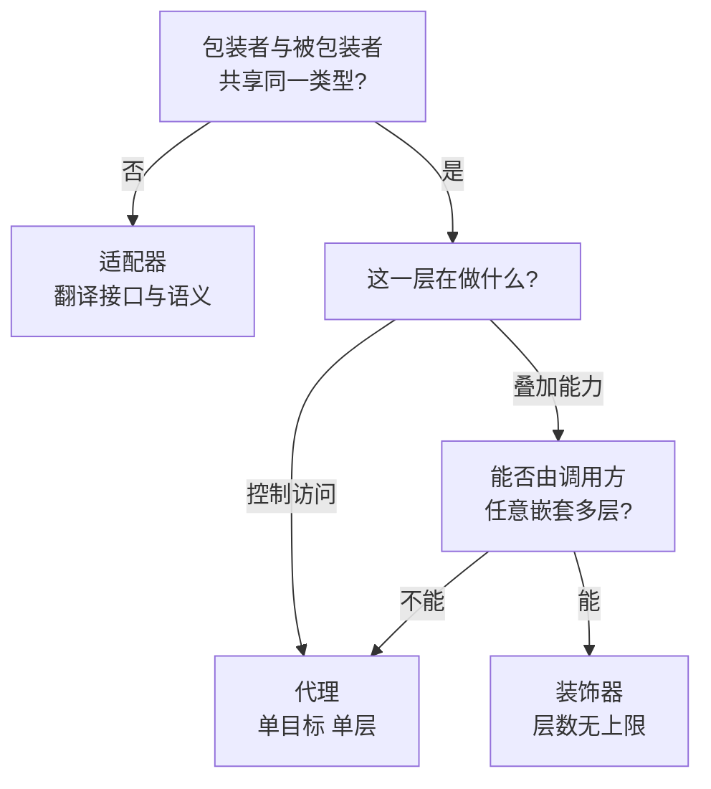
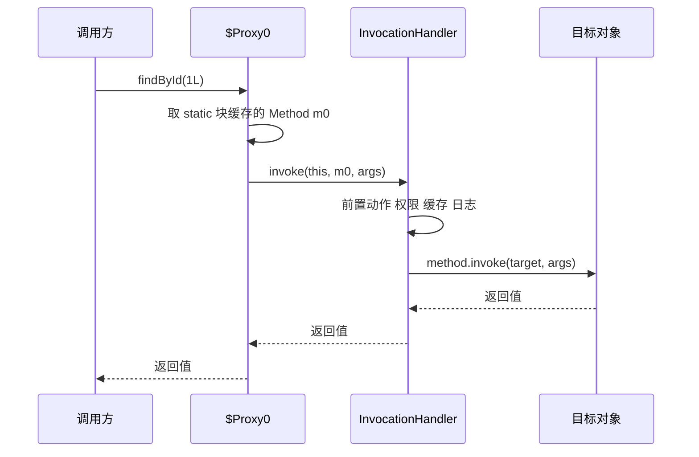
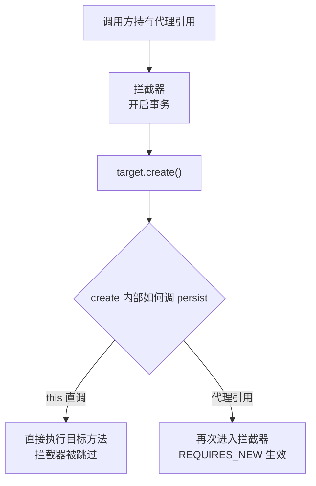
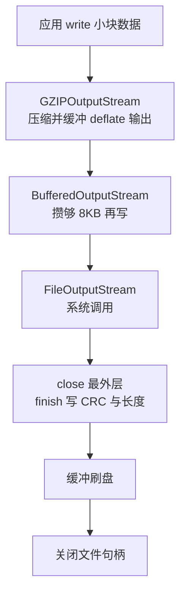
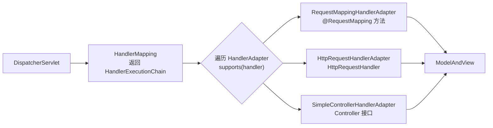

# 结构型模式（上）——代理、适配器与装饰器

**摘要：**

代理、适配器、装饰器是结构型模式里最容易被混为一谈的一组，因为三者在类图上几乎同形：一个类实现某个接口，字段里握着一个对象，方法体里把调用转手出去。本文不从类图切入，而从调用方视角给出一组可以逐层落地的判据：先看包装者与被包装者是否共享同一类型，共享则排除适配器，不共享则一定在翻译接口；再看共享类型的那两个模式里，行为是控制访问还是叠加能力，以及包装层能否由调用方任意嵌套，由此把代理与装饰器分开。判据立住之后，文章沿着 Java 的实现走一遍：静态代理的模板成本、JDK 动态代理的 `InvocationHandler` 与 `$Proxy0` 生成规则、CGLIB 与 ByteBuddy 的继承约束，以及 Spring 为何把 CGLIB 设成默认；随后落到 `this` 自调用这个 AOP 失效的头号原因上。装饰器一节以 `java.io` 流家族、`Collections.unmodifiableList`、`HttpServletRequestWrapper` 为落点，讲清 `close()` 传播、`available()` 语义、`PrintWriter` 吞异常与嵌套顺序四个坑。适配器一节以 `InputStreamReader`、`Arrays.asList`、Spring MVC 的 `HandlerAdapter` 为例，说明接口翻译在框架里如何换来可插拔。最后用反例把三者的误用收束成一张清单。

---

## 第 1 章 同形的三个模式

### 1.1 从一段几乎可以互换的代码说起

1994 年，GoF 的四人组把二十三个模式分成创建型、结构型、行为型三组，结构型占了七个。七个里面最容易被读成一回事的，是代理、适配器与装饰器：翻开任何一份 UML 图，它们都是同一个形状——一个类实现某个接口，类的字段里握着一个对象，方法体里把调用转手出去，转手之前或之后添一点自己的动作。把三个类的名字遮住，只看字段与方法体，编译器分不出差别，IDE 的重构功能也分不出差别。

这种同形不是巧合。三者解决的都是"不能或不想改动那个已有对象"的问题，手法也就收敛到了同一个：**包一层**。真正的分叉发生在包这一层的人想干什么，以及调用方是否知道自己在跟一层包装打交道。

考虑三个类，它们实现同一个业务接口：

```java
// 代理：接口不变，拦住访问
public class SecuredUserService implements UserService {
    private final UserService target;              // 目标和代理共享 UserService
    public User findById(Long id) {
        checkPermission("USER_READ");              // 调用之前先设关卡
        return target.findById(id);
    }
}

// 装饰器：接口不变，叠一层行为，可以再叠
public class TimedUserService implements UserService {
    private final UserService inner;               // 被装饰者同样实现 UserService
    public User findById(Long id) {
        long start = System.nanoTime();
        try { return inner.findById(id); }
        finally { record("findById", System.nanoTime() - start); }
    }
}

// 适配器：接口改变，把另一套类型翻译过来
public class LegacyUserAdapter implements UserRepository {
    private final LegacyUserSystem legacy;         // 被适配者不实现 UserRepository
    public Optional<User> findById(Long id) {
        LegacyRecord r = legacy.queryByCode(String.valueOf(id));
        return r == null ? Optional.empty() : Optional.of(convert(r));
    }
}
```

三个类的声明行一模一样，差别全在字段的类型与调用前后的动作上。这也解释了为什么单靠"结构"无法判别模式：结构只提供了包一层的能力，意图才决定这一层被叫作什么。

### 1.2 判据一：包装者与被包装者是否共享同一类型

代理与装饰器的字段类型，和被包装对象实现的是同一个接口；适配器的字段类型，和被适配对象实现的是另一套接口。这一条差异不在"调用方看到的接口变没变"上（调用方看到的一直是 `UserRepository`），而在**两侧接口是否一致**上。适配器的本质是类型翻译：它对外是目标接口，对内消费被适配者的接口，两侧签名、单位、返回值、异常语义都可能不同——上例里 `Long` 与 `String` 的转换、`null` 与 `Optional` 的转换、`LegacyRecord` 与 `User` 的转换，都是翻译工作的一部分。

这条判据可以直接落到代码审查的动作上：把包装类的字段类型与被包装对象的声明类型并排看。相同，就只可能是代理或装饰器；不同，就一定是适配器。反过来，如果一段代码号称在做"适配"，但被适配者本来就实现了目标接口，那多出来的这一层要么是无意义的转发，要么是代理或装饰器被叫错了名字。

调用方视角的补充在于：代理与装饰器对调用方是完全同构的，调用方拿到的引用类型、能调的方法、看到的签名都没有变化；适配器改变的也不是"调用方依赖的那个类型"，而是"被适配者参与进来的方式"。这也是适配器在遗留系统集成里几乎无往不利的原因——既有的调用点一行不用改，新写的只有一个翻译类。

不过"共享类型"只是第一层筛子。它把适配器分出去之后，剩下的代理与装饰器在结构上仍然无法区分，得靠第二层判据。

### 1.3 判据二：控制访问，还是叠加能力

代理与装饰器都保持接口不变，差别在包装层的职责与它被允许出现的层数。

代理的职责是**控制访问**：能进不能进、要不要先查缓存、要不要先开事务、要不要延后到真正用到时再构造目标。这类动作有一个共同特征——它决定"这次调用是否发生、以什么条件发生"，而不是"这次调用的结果再多一点什么"。代理通常只有一个目标，也只包一层：再包一层权限代理没有意义，因为权限已经在第一层拦住了。

装饰器的职责是**叠加行为**：在原有结果之上再加一点东西，加日志、加计时、加缓冲、加压解缩、加字符集转换。这类动作天然可组合，因此装饰器的设计必须允许任意嵌套，每一层都假定自己上面还可能再套一层、下面也可能还有一层。`BufferedInputStream(new GZIPInputStream(new FileInputStream(path)))` 之所以成立，是因为三层都实现了 `InputStream`，且每层只关心"我这一层加什么"，不关心自己在链上的绝对位置。

把这两层判据画成判定流程，顺序就是先看类型、再看职责：



把两层判据压成一句话：接口变了是适配器；接口没变，看这一层是在"设关卡"还是在"加功能"，设关卡的是代理，加功能且能任意叠的是装饰器。这句话在绝大多数真实代码上都够用，但它仍然留下一个含混地带——有些包装既像设关卡又像加功能，有些装饰器确实只叠了一层。要处理含混地带，还得看第三个维度：谁掌握包装权。

### 1.4 代理与装饰器的真正分界

单看"控制"与"增强"，边界会飘。日志代理是在加功能，缓存代理是在加速，`Collections.unmodifiableList` 是在收窄契约而不是加功能。真正稳的分界有三条，且三条通常同时成立。

第一条是目标的数量与包装层数。代理对着一个目标，语义上就是"这个对象的替身"，替身套替身没有增量；装饰器对着一条链，语义上是"这个对象外面的一层壳"，壳可以有很多层。`java.io` 的流体系把这条推到了极致：`FilterInputStream` 的子类各自只管一件事，任何一层都可以被替换或省略，链的长度由使用方按需决定。

第二条是创建者与调用方的知情程度。代理绝大多数时候**由框架生成**，调用方拿到的引用从容器、工厂或 ORM 里出来，压根不知道手上是一个代理；装饰器绝大多数时候**由调用方显式构造**，`new BufferedInputStream(new FileInputStream(f))` 这行代码本身就是"我知道我在包装"的声明。Spring 的 `@Transactional` 是前者的标本：业务类上什么都没写，事务却生效了，调用方只看到注入进来的那个 `UserService`；而 `Collections.unmodifiableList(list)` 是后者的标本：包装是调用方主动要求的，且调用方清楚自己在拿一个只读视图。

第三条是契约的方向。代理不改变接口契约，它只是决定这次调用是否放行、是否提前返回、是否延后构造；装饰器可以收窄契约，`unmodifiableList` 让 `add` 抛 `UnsupportedOperationException`，`Collections.synchronizedList` 让每个方法多一层锁，`BufferedInputStream` 让 `read` 的阻塞行为发生变化。契约的收窄与增强都发生在接口之内，所以它仍然是装饰器，而不是适配器。

> [!info] 中间地带：工具方法产出的装饰器
> `Collections.synchronizedList`、`Collections.unmodifiableList`、`List.copyOf` 这些静态工厂产出的包装对象，既不是调用方 `new` 出来的，也不需要调用方写子类。它们仍然算装饰器：包装是调用方显式请求的，调用方知道自己在拿一个加了同步或只读语义的视图，而且同一层可以再叠别的包装。判据落在"调用方是否显式选择包装"，而不是"由谁执行 new"。

这个中间地带正好暴露出一条工程上更要紧的推论：强制性的行为不能做成装饰器。权限校验、事务边界、审计留痕这类"绝不能绕过"的动作，只适合放在代理里，由框架在对象创建时透明挂上；一旦把它做成装饰器，就等于把是否执行安全检查的权力交给了调用方——调用方只要少包一层，检查就没了。反过来，缓冲、压缩、计时这类"可以有也可以没有"的动作，做成装饰器最合适，因为它们的组合方式是使用方的自由。这条推论在第 5 章的反例会再出现一次。

### 1.5 判据的用途

判据不是为了给代码贴标签，而是为了在三种场景里做对决定。

第一种是读框架源码。看到 `BeanPostProcessor` 里对 Bean 做 `wrapIfNecessary`，能立刻判断这是代理而不是装饰器，于是知道增强是透明的、不可跳过的；看到 `FilterInputStream` 的子类，能立刻判断这是装饰器，于是知道链的顺序和层数由自己控制。

第二种是设计新的一层。要加权限，先问这层是否必须不可绕过，是则用代理并由容器生成；要加格式转换，先问被转换的两侧是否共享接口，不共享就只能写适配器，共享则用装饰器，且要保证它可被嵌套。

第三种是排错。AOP 没生效，八成是调用没走代理；流读到一半断了，八成是 `available()` 被当成了长度；`Arrays.asList` 抛 `UnsupportedOperationException`，八成是把视图当成了可变集合。三类故障对应三个模式，判据清楚时排错路径也就清楚了。

---

## 第 2 章 代理：三种实现与代价

### 2.1 静态代理：把模板写死在编译期

静态代理是最直白的做法：手写一个类，实现目标接口，每个方法里把"前置动作、委托调用、后置动作、异常处理"这套模板抄一遍。

```java
public class UserServiceLoggingProxy implements UserService {
    private final UserService target;

    public UserServiceLoggingProxy(UserService target) { this.target = target; }

    @Override
    public User findById(Long id) {
        long start = System.nanoTime();
        try {
            return target.findById(id);            // 唯一的实质动作是委托
        } finally {
            log.info("findById cost {} ns", System.nanoTime() - start);
        }
    }

    @Override
    public void save(User user) {
        long start = System.nanoTime();
        try {
            target.save(user);
        } finally {
            log.info("save cost {} ns", System.nanoTime() - start);
        }
    }
}
```

代价随两个变量相乘增长：接口的方法数，与需要叠加的横切关注点数。一个接口十个方法，要日志、要权限、要缓存，手写静态代理就是三十个方法体；接口新增一个方法，三个代理类都得同步；横切逻辑要改格式，改三处。类爆炸只是表象，真正难受的是模板代码与业务代码的变更频率不一致——业务接口一个月改一次，日志格式一年改一次，两者被强行绑在同一个文件里。

不过静态代理并没有被淘汰。它有几个动态代理给不了的好处：编译期就能看到全部转发逻辑，IDE 能跳转，栈追踪干净；能精确声明受检异常，不会像反射那样把异常包一层；不依赖运行时代码生成，在禁止反射或需要 GraalVM 原生镜像预编译的环境里反而省事。接口只有两三个方法、横切点只有一处时，手写一个静态代理比引入一套 AOP 基础设施更划算。

手写时的模板重复可以用一个小技巧压掉一部分：把"取开始时间、try、委托、finally 记耗时"抽成一个接受 `Supplier` 的函数，代理类里每个方法只剩一行。但这样做的代价是把受检异常挡在了 `Supplier` 之外——`Supplier.get()` 不声明受检异常，转发里一旦有 `IOException` 就得包成运行时异常。这正是静态代理"精确表达异常"这一优点被自己放弃的过程，也是很多人从静态代理转向动态代理时没意识到的隐性损失。

### 2.2 JDK 动态代理：一个 handler 接管所有方法

`java.lang.reflect.Proxy` 从 JDK 1.3 起就在标准库里，思路是把"生成代理类"这件事推迟到运行时：调用方给出接口列表与一个 `InvocationHandler`，`Proxy.newProxyInstance` 在运行时生成一个实现了这些接口的类，实例化后返回。

```java
public class LoggingHandler implements InvocationHandler {
    private final Object target;

    public LoggingHandler(Object target) { this.target = target; }

    @Override
    public Object invoke(Object proxy, Method method, Object[] args) throws Throwable {
        long start = System.nanoTime();
        try {
            // 注意第一个参数传 target 而不是 proxy，否则会回到代理自身造成递归
            return method.invoke(target, args);
        } catch (InvocationTargetException e) {
            // 反射调用会把目标异常包一层，必须解包，否则调用方的 catch 失配
            throw e.getCause();
        } finally {
            log.info("{} cost {} ns", method.getName(), System.nanoTime() - start);
        }
    }
}

UserService service = (UserService) Proxy.newProxyInstance(
        UserService.class.getClassLoader(),
        new Class<?>[]{UserService.class},
        new LoggingHandler(new UserServiceImpl()));
```

这段代码里有几个点值得逐个说清，因为它们决定了动态代理在真实项目里好不好用。

`invoke` 的第一个参数是被生成的代理对象本身，不是目标对象。这个参数在普通转发里用不上，但在需要"把代理自身传回去"的场景里是唯一来源，譬如目标方法内部要接收一个与自身同类型的回调。把它当成目标对象传给 `method.invoke`，会得到一次自我递归，栈很快撑爆。

`Method.invoke` 抛出的异常永远不是目标方法声明的那个类型，而是被包在 `InvocationTargetException` 里。handler 不解包，调用方写 `catch (OrderNotFoundException e)` 就永远进不去，只能捕获一个 `UndeclaredThrowableException`——这是排查"异常类型不对"时最常见的成因。

`equals`、`hashCode`、`toString` 也会被路由进 `invoke`。普通转发场景下 `method.invoke(target, args)` 能正确处理这三个方法；但如果做的是延迟加载代理，目标对象此刻还是 `null`，而调用方恰好把代理放进了 `HashSet` 或者打了一行包含代理的日志，`hashCode` 或 `toString` 就会触发空指针。写虚拟代理时必须显式处理这三个方法，这是很容易漏掉的一处。

被生成的代理类的样子，可以通过系统属性让它落盘后反编译看到。JDK 8 及更早用 `-Dsun.misc.ProxyGenerator.saveGeneratedFiles=true`，JDK 9 起改名成 `-Djdk.proxy.ProxyGenerator.saveGeneratedFiles=true`，用旧属性在 17 上不会有任何输出。落盘后看到的类大致是这样：

```java
// JDK 动态生成的代理类，反编译后的大致结构
public final class $Proxy0 extends Proxy implements UserService {
    private static final Method m0;    // findById
    private static final Method m1;    // save

    static {
        m0 = Class.forName("...UserService").getMethod("findById", Long.class);
        m1 = Class.forName("...UserService").getMethod("save", User.class);
    }

    public final User findById(Long id) {
        try {
            return (User) h.invoke(this, m0, new Object[]{id});
        } catch (RuntimeException | Error e) { throw e; }
        catch (Throwable e) { throw new UndeclaredThrowableException(e); }
    }

    public final void save(User user) {
        try { h.invoke(this, m1, new Object[]{user}); }
        catch (RuntimeException | Error e) { throw e; }
        catch (Throwable e) { throw new UndeclaredThrowableException(e); }
    }
}
```

类名规则是从 `$Proxy0` 开始递增，同一个类加载器下按生成的先后编号。JDK 9 引入模块系统之后，这些类被放进动态模块里，名字带上前缀，实际形态是 `jdk.proxy1.$Proxy0` 这样的全名；`Proxy.isProxyClass` 与 `Proxy.getInvocationHandler` 是判断与取回 handler 的官方入口，比用类名做字符串匹配可靠。生成的类被声明为 `final` 且继承 `Proxy`，因此它不能再被继承——这一点也解释了为什么 JDK 动态代理只能代理接口：`Proxy` 这个父类位置被占了，Java 的单继承没有第二个位置留给目标类。

成本要分生成与调用两段看。生成一段的开销主要在定义类与缓存 `Method`，JDK 8 之后这条路被大幅优化，同一个接口列表的代理类还会被缓存复用，首次之后基本可以忽略。调用一段的结构性开销是固定的：每次调用都要组装一个 `Object[]`，基本类型参数要装箱，再走一次 `Method.invoke` 的反射路径。`Method.invoke` 自身的实现也换过几轮：旧版本是"前若干次走本地实现、超过阈值后膨胀成生成的字节码访问器"，JDK 18 通过 JEP 416 把核心反射整体重写到 `MethodHandle` 之上，调用开销进一步下降。差距已经不大，但"每次调用多一次数组分配加一次反射跳转"这个事实没有消失，在每秒数十万次调用的热点路径上，它仍然是可测量的固定成本。用具体倍数去描述两者快慢没有普适意义，因为它随 JDK 版本、参数类型、JIT 状态而变。

调用链可以画成这样：



反射这条路径还有一个与现实代码紧密相关的分支：接口的 `default` 方法同样会被路由进 `invoke`，`method.invoke(target, args)` 对默认方法能正常执行目标类的覆盖实现或接口默认实现，前提是 `target` 确实实现了该接口。Spring AOP 把默认方法当作普通连接点处理，切面照常生效；但如果 handler 自己在转发前做了"只处理抽象方法"的过滤，默认方法就会被悄悄跳过，表现为某个便捷方法上的增强不生效。

一条容易被忽略的限制：接口必须是 `public` 的，否则生成的代理类会被定义在该接口所在的包里，JDK 9 之后跨模块访问未导出包会直接失败，报错信息通常只说找不到类，排查起来要绕一圈。

`Proxy.newProxyInstance` 每次调用都会走一遍"查缓存、没有就生成"的流程，同一个类加载器下、同一组接口生成的代理类会被复用，因此把创建代理放在循环里并不是性能灾难；真正的浪费在于每个请求都创建一个新的 handler 与目标对象，那部分开销与代理机制无关，属于对象生命周期管理的问题。

### 2.3 CGLIB 与 ByteBuddy：用继承换通用性

目标类没有实现任何接口时，JDK 动态代理就无能为力了。CGLIB（Code Generation Library）走另一条路：生成目标类的子类，覆写其中的非 `final` 方法，在覆写方法里插入拦截逻辑。

```java
Enhancer enhancer = new Enhancer();
enhancer.setSuperclass(OrderServiceImpl.class);
enhancer.setCallback((MethodInterceptor) (obj, method, args, proxy) -> {
    long start = System.nanoTime();
    try {
        // 必须用 invokeSuper，用 method.invoke(obj, args) 会回到代理自身造成递归
        return proxy.invokeSuper(obj, args);
    } finally {
        log.info("{} cost {} ns", method.getName(), System.nanoTime() - start);
    }
});
OrderServiceImpl proxy = (OrderServiceImpl) enhancer.create();
```

`MethodProxy.invokeSuper` 之所以不会递归，是因为 CGLIB 在生成子类时同时生成了两张 FastClass 索引表，`invokeSuper` 通过索引直接定位到父类方法，绕开了反射，也绕开了"在代理实例上调用同名方法又进拦截器"的循环。这一点与 JDK 动态代理形成对照：那边每次调用都要过反射，这边是生成好的直接调用，热点路径上的差距主要来自这里。

继承带来的约束是硬的。`final` 类无法被继承，CGLIB 直接失败，Spring 在这种情况下的报错是 `Cannot subclass final class`，信息还算清楚。`final` 方法无法被覆写，于是拦截器不会被调用，增强**静默失效**——这比直接报错危险，因为应用照常启动、事务照常"看起来"开了，只有出问题时才发现没回滚。构造器是另一处常被误解的地方：直接用 `Enhancer.create()` 需要一个可访问的构造器，但 Spring 并不受这个限制，它用 Objenesis 直接分配代理实例、不执行父类构造器，被拦截的方法通过 `MethodProxy.invoke(target, args)` 转到容器建好的目标实例上执行。所以"被代理的类必须有无参构造器"这条在 Spring 场景里并不成立，它是 CGLIB 裸用时的约束。

CGLIB 项目本身在 3.3.0 之后基本停更，Spring 把它的源码收进 `org.springframework.cglib` 自行维护，这也是"Spring 6 仍然用 CGLIB"这句话的实际含义——用的是内联维护的版本，不是 Maven 中央仓库那个。真正活跃的字节码方案是 ByteBuddy，Hibernate 从 5.4 起用它在运行期生成实体代理，Mockito 也用它生成 mock，Spring 的 AOP 仍以 CGLIB 为主，但整个生态的方向是往 ByteBuddy 迁移。

### 2.4 Spring 为什么默认选 CGLIB

三种实现的差异可以并排看：

| 维度 | 静态代理 | JDK 动态代理 | CGLIB / ByteBuddy |
| --- | --- | --- | --- |
| 代理机制 | 手写类实现接口 | 运行时生成实现接口的类 | 运行时生成目标类的子类 |
| 是否要求接口 | 要求 | 必须有接口 | 不要求 |
| final 类 | 不涉及 | 不受影响，只代理接口 | 无法代理 |
| final 方法 | 不涉及 | 不受影响 | 无法拦截，静默失效 |
| 构造器要求 | 无 | 无 | 裸用需要可访问构造器，Spring 用 Objenesis 绕过 |
| 每次调用开销 | 直接调用，最低 | 数组分配 + 装箱 + 反射 | 生成的直接调用，低于反射 |
| 生成开销 | 无 | 有，同类可缓存 | 有，且需要生成子类 |
| 典型使用者 | 小接口、无反射环境 | Spring 早期默认 | Spring Boot 2.0 起默认 |

Spring 早期的策略是"有接口用 JDK 代理，没接口用 CGLIB"，判断依据是目标类是否实现了至少一个接口。这套策略在实际使用中反复出问题：按接口注入时正常，一旦某处按实现类注入，JDK 代理的对象不是实现类的实例，容器直接抛 `BeanNotOfRequiredTypeException`；同一个应用里两种代理共存，排错时要先分辨手上这个 Bean 是哪一种，心智负担不小。

Spring Boot 2.0 起，AOP 自动配置把 `proxyTargetClass` 默认设为 `true`，也就是**一律用 CGLIB**，需要退回 JDK 代理时显式设置 `spring.aop.proxy-target-class=false`。这里要分清两个默认值：`spring.aop.proxy-target-class` 是 Spring Boot 自动配置的属性，默认 `true`；`@EnableAspectJAutoProxy` 注解自己的 `proxyTargetClass` 属性默认仍是 `false`，纯 Spring Framework 项目不经过 Boot 自动配置时，拿到的还是 JDK 代理。把两者混为一谈是常见的误读："Spring 6 起默认 CGLIB"这句话在 Boot 场景成立，在 Framework 场景不成立，具体版本以官方文档为准。

统一用 CGLIB 的代价也很明确：`final` 类与 `final` 方法彻底无法增强，且失败形态不同——`final` 类直接报错，`final` 方法静默跳过。这个不对称在排错时是个陷阱，会在第 5 章展开。

这套默认值对 Kotlin 项目有直接影响。Kotlin 的类与方法默认是 `final`，不显式写 `open` 就无法被继承，于是被 `@Transactional`、`@Cacheable` 标注的 Kotlin 类在 Spring 里会撞上 CGLIB 的继承约束：轻则增强失效，重则启动失败。Spring 官方给出的解法是 `kotlin-spring`（all-open）编译插件——它在编译期给标注了 Spring 注解的类自动加上 `open`，让字节码层面可以继承。这个插件存在本身，就是"默认 CGLIB"这一决策的外部成本：语言默认语义与框架默认策略冲突时，只能在编译期做一次改写。

代理还有一个经常被低估的语义后果：注入到业务代码里的对象，类型可能不是业务类本身。JDK 代理下，`bean.getClass()` 是 `$Proxy0` 一类；CGLIB 代理下是生成的子类。做类型判断、反射读注解、按 `getClass()` 做缓存 key、序列化时写类名，这些操作拿到的都是代理类型而不是原始类型。要拿原始类型得用 `AopUtils.getTargetClass(bean)` 或 `AopProxyUtils.ultimateTargetClass`，要读业务类上的注解得用 `AnnotatedElementUtils` 一类能穿透代理的工具。这类问题不会报错，只会让"注解明明写了却不生效"的困惑换个地方出现。

### 2.5 自调用：AOP 失效的头号原因

代理能生效的前提是调用经过代理引用。一旦代码在目标对象内部用 `this` 调用自己的另一个方法，这次调用就绕开了代理，拦截器不会执行。

```java
@Service
public class OrderService {
    @Transactional
    public void create(Order order) {
        validate(order);
        // 这里用的是 this，不是代理，@Transactional 不会生效
        this.persist(order);
    }

    @Transactional(propagation = Propagation.REQUIRES_NEW)
    public void persist(Order order) {
        repository.save(order);
    }
}
```

`create` 由外部调用，走代理，事务按 `REQUIRED` 开启；`persist` 由 `this` 调用，直接进目标方法体，`REQUIRES_NEW` 完全没被读到，于是本该独立提交的记录跟着外层事务一起回滚。代码看起来毫无破绽，事务注解也写得规规矩矩，问题只在那一处 `this` 上。两条路径的差别，只在于发起调用时手里握的是哪个引用：



根因可以说得更一般一些：拦截点**挂在对象引用上**，不挂在类型上。任何让调用绕过代理引用的写法都会丢增强，`this` 只是最常见的一种，内部类持有外部实例的字段、lambda 捕获的 `this`、`super` 调用、构造器里调用本类方法，全都一样。

修法有几条，取舍各不相同：

| 失效场景 | 表象 | 解法与代价 |
| --- | --- | --- |
| `this.method()` 自调用 | 注解不生效，无任何报错 | 把方法移到另一个 Bean；或在自身注入代理引用 |
| 自注入形成循环依赖 | 启动报循环依赖 | 用 `@Lazy` 注入自身，或用 `ObjectProvider` 延迟取 |
| 需要在不改结构的前提下拿代理 | 需要改调用点 | `@EnableAspectJAutoProxy(exposeProxy = true)` 配 `AopContext.currentProxy()` |
| `private` / `static` / `final` 方法加注解 | 静默不生效 | 改可见性、改设计，或改用 AspectJ 织入 |
| 构造器内部调用 | 启动期不生效 | 把逻辑挪到 `@PostConstruct` 或初始化回调 |
| 不想依赖代理语义 | 需要显式事务边界 | 用 `TransactionTemplate` 编程式事务 |

`AopContext.currentProxy()` 依赖 `ThreadLocal`，只有在 `exposeProxy` 打开时才有值，且跨线程之后取不到；自注入最直观，但要注意 `@Lazy` 与循环依赖的相互作用；把方法拆到另一个 Bean 是最干净的做法，代价是要重新划一次职责边界。至于 AspectJ 的编译期织入与加载期织入，它把增强直接织进字节码，根本不经过代理，自调用自然不存在问题——代价是要引入额外的编译步骤或 JVM agent。

---

## 第 3 章 装饰器：在标准库里长成的样子

### 3.1 同接口是硬约束

装饰器能让调用方"看不出被包过"，靠的是类型不变：装饰器实现与被装饰对象完全相同的接口，调用方在任何位置都只能看到这个接口。一旦装饰器暴露了新方法，它就不再是可替换的包装——调用方要么依赖具体装饰器类型，要么拿到接口后调不到新方法，包装的意义就瓦解了。

最小形态的装饰器只需要三件东西：与被装饰者相同的接口、一个持有被装饰者的字段、每个方法里"做一点自己的事，然后委托"。

```java
public class RetryOnceUserService implements UserService {
    private final UserService inner;

    public RetryOnceUserService(UserService inner) { this.inner = inner; }

    @Override
    public User findById(Long id) {
        try {
            return inner.findById(id);
        } catch (TransientDataAccessException e) {
            return inner.findById(id);        // 只加一次重试，不改变接口也不改变语义层次
        }
    }
}
```

这段代码的意图是"叠加一次重试"，而不是"控制是否允许查询"，所以它落在装饰器一侧。它也确实可以被继续嵌套：外面再套一层计时、再套一层缓存，只要每一层都只依赖 `UserService`。

### 3.2 java.io：装饰器的教科书样本

`java.io` 的流体系是 JDK 里最大规模的一次装饰器实践，也是无数人第一次"被迫理解"装饰器的地方：读一个 gzip 压缩的二进制文件，需要写四层 `new`。

```java
try (DataInputStream in = new DataInputStream(
        new GZIPInputStream(
            new BufferedInputStream(
                new FileInputStream(path))))) {
    int version = in.readInt();
    long timestamp = in.readLong();
}
```

这四层的分工是清晰的：`FileInputStream` 是节点流，负责拿到字节；`BufferedInputStream` 是缓冲装饰器，把小块读合并成大块系统调用；`GZIPInputStream` 是解压装饰器，把压缩字节还原；`DataInputStream` 是类型装饰器，把字节解释成 `int`、`long`。它们共同的父类 `FilterInputStream` 只做一件事——持有一个 `protected InputStream in`，所有方法默认委托给它。这就是装饰器基类该有的样子：不定义行为，只定义"我可以被继续包装"。

层次顺序不是随意的。`DataInputStream` 必须在最外层，因为它消费的是解压后的字节；`GZIPInputStream` 必须在缓冲层之外，因为它需要的是"可顺序读取的字节流"，缓冲层放在里面能让它的块读取真正合并成一次系统调用。写出来的方向也对称：`DataOutputStream` 在外、`GZIPOutputStream` 居中、`BufferedOutputStream` 贴文件。记住一条就够用——缓冲贴着真实的流，压缩与编码往外放。

`Collections.unmodifiableList` 是另一类装饰器：不改变读写行为，而是收窄契约。

```java
List<String> mutable = new ArrayList<>(List.of("a", "b"));
List<String> readOnly = Collections.unmodifiableList(mutable);
mutable.add("c");                 // 底层照常可变
System.out.println(readOnly);     // [a, b, c]，视图跟着变
readOnly.add("d");                // UnsupportedOperationException
```

"不可变"这个词在这里要打折扣：它只是**一个禁止写入的视图**，底层集合还是原来那个。把 `readOnly` 交给别人之后，自己继续往 `mutable` 里加元素，对方看到的内容会跟着变——这类问题在并发场景里尤其隐蔽，读到的列表长度可能在两次遍历之间改变。真正的不可变要 `List.copyOf` 或 `List.of`，它们复制数据并切断与源集合的联系。装饰器保留了对象身份，代价是保留了底层可变性的全部后门。

Servlet 容器里的 `HttpServletRequestWrapper` 是第三个落点，而且是装饰器在框架中被大量继承的一个基类。它实现 `HttpServletRequest`，内部持有原始请求，默认把每个方法转发过去；子类只覆写自己关心的方法即可。

```java
public class CachedBodyRequest extends HttpServletRequestWrapper {
    private final byte[] body;

    public CachedBodyRequest(HttpServletRequest request) throws IOException {
        super(request);
        this.body = request.getInputStream().readAllBytes();   // 只读一次，缓存下来
    }

    @Override
    public ServletInputStream getInputStream() {
        return new ByteArrayServletInputStream(body);          // 每次都给一份新的
    }

    @Override
    public BufferedReader getReader() {
        return new BufferedReader(new InputStreamReader(getInputStream(), StandardCharsets.UTF_8));
    }
}
```

这里有个必须成对覆写的细节：`getInputStream` 与 `getReader` 是同一份数据的两个入口，只覆写其中一个，另一个仍会去读原始流，而原始流已经被读过一次，下游拿到的就是空内容。Spring 的 `ContentCachingRequestWrapper` 做的是同一件事。这条坑之所以频繁出现，是因为原始 API 本身允许两个入口混用，而 Servlet 规范并不保证二者可以反复读取。

字符流的装饰器家族值得单独提一句，因为它的继承结构与字节流并不完全对称。字节流有 `FilterInputStream` 作为统一的装饰器基类，字符流虽然也有 `FilterReader`、`FilterWriter`，但最常用的 `BufferedReader` 与 `BufferedWriter` 是直接继承 `Reader`、`Writer` 的，并不经过 `FilterReader`。这说明装饰器模式并不要求一个统一的抽象基类——只要实现同一接口、持有一个同类型引用、默认委托，就构成装饰器；`FilterInputStream` 只是 JDK 为了复用"持有 `in` 并默认委托"这套样板代码而做的一次工程化收敛。反过来说，如果一个类实现了同一接口、持有了同类型引用，但没有默认委托而是自己重写了全部行为，它仍然是装饰器结构，只是没有复用基类而已。

装饰器在 JDK 与框架中的落点可以并排看：

| 落点 | 装饰对象 | 叠加或收窄了什么 | 需要留意的坑 |
| --- | --- | --- | --- |
| `BufferedInputStream` | 任意 `InputStream` | 缓冲，减少系统调用 | 与内层缓冲重复包装，只增开销 |
| `GZIPInputStream` | 任意 `InputStream` | 解压 | `available` 只返回 0/1；必须读到 -1 |
| `DataInputStream` | 任意 `InputStream` | 基本类型读取 | 大端序固定，跨语言要确认字节序 |
| `Collections.unmodifiableList` | `List` | 禁止写入 | 只是视图，底层仍可变 |
| `HttpServletRequestWrapper` | `HttpServletRequest` | 按需改写请求 | `getInputStream`/`getReader` 要成对 |
| `ShallowEtagHeaderFilter` 的 response wrapper | `HttpServletResponse` | 缓存响应体算 ETag | 大响应会整份进内存 |

### 3.3 close 的传播与 available 的语义

`FilterInputStream.close()` 的实现是 `in.close()`，`BufferedInputStream` 还会先把缓冲丢掉；因此关闭最外层会一路关到最内层。这条设计在绝大多数时候是对的：流的生命周期就是链的生命周期，关外层等于宣告整条链用完。

但它也带来两个后果。第一个是"关外层不关内层"无法直接实现。有时确实需要这个语义，譬如把请求体包装后交给下游组件，下游组件按规范关闭了输入流，而容器还要继续读原始流——这时就需要一个"关闭屏蔽"包装，Commons IO 的 `CloseShieldInputStream` 就是干这个的：它覆写 `close()`，只把自身标记为关闭，不动内层。第二个后果是重复关闭，`try-with-resources` 里同时声明外层与内层，关闭顺序是从后往前，内层随后又被外层关一次。JDK 的多数流对重复 `close` 是幂等的，但第三方流的实现不保证，声明资源时只声明最外层是更稳的写法。

`available()` 是另一个高频误用点。它的契约是"在不阻塞的情况下可以读到的字节数**估计值**"，注意三个词：估计、不阻塞、可以读到。它不是剩余长度，也不是文件大小。`BufferedInputStream.available()` 返回缓冲内剩余字节加内层 `available()`；`GZIPInputStream.available()` 在未到流尾时返回 1，到了流尾返回 0，因为它无法在不实际解压的情况下知道还有多少内容。

于是 `while (in.available() > 0) { in.read(buf); }` 这种写法在读压缩流时会提前结束：解压器内部缓冲还没填满，`available` 就是 0，循环退出，剩下的数据全丢。正确的读法只有一种——读到 `read()` 返回 -1 为止，或者用 JDK 9 引入的 `readAllBytes()`、`transferTo()`，JDK 11 补上的 `readNBytes`。`available()` 的正确用途是"决定要不要在这一次轮询里尝试读取"，用在非阻塞 IO 的分支判断上，用在循环条件上几乎总是错的。

### 3.4 PrintWriter：把异常吞掉的那一层

`PrintWriter` 是装饰器家族里的一个异类：它把 `IOException` 全部吞掉，方法签名上不声明受检异常，出错时只是把内部的 `trouble` 标记置为真，需要调用方主动查 `checkError()`。

```java
// 看起来最自然的写法，磁盘满或连接断开时不会抛出任何异常
try (PrintWriter out = new PrintWriter(new FileWriter(file))) {
    out.println(payload);          // 写失败也不会有异常
}

// 必须在关闭之前检查
try (PrintWriter out = new PrintWriter(new FileWriter(file))) {
    out.println(payload);
    out.flush();
    if (out.checkError()) {
        throw new IOException("write failed: " + file);
    }
}
```

`PrintWriter` 这样设计有它的历史原因：它最初的定位是"给人看的文本输出"，类似 `System.out`，不希望打印日志这件事把业务打断。但把它当成通用写文件的工具，就等于让业务代码失去感知写入失败的能力——磁盘满、磁盘只读、NFS 断连、对端关闭，全部变成**静默失败**。更隐蔽的是 `PrintWriter(OutputStream)` 这个构造器，它内部会再包一层 `BufferedWriter`，即使你把外层的 `flush` 调用了，只要不 `close`，缓冲里的内容仍然可能没落盘。

要在"用起来方便"和"错了能知道"之间取一个平衡，写文件时更稳的选择是 `BufferedWriter` 或直接用 `Files.writeString`、`Files.newBufferedWriter`，它们都会抛出 `IOException`。

### 3.5 嵌套顺序：flush 与 close 打在谁身上

装饰器链的语义由顺序决定，这一点在 gzip 上表现得最尖锐。写一个 gzip 文件，最常见的错误是顺序反了，或者只 `flush` 不 `close`。

`GZIPOutputStream` 在关闭时才会调用 `finish()`，把 deflate 的剩余数据与尾部 8 字节（CRC32 与原始长度 ISIZE）写出去。只 `flush()` 不 `close()`，得到的文件缺尾部，`gunzip` 会报 "unexpected end of file"，JDK 侧读到流尾会抛 `EOFException: Unexpected end of ZLIB input stream`。

顺序上，压缩后的字节应该先进缓冲再落盘，所以缓冲层放在压缩层里面：

```java
// 正确：压缩后的字节经过缓冲，写盘次数被合并
try (OutputStream out = new GZIPOutputStream(
        new BufferedOutputStream(
            new FileOutputStream(path)))) {
    out.write(payload);
}   // close 最外层 → finish 写出 gzip 尾部 → 缓冲刷盘 → 文件句柄释放
```

如果反过来写成 `new BufferedOutputStream(new GZIPOutputStream(new FileOutputStream(path)))`，也能跑通，但 `GZIPOutputStream` 的输出直接怼到文件流上，压缩器每产生一小段就触发一次写系统调用，缓冲的收益基本没了。更糟的是在这种顺序下，如果调用方只 `flush` 最外层的 `BufferedOutputStream`，数据只是从缓冲推进到 gzip 层，gzip 层的 deflater 缓冲与尾部仍然没写出，下游读到的依然是不完整内容。写路径的层次与收尾顺序可以画成这样：



把这条规则抽象出来：**关闭动作打在最外层**，因为只有最外层知道整条链"还有哪些层没收到收尾信号"；而收尾信号的内容（gzip 尾部、字符编码器残留的半字节）由各层自己决定。理解这一点之后，`try-with-resources` 只声明最外层就成了自然选择，而不是风格偏好。

---

## 第 4 章 适配器：接口翻译的落点

### 4.1 翻译，而不是叠加

适配器的判据在第 1 章已经给出：被包装对象的接口与包装者暴露的接口不同。实现上有两种写法，一种是持有引用（**对象适配器**），一种是继承被适配者（**类适配器**）。

```java
// 对象适配器：持有引用，Java 里的默认选择
public class LegacyUserAdapter implements UserRepository {
    private final LegacyUserSystem legacy;
    public Optional<User> findById(Long id) {
        return Optional.ofNullable(legacy.queryByCode(String.valueOf(id)))
                       .map(this::convert);
    }
}

// 类适配器：继承被适配者，同时实现目标接口
public class LegacyUserClassAdapter extends LegacyUserSystem implements UserRepository {
    @Override
    public Optional<User> findById(Long id) {
        return Optional.ofNullable(queryByCode(String.valueOf(id))).map(this::convert);
    }
}
```

类适配器在 Java 里退居次席有三个原因，都与语言特性有关。单继承占位是第一个：继承被适配者之后，适配器不能再继承任何模板类。封装泄漏是第二个：被适配者的全部 `public` 方法都成了适配器的公开 API，调用方可以绕过翻译逻辑直接调 `queryByCode`，两个世界的语义混在同一个对象上。灵活性是第三个：对象适配器可以在运行时换一个被适配者实例，也可以适配子类；类适配器把被适配者的具体类型焊死在编译期。

有一种场景下类适配器确实更顺手：被适配者的方法全是 `protected`，只能被子类访问。此时对象适配器拿不到这些方法，只能用继承。这类情况在遗留系统里不算罕见，但它是妥协而不是首选。

### 4.2 JDK 里的适配器

`InputStreamReader` 是最经典的适配器：把字节流适配成字符流。

```java
Reader reader = new InputStreamReader(
        new FileInputStream(path), StandardCharsets.UTF_8);
```

两个类型体系本来是不兼容的——`InputStream` 以字节为单位、`Reader` 以字符为单位，`Reader` 甚至不是 `InputStream` 的子类型，无法靠继承复用，只能靠包装。`InputStreamReader` 内部持有一个 `InputStream`，用 `CharsetDecoder` 把字节序列解码成字符序列，同时处理多字节字符被读边界切断的情况：一次读到的字节可能只构成半个汉字，解码器要把它留在内部缓冲里等下一批字节。这种"翻译里带着状态"的细节，正是适配器不能简单写成一行类型转换的原因。

一种流传很广的说法是 `InputStreamReader` "同时体现了适配器与装饰器"，这个说法不准确。装饰器的前提是共享接口，而 `InputStreamReader` 的类型与被适配者完全不同，调用方拿到的 `Reader` 与内部的 `InputStream` 是两套 API——它只承担适配职责。`java.io` 里真正的装饰器是 `FilterInputStream` 那一族，两者在同一套包里，很容易看混。

编码是适配过程的一部分，也是最容易出问题的地方。`new InputStreamReader(in)` 不带字符集时会用平台默认字符集，在 JDK 18 之前，这个默认值跟操作系统与启动参数有关：Windows 中文环境下是 GBK，Linux 下常见 UTF-8，同一份代码在两台机器上读出不同结果。JDK 18 通过 JEP 400 把默认字符集统一成 UTF-8，这个坑被填掉了一大半，但显式传入 `StandardCharsets.UTF_8` 仍然是唯一正确的做法——依赖默认值意味着代码行为受运行环境影响，而适配器的职责恰恰是把这种环境差异收进一处。

`Arrays.asList` 是另一类适配器：把数组适配成 `List` 接口。

```java
List<String> list = Arrays.asList("a", "b");
list.set(0, "z");        // 可以，透写到原数组
list.add("c");           // UnsupportedOperationException
```

返回的是 `java.util.Arrays$ArrayList` 这个内部类，一个固定长度的视图，底层直接是传入的数组。`set` 会写回数组，`add`、`remove` 会抛异常，因为数组长度不可变。还有一处更隐蔽的：`Arrays.asList(new int[]{1, 2})` 得到的是 `List<int[]>`，长度 1，因为基本类型数组不会被展开成变长参数；要得到 `List<Integer>` 必须传包装类型数组。这类陷阱的根源在于适配器只翻译接口，不改变数据模型——数组的定长特性被原样带进了 `List` 的语义里。

| 落点 | 被适配者 | 适配为 | 需要留意 |
| --- | --- | --- | --- |
| `InputStreamReader` | 字节流 `InputStream` | 字符流 `Reader` | 必须显式指定字符集 |
| `OutputStreamWriter` | 字节流 `OutputStream` | 字符流 `Writer` | 不 `flush` 会丢尾部半个字符 |
| `Arrays.asList` | 数组 `T[]` | `List<T>` 固定长度视图 | `add`/`remove` 抛异常，`set` 透写 |
| `Collections.list` | `Enumeration` | `ArrayList` | 一次性复制，之后与源无关 |
| `Collections.enumeration` | `Collection` | `Enumeration` | 反向适配，为兼容老 API |
| `Channels.newReader` | `ReadableByteChannel` | `Reader` | 通道不可重复读，适配后只读一次 |

### 4.3 Spring MVC 的 HandlerAdapter

适配器在框架里最大的价值，是让"分发"这件事与"被分发的对象是什么类型"解耦。Spring MVC 是这个设计最完整的样本。

`DispatcherServlet` 拿到请求后，先问 `HandlerMapping` 要 handler，拿回来的是一个 `HandlerExecutionChain`；其中 handler 的类型并不固定，可能是 `@Controller` 里的一个 `HandlerMethod`、一个实现了 `Controller` 接口的对象、一个 `HttpRequestHandler`，甚至是一个 `Servlet`。如果 `DispatcherServlet` 自己写 `instanceof` 分支去调用，每新增一种 handler 类型都要改分发器本身，分发器就会持续膨胀。

Spring 的解法是引入 `HandlerAdapter`：分发器不关心 handler 是什么，只把它交给适配器，由适配器判断"我能不能处理这个 handler"，能则执行并返回 `ModelAndView`。

```java
// DispatcherServlet 的核心逻辑（简化）
protected HandlerAdapter getHandlerAdapter(Object handler) {
    for (HandlerAdapter adapter : this.handlerAdapters) {
        if (adapter.supports(handler)) {       // 每种适配器自己判断是否支持
            return adapter;
        }
    }
    throw new ServletException("No adapter for handler " + handler);
}
```

对应的三个实现各有分工：`RequestMappingHandlerAdapter` 处理 `@RequestMapping` 标注的方法，内部还要再做一层参数解析与返回值处理；`HttpRequestHandlerAdapter` 处理 `HttpRequestHandler`；`SimpleControllerHandlerAdapter` 处理实现了 `Controller` 接口的老式控制器。新增一种 handler 类型时，只要再写一个 `HandlerAdapter` 注册进容器，分发器一行都不用改。一次请求在分发阶段经过的形状如下：



这个设计的取舍值得说透。适配器带来了**可插拔**：handler 的类型与分发器的实现彻底解耦，Spring MVC 才能在二十年里吸纳各种编程模型而不改核心。它也带来了间接性：一次请求要经过"找 handler、找适配器、适配器内部再找参数解析器"三次查找，出错时的调用栈比直接调用深得多，`No adapter for handler` 这类异常的现场信息也很少——它只告诉你没有适配器，不告诉你为什么没有。框架维护者换来的扩展性，最终由每个排错的人分摊一点理解成本，这是结构型模式在框架层的常态。

还有一个容易被忽视的适配器：`HandlerMethodArgumentResolver`。它把"HTTP 请求里的原始数据"适配成"控制器方法的参数"，看似是参数绑定，实质是同一类翻译工作，且同样是可插拔的——写一个自定义注解加一个 resolver，就能让任意类型的参数从请求里长出来。

### 4.4 适配器的边界

适配器**只做翻译**，不该承载业务。这条听起来像废话，但在遗留系统改造里经常被突破：一开始只是把 `queryByCode` 翻译成 `findById`，后来发现两边状态字段不一致，于是在适配器里加一段状态映射；再后来发现字段含义也不一样，又加一段推断逻辑。半年之后，适配器里长出了一套与领域层平行的业务规则，两套规则开始漂移，谁也不知道哪个才是对的。判据很简单：适配器里的每个方法应该能在几行内写清"入参怎么转、出参怎么转"，一旦出现分支判断与业务规则，就该把规则上移到领域层，让适配器只做形状转换。

适配器还要注意方向。单向适配（旧接口 → 新接口）是常态；双向适配（同时实现两套接口）在迁移过渡期很有用，可以让新旧调用方同时工作，代价是对象上并存两套语义，任何一处改动都要同时满足两边的契约。过渡期结束就该把双向适配器拆掉，它不该成为长期结构。

还有一对容易混淆的是适配器与门面。两者都改变调用方看到的接口，但动机与数量关系不同：适配器是为了让"已有的两个不兼容接口"协作，通常是一对一的翻译，被适配者是既成事实、不可修改；门面是为了给"一组子系统"提供一个简化入口，通常是一对多的汇总，被汇总的那些类本来就能单独使用。判据落在被包装对象的数量与调用方的处境上——调用方面对的是一个不听话的现有类，是适配器；面对的是一堆能单独用但组合起来太麻烦的类，是门面。混用的典型症状是把门面写成适配器之后，门面里开始出现针对单一被适配者的分支判断，说明它其实只想翻译一个东西。

---

## 第 5 章 反例与误用

### 5.1 用 CGLIB 代理 final 类

```java
public final class RateLimiter {          // final 类
    public boolean tryAcquire() { ... }
}

@Aspect
@Component
public class RateLimitAspect {
    @Around("execution(* com.example.RateLimiter.*(..))")
    public Object around(ProceedingJoinPoint pjp) throws Throwable { ... }
}
```

启动时容器创建代理失败，报 `Cannot subclass final class com.example.RateLimiter`。这条报错信息指向明确，改法也只有两个：去掉 `final`，或者让 `RateLimiter` 实现一个接口、把切点移到接口方法上。

真正危险的是 `final` 方法。类不是 `final`、方法被声明成 `final` 时，CGLIB 能生成子类，但覆写不了那个方法，于是切面静默失效：容器正常启动，日志里没有任何提示，`@Transactional`、`@Cacheable` 全都像没写一样。排查这类问题只能靠对比——同一个类里非 `final` 方法生效、`final` 方法不生效，基本就可以定位。给方法加切面之前先看一眼有没有 `final`，比事后排查省事得多。

### 5.2 自调用导致事务失效

第 2 章已经把机制讲完，这里补一个更隐蔽的变体：把自调用藏进 lambda。

```java
@Transactional
public void batchCreate(List<Order> orders) {
    orders.forEach(this::create);       // 方法引用捕获的仍是 this
}
```

方法引用在字节码层面就是 `this` 的一次调用，代理同样被绕过。类似的写法还有 `stream().map(o -> this.persist(o))`、内部类里直接调用外部实例方法。判断标准只有一条：这段代码里发起调用的那个引用，是不是容器注入进来的代理。不是，就没有增强。

定位手段有两个。其一，调试时看 `AopUtils.isAopProxy(bean)` 与 `AopUtils.isCglibProxy(bean)`，确认手上是不是代理；其二，在切面里打一行日志，看自调用那条路径有没有进切面。前者判断对象身份，后者判断调用路径，两个一起用基本能定位所有自调用问题。

### 5.3 装饰器嵌套顺序与 flush

第 3 章讲过的 gzip 顺序问题，在真实项目里的表现往往不是"文件损坏"，而是"偶发文件损坏"：小数据量时缓冲没被填满，一次 `close` 就把所有数据连尾部一起写出，测试全部通过；生产上数据量变大，某次只 `flush` 没 `close`，或者异常路径提前退出、`close` 没执行，文件就成了半截。测试环境与生产环境的差别只在数据量上，这类缺陷因此极难在测试阶段暴露。

`try-with-resources` 能消除大部分风险，但它要求资源声明在 try 的括号里。如果流是在别处创建、作为参数传进来的，关闭责任就落在调用方身上，这时需要在文档或方法名里写清楚"本方法不关闭传入的流"，否则两个调用方都以为对方会关。

### 5.4 把代理写成装饰器

最典型的误用是把安全校验做成可选的包装层：

```java
// 反例：调用方可以不包这一层
UserService service = new SecuredUserService(new UserServiceImpl());
// 只要写成下面这行，校验就没了，且没有任何编译或运行期提示
UserService unsafe = new UserServiceImpl();
```

权限校验、事务边界、审计这类行为必须强制生效，就只能放在代理里，由**容器统一挂上**，调用方无法选择跳过。把它们做成装饰器，等于把"是否执行安全检查"这个决定交给每一个调用方，而调用方在赶进度时一定会选择更短的那条路径。反过来，把缓冲、压缩、计时做成容器强制挂载的代理，则会剥夺使用方按需组合的自由——不该缓冲的流被强行缓冲，性能反而下降。

### 5.5 把适配器写成第二套领域层

遗留系统改造中，适配器承担的状态映射与字段推断会逐渐长成业务逻辑。判据是适配器方法的长度与分支数：超过十来行、出现按业务状态分支的 `if`，就该把规则上移。另一个信号是测试：适配器如果开始需要写业务场景的单元测试，说明它已经不是纯粹的翻译层。

| 反例 | 表现 | 根因 | 处置 |
| --- | --- | --- | --- |
| CGLIB 代理 `final` 类 | 启动报 `Cannot subclass final class` | 继承路径被语言禁止 | 去 `final` 或改为接口代理 |
| CGLIB 代理 `final` 方法 | 增强静默失效，无报错 | 方法不可覆写 | 去 `final`，或改用 AspectJ 织入 |
| `this` 自调用 | 注解不生效 | 拦截点挂在代理引用上 | 拆 Bean、自注入、`AopContext` |
| gzip 只 `flush` 不 `close` | 偶发文件损坏 | 尾部 CRC 只在 `close` 时写出 | `try-with-resources` 关最外层 |
| `available()` 当长度 | 读取提前结束、数据缺失 | `available` 只是估计值 | 读到 -1 或用 `readAllBytes` |
| `PrintWriter` 吞异常 | 写入静默失败 | 设计上不抛 `IOException` | 用 `BufferedWriter` 或查 `checkError` |
| `Arrays.asList` 当可变集合 | `add` 抛 `UnsupportedOperationException` | 返回定长视图 | 用 `new ArrayList<>(...)` 复制 |
| 安全校验做成装饰器 | 调用方可绕过 | 强制行为放在了可选层 | 改为容器代理 |

---

## 第 6 章 结语

三个模式的结构同形，差异全在意图与调用方视角：适配器回答"两个不兼容的接口如何协作"，代理回答"这次访问是否应该发生"，装饰器回答"这次调用的结果能否再多一点"。一句话判据是接口变没变——变了是适配器，没变则再看这一层是在设关卡还是在加功能，能不能任意嵌套。判据之外还得看谁掌握包装权：强制性的行为只能由框架以代理方式透明挂上，可组合的行为才适合交给调用方用装饰器自由叠加。

Java 把这三件事都做成了语言级的基础设施，代价也一并继承了下来。JDK 动态代理用接口换通用性，`$Proxy0` 每次调用都要组装参数数组并走一次反射；CGLIB 用继承换通用性，`final` 类直接失败、`final` 方法静默失效；Spring Boot 2.0 起默认全用 CGLIB，是为了消除"按接口注入与按实现类注入行为不一致"这类反复出现的坑，代价是把 `final` 的约束变成了框架的默认约束。这些都不是免费的，只是代价被挪到了不同的位置。

理解这一组模式的实际收益，往往不在写新代码时，而在排错时：AOP 不生效先怀疑自调用，流读不完整先怀疑 `available`，集合抛 `UnsupportedOperationException` 先怀疑视图，这三个反射弧建立起来之后，大部分"玄学问题"都会退化成一次定向检查。

## 延伸阅读

- [[05 结构型模式（下）——外观、桥接、组合与享元]]
- [[09 设计模式在Spring中的应用全景]]
- [[10 设计模式在JDK源码中的应用全景]]

---

## 参考资料

1. Erich Gamma, Richard Helm, Ralph Johnson, John Vlissides. *Design Patterns: Elements of Reusable Object-Oriented Software*. Addison-Wesley, 1994.
2. Spring Framework Reference Documentation, *Aspect Oriented Programming with Spring*：<https://docs.spring.io/spring-framework/reference/core/aop.html>
3. Spring Framework Javadoc, `org.springframework.context.annotation.EnableAspectJAutoProxy`（`proxyTargetClass` 默认值说明）：<https://docs.spring.io/spring-framework/docs/current/javadoc-api/org/springframework/context/annotation/EnableAspectJAutoProxy.html>
4. Spring Boot Javadoc, `org.springframework.boot.autoconfigure.aop.AopAutoConfiguration`（`spring.aop.proxy-target-class` 默认 `true`）：<https://docs.spring.io/spring-boot/api/java/org/springframework/boot/autoconfigure/aop/AopAutoConfiguration.html>
5. Java SE 17 API Documentation, `java.lang.reflect.Proxy`、`java.lang.reflect.InvocationHandler`：<https://docs.oracle.com/en/java/javase/17/docs/api/java.base/java/lang/reflect/Proxy.html>
6. Java SE 17 API Documentation, `java.io.FilterInputStream`（装饰器基类）：<https://docs.oracle.com/en/java/javase/17/docs/api/java.base/java/io/FilterInputStream.html>
7. Java SE 17 API Documentation, `java.io.PrintWriter`、`java.io.IOException` 相关语义：<https://docs.oracle.com/en/java/javase/17/docs/api/java.base/java/io/PrintWriter.html>
8. JEP 400: UTF-8 by Default：<https://openjdk.org/jeps/400>
9. Spring Framework Javadoc, `org.springframework.web.servlet.HandlerAdapter`：<https://docs.spring.io/spring-framework/docs/current/javadoc-api/org/springframework/web/servlet/HandlerAdapter.html>

---

> [!note] 思考题
> 1. 一个包装类既实现了目标接口、又对调用方隐藏了自己的存在，你会用哪三个问题把它归类为代理或装饰器？如果它同时具备"拦截"与"叠加"两种动作，判据该如何加权？
> 2. JDK 动态代理生成的类为什么必须是 `final`，并且必须继承 `Proxy`？如果允许它继承目标类，会与 Java 的哪条语言规则冲突？
> 3. `Collections.unmodifiableList` 只提供只读视图，底层集合仍可变。要构造一个真正不可变的列表，除了 `List.copyOf`，还有哪些做法，各自的复制成本如何？
> 4. CGLIB 对 `final` 类直接报错、对 `final` 方法静默跳过。这种不对称在排查线上"事务没生效"时会造成什么误导，如何用最少的步骤确认根因？
> 5. 如果把 `@Transactional` 的实现从代理换成 AspectJ 编译期织入，自调用问题会消失，但会引入哪些新的工程成本？在什么样的项目规模下这种交换才划算？
> 6. `HandlerAdapter` 让分发器与 handler 类型解耦，代价是多一次查找与更深的调用栈。如果一个系统只有一种 handler 类型，引入适配器的收益是否还成立？