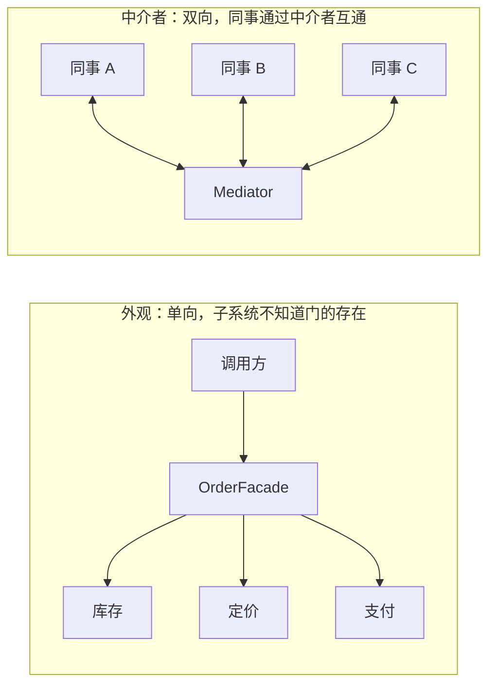
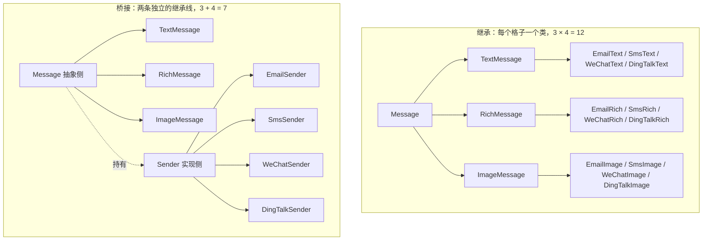
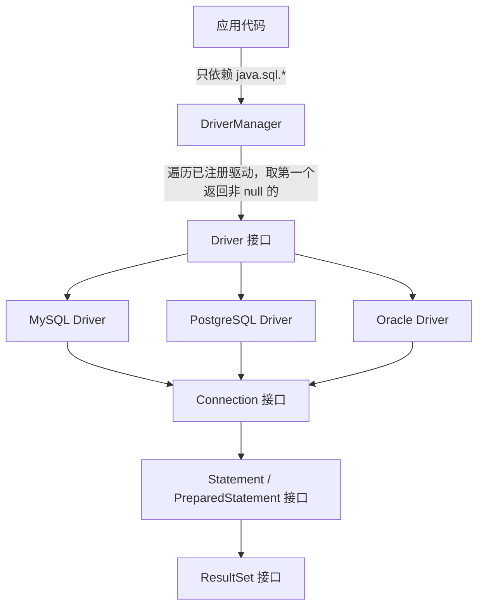
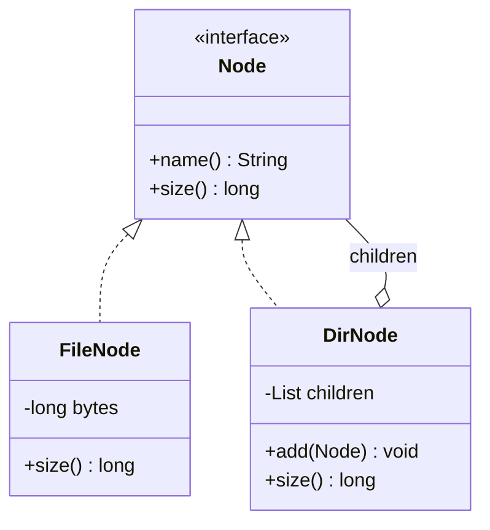
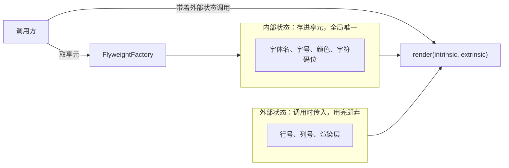

# 结构型模式（下）——外观、桥接、组合与享元

**摘要：**

外观、桥接、组合、享元是结构型模式的后半段，也是四个最容易被跳过、又最容易被误用的模式。它们都不改变对象的职责，只改变对象之间的连接方式，于是判据全部落在"连接"这一个词上。外观把一次多步调用的顺序与失败处理收进一个门里，交付的是单向依赖；桥接处理两个各自独立变化的维度，用 m + n 个类换掉 m × n 个类，判据是能否指出这两个维度，而不是能否画出两个继承层次；组合让叶子与容器被统一对待，前提是复合语义对每一个操作都成立，`java.io.File` 恰好证明了这条前提不成立时会发生什么；享元共享不可变的内部状态，把账算给"存活对象的堆占用"而不是算给"对象数量"，代价是对象身份泄漏成可观测的语言语义。全篇以"不这样写会退化成什么样"为主线，每个模式都给判据、反例与 Java 里的真实落点，最后把四个模式并进一张表，标出各自"不该用"的信号。

---

## 第 1 章 外观：把调用顺序收进一个门里

### 1.1 被隐藏的不是接口，是顺序

GoF 在 1994 年给外观（Facade）写的意图只有一句话：为子系统中的一组接口提供一个一致的界面，让子系统更容易使用。这句话的重心落在"一致的界面"上，读起来像接口合并的技术细节，于是外观成了二十三种模式里最没有存在感的一个——它太简单，简单到很多人一边在用一边不承认自己在用。

但这句话漏掉了外观真正的交付物。外观固化下来的不是接口，而是**顺序**。

一次完整的下单包含校验库存、计算价格、核销优惠券、扣减库存、发起支付、落库、发通知、累积积分这七八个步骤，它们之间存在一个偏序关系：扣减库存必须在校验之后，落库必须在支付之后，通知必须在落库之后。这个偏序不属于任何一个子系统，它只属于"下单"这个业务场景。当它没有被显式建模时，它就以控制器的行序、if 的嵌套、try-catch 的位置这三种形态散落在调用方，而这三样东西都是隐式的，无法被检索，无法被单测，也无法被复用。

反事实很容易构造。假设下单流程有三个调用点——普通下单接口、批量下单任务、运营后台补单工具。只要顺序变更一次（譬如支付前要加一道风控），三个调用点都要改；如果三处的行序当初就抄得不一样，那么改完之后它们的行为也不一样，而这三条路径都不会报错。外观把这份偏序收进一个方法，修改点从三处变成一处，更重要的是它让"顺序"从行序变成了可以被阅读、被测试、被讨论的代码。

由此得到一个比教科书更实用的判据：外观的价值不取决于子系统的数量，而取决于调用方是否被迫知道不属于它的问题。一个子系统也能构成外观——如果它需要三次按特定顺序调用、需要处理中间失败、需要保证幂等，那么把这三次调用包进一个方法就已经是外观，不需要凑够五个类。

```java
// 外观承担三件事：顺序、短路、失败处理；控制器只剩协议转换
@Service
public class OrderFacade {

    private final InventoryService inventory;
    private final PricingService pricing;
    private final CouponService coupon;
    private final PaymentGateway payment;
    private final OrderRepository orders;
    private final Notifier notifier;

    public OrderFacade(InventoryService inventory, PricingService pricing, CouponService coupon,
                       PaymentGateway payment, OrderRepository orders, Notifier notifier) {
        this.inventory = inventory;
        this.pricing = pricing;
        this.coupon = coupon;
        this.payment = payment;
        this.orders = orders;
        this.notifier = notifier;
    }

    // 事务边界落在外观上：它掌握了全部步骤，也只有它知道补偿的起点
    @Transactional
    public Order place(CreateOrderCommand cmd) {
        inventory.reserve(cmd.productId(), cmd.quantity());        // 先占位，失败即短路
        BigDecimal price = pricing.quote(cmd.productId(), cmd.quantity());
        if (cmd.couponCode() != null) {
            price = coupon.redeem(cmd.couponCode(), cmd.userId(), price);
        }
        PaymentResult result = payment.charge(cmd.userId(), price); // 失败由事务回滚库存
        Order order = orders.save(Order.of(cmd, price, result));
        notifier.orderPlaced(order);                                // 落库之后才通知
        return order;
    }
}
```

注意这段代码里真正的知识不在任何一行语句上，而在语句的排列里：`reserve` 在 `charge` 之前，`notifier` 在 `save` 之后。外观把这个排列一次性固化，并且让它在整个应用里只有一份。

### 1.2 门不是墙

外观与封装经常被混为一谈，这个混淆会带来一个错误的期待：以为引入外观之后调用方就再也碰不到子系统了。事实并非如此。外观只是提供了一扇更好走的门，它并不封死其他入口，调用方依然可以直接注入 `PaymentGateway` 绕过外观。

这是设计意图，不是缺陷。外观要解决的是"常见路径太麻烦"，不是"禁止非常规路径"。真正需要强制边界时，靠工具而不是靠模式：把子系统实现类放进不对外导出的包（JPMS 的 `exports` 只导出 API 包），用分层架构的依赖检查（ArchUnit 一类的规则）拦住跨层调用，或者干脆把子系统拆成独立模块。模式负责**可读性**，边界负责**正确性**，两者不能互相替代。

外观还有两处容易走坏的细节。

其一是接口泄漏。如果外观方法的签名直接接收子系统的 DTO，外观就退化成了透传层：

```java
// 透传门面：参数是子系统的类型，调用方仍然要知道子系统的数据形状
public Order place(InventoryRequest inv, PricingRequest pr, CouponRequest cr) { ... }

// 收口门面：参数是业务场景自己的命令对象，子系统类型不出现在签名上
public Order place(CreateOrderCommand cmd) { ... }
```

判断标准很直接：把子系统替换成另一套实现时，外观的签名要不要改。要改，说明外观没有隔离住变化，它只是把调用搬了个位置。

其二是职责膨胀。外观最自然的切分依据是"一个完整的业务场景"，而不是"一个技术层次"。把所有数据库操作塞进一个 `PersistenceFacade`、把所有远程调用塞进一个 `RemoteFacade`，得到的是按技术横切的门面，它会被所有业务场景使用，于是所有业务场景的变更都会落到它身上。按业务纵切（下单、退款、对账各一个门面）才能保证变更局限在场景内部。

### 1.3 外观与中介者的分界

外观最常被拿来和中介者（Mediator）比较，因为两者的形状都是"中间多了一个类"。区分它们不能看类图，要看依赖的方向。

外观是**单向**的：调用方依赖外观，外观依赖子系统，子系统完全不知道外观存在。中介者是**双向**的：同事对象依赖中介者，中介者也依赖同事对象，通信从"同事之间网状互引"改成"同事与中介者之间的星形"。



用这张图能读出一组可以直接检验的判据。

| 判据 | 外观 | 中介者 |
| --- | --- | --- |
| 依赖方向 | 调用方 → 外观 → 子系统，单向 | 同事 ↔ 中介者，双向 |
| 谁知道谁 | 外观知道子系统，子系统不知道外观 | 中介者知道全部同事，同事知道中介者 |
| 是否改变通信拓扑 | 不改变，子系统之间原本怎么交互还是怎么交互 | 改变，同事之间不再直接持有引用 |
| 变更影响面 | 改外观不影响子系统接口 | 改中介者常要求同事配合调整交互协议 |
| 失效信号 | 外观开始需要子系统反向回调它 | 同事仍然互相持有引用，中介者只是多了个转发方法 |

表格的最后一行是最实用的诊断项。外观一旦需要反向通知（子系统完成后回调外观、外观持有子系统的处理状态），它就已经在向中介者漂移了，因为双向通信出现了。这时要做的判断不是"要不要继续用外观"，而是"这个业务场景的交互规则是否复杂到需要一个专门的协调者"。协调者的设计、它与事件总线的取舍，留给 [[08 行为型模式（下）——状态、中介者、备忘录与访问者]] 展开，这里只留一条边界：外观协调的是"调用方与子系统"的边界，中介者协调的是"同事之间"的拓扑。

---

## 第 2 章 桥接：两个维度的乘法

### 2.1 先把算术做对

桥接（Bridge）是 GoF 里少数可以用一道算术题讲清的模式。抽象维度有 m 个取值，实现维度有 n 个取值，用继承表达全部组合需要 **m × n** 个类；把两个维度各自做成一个继承层次、再用组合把它们连起来，需要 **m + n** 个类。

| 场景 | 继承方案的类数 | 桥接方案的类数 | 新增一个取值的改动 |
| --- | --- | --- | --- |
| 3 种消息 × 4 种渠道 | 12 | 7（3 + 4） | 继承方案改 3 或 4 个类，桥接改 1 个 |
| 5 种窗口 × 3 种平台 | 15 | 8 | 同上 |
| 10 种报表 × 10 种导出格式 | 100 | 20 | 同上 |
| 三维：5 种单据 × 4 种渠道 × 3 种格式 | 60 | 12 | 继承方案改 12 个，桥接改 1 个 |



算术本身没有问题，问题在于它只回答了"桥接能省多少类"，没有回答"什么时候该架桥"。事实上，m × n 这个数字经常是个假警报。假设十种报表导出到十种格式，但每种格式的处理逻辑完全一样，只是构造参数不同，那么一个 `ReportExporter(format)` 加一个格式枚举就够了，一个类顶一百个，连桥接都不需要。乘法爆炸真正成立的附加前提是：每一个"抽象 × 实现"的格子里都有独立的行为，而不是独立的数据。

这就把判据从"维度有几个"推进到了"格子里有什么"。

| 方案 | 类数 | 扩展一个实现的成本 | 类型安全 | 适用前提 |
| --- | --- | --- | --- | --- |
| 组合继承 | m × n | 新增 n 个类 | 强 | 格子里的行为确实各不相同 |
| 参数化 + 分支 | 1 + 分支表 | 改一处 if/switch，加一个枚举值 | 弱，运行期才发现漏分支 | 差异只在参数，行为一致 |
| 桥接 | m + n | 新增 1 个类 | 强 | 两个维度各自独立扩张，且格子行为独立 |

### 2.2 什么才算一个维度

"两个维度"这个说法太松，几乎任何两个名词都能被摆成两个维度，于是桥接成了过度设计的重灾区。下面四项检验可以把大多数假维度筛掉。

| 检验 | 要回答的问题 | 不通过的信号 |
| --- | --- | --- |
| 正交性 | 笛卡尔积里每个格子是否都有意义 | "短信 + 图片消息"没有意义，说明维度不正交 |
| 独立性 | 两个维度能否各自新增取值而互不修改 | 新增渠道要改所有消息类型，说明耦合了 |
| 非属性化 | 一个维度的取值是否是另一个维度的属性 | "红色按钮"不是颜色维度，是按钮的一个属性 |
| 扩张预期 | 两个维度是否都预期会继续增长 | 只有一个确定实现，接口就够了 |

**正交性检验**最能筛掉假桥接。"短信渠道发不了图片消息"这类情况非常常见，它说明所谓两个维度其实是"消息类型"里包含了一个"是否需要富媒体"的布尔属性。遇到这种情况，正确的建模是承认存在约束：抽象侧的 `Message` 提供一个 `boolean supports(Sender)` 的声明，或者让类型系统表达（`RichMessage` 只接受 `RichSender`），而不是硬造两个正交维度然后在每个格子里写"不支持"。

扩张预期也值得单独说，因为它是 YAGNI 与桥接冲突最直接的地方。如果第二个实现眼下并不存在、也看不到出现的理由，那么一个接口加一个实现就是最合适的形态；等第二个实现真的出现、并且带来第三种行为差异时再抽桥，重构代码量通常只有几十行——因为它只是在实现类和抽象类之间插一层引用。桥接的价值在乘法开始生效时才兑现，在此之前它只是一个多出来的间接层。

### 2.3 桥的方向，以及实现侧该有多抽象

很多讲桥接的材料止步于"抽象持有实现"，于是写出来的桥是这样的：

```java
// 退化的桥：实现侧接口定义得过高，差异只能靠参数表达
public interface MessageSender {
    void send(String recipient, String title, String content);
}

public class TextMessage extends Message {
    public void send(String recipient, String raw) {
        sender.send(recipient, "通知", raw);      // 差异被压进了标题这个字符串
    }
}

public class AlertMessage extends Message {
    public void send(String recipient, String raw) {
        sender.send(recipient, "告警", "请立即处理: " + raw);
    }
}
```

这段代码在算术上省了类，但在结构上并没有省掉耦合：两个消息类型的区别只是传了不同的字符串，抽象侧的层次形同虚设，任何真正需要差异化处理的地方（消息长度上限、是否允许富文本、是否要回执）都无处安放，只能继续往字符串里塞。

GoF 对桥接有一条常被略过的要求：实现侧接口应当只提供**原语操作**（primitive operations），高层操作由抽象侧基于这些原语定义。换句话说，桥的两端要处在不同的抽象层次上，实现侧负责"怎么把一个已经成形的载荷投递出去"，抽象侧负责"这个载荷长什么样"。

```java
// 实现侧：只关心投递这一个原语，不关心业务语义
public interface Transport {
    DeliveryReceipt deliver(Envelope envelope, Address to);
}

public record Envelope(String subject, String body, boolean richText) {}

// 抽象侧：负责把业务消息组装成信封，再把信封交给实现侧
public abstract class Message {
    protected final Transport transport;
    protected Message(Transport transport) { this.transport = transport; }
    public abstract void send(Address to, String raw);
}

public class AlertMessage extends Message {
    private final Severity severity;
    public AlertMessage(Transport transport, Severity severity) {
        super(transport); this.severity = severity;
    }
    @Override
    public void send(Address to, String raw) {
        Envelope env = new Envelope("[" + severity + "] 需要处理", raw, false);
        transport.deliver(env, to);      // 渠道自己决定怎么处理富文本与长度
    }
}
```

这样切分之后，"短信只有 70 个字符"这件事就落在 `SmsTransport` 里（它可以截断或拒绝），而不是落在 `AlertMessage` 里。"告警要有标题"落在抽象侧。两边的变化互不干扰，这才是桥接想买的东西。

方向也要说清：桥是单向的，抽象侧知道实现侧，实现侧不知道抽象侧。如果实现侧需要反向询问抽象侧（譬如 Handler 需要知道 Logger 当前的级别），调用会变成双向，桥的复杂度立刻上一个台阶；这种情况下更合适的做法是把需要的信息随调用一起传下去，或者重新审视这个模式是否还是桥接。桥的另一端由谁装配同样是个设计决定：简单的场景在构造器里 `new SmsTransport()` 注入，复杂场景交给工厂或容器。JDBC 就把这件事交给了 `DriverManager`，Spring 里则交给依赖注入。

### 2.4 JDBC：两层桥与被移交的定义权

JDBC 是桥接最常被引用的工业级案例，而它比"抽象与实现分离"这句话更有意思的地方在于，它其实是两层桥套在一起。

第一层是驱动层：`java.sql.Driver` 是接口，MySQL、PostgreSQL、Oracle 各自实现 `connect(url, info)`，返回一个实现了 `java.sql.Connection` 的对象。第二层是连接层：`Connection`、`Statement`、`ResultSet` 全是接口，真正干活的是驱动内部的实现类。第一层桥的产品恰好是第二层桥的一端，这也是桥接与抽象工厂天然合流的地方——`Driver` 本身就是个工厂，只不过它的产品同时是另一条继承层次上的接口。



装配过程本身很朴素。`DriverManager.getConnection` 遍历注册过的驱动，逐个调用 `driver.connect(url, info)`，拿到第一个非 null 的 `Connection` 就返回，并且把第一个抛出的 `SQLException` 留到最后再抛。驱动发现从 JDBC 4.0（Java 6）起改成了 SPI：`DriverManager` 的初始化逻辑用 `ServiceLoader.load(Driver.class)` 扫描 `META-INF/services/java.sql.Driver`，于是 `Class.forName("com.mysql.cj.jdbc.Driver")` 那行仪式性代码不再是必需的。

这套设计隔离掉的东西是确凿的：应用代码只面向 `java.sql` 包编程，换数据库改的是 URL 和依赖坐标；数据库厂商新增一种数据库，只需要提供驱动，不需要触碰 JDBC 规范，也不需要触碰任何应用代码。没有它的话，m 个应用 × n 种数据库就是 m × n 套调用代码，回到 2.1 节的算术。

但它隔离不掉的东西同样确凿。桥能抹平接口差异，抹不平能力差异。`DatabaseMetaData` 报出的方言、`getGeneratedKeys` 能不能拿到自增主键、批量更新支不支持、`ResultSet.getObject(int, Class)` 的类型转换边界、事务隔离级别支持到哪一档，这些都会穿过 `Connection` 接口抵达应用层。所以真正需要跨库的应用，最终都会在 JDBC 之上再套一层自己的方言层——桥只能保证"代码能编过"，保证不了"行为一致"。

JDBC 能活到今天，还有一条比桥接技巧更关键的原因：接口的**定义权被移交出去了**。`java.sql` 由 JCP 通过 JSR 制定，不属于任何一家数据库厂商；正因为定义权中立，厂商才愿意实现它，应用才敢依赖它。这一点对自研桥接是个提醒：如果你设计了一个桥，而"实现侧"是外部团队或外部厂商，那么桥的接口能不能稳定，取决于你有没有能力单方面冻结它。冻结不了，桥就会变成双方都要维护的负债。

### 2.5 java.util.logging：一个继承层次加一个运行期层级

`java.util.logging`（JUL，2002 年随 J2SE 1.4 引入）提供了一个值得单独看的桥接形状，因为它不满足教科书的"两个继承层次"。

它的两个维度是：日志通道（Logger）与投递目标（Handler）。`Logger` 不是一个需要子类化的继承层次，它靠名字的点分层级在运行期组织成树——`com.example.order` 的父是 `com.example`，再往上是根 Logger；`Handler` 才是一个真正的类层次，`ConsoleHandler`、`FileHandler`、`SocketHandler`、`MemoryHandler` 各自实现 `publish(LogRecord)`；`Formatter` 再叠一层，负责把记录渲染成文本或 XML。三个维度各自扩张，用组合连起来。

这修正了一条很容易被教条化理解：桥接的判据是两个独立变化的维度，不是两个继承层次。一个维度完全可以用运行期结构（名字层级、配置表、标签）来表达，只要它和另一个维度互不牵挂。

JUL 也暴露了桥的一个典型副作用：配置分布在桥的两侧，行为由两端共同决定。`Logger` 有自己的 `Level`，`Handler` 也有自己的 `Level`，一条日志要真正落到文件里，需要先通过 `Logger.isLoggable` 的过滤，再通过 `Handler` 的过滤；`Logger.log` 在构造出 `LogRecord` 之后会沿着 parent 链一路上溯，把记录投递给每一层 Logger 上挂的 Handler，直到某个 Logger 把 `useParentHandlers` 置为 false 为止。这条上溯规则正是"日志为什么打了两遍"这个经典故障的全部原因，而排查时必须同时看两端的配置——桥把变化隔离开了，也把知识拆散了。

### 2.6 AWT peer：一座桥的退场方式

AWT 的 peer 体系是桥接在 JDK 里的历史正例。`Component` 是抽象侧，`java.awt.peer.ComponentPeer` 是实现侧，每个平台（Windows、Motif、Mac）提供一套 peer。GoF 书里桥接的示例是 `Window` 与 `WindowImp`，两个实现分别是 X Window 与 Presentation Manager——形状与 AWT 完全一致。

这座桥的收益在 1996 年是明显的：一套 Java 组件 API，落到三个平台的原生控件上，m + n 而不是 m × n。它的成本则要过几年才显形。

第一项成本是接口的同步增长。peer 接口必须覆盖组件 API 的每一项能力，组件 API 每长出一个方法，peer 就要跟着长一个，而且是跨所有平台实现地长。跨平台的语义差异（字体度量、事件分发顺序、窗口装饰）会沿着 peer 接口向上渗透，最后变成 AWT 里的平台相关分支。桥把类数从乘法压成加法，但没有把"实现维度必须与抽象维度同步演化"这件事压掉。

第二项成本是收益结构的改变。Swing 出现之后，轻量组件（lightweight component）让绝大多数控件由 Java 自己绘制，只有顶层窗口需要一个原生窗口，peer 的价值从"每个组件一次"降到"每个窗口一次"。收益消失，桥就该退场了。退场过程留下的疤痕是 heavyweight 与 lightweight 混用时的层叠与裁剪问题——原生窗口永远浮在 Java 绘制的组件之上，这是桥两侧语义不一致的直接症状。

最终的收场方式值得记住：JDK 9 模块化之后，`java.awt.peer` 在 `java.desktop` 模块里只被 `contains`、不被 `exports`，公开 API 层面已经无法引用 peer 类型；`Component.getPeer()` 自 1.1 起就标注了弃用，AWT 内部改用 `ComponentAccessor` 这类内部通道访问 peer 字段。桥的公开接口被关掉了，模式还在内部运转，只是不再对使用者开放。

这里有一条对自研桥接有用的教训：桥的寿命取决于实现维度的数量与变动频率。实现维度越不受你控制（外部厂商、操作系统、硬件），桥的接口越容易变成负债，因为你冻结不了它，而它每一次变动都要你配合。JDBC 能冻结接口是因为有标准化组织，AWT 冻结不了是因为平台在别人手里。

### 2.7 反例与四个模式的辨析

单维度上桥接是最常见的误用。判据可以用一个反问句来检验：把实现侧的接口删掉，直接把实现类注入抽象侧，代码会变差吗？如果答案是"不会"，那就不要桥。这种情况下多出来的一跳间接不仅没有隔离住任何变化，还额外提供了一个可以被绕过的地方，测试里也得多造一个假实现。

另外三个模式与桥接形状相近，辨析要落在意图和时机上。

| 模式 | 解决什么 | 与桥接的分界 |
| --- | --- | --- |
| 桥接 | 两个独立变化的维度 | 抽象侧自己也要有子类族，且实现侧提供原语 |
| 策略 | 一个维度的算法替换 | Context 通常只有一份，不需要为它建子类族 |
| 适配器 | 两个已存在的不兼容接口 | 事后补救，目标接口是既定的，不随实现扩张 |
| 抽象工厂 | 一整套相关实现的创建 | 造出整族对象；常作为桥的装配器，本身不负责使用 |

代理、适配器、装饰器三者的完整展开见 [[04 结构型模式（上）——代理、适配器与装饰器]]，此处只取与桥接相邻的那条边界：适配器让两个既存接口对上，桥接让两个即将变化的维度分开。前者是**事后粘合**，后者是**事前分家**。

还有一个反例来自把"维度"想得太大。数据库类型与 SQL 方言看起来像两个维度，但方言差异的大部分可以用模板方法加一个方言参数表解决，真正需要独立行为的部分（分页语法、upsert 语义、函数名映射）通常只有几十行。为这几十行架一座桥，换来的是每条 SQL 都要穿过两层间接——过度设计往往不是"模式用错了"，而是"用模式解决了一个更小的问题"。

---

## 第 3 章 组合：树的统一对待

### 3.1 从 instanceof 说起

组合（Composite）的适用场景比其他三个模式窄得多，窄到可以用一句话界定：存在树形结构，且需要以统一方式处理叶子与容器。

没有它的时候，代码长这样：

```java
// 每加一种节点类型，所有遍历代码都要改
public long size(Object node) {
    if (node instanceof FileNode f) {
        return f.bytes();
    } else if (node instanceof DirNode d) {
        long total = 0;
        for (Object child : d.children()) { total += size(child); }
        return total;
    }
    throw new IllegalArgumentException(node.getClass().getName());
}
```

问题不在于 `instanceof` 本身难看，而在于这组分支是复制粘贴的：`count()`、`print()`、`find()`、`delete()` 各自都要再来一遍，而且每一份都可能在某个版本里漏掉新类型。组合模式把这个分支从"每个操作一份"变成"类型系统里一份"。

### 3.2 递归委托

组合模式的结构只有两条规则：叶子和容器实现同一个接口；容器把接口上的操作委托给子节点，并加上自己的复合逻辑。



`DirNode.size()` 的实现是 `children.stream().mapToLong(Node::size).sum()`，这一行是整个模式的枢纽：容器把自己定义成子节点的**折叠**（fold），于是"计算整棵树"变成了"对根节点调用一次方法"。递归不是实现细节，它是模式的本体——客户端之所以能对整棵树写一行代码，是因为容器把递归藏进了自己的实现里。

同一形状反复出现在别处：算术表达式求值（`Add.eval()` 等于两个操作数 `eval()` 之和）、SQL 的聚合、组织架构的编制统计、前端组件树的布局计算。反过来，任何"树上的操作需要知道自己在第几层、父节点是谁"的需求，都会立刻挑战这个形状，因为标准结构里节点是不持有父引用的。

### 3.3 透明与安全

组合模式有一个经典的两难：`add()`、`remove()` 这类只有容器才有意义的方法，要不要放进统一接口。

| 方案 | 接口是否含 add/remove | 客户端 | 代价 |
| --- | --- | --- | --- |
| 透明式 | 含，叶子给空实现或抛异常 | 完全不用区分叶子和容器 | 叶子实现了它不支持的操作，违反 ISP 与 LSP |
| 安全式 | 不含，容器自己提供 | 动态改树时需要判断节点类型 | 接口纯粹，但把判断推回客户端 |

GoF 倾向于透明式，理由是客户端代码的简洁更重要。但"空实现"和"抛异常"是两种完全不同的透明式：空实现会把 bug 静默掉——往叶子上加子节点本该是个错误，结果什么也没发生，树的形状与预期不符，错误在几层调用之后才以另一种形式出现。抛 `UnsupportedOperationException` 则是把错误留在发生的现场。

Java 8 之后 `default` 方法让这件事更好办：在接口里给 `add` 一个默认实现直接抛 `UnsupportedOperationException`，容器覆写它，叶子什么都不用写。Java 集合框架走的正是这条路——`Collection.add` 允许抛 `UnsupportedOperationException`，`Arrays.asList()` 与 `List.of()` 返回的都是这种"部分实现"的集合。这条线索说明透明式的合法性依赖于一个前提：把 `add` 定义为可选操作，而不是每个实现都必须支持的操作。一旦在文档和类型上承认了这一点，LSP 的指责就失去了着力点，剩下的只是调用方要习惯"这个方法可能不支持"。

安全式的成本也要看清：它会把类型判断推回客户端，而客户端一旦开始写 `if (node instanceof DirNode d) d.add(...)`，组合模式最初要消除的东西又回来了。所以安全式适合"树构建完成后只读"的场景，透明式适合"运行期频繁改树"的场景。

### 3.4 File：组合模式的著名反面教材

`java.io.File` 是 JDK 里最常被引用的设计失误之一，而它失误的方式恰好与组合模式有关：一个类同时扮演叶子和容器两个角色。

`File` 不区分文件与目录，它把"是什么"变成了一组需要调用方自己判断的谓词。`isFile()`、`isDirectory()`、`exists()` 三个方法构成了一个事实上的 `instanceof` 分支，客户端每写一次遍历都要展开一次。这一点已经足够说明它没有采用组合模式——但真正的教训在更深一层：即使强行给 `File` 套上组合模式，也修不好它。

先看几处具体的坑，这些行为在 JDK 17 上可以直接复现。

`list()` 与 `listFiles()` 在"不是目录"和"发生 I/O 错误"两种情况下都返回 `null`。对一个普通文件调用 `file.list()` 返回 `null`，对一个不存在的路径调用同样返回 `null`，两种完全不同的原因被塞进了同一个返回值里，于是调用方既无法区分"这不是目录"和"读失败了"，也很容易在下游写出 NPE。

`length()` 对目录返回的是目录自身的元数据大小，与目录里的内容毫无关系。在笔者的机器上，一个含有 6 字节文件的目录，`dir.length()` 报出 96 字节；换一个文件系统、换一个平台，这个数字会变。也就是说，`length()` 这个"看起来正好就是组合模式需要的 `size()`"的方法，对容器根本没有定义。

`delete()` 对非空目录返回 `false`，静默失败；`mkdir()` 不递归，要递归得用 `mkdirs()`；`renameTo()` 的失败原因不告知。这些都是同一个设计取向的后果：用 `boolean` 表达失败，用返回值重载两种语义。

现在假设我们重写一个 `FileSystemItem` 接口，让文件和目录都实现它，会撞上什么？`size()` 对目录要么返回元数据大小（无意义），要么递归求和（与 `File.length()` 的语义冲突，且性能特征完全不同）。`delete()` 对文件是删除，对目录要求先清空，语义不一致。`list()` 对文件无定义，只能抛异常或返回空。也就是说，退化到 `instanceof` 不是实现懒惰，而是这组操作的**复合语义不成立**——组合模式要求容器对接口上的每个操作都有合理的复合解释，而文件系统只对"读取元数据"和"遍历子项"这两件事有，对"大小"和"删除"没有。

第二层原因更根本：文件系统的"叶子/容器"不是类型层次，而是运行时属性。符号链接可以让一个路径指向目录，设备文件既不是文件也不是目录，挂载点会让一个目录的内容随挂载状态变化。组合模式把二分编码进类型系统，而这里的信息只有运行时才知道，硬编码成类型必然要留出 `isOther()` 这样的逃生口。`BasicFileAttributes` 恰好承认了这一点：它提供 `isRegularFile()`、`isDirectory()`、`isSymbolicLink()`、`isOther()` 四个谓词，而不是两个。

NIO 的补救办法不是重新实现组合模式，而是绕开了它，走了两条路。

一条是把类型变成属性查询：`Path` 只表示路径，不含任何"我是文件还是目录"的判断，`Files.exists`、`Files.isDirectory`、`Files.readAttributes` 承担谓词职责。`Files.newDirectoryStream` 对空目录返回空的流而不是 `null`，对非目录直接抛 `NotDirectoryException`，把两种失败原因分开；而且它是流式的，不像 `listFiles()` 那样一次性构造出 `File[]`，大目录下的内存特征完全不同。

另一条是把遍历里的分支变成回调：`Files.walkFileTree` 接受一个 `FileVisitor`，进入目录、遇到文件、访问失败各有回调，调用方不再写 `instanceof`，也不再自己写递归。顺带解决了递归深度问题——`FileTreeWalker` 内部用 `ArrayDeque<DirectoryNode>` 维护显式栈，深目录树走的是堆而不是调用栈。

```java
// NIO 的写法：谓词由属性查询给出，遍历由 visitor 驱动，异常由 visitFileFailed 接管
Files.walkFileTree(root, new SimpleFileVisitor<>() {
    @Override
    public FileVisitResult visitFile(Path file, BasicFileAttributes attrs) {
        if (attrs.isRegularFile()) {            // 符号链接、设备文件的 size 语义不同
            total.addAndGet(attrs.size());
        }
        return FileVisitResult.CONTINUE;
    }
    @Override
    public FileVisitResult visitFileFailed(Path file, IOException e) {
        log.warn("skip {}: {}", file, e.toString());   // 失败原因不再与"不是目录"混淆
        return FileVisitResult.CONTINUE;
    }
});
```

这套设计同时回答了"什么时候组合模式才成立"这个更大的问题。

| 检查项 | 组合模式成立 | `java.io.File` 的实际情况 |
| --- | --- | --- |
| 叶子/容器二分是否稳定 | 编译期可判定的类型层次 | 运行时属性，还可能是"都不是" |
| 复合语义是否覆盖每个操作 | 每个操作对容器都有合理定义 | 大小、删除、列举三者语义各不相同 |
| 树的深度与规模是否可控 | 可控，或遍历可迭代化 | 深度不受控，需要显式栈 |

三项里有两项不成立，所以文件系统正确的做法是放弃组合模式，改用属性查询加访问者。这个案例的价值不在于嘲笑 JDK，而在于它把组合模式的隐藏前提摆了出来：统一对待不是靠一个共同接口，而是靠每个操作都真的能被统一对待。

### 3.5 递归的工程代价

组合模式把递归藏进容器之后，代价也跟着藏了进去，等到规模上来才暴露。

其一是调用栈。`getSize()` 的深度等于树的深度，表达式树、DOM、语法树都可能很深。深度可控时递归写法最清晰；深度不可控时要么改成显式栈，要么用 visitor（如 `walkFileTree`）。Java 没有尾调用优化，这条线是硬的。

其二是父子引用。标准结构里节点不持有父引用，这让树是单向的，GC 不必处理环，改动也不必双向维护。一旦为了方便加了 `parent`，`add`、`remove`、`move` 都要维护双向一致性，而且任一方向漏改都会留下难以复现的遍历错误。需要"从节点找路径"时，更稳妥的做法是把路径作为遍历参数传下去，或者用 visitor 在外部维护一个 `Deque`。

其三是环与共享。`add` 不检查祖先关系，把父节点加到自己的子节点列表里就构造出一个环，`getSize()` 会栈溢出；同一个子节点被两棵树引用，汇总结果会被重复计算。这两件事在业务代码里都不罕见（移动节点时忘了先摘除），需要在 `add`/`remove` 里做最基础的检查。

其四是并发遍历。一边遍历一边增删子节点，轻则 `ConcurrentModificationException`，重则遍历悄悄跳过或重复。组合结构上的遍历应当基于快照（先收集再处理），或者像 `CopyOnWriteArrayList` 那样把读写分离，代价是写性能。

反过来说，组合模式在编译器与解释器里活得很好：抽象语法树就是它的正例，节点类型在编译期稳定，每个操作（求值、类型检查、优化、代码生成）都是对树的折叠。这些场景往往还叠一个访问者（Visitor）来把操作从节点上剥出去，因为节点类型稳定而操作类型经常增加——这也是组合模式与访问者模式经常一起出现的原因。

---

## 第 4 章 享元：一笔内存账

### 4.1 一个对象到底占多少字节

享元（Flyweight）是二十三种模式里唯一一个可以先算账再决定的。账要算得准，得先知道一个对象占多少字节。

HotSpot 64 位、默认开启压缩指针（堆小于约 32 GB 时自动生效）的情况下，**对象头**是 12 字节——8 字节 Mark Word 加 4 字节类型指针，字段紧随其后，整个对象按 8 字节对齐。于是容器里的 `Integer` 对象是 12 + 4 = 16 字节；JDK 9 之后改成紧凑字符串的 `String` 对象是 12 字节头加 4 字节 `byte[]` 引用、4 字节缓存的 hash、1 字节 `coder`、1 字节 `hashIsZero`，共 22 字节，对齐后 24 字节，还不含它引用的那个 `byte[]` 数组本身。对象内部布局的更多细节见 [[03 对象的创建、内存布局与访问定位]]。

笔者的机器上有一组直接测量可以印证这个推算：构造一百万个取值超出缓存范围的 `Integer`，连同存放引用的数组，堆占用约 20.1 MB，摊到每个槽位约 20 字节，即 4 字节压缩引用加 16 字节对象，与布局推算吻合。

有了单对象成本，享元的账本就可以写出来了。

| 项 | 不用享元的成本 | 用享元的成本 |
| --- | --- | --- |
| 对象本体 | N × S | P × S（P 是内部状态的取值种类数） |
| 外部状态 | 包含在 S 里 | N × E（不得不另存一份） |
| 查找开销 | 无 | N 次查表，或 N 次下标寻址 |
| 不可变约束 | 无 | 内部状态必须完全不可变 |

账本的结论比"省内存"三个字精确得多：享元省下的是 (N − P) × S，付出的是 N × E 加上查找开销。当 E 与 S 同量级时，收益会被自己的外部状态吃掉——把"361 个棋子对象"换成"361 个坐标对加 2 个共享棋子"，省的是 361 个对象头，而坐标对本身一个字节也省不掉。围棋这个经典例子成立，靠的正是坐标对（两个 int）远小于一个棋子对象。

### 4.2 内部状态与外部状态

享元的全部技巧就是把对象的状态切成两半：与使用场景无关、可以共享的部分是内部状态；每次使用都不同的部分是外部状态，由调用方在使用时传入，不存进对象。



切分之后有一条硬约束：**内部状态必须不可变**。共享意味着无主，一个上下文改了字段，所有引用它的上下文都会看到这次修改，而且没有任何机制能阻止并发写。给共享对象加锁只能把错误变成串行化，救不了语义。所以内部状态的字段要 `final`，并且要做到深层不可变——`final List<String>` 只保证引用不变，列表内容照样能改，这样的"享元"是一个伪装成不可变对象的全局可变容器。

外部状态该往哪里放，是享元落地时的主要设计工作。放在方法参数里最直接，但参数会变长；包成一个上下文对象也行，但那个上下文对象本身又会产生分配。围棋的例子把坐标存在 `int[]` 里，字符渲染的例子把位置存在基本类型数组里，共同的取向是让外部状态尽量以基本类型或紧凑数组存放，避免"为了省对象而制造更多对象"。

### 4.3 查表与池的边界

享元工厂的职责是把内部状态映射到唯一的享元实例。映射方式决定了开销的形态。

`HashMap` 是最通用的做法：键是内部状态，值是指针。每次取用都要算一次哈希、比较一次键、再走一次数组索引，命中率高时这些开销可以忽略，但在热路径上，一次哈希加一次比较未必比直接新建一个对象便宜。JDK 自己在这件事上给出了另一种答案：`IntegerCache` 用"值减去下界"直接做数组下标，没有哈希、没有装箱、没有链表，寻址是常数时间。

池的并发形态也要想清楚。`static final` 数组在类初始化时填满、之后只读，天然无锁，这是 JDK 的做法；如果池需要按需增长（`HashMap` 加 `computeIfAbsent`），就必须换成 `ConcurrentHashMap`，于是每次取用都多一次并发容器的方法调用。池的生命周期越长，这份常驻内存越需要注意——它不会因为业务空闲而释放。

最容易被忽略的是池的边界：键的取值域必须有限且受控。`Integer` 缓存的键是 256 个整数，`Character` 是 128 个，`Boolean` 是 2 个，都在设计时就固定了。如果按用户 ID、URL、请求参数来建享元，键的域就是无界的，这个"池"实际上变成了一个没有淘汰策略的缓存，最后一定会变成内存泄漏。享元与缓存的分界线正在这里：享元的键域由内部状态的语义天然限死，缓存的键域来自外部输入。

### 4.4 JDK 里的五处落点

JDK 里的享元实现比教科书丰富，它们的共同点是"内部状态就是值本身，没有额外外部状态"。

| 落点 | 缓存范围 | 可否调整 | 键域是否有限 | 语义后果 |
| --- | --- | --- | --- | --- |
| `Integer` | -128 到 127，默认 256 个 | 可，`-XX:AutoBoxCacheMax` 或系统属性 | 有限，随参数变化 | `==` 结论随参数变化 |
| `Long` / `Short` / `Byte` | -128 到 127，固定 256 个 | 不可 | 有限，固定 | `Long` 不在语言规范保证内 |
| `Character` | 0 到 127，固定 128 个 | 不可 | 有限，固定 | 拉丁字符 `==` 成立 |
| `Boolean` | 恒为 `TRUE` / `FALSE` | 不可 | 2 个 | `==` 永远成立 |
| `String` 常量池 | 字面量与 `intern()` 结果 | 不可 | 无界 | `==` 只对字面量成立 |

`Integer` 的缓存值得逐行读。JDK 17 的 `IntegerCache` 大致是这样的：

```java
private static class IntegerCache {
    static final int low = -128;
    static final int high;
    static final Integer[] cache;
    static Integer[] archivedCache;

    static {
        int h = 127;
        String integerCacheHighPropValue =
            VM.getSavedProperty("java.lang.Integer.IntegerCache.high");
        if (integerCacheHighPropValue != null) {
            try {
                h = Math.max(parseInt(integerCacheHighPropValue), 127);   // 只能调大，不能调小
                h = Math.min(h, Integer.MAX_VALUE - (-low) - 1);          // 受数组长度上限约束
            } catch (NumberFormatException nfe) {
                // 解析失败就退回 127
            }
        }
        high = h;
        CDS.initializeFromArchive(IntegerCache.class);            // JDK 9+：先尝试从归档恢复
        int size = (high - low) + 1;
        if (archivedCache == null || size > archivedCache.length) { // 归档不够大才真的新建
            Integer[] c = new Integer[size];
            for (int i = 0; i < c.length; i++) { c[i] = new Integer(low + i); }
            archivedCache = c;
        }
        cache = archivedCache;
    }
}
```

这段源码里有三件事在文档里看不到。

第一，上界是通过 `VM.getSavedProperty` 读的，不是 `System.getProperty`。它读的是 VM 启动时保存的属性快照，所以 `System.getProperty("java.lang.Integer.IntegerCache.high")` 返回 `null`，运行期再 `System.setProperty` 也完全无效——缓存类一旦初始化就不会重建。想调整必须在启动参数里给，`-XX:AutoBoxCacheMax=<n>` 与 `-Djava.lang.Integer.IntegerCache.high=<n>` 两种写法都能生效，笔者实测在 900 的上界下，500、600、800 三个值全部命中缓存。

第二，`Math.max(h, 127)` 保证上界不会被压到 127 以下。也就是说缓存区间只能向上扩，不能收缩，因为语言规范要求 -128 到 127 的装箱对象同一，这个下限由规范强制，不是实现可选的余地。

第三，JDK 9 起缓存数组可以从 CDS（Class Data Sharing）归档中恢复，冷启动时不必真的 new 出 256 个 `Integer`。这类优化对单次启动的收益很小，却对启动时间敏感的场景（命令行工具、短生命周期的函数计算）有实际意义。

其余包装类的缓存没有这个开关。`LongCache`、`ShortCache`、`ByteCache` 的源码里区间是写死的常量（`size = -(-128) + 127 + 1`），`CharacterCache` 是 `0..127` 共 128 个，都没有读取任何属性。这里还有一条容易被忽略的规范细节：JLS 第 5.1.7 节只保证 `boolean`、`\u0000` 到 `\u007f` 范围的 `char`、以及 -128 到 127 范围的 `int`/`short`/`byte` 在装箱时得到同一个对象，`long` 不在保证范围内。也就是说 `Long a = 100L, b = 100L; a == b` 在 HotSpot 上为 `true`，但这是实现细节，换一个 JVM 或换一个版本都可能变。

`Boolean` 只有两个实例，`Boolean.valueOf` 恒返回其中之一。`String` 常量池靠的是编译期：字面量与常量表达式在类加载时进池，`intern()` 则是运行期入口，JDK 7 起它的语义是"池里已有等值字符串就返回池中那个，否则把当前这个堆对象的引用放进池"，不复制内容——`new String("hello").intern()` 与 `"hello"` 是同一个对象。同一时期常量池从永久代搬到了堆里，于是大量 `intern` 造成的压力从 PermGen 转移到了 Java 堆，旧代码里调 `-XX:MaxPermSize` 解决不了的那类 OOM 由此而来。`String` 自身的不可变性（`final class`、`final byte[] value`、没有任何 setter）正是它能够被共享的前提。

枚举是享元的极限形态：常量由 JVM 保证唯一，`values()` 每次返回克隆数组以防止调用方改掉内部缓存，不可变性由语言强制。它同时说明享元最舒服的用法——内部状态的取值集合在编译期就确定，池的大小不需要任何运行期管理。

### 4.5 身份泄漏：100 与 1000 的差别

享元省下的是字节，付出的却是语义。共享让"两个值相等"与"两个对象是同一个"这两件事在小整数上意外地重合了，而它们本不该重合。

```java
Integer a = 100, b = 100;
Integer c = 1000, d = 1000;
System.out.println(a == b);   // true，缓存命中
System.out.println(c == d);   // false，两个不同对象
```

这两行在 JDK 17 上的输出就是 `true` 和 `false`，而如果把上界调到 1000 以上重新运行，第二个输出会变成 `true`。同一份源码，换一个启动参数，语义就变了——这是享元最贵的一笔代价：它把**对象身份**从一个纯实现细节变成了可观测的语言行为。

JLS 之所以强制保证 -128 到 127 的同一性，本意是让"小整数装箱"在语言层面可推理，顺便也让 `==` 在小整数上"看起来是对的"。但这块保证是沼泽：一旦代码依赖它，代码就绑定了实现细节，而且绑定得很隐蔽——测试环境用默认参数跑通，生产环境加了 `-XX:AutoBoxCacheMax` 就出一个偶发 bug。

具体的坑集中在三类写法上。第一类是比较，`if (status == someInteger)` 在 127 以内一直正常，等某天状态码扩到 200 就突然失效；两个 `Long` 相比时比的是引用，而 `Long` 的缓存在 HotSpot 里存在，却不在语言规范的保证之内，换一个实现就可能失效。第二类是集合操作，`map.remove(key)` 与 `list.remove(index)` 的重载解析依赖参数的静态类型，装箱之后的 `Integer` 走的是 `remove(Object)`；用 `==` 判断 `Set<Integer>` 的元素更是完全错误。第三类是循环，`for (Integer i = 0; i < 1000; i++)` 里对 `i` 做 `==` 比较，前 128 次恰好正确。

收益这边也要算清楚。`Integer` 缓存本身是 256 个对象，约 4 KB，缓存数组再约 1 KB。为这 5 KB 常驻内存换掉 `equals` 的清晰语义，只在"高频、小整数、且在热路径上"三个条件同时成立时才划算。JDK 选择这么做，是因为它要为整个平台兜底；业务代码没有这个义务，用 `equals` 或者直接比较 `int` 永远是对的。

### 4.6 判据与反例

把账本和代价放在一起，享元的判据可以写成一张可执行的检查表。

| 检查项 | 通过条件 | 不通过时的替代方案 |
| --- | --- | --- |
| 数量 | 重复对象数量达到需要关注的量级 | 直接新建对象，JIT 与 TLAB 会处理 |
| 单对象大小 | 对象头占比高，省下来的是可观的内存 | 优化字段布局、换用基本类型数组 |
| 内部状态可枚举 | 取值种类有限且受控 | 说明键域无界，应改用有淘汰的缓存 |
| 不可变可实现 | 字段全 final 且深层不可变 | 退化为全局可变单例，禁止 |
| 外部状态可外提 | 外部状态比内部状态小 | 收益被外部状态吃掉 |
| 生命周期 | 对象是长寿命的 | 短命对象交给年轻代回收更便宜 |

最后一行值得展开，因为它是很多人对享元的直觉里错得最厉害的一条。现代 JVM 的分配成本很低——TLAB 上的指针碰撞，一条指令就完成；年轻代的复制回收成本与存活对象数量成正比，短命对象几乎不付代价。所以"减少对象数量"本身并不等于"减少开销"，享元真正省的是存活对象的堆占用，以及随之而来的标记、复制、晋升成本。一个每秒创建又销毁十万个对象的循环，用享元去优化对象数量，很可能一点好处都没有；一个常驻缓存里躺着百万个重复对象，才是享元的目标。这条推理的细节见 [[05 垃圾回收算法——标记清除、复制、标记整理与分代假说]]。

反例有五个，每一个都很常见。

第一，内部状态可变。给"享元"留一个 setter，它立刻退化成全局可变单例，所有上下文共享同一份可变状态。这类代码往往在单线程测试里通过，一上并发就出现莫名其妙的数据串台。

第二，把对象池当享元。连接池、线程池是**租借语义**：一个对象在同一时刻只归一个使用者，用完归还；享元是**共享语义**：同一个对象同时服务所有使用者。判据很简单——这个对象有没有归属。有归属的是池，没归属的是享元。反过来，把享元当池用（取出后调用方按需修改）则直接破坏不可变性。

第三，池的键无界。按用户 ID、会话 ID、请求指纹建享元工厂，池会随着流量单调增长，且没有任何回收机制。这不是享元，是一个没有淘汰策略的缓存。

第四，为省对象而制造对象。外部状态被包装成对象传参，或者每次取用都要构造一个键对象（`Map<String, X>` 的键字符串每次拼接新对象），省的没有造的多。

第五，用 `intern()` 做字符串去重。`intern()` 是一次哈希查找，命中后省下的是一个 `String` 对象和它的 `byte[]`；如果字符串本身很短、重复率不高，查找与池竞争的成本会超过收益，而且常量池本身也是要占内存的。

---

## 第 5 章 四个模式的连接方式

行文至此，四个模式可以放进同一张表里看。它们的共同点是都不改变对象的职责，只改变对象之间怎么连；差别在于它们各自回答了哪一种连接问题。

| 模式 | 改变的是 | 解决的算术 | 不用的代价 | 什么时候不该用 |
| --- | --- | --- | --- | --- |
| 外观 | 调用方到子系统的路径 | 调用点从 N 个步骤降为 1 个方法 | 顺序与失败处理散落在每个调用点，变更时各处漂移 | 只有一个调用点，或子系统只有一步 |
| 桥接 | 抽象与实现之间的连接 | m × n 降为 m + n | 类数乘法爆炸，新增一个实现要动一整排类 | 只有一个变化维度，或格子里没有独立行为 |
| 组合 | 叶子与容器之间的连接 | 操作数与类型数解耦 | 每个操作各写一份 instanceof 分支 | 叶子/容器二分不稳定，或复合语义不成立 |
| 享元 | 多个使用方与同一份状态 | N × S 降为 P × S | 重复对象的堆占用与 GC 压力 | 对象数量不大，或内部状态不可变无法保证 |

把这张表和结构型模式的另外三个对照，可以看出一条连续的光谱：代理、装饰器、适配器都在处理"一个对象与另一个对象"的关系，桥接与享元在处理"一份抽象与多份实现"的关系，组合在处理"一个对象与它的一群孩子"的关系，外观在处理"一群对象与它们的调用方"的关系。三个模式在 [[04 结构型模式（上）——代理、适配器与装饰器]] 里已经展开，本篇的四个与它们的接缝处，判据只有一条：看连接的两端是不是**同一个抽象层次**。同层之间做转发是代理与装饰器，跨层之间做收口是外观，同一个问题的两个变化维度做分离是桥接，跨使用方共享状态是享元。

还有一个反复出现的信号值得记下来：当一个模式开始需要双向通信，它多半正在变成另一个模式。外观需要反向回调，是在变成中介者；桥接的实现侧需要询问抽象侧，是在变成策略或观察者；组合的节点需要知道父节点，是在变成一张图。模式的名字不重要，重要的是别在结构漂移之后还用旧名字解释新结构。

---

## 结语

四个模式里，桥接与享元的判据是可以量化的：一个算类数（m × n 与 m + n），一个算字节（N × S 与 P × S）。恰恰是这两个能量化的模式最容易被误用，因为算术给了人一种"已经论证过"的错觉，而算术只覆盖了收益那一半。桥接的真正门槛是能不能指出两个互不牵挂的变化维度，享元的真正门槛是能不能保证内部状态完全不可变，这两条都不在算术里。

外观与组合则相反，它们的判据无法量化，只能靠反事实来检验：没有外观，同一个流程要在几个地方各写一遍；没有组合，同一个操作要在几个类型上各写一遍。这两个问题的答案如果都是"一"，模式就不该出现。

至于 `java.io.File` 与 AWT peer 这两段历史，它们的价值不在于是失败的案例，而在于展示了模式失效的样子：桥接失效于实现维度不受自己控制，组合失效于复合语义不成立。模式从来不是靠结构成立的，是靠前提成立的。**前提没了，结构还在**，那才是最贵的状态。

---

## 参考资料

1. Erich Gamma, Richard Helm, Ralph Johnson, John Vlissides. *Design Patterns: Elements of Reusable Object-Oriented Software*. Addison-Wesley, 1994.（Facade、Bridge、Composite、Flyweight 四章的意图与结构，其中 Bridge 一章的 Window/WindowImp 示例与 AWT peer 同形）
2. James Gosling 等. *The Java Language Specification, Java SE 17 Edition*. 第 5.1.7 节 Boxing Conversion，规定 -128 到 127 的 `int`/`short`/`byte`、`\u0000` 到 `\u007f` 的 `char` 与 `boolean` 的装箱对象同一性。
3. OpenJDK 17 源码：`java.base/java/lang/Integer.java`（`IntegerCache` 与 `VM.getSavedProperty`）、`java.lang.Long`/`Short`/`Byte`/`Character`（各自固定区间的缓存）、`java.lang.String`（`intern()` 的实现约定与 `byte[] value`）。
4. OpenJDK 17 源码：`java.base/java/io/File.java`（`list()` 返回 `null` 的约定、`length()` 对非普通文件的返回值）、`java.base/java/nio/file/FileTreeWalker.java`（`ArrayDeque<DirectoryNode>` 显式栈）。
5. OpenJDK 17 源码：`java.sql/java/sql/DriverManager.java`（`ServiceLoader.load(Driver.class)` 与遍历注册驱动的连接协商）、`java.sql/java/sql/Driver.java`（`connect` 返回 `null` 表示不认领 URL 的约定）。
6. OpenJDK 17 源码：`java.logging/java/util/logging/Logger.java`（`log` 沿 parent 链投递与 `useParentHandlers`）、`Handler.java`（`publish` 的抽象约定）。
7. Java SE 17 API 文档：`java.io.File`、`java.nio.file.Files`、`java.nio.file.attribute.BasicFileAttributes`、`java.awt.peer`（`java.desktop` 模块中仅 contains、不 exports）。

---

> [!note] 思考题
> 1. 桥接的判据是"两个独立变化的维度"，但维度是否正交往往要等第二次扩展才看得出来。在只有一次扩展证据时，你会先写继承、等爆炸出现再重构，还是提前架桥？这两种选择的成本结构差别在哪里？
> 2. `-XX:AutoBoxCacheMax` 能把 1000 也纳入缓存，于是依赖 `==` 的代码在不同启动参数下语义不同。这种"性能开关改变语义"的选项在 JDK 里还有别的例子吗，它是不可避免的妥协还是本不该暴露给使用者的旋钮？
> 3. `File.list()` 用 `null` 同时表示"不是目录"和"I/O 错误"。如果由你重新设计这个 API，返回值该怎么表达失败原因，才不至于让调用方顺手写出 NPE？
> 4. 组合模式要求叶子与容器可被统一对待，文件系统却做不到。判断一个树形领域是否适合组合模式，你会先检查哪几个操作的语义一致性？
> 5. 享元把对象从"每个调用方一份"变成"全局一份"，不可变性成了正确性的前提。当需要外部状态参与计算时（譬如按用户区分渲染格式），你会把变化的部分外提为参数，还是退回为每个用户一份对象？两种做法的失效条件分别是什么？