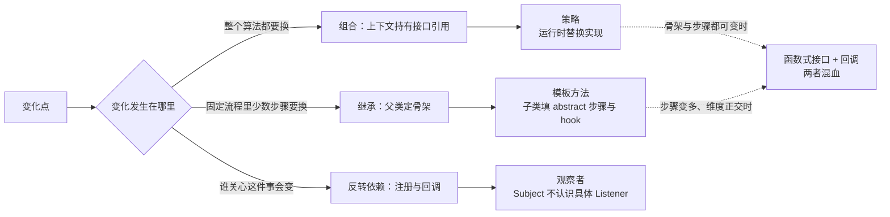
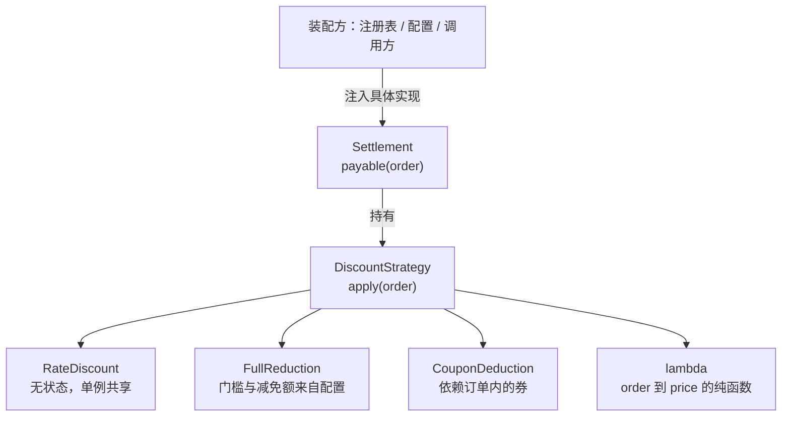
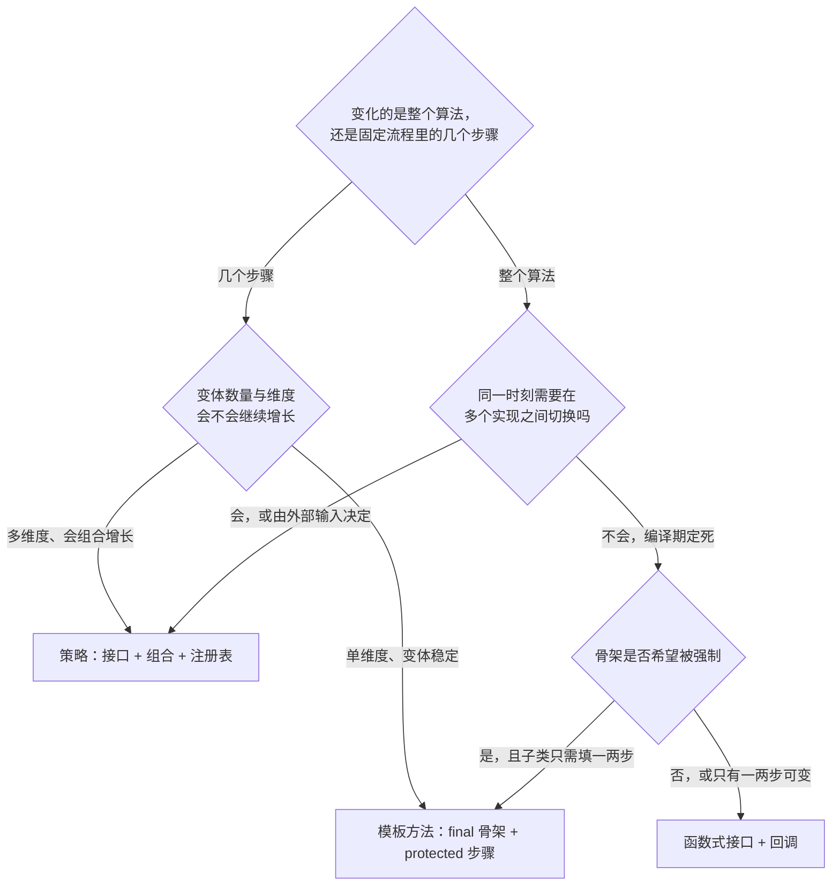
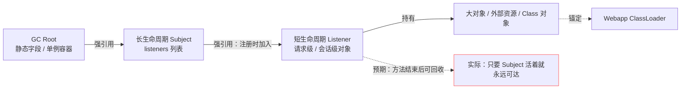
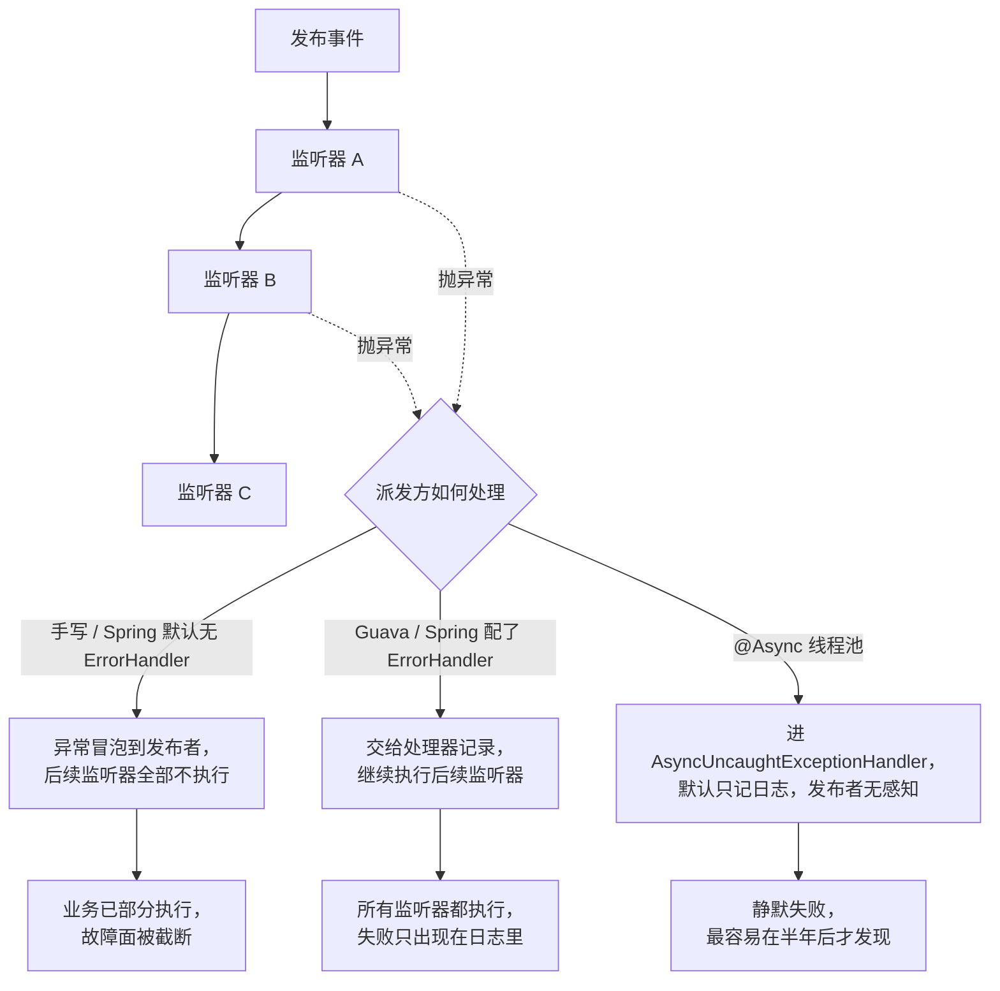
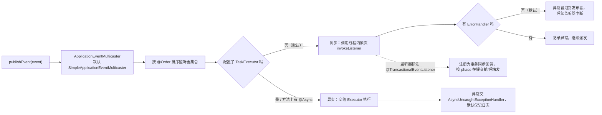

# 行为型模式（上）——策略、模板方法与观察者

**摘要：**

策略与模板方法常被并列成“两种封装变化的模式”，但它们的差别不在结构图上，而在变化点的粒度：策略把一整个算法换成可替换的对象，模板方法把固定流程里的若干步骤留给子类填空。前者用组合换运行时弹性，后者用继承换骨架的强制力，代价是继承耦合、子类爆炸，以及父类一改动就波及全部子类。本篇先给出一条可操作的判据——算法整体可替换则用策略，固定流程里少数步骤可变则用模板方法——再拆解 Hollywood 原则的账单，以及用函数式接口把模板方法改写成“骨架 + 回调”的现代做法，`Stream.collect` 正是两者混血的范例。观察者一侧的落点不是结构，而是它在生产环境里最常见的出事方式：长生命周期的 Subject 强引用短生命周期的 Listener、注册与注销不对称，以及由此引发的 `OutOfMemoryError: Metaspace`。手写实现、JDK 已弃用的 `Observer`、Spring 的 `ApplicationEventPublisher`、Guava 的 `EventBus` 四种方案，将按通知顺序、异常传播、线程安全三个维度逐一对照，并给出弱引用注册表、`AutoCloseable` 注册凭据、写时复制快照遍历等修法的取舍边界。

---

## 第 1 章 变化点的两种安放方式

1994 年，GoF 四人把 23 个模式切成创建型、结构型、行为型三组，行为型那一组占了 11 个，其中又有半数以上在处理同一件事：把“会变的那一段”从调用路径里挪出去，使它不再同稳定部分缠在一起。二十多年过去，创建型模式的地盘大半被容器与依赖注入接管，结构型模式被动态代理和字节码增强占去一半，反倒是行为型里最不起眼的策略与模板方法，至今仍以最朴素的形式出现在几乎每一份业务代码里——只不过它们经常被写反，用继承去实现本该用组合表达的东西。

这一章先把“变化点可以放在哪里”讲清楚，后面三章的分辨与事故才有共同的语言。

### 1.1 一次改动要动几个文件

设想一个结算流程：参数校验、计价、折扣、税费计算、落账。第一版只有一个折扣口径，代码里写四个 `if` 就够了；第二版加了会员等级这个维度，第三版又加了渠道维度，第四版开始出现“渠道折扣与会员折扣互斥”这类规则。每次需求进来，工程师都面对同一个选择题：这段分支是就地加一个 `else if`，还是抽出一层抽象。

判断抽象放得对不对，有一个比“是否符合开闭原则”更可操作的度量，笔者把它叫作**改动半径**：新增一种变体时，需要触碰几个文件、需要重跑哪些测试、有没有可能碰到不相关的分支。就地加 `else if` 的改动半径是 1 个文件、1 个方法、1 组测试；但如果这个方法已经被 5 个入口共享，改动半径会顺着调用图迅速放大，因为任何一个分支的副作用都可能被别的入口撞上。

抽出一层抽象也未必缩小改动半径。把折扣规则抽成接口之后，如果“选择哪个规则”的 `switch` 还在原地，改动半径只是从“改算法分支”变成“改选择分支”，问题换个位置继续存在。这一点在后面讲策略注册表时会再回到，它解释了为什么许多号称“用了策略模式”的代码，新增变体时依旧要改主流程。

### 1.2 继承与组合：控制权在谁手里

把变化点从主流程里移出去，机制只有两种：让子类填空，或者让对象替换。

前者的骨架在下发之前已经由父类写好，父类按固定次序调用若干步骤，哪些步骤留给子类由父类决定——控制权在父类，子类只在被点名的那一刻出场。后者的骨架由装配方或调用方拼装，上下文只持有一个接口引用，具体实现可以在运行时换掉——控制权在使用者手里。两条路径的分野不在“有没有抽象”，而在控制权归属：流程由谁决定，实现由谁替换。

下图把三种行为型机制摊在一起，后面会反复回到这张图：策略换的是整个算法，模板方法换的是流程中的步骤，观察者换的是依赖的方向。



### 1.3 观察者反转的是依赖方向

策略与模板方法交换的是“实现”，观察者交换的是“依赖方向”。一个对象状态变了，关心它的模块应当自动得到通知；最直觉的写法是在状态变更处直接调用每个关心方的方法，这会让被观察者反向依赖所有观察者。观察者把这条依赖翻过来：被观察者只认识一个极窄的接口，关心方自己走过来登记。

正因为三个模式都在“挪动变化点”，它们的分辨经常混在一起。本篇把策略与模板方法的辨析作为第一条主线，把观察者的内存泄漏作为第二条主线——后者在工程上的杀伤力远大于前者，前者写错了顶多难看，后者写错了会在凌晨三点把一个 Metaspace 打满的堆栈甩到值班手机上。

---

## 第 2 章 策略：把整个算法变成可替换的对象

策略模式（Strategy）要解决的问题很具体：同一个操作有多种实现方式，且需要在使用时选择。它的解法是把每种实现封装成一个独立对象，让它们实现同一接口，上下文只持有接口引用。

### 2.1 反例：随业务膨胀的选择分支

促销计算是这类代码的典型温床。第一版只有会员折扣，第二版加了优惠券与满减，第三版加了限时秒杀与生日特惠，每次都在同一个方法尾部续一个 `else if`：

```java
// 反例：每次新增促销都要改这个方法，且所有分支的测试挤在一个用例里
public class DiscountCalculator {
    public BigDecimal calculate(Order order, String promotionType) {
        BigDecimal price = order.getOriginalPrice();
        if ("NORMAL".equals(promotionType)) {
            return price;
        } else if ("VIP".equals(promotionType)) {
            return price.multiply(new BigDecimal("0.90"));
        } else if ("COUPON".equals(promotionType)) {
            return price.subtract(order.getCouponAmount()).max(BigDecimal.ZERO);
        } else if ("FULL_REDUCTION".equals(promotionType)) {
            long times = price.divide(new BigDecimal("200"), RoundingMode.DOWN).longValue();
            return price.subtract(new BigDecimal("30").multiply(new BigDecimal(times)));
        }
        throw new IllegalArgumentException("unknown promotion: " + promotionType);
    }
}
```

这段代码的坏处不只是长。判断“某个促销算得对不对”必须构造整个 `Order`，测试之间互相牵连；新增一种促销时，`calculate` 的每个分支都要重新阅读一遍，因为分支之间隐含了优先级假设；而且 `promotionType` 是字符串，拼写错误要到运行时才暴露。

### 2.2 结构：上下文持有接口，自己不碰分支

把每种规则搬进各自的类，接口只保留一个方法，上下文退化成纯粹的委托者：

```java
@FunctionalInterface
public interface DiscountStrategy {
    BigDecimal apply(Order order);
}

public class RateDiscount implements DiscountStrategy {
    private final BigDecimal rate;          // 策略对象无状态，可安全共享

    public RateDiscount(String rate) {
        this.rate = new BigDecimal(rate);
    }

    @Override
    public BigDecimal apply(Order order) {
        return order.getOriginalPrice().multiply(rate);
    }
}

public class FullReduction implements DiscountStrategy {
    private final BigDecimal threshold;
    private final BigDecimal reduction;

    public FullReduction(String threshold, String reduction) {
        this.threshold = new BigDecimal(threshold);
        this.reduction = new BigDecimal(reduction);
    }

    @Override
    public BigDecimal apply(Order order) {
        BigDecimal price = order.getOriginalPrice();
        long times = price.divide(threshold, RoundingMode.DOWN).longValue();
        return price.subtract(reduction.multiply(BigDecimal.valueOf(times)));
    }
}

// 上下文：只做委托，不认识任何具体规则
public class Settlement {
    private final DiscountStrategy discount;

    public Settlement(DiscountStrategy discount) {
        this.discount = discount;
    }

    public BigDecimal payable(Order order) {
        return discount.apply(order);
    }
}
```

结构上它就是这样一条直线，没有更多秘密。策略模式的全部价值来自一个决定：上下文不再枚举有哪些算法，只持有一个算法接口。这一刀切下去，新增规则从“修改已有方法”变成“新增一个类”，`Settlement` 的编译单元不再被触碰，测试也可以逐个策略独立编写。



### 2.3 选择逻辑搬到哪里

策略模式最容易漏掉的一步，是“谁来选”。如果选择逻辑还是 `switch (promotionType)`，只是把分支从算法里挪到了调用方，改动半径没有变化。选择逻辑有三级去处，代价依次不同。

第一级是注册表：用 `Map<String, DiscountStrategy>` 把类型直接映射到实例。新增规则时改一行 `put`，调用方零改动。手工 `put` 的代价是注册表本身成了新的修改热点，而且重复的键会静默覆盖——后注册的规则吃掉先注册的规则，只有在大促当天算错钱时才会被发现。

第二级是容器注入加自描述：每个策略声明自己负责的类型，Spring 把所有实现按类型注入成 `List`，启动时折叠成 `Map`，键冲突直接 **fail-fast**：

```java
public interface DiscountStrategy {
    String type();                                  // 自描述，注册表不再硬编码键
    BigDecimal apply(Order order);
}

@Component
public class StrategyRegistry {
    private final Map<String, DiscountStrategy> byType;

    public StrategyRegistry(List<DiscountStrategy> strategies) {
        Map<String, DiscountStrategy> map = new HashMap<>();
        for (DiscountStrategy s : strategies) {
            DiscountStrategy prev = map.putIfAbsent(s.type(), s);
            if (prev != null) {
                // 键冲突是配置错误，启动期失败远好过运行期算错钱
                throw new IllegalStateException("duplicated strategy: " + s.type());
            }
        }
        this.byType = Map.copyOf(map);
    }

    public DiscountStrategy of(String type) {
        DiscountStrategy s = byType.get(type);
        if (s == null) {
            throw new IllegalArgumentException("unsupported promotion: " + type);
        }
        return s;
    }
}
```

第三级是让类型本身成为封闭集合。如果促销类型来自运营后台的外部输入，字符串键的注册表就成了一道开放的门，任何拼写错误都变成运行时异常。把类型收敛成枚举、把未知值在入口处拒绝，比在策略层兜底更可靠——策略层兜底只能抛异常，而入口处可以给出可读的业务提示。

### 2.4 策略的边界：什么时候不该用它

策略被滥用的情况比被遗忘多得多，下面几种场景里引入策略接口只会增加阅读成本。

分支只有两三处且长期稳定时，`if` 的可读性远好于“接口 + 三个类 + 注册表”的四段式；抽象的价值来自变化频率，不来自分支数量。策略对象没有状态、每次调用都新建时，除了多一次分配没有任何收益，用函数式接口或静态方法就够了。策略接口的参数表膨胀到把整个上下文对象传进去时，抽象已经失效——策略开始读取上下文的内部字段，两者重新耦合，只是换了个方向的耦合。策略的实现之间存在优先级、互斥、叠加规则时，单纯的替换语义表达不了这些约束，需要额外的组合器或规则引擎，硬塞进策略接口只会得到一堆彼此打探的 `instanceof`。

还有一类更隐蔽的误用：策略只被调用一次、且装配点就在调用点的上一行。此时抽象没有隔离任何东西，只是把一次直接调用拆成了两个文件，读者要在两个位置之间来回跳。笔者见过不少“为了符合设计模式”而拆出来的单实现策略，它们的改动半径与直接调用完全相同，却让调用链多了一层。

---

## 第 3 章 模板方法：把骨架钉在父类

策略把控制权交给使用者，模板方法（Template Method）把控制权收归父类。它要解决的问题是：一个算法的整体次序是稳定的，只有其中若干步骤随场景而异。

### 3.1 反例：被复制三遍的骨架

数据导入是骨架重复的重灾区。CSV 导入、Excel 导入、接口拉取三种来源，流程其实一致：校验文件头、解析、逐行转换、批量落库、失败补偿、清理临时资源。直接写三遍的结果是：校验逻辑三份、异常处理三份、资源关闭三份，某天需求要求“落库前统一加一次幂等检查”，就要改三个地方，且必然漏掉一处。

### 3.2 结构：final 的模板方法与三类步骤

模板方法把次序固定在父类的一个 `final` 方法里，把变化留给 `protected` 步骤：

```java
public abstract class AbstractImporter<T> {

    // 模板方法：次序与异常兜底都在父类，子类无法改变骨架
    public final ImportResult importFrom(Path path) {
        List<String> lines = null;
        try {
            validate(path);                       // 固定步骤
            lines = readLines(path);              // 固定步骤
            beforeConvert(lines);                 // 钩子：默认空实现
            List<T> rows = convert(lines);        // 抽象步骤：子类必须实现
            if (shouldDedup()) {                  // 钩子：默认 true
                rows = dedup(rows);               // 固定步骤
            }
            int saved = save(rows);               // 抽象步骤：子类必须实现
            return ImportResult.ok(saved, rows.size());
        } catch (RuntimeException e) {
            return ImportResult.fail(e, onFailure(e)); // 钩子：失败策略可覆写
        } finally {
            cleanup(lines);                       // 固定步骤：资源清理
        }
    }

    protected abstract List<T> convert(List<String> lines);

    protected abstract int save(List<T> rows);

    protected void beforeConvert(List<String> lines) { }

    protected boolean shouldDedup() { return true; }

    protected String onFailure(RuntimeException e) { return e.getMessage(); }

    private void validate(Path path) { /* 父类私有：子类既不能调用也不能覆写 */ }

    private List<String> readLines(Path path) { /* 同上 */ }

    private void cleanup(List<String> lines) { /* 同上 */ }
}
```

三类步骤的义务划分是模板方法的第一道设计决策，也是最容易做错的地方：

| 步骤类型 | 修饰符 | 子类义务 | 设计意图 |
| --- | --- | --- | --- |
| 模板方法 | `public final` | 禁止覆写 | 骨架是契约，次序不能被子类改写 |
| 抽象步骤 | `protected abstract` | 必须实现 | 差异点确定的场合，用编译期强制 |
| 钩子方法 | `protected` 带默认实现 | 可选覆写 | 差异点不确定或多数子类不需要的场合 |
| 固定步骤 | `private` | 不可见 | 骨架内部实现细节，不进子类的可选集 |

一个常被忽略的细节是 `protected` 的分量。它同时表达两件事：对子类开放，对外封闭。框架用 `protected` 划定扩展点，等于承诺“这些方法可以被覆写”，但不承诺它们是稳定的公开 API。Spring 的 `AbstractApplicationContext` 系列把大量钩子放在 `protected` 上，正是这个意思——子类能改，但不受公开 API 的兼容性保护。

### 3.3 Hollywood 原则与它的账单

模板方法是控制反转在类继承上的具体形态，业界给它起了个名字：Hollywood 原则（Hollywood Principle）——“别打给我们，我们会打给你”。你写的 `convert` 不会被自己调用，只有一个时机由父类决定。Servlet 的 `service` 分发到 `doGet`/`doPost`、`AbstractQueuedSynchronizer` 的 `acquire` 调用 `tryAcquire`、`JdbcTemplate` 的 `execute` 调用回调，都是这条原则的实例。

原则听着优雅，账单要在后面几页才寄到。模板方法的代价可以归成五条，每一条在真实代码库里都能找到对应的伤疤。

第一是继承耦合。子类覆写 `protected` 方法，同时继承了父类的字段、初始化次序和未文档化的假设。父类内部换一种缓存方式、把某个 `private` 字段挪走、在钩子前后插一行日志，都可能让子类的行为悄悄变化——这就是经典的**脆弱基类**问题（fragile base class）。父类作者看不到所有子类，子类作者看不到父类的演进计划，两侧都被对方约束。

第二是父类改动的波及面。给一个已有抽象类加一个新的 `abstract` 方法，全部子类当场编译失败；Java 8 的接口默认方法救了接口，却没有救抽象类，因为抽象类新增抽象方法没有“默认实现”这一层缓冲。把骨架里的两个步骤对调，语义上等价于换了一套算法，但所有子类的隐含假设都可能失效。

第三是子类爆炸。当变化点不止一个维度时，继承会把维度乘起来。数据来源（CSV、Excel、接口）与输出目标（MySQL、Kafka）各自独立变化，用继承表达就是 3×2=6 个子类，第三个维度进来就变成 18 个。策略可以用组合把维度拆开——来源解析器与输出写入器各是一个可替换对象，装配时相乘，类的数量变成 3+2 而不是 3×2。

第四是测试成本。想单独验证 `dedup` 这一步，必须造一个子类，或者把这一步提到可独立调用的位置。父类的骨架无法在不启动子类的前提下被测试，因为骨架本身就是父类的方法。

第五是单继承额度。Java 的类只有一个 `extends` 名额，占给框架之后就没了。一个既想复用框架骨架、又想复用另一套基础设施的类，在继承路线下必须做取舍，而组合没有这个限制。

### 3.4 用回调替掉继承

模板方法里真正需要子类填的往往只有一两个方法，此时继承是杀鸡用牛刀。把抽象步骤改成参数，骨架可以收进一个 `final` 类，调用方用 lambda 填空：

```java
public final class Importer {
    // 骨架变成静态结构，步骤由调用方以函数式接口注入
    public static <T> ImportResult run(Path path,
                                       Function<List<String>, List<T>> converter,
                                       ToIntFunction<List<T>> saver) {
        try {
            List<String> lines = Files.readAllLines(path);
            List<T> rows = converter.apply(lines);
            return ImportResult.ok(saver.applyAsInt(rows), rows.size());
        } catch (IOException | RuntimeException e) {
            return ImportResult.fail(e, e.getMessage());
        }
    }
}

// 调用方：差异只有两行 lambda
ImportResult r = Importer.run(path, CsvRow::parse, repo::saveAll);
```

这个改写把“继承 + 覆写”换成了“组合 + 注入”，收益是子类消失、维度可自由组合、骨架可独立测试；代价是步骤一多，lambda 参数表就变成一列看不出含义的类型签名，需要退回到参数对象或 `Builder`。钩子方法的语义也会丢——可选步骤在函数式接口里表现为一个可能为 `null` 的参数，或者一个默认实现，可读性弱于 `protected void beforeConvert()`。

模板方法与策略在标准库里经常是缠在一起的。`Stream.collect(Collector)` 就是典型：`collect` 是终结算子，流水线如何触发、`Sink` 如何串联、并行时如何归并，这些骨架由 `Stream` 自己把握；而“元素怎么装进容器”由 `Collector` 提供四件套——`supplier` 造容器、`accumulator` 累加、`combiner` 并行合并、`finisher` 收尾转换。`Collectors.toList()`、`Collectors.joining(",")`、`Collectors.groupingBy(...)` 就是一组现成的策略实现。骨架是模板方法，步骤是策略，两者在同一次调用里各司其职。

---

## 第 4 章 判据：整体可替换，还是步骤可变

前面两章分别描述了两种机制，这一章给判据。判据的价值在于它必须能在写代码前三十秒内被用出来，因此不能是“看情况”。

### 4.1 四个问题定分支

笔者在实践中把它压缩成四个问题，按顺序回答，第一个问题就能分掉大部分场景。



第一个问题的判断标准不是“代码长什么样”，而是“变化的边界在哪里”。策略的变化边界是算法入口——换一个实现，输入输出契约不变；模板方法的变化边界是流程中的某个节点——换一个实现，前后步骤的次序与语义都不变。如果一处改动会让流程的步骤顺序也跟着变，它就不是模板方法该管的范围，硬要用钩子去表达次序变化，会得到一堆互相打探的布尔钩子。

第二个问题问的是切换时机。策略天然支持运行时替换，因为实现是一个对象引用；模板方法的替换发生在编译期，一个对象不可能今天是 `CsvImporter` 明天变成 `ExcelImporter`。如果需求里有“按租户配置选择解析器”“灰度期间两套算法并存”这类描述，答案已经写好了。

第三个问题问的是增长方式。单维度、变体有限的差异，继承的强制力是优点；多维度、会组合增长的差异，继承会指数级膨胀。这条判断有个简单的检验办法：把变化点列成清单，数一数它们是否互相独立。互相独立的两个变化点用继承表达，必然产生**笛卡尔积**。

第四个问题问的是骨架要不要被强制。有些场景里“流程不能被改写”本身就是需求——结算必须先扣减再落账，导入必须先校验再解析，这些约束如果只写在文档里，迟早会被某个子类绕开。`final` 的模板方法是把约束编译进类型系统，这是策略给不了的。

### 4.2 三栏对照

把两种机制与“函数式回调”这一现代变体并排放在一起，差异集中在控制权与耦合方式上：

| 维度 | 策略（组合） | 模板方法（继承） | 函数式回调 |
| --- | --- | --- | --- |
| 变化点粒度 | 整个算法 | 流程中的若干步骤 | 单个步骤或单个动作 |
| 控制权 | 调用方或装配方 | 父类 | 骨架代码 |
| 替换时机 | 运行时 | 编译期 | 运行时（lambda 可传可存） |
| 耦合方式 | 上下文依赖接口，实现互不知情 | 子类依赖父类的字段与调用次序 | 骨架依赖函数签名，双方无类型关系 |
| 变体增长 | 加法：每个变体一个类 | 乘法：多维度产生笛卡尔积 | 加法，且常以 lambda 内联 |
| 骨架约束力 | 无（上下文可被绕过） | 强（`final` 不可覆写） | 中（骨架在库里，调用方无法改） |
| 测试方式 | 策略可独立测试 | 需构造子类或暴露钩子 | 骨架与 lambda 分别测试 |
| 典型落点 | `Comparator`、`DiscountStrategy` | `JdbcTemplate`、`AbstractQueuedSynchronizer`、`HttpServlet` | `Stream.collect` 的 `Collector`、`JdbcTemplate` 的 `RowMapper` |
| 主要代价 | 选择逻辑要另找地方安放 | 继承耦合、子类爆炸、脆弱基类 | 步骤多时参数表失控 |

### 4.3 两个方向的误用

判据的用处一半在选对，一半在认出选错。两个方向的误用各有清晰的症状。

用继承实现策略的症状是：抽象类里没有任何骨架代码，只有一堆 `abstract` 方法，每个子类覆写其中唯一的一个。这说明“父类”没有提供任何共性，它只是一个接口，而 Java 的接口不占继承额度。这种代码的正确形态是接口加组合，甚至可以直接退化成 `Function`。它还有一个隐性成本：所有子类被绑在同一棵树上，将来任何一个子类想复用别处的实现，都要面对单继承的限制。

用策略实现模板方法的症状相反：多个策略实现里有大段重复的步骤序列，差别只在中间一两行。骨架被复制了 N 份，改骨架要改 N 个文件，而且必然漏掉一处。识别这种代码的方法很直接——把几个实现并排打开，如果前五行和后五行一致，中间不同，那它本来是一个模板方法。

还有一种混合误用值得单独提：把选择逻辑写进策略内部。策略 `apply` 的第一行是 `if (order.isNewUser())`，第二行是 `if (order.getChannel() == Channel.APP)`。这说明变化点没有被真正定位，只是从一个类搬到了另一个类，分支总数一点没少。策略的边界应当落在“一种完整算法”上，而不是“算法的一个片段”。

### 4.4 混血是常态，判据要落到粒度上

真实的标准库里很少见到纯粹的策略或纯粹的模板方法，前面提到的 `Stream.collect` 是一例，`JdbcTemplate` 是另一例，而且更彻底：

```java
// 骨架（模板方法）：连接获取、语句创建、异常转译、资源释放全部固定
public <T> T execute(StatementCallback<T> action) {
    Connection con = DataSourceUtils.getConnection(getDataSource());
    try (Statement stmt = con.createStatement()) {
        applyStatementSettings(stmt);
        T result = action.doInStatement(stmt);      // 步骤（策略）：调用方提供
        handleWarnings(stmt);
        return result;
    } catch (SQLException ex) {
        throw translateException("StatementCallback", getSql(action), ex);
    } finally {
        DataSourceUtils.releaseConnection(con, getDataSource());
    }
}

// 调用方只填策略部分
List<User> users = jdbcTemplate.query(sql, (rs, rowNum) ->
        new User(rs.getLong("id"), rs.getString("name")));
```

`AbstractQueuedSynchronizer` 是同一种结构在并发库里的版本：`acquire` 管排队、阻塞、唤醒、中断处理，`tryAcquire` 交给子类——`ReentrantLock`、`Semaphore`、`CountDownLatch` 各自实现一小段状态判定，就得到了完全不同的同步语义。它的设计者把骨架放在继承里，把可变部分收进 `protected` 钩子，而调用方拿到的仍然是组合式的 API。

由此可见，判据不该问“这是策略还是模板方法”，而该问**骨架与步骤的归属**：它们各自被谁拥有、以什么方式被替换。骨架需要强制、步骤需要少数几处可换，就落在继承加钩子；骨架也需要被替换、或者骨架之外的维度也要独立变化，就落在组合加注册表。把一个模式认成另一个模式，通常不会立刻出错，代价会在第三次需求变更时以“改动半径突然变大”的形式出现。

---

## 第 5 章 观察者：四种实现与它们的通知语义

观察者模式（Observer）回答的问题是：对象状态变化时，如何通知所有关心它的模块，同时不让被观察者认识这些模块。

### 5.1 反例：状态变更处直连所有下游

订单完成要发邮件、确认库存、加积分、通知物流、写统计。最直觉的写法是在 `complete()` 里逐个调用：

```java
// 反例：Order 反向依赖五个下游服务，且全部同步执行
public void complete() {
    this.status = COMPLETED;
    orderRepository.save(this);
    emailService.sendCompletionMail(this);
    inventoryService.confirmDeduction(this);
    pointsService.addPoints(this);
    logisticsService.notifyShipment(this);
    statisticsService.recordCompleted(this);
}
```

这段代码的问题可以逐条量化。`Order` 的构造与测试需要五个下游的桩，任何一次单元测试都在验证一段与订单逻辑无关的编排；邮件服务超时会把订单接口的响应时间拉长到超时时间；五个调用共享同一个事务边界与同一个异常出口，任意一个抛异常都会让前面已经执行的副作用留在原地——邮件已经发出去了，事务却因为积分服务的空指针回滚了。

### 5.2 最小实现：列表 + 快照遍历

观察者把“通知谁”从被观察者里剥离出去，被观察者只维护一个极窄的接口列表：

```java
public interface OrderListener {
    void onCompleted(Order order);
}

public class Order {
    // 写时复制：遍历拿到的是快照，注册/注销不会打断正在进行的通知
    private final List<OrderListener> listeners = new CopyOnWriteArrayList<>();

    public void addListener(OrderListener l) {
        listeners.add(l);
    }

    public void removeListener(OrderListener l) {
        listeners.remove(l);
    }

    public void complete() {
        this.status = COMPLETED;
        orderRepository.save(this);
        for (OrderListener l : listeners) {
            l.onCompleted(this);        // 迭代器是快照，回调里增删监听器不会抛 CME
        }
    }
}
```

手写版的全部成本集中在三处：每个主题都要重复一份注册与遍历代码；通知是同步的，慢监听器直接拖慢主题；注册关系由使用方自己维护，忘记 `removeListener` 就埋下了内存泄漏。第三点会在下一章展开，它是观察者在生产环境里最贵的错误。

### 5.3 JDK 的失败尝试：Observer 与 Observable

JDK 1.0 就内置了 `java.util.Observer` 与 `java.util.Observable`（下文关于实现细节的描述基于 Java 17 与 Java 21 LTS），教科书上的观察者示例大多来自这里。它们从 JDK 9 起被标记为弃用（`@Deprecated(since="9")`），javadoc 给出的理由有三条：这套事件模型的能力相当有限，通知的次序未被规定，状态变化与通知之间也没有一一对应关系。三条理由对应着三个具体的坑，值得逐条看清，因为它们的教训在后来的框架设计里被反复引用。

第一条是“类不是接口”。`Observable` 是一个具体类，想被观察就必须 `extends Observable`。Java 只有一个继承名额，业务类继承了它就无法再继承别的基类；更麻烦的是“一个对象只能是一种被观察者”——`Observable` 内部维护一份观察者列表，没有区分事件类型，所有观察者收到同一个 `update(Observable, Object)` 回调，靠 `arg` 参数自己分辨发生了什么。这相当于把所有事件压进一个通道，类型安全荡然无存。接口可以多实现，类只能单继承，这一条几乎判了 `Observable` 的死刑。

第二条是“方法不是 public”。`setChanged()`、`clearChanged()`、`notifyObservers()` 都是 `protected`，外部无法驱动，只能由子类在自己的业务方法里调用。这迫使被观察者必须为“能通知”而继承，反过来又把第一条的继承额度问题放大。对使用方而言，这意味着没法用组合的方式把一个普通对象包装成可观察对象。

第三条是“通知次序与状态的语义都不牢”。javadoc 明确写了通知次序未定义，而实际实现的次序又与文档不一致：在 JDK 17 的 `Observable` 里，`notifyObservers` 先把观察者 `Vector` 里的元素复制成数组、清掉 `changed` 标记、释放锁，然后**从数组末尾往前**逐个调用 `update`，也就是后注册的先收到通知；而该类的 javadoc 却写着默认实现按注册顺序通知。规范与实现不一致，任何依赖通知先后的业务逻辑都建立在流沙上。

`Observable` 还有两个细节上的坑。其一是“忘记 `setChanged` 就静默不通知”：`notifyObservers` 的第一行是检查 `changed` 标志，为 `false` 就直接返回，既不报错也不打日志，症状是“代码看起来没问题，监听器就是不触发”。其二是 `addObserver` 用 `equals` 判重，而 `Observable` 内部用 `Vector` 存观察者，`Vector` 的每个操作都带同步——它不是为并发通知设计的，只是复用了一个历史遗留的线程安全集合。

javadoc 给出的替代路径也值得记住：需要更丰富的事件模型用 `java.beans` 包，需要线程间可靠有序的消息用 `java.util.concurrent` 里的并发数据结构，需要响应式流风格的编程用 JDK 9 引入的 `Flow` API。这三条替代路径其实预告了后面三种实现的方向。

### 5.4 Spring：ApplicationEventPublisher

Spring 的事件机制是进程内观察者在企业应用里的主流形态。Spring 4.2 引入注解驱动的事件监听，把“实现 `ApplicationListener` 接口”和“加一个 `@EventListener` 注解”两条路都保留了下来：

```java
// 事件可以是任意 POJO，不必继承 ApplicationEvent
public record OrderCompletedEvent(Long orderId, Long userId, BigDecimal amount) { }

@Service
public class OrderService {
    private final ApplicationEventPublisher publisher;

    public OrderService(ApplicationEventPublisher publisher) {
        this.publisher = publisher;
    }

    @Transactional
    public void complete(Long orderId) {
        Order order = load(orderId);
        order.complete();
        orderRepository.save(order);
        publisher.publishEvent(new OrderCompletedEvent(order.getId(), order.getUserId(), order.getAmount()));
    }
}

@Component
public class MailListener {
    @EventListener
    @Order(10)                       // 数值小的先执行，未标注者排在最后
    public void onCompleted(OrderCompletedEvent e) {
        mailService.send(e.userId(), "订单 " + e.orderId() + " 已完成");
    }
}

@Component
public class StockListener {
    // 默认 phase 就是 AFTER_COMMIT：事务提交后才触发
    @TransactionalEventListener
    public void onCompleted(OrderCompletedEvent e) {
        stockService.confirmDeduction(e.orderId());
    }
}
```

默认语义必须讲清楚，因为大量线上问题源于对它的误判。`ApplicationEventPublisher.publishEvent` 是**同步**调用：事件在同一线程里被逐个派发给监听器，`publishEvent` 返回时所有监听器都执行完了。所谓“发布即返回、异步处理”是误解。异步要显式开启——在监听方法上加 `@Async`，或者给 `ApplicationEventMulticaster` 配一个 `TaskExecutor`，两者都需要一个可用的 `Executor`，前者还需要 `@EnableAsync`。

`@TransactionalEventListener` 解决的是时序问题：事务未提交时发布事件，监听器读到的数据可能还没落库，或者事务最终回滚而“已完成”的邮件已经发出。它的 `phase` 属性有四个取值，配 `fallbackExecution` 处理“根本没有事务”的场景：

| phase 取值 | 触发时机 | 典型用途 | 代价 |
| --- | --- | --- | --- |
| `BEFORE_COMMIT` | 提交前，仍在事务内 | 需要与业务同一事务的校验 | 此处抛异常会让事务回滚 |
| `AFTER_COMMIT`（默认） | 提交成功后 | 发消息、发邮件、清缓存等外部副作用 | 抛异常无法回滚数据，业务已提交 |
| `AFTER_ROLLBACK` | 事务回滚后 | 补偿、告警、释放预占资源 | 只能做清理，不能假设数据已生效 |
| `AFTER_COMPLETION` | 提交或回滚之后 | 统一收尾 | 需自行判断事务结果 |

`fallbackExecution` 默认 `false`，意思是没有活动事务时监听器干脆不执行。这在定时任务、异步线程池、`@Transactional` 因自调用失效等场景里会造成“事件发了但什么都没发生”的静默故障——事务被代理吞掉的地方，事务事件也在同一个地方被吞掉。

### 5.5 Guava：EventBus

Guava 的 `EventBus` 用注解声明订阅关系，发布者完全不认识订阅者：

```java
public class MailSubscriber {
    @Subscribe                                    // Guava 的事件注解
    public void onCompleted(OrderCompletedEvent e) {
        mailService.send(e.userId(), "订单已完成");
    }
}

// 装配：注册订阅者；发布：post 事件
EventBus bus = new EventBus();                    // 默认 DirectExecutor，同步派发
bus.register(new MailSubscriber());
bus.post(new OrderCompletedEvent(1L, 2L, new BigDecimal("99.00")));
```

它的默认行为与 Spring 有几个关键差异。默认构造出来的 `EventBus` 使用 `directExecutor`，即在调用 `post` 的线程里同步执行订阅方法；需要异步就得用 `AsyncEventBus` 并显式传入 `Executor`。分发器默认是 `perThreadDispatchQueue`，同线程内发布的事件会排队串行处理，避免递归发布把栈压爆。订阅者集合按事件类型保存在 `ConcurrentMap<Class<?>, CopyOnWriteArraySet<Subscriber>>` 里，因此注册与注销不会打断正在进行的派发。

最值得注意的差异是异常处理。Guava 在派发每个订阅者时单独捕获反射调用抛出的异常，转交给 `SubscriberExceptionHandler`（默认实现是 `LoggingHandler`，只写一条 `SEVERE` 日志），然后继续派发下一个订阅者。后果是：一个订阅者抛异常不会影响其他订阅者，但发布方完全不知道出过事——Guava 自己的 javadoc 就把“不传播异常，应用无法对此作出反应”列为 `EventBus` 的已知缺陷。这与 Spring 的默认行为恰好相反，选择哪一种取决于你要的是“故障隔离”还是“故障可见”。

### 5.6 四种实现的横向对照

把四种实现放在同一张表里，差异会集中到几列上，选型时按这几列对号入座即可：

| 维度 | 手写列表 | JDK Observer/Observable | Spring ApplicationEvent | Guava EventBus |
| --- | --- | --- | --- | --- |
| 状态 | 项目代码 | JDK 9 起弃用 | Spring 6.x / Boot 3.x 主流 | 维护中，官方标注为进程内总线 |
| 注册方式 | 显式 `add/removeListener` | `addObserver`，需继承 `Observable` | 容器扫描 `@EventListener` 或实现接口 | 显式 `register/unregister` |
| 通知线程 | 调用线程 | 调用线程 | 默认调用线程，`@Async` 可换 | 默认调用线程，`AsyncEventBus` 可换 |
| 顺序保证 | 注册顺序（列表语义） | 未定义，JDK 17 实现为逆序 | `@Order`/`Ordered` 排序 | 不承诺顺序 |
| 异常传播 | 直接抛出，中断后续 | 直接抛出，中断后续 | 默认传播给发布者（可配 `ErrorHandler`） | 捕获后交 handler，后续继续 |
| 事务感知 | 无 | 无 | `@TransactionalEventListener` 四阶段 | 无 |
| 注销责任 | 使用方 | 使用方 | 容器管理 Bean 生命周期 | 使用方（漏掉即泄漏） |
| 适用场景 | 主题少、依赖简单 | 历史代码维护 | Spring 应用内的业务事件 | 无 Spring 依赖的进程内解耦 |

---

## 第 6 章 内存泄漏：观察者最贵的错误

观察者的结构简单到没什么可讲，它在生产环境里的杀伤力全部来自生命周期管理。一个注册动作如果没有对应的注销，被注册者就被延长到了注册容器的寿命，而注册容器往往是单例或静态的。

### 6.1 三个来源

来源一：长生命周期的 Subject 强引用短生命周期的 Listener。一个单例的 `Settlement`、一个静态的 `EventBus`、一个 Spring 单例 Bean 里的 `List<Listener>`，都是长生命周期对象；被注册进去的监听器可能是一个请求级的对象、一次查询的临时回调、一个刚创建的 UI 组件。注册之后，这个短命对象就挂在了单例的强引用链上，方法结束也不会消失。如果注册动作发生在每次请求里，泄漏速度就是每次请求一个对象，几小时后堆内存见底。

来源二：忘记注销，或注销与注册不对称。注册写在构造器里、注销写在某个业务分支里；注册成功之后的三行代码抛了异常，注销永远走不到；用 try 包了业务逻辑却把 `finally` 忘了，池化对象被回收时监听器还留在总线上。这类问题的共同特征是注册点与注销点在不同的代码位置、由不同的人维护，评审时几乎看不出来。

来源三：被误传的“循环引用”。很多资料把“循环引用”列为内存泄漏来源，这个说法在 JVM 上是错的：JVM 用可达性分析而不是引用计数判定垃圾，两个互相引用的对象如果从 GC Root 不可达，一样会被回收。真正的泄漏机制是**锚定**——反向引用把本该死亡的对象挂在了 GC Root 上。比如 A 把自己注册给长生命周期的 B，B 又被存进 A 的字段以便回调，A 本该随会话结束而消失，却因为 B 的监听器列表持有它而永远可达。这里的罪魁不是“循环”，而是“从 Root 出发有一条强引用路径通到一个已经没人用的对象”。区分这两件事很重要：前者无法通过解环修复，后者必须靠注销或弱引用切断路径。



### 6.2 为什么后果常常是 Metaspace 溢出

监听器泄漏最先耗尽的未必是堆。一个监听器对象本身可能只有几十字节，堆要很久才满；但如果泄漏的对象是类本身，速度就完全不同。典型场景是 Web 容器热部署或 Spring Boot devtools 重启：每次重启会创建一个新的 ClassLoader 来加载应用类，旧的 ClassLoader 本该在旧应用的所有对象都不可达后被回收。此时如果父加载器（容器共享区）里的某个单例注册表还持有旧应用里的监听器实例，这个实例的 `Class` 就指向旧的 ClassLoader，旧 ClassLoader 因此保持可达——它加载过的所有类元数据都无法卸载。每次重启泄漏一整个应用的类元数据，十几次之后就是 `java.lang.OutOfMemoryError: Metaspace`。

匿名内部类与 lambda 会加速这个过程：每个 lambda 的调用点都会在运行时生成类（`invokedynamic` 的实现），监听器以 lambda 形式注册时，泄漏的不仅是对象，还连带着它的调用点类。

排查这类故障时，堆转储比堆占用数字更有用：用 MAT 打开堆转储，看 Dominator Tree 里是否有某个集合异常巨大，再看 Duplicate Classes 视图里同一个类名是否被多个 ClassLoader 各加载了一份。在线诊断可以先用 `jcmd <pid> VM.classloader_stats` 观察 ClassLoader 数量是否单调增长，或用 `jmap -clstats <pid>` 查看每个加载器的类数量；堆里对象数量平稳而类数量持续上涨，基本可以锁定类加载器泄漏。

### 6.3 修法一：弱引用注册表

最直接的修法是把 Subject 对 Listener 的强引用换成弱引用，让监听器的存活不再取决于是否被注册：

```java
public final class WeakListenerRegistry<L> {
    // 弱引用 + 引用队列：被回收的引用会进队列，遍历时顺手清理
    private final ReferenceQueue<L> queue = new ReferenceQueue<>();
    private final List<WeakReference<L>> refs = new CopyOnWriteArrayList<>();

    public void add(L listener) {
        purge();                                    // 先清掉已失效的
        refs.add(new WeakReference<>(listener, queue));
    }

    public List<L> snapshot() {
        purge();
        List<L> alive = new ArrayList<>(refs.size());
        for (WeakReference<L> ref : refs) {
            L l = ref.get();                        // 可能已被回收，必须判空
            if (l != null) {
                alive.add(l);
            }
        }
        return alive;
    }

    private void purge() {
        Reference<? extends L> dead;
        while ((dead = queue.poll()) != null) {      // 队列里是已清除的引用
            refs.remove(dead);
        }
    }
}
```

这段代码有三处容易写错。第一，弱引用注册表要求监听器在别处有强引用，否则它可能在注册之后立刻被回收——`bus.add(new MailListener())` 这种写法里没有任何强引用，弱引用拿到手就是空的，症状是“监听器时灵时不灵”。第二，`ref.get()` 必须判空，判空与使用之间的竞态无法完全消除，但可以要求监听器方法本身能容忍一次空转。第三，`refs.remove(dead)` 之所以能对上号，是因为 `WeakReference` 没有覆写 `equals`，比较的是引用相等；如果换成自己包装的引用对象，就必须保证包装类不覆写 `equals`，否则清理时会误删别的条目。

弱引用不是免费的。它把“泄漏”换成了“监听器可能被静默回收”，后者更难排查：通知丢了一次，日志里什么都没有。因此弱引用只适合“监听器可有可无”的场景，比如缓存失效回调、指标采集钩子；业务上不能丢的通知，应当走显式注销。

### 6.4 修法二：WeakHashMap 的陷阱

`WeakHashMap` 看起来是现成的答案——键弱引用，键被回收后条目自动消失。但它有两个反直觉的性质，用错方向反而会制造泄漏。

第一，值是被强引用的。如果值是监听器、而监听器又持有键的引用，键就永远有强引用路径，条目永远不消失——这正是想解决的问题。第二，条目不是在键被回收的瞬间删除的，而是在后续访问时由 `expungeStaleEntries()` 清理，如果这个 map 长期不被访问，垃圾条目就一直留在表里。此外 `WeakHashMap` 不是线程安全的，也不是缓存：它没有容量上限、没有过期策略，键被回收的时机完全由 GC 决定。

拿它做事件总线尤其不合适，因为语义反了。总线要的是“订阅者活着就通知，订阅者死了就自动摘掉”，`WeakHashMap` 的键恰恰是订阅者，而值通常需要引用订阅者才能回调——强弱关系正好拧着。相比之下，“`WeakReference` + `ReferenceQueue` 的列表”把弱引用放在我们需要的位置上（对监听器的引用），语义更直白，也更容易加上“显式注销”这条正常路径。

### 6.5 修法三：注册凭据与生命周期钩子

比弱引用更可靠的做法，是把“注册”变成一个有作用域的、可关闭的资源，让注销与注册在同一个位置完成。Java 的 `AutoCloseable` 正好表达这件事：

```java
public interface ListenerRegistration extends AutoCloseable {
    @Override
    void close();                                    // 幂等：重复调用无副作用
}

public final class Order implements AutoCloseable {
    private final List<OrderListener> listeners = new CopyOnWriteArrayList<>();

    public ListenerRegistration onCompleted(OrderListener l) {
        listeners.add(l);
        return () -> listeners.remove(l);            // 注销凭据，与注册同源
    }

    @Override
    public void close() {
        listeners.clear();
    }
}

// 使用方：作用域结束必然注销，异常路径也一样
try (ListenerRegistration reg = order.onCompleted(mailListener)) {
    order.complete();
}
```

这个模式在响应式编程里有个更广为人知的名字：`CompositeDisposable`。它的思路是把一个组件内所有注册凭据收进一个容器，组件销毁时一次性 `dispose` 全部，而不是在每个注册点手写注销。Java 里没有内置的 `CompositeDisposable`，但用 `List<ListenerRegistration>` 加 `close()` 循环即可。关键收益是**注销点收敛**：一个组件只有一个销毁入口，评审时只需检查这一个方法是否覆盖了所有注册。

生命周期钩子是另一条保障线。Spring Bean 用 `@PreDestroy` 或实现 `DisposableBean`，Servlet 用 `contextDestroyed`，Spring 上下文还可以监听 `ContextClosedEvent`：

```java
@Component
public class BusRegistrar {
    private final EventBus bus = new EventBus();
    private final List<Object> subscribers = new ArrayList<>();

    public void register(Object subscriber) {
        bus.register(subscriber);
        subscribers.add(subscriber);
    }

    @PreDestroy
    public void shutdown() {
        subscribers.forEach(bus::unregister);        // 容器关闭时统一摘除
        subscribers.clear();
    }
}
```

### 6.6 判据：什么情况下必须显式注销

判断一段观察者代码是否需要显式注销，可以按三个问题顺序自检，三个都为“是”就是高危组合：

| 自检问题 | 为“是”的含义 | 处置 |
| --- | --- | --- |
| Subject 的生命周期长于 Listener 吗 | 单例、静态字段、容器级总线都属于长生命周期 | 必须注销，或改用弱引用 |
| 注册动作会重复发生吗 | 每次请求、每次打开页面都注册，泄漏量随流量线性增长 | 注册收敛到初始化阶段，或做成幂等 |
| Listener 捕获了请求级对象吗 | 捕获了 `HttpServletRequest`、会话、大集合、临时连接 | 优先注销，其次考虑不注册闭包而注册无状态单例 |

三个问题都否的场合，比如监听器与应用同生共死、注册只发生在启动时，泄漏风险可以接受，此时强行加弱引用只会让调试变复杂。这里的分寸与前面策略的边界是同一个道理：模式本身不产生价值，对生命周期的判断才产生价值。

---

## 第 7 章 通知语义：顺序、异常与并发

同一个观察者模式，换个实现就换了一套通知语义。这些语义差异不会在编译期提示，只在故障时显现。

### 7.1 通知顺序

手写实现用 `List` 遍历，顺序就是注册顺序，这点最直观。`Observable` 的契约是未定义，JDK 17 的实现从数组末尾往前遍历，后注册的先收到通知，且这一行为与它自己的 javadoc 描述不一致。Spring 用 `@Order` 与 `Ordered` 接口排序，数值小的先执行，未标注的按 `Ordered.LOWEST_PRECEDENCE` 排在最后；同一个 `@Order` 值内部的次序不再有保证。Guava 的订阅者集合是 `CopyOnWriteArraySet`，通常表现为插入顺序，但契约上不承诺顺序。

顺序在什么时候真的重要？当多个监听器对同一份数据做有依赖的加工时——审计日志要看到扣减前的快照，缓存清理要在通知下游之前完成。这类依赖应当被显式建模成“一个监听器内部按序调用”，而不是靠两个监听器的执行顺序碰巧正确。用注解排序去表达业务依赖，等于把正确性押在框架的排序实现上。

### 7.2 异常传播：一个监听器抛异常会不会阻断后面

这是观察者实现之间差异最大、也最容易造成隐性 bug 的一点。多数实现的答案是“会”，而且不会有任何提示。



手写实现最直接：`for` 循环里没有 try，`A` 抛出后循环终止，`B`、`C` 从未收到通知。此时业务状态是“部分通知”，如果发布者没有感知到这个半成品状态，后续补偿就无从下手。Spring 的 `SimpleApplicationEventMulticaster` 默认没有配置 `ErrorHandler`，`invokeListener` 直接调用监听器，异常沿着 `publishEvent` 冒到发布方，同样会中断后面的监听器；只有显式设置 `ErrorHandler`（通过自定义 multicaster）才会变成“记录后继续”。Guava 在派发每个订阅者时单独捕获，异常交给 `SubscriberExceptionHandler`，后续订阅者照常执行。

三种语义对应三种故障形态：手写与 Spring 默认是“故障可见但面被截断”，Guava 是“面完整但故障不可见”。工程上更稳妥的组合是：派发层捕获并记录，同时让关键链路具备补偿能力。观察者模式本身不提供任何一致性保证，把多个副作用写进同一次同步通知里，本质上是在用进程内的顺序性去近似一个事务。

这里还藏着一个与事务的交互。`@TransactionalEventListener` 的 `AFTER_COMMIT` 阶段里监听器抛异常，数据已经提交，异常却会从 `commit()` 调用处冒出来，让调用方看到一个失败——它看起来像“订单没成功”，实际是“订单成功但通知失败”。如果上层据此重试，就会出现重复下单。这类问题不能靠调顺序解决，只能靠幂等键或本地消息表。

### 7.3 遍历中被修改：ConcurrentModificationException

监听器在回调里注销自己，是最常见的自修改场景。用 `ArrayList` 存监听器并在 `for-each` 中修改，会得到一个 `ConcurrentModificationException`：

```java
// 反例：监听器在回调里注销自己，遍历随即失败
private final List<OrderListener> listeners = new ArrayList<>();

public void complete() {
    for (OrderListener l : listeners) {   // 迭代器记录 modCount
        l.onCompleted(this);              // 内部调用 removeListener(this)
    }
}
```

修法有四种，代价不同：

| 方案 | 遍历行为 | 写操作成本 | 内存成本 | 适用场景 |
| --- | --- | --- | --- | --- |
| `ArrayList` + 迭代器 `remove` | 允许通过迭代器删除 | O(1) 尾部删除 | 无额外 | 单线程、遍历即修改 |
| `synchronizedList` + 手动快照 | 遍历副本，安全 | 每次写加锁 | 每次遍历复制一份 | 并发低、监听器数量少 |
| `CopyOnWriteArrayList` | 遍历快照，绝不抛 CME | 每次写复制整个数组 | 写时存在两份数组 | 读多写少，注册与注销稀疏 |
| `ConcurrentHashMap` 键集合 | 弱一致迭代 | O(1) 平均 | 哈希表开销 | 需要按 ID 去重或随机访问 |

`CopyOnWriteArrayList` 是监听器列表的常规选择，但它的取舍必须说清。写操作（`add`、`remove`、`set`）会复制整个底层数组，复杂度 O(n)，写频繁时不仅有 CPU 开销，还会产生大量短命数组，给 GC 增加压力；迭代器是创建时刻的快照，看不到迭代开始之后的新增与注销，这是一种**弱一致**语义——正在通知的监听器即使已被注销，本轮通知仍会收到回调。这两点决定了它只适合“注册稀疏、通知频繁”的场景，恰好是监听器列表的典型形态。批量注册时用 `addAll` 而不是循环 `add`，能把 n 次复制压成一次。

如果监听器列表本身是热点（比如每次请求注册若干监听器），`CopyOnWriteArrayList` 的复制成本会变成瓶颈，此时应当改用快照加锁的方案：在锁内复制一份数组，在锁外遍历。这也是 `Observable` 内部的做法——它在同步块里 `Vector.toArray()`，出块之后再逐个通知，代价是它在别处又引入了逆序与 `changed` 标志的坑。

### 7.4 持锁通知：死锁的常见入口

比 CME 更隐蔽的是持锁通知。如果 Subject 在同步块内遍历监听器，而监听器回调里又去访问同一个 Subject（注销自己、查询状态、触发另一次通知），就形成了对同一把锁的可重入获取——单线程下不会立刻出错，多线程下则是典型的锁顺序反转：线程 A 持有 Subject 锁等待监听器内部的锁，线程 B 持有那把内部锁等待 Subject 锁。

规则可以用一句话概括：**先快照，后回调**。`Observable` 在这一条上是正确的示范，它把通知移到了同步块外面；`PropertyChangeSupport` 则把读路径的锁压到只取一次数组引用，靠写时复制保证快照安全。反过来看，很多手写实现在 `synchronized (this)` 里直接调用监听器，把外部代码放在了临界区里，等于把锁的持有时间交给了不可控的第三方。

---

## 第 8 章 Java 生态里的三个落点

观察者不是一个需要自己发明的结构，JDK 与 Servlet 规范各自提供了一个形态不同、但都在生产里跑了二十年的实现。看懂它们的取舍，比背下模式结构图有用。

### 8.1 PropertyChangeListener：JavaBeans 的绑定属性

`java.beans` 包从 JDK 1.1 起就提供了 `PropertyChangeSupport` 与 `PropertyChangeListener`，这是 JavaBeans 规范里“绑定属性”（bound property）的标准实现，Swing 的属性联动全靠它。用法是把注册与派发委托给一个 `PropertyChangeSupport` 字段：

```java
public class OrderForm {
    private final PropertyChangeSupport pcs = new PropertyChangeSupport(this);
    private BigDecimal amount = BigDecimal.ZERO;

    public void addPropertyChangeListener(PropertyChangeListener l) {
        pcs.addPropertyChangeListener(l);
    }

    public void removePropertyChangeListener(PropertyChangeListener l) {
        pcs.removePropertyChangeListener(l);
    }

    public void setAmount(BigDecimal newValue) {
        BigDecimal old = this.amount;
        this.amount = newValue;
        // 旧值与新值相等时不会派发，这个语义由 PropertyChangeSupport 保证
        pcs.firePropertyChange("amount", old, newValue);
    }
}
```

它的实现细节值得看两眼，因为它是“用写时复制解决并发修改”的最小范例。监听器按属性名分组存在一个 `Map<String, PropertyChangeListener[]>` 里，`add` 与 `remove` 都是 `synchronized` 的，而且每次修改都会重建整个数组；`firePropertyChange` 走的是读路径，只取一次数组引用就在锁外遍历。因为写路径从不原地修改数组，读到的那份引用天然是一个不可变快照，遍历时不加锁也不会撞上并发修改。这与 `CopyOnWriteArrayList` 是同一个思想，只是把粒度落到了每个属性名上。

另一个常被忽略的语义在 `firePropertyChange(String, Object, Object)` 的第一行：旧值与新值都非 `null` 且 `equals` 时，事件根本不发。这和“每次 set 都通知”的朴素实现不同，能省掉大量无效刷新，但也意味着依赖“每次赋值必触发”的逻辑会在此处静默失效。该类还有三项约定：实例本身线程安全（javadoc 原文如此）、支持按属性名注册监听器（`getPropertyChangeListeners` 返回的是 `PropertyChangeListenerProxy` 包装）、序列化时跳过不可序列化的监听器。

### 8.2 ServletContextListener：容器替你调用

`ServletContextListener` 是 Hollywood 原则在 Web 规范里的样子：容器在应用启动时调用 `contextInitialized`，在应用关闭或重载时调用 `contextDestroyed`，两个方法在 Servlet 4.0 之后都是默认方法，可以按需覆写其一。Spring 的 `ContextLoaderListener` 就是它的一个实现，负责创建根 `WebApplicationContext`。

这个接口的工程价值全在 `contextDestroyed` 里。Web 应用热部署时，容器会丢弃旧的 ClassLoader，但不会替你关闭线程池、注销 JDBC 驱动、停掉定时任务、摘除注册在容器级对象上的监听器——这些资源如果被旧 ClassLoader 加载的类持有，旧 ClassLoader 就无法回收，于是又回到前一章的 Metaspace 场景。Servlet 容器日志里那句 “The web application appears to have started a thread but has failed to stop it” 是这个问题的标准告警，它的成因通常就是一个没有在 `contextDestroyed` 里注销的监听器或线程。

### 8.3 ApplicationListener 与 @Order：Spring 的排序与生命周期

Spring 提供了两种写法：实现 `ApplicationListener<E>` 接口，或用 `@EventListener` 注解。前者可以用泛型精确声明关心的事件类型，后者更灵活——支持一个方法处理多种事件、支持 SpEL 条件、支持非 `ApplicationEvent` 的任意对象。两者都能被 `@Order` 或 `Ordered` 接口排序，排序动作由 `AnnotationAwareOrderComparator` 完成。

以单例 Bean 形式存在的监听器由容器管理生命周期，注销问题在 Bean 销毁时自然解决，这是 Spring 事件相比手写总线最实在的收益。它不是免费的：单例监听器如果持有了请求级对象，泄漏从“注册表”转移到了“字段”，性质一样，位置更隐蔽。

派发链路可以画成下面这样，异步与事务两个分支是理解它的关键：



这张图解释了三个常见误判：把 `publishEvent` 当成异步投递；以为 `@Async` 之后事务仍然有效；以为监听器抛异常会被框架兜住。三条都不成立，而它们的表现都是“程序没报错，业务没生效”。

---

## 第 9 章 反例与争议

### 9.1 三种过度设计

第一种是为一个实现造一座抽象。团队里只有一个 `AlipayPayStrategy`，却先定义了 `PayStrategy` 接口、一个抽象基类、一个工厂、一个注册表，最后新增一种支付方式时，改动点从 1 个类变成 4 个文件。抽象的成本是固定的，收益随变体数量增长，只有一个变体时收益为零。

第二种是用继承表达组合。数据导入的两个维度——来源格式与写入目标——各自有三种，用继承实现得到九个类，而每个类里真正不同的只有两行。改成“解析器 + 写入器”两个可替换对象之后，类数量降到六个，且新增任一维度只需加一个实现。

第三种是把事件当成万能解耦器。任何两个模块之间需要通信，就发一个事件；结果是发布方不知道谁在处理，处理方不知道自己为什么被触发，一个业务动作触发二十个监听器，其中三个监听器之间还互相依赖执行顺序。这时的系统并不比直接调用更松耦合，只是把耦合藏进了运行时的时序里。

### 9.2 事件的代价：可见性、时序与同步阻塞

观察者把直接调用换成了间接调用，收益是可扩展，代价是三样东西的流失。

第一是调用链的可见性。IDE 的“查找用法”在 `publishEvent(new XxxEvent(...))` 上找不到任何监听器，读者必须在整个工程里搜索事件类型。代码评审时看不出一个业务方法实际做了什么，这是事件驱动代码最常被诟病的地方。

第二是时序的隐性化。多个监听器对同一份数据的加工顺序如果只是“碰巧正确”，任何一次新增监听器、调整 `@Order`、或者某个监听器改成异步，都会打破它。

第三是同步阻塞。`publishEvent` 默认同步，前面提过的反例在这里完整成立：一个监听器里查三次库、调一次外部 HTTP、发一封邮件，主流程的响应时间就从 20ms 变成 800ms。更糟的是这条耗时链路在压测报告里表现为“下单接口慢”，排查时才发现慢在一个“与下单无关”的邮件监听器上。改成 `@Async` 能解决阻塞，却换来三个新问题：事务上下文不再传播（监听器里拿不到调用方的事务，需要自己开新事务）、`ThreadLocal` 里的用户上下文与 MDC 不跟着走（日志丢 traceId）、异常默认只进 `AsyncUncaughtExceptionHandler` 的日志，业务方以为成功了。至于“异步池打满把主线程拖住”这种次级故障，也是异步化的常见后遗症。

综合这些代价，观察者的适用边界可以收窄成一条：通知的接收方与状态变更之间没有强一致要求，并且接收方愿意承担被静默失败的风险。有强一致要求的场景，应当走事务内的直接调用或可靠消息，而不是进程内事件。

### 9.3 组合一定优于继承吗

“组合优于继承”（favor composition over inheritance）是这条技术线上的政治正确，但把它当成铁的纪律会错过模板方法的不可替代之处。继承在框架层仍有三个真实的优势：骨架的强制力（`final` 让“次序不可改”变成编译期约束，组合做不到）、钩子的可演进性（父类可以新增带默认实现的钩子，不影响已有子类；而给组合式骨架新增一个回调参数是破坏性变更）、以及无额外分配的开销（模板方法的步骤调用是普通虚方法调用，不需要 lambda 对象或函数式接口的装箱）。

组合的优势则集中在变化的自由度上：多维度可以独立扩展、运行时可以替换、单元测试不需要造子类、单继承额度不被占用。这些优势在业务层压倒性重要，在框架层则要让位于“骨架必须稳定”这个前提。

因此笔者倾向于把结论落在两边都不极端的位置上：变化的维度多、需要运行时决策、需要独立测试，用组合；骨架需要被强制、变体少而稳定、并且你正在写的是被别人继承的框架代码，用继承加钩子；两者都想要时，就在钩子内部再调用一个策略对象——`JdbcTemplate` 与 `Stream.collect` 都是这么做的。

---

## 第 10 章 结语

策略与模板方法的分界，最终落在**控制权与粒度**这两件事上：谁来拥有流程，变化点有多粗。整个算法要被换掉、替换时机可能在运行时，就是策略；流程的次序本身就是需求、只有若干步骤要填空，就是模板方法。Hollywood 原则给模板方法带来了骨架的强制力，也带来了继承耦合、父类改动波及全部子类、多维度变化时子类数量按笛卡尔积膨胀这三项固定成本，所以现代 Java 更常见的写法是把步骤抽成函数式接口，让骨架退化成静态结构，只在需要编译期强制的地方保留继承。

观察者真正的难点不在结构，而在生命周期与通知语义。长生命周期 Subject 强引用短生命周期 Listener、注册与注销不对称、以及被误传的“循环引用”，是三条泄漏路径；它们合起来的后果往往不是堆溢出，而是 ClassLoader 无法卸载导致 Metaspace 耗尽，热部署场景里尤其明显。修法有三档：弱引用切断强引用路径，代价是可能静默漏通知；注册凭据加生命周期钩子把注销点收敛，代价是多一层接口；`CopyOnWriteArrayList` 之类的写时复制容器保证遍历安全，代价是写放大与弱一致迭代。通知顺序、异常传播、事务边界这三项语义在不同实现之间的差异，比结构差异重要得多，而它们全都不会在编译期报错。

模式本身不产生价值，对变化频率与生命周期的判断才产生价值。选错了不会立刻出错，代价会在第三次需求变更或第一次热部署时结账。

---

## 相关篇目

- [[07 行为型模式（中）——责任链、命令与迭代器]]：责任链处理“谁来处理”，命令把请求对象化，与观察者的事件对象在边界上有重叠
- [[09 设计模式在Spring中的应用全景]]：Spring 内部如何把模板方法、策略、观察者组合成一套扩展点体系
- [[08 Spring事件机制与观察者模式]]：Spring 事件从 `ApplicationEvent` 到事务同步回调的完整链路
- [[10 类加载机制——双亲委派模型与打破它的场景]]：理解监听器泄漏为什么表现为 Metaspace 溢出的前提

---

## 参考资料

1. Gamma E., Helm R., Johnson R., Vlissides J.《Design Patterns: Elements of Reusable Object-Oriented Software》. Addison-Wesley, 1994（Strategy、Template Method、Observer 三章的原始定义）
2. Java SE 21 API：`java.util.Observable`（含弃用说明与替代建议）https://docs.oracle.com/en/java/javase/21/docs/api/java.base/java/util/Observable.html
3. Java SE 21 API：`java.beans.PropertyChangeSupport` https://docs.oracle.com/en/java/javase/21/docs/api/java.desktop/java/beans/PropertyChangeSupport.html
4. Java SE 21 API：`java.util.concurrent.CopyOnWriteArrayList` https://docs.oracle.com/en/java/javase/21/docs/api/java.base/java/util/concurrent/CopyOnWriteArrayList.html
5. Java SE 21 API：`java.util.stream.Collector`（supplier/accumulator/combiner/finisher 四件套）https://docs.oracle.com/en/java/javase/21/docs/api/java.base/java/util/stream/Collector.html
6. Java SE 21 API：`java.lang.ref.ReferenceQueue` 与 `WeakReference` https://docs.oracle.com/en/java/javase/21/docs/api/java.base/java/lang/ref/ReferenceQueue.html
7. Spring Framework Reference：Application Events and Listeners https://docs.spring.io/spring-framework/reference/core/beans/context-introduction.html
8. Spring Framework API：`SimpleApplicationEventMulticaster`（`taskExecutor` 与 `errorHandler` 的默认值）https://docs.spring.io/spring-framework/docs/current/javadoc-api/org/springframework/context/event/SimpleApplicationEventMulticaster.html
9. Spring Framework API：`@TransactionalEventListener`（`phase` 默认 `AFTER_COMMIT`）https://docs.spring.io/spring-framework/docs/current/javadoc-api/org/springframework/transaction/event/TransactionalEventListener.html
10. Guava Wiki：EventBus Explained https://github.com/google/guava/wiki/EventBusExplained
11. Guava API：`EventBus`（javadoc 中列出的已知缺陷，含“不传播异常”）https://guava.dev/releases/snapshot-jre/api/docs/com/google/common/eventbus/EventBus.html
12. Jakarta Servlet 6.0 API：`ServletContextListener` https://jakarta.ee/specifications/servlet/6.0/apidocs/jakarta.servlet/jakarta/servlet/servletcontextlistener

---

> [!note] 思考题
> 1. 策略对象要能被单例注册表安全共享，前提是它无状态。若某种折扣需要按租户缓存中间结果，这个状态应当放在策略里、上下文里，还是放进一个由策略调用的缓存组件？
> 2. 模板方法用 `final` 挡住了骨架覆写。如果确实有一个子类需要改变步骤次序，正确的动作是给它加一个钩子、把骨架参数化，还是承认这个骨架不该由父类独占？
> 3. 弱引用注册表把“不会泄漏”换成了“可能静默漏通知”。在什么业务条件下，这个交换是划算的，又该用什么手段补偿漏掉的那一次通知？
> 4. Spring 事件默认同步，加 `@Async` 又会丢掉事务上下文与 MDC。既要异步、又要事务一致性与链路追踪，边界应当划在应用内事件还是可靠消息上？
> 5. `CopyOnWriteArrayList` 的写时复制在高频注册场景下会变成 GC 压力。这个拐点靠哪些指标能观测到，观测到之后该换成哪种结构？