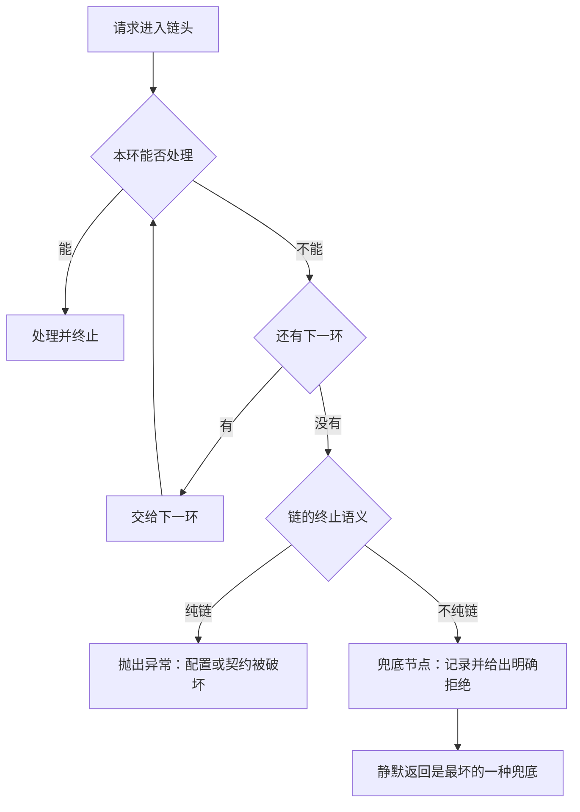
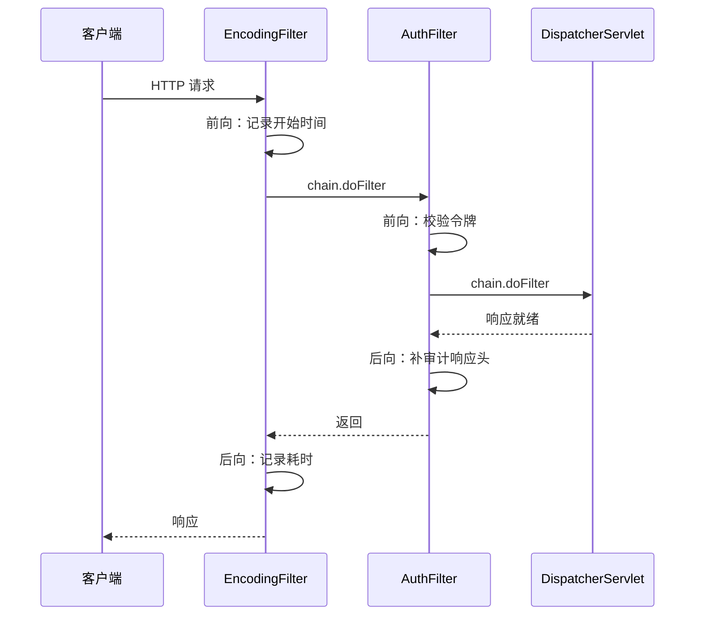
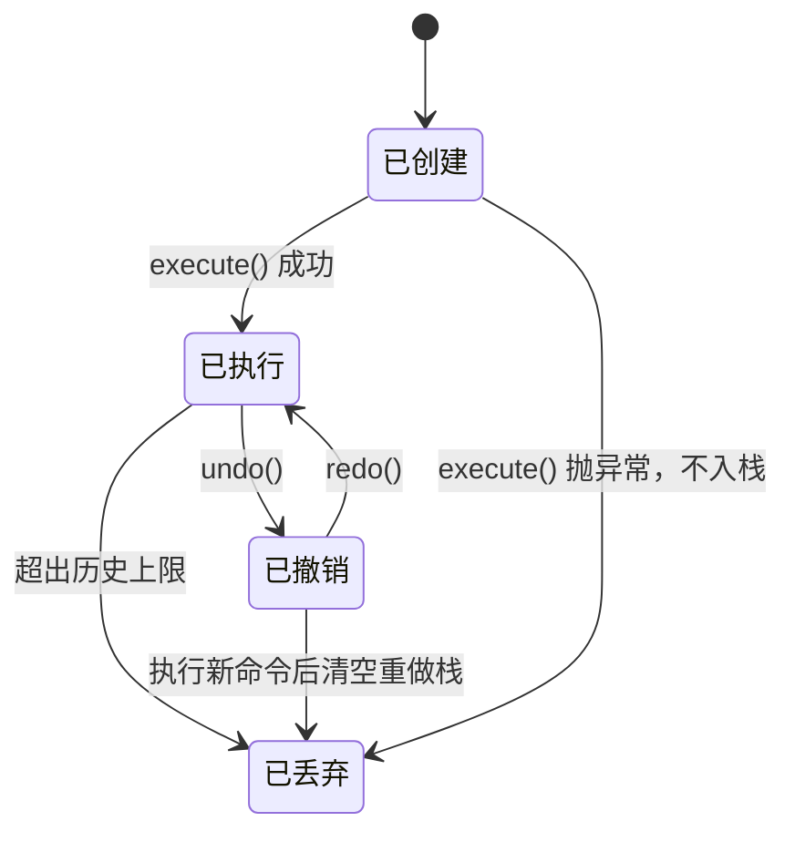
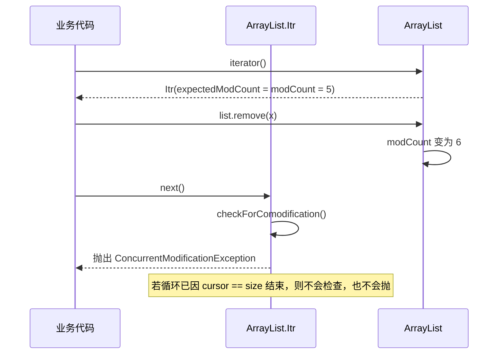
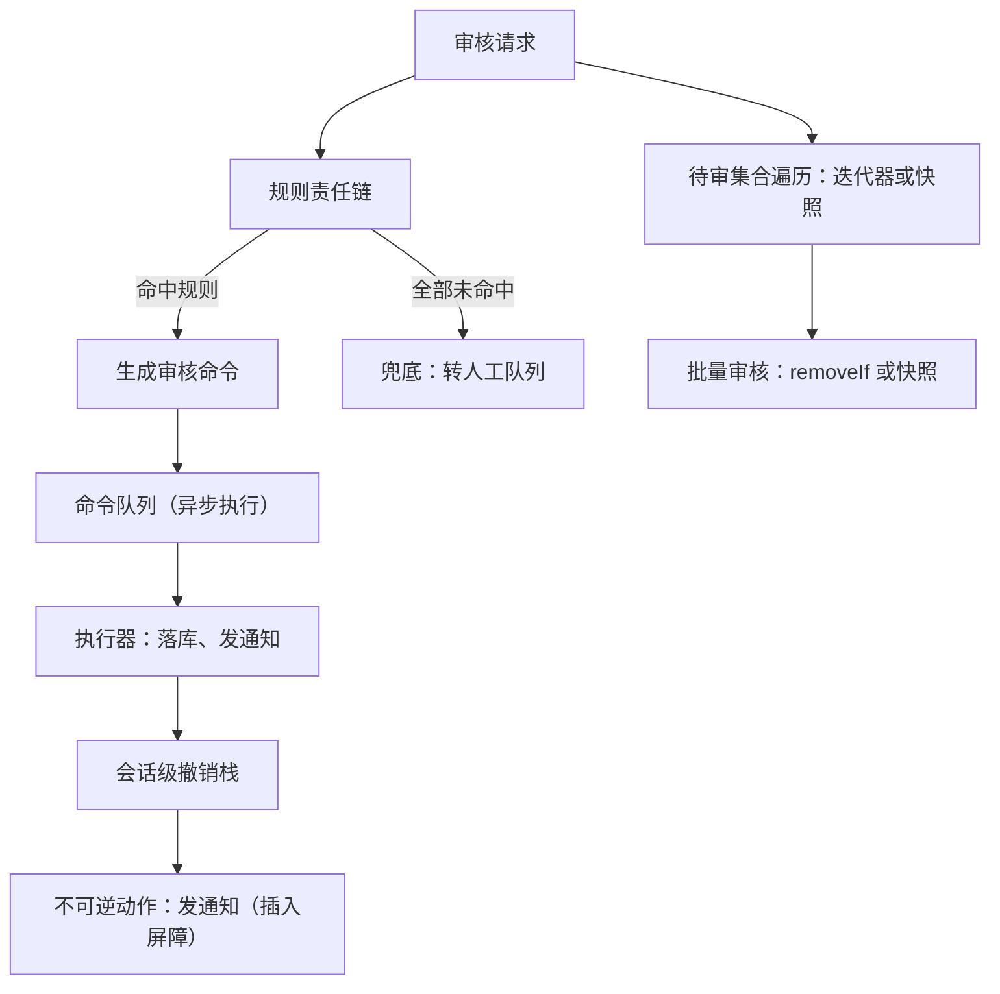

# 行为型模式（中）——责任链、命令与迭代器

**摘要：**

1994 年 GoF 把责任链、命令、迭代器并列为行为型模式时，三者回答的其实是三个层次不同的问题：一个请求该由谁来处理，一次操作如何被记住并撤回，一组元素如何被安全地走过。本文按这三条线展开，落点是它们在 Java 生态里的真实形态与失效边界。责任链部分区分纯链与不纯链两种终止语义，给出"无人处理是否合法"的五条判据，解释 Servlet 的 `FilterChain.doFilter` 为什么同时具备前向与后向两个方向，以及 `@Order` 这类排序手段管不到的地方；命令部分从快照与逆操作的分野讲起，落到简单命令、可撤销命令、宏命令三个变体，把撤销栈的三条真实约束逐条拆开；迭代器部分以 `ArrayList.Itr` 的 `modCount` 检查为主线，说明 fail-fast 是尽力而为的缺陷检测而非线程安全保证，再对比三种 fail-safe 语义的差异。三者共同的教训是：结构图只画出成功路径，真正的工程判断都发生在失败路径上，落点不是记住三个模式，而是知道它们各自在哪一步失效。

---

## 第 1 章 责任链：谁处理，以及还让不让往下走

### 1.1 一条链要回答的两个问题

1994 年，GoF 在《设计模式》里给责任链（Chain of Responsibility）举的例子是一个联机帮助系统：界面上任何一个控件被点击，帮助请求先由控件自己消化，消化不了就交给父容器，再交给窗口，直到有人能解释这个控件为止。这个例子埋下了后来所有争论的种子——"沿链传递"只是手段，真正需要设计的是两个问题：请求最终由谁处理，以及没有任何人处理时算不算正常结果。

前一个问题在教科书的图里画得很清楚：处理者持有下一个处理者的引用，处理不了就往下传。后一个问题被长期忽略，而它恰好是实践里分歧最大的地方。同样叫"责任链"，认证框架和 Web 中间件对"没人处理"的态度可以完全相反：前者认为这意味着配置错了，必须立刻失败；后者认为这是每天都在发生的正常结果，过滤器拒绝请求就该安静返回。

不妨先看没有链的时候，代码会变成什么样。下面这段请求处理逻辑把认证、限流、校验、业务、指标五个步骤写进同一个方法：

```java
// 反例：顺序藏在语句顺序里，是否继续藏在 early return 里
public Response handle(Request req) {
    if (!authenticator.check(req)) {
        return Response.unauthorized();          // 步骤一旦增删，这个方法就要改
    }
    if (!rateLimiter.tryAcquire(req.ip())) {
        return Response.tooManyRequests();
    }
    if (!validator.validate(req)) {
        return Response.badRequest();
    }
    Response resp = service.process(req);
    metrics.record(req, resp);
    return resp;
}
```

这段代码的问题不在于长，而在于它把三样东西焊死在了同一个类里：处理者的集合、处理者的顺序、以及"哪一步可以截断"的规则。要支持不同接口走不同的处理步骤，就只能加参数、加分支，最后退化成方法内部的一棵判断树。责任链把这三样东西从方法体里搬到了对象图里，于是增删一步变成增删一个节点，调整顺序变成调整一次装配。

链的装配有两种常见形态。一种是每个节点持有 `next` 引用，从链头进入，节点决定是否调用 `next`；另一种是调用方持有 `List<Handler>`，按顺序逐个调用。前者更接近 GoF 的原始描述，后者在框架里更常见，因为列表天然支持排序、插拔与快照，Spring Security 和 Servlet 容器的过滤器链都是列表形态。形态不影响语义，真正决定语义的是链尾那一步。

### 1.2 纯链：必须有人接住

**纯链**（pure chain）的约束可以概括成一句话：任何一环都可以拒绝处理，但整条链不能集体拒绝。请求进入链头之后，要么被某一环处理并终止，要么一路传到链尾，由链尾抛出明确的异常。GoF 原文强调"只有一个处理者处理请求"，工程上更值得关注的是"必须有人接住"这条承诺，它是纯链全部价值的来源。

```java
public interface Handler {
    /** 返回 true 表示请求已被本环处理，链到此为止 */
    boolean handle(Request req);
}

public final class PureChain {
    private final List<Handler> handlers;

    public PureChain(List<Handler> handlers) {
        this.handlers = List.copyOf(handlers);   // 装配后不可变，避免运行期改链
    }

    public void handle(Request req) {
        for (Handler h : handlers) {
            if (h.handle(req)) {
                return;
            }
        }
        throw new IllegalStateException("no handler accepted: " + req.type());
    }
}
```

这段代码里真正重要的不是 `for` 循环，而是最后那行 `throw`。它把"无人处理"从一个静默的返回值变成调用方必须面对的失败，配置错误会在第一次真实请求到来时暴露，而不是在监控图上表现为一条平缓的零值曲线。Spring Security 的 `ProviderManager` 就是这种语义：它按顺序询问每个 `AuthenticationProvider` 能否处理当前令牌，全部拒绝时抛 `ProviderNotFoundException`。JDK 的类加载器同构：父加载器逐级尝试，全部找不到就抛 `ClassNotFoundException`，不允许"什么都没发生"。

纯链的代价同样明确：处理者集合必须被视为封闭的。每新增一种请求类型，就得同步新增一个能处理它的节点，而编译器检查不了这个约束，只能靠启动自检或契约测试钉住。如果处理者来自插件或第三方扩展点，纯链的承诺就很难维持——你无法保证外部插件补齐了所有分支，于是"必须有人接住"退化成"但愿有人接住"。

### 1.3 不纯链：允许无人接住

**不纯链**（impure chain）放弃了这个承诺：每一环都可以处理、可以拒绝、可以继续，整条链走完仍然没人处理时，系统静默返回或者交给一个兜底节点。Servlet 的过滤器链是这种语义最典型的样本：`FilterChain.doFilter` 把请求交给下一环，如果某一环决定不调用它，请求就停在那一环，容器拿到的是一个没有后续处理的响应；如果所有过滤器都调用了它，请求最终会到达 Servlet，由 Servlet 负责产生响应。Servlet 在这里扮演的就是那个天然的兜底节点。

不纯链的失败模式因此变得隐蔽：过滤器忘记调用 `chain.doFilter`，客户端收到状态码 200、内容为空的响应，服务端没有任何异常，监控上看不到 4xx 也看不到 5xx，只有用户投诉页面白屏。这类问题在代码审查里极难发现，因为漏掉的那一行不产生编译错误，也不产生运行时异常，它只是让请求安静地消失。纯链至少会把这种错误变成异常，不纯链则把它变成了一次"成功"。

兜底节点的写法因此变得关键。兜底不等于返回 `null`，也不等于返回空的成功响应，它应该留下可归因的日志，并给出调用方能够理解的拒绝语义。

```java
// 不纯链的尾部：兜底不是"返回 null"，而是让"无人处理"这件事可观测、可归因
public final class DefaultHandler implements Handler {
    @Override
    public boolean handle(Request req) {
        log.warn("no rule matched, path={}, traceId={}", req.path(), req.traceId());
        throw new NoMatchingRuleException(req.path());   // 也可以返回明确的 404/403
    }
}
```

Spring Security 的过滤器链是"不纯 + 兜底"的工业折中：链上每个过滤器都可以决定不再往下走（认证失败写 401，跨域预检直接返回），链尾的授权过滤器负责**默认拒绝**，没有任何规则显式放行的请求一律拒绝。默认拒绝之所以能成立，前提是链尾确实有人兜底，而不是指望某个业务过滤器碰巧接住。

### 1.4 判据：五问定形态

纯链与不纯链没有优劣，只有是否匹配语义。笔者用五个问题来判断，顺序从业务语义问到工程约束。

第一问，"无人处理"是不是合法业务结果。限流拒绝、参数校验拦截都是每天发生的正常结果，拒绝本身就是处理，不纯链更自然；一个必须被某种协议解释的字节流如果无人认领，那就是配置错误，该走纯链。

第二问，链尾有没有天然接收者。Servlet 链末尾一定有 Servlet，Spring Security 链末尾一定有授权过滤器，"不纯"因此安全；如果链是开放式的，末尾什么都没有，纯链反而更容易维护。

第三问，静默失败的代价有多大。如果一个请求被悄悄丢弃之后，外部只能通过用户投诉发现，那么这条链就不该允许静默；支付、下单、审批这类链路，宁可抛异常也不能静默。

第四问，处理者集合是否封闭。编译期能枚举全部处理者，纯链的可验证性最好；处理者来自插件或配置，纯链的"必须有人接住"很难兑现，此时该退一步用不纯链加兜底节点，并把兜底节点作为可观测点。

第五问，调用方是否需要区分"没人处理"和"处理失败"。这两件事在纯链里是两种异常，在不纯链里常被合并成一个兜底返回值；上层需要据此做不同决策时，纯链的表达力更强。

| 维度 | 纯链 | 不纯链 |
|------|------|--------|
| 终止语义 | 必须有一环处理，否则抛异常 | 允许全部拒绝，静默返回或兜底 |
| 典型落点 | `ProviderManager`、类加载器委派、协议协商 | Servlet Filter 链、Spring Security 过滤器链 |
| 失败暴露 | 失败即异常，问题早暴露 | 失败可能表现为空响应，问题晚暴露 |
| 处理者集合 | 适合封闭、可枚举的集合 | 适合开放、可插拔的集合 |
| 扩展成本 | 新增请求类型必须配套处理者 | 新增处理者不影响既有语义 |
| 主要风险 | 处理者缺失时运行时抛错 | 忘记转发导致请求静默消失 |

两种形态在代码上的差别其实只有一个 `throw`，但这个 `throw` 决定了整条链的失败语义。很多团队在写链的时候只想着"如何让处理者解耦"，忘了问"没人处理时怎么办"，最后得到一条既不像纯链也不像不纯链的东西：链尾返回 `null`，调用方对 `null` 做判空，判空之后随手返回一个默认值，默认值又恰好掩盖了配置错误。这种链比不用模式更糟，因为它把失败藏进了一个看起来正常的返回值里。两种终止语义的分叉只发生在链尾，区别如下图所示。



### 1.5 顺序为什么会变成缺陷

链一旦超过两个节点，顺序就成了设计的一部分，而不是实现的细节。认证放在限流之前还是之后，行为完全不同：认证在前，未携带令牌的请求会被直接打回，不会消耗限流配额；限流在前，未认证的流量也会计入 IP 配额，攻击者可以用无效令牌把某个 IP 的正常用户挤掉。两种顺序都说得通，但必须是有意选择的结果，而不是 `@Order` 随手写了个数字。

顺序问题之所以难查，是因为它通常不报错。包装请求体的过滤器如果排在读取请求体的过滤器之后，后者读到的就是原始流，读完一次之后流就空了，前面的包装器再想读只能拿到空内容；响应压缩如果排在安全过滤器之前，压缩后的字节流可能绕过某些基于内容的检查。这些错误都不会抛异常，只会表现为"某个功能偶发失灵"，而偶发的原因往往与请求大小、编码方式、是否命中缓存有关，排查成本极高。

顺序的保证手段在 Java 生态里大致有五种，各自的边界差别很大。

| 机制 | 作用对象 | 优先规则 | 边界与风险 |
|------|----------|----------|------------|
| 显式构造链 | 手写链、列表形态 | 代码书写顺序 | 编译期可见，但增删节点要改装配代码 |
| `@Order` / `Ordered` | Spring 容器中的同类型 Bean | 值小者优先 | 只管同类 Bean，跨注册机制不保证 |
| `FilterRegistrationBean#setOrder` | Spring Boot 注册的 Servlet Filter | 值小者优先 | 与 `web.xml` 注册的过滤器之间无统一顺序 |
| `web.xml` 的 `filter-mapping` 声明顺序 | 传统 WAR 部署 | 声明顺序 | 注解注册的过滤器不参与这套顺序 |
| `@WebFilter` | Servlet 3.0 注解 | 规范未规定 | 依赖容器实现，不可作为设计前提 |

这张表里最容易被忽略的是最后一行。`@WebFilter` 看起来和 `@Component` 一样方便，但 Servlet 规范没有规定注解过滤器的顺序，不同容器可能给出不同结果，同一容器换版本也可能变。把安全过滤器交给 `@WebFilter` 排序，等于把正确性交给没有承诺的实现细节。可靠的做法是只留一个编排入口：全部用 `FilterRegistrationBean` 显式指定，或全部在 `web.xml` 里声明。

Spring Security 的顺序问题还有一层：应用里存在多个 `SecurityFilterChain` Bean 时，`FilterChainProxy` 按 `@Order` 从前往后匹配，第一个 `RequestMatcher` 命中的链生效，后面的链根本不参与。这意味着"给某个路径加一条更严格的规则"不一定生效——如果前面有一条宽泛的链先匹配上，新规则永远轮不到。日志里表现为"配置明明写了却没执行"，根因是链的选择发生在过滤器执行之前。

### 1.6 FilterChain 的前向与后向

Servlet 的 `Filter` 接口只有一个方法，签名里带着 `FilterChain`：

```java
public interface Filter {
    void doFilter(ServletRequest request, ServletResponse response, FilterChain chain)
            throws IOException, ServletException;
}
```

初学者常把 `chain.doFilter(req, res)` 理解成"把请求交出去，我这一环就结束了"，于是写在方法最后一行，前面放前置逻辑。这样写能跑，但只用了接口一半的能力。`doFilter` 是一次普通方法调用，控制权在下一环返回后还会回到当前这一环，所以一次调用里可以同时有前置和后置两段逻辑：

```java
@Override
public void doFilter(ServletRequest req, ServletResponse res, FilterChain chain)
        throws IOException, ServletException {
    long start = System.nanoTime();
    try {
        chain.doFilter(req, res);              // 前向：把控制权交给下一环
    } finally {
        metrics.record(System.nanoTime() - start);   // 后向：下一环返回后执行
    }
}
```

`try/finally` 不是可有可无的写法。后向逻辑写在 `chain.doFilter` 之后而不加保护，一旦下游抛异常，这段逻辑就被跳过，指标里会出现"有开始没有结束"的请求；更糟的是，清理 `ThreadLocal`、归还连接、恢复 MDC 这类后置操作如果被跳过，会污染线程池里的下一个请求。过滤器链是少数几个必须把异常路径和后向逻辑一起考虑的地方。把一次调用按时间展开，前向与后向的分工如下图所示。



这张时序图画出了一个常被误称为"环绕通知"的结构：请求从链头流向链尾，响应从链尾回到链头，每个节点在去程和回程各有一段时间片。Spring AOP 的 `@Around` 通知与它同构，`ProceedingJoinPoint.proceed()` 的角色就是 `chain.doFilter`；区别在于 AOP 的环绕通知作用在方法调用上，而过滤器作用在 HTTP 请求上，前者可以修改返回值，后者只能修改请求和响应对象。理解了这层同构，就不会再把"过滤器只能做前置"当成常识。

后向逻辑有一个硬约束：响应一旦提交，再改就来不及了。`getWriter().write()` 之后响应头已发给客户端，此时再 `setHeader` 不报错也不生效。需要修改响应头的逻辑必须放在 `chain.doFilter` 之前，或者用 `HttpServletResponseWrapper` 把响应缓冲起来统一处理。包装器能解决顺序问题，代价是响应体被完整缓冲，大文件下载时会把内存打满。

### 1.7 Spring Security 与 Logback 的两种链

Spring Security 的过滤器链是 Servlet 过滤器链的嵌套版本。容器链上只挂一个 `FilterChainProxy`，它内部按 `RequestMatcher` 选一条 `SecurityFilterChain`，顺序执行完安全过滤器后才调用容器的 `chain.doFilter`。嵌套带来两个后果：安全过滤器顺序由框架注册表管理，与容器过滤器互不干扰；同一请求可匹配多条安全链，只有第一条生效，`@Order` 决定哪套规则说话。

`FilterChainProxy` 的这种设计解决了一个很实际的问题：安全规则需要按路径分组，而 Servlet 容器只认识一条扁平的过滤器链。把分组逻辑收进一个代理过滤器，容器侧保持简单，框架侧获得表达力。代价是排障时调用栈多出两层，日志里的过滤器名字与容器注册的名字对不上，需要借助 `FilterChainProxy` 的调试日志还原执行顺序。

Logback 的 Appender 则提醒我们不要把"列表"都当成"责任链"。一个 Logger 上挂着多个 Appender 时，日志事件会被依次交给每一个 Appender，全部执行完才结束，`additive` 为真时还会继续向父 Logger 的 Appender 传播。这是扇出（fan-out），不是链式筛选：没有任何一个 Appender 能"截断"后续 Appender。真正具备链语义的是 Appender 内部挂的 `Filter` 链：每个 `Filter` 返回 `DENY`、`NEUTRAL` 或 `ACCEPT`，`DENY` 立即丢弃事件并终止判断，`ACCEPT` 立即放行并跳过剩余过滤器，`NEUTRAL` 则继续询问下一个，全部 `NEUTRAL` 时按正常流程输出。三种返回值分别对应拒绝、弃权、接受，多出来的 `ACCEPT` 让某个过滤器能越过后续检查，这是纯链语义在日志框架里的一个小型实现。

把三者放在一张表里对比，可以看到"链"这个词在不同框架里对应的语义差别有多大。

| 实现 | 链形态 | 能否截断 | 方向 | 顺序由谁决定 |
|------|--------|----------|------|--------------|
| Servlet Filter 链 | 不纯链，终端是 Servlet | 能，不调用 `doFilter` 即截断 | 前向 + 后向 | 容器按注册顺序，注解无序 |
| Spring Security 过滤器链 | 不纯链，默认拒绝兜底 | 能，过滤器直接写响应 | 前向 + 后向 | `@Order` 选链，注册表定内部顺序 |
| Logback Appender 的 Filter 链 | 纯链，三态判定 | 能，`DENY` 立即终止 | 单向 | 配置文件中的声明顺序 |
| Logback Appender 列表 | 扇出，不是链 | 不能 | 单向 | 声明顺序，但每个都会执行 |

### 1.8 责任链与装饰器的分界

责任链与装饰器（Decorator）在代码形态上几乎一样：都持有一个同类型引用，都在调用前后插入逻辑，都可以层层嵌套。正因为像，很多代码把装饰器写成了责任链，或者反过来，半年后自己说不清这段嵌套到底在做什么。

判据要从调用方视角找。装饰器的调用方知道自己在使用一个组件，也知道它被包装过若干层，期望的是功能叠加：去掉任意一层，剩下的层仍完整工作，请求仍到达最内层的真实组件，只是少了某项增强。责任链的调用方只知道把请求交给链头，不关心谁处理；去掉一环，处理责任转移到后一环，结果可能完全不同。换句话说，装饰器的默认义务是转发，缓存装饰器命中时可以不转发，但它交回的仍是同一次操作的结果；责任链的不转发是把职责交给下一环，两者含义不同。

| 维度 | 责任链 | 装饰器 |
|------|--------|--------|
| 封装的变化 | 处理者集合与顺序 | 对象职责的叠加 |
| 是否必然转发 | 否，可以终止 | 是，必须调用内层 |
| 终止语义 | 正常语义，处理即终止 | 不存在终止，只存在返回 |
| 调用方视角 | 不知道谁处理 | 知道组件被包装，但不关心包装了几层 |
| 去掉一环的后果 | 处理责任转移，结果可能不同 | 功能缺失，请求仍到达目标 |
| 顺序敏感性 | 高，顺序常常决定正确性 | 低，多数装饰可交换 |
| 典型落点 | Servlet Filter、Security 过滤链 | `InputStream` 装饰族、`BufferedReader` |

代码层面的差别可以用两个最小骨架说明：

```java
// 装饰器：构造器注入被装饰对象，接口不变，所有方法都委托
public final class LoggingRepository implements Repository {
    private final Repository delegate;
    public LoggingRepository(Repository delegate) { this.delegate = delegate; }
    @Override public Order find(long id) {
        log.info("find {}", id);
        return delegate.find(id);          // 无条件转发
    }
}

// 责任链：节点之间没有"被装饰对象"的概念，只有"下一个处理者"
public final class AuthHandler implements Handler {
    private final Handler next;
    @Override public boolean handle(Request req) {
        if (!authenticated(req)) return reject(req);   // 可以终止
        return next.handle(req);                        // 也可以转发
    }
}
```

实际系统里两者常常混在一起，Servlet Filter 就是典型：它既能拦截请求（链的语义），又能包装请求对象（装饰器语义）。判断标准不是类名，而是意图——不调用 `chain.doFilter` 是合法设计（譬如鉴权失败），它承担的是链的职责；无论如何都必须转发、只是给请求加一层能力，它承担的是装饰器职责。一个类兼有两种职责并不罕见，但文档里必须写清它在什么情况下终止。

### 1.9 反例：没有兜底的链

一条没有兜底的链，最常见的写法是链尾返回 `null`：

```java
// 反例：链尾返回 null，调用方判空后随手给默认值，配置错误被彻底吞掉
public Response handle(Request req) {
    for (Rule rule : rules) {
        Response r = rule.apply(req);
        if (r != null) return r;
    }
    return null;          // 调用方看到 null 会怎么办，取决于它当时的心情
}
```

这段代码有三重问题。`null` 没有语义，可能是"没人处理"，也可能是"处理了但没有响应体"，调用方无从区分；调用方为了不抛空指针通常会给默认值，而默认值恰好掩盖了"规则没配全"；链尾没有任何日志，线上出现"请求没反应"时，你不知道请求走到了哪一环，因为每一环都在沉默。

正确的写法在链尾做三件事：记录可检索的上下文（请求类型、链路 ID、已尝试的规则）、抛出或返回一个明确的失败语义、在监控上暴露计数。第三件事最容易被省略，但它决定了这个问题是"上线当天被发现"还是"三个月后被用户投诉"。

另一种反例是链过长且职责重叠。一条链超过七八个节点就该停下来审视：这些节点真的各自独立，还是有几个可以合并？链越长，顺序敏感的组合越多，任何一次插入都要重新推演前后依赖。一个节点只做一件事的前提，是这件事真的值得单独成为一个节点。

---

## 第 2 章 命令：把一次操作变成可以被推迟、被记住的东西

### 2.1 撤销为什么难：快照与逆操作

命令模式（Command）的经典定义只有一句话：把一个请求封装成对象。这句话之所以需要一本书来解释，是因为封装成对象之后，请求获得了方法调用形态下不可能拥有的能力——被排队、被记录、被序列化、被撤销。前三种能力在消息队列与任务调度里司空见惯，第四种才是命令模式真正的分水岭，也是绝大多数实现翻车的地方。

撤销有两条路。第一条是**快照**：每次操作前把整个对象的状态复制一份，撤销时整体换回去。实现极其简单，数据库开一个事务就能做到。代价是内存，一份几十兆的富文本文档每敲一个字存一份快照，几分钟就能把堆撑爆；即便做增量快照，复制开销也会让输入变卡。

第二条路是逆操作：不保存状态，只保存"做了什么"，撤销时执行这个动作的反向动作。插入文本的逆操作是删除同一区间，删除文本的逆操作是把删掉的内容插回原位，修改属性的逆操作是把旧值写回去。这条路的内存开销与操作次数成正比，与对象大小无关，代价是每一类操作都必须能写出逆操作，而且逆操作所需的全部信息必须在执行时就被捕获。

| 维度 | 快照 | 逆操作 |
|------|------|--------|
| 内存开销 | 与对象大小 × 历史深度成正比 | 与操作次数成正比，通常是常量级 |
| 实现难度 | 低，复制即可 | 高，每类操作都要设计逆操作 |
| 适用前提 | 状态小、变更频繁、可整体替换 | 操作可逆、逆操作所需信息可在执行时捕获 |
| 典型落点 | 数据库事务、配置整包回滚、小对象编辑 | 文本编辑器、画布、表单字段级撤销 |
| 主要风险 | 内存爆炸、复制开销拖慢交互 | 逆操作写错导致状态漂移、不可逆操作无法处理 |

命令模式通常走第二条路，但两条路并不互斥。真实的编辑器往往混合使用：普通输入走**逆操作**，大范围重排（譬如全文替换）走快照，因为为它设计精确的逆操作不划算。判断标准是逆操作需要保存的信息量，如果它与快照差不多，就没有理由不用快照。

### 2.2 简单命令：把执行推迟

最简单的一类命令只需要 `execute()`，甚至只需要 `run()`。Java 的 `Runnable`、`Callable`、`Supplier` 都是命令接口的最小化版本：它们把一段行为包装成可以传递的对象，调用方拿着它决定什么时候、在哪个线程、以什么顺序执行。

```java
// 简单命令的价值不在"执行"，而在"把执行的时间与地点从调用方剥离"
public final class ReportService {
    private final ThreadPoolExecutor executor = new ThreadPoolExecutor(
            4, 4, 0L, TimeUnit.MILLISECONDS,
            new ArrayBlockingQueue<>(200),              // 有界队列，背压显式化
            new ThreadPoolExecutor.CallerRunsPolicy()); // 队列满时由提交线程自己执行

    public void requestReport(long userId) {
        executor.execute(() -> reportGenerator.generate(userId));   // Runnable 即命令
    }
}
```

`ThreadPoolExecutor` 的 `execute` 做的事情，本质上就是命令模式的教科书流程：把 `Runnable` 包装成内部任务，放进工作队列，由工作线程取出执行。任务队列是命令的缓冲区，拒绝策略是缓冲区满时的失败语义。这里有一个与撤销栈同构的陷阱：队列换成无界的 `LinkedBlockingQueue` 之后，提交方永远不会被拒绝，看上去系统很稳，实际上任务在内存里一直堆积，直到某次 GC 之后直接 OOM。无界队列把背压从"提交时失败"推迟成了"运行时崩溃"，而后者的发生时刻与业务高峰完全脱节。

`FutureTask` 在简单命令之上加了结果获取与执行取消。它的状态机（未开始、运行中、已完成、已取消）说明了一件常被忽略的事——命令一旦进入并发环境就需要明确的生命周期，调用方必须知道这个命令还能不能取消、结果还有没有人要。裸 `Runnable` 适合即发即忘，需要追踪结果的场景应该用 `Callable` 配合 `Future`。

Swing 的 `javax.swing.Action` 是简单命令的另一个变体，它把命令与界面状态绑在一起。一个 `Action` 同时携带名称、图标、快捷键、启用状态和 `actionPerformed` 入口；同一个实例可以挂到菜单项、工具栏按钮和快捷键上，任何一处改变启用状态，其余几处自动同步，因为它们观察的是同一个对象的属性变化。这把"什么时候能点"的判断从各个控件收拢到命令内部。代价是 `Action` 同时承担命令与视图模型职责，违反了单一职责，后来的 UI 框架大多把两者拆开。

### 2.3 可撤销命令与历史栈

可撤销命令在 `execute()` 之外多了一个 `undo()`，并且需要一个调用者（invoker）来维护历史。下面的骨架省略了参数校验和异常处理，只保留与撤销语义直接相关的部分：

```java
public interface Command {
    void execute();
    void undo();
}

public final class InsertText implements Command {
    private final TextDocument doc;
    private final int offset;
    private final String text;

    public InsertText(TextDocument doc, int offset, String text) {
        this.doc = doc; this.offset = offset; this.text = text;
    }
    @Override public void execute() { doc.insert(offset, text); }
    @Override public void undo()    { doc.delete(offset, text.length()); }
}

public final class DeleteText implements Command {
    private final TextDocument doc;
    private final int offset;
    private final int length;
    private String removed;          // 必须在 execute 时捕获，不能在 undo 时再读

    public DeleteText(TextDocument doc, int offset, int length) {
        this.doc = doc; this.offset = offset; this.length = length;
    }
    @Override public void execute() {
        this.removed = doc.substring(offset, offset + length);   // 先记再删
        doc.delete(offset, length);
    }
    @Override public void undo() { doc.insert(offset, removed); }
}
```

`DeleteText` 里 `removed` 字段的赋值时机是核心。偷懒把它放到 `undo()` 里再读，撤销时文档已被改过，读到的内容与当初删掉的不一定一致；把它设计成构造器参数，调用方就得在创建命令时先读出要删的内容，把"读"和"删"拆成两步，中间可能被其他操作插入。命令模式的正确性很大程度上取决于这类"信息捕获时机"，而这些细节无法从结构图上读出来。

调用者维护两个栈：已执行栈与重做栈。执行新命令时压入已执行栈并清空重做栈；撤销时从已执行栈弹出、调用 `undo()`、压入重做栈；重做反过来。流程很机械，但有三处容易写错。`execute()` 抛异常时不能入栈，否则历史里会出现一条从未成功执行过的命令。重做栈必须在执行新命令时清空，否则用户撤销后又做新操作，旧的重做记录仍在，重做会跳到一个逻辑上不存在的状态。`undo()` 本身也可能失败，失败后命令该留在哪个栈里必须有约定，否则栈与文档的状态会逐渐漂移。命令在历史中的状态迁移如下图所示。



Swing 的 `UndoManager` 是这个模型的标准实现，它把历史抽象成一串 `UndoableEdit`，并提供三个值得借鉴的机制。`isSignificant()` 允许把连续的小编辑合并成一次撤销单位；`CompoundEdit` 把多个编辑打包成原子单位，对应下一节的宏命令；`setLimit(int)` 给历史长度设上限，默认 100，超出后最老的编辑被丢弃。笔者在 JDK 17 上实测，连续加入 105 个编辑之后能撤销的步数正好是 100，最早的五步不可恢复。这个默认值反映了一个经验：撤销深度的价值随深度递减，内存占用却随深度线性增长，取折中比追求无限历史更合理。

### 2.4 宏命令与部分失败

宏命令（MacroCommand）把一组命令组合成一个命令，执行时按顺序执行子命令，撤销时按逆序撤销。逆序不是可选项：先创建文件再写入内容，撤销时必须先撤销写入再撤销创建，反过来会得到一个"文件不存在但内容还在"的荒谬状态。

```java
public final class MacroCommand implements Command {
    private final List<Command> commands;
    private final Deque<Command> executed = new ArrayDeque<>();

    public MacroCommand(List<Command> commands) { this.commands = List.copyOf(commands); }

    @Override public void execute() {
        try {
            for (Command c : commands) {
                c.execute();
                executed.push(c);           // 只有成功的才记录
            }
        } catch (RuntimeException e) {
            rollback();                     // 部分失败：把已经成功的逆序撤掉
            throw e;
        }
    }

    private void rollback() {
        while (!executed.isEmpty()) {
            executed.pop().undo();          // 回滚本身也可能失败，需要单独处理
        }
    }

    @Override public void undo() { rollback(); }
}
```

这段代码有两点值得停一下。**宏命令**的"回滚"不是数据库意义上的回滚：数据库回滚由资源管理器保证原子性，中间状态对外不可见；宏命令的回滚是应用层逐个调用 `undo()`，中间状态可能已被其他线程看到，回滚本身也可能中途失败，留下"撤了一半"的状态。回滚失败必须记录并告警，不能吞掉，因为系统已经进入既非全做也非全不做的状态。

这与分布式事务里的**补偿**（compensation）是同一个问题。1987 年 Garcia-Molina 和 Salem 提出的 Sagas 模型给出了基本思路：把长事务拆成一串本地事务，每个本地事务配一个补偿动作，失败时逆序执行。补偿与回滚的关键差别在语义——回滚是当作没发生过，补偿是再做一件相反的事。退款不是把支付抹掉，而是产生一条退款记录；取消订单不是让订单消失，而是把状态改成已取消。理解了这点，就不会在设补偿时追求无痕，而会去保证幂等与可观测。

> [!warning] 宏命令不是事务
> 把一组命令包成宏命令，只能保证"尽力按顺序执行、尽力逆序撤销"，不能保证原子性、隔离性和持久性。真正的原子性需要数据库事务或分布式事务协议来提供，宏命令适合的是那些"每一步都可补偿、中间状态可接受"的业务。

### 2.5 撤销栈的三个真实约束

**撤销栈**的实现代码通常不超过五十行，但它在生产环境里会遇到三类教科书不写的问题。

第一类是**不可逆操作**。发出去的邮件、调用成功的第三方支付、删除的外部文件，这些操作没有逆操作。工程上有三种处理方式：把命令标记为不可撤销，`undo()` 抛 `UnsupportedOperationException`，UI 上禁用撤销按钮；让 `undo()` 静默地什么都不做，这是最危险的一种，用户以为撤销成功，实际上状态没变，下一次操作会基于错误的前提展开；改用补偿，不撤销原操作，而是执行一个相反的业务动作，譬如发一封更正邮件、发起一笔退款。补偿会留下痕迹，补偿本身也可能失败，需要重试与对账。

除了单个命令的不可逆，还有整条历史的不可逆。用户先改了一段文字，然后点击"发布"，发布这个动作不可撤销，那么发布之前的编辑历史是否还能撤销？合理的做法是在历史里插入**屏障**（barrier）：屏障之前的命令不可跨越，撤销只能停在屏障处，UI 上给出明确提示。不做屏障而直接允许撤销，会导致线上已发布的内容与编辑器里的内容不一致，这是内容类系统里非常典型的一类事故。

第二类是**内存上限**。撤销栈的每一帧都持有命令对象，命令对象又持有接收者引用、被删除的内容、修改前的旧值，栈越深，持有的数据越多。一个支持无限撤销的编辑器，堆里可能躺着几十万条命令和它们引用的字符串。对策有三种：固定栈深、合并命令、历史落盘。三种都有代价：固定栈深会让用户"撤不回去"，必须在 UI 上说明支持最近多少步；合并命令改变撤销粒度，按一次可能回退一大段；落盘引入序列化成本与版本兼容问题。

撤销栈的淘汰方向与任务队列相反。队列满了拒绝的是最新的任务，撤销栈满了丢弃的是最老的命令，因为用户总是更想撤销刚才的操作。这个方向差异决定了两种结构在用户体验上的根本不同：队列保护的是系统，撤销栈保护的是用户对"刚才"的预期。

第三类是**并发**。单线程 GUI 里撤销栈天然安全，所有操作都发生在 UI 线程；一旦命令被提交到线程池异步执行，历史栈立刻变成共享可变状态。`ArrayDeque` 不是线程安全的，换成 `ConcurrentLinkedDeque` 也不够，因为"判断能否撤销"与"弹出命令"是两步操作，需要原子性。真正的难点是顺序：命令 A 先提交、B 后提交，但 B 先执行完，按完成顺序入栈时撤销 B 再撤销 A 是合理的，按提交顺序入栈则可能撤销一个还没生效的状态。解决办法不是给栈加锁，而是把执行串行化到单写者线程；确实需要并行的命令，则在完成时入栈并分配序号。

| 约束 | 典型现象 | 对策 | 代价 |
|------|----------|------|------|
| 不可逆操作 | 撤销后状态未变，用户继续操作导致数据错乱 | 标记不可撤销、插入历史屏障、改用补偿动作 | 补偿留痕、补偿可能失败、需要幂等与对账 |
| 内存上限 | 长时间编辑后堆占用持续上涨，最终 OOM | 限制栈深、合并连续命令、历史落盘 | 撤销深度受限、撤销粒度变粗、序列化成本 |
| 并发顺序 | 异步命令完成后撤销顺序错乱，或撤销了未完成的命令 | 单写者串行化、完成时入栈、命令序号 | 吞吐下降、实现复杂度上升 |

### 2.6 命令与策略的分界

命令与策略（Strategy）都是用对象替换一段行为，都通过接口把调用方与实现解耦，所以经常被混用。判据在于封装的对象是什么：**命令**封装的是"一次请求"，它知道接收者是谁、参数是什么、这次操作对状态产生了什么影响；**策略**封装的是"一个算法"，通常无状态，同一个实例可以被反复调用，每次只依赖入参。

从调用方视角看，差别更直观。命令的调用方是调用者（invoker），它不知道命令具体做什么，只知道可以执行、可以排队、可以撤销，它关心时机与历史；策略的调用方是上下文（context），它清楚自己在计算什么，只是把"怎么算"委托出去，它关心选择哪套算法。需要记住"这次操作做了什么"的场景用命令，需要"换一种方式算同样的结果"的场景用策略。

| 维度 | 命令 | 策略 |
|------|------|------|
| 封装对象 | 一次请求及其接收者、参数、逆操作 | 一个算法 |
| 状态 | 有状态，携带接收者引用、执行上下文、撤销数据 | 通常无状态，可复用 |
| 调用方 | 调用者只负责触发、排队、记录历史 | 上下文负责选择并调用 |
| 生命周期 | 一次执行，可撤销、可重放 | 可反复调用，幂等 |
| 典型落点 | `Runnable`、`UndoableEdit`、事务补偿日志 | `Comparator`、折扣策略、序列化器 |
| 误用形态 | 给纯计算逻辑强加 `undo()` | 把每次操作都做成策略，导致无法记录历史 |

两者可以组合：命令内部可以持有策略，用策略决定这次操作的具体算法；策略也可以被命令包装，从而获得排队与重放的能力。组合不是混淆，混淆是用一个模式的接口去承担另一个模式的职责，譬如给纯计算逻辑强加 `undo()`。策略本身的展开见 [[06 行为型模式（上）——策略、模板方法与观察者]]。

### 2.7 落地：补偿日志与批处理

命令模式在服务端最实在的落点是补偿日志。跨服务的业务流程每一步都写一条命令记录（步骤号、类型、参数、状态、补偿标识），执行前先落库，执行后更新状态，失败时按逆序扫描未完成记录并执行补偿。日志与业务数据在同一个本地事务里提交，保证业务改了日志一定在；补偿动作要做成幂等的，因为重试是常态。

```sql
-- 补偿日志的最小结构：执行前写入，失败后按 id 逆序补偿
CREATE TABLE command_log (
    id            BIGINT PRIMARY KEY,
    biz_key       VARCHAR(64)  NOT NULL,   -- 幂等键，同一业务只补偿一次
    step_no       INT          NOT NULL,
    command_type  VARCHAR(64)  NOT NULL,   -- 对应哪个 Command 实现
    payload       TEXT         NOT NULL,
    status        VARCHAR(16)  NOT NULL,   -- PENDING / DONE / COMPENSATED / FAILED
    created_at    TIMESTAMP    NOT NULL
);
```

这张表的作用不只是记录，它把命令从内存对象变成了可审计、可重放、可人工介入的事实。线上出问题时，运维可以直接查表知道流程停在哪一步、补偿执行了几次、哪一条补偿失败。代价是每一步多一次写库，以及补偿逻辑的长期维护——补偿代码往往比正向代码更难写。

`javax.swing.Action` 展示了命令在客户端的另一种落地：命令对象同时是界面状态的载体，多个控件共享同一个实例，启用状态通过属性变更通知同步到所有控件。这把"什么时候能点"的判断从各个控件收拢到命令内部，避免了菜单项灰了但工具栏按钮还亮着的不一致。代价是命令与视图模型耦合，在非 GUI 环境里复用业务逻辑时显得笨重。

---

## 第 3 章 迭代器：遍历状态归谁所有

### 3.1 把遍历状态从集合里拿出来

迭代器（Iterator）大概是二十三种模式里最不起眼的一个：接口只有 `hasNext()` 和 `next()`，实现不过是一个游标加几次边界判断。但正是这个不起眼的接口，让 Java 的集合框架在 1998 年完成了一次统一——在此之前，`Vector`、`Hashtable`、`Enumeration` 各自为政，调用方要遍历一个容器，得先知道它是什么容器。

把遍历状态从集合里拿出来，带来三个好处。第一，同一个集合可以同时存在多个互不干扰的遍历过程，每个迭代器持有自己的游标，嵌套遍历不再需要集合提供"保存现场"的能力。第二，遍历逻辑与数据结构解耦，调用方只依赖 `Iterator` 接口，底层是数组、链表还是树对上层透明；集合类也不必为每种遍历方式都提供方法。第三，遍历可以是惰性的，`next()` 被调用时才计算下一个元素，无限序列与超大集合第一次能用同一套接口表达。

```java
// 惰性迭代：集合本身不存储元素，next() 被调用时才计算
public final class NaturalNumbers implements Iterable<Long> {
    @Override public Iterator<Long> iterator() {
        return new Iterator<>() {
            private long current = 0L;
            @Override public boolean hasNext() { return true; }
            @Override public Long next() { return current++; }
        };
    }
}
```

这段代码能成立，前提是遍历状态完全由迭代器持有，集合本身不需要知道遍历到哪了。如果遍历状态放在集合里，同一个集合就只能被遍历一次，嵌套循环会互相踩踏。这个选择看起来理所当然，却是从"容器自己提供遍历方法"到"容器返回一个遍历器"的关键一步，也是 `for-each` 能够成立的基础。

迭代器的代价同样存在。它是一次性的，走完就不能复用，想再遍历必须重新 `iterator()`；它是单向的，`Iterator` 没有 `previous()`，双向遍历要用只对 `List` 有效的 `ListIterator`；它与集合的修改紧密耦合，集合在迭代期间被改动，迭代器就可能失效，这正是下一节要展开的内容。

### 3.2 外部迭代器与内部迭代器

Java 的 `Iterator` 属于外部迭代器：调用方控制节奏，决定何时调用 `next()`、何时停止、循环体里做什么。Java 8 的 Stream 提供内部迭代器：调用方只声明"对每个元素做什么"，遍历过程由框架控制。

```java
// 外部迭代：调用方掌握节奏，可以在中途 break，可以同时操作多个集合
Iterator<Order> it = orders.iterator();
while (it.hasNext()) {
    Order o = it.next();
    if (o.amount() > threshold) {
        bigOrders.add(o);          // 循环体里可以做任何事
    }
}

// 内部迭代：调用方声明意图，框架决定怎么遍历
List<String> names = orders.stream()
        .filter(o -> o.amount() > threshold)
        .map(Order::customerName)
        .toList();
```

外部迭代器的优势是控制力：可以在循环里 `break`、可以同时推进两个迭代器做归并、可以把迭代器传给另一个方法继续消费。代价是状态管理责任落在调用方身上，忘了调用 `next()` 会死循环，在循环里改集合会抛异常。内部迭代器的优势是表达力与可优化空间：框架可以把 `filter` 和 `map` 融合成一次遍历，可以在 `parallelStream()` 时自动切分任务；代价是控制力减弱，循环里不能随意 `break`，副作用要格外小心。

Stream 的底层是 `Spliterator`，它在 `Iterator` 的基础上增加了分割能力：`trySplit()` 把剩余元素切成两半，一半留给当前线程，一半交给另一个线程。并行流之所以能工作，靠的就是这个接口；`Spliterator` 还带有 `ORDERED`、`SIZED`、`DISTINCT` 等特征位，框架据此决定能否跳过某些操作。`ArrayList` 的并行流通常比 `LinkedList` 快，正是因为前者可以按索引精确切分，后者只能顺着链表一点点走。

| 维度 | 外部迭代器 | 内部迭代器 |
|------|------------|------------|
| 控制权 | 调用方 | 框架 |
| 中途退出 | `break` 直接退出 | 需要 `takeWhile` 等算子 |
| 并行能力 | 需自行切分任务 | `parallelStream()` 自动切分 |
| 状态管理 | 调用方负责 | 框架负责 |
| 修改集合 | 容易触发失效检测 | 同样不允许，且更难定位 |
| 典型接口 | `Iterator`、`ListIterator` | `Stream`、`Spliterator` |

### 3.3 modCount 与 checkForComodification

`ArrayList` 的迭代器在创建时记录一个 `expectedModCount`，之后每次取元素都拿它与集合的 `modCount` 比较，不相等就抛 `ConcurrentModificationException`。这套机制被称为 **fail-fast**，更准确的说法是"尽快暴露结构性修改"：它检测的不是并发，而是"迭代期间集合被改过"。

```java
// Java 17 的 ArrayList.Itr，删去无关分支后的核心逻辑
private class Itr implements Iterator<E> {
    int cursor;                       // 下一个元素的索引
    int lastRet = -1;                 // 上一个返回的索引，-1 表示没有
    int expectedModCount = modCount;  // 创建迭代器时的版本号

    public boolean hasNext() {
        return cursor != size;        // 注意：这里不检查版本号
    }

    public E next() {
        checkForComodification();     // 取元素前检查
        int i = cursor;
        Object[] elementData = ArrayList.this.elementData;
        if (i >= size) throw new NoSuchElementException();
        cursor = i + 1;
        return (E) elementData[lastRet = i];
    }

    final void checkForComodification() {
        if (modCount != expectedModCount) {
            throw new ConcurrentModificationException();
        }
    }

    public void remove() {
        if (lastRet < 0) throw new IllegalStateException();
        checkForComodification();                 // 删除前也检查
        ArrayList.this.remove(lastRet);           // 真正修改集合
        cursor = lastRet;                         // 游标回退，跳过被删元素
        lastRet = -1;
        expectedModCount = modCount;              // 同步版本号，之后的 next 不会抛
    }
}
```

这段代码里有两个细节决定了后面所有的坑。第一，`hasNext()` 不检查版本号，只比较 `cursor != size`；第二，`next()` 检查版本号，但检查发生在取元素之前。两个细节合在一起，产生了 fail-fast 最著名的漏洞：在 `for-each` 里删除倒数第二个元素，循环可能在抛出异常之前就结束，于是既不报错，也漏掉了最后一个元素。这一检查过程如下图所示。



笔者在本机 JDK 17 上验证过这个边界：`[a, b, c, d]` 在 `for-each` 中删除 `c`，循环正常结束，结果是 `[a, b, d]`，`d` 从未被访问；删除 `b` 则立即抛异常。同一写法，一个静默出错，一个显式报错，差别只在于被删元素的位置。这也是不能把 fail-fast 当成保证的原因——它连"一定抛异常"都做不到。

`modCount` 本身只是一个 `protected transient int`，定义在 `AbstractList` 里，每次结构性修改递增。但"结构性"这个词在实现里比 javadoc 的描述要宽。`add`、`remove`、`clear`、`addAll`、有删除的 `removeIf` 会增加它，这些没有争议；`set` 不增加，因为元素个数没变，这个也没有争议；有争议的是 `sort`、`replaceAll`、`trimToSize`、`ensureCapacity`——它们并不改变元素个数，但在 Java 17 的 `ArrayList` 实现里同样会增加 `modCount`，因为在迭代过程中这些操作会改变元素的位置或数组本身。`ensureCapacity` 只在真正扩容时增加，不扩容时保持原值。

| 操作 | `modCount` 是否变化 | 迭代中的后果 |
|------|---------------------|--------------|
| `add` / `remove` / `clear` | 增加 | 下一次 `next()` 抛异常 |
| `removeIf`（有元素被删） | 增加一次 | 下一次 `next()` 抛异常 |
| `set` | 不变 | 正常，读到的是新值 |
| `get` / `size` / `contains` | 不变 | 正常 |
| `sort` | 增加 | 下一次 `next()` 抛异常 |
| `replaceAll` | 增加 | 下一次 `next()` 抛异常 |
| `trimToSize` | 增加 | 下一次 `next()` 抛异常 |
| `ensureCapacity` | 真正扩容时增加 | 扩容则抛，不扩容则正常 |
| `iterator.remove` | 增加，但同步更新 `expectedModCount` | 正常 |

这张表里最容易让人意外的是 `trimToSize`。它看起来只是把数组缩到实际大小，与元素内容无关，实现里照样递增 `modCount`。这类细节没法靠常识推断，只能靠读实现或读文档，而文档对"结构性修改"的定义又不够精确。笔者的建议是：迭代期间除了通过迭代器自身删除，不要对集合做任何修改操作，连 `sort` 这种看起来不改变长度的也不要，把迭代当作集合的只读窗口期。

### 3.4 为什么是 iterator.remove

`for-each` 里删除元素会抛异常，但为什么必须用 `iterator.remove()` 而不是 `list.remove()`，能说清楚的人不多。原因藏在上一节的代码里：`list.remove()` 会递增 `modCount`，但不会更新迭代器的 `expectedModCount`，于是下一次 `next()` 必然检查失败；`iterator.remove()` 在真正删除之后，把 `cursor` 回退到被删位置、把 `lastRet` 置为 -1、把 `expectedModCount` 同步成新的 `modCount`，三步合在一起，迭代器与集合重新对齐。

`iterator.remove()` 还有两条约束。调用之前必须先调用 `next()`，因为它删除的是上一个返回的元素，没有 `lastRet` 就无从删起，此时抛 `IllegalStateException`；一次 `next()` 只能配一次 `remove()`，连续调用两次，第二次会因为 `lastRet` 已是 -1 而抛 `IllegalStateException`。这两条在正常路径上不会触发，只有边界逻辑才会暴露。

```java
// 三种正确的删除方式，适用场景不同
Iterator<Order> it = orders.iterator();
while (it.hasNext()) {
    if (it.next().expired()) {
        it.remove();                       // 单线程、需要精确控制删除时机
    }
}

orders.removeIf(Order::expired);           // 单线程、按谓词批量删，ArrayList 内部用 BitSet 标记
List<Order> kept = orders.stream()         // 需要保留原集合不变时，生成新集合
        .filter(o -> !o.expired())
        .toList();
```

`removeIf` 在 `ArrayList` 里的实现值得单独提一句：它先用一个 `BitSet` 标记所有要删除的位置，最后一次性压缩数组，复杂度是 O(n)，而不是逐个 `iterator.remove()` 的 O(n²)。这也是为什么"用 `removeIf` 替代循环删除"不只是写法更短，它在数据量大时是实打实的性能差异。`Stream.filter().toList()` 则更适合"原集合不能动"的场景，代价是多一份内存，换来的是一份不可变的快照。

### 3.5 for-each 的编译产物

`for-each` 是语法糖，编译器会把它展开成迭代器调用。用 `javap` 反编译一个最简单的循环就能看到证据：

```text
// for (int x : list) { sum += x; } 的字节码（节选）
invokeinterface  java/util/List.iterator:()Ljava/util/Iterator;
astore_2
aload_2
invokeinterface  java/util/Iterator.hasNext:()Z
ifeq           38
aload_2
invokeinterface  java/util/Iterator.next:()Ljava/lang/Object;
checkcast       java/lang/Integer
```

而遍历数组的 `for-each` 展开成索引循环，字节码里出现 `arraylength`、`iaload` 和 `iinc`，没有 `Iterator` 的影子。这两条路径解释了"在 for-each 里改集合"与"在普通 for 里改集合"的后果为何不同：前者走迭代器的版本检查，后者走索引比较，前者会抛异常，后者可能越界，也可能静默跳过元素。

| 写法 | 是否安全 | 原因 |
|------|----------|------|
| `for (X x : list) list.remove(x)` | 否 | 展开成迭代器，修改后 `next()` 检查失败 |
| `for (int i = 0; i < list.size(); i++) list.remove(i)` | 否 | 删除后索引前移，会跳过元素 |
| `for (int i = list.size() - 1; i >= 0; i--) list.remove(i)` | 是 | 倒序删除不影响未访问部分的索引 |
| `iterator.remove()` | 是 | 迭代器自己维护游标与版本号 |
| `list.removeIf(...)` | 是 | 内部统一处理，只改一次结构 |
| `list.stream().filter(...).toList()` | 是 | 生成新集合，原集合不动 |

顺带说一个容易混淆的点：`Iterable.forEach` 和 `for-each` 不是一回事。`Iterable` 的默认 `forEach` 用迭代器实现，在 lambda 里改集合会抛异常；`ArrayList` 覆写了 `forEach`，用索引循环实现，并在循环前后检查 `modCount`，所以它同样会抛，只是抛出时机在循环结束或下一次条件判断，而不是在 `next()`。不同集合的实现不同，这也是为什么同一段代码换一个集合之后，可能从抛异常变成静默漏元素。

### 3.6 fail-safe 的三种做法

既然 fail-fast 会抛异常，并发场景下就需要一种不抛异常、能安全遍历的机制，这类机制通常被称为 **fail-safe**。但 fail-safe 不是一个统一的语义，Java 里至少存在三种实现，它们的差异比名字大得多。

`CopyOnWriteArrayList` 采用写时复制：任何修改都创建一个新数组，迭代器持有创建时刻的数组**快照**。快照在迭代器生命周期内不会变化，所以迭代永远不抛 `ConcurrentModificationException`，也永远看不到创建之后的修改。迭代器上的 `remove`、`set`、`add` 都不支持，直接抛 `UnsupportedOperationException`。写成本是 O(n) 的数组复制，读成本几乎为零，适合读多写少、规模不大的场景，譬如监听器列表、白名单。

`ConcurrentHashMap` 采用**弱一致**（weakly consistent）迭代器：迭代中不抛 `ConcurrentModificationException`，但不保证看到某个时刻的完整快照，可能看到新加入的元素，也可能看不到；`size()`、`isEmpty()` 返回的是瞬时估计值，只适合监控，不适合做控制逻辑。它的迭代器同样不是为多线程并发使用设计的——javadoc 明确写着迭代器设计为一次只被一个线程使用，弱一致解决的是"遍历时别的线程在改"，不是"多个线程共用同一个迭代器"。

`Collections.synchronizedList` 是三者里最容易被误用的。它给每个方法加同一把锁，单个操作线程安全，但迭代器仍是底层 `ArrayList` 的 fail-fast 迭代器，遍历期间其他线程修改集合照样抛异常。javadoc 对此有明确要求：遍历时必须手工在集合对象上加同步块，把整个迭代过程包起来。它保证的是方法级互斥，不保证迭代期间的一致性，用它来"解决" `ConcurrentModificationException` 只是在错误的方向上加锁。

| 集合 | 迭代语义 | 是否抛 CME | 是否看到并发新元素 | `iterator.remove` | 写成本 |
|------|----------|------------|--------------------|--------------------|--------|
| `ArrayList` | fail-fast，版本号检查 | 会 | 不允许修改 | 支持 | 均摊 O(1) |
| `CopyOnWriteArrayList` | 快照，创建时刻的数组 | 不会 | 不会 | 不支持 | O(n) 复制 |
| `ConcurrentHashMap` | 弱一致 | 不会 | 可能看到，也可能看不到 | 支持 | 分段/桶级同步 |
| `Collections.synchronizedList` | 底层集合的 fail-fast | 会 | 不允许修改 | 支持，但需手工同步 | 每次操作加锁 |

第四种做法不在集合框架里，但最常用：显式复制一份。`new ArrayList<>(list)`、`List.copyOf(list)`、`stream().toList()` 都会生成独立快照，之后的遍历与修改互不影响。代价是内存与复制时间，好处是语义最清晰——你明确知道自己在遍历哪个版本。集合不大、修改不频繁、逻辑正确性优先的场景里，这往往是最省心的选择。

### 3.7 失效检测不是线程安全

`ConcurrentModificationException` 最常见的误读，是把它当成"多线程修改集合时的保护机制"。它确实会在并发修改时出现，但它的目的不是保护，而是尽早暴露 bug；官方文档的措辞很克制：fail-fast 迭代器在存在非同步并发修改时无法做出硬保证，它们"尽力而为"地抛出异常，因此依赖这个异常来保证程序正确性是错误的，它只应该被用来检测缺陷。

不能保证的原因有两条。`modCount` 不是 `volatile` 的，一个线程的修改对另一个线程的迭代器未必可见，检查可能读到旧值，异常不会抛出；即便读到了新值，检查与使用之间也存在时间窗，检查通过之后集合仍可能被改，迭代器拿着过期索引去取元素，可能读到错位数据，也可能直接越界。两条都属于竞态条件，加一次检查解决不了，因为问题不在检查本身，而在"检查"与"使用"不是一个原子操作。

于是"没有抛异常"完全不能证明遍历是安全的。它可能意味着真的没有并发修改，也可能意味着修改没被检测到，还可能意味着遍历已结束、根本没触发检查。反过来，抛了异常也不一定有并发问题，单线程里在 `for-each` 中调用 `list.remove()` 同样会抛。把 `ConcurrentModificationException` 当成并发告警，会让人往查线程 dump、加锁的方向排查，而真正的问题可能只是一行写错的删除语句。

正确的做法是按场景选工具，而不是靠异常兜底。单线程边遍历边删，用 `iterator.remove()` 或 `removeIf`；多线程读多写少，用 `CopyOnWriteArrayList`；读写都频繁，用 `ConcurrentHashMap` 或自己控制锁粒度；需要强一致快照就先复制一份。四条路各有代价，没有一条能靠捕获异常再重试绕过去。

> [!info] 一个判断口诀
> 问自己"这个集合在遍历期间会不会被别的线程改"。答案是"不会"，就用普通集合并让 fail-fast 帮你抓单线程 bug；答案是"会"，就换并发集合或显式快照，不要试图用 `synchronized` 包住 `for-each` 了事——那样只是把异常换成了死锁或性能问题。

### 3.8 反例与正确写法

反例一，在 `for-each` 里调用 `list.remove()`。这是最常见的一种，后果取决于被删元素的位置：多数情况抛异常，少数情况静默漏元素。它之所以顽固，是因为代码看起来完全正常，IDE 也不会警告。

```java
// 反例：删除倒数第二个元素时不抛异常，但最后一个元素被跳过
for (String s : list) {
    if (shouldRemove(s)) {
        list.remove(s);          // 有时抛 CME，有时静默漏元素
    }
}
```

反例二，在迭代过程中修改 `subList` 的父列表。`subList` 返回视图而不是副本，视图与父列表共享同一个 `modCount`；通过视图修改父列表会更新版本号，通过父列表修改会让视图的迭代器失效，反过来也一样。这类问题的表现是单独测试没问题、组合起来就抛异常，因为失效取决于两个视图的修改交错顺序。

```java
// 反例：视图与父列表共享版本号，交错修改时迭代器失效
List<String> sub = list.subList(0, 3);
for (String s : sub) {
    list.add("x");               // 修改父列表，sub 的迭代器下一次 next() 抛异常
}
```

反例三，把 `Arrays.asList` 或 `List.of` 返回的列表当成可变集合。前者是定长视图，`add`/`remove` 抛 `UnsupportedOperationException`；后者完全不可变，连 `set` 都不允许。它们抛的都不是 `ConcurrentModificationException`，捕获 CME 的代码在这里接不住。区分这两类异常很重要：一个是"这个集合不支持该操作"，一个是"迭代期间被改了"，处理方式完全不同。

```java
// 正确写法：先判断集合的可变性，再选择删除策略
List<String> mutable = new ArrayList<>(source);   // 需要修改就复制一份
mutable.removeIf(this::shouldRemove);

List<String> snapshot = List.copyOf(source);      // 只需要遍历就冻结
for (String s : snapshot) { ... }
```

---

## 第 4 章 三种模式在同一条链路上的分工

### 4.1 一条审核请求里的三种职责

把三个模式放进同一个业务场景，能看清各自的边界。设想一个内容审核服务：请求进来先过一组审核规则（敏感词、图片识别、人工复核），命中后生成审核动作（通过、驳回、加白），动作异步执行并进入可撤销的历史，批量审核时还要遍历待处理集合。三种职责的分工如下图所示。



这张图里三种模式的职责没有重叠。责任链决定谁来判、判完是否继续，它关心处理者的集合与顺序；命令决定判完之后做什么、能不能撤回、撤回的边界在哪，它关心操作的时间维度；迭代器决定如何安全地走过待处理集合，它关心遍历状态的所有权。混在一起写，会得到一个既难测试又难排障的类，任何一处改动都牵动另外两处。

### 4.2 什么时候不该用

三个模式都有明确的"不该用"场景，而且这些场景比"该用"的场景更常见。

责任链不该用在处理者只有两三个、顺序永远不变的地方。两个 `if` 就能说清的逻辑，硬拆成两个类加一条链，读代码的人要在三个文件之间跳转才能拼出完整流程。链的价值出现在处理者集合会变、顺序会调、需要动态装配的时候，这三点都不成立，链只是把简单问题复杂化。

命令不该用在只需要执行的地方。一个方法调用能完成的事，包成命令对象再立刻执行，除了多一个类没有任何收益。命令的价值出现在执行需要被推迟、排队、记录、撤销的时候，四件事一件都不沾，用 lambda 或直接调用方法更诚实。

迭代器不该用在简单的数组遍历上。数组用索引循环更快、更直观，`for (int i = 0; i < arr.length; i++)` 没有任何问题。迭代器的价值出现在调用方不应该知道底层结构、需要统一遍历协议的时候；数据结构在编译期就确定且不会替换，这层抽象就是多余的。

过度设计与不用模式是同一个问题的两面：前者把变化点想象得比实际多，后者想象得比实际少。判断依据不是模式先不先进，而是这里的变化是否真的会发生、频率有多高、代价有多大。三个模式封装的变化各不相同，只有当对应的变化真实存在时，模式才是解药；状态、中介者、备忘录与访问者的收尾见 [[08 行为型模式（下）——状态、中介者、备忘录与访问者]]。

### 4.3 三者共同的前提

三个模式能成立，依赖同一个前提：调用方与实现方之间存在一个稳定的接口，变化被关在接口的另一侧。链的接口是处理请求，命令的接口是执行与撤销，迭代器的接口是取下一个。接口一旦不稳定，模式就退化为没有价值的间接：处理者接口从 `boolean handle` 改成 `Response handle`，所有节点都要改；命令接口加上 `undo()`，所有实现都要补方法；迭代器从 `Iterator` 换成 `Stream`，所有调用方都要重写。模式的价值通常在项目中期才体现，因为只有经历一两轮需求变更，才看得出第一次定义的接口是否站得住。

---

## 结语

责任链、命令、迭代器三个模式，分别把"处理者集合""操作的时间维度""遍历状态的所有权"从调用方手里拿走，交给一个可以独立演化的对象结构。它们解决的不是"代码怎么写更优雅"，而是"变化发生的时候，改动会扩散到哪里"。

三种模式的失效点也各不相同。责任链的失效点在链尾：没人接住时是抛异常还是静默返回，决定了这条链是可观测的还是隐形的。命令的失效点在历史：不可逆操作、内存上限、异步顺序，任何一条处理不好，撤销就会从"保护用户"变成"制造错误状态"。迭代器的失效点在版本号：`modCount` 检查是尽力而为的缺陷检测，它能帮你抓单线程的 bug，但扛不住并发，也保证不了"一定抛异常"。

判断该用哪个模式，最终要回到一个问题上：这里真正会变的是什么。处理者会增减、顺序会调整，用链；操作需要排队、重放、撤回，用命令；遍历方式需要统一、底层结构需要隐藏，用迭代器。如果三件事都不会变，那么最合适的选择可能是一个普通的方法调用，而这也是最难承认的一种设计决定。

---

## 参考资料

1. Erich Gamma 等.《Design Patterns: Elements of Reusable Object-Oriented Software》. Addison-Wesley, 1994. 三个模式的原始定义，[书目条目](https://en.wikipedia.org/wiki/Design_Patterns)。
2. Oracle.《Java SE 17 API Specification: ArrayList》. fail-fast 迭代器"best-effort"的官方措辞，[javadoc](https://docs.oracle.com/en/java/javase/17/docs/api/java.base/java/util/ArrayList.html)。
3. Oracle.《Java SE 17 API Specification: Collections》. `synchronizedList` 要求手工同步遍历，[javadoc](https://docs.oracle.com/en/java/javase/17/docs/api/java.base/java/util/Collections.html)。
4. Oracle.《Java SE 17 API Specification: ConcurrentHashMap》. 弱一致迭代器，[javadoc](https://docs.oracle.com/en/java/javase/17/docs/api/java.base/java/util/concurrent/ConcurrentHashMap.html)。
5. Oracle.《Java SE 17 API Specification: CopyOnWriteArrayList》. 快照迭代器，[javadoc](https://docs.oracle.com/en/java/javase/17/docs/api/java.base/java/util/concurrent/CopyOnWriteArrayList.html)。
6. Oracle.《Java SE 17 API Specification: UndoManager》. 历史上限与编辑合并，[javadoc](https://docs.oracle.com/en/java/javase/17/docs/api/java.desktop/javax/swing/undo/UndoManager.html)。
7. Spring Security Reference.《Servlet Architecture》：[文档](https://docs.spring.io/spring-security/reference/servlet/architecture.html)。
8. Logback Manual.《Filters》. `DENY`/`NEUTRAL`/`ACCEPT` 三态语义：[文档](https://logback.qos.ch/manual/filters.html)。
9. Jakarta EE.《Jakarta Servlet Specification 6.0》：[规范](https://jakarta.ee/specifications/servlet/6.0/)。
10. Hector Garcia-Molina, Kenneth Salem.《Sagas》. ACM SIGMOD Record, 1987：[论文](https://www.cs.cornell.edu/andru/cs711/2002fa/reading/sagas.pdf)。

---

> [!note] 思考题
> 1. 纯链在链尾抛异常，不纯链在链尾兜底。如果你的链同时包含"必须处理"和"可以拒绝"两类节点，你会怎么组织？是把两类拆成两条链，还是在一处统一约定终止语义？
> 2. `FilterChain.doFilter` 的前向与后向逻辑，让过滤器可以承担"环绕"职责。如果后向逻辑需要在响应已提交之后修改响应体，除了 `HttpServletResponseWrapper` 还有别的办法吗？缓冲整个响应体在什么规模下会变成问题？
> 3. `UndoManager` 的默认历史上限是 100。如果业务要求"支持无限撤销"，你会用落盘、命令合并还是别的方案？落盘之后的跨版本兼容问题怎么处理？
> 4. 一个不可逆的外部调用（譬如发送短信）被放进了可撤销的命令链。你会在什么时候插入历史屏障，屏障之前的命令还能不能重做？
> 5. `ArrayList` 在迭代中删除倒数第二个元素不抛异常但会漏元素，这个行为是 bug 还是设计取舍？如果让你重新设计 fail-fast，你会让 `hasNext()` 也检查版本号吗？代价是什么？