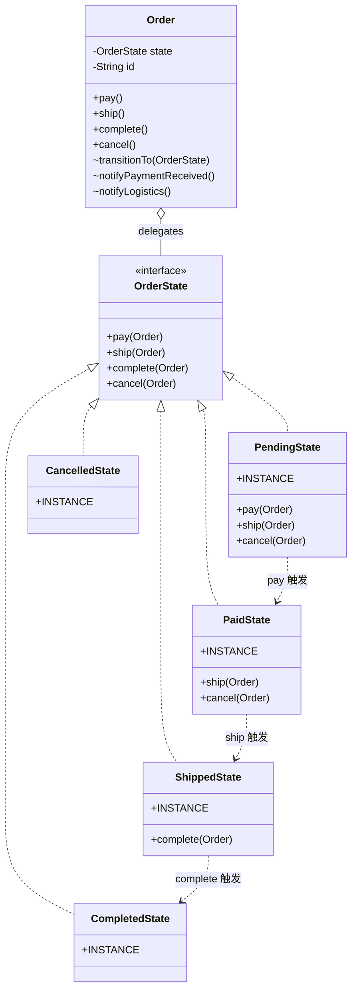
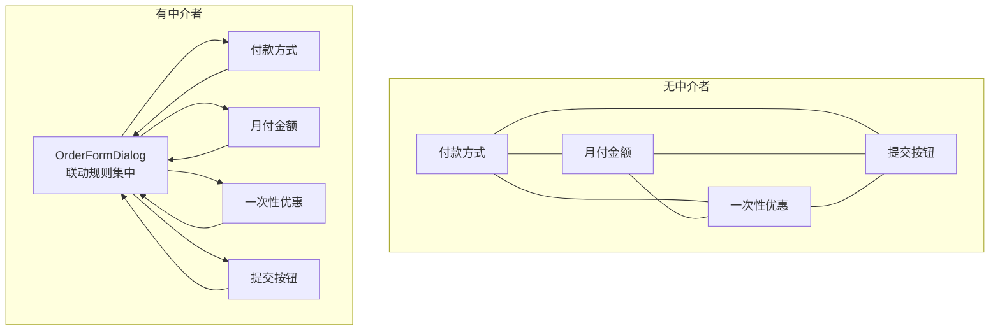
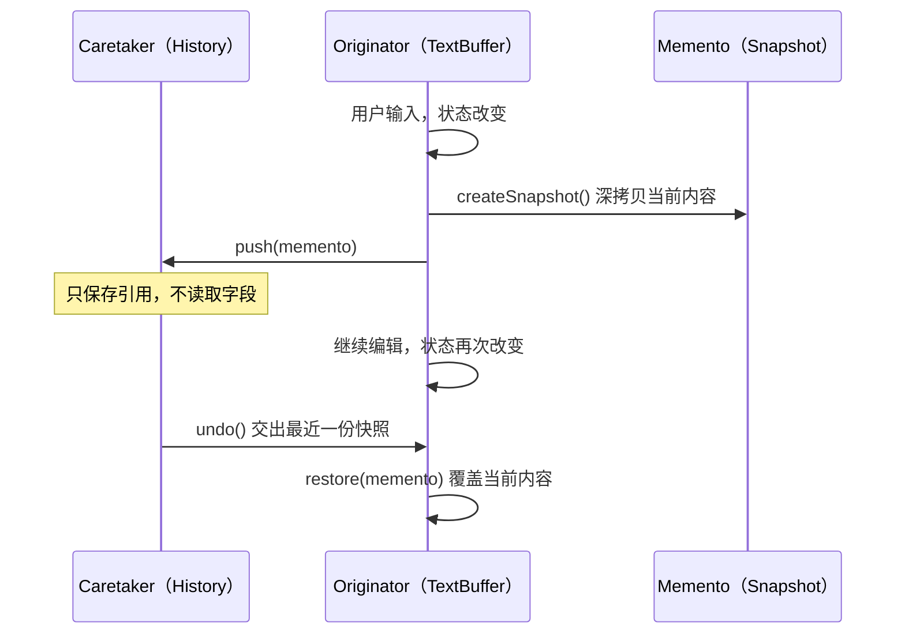
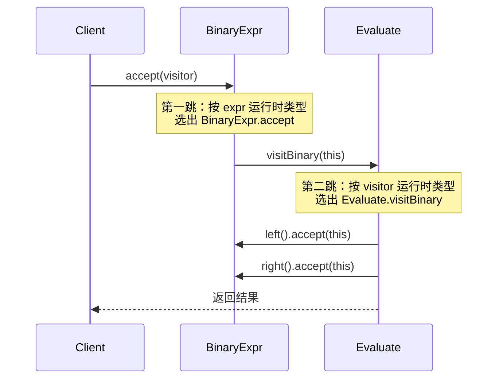
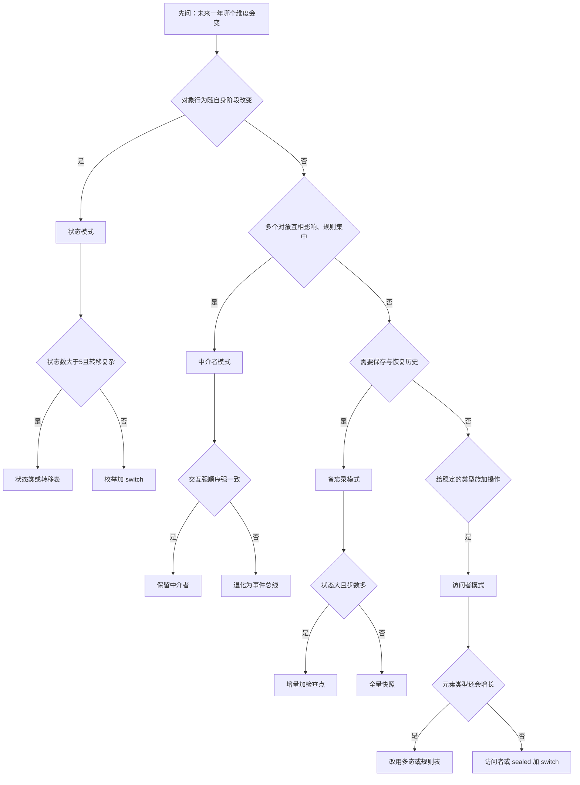

# 行为型模式（下）——状态、中介者、备忘录与访问者

**摘要：**
行为型模式的最后一批，问题域从「对象之间怎么协作」转向三个更难的维度：对象在时间里如何改变、在结构里如何彼此牵扯、在操作维度上如何被反复扩展。本文不按四张 UML 图逐个背诵，而是抓住两组真正决定落地的判据。第一组是状态与访问者。状态模式与策略模式在结构上同构，都是接口、实现与委托，真正的分界不在结构，而在谁有权改写 Context 里那个指针：策略由调用方在装配时选定，状态由对象在运行时按自身规则流转；状态对象之间通常互相认识，策略之间刻意互不相识。沿着这条判据往下，状态机的三种实现（每个状态一个类、枚举加 `switch`、转移表）各有适用区间，状态数量与转移复杂度决定该选哪一种。访问者的双分派由 `element.accept(visitor)` 与 `visitor.visit(this)` 两跳构成，让元素类型与操作类型各分派一次；但它的致命前提是元素类型必须稳定，一旦元素种类会增长，新增一个类型就要改遍所有访问者，公共契约、二进制兼容与团队边界同时被击穿。第二组是中介者与备忘录。中介者的判据是双向依赖，退化路径是事件总线，代价是控制流反转与调试栈断裂；备忘录的判据是可逆性，全量拷贝、增量与序列化快照三种实现在空间、恢复速度与封装性上互斥，而封装边界在 Java 里远比「包私有」四个字要讲究。全文以订单状态机、表单联动、文档撤销与表达式树四个贯穿案例承载这些判断。

---

## 第 1 章 状态模式：把「当前阶段」升格为对象

### 1.1 状态图比设计模式更早

1987 年，David Harel 在《Science of Computer Programming》上发表《Statecharts: A Visual Formalism for Complex Systems》，给「一个系统在哪些状态之间迁移」这件事画出第一套被广泛接受的图形语法；再往前推六年，1981 年的 RFC 793 已经用一张包含十一个状态的状态迁移图描述了 TCP 连接的完整生命周期——LISTEN、SYN-SENT、SYN-RECEIVED、ESTABLISHED、FIN-WAIT-1、CLOSE-WAIT、CLOSING、LAST-ACK、TIME-WAIT 等，每条边都标着触发事件与附加动作。这两件事放在一起说明，状态机并不是设计模式发明的，它比设计模式早了十几年；1994 年 GoF 把 State 收进行为型模式，做的其实是一件翻译工作：把一张图翻译成一组对象。

翻译的动机，在于那张图落到代码里会散架。下面这个订单类是很多交易系统的起点：

```java
// 反例：状态图被拆散在四个业务方法里，没有任何一处能看到全貌
public class Order {
    private OrderStatus status = OrderStatus.PENDING;

    public void pay() {
        if (status == OrderStatus.PENDING) {
            status = OrderStatus.PAID;
            notifyPaymentReceived();
        } else if (status == OrderStatus.PAID) {
            throw new IllegalStateException("订单已支付");
        } else if (status == OrderStatus.SHIPPED) {
            throw new IllegalStateException("已发货订单不能再次支付");
        } else if (status == OrderStatus.COMPLETED) {
            throw new IllegalStateException("已完成订单不能再次支付");
        } else if (status == OrderStatus.CANCELLED) {
            throw new IllegalStateException("已取消订单不能再次支付");
        }
    }

    public void ship() {
        if (status == OrderStatus.PAID) {
            status = OrderStatus.SHIPPED;
            notifyLogistics();
        } else if (status == OrderStatus.PENDING) {
            throw new IllegalStateException("未支付订单不能发货");
        } else if (status == OrderStatus.SHIPPED) {
            throw new IllegalStateException("订单已发货");
        }
        // 已取消、已完成的处理被漏掉了——这类遗漏在分支复制中几乎必然发生
    }

    public void cancel() {
        if (status == OrderStatus.PENDING || status == OrderStatus.PAID) {
            boolean refundRequired = status == OrderStatus.PAID;
            status = OrderStatus.CANCELLED;
            if (refundRequired) {
                initiateRefund();
            }
        } else {
            throw new IllegalStateException("当前状态不可取消");
        }
    }
}
```

这段代码的问题不在长度，在结构。五个状态与四个操作的组合被摊平成二十来个 `if` 分支，而每一个分支都在重复回答两个不同的问题：当前状态是否允许这个操作，以及操作完成之后要迁移到哪个状态。这两个问题本该由两张表回答——合法操作的矩阵，与迁移的目标状态——现在却混在每一处分支里，于是「从哪些状态可以到 SHIPPED」这个最简单的问题，需要翻遍四个方法才能拼出答案。

第二个代价是扩展成本随状态数线性叠加。新增一个「退款中」状态，`pay`、`ship`、`cancel` 三个方法都要加分支，`complete` 可能也要；而只要漏掉一处，编译器不会提醒，测试也未必覆盖，问题要等到线上出现一笔「退款中订单被重复支付」的对账差异才暴露。第三个代价是测试：单个状态的行为无法独立验证，测试一个「已发货不可取消」的规则，必须先把订单推到已发货，再调 `cancel`，断言的失败信息里混着构造状态的噪音。

还有一个更隐蔽的代价：状态迁移是隐式的。读 `ship()` 的人只能看到「PAID 变成 SHIPPED」，看不到 SHIPPED 之后还有哪些路可走；状态图存在文档里、存在产品经理的脑子里，唯独不存在代码里。状态模式要做的，是把这张图搬回代码，并且让每一块都能被单独编译、单独测试。

### 1.2 结构：Context、State 与「谁有权改指针」

状态模式的分工是三段式的：Context 持有当前状态对象，把动作委托给它；状态接口声明「在这个状态下可以被请求的动作」；每个具体状态类实现自己那一种状态下的全部动作，并在需要迁移时改写 Context 的指针。

以订单为例，用 Mermaid 把类关系画出来，比文字更直观：



落到代码，状态对象的写法有两个细节值得单独说。

```java
// 状态接口只回答「在这个状态下，某个动作意味着什么」；它不负责回答「我现在是什么状态」
public interface OrderState {
    void pay(Order order);
    void ship(Order order);
    void complete(Order order);
    void cancel(Order order);
}

final class PendingState implements OrderState {
    // 状态对象没有字段，因此可以是单例：数据都在 Context 上，状态只承载「行为」的差异
    static final PendingState INSTANCE = new PendingState();
    private PendingState() {}

    @Override public void pay(Order order) {
        order.transitionTo(PaidState.INSTANCE);
        order.notifyPaymentReceived();
    }

    @Override public void ship(Order order) {
        throw new IllegalStateException("待付款订单不能发货");
    }

    @Override public void complete(Order order) {
        throw new IllegalStateException("待付款订单不能完成");
    }

    @Override public void cancel(Order order) {
        // 待付款取消不需要退款，这是 PendingState 与 PaidState 唯一的差异
        order.transitionTo(CancelledState.INSTANCE);
    }
}

final class PaidState implements OrderState {
    static final PaidState INSTANCE = new PaidState();
    private PaidState() {}

    @Override public void pay(Order order) {
        // 同一个动作在不同状态下给出不同回应，这正是状态模式存在的理由
        throw new IllegalStateException("订单已支付，请勿重复提交");
    }

    @Override public void ship(Order order) {
        order.transitionTo(ShippedState.INSTANCE);
        order.notifyLogistics();
    }

    @Override public void complete(Order order) {
        throw new IllegalStateException("未发货订单不能完成");
    }

    @Override public void cancel(Order order) {
        order.transitionTo(CancelledState.INSTANCE);
        order.initiateRefund();
    }
}

public final class Order {
    private OrderState state = PendingState.INSTANCE;   // 初始状态由 Context 决定
    private final String id;

    Order(String id) { this.id = id; }

    public void pay()      { state.pay(this); }
    public void ship()     { state.ship(this); }
    public void complete() { state.complete(this); }
    public void cancel()   { state.cancel(this); }

    // 包私有而非 public：外部调用方无法把订单直接「掰」到任意状态，状态机才守得住
    void transitionTo(OrderState next) { this.state = next; }

    void notifyPaymentReceived() { /* 支付回调、流水、消息 */ }
    void notifyLogistics()       { /* 通知仓配系统 */ }
    void initiateRefund()         { /* 发起退款 */ }
}
```

第一个细节是状态对象的生命周期。状态类没有字段时，它是无状态对象，可以做成单例常量，一台机器上几万个订单共享五个状态实例，堆开销可以忽略；一旦某个状态需要携带数据，譬如「退款中」要记录退款单号与重试次数，状态对象就不再可共享，只能每次 `new` 或者从 Context 取数据。这个选择没有对错，但把无状态的状态类做成单例，是一个几乎零成本的小优化，很多实现却习惯性写成 `new PaidState()`。

第二个细节是 `transitionTo` 的可见性。它必须是包私有或 `protected`，不能是 `public`。原因在于状态模式的全部约束都建立在一件事上：只有状态对象知道「下一步合法去哪」。一旦 `public`，任何一段业务代码都可以绕过状态逻辑把订单改成任意状态，状态机退化成一块可随便写的字段，模式的意义立刻归零。这条约束在代码评审里很容易被漏掉，因为 `public` 写在状态类里看起来「更灵活」。

至于非法转移该抛异常还是返回结果，取决于调用方能不能提前判断。拒绝支付、拒绝重复发货属于程序或并发错误，抛 `IllegalStateException` 让错误尽早暴露；而「库存不足导致支付失败」这类业务失败不该用异常表达，应由 Context 返回业务结果。边界划清楚，状态类内部才不会一半异常一半返回码。

### 1.3 迁移逻辑的三个落点

状态接口定好之后，还有一个位置问题：迁移逻辑写在哪。这件事有三种落点，选错了，状态模式会退化成另一种东西。

第一种是状态类自己迁移，也就是 1.2 节代码里的做法：`PendingState.pay` 里直接 `order.transitionTo(PaidState.INSTANCE)`。它的优点是迁移知识紧挨着动作，读到 `pay` 就能看到「支付之后去哪」；代价是状态类之间出现静态依赖，`PendingState` 编译时就要引用 `PaidState`，五个状态两两可达时，这些引用会织成一张新的网。这张网本身并不坏——它就是把状态图画进代码的代价——但它意味着状态类很难被独立替换。

第二种是 Context 负责迁移：状态类只做动作，不碰指针，由 Context 在调用返回后决定下一个状态。这样状态类彼此完全独立，但 Context 里会长出一段「动作之后看情况改状态」的判断，本质上又把 `if` 挪了回来。这种写法在状态类只作为「动作处理器」、迁移规则由更上层决定时更自然，它已经站到了策略模式的边界上。

第三种是转移表：把「从哪个状态、经哪个事件、到哪个状态、附带什么动作」做成数据，用一个表驱动执行器统一处理。状态数量上到十几个、迁移边上到几十条时，表是唯一还能被人整体阅读的形式。

```java
enum OrderEvent { PAY, SHIP, COMPLETE, CANCEL }

record Transition(OrderStatus from, OrderEvent event, OrderStatus to, Consumer<Order> action) {}

final class OrderStateMachine {
    // 一张表就是那张状态图：新增一条边只加一行，不必改任何状态类
    private final Map<OrderStatus, Map<OrderEvent, Transition>> table = new EnumMap<>(OrderStatus.class);

    OrderStateMachine() {
        register(OrderStatus.PENDING,  OrderEvent.PAY,      OrderStatus.PAID,      Order::notifyPaymentReceived);
        register(OrderStatus.PENDING,  OrderEvent.CANCEL,   OrderStatus.CANCELLED, o -> { });
        register(OrderStatus.PAID,     OrderEvent.SHIP,     OrderStatus.SHIPPED,   Order::notifyLogistics);
        register(OrderStatus.PAID,     OrderEvent.CANCEL,   OrderStatus.CANCELLED, Order::initiateRefund);
        register(OrderStatus.SHIPPED,  OrderEvent.COMPLETE, OrderStatus.COMPLETED, Order::triggerAfterSale);
    }

    private void register(OrderStatus from, OrderEvent event, OrderStatus to, Consumer<Order> action) {
        table.computeIfAbsent(from, k -> new EnumMap<>(OrderEvent.class))
             .put(event, new Transition(from, event, to, action));
    }

    void fire(Order order, OrderEvent event) {
        Map<OrderEvent, Transition> byEvent = table.get(order.status());
        Transition t = byEvent == null ? null : byEvent.get(event);
        if (t == null) {
            // 表里没有这条边，就是「当前状态不接受这个事件」，错误信息可以直接把边打出来
            throw new IllegalStateException("非法迁移：" + order.status() + " 不接受 " + event);
        }
        order.setStatus(t.to());
        t.action().accept(order);
    }
}
```

三种落点对照如下。注意它们不是互斥的：大型状态机常见「转移表负责路由 + 状态类负责动作实现」的混合形态，表管边、类管点，各自做自己擅长的事。

| 落点 | 状态类之间的耦合 | Context 的复杂度 | 可配置性 | 适用区间 |
| --- | --- | --- | --- | --- |
| 状态类自迁移 | 高，状态之间互相引用 | 低，只做委托 | 低，迁移写死在字节码里 | 状态少、迁移稳定、行为差异大 |
| Context 迁移 | 低，状态类互不相识 | 高，判断逻辑回流 | 中 | 迁移规则需要集中审计或按场景切换 |
| 转移表 | 无，状态退化为枚举值 | 中，执行器统一 | 高，可来自配置或数据库 | 状态多、边多、运营可调整 |

### 1.4 状态模式与策略模式：结构同构，判据在「谁改指针」

状态模式最容易被误用的地方，是把它当成策略模式的同义词。策略的完整形态见[[06 行为型模式（上）——策略、模板方法与观察者]]，这里只取两者的判据。两者在结构上确实同构：都有一个接口，都有若干实现，都通过 Context 委托调用。把状态模式的类图与策略模式的类图并排放，去掉类名之后几乎无法区分——这不是巧合，GoF 在书里也承认两者结构相似，区别在意图与运行期行为。

真正的判据有三条，按重要性排序。

**第一条，选择权归谁。** 策略由调用方选择，选择发生在 Context 装配时或调用前的参数里：`new CheckoutService(new VipDiscountStrategy())`，或者 `discountService.calc(user, order, strategy)`。调用方掌握「用哪个算法」的决定权，Context 本身对策略一视同仁、不参与挑选。状态则相反，状态由对象自己在运行时切换，调用方只说「我要支付」，至于支付之后变成已支付还是保持待付款，由当前状态对象与迁移规则决定。一句话概括：策略的选择权在调用栈的上层，状态的选择权在对象内部。

**第二条，实现是否相识。** 策略之间刻意互不相识，`VipDiscountStrategy` 不需要知道 `CouponStrategy` 的存在，它们是并列的可选项，谁也不会把 Context 指向对方。状态之间通常互相认识，因为迁移本身就是「从我这走到你那」，`PendingState` 天然知道 `PaidState` 的存在。这条差别直接决定了两者的扩展方式：新增策略不必动任何既有策略，新增状态往往要动若干状态类的迁移出口。

**第三条，谁触发替换。** 策略的替换由外部条件触发——用户等级、活动配置、AB 分组，触发点在使用方。状态的替换由内部事件触发——支付成功、发货完成、超时关单，触发点在状态对象处理的那些动作里。

把这两段代码放在一起，差别比任何定义都清楚：

```java
// 策略：Context 不关心算法是什么，只管调用；换算法是外部的事
public final class CheckoutService {
    private final DiscountStrategy strategy;          // 装配期决定，运行期不变

    public CheckoutService(DiscountStrategy strategy) { this.strategy = strategy; }

    public BigDecimal checkout(Order order) {
        return strategy.discount(order.total());
    }
}

// 状态：Context 不关心下一个状态是什么，只管转发；换状态是状态对象自己的事
public final class Order {
    private OrderState state = PendingState.INSTANCE; // 运行期由状态对象改写

    public void pay() { state.pay(this); }
    void transitionTo(OrderState next) { this.state = next; }
}
```

判据落到实践，还会遇到两类模糊地带，值得单独交代。

一类是「策略由规则引擎挑选」。规则引擎根据上下文算出一个策略，再注入 Context，选择过程虽然自动化，但决策者仍在 Context 外部，Context 只是被动接受，这依然是策略。判断的关键不是「谁按下了按钮」，而是「Context 自己有没有参与决策」。

另一类是「状态被外部强制改写」。后台运营可以把订单从待付款直接改成已取消，或者运维把连接池里的连接强制标记为失效。这类强制写入口是管理通道，不改变状态模式的本质：订单的其他行为仍然由当前状态对象决定，迁移规则仍然在状态类或转移表里，只是多了一条带审计日志的旁路。真正的反例是另一种情况——Context 每次调用前根据参数从外部挑一个状态对象，状态对象之间毫无关系、互不触发，那它在语义上已经是策略，只是名字叫 State。

| 维度 | 策略模式 | 状态模式 |
| --- | --- | --- |
| 选择者 | 调用方或装配方 | 对象自身（或状态机执行器） |
| 选择时机 | 调用之前、装配之时 | 运行期，由事件驱动 |
| 实现之间的关系 | 互相不认识，并列可选 | 通常互相认识，构成迁移图 |
| Context 的视角 | 「我不知道用哪个算法」 | 「我不知道下一步去哪」 |
| 扩展点 | 新增算法不触碰旧算法 | 新增状态常要改迁移出口 |
| 典型误用 | 把状态迁移塞进策略，Context 被外部反复换实现 | 两个状态的开关硬套状态类 |

### 1.5 状态机的三种实现与判据

判定了「该用状态」之后，紧接着的问题是「用哪种写法」。三种实现各有明确的适用区间，选错的代价在状态数量增长之后才会显现。

**枚举加 `switch`** 是简单状态机的首选。它不需要为每个状态建类，状态的取值被枚举约束，而且 Java 的 `switch` 表达式对枚举有穷尽性检查——新增一个枚举常量而忘了处理，编译期就会报错，这比状态类漏实现接口方法更容易被发现。

```java
enum OrderStatus {
    PENDING, PAID, SHIPPED, COMPLETED, CANCELLED;

    // 状态专属的数据与判定挂在枚举上，避免为了一个布尔标志拆出一个类
    boolean isTerminal() { return this == COMPLETED || this == CANCELLED; }
}

final class Order {
    private OrderStatus status = OrderStatus.PENDING;

    public void pay() {
        status = switch (status) {
            case PENDING -> {
                notifyPaymentReceived();
                yield OrderStatus.PAID;      // 枚举 switch 表达式必须穷尽，漏掉状态编译不过
            }
            case PAID, SHIPPED, COMPLETED, CANCELLED ->
                throw new IllegalStateException("当前状态不允许支付：" + status);
        };
    }
}
```

枚举写法的收益很直接：一个文件看完全部状态与转移，断点能打，堆栈干净，没有额外对象。它的代价在状态变多之后出现——每个动作一个 `switch`，四个动作就是四段长 `switch`，状态之间的迁移关系要到每个 `switch` 里去找，又回到了「图散在方法里」的老问题；状态专属的行为一旦需要三五个辅助方法，枚举会膨胀成一个巨型类。

**每状态一个类**，适合状态行为差异大的场合。当每个状态不只是「允许或拒绝」，而有独立的数据、独立的副作用、独立的协作对象时，类的边界才立得住。判据是状态数量与转移复杂度：状态超过五个、转移不再是简单的线性推进（存在回退、跳过、并行分支）、且每个状态带自己的逻辑，类才值得建。否则五个类加一个接口的样板量，会超过它带来的结构收益。

**转移表**适合把状态图交给业务方维护的场合。状态上到十几个、迁移边上到几十条，或者运营需要在后台配置流程时，表是唯一还能被非程序员阅读的形式。它的代价是类型安全变弱——表和状态枚举之间的一致性只能靠启动时校验来保证，写错一个状态名，编译器帮不上忙；调试也更绕，断点要打在执行器里，看到的是一层层 `Map` 查找。

| 实现 | 状态数合适区间 | 转移复杂度 | 类型安全 | 可配置 | 调试体验 | 适用场景 |
| --- | --- | --- | --- | --- | --- | --- |
| 枚举加 `switch` | 2 到 6 | 低，线性为主 | 强，穷尽性可查 | 无 | 好，断点直达 | 订单、工单、审批等固定流程 |
| 每状态一个类 | 5 以上 | 中高，含回退与分支 | 强，接口方法强制实现 | 低 | 中，跳转较多 | 状态行为差异大、需要独立测试 |
| 转移表 | 8 以上 | 高，边数远超状态数 | 弱，靠启动校验 | 高，可落库 | 差，需专用执行器 | 工作流、协议栈、运营可配置流程 |

判据可以压缩成一句话：状态不超过五个、转移以线性推进为主，用枚举；状态超过五个且行为差异大到值得独立成类，用类；迁移规则要交给业务方调整，用表。这三种实现之间可以迁移，且迁移成本随规模上升而剧增，所以不要等到二十个状态再重构——到那时，无论换成哪种实现，都是一次高风险改造。

### 1.6 落点：订单、连接池与 Spring Statemachine

状态模式在 Java 生态里的落点，比大多数行为型模式都密集，原因很简单：只要系统里有「生命周期」，就有状态机。

电商与支付的订单状态机是最常见的一个。它真正的难点不在模式本身，而在状态与外部副作用的一致性：支付回调、库存扣减、退款单、关单定时任务，每一个都可能把订单推到下一个状态。通行的做法是把状态迁移做成幂等操作——以订单号加状态版本号做乐观锁，`UPDATE ... WHERE status = ?` 影响行数为零，说明状态已被别的线程改过，直接放弃；再配一张状态流水表做对账。状态模式提供行为的组织方式，幂等与对账由存储层保证，缺一不可。

连接池是枚举式状态机的典型落点。Apache Commons Pool 用 `PooledObjectState` 枚举描述池化对象的一生：IDLE、ALLOCATED、EVICTION、VALIDATION、INVALID、ABANDONED、RETURNING 等，借出、归还、校验、驱逐、废弃都在这几个值之间迁移，迁移由池的锁与原子操作协同完成。这里没有为每个状态建类，因为状态之间的差异主要体现为「能不能被借出」这一组标志位语义，行为由池统一驱动；为七个状态各写一个类，只会让并发路径更难读。

Spring Statemachine 则是把状态机做成基础设施的那条路。它支持层次状态、并行区域、守卫条件（guard）、进入与退出动作，状态机实例可以与持久化上下文绑定，重启后从数据库恢复。用它的判据是：状态多、有层次结构、需要持久化运行中的状态、需要把流程可视化给非技术人员看。不用它的理由同样充分：引入之后调试链路变长，一次事件要穿过拦截器、监听器、动作与守卫；版本迭代节奏不快，遇到问题时能参考的资料有限。以对应版本文档为准。

| 落点 | 状态规模 | 采用实现 | 选择理由 |
| --- | --- | --- | --- |
| 订单/支付状态机 | 5 到 10 | 枚举加 `switch` 或转移表 | 流程固定，但运营需要看到全图 |
| Commons Pool `PooledObjectState` | 7 左右 | 枚举 | 状态差异是标志位语义，行为由池驱动 |
| Spring Statemachine | 10 以上 | 框架托管 | 层次状态、持久化、可视化 |
| TCP 连接状态机 | 11 | 规范给定 | 迁移由协议规定，实现只做映射 |
| `Thread.State` | 6 | 枚举 | 状态由 JVM 维护，用户代码只读 |

### 1.7 反例：两个状态的开关

最典型的状态模式误用，是给一个只有开与关的开关建接口、建两个状态类、再建一个 Context。三个文件、几十行代码，换来的是一个可以直接用 `boolean` 表达的字段。判断这类过度设计不需要复杂的分析，只看三件事：状态数是否少于三个、迁移是否只有一条、状态是否没有独立行为与数据。三条全中，就不该用模式。两个状态的系统里，`boolean` 加一个 `if` 比任何模式都诚实。

第二类误用是把「类型」当成「状态」。优惠券有满减、折扣、立减三种，订单有普通、预售、拼团三类——这些是并列的分类，彼此之间不会互相迁移，用策略或枚举分类即可。状态的定义里必须包含「迁移」：一个值可以在特定事件下变成另一个值，且这个变化是对象生命周期的一部分。没有迁移的分类叫类型，有迁移的才叫状态。

---

## 第 2 章 中介者模式：把网状依赖压成星型

### 2.1 网状依赖的代价

1979 年，Trygve Reenskaug 在施乐帕克研究中心记录下 MVC 的雏形时，把「视图与模型之间的同步」交给了一个不直接参与显示的协调角色。这个决定的理由并不抽象：在图形界面里，控件之间天然存在联动——付款方式选「按月」时，月付金额输入框要出现，一次性优惠输入框要隐藏，提交按钮还要重新计算可用性。如果让控件直接互相引用，三个控件就有三条耦合边，七个控件最多能长到二十一条。

更麻烦的是这些边不是结构性的，而是行为性的。控件之间不是「持有」关系，是「我变了之后可能影响你」的隐式约定，代码里表现为一堆 `if`：

```java
// 反例：联动规则分散在控件内部，任何一处改动都要检查其余六个控件
final class PaymentTypeBox extends ComboBox {
    private final MonthlyAmountField monthly;
    private final OneTimeDiscountField discount;
    private final SubmitButton submit;

    void onSelectionChanged() {
        if ("monthly".equals(selected())) {
            monthly.setVisible(true);
            discount.setVisible(false);
            submit.setEnabled(!monthly.text().isEmpty());   // 规则复制了一份
        } else {
            monthly.setVisible(false);
            discount.setVisible(true);
            submit.setEnabled(!discount.text().isEmpty()); // 又复制了一份
        }
    }
}
```

这段代码有三个问题，会随控件增加而放大。规则不可见——想知道「提交按钮什么时候可用」，得读完所有控件的 `onSelectionChanged`；测试昂贵——验证一条联动要构造所有相关控件，还要按正确顺序触发事件；波及面不可控——新增一个「优惠券」控件，付款方式下拉、优惠输入框、提交按钮三处都要改，却没有一处能提醒你还有第三处。

网状依赖真正的成本不是边数，而是「没有一个人能说出全部规则」。中介者要解决的就是这件事：把规则从各个控件里抽出来，集中到一个知道所有人的对象里。

### 2.2 结构：一个知道所有人的对象

中介者模式有三个角色：Mediator 接口声明协调入口，通常是 `notify(sender, event)`；Colleague 抽象持有 Mediator 引用，在状态变化时上报；ConcreteMediator 持有全部同事的引用，实现联动规则。



依赖从「同事之间两两相连」变成「同事到中介者的星型」，边数从 M(M-1)/2 降到 M。更重要的变化是规则的可见性：所有联动集中在一个 `notify` 方法里，读一遍就能知道全貌。

```java
public interface DialogMediator {
    void notify(UIComponent sender, String event);
}

public abstract class UIComponent {
    protected final DialogMediator mediator;

    protected UIComponent(DialogMediator mediator) { this.mediator = mediator; }

    // 组件不知道谁会响应，只负责把「我这里发生了什么」上报
    protected void fire(String event) { mediator.notify(this, event); }
}

public final class OrderFormDialog implements DialogMediator {
    private final PaymentTypeBox paymentType = new PaymentTypeBox(this);
    private final MonthlyAmountField monthly = new MonthlyAmountField(this);
    private final OneTimeDiscountField discount = new OneTimeDiscountField(this);
    private final SubmitButton submit = new SubmitButton(this);

    @Override
    public void notify(UIComponent sender, String event) {
        if (sender == paymentType && "selectionChanged".equals(event)) {
            boolean monthlyMode = "monthly".equals(paymentType.selected());
            monthly.setVisible(monthlyMode);
            discount.setVisible(!monthlyMode);
        }
        // 可用性规则只写一次，与触发源无关
        String amount = monthly.isVisible() ? monthly.text() : discount.text();
        submit.setEnabled(!amount.isEmpty());
    }
}
```

这里有一个容易忽略的设计点：`notify` 的参数是 `sender` 加 `event` 字符串，而不是为每种联动定义一个方法。参数化让新增控件不必改接口，代价是丢掉类型安全——事件名写错一个字母，编译器不会报错；规模一大，事件名就该升级成枚举或密封类型。

### 2.3 中介者与外观：判据是「会不会回头敲门」

中介者与外观（Facade，见[[05 结构型模式（下）——外观、桥接、组合与享元]]）在结构上都是「中间放一个对象」，很容易被混为一谈。区分它们的判据只有一条：**依赖方向是否双向**。

外观是单向的门面：调用方调外观，外观转调子系统，子系统完全不知道外观的存在。它的目的是简化入口，把一组复杂接口包成一次调用，子系统之间的协作关系不变。中介者是双向的协调：同事主动把变化上报给中介者，中介者再回调其他同事，被协调者是这场协作的参与者，不是被动被调用的零件。

一句话概括：被协调者会不会回头敲门。会回头，是中介者；不会，是外观。

| 维度 | 外观（Facade） | 中介者（Mediator） |
| --- | --- | --- |
| 依赖方向 | 单向，调用方到子系统 | 双向，同事与中介者互相调用 |
| 被协调者是否知道中间层 | 不知道 | 知道，且持有中介者引用 |
| 目的 | 简化入口、隐藏子系统复杂度 | 解耦同事之间的网状依赖 |
| 变化点 | 子系统接口变化由外观吸收 | 联动规则变化集中在中介者 |
| 失败形态 | 门面变成又一个上帝类 | 中介者变成上帝类并吞掉业务 |
| 典型落点 | SLF4J、`JdbcTemplate` | GUI 对话框、`ButtonGroup` |

这条判据可以用来纠一个流传很广的说法。很多资料把 Spring MVC 的 `DispatcherServlet` 称作中介者模式的典型实现，理由是 `HandlerMapping`、`HandlerAdapter`、`ViewResolver`、`HandlerExceptionResolver` 都不互相引用，而是通过它协作。前半句成立，后半句不成立：这些组件是被依次调用的策略，它们不会在处理完之后回调 `DispatcherServlet` 说「我变了，你去通知别人」。整条链路是单向分发，`DispatcherServlet` 扮演的是前端控制器（Front Controller）加上策略编排者的角色，更接近外观与模板方法的组合，而不是教科书意义上的中介者。把它当中介者讲，会让读者误以为中介者的关键特征是「组件都围着它转」，而真正的关键是「组件之间通过它互相影响」。

JDK 里更贴切的中介者是 `javax.swing.ButtonGroup`：一组单选按钮之间不互相引用，选中一个时由 `ButtonGroup` 负责把其余按钮的状态清掉，按钮只管上报「我被选中了」。规模很小，但结构完全对得上。

### 2.4 上帝类：中介者最自然的死法

中介者把复杂度从「网状」搬到了「中心」，而中心会膨胀成**上帝类**。`notify` 的分支数量与「事件类型 × 同事数量」成正比，控件从四个长到二十个时，这个方法会长到没有人敢改：每一次改动都要通读全部 `if`，每一处遗漏都会表现为某个边角场景下界面不刷新。

膨胀有一个可度量的信号：中介者的单方法分支数超过三十，或者这个类的提交频率显著高于同模块其他类，就说明它已经在承担不属于自己的职责。拆解有三条路。按子域拆成多个中介者，一个对话框一个中介者，一个向导页一个中介者，让每个中心只管自己那屏的联动；把联动规则下沉成状态机或规则表，中介者只做路由；把「一对多通知」的部分交给发布订阅，中介者只保留强顺序的编排。

这三种拆法的共同点是缩小中心的职责边界，而不是消灭中心。中介者的价值恰恰在于「有一个地方能看懂全局」，拆得过头，全局就又散回各处了。

### 2.5 什么时候退化成事件总线

中介者写久了，很多人会顺手换成**事件总线**：控件不再调用 `mediator.notify`，而是 `publisher.publish(new PaymentTypeChangedEvent(...))`，感兴趣的组件各自订阅。Spring 的 `ApplicationEventPublisher` 与 `@EventListener`、Guava 的 `EventBus` 都是这条路。代码确实短了，发布者也不需要知道谁在听。

但这是两种不同的取舍，不是同一种东西的简化版。中介者的价值是显式编排：谁在什么时候被通知、顺序如何、失败了怎么办，都能在一个方法里读到；事务边界清晰，出问题能顺着调用栈查。事件总线的价值是发布者无感知：新增订阅方不必改发布方，订阅方可以独立演化，天然支持一对多。

判据可以这样问：这些交互是否要求强顺序、强一致，或者需要在同一个事务里完成。如果是，留在中介者；如果只是「发生了这件事，感兴趣的人自己处理」，且订阅方会不断增加，就该退化成事件总线。

退化的代价必须提前知道。控制流反转之后，调用栈不再能说明问题——发布者返回时，订阅者可能还没执行，也可能已经抛了异常；隐式依赖变多，一个事件有几个订阅者只能全局搜索；事件风暴与循环触发是常见事故，A 的监听器改了 B，B 的监听器又改回 A；事务边界也变得微妙，`@TransactionalEventListener(phase = AFTER_COMMIT)` 能保证事件在提交后处理，但这也意味着监听器里的失败无法回滚业务。

```java
// 退化后的形态：发送方不认识接收方，防重入要靠自己
@Component
public final class PaymentTypeListener {
    private static final ThreadLocal<Boolean> IN_FLIGHT = ThreadLocal.withInitial(() -> false);

    @EventListener
    public void on(PaymentTypeChangedEvent event) {
        if (IN_FLIGHT.get()) return;         // 没有这行，A→B→A 的循环触发会打满 CPU
        IN_FLIGHT.set(true);
        try {
            // 处理联动：调整可见性、重算可用性
        } finally {
            IN_FLIGHT.set(false);
        }
    }
}
```

| 维度 | 中介者 | 事件总线 |
| --- | --- | --- |
| 发布方是否知道接收方 | 知道（中介者持有同事） | 不知道 |
| 调用顺序 | 显式、可控 | 隐式、由注册顺序决定 |
| 新增接收方 | 改中介者 | 加订阅者即可 |
| 事务边界 | 同一调用栈，容易控制 | 需显式指定提交前或提交后 |
| 调试 | 栈清晰 | 栈断裂，靠日志与事件追踪 |
| 失败形态 | 中心膨胀成上帝类 | 循环触发、事件风暴、隐式依赖 |

### 2.6 反例：两个同事也上中介者

中介者成立的前提是「同事数量大于二，且交互不是一条直线」。如果只有两个对象互相通知，直接持有引用比引入中介者少一层跳转；如果三个对象之间只有一条单向链路，责任链或直接调用更合适。判断是否需要中介者，可以数一数「如果不用中介者，需要维护多少条边」：三条以下且方向单一，不值得；超过五条且互相影响，中介者才开始产生净收益。跨进程之后还会变味：四个服务全部经过同一个编排器，进程内的中介者就成了分布式单体，编排器一改，四个服务一起回归，跨进程协调应当交给消息与 Saga。

---

## 第 3 章 备忘录模式：快照的三种实现与封装边界

### 3.1 撤销的两种抽象

撤销功能有两种实现路径，一条是记住「做了什么」，另一条是记住「当时是什么样」。前者是命令模式，每个命令带着逆操作，撤销就是执行逆操作；后者是备忘录模式，保存对象的完整或部分状态，撤销就是把状态覆盖回去。命令模式的组织方式见[[07 行为型模式（中）——责任链、命令与迭代器]]。

命令式撤销的前提是逆操作存在且可计算：插入的逆是删除，加一的逆是减一。但很多操作没有可计算的逆：图像编辑器里的任意变形、滤镜叠加、随机噪点；文本编辑器里的一次正则替换；协同编辑中他人同时插入的内容。更棘手的是副作用已经外溢的操作——短信已发、款项已扣，逆操作只能在业务层补偿，而补偿本身又是一次新操作。

备忘录绕开了「逆操作」这个前提，只要求「能恢复到某个时刻」。代价从「定义逆操作」变成了「保存状态」，而保存状态的成本，取决于状态有多大、要保存多少份、恢复要多快。这三件事决定了备忘录的三种实现。

### 3.2 结构与执行链

备忘录模式有三个角色：Originator 是会变的对象，负责创建与恢复快照；Memento 是不可变的快照载体；Caretaker 保管快照但不读内容。协作顺序固定：Originator 把当前状态封进 Memento，Caretaker 收下；需要回滚时原样交回，由 Originator 自己解析。



```java
public final class TextBuffer {
    private final StringBuilder content = new StringBuilder();

    public void insert(int offset, String text) { content.insert(offset, text); }
    public void delete(int offset, int length) { content.delete(offset, offset + length); }
    public int length() { return content.length(); }

    // Memento 是 Originator 的公有嵌套类：外部可以持有，但拿不到任何字段
    public static final class Snapshot {
        private final String text;          // private，无 getter，外部无法读取
        private Snapshot(String text) { this.text = text; }
    }

    public Snapshot createSnapshot() {
        return new Snapshot(content.toString());   // 构造器 private，只有这里能建
    }

    public void restore(Snapshot snapshot) {
        // 字段在同一个外部类里可见，这正是嵌套类做 Memento 的意义
        content.setLength(0);
        content.append(snapshot.text);
    }
}

public final class History {
    private final Deque<TextBuffer.Snapshot> undoStack = new ArrayDeque<>();
    private final Deque<TextBuffer.Snapshot> redoStack = new ArrayDeque<>();

    public void record(TextBuffer buffer) {
        undoStack.push(buffer.createSnapshot());
        redoStack.clear();                 // 新操作让重做栈失效，这是编辑器语义
    }

    public void undo(TextBuffer buffer) {
        if (undoStack.isEmpty()) return;
        redoStack.push(buffer.createSnapshot());
        buffer.restore(undoStack.pop());   // Caretaker 只搬运，不解析
    }
}
```

### 3.3 三种实现与代价

**全量拷贝**是最直白的实现：每次快照把当前状态完整复制一份。它的优点是恢复为 O(1)——直接把快照覆盖回对象，不需要重放任何历史；缺点是空间开销与状态大小成正比，而且深拷贝容易写错。浅拷贝的坑尤其隐蔽：快照里保存了 `List` 的引用，之后的编辑继续往同一个 `List` 里加元素，快照跟着一起变，撤销出来的内容与保存时刻不一致。这类缺陷在测试里很难暴露，因为看起来「快照对象还在」，实际内容已经被污染。

**增量快照**只保存变化量，典型形态是 undo log：记录「在偏移多少处插入了什么」「删除了哪一段」，撤销时反向执行。空间开销与变更量成正比，适合大文档的编辑场景；代价是恢复 O(k)，要把从快照到当前位置的所有增量依次反向应用，k 大时撤销会明显变慢。增量实现还必须处理顺序依赖——中间某条记录丢失，后续全部无法恢复；想支持任意跳转（undo 到第 5 步再跳到第 50 步），只能每隔若干步插入一个全量检查点，形成**检查点加增量**的混合结构。数据库的 WAL 加 checkpoint、Redis 的 AOF 加 RDB，都是同一套思路的不同尺度实现。

**序列化快照**把状态写成字节流或文本，优点是通用：不必为每种对象手写拷贝逻辑，可以落盘、跨进程、做版本迁移；缺点是慢且大，`ObjectOutputStream` 会把类描述与引用关系一并写入，体积常是内存表示的数倍。还有三个隐性成本：`transient` 字段不会被保存；类结构演进后旧快照无法反序列化，需要兼容策略；反序列化本身是攻击面，不可信来源的字节流绝不能直接读。

| 实现 | 空间 | 恢复速度 | 可持久化 | 实现复杂度 | 主要失败模式 |
| --- | --- | --- | --- | --- | --- |
| 全量拷贝 | O(状态大小) × 份数 | 快，O(1) | 否 | 低，但要防浅拷贝 | 内存膨胀、共享引用污染 |
| 增量 | O(变更量) × 步数 | 慢，O(历史长度) | 部分（需检查点） | 高，顺序依赖 | 记录丢失导致无法恢复、重放慢 |
| 序列化快照 | 大，常为内存数倍 | 慢，需反序列化 | 是，可跨进程 | 中 | 版本不兼容、`transient` 丢字段、安全风险 |

粗算一下量级就能看清选择：一个 10 MB 的文档，全量快照保存 100 步就是 1 GB，在 2 GB 堆上开一个文档就可能 OOM；同样的编辑若每次平均改动 10 KB，增量只需 1 MB 左右。反过来，如果状态只有几百字节、撤销步数通常不超过 20，全量拷贝的 1 GB 风险根本不存在，为它写一套增量与检查点机制属于过度设计。

### 3.4 封装边界：包私有并不够

备忘录模式的定义里有一句常被忽略的话：快照的内部状态只能被 Originator 读取。这不是洁癖，而是模式成立的条件——一旦外部能读能改快照，Caretaker 就可能在不经意间修改历史，撤销恢复出来的状态与当时不一致，问题还极难定位。

不少实现用「包私有 getter」划这个边界，思路对了一半：getter 不加 `public`，确实挡住了其他包的类；但在同一个包里，任何类都能读到快照字段，Caretaker 只要与 Originator 同包，封装就名存实亡。

Java 没有 C++ 的 `friend`，也没有 C# 的 `internal`，最接近「只有你能读」的手段是把 Memento 做成 Originator 的嵌套类：字段全 `private`、构造器 `private`、不提供任何 getter，只有外部类能访问嵌套类的私有成员。Caretaker 拿到的是 `TextBuffer.Snapshot` 这个类型的引用，可以存、可以传，但读不出任何内容。

| 封装手段 | 强度 | 代价 | 适用 |
| --- | --- | --- | --- |
| `public` 字段 | 无 | 无 | 绝对不用 |
| 包私有 getter | 弱，同包可见 | 低 | 包边界严格、团队规模小 |
| 嵌套类加私有字段 | 强，仅 Originator 可读 | 低 | Java 下的标准做法 |
| 独立类加 JPMS 模块限定 | 强，跨模块不可见 | 中，需模块化 | 大型多模块工程 |
| 序列化字节流 | 弱，任何持有字节者可读 | 低 | 仅用于自用持久化，不用于封装 |

如果再叠加序列化，封装会进一步失效：`Serializable` 的快照，任何拿到字节的人都能反序列化读出内容，`readObject` 甚至是一条隐藏的构造路径，可以绕过构造器校验构造出非法状态。要用序列化做快照，就得接受「封装换通用性」这笔交易，并且把字节流当作敏感数据对待。

### 3.5 撤销与重做的选型判据

命令与备忘录不是二选一，而是两个不同的问题：命令回答「这个操作能不能反向执行」，备忘录回答「这个时刻的状态能不能恢复」。选型时先看逆操作是否存在且廉价——存在，优先命令，因为内存占用小、可审计、可重放；不存在或代价高，用备忘录；两者都想要，就用「命令携带前后快照」的混合形态，命令负责语义与审计，快照负责兜底恢复。

| 维度 | 命令式撤销 | 备忘录式恢复 |
| --- | --- | --- |
| 存储内容 | 操作描述与参数 | 状态数据 |
| 恢复方式 | 执行逆操作 | 覆盖回快照 |
| 内存占用 | 低 | 高，与状态大小相关 |
| 任意跳转 | 需逐步重放 | 直接跳到任一快照 |
| 可审计 | 强，操作即日志 | 弱，只有状态没有原因 |
| 适用前提 | 逆操作存在且可计算 | 状态可完整或增量捕获 |

实现撤销栈时还有四个细节决定体验。容量要设上限，环形缓冲加容量上限是最简单可靠的做法，超出后丢弃最旧的快照；合并要按语义做，连续输入应当合并成一步撤销，否则用户按二十次撤销才退回一个字；事务边界要按用户操作划分，一次拖拽、一次粘贴算一个单元，而不是按底层事件；重做栈要在新操作发生时清空，否则会出现「撤销后做了新操作，再重做却跳回旧分支」的错乱。

落到具体实现，`javax.swing.undo.UndoManager` 走命令路线，管理 `UndoableEdit`，每个编辑自己实现 `undo` 与 `redo`；Hibernate 在加载实体时把字段值存进 `EntityEntry` 的 `loadedState`，脏检查时与当前值比对，是备忘录思想在 ORM 里的应用，只用于比对而不用于回滚；数据库的 undo log 与 MVCC 是同一思想的系统级实现。

### 3.6 反例：把整个对象图塞进撤销栈

备忘录最典型的线上事故，是快照把整个对象图都装了进去。设想一个富文本编辑器：`Document` 里除了文本，还挂着图片字节数组、嵌入表格、字体缓存、渲染树的引用。每次输入都做全量序列化快照，一个 10 MB 的文档编辑 100 步，撤销栈就是 1 GB；快照被 `Deque` 强引用，GC 无法回收，堆还没到阈值，Full GC 先来，随后就是 OOM 与整个编辑会话丢失。

修复思路有四条，通常组合使用。给撤销栈设硬上限并做环形淘汰；只快照受影响的子树，而不是整个文档，图片等大对象以内容寻址的方式共享，快照里只存引用标识；把快照外置到磁盘或堆外，内存里只留索引；对确实无法快照的资源（数据库连接、线程、文件句柄、锁对象）显式排除，恢复后重新获取，而不是试图把运行态一起序列化。

第二个反例是恢复之后状态错乱。快照里包含了「当前选中的连接」或「正在持有锁的标记」，恢复时这些运行态被一起覆盖，对象看起来回到了过去，实际却持有了一个已经失效的句柄。备忘录应当只保存业务状态，运行态资源要么排除，要么在恢复钩子里重建，这条边界不划清，撤销功能会在很久以后以诡异的方式出问题。

---

## 第 4 章 访问者模式：双分派与它的致命前提

### 4.1 操作沿着类型层次横切

编译器前端是访问者模式最古老的战场。一棵表达式树通常只有少数几种节点——数字、二元运算、变量引用，加上后来的函数调用与字面量集合——但围绕它要做的事却一直在长：求值、类型检查、常量折叠、中间代码生成、目标代码生成、格式化打印、依赖分析。节点类型基本封闭，操作类型持续膨胀，这是一个极端不对称的矩阵。

如果把操作写进节点类，`Expression` 家族会迅速变成杂物间：`evaluate()` 需要运行时环境，`typeCheck()` 需要符号表与作用域栈，`codeGen()` 需要寄存器分配策略。节点类本来只该描述语法结构，却被迫依赖后端与优化器，编译期分层被打穿；每加一个操作，所有节点类都要改一遍。

如果改用 `instanceof` 链，问题换了个方向：每个操作函数里都是一长串类型判断，新增一个节点类型时，所有操作函数都要补分支，漏掉一处就落到最后的 `throw` 上。两条路都会在某个维度上失控，原因在于方法分派只支持一个维度——接收者的类型。操作这个维度在面向对象语言里没有原生支持，只能靠手写判断把它补出来。

访问者模式的做法，是把操作维度抽成独立的类型，然后用两次分派把「元素类型」与「操作类型」都交给运行时决定。

### 4.2 Java 的方法分派只有一次

要理解双分派，先要看清 Java 的方法调用到底按什么选方法。一次调用涉及两个类型：接收者的运行时类型，与参数的静态类型。接收者这一侧走虚方法表，是真正的动态分派；参数这一侧走重载解析，在编译期就按静态类型选定签名，写进字节码的描述符里。这两条规则合起来意味着：Java 只能按一个运行时类型选方法。

```java
interface ExprVisitor {
    void visitNumber(NumberExpr n);
    void visitBinary(BinaryExpr b);
}

static void dispatch(ExprVisitor visitor, Expr expr) {
    visitor.visit(expr);   // 编译不通过：Expr 没有匹配的重载
}
```

即便补一个 `visit(Expr)` 兜底，`visitor.visit(expr)` 在编译期也只会绑定到 `visit(Expr)`，运行时按 `visitor` 的类型选实现，`expr` 的具体类型被彻底忽略。想让 `expr` 参与决定，唯一的办法是让它自己开口——这就是 `accept` 方法存在的全部理由。

### 4.3 双分派：两跳调用

访问者的结构只有三样东西：元素基类声明 `accept`，每个具体元素实现它，访问者接口为每种元素声明一个 `visit` 重载。

```java
public interface ExprVisitor<R> {
    R visitNumber(NumberExpr n);
    R visitBinary(BinaryExpr b);
    R visitVariable(VariableExpr v);
}

public abstract class Expr {
    // accept 的泛型返回值让访问者可以返回任意结果：求值返回 Integer，打印返回 String
    public abstract <R> R accept(ExprVisitor<R> visitor);
}

public final class NumberExpr extends Expr {
    private final int value;
    public NumberExpr(int value) { this.value = value; }
    public int value() { return value; }

    @Override public <R> R accept(ExprVisitor<R> visitor) {
        // this 的静态类型在这里已经是 NumberExpr，重载在编译期锁定 visitNumber
        return visitor.visitNumber(this);
    }
}

public final class BinaryExpr extends Expr {
    private final Expr left;
    private final Expr right;
    private final String op;

    public BinaryExpr(Expr left, String op, Expr right) {
        this.left = left; this.op = op; this.right = right;
    }
    public Expr left()  { return left; }
    public Expr right() { return right; }
    public String op()  { return op; }

    @Override public <R> R accept(ExprVisitor<R> visitor) {
        return visitor.visitBinary(this);
    }
}

public final class Evaluate implements ExprVisitor<Integer> {
    private final Map<String, Integer> env;
    public Evaluate(Map<String, Integer> env) { this.env = env; }

    @Override public Integer visitNumber(NumberExpr n) { return n.value(); }

    @Override public Integer visitBinary(BinaryExpr b) {
        int l = b.left().accept(this);      // 递归下去，每个子节点又是一次两跳
        int r = b.right().accept(this);
        return switch (b.op()) {
            case "+" -> l + r;
            case "-" -> l - r;
            case "*" -> l * r;
            default  -> throw new UnsupportedOperationException("未知运算符：" + b.op());
        };
    }

    @Override public Integer visitVariable(VariableExpr v) {
        return env.getOrDefault(v.name(), 0);
    }
}

public final class Print implements ExprVisitor<String> {
    @Override public String visitNumber(NumberExpr n) { return String.valueOf(n.value()); }
    @Override public String visitBinary(BinaryExpr b) {
        return "(" + b.left().accept(this) + " " + b.op() + " " + b.right().accept(this) + ")";
    }
    @Override public String visitVariable(VariableExpr v) { return v.name(); }
}
```

一次 `expr.accept(visitor)` 里发生两次动态分派，顺序固定：

第一跳由 `expr` 的运行时类型决定调用哪个 `accept` 实现。`Expr` 声明的是抽象方法，JVM 按接收者的实际类型查虚方法表，于是 `BinaryExpr` 的对象进到 `BinaryExpr.accept`。这一跳解决的是「我是什么元素」。

第二跳在具体 `accept` 里发生。`visitor.visitBinary(this)` 中 `this` 的静态类型已经是 `BinaryExpr`，重载解析在编译期就选定 `visitBinary`；而 `visitor` 的运行时类型决定调用哪个类的 `visitBinary`。这一跳解决的是「谁来处理」，也就是操作的类型。



合起来，最终执行的方法由两个运行时类型共同决定，这就是**双分派**的准确含义。理解这一点之后，访问者模式的代价也就浮出来了：每个元素类都要写一个 `accept`，而这个方法的全部内容是「把我的具体类型告诉访问者」。元素类主动交出了对自己行为的控制权，换来的是一族操作可以独立演化。这笔交易划算与否，完全取决于元素类型会不会变。

### 4.4 致命前提：元素类型必须稳定

访问者模式有一个几乎所有教程都会提、但很少有人当真的前提：**元素类型必须稳定**。它不是一条风格建议，而是模式能否成立的地基。

原因在接口的形状上。访问者接口的每一个方法，参数都是某种具体元素类型，因此接口的签名族由元素类型的集合定义。新增一个元素类型，等于给接口加一个抽象方法；而给接口加抽象方法，所有实现类都必须补齐实现。源码在同一工程里，这是编译错误，编译器会帮你把每一处都指出来——这算好事。但如果访问者接口已经被第三方实现，或者由插件在运行期生成，情况就变成：类还能正常加载（接口加方法在二进制层面是兼容的），一旦调用到新方法就抛 `AbstractMethodError`。错误从编译期推迟到运行期，而且只在走到那条新路径时才出现，这是最难排查的一类缺陷。

Java 生态里有两处很硬的证据。`javax.lang.model.element.ElementVisitor` 在 Java 16 为 record 增加了 `visitRecordComponent`，原因是记录组件成了一种新的元素种类；JDK 的缓解办法是提供版本化的抽象适配器，`AbstractElementVisitor6` 到 `AbstractElementVisitor14`，让实现者只覆盖自己关心的版本，其余走默认转发。这组类本身就是为「元素类型会随语言版本演进」付的代价。ASM 走的是另一条路：`ClassReader.accept(ClassVisitor, int)` 要求访问者用一个 API 版本号声明自己能理解到哪一版 class 文件，`Opcodes.ASM9` 之类的常量就是这套契约的载体；class 文件每增加一种新结构，ASM 要升级，访问者也必须声明新版本，否则解析到新结构时会出错。

由此可以给出「什么情况下绝对不能选访问者」的判据，五条里中一条就该换方案：

1. 元素类型还在增长，且可预期还会继续增加。近一年内加过新类型，就是明确信号。
2. 元素类型由外部或多团队定义，你无法一次性改完所有实现。
3. 访问者需要由第三方或插件来实现，扩展点不在自己手里。
4. 元素类型随协议版本演进，譬如报文类型、事件类型、营销活动类型。
5. 元素需要跨版本序列化，类型集合的演进会同时打破序列化兼容。

反过来，访问者的甜点区也有清晰的边界：元素类型封闭且稳定（最好能用 `sealed` 表达），操作持续增加且每个操作逻辑较重，操作需要横切多个元素（报表、导出、校验、统计），操作需要携带独立上下文（符号表、输出缓冲）而不愿污染元素类。编译器 AST、字节码结构、文件系统遍历，全都落在这个区间里。

### 4.5 访问者与多态：把扩展点搬到哪一维

访问者与多态的取舍，本质是「把扩展点放在哪个维度」。多态把扩展点放在类型维度：新增一个元素类型，只加一个类，所有既有操作自动适配；新增一个操作，要改所有元素类。访问者把扩展点放在操作维度：新增操作只加一个访问者类；新增元素类型要改所有访问者。

| 维度 | 多态（操作写进元素类） | 访问者（操作独立成类） |
| --- | --- | --- |
| 元素类型增加 | 只加类，成本低 | 改接口与所有访问者，成本高 |
| 操作增加 | 改所有元素类，成本高 | 只加访问者类，成本低 |
| 编译期保障 | 接口方法强制实现 | 接口方法强制实现，但第三方实现延迟到运行期 |
| 元素类职责 | 结构加行为，可能膨胀 | 只留结构与 `accept`，职责干净 |
| 类型封闭要求 | 无 | 元素类型必须稳定 |
| 典型场景 | 元素会增长、操作固定 | 元素封闭、操作会增长 |

一句话判据：操作的种类稳定、元素的种类会变，用多态；元素的种类稳定、操作的种类会变，用访问者。这条判据与「类型维度与操作维度只能选一个当扩展点」是同一件事的两种说法。

两个维度都在变的情况最麻烦，此时访问者与多态都不合适：选多态，每次加操作改一遍元素类；选访问者，每次加元素改一遍访问者。结构化出路是把数据与操作彻底分离——元素退化成不可变的数据载体，操作写成独立的函数或解释器。函数式语言默认就是这个形态，Java 用 `sealed` 加 `switch` 加 `record` 可以逼近它，但每次新增元素仍要改所有 `switch`，成本没有消失，只是从「所有访问者类」换了位置。

### 4.6 Java 落点：六处真实的访问者

访问者在 JDK 与主流框架里的落点密度很高，而且各自对应一种不同的元素封闭程度。

| 落点 | 元素类型 | 操作维度 | 为什么用访问者 |
| --- | --- | --- | --- |
| `javax.lang.model.element.ElementVisitor` | 包、类、方法、字段、类型参数、record 组件 | 注解处理、代码生成、校验 | 元素由语言规范定义，版本级演进，操作由各家处理器实现 |
| `java.nio.file.FileVisitor` | 目录、文件、访问失败 | 遍历、删除、复制、统计 | 元素类型固定为三类，操作为横切遍历 |
| `com.sun.source.tree.TreeVisitor` | javac 语法树节点 | 分析、改写、代码生成 | 节点随语言特性演进，操作由编译器插件实现 |
| ASM `ClassVisitor` / `MethodVisitor` | class 文件结构 | 插桩、脱敏、AOP、字节码分析 | class 文件结构稳定，操作持续增加 |
| ANTLR `ParseTreeVisitor` | 语法规则节点 | 解释执行、翻译、校验 | 节点由语法文件生成，操作独立演化 |
| ByteBuddy `TypeDescription.Generic.Visitor` | 泛型类型描述 | 类型匹配、替换、生成 | 泛型结构稳定，操作按需扩展 |

`ElementVisitor` 是理解「双分派在框架里长什么样」的最好样本。注解处理器的 `process` 拿到 `RoundEnvironment` 后，通常对每个根元素调用 `element.accept(visitor, null)`，第二个参数是访问者自定义的上下文；`Element.accept` 内部再调 `visitor.visitType(this, p)` 或 `visitExecutable(this, p)`。元素侧分派出「这是类还是方法」，访问者侧分派出「处理器想怎么处理」，于是同一个 `TypeElement` 可以被生成代码、校验注解、收集依赖的处理器分别处理，而它对这一切一无所知。

`FileVisitor` 展示了另一种形态：接口方法少、元素类型固定，`Files.walkFileTree(path, visitor)` 把遍历控制权交给访问者，`preVisitDirectory`、`visitFile`、`visitFileFailed`、`postVisitDirectory` 四个方法分别对应目录进入、文件访问、失败处理、目录退出，返回值 `FileVisitResult` 决定继续、跳过还是终止。JDK 还提供了 `SimpleFileVisitor`，把四个方法都实现成「继续」，使用者只覆盖关心的那一个。这个适配器说明访问者还有另一个痛点：接口方法多、实现者只关心少数几个；它缓解了后者，缓解不了前者——文件系统模型若新增一种元素，`FileVisitor` 照样要改接口。

### 4.7 sealed 与模式匹配替代了什么

Java 16 把 `instanceof` 的模式匹配转正（JEP 394），Java 17 转正密封类（JEP 409），Java 21 转正 `switch` 的模式匹配（JEP 441），三个特性叠加之后，同一段表达式求值可以写成这样：

```java
// Java 21：sealed 保证穷尽，编译器检查有没有漏掉某种节点
public sealed interface Expr permits Num, Bin, Var {}

public record Num(int value) implements Expr {}
public record Var(String name) implements Expr {}
public record Bin(Expr left, String op, Expr right) implements Expr {}

static int eval(Expr e, Map<String, Integer> env) {
    return switch (e) {
        case Num n -> n.value();
        case Var v -> env.getOrDefault(v.name(), 0);
        case Bin b -> {
            int l = eval(b.left(), env);
            int r = eval(b.right(), env);
            yield switch (b.op()) {
                case "+" -> l + r;
                case "-" -> l - r;
                case "*" -> l * r;
                default  -> throw new UnsupportedOperationException("未知运算符：" + b.op());
            };
        }
    };
}
```

这段代码替代了 `accept` 与 `visit` 的样板，`sealed` 加 `record` 让编译器能检查穷尽性：新增一种节点而不处理，编译期报错。这比访问者的「接口加方法导致第三方实现运行期抛 `AbstractMethodError`」要好，因为错误被提前到了编译期。

但它替代不了访问者的全部价值。操作仍然分散在每个 `switch` 里，新增操作要再写一个 `switch`，跨切面逻辑被复制；访问者可以把「符号表、作用域栈、输出缓冲」封装在字段里，`switch` 版本只能靠额外传参；插件式扩展也更难，外部模块无法给已封闭的 `switch` 加分支，却可以实现新的访问者。更关键的是，模式匹配同样依赖「元素封闭」——元素开放时，`switch` 退化成带 `default` 的兜底分支，穷尽性检查失效，问题与访问者一样多。

选择判据因此可以写得很短：操作少而集中（三五个以内），用 `sealed` 加 `switch`；操作多、需要独立演化或被外部实现，用访问者；元素类型不封闭，两者都不该用，改多态或规则表。

### 4.8 反例：给会变的元素类型上访问者

最典型的错误，是给一个类型集合仍在扩张的领域套访问者。设想一个促销引擎：满减、折扣、赠品、秒杀、拼团、预售，产品每两个月加一种玩法。用访问者实现计价，每加一种活动就要给 `PromotionVisitor` 加一个 `visitXxx`，而计价、库存校验、风控校验、结算单打印四个访问者全部要改。四个访问者乘以每季度两种新活动，半年就是十六处改动，任何一处遗漏都在等一次资损。

这类领域的正确形态是多态加注册表：每种活动是一个独立的类，实现 `discount()` 与 `validate()`，新活动只加一个类并注册；需要横切汇总时，用流式遍历加 `Collectors` 聚合，而不是为每种活动写一个访问者方法。

第二个反例是过度设计：三个节点、两个操作，就搭起 `accept` 与 `visit` 的完整架子，最后代码量比 `sealed` 加 `switch` 多出一倍，调试时还要在两跳调用之间跳来跳去。模式的价值在于它解决的问题真实存在，问题不存在时，样板只会变成负担。

---

## 第 5 章 同框对照：把变化维度摆到桌面上

### 5.1 四个模式各自封装哪一种变化

把这四个模式放在一起看，它们的差别不在结构，而在封装的变化维度。状态封装「对象当前处于哪个阶段」，中介者封装「对象之间的交互拓扑」，备忘录封装「过去的某个时刻」，访问者封装「施加在类型族上的操作族」。

| 模式 | 封装的变化 | 变化的维度 | 刚性落在哪里 | 典型滥用 |
| --- | --- | --- | --- | --- |
| 状态 | 对象内部阶段决定行为 | 时间 | 状态类数量或枚举分支 | 两个状态的开关 |
| 中介者 | 同事之间的交互规则 | 空间（依赖图） | 中心节点的规模 | 两个同事也上中介者 |
| 备忘录 | 可恢复的历史时刻 | 时间（过去） | 内存占用 | 整个对象图进栈 |
| 访问者 | 类型族上的操作集合 | 功能 | 元素类型封闭 | 元素类型会增长 |

用一句话记住：状态管「我是谁」，中介者管「我和谁说话」，备忘录管「我曾经是谁」，访问者管「外面的人要我做什么」。这四句话不是修辞，它们对应的扩展方向完全不同：状态沿事件扩展，中介者沿同事与规则扩展，备忘录沿时间轴扩展，访问者沿操作扩展。

### 5.2 组合使用与它的代价

四个模式经常成对出现，组合时的代价要先算清楚。

状态加备忘录是最常见的组合：状态机需要回滚，订单从「已发货」退回「已付款」，编辑器退回上一步。这里有一个实现细节：如果状态对象是无状态单例，快照里不能直接存状态对象的引用，否则反序列化会得到新的状态实例，与单例不是同一个对象；正确做法是快照里存状态枚举值，恢复时再映射回单例。

组合的代价集中在三处：对象数量随「状态 × 操作」增长，序列化边界变复杂，调试栈变深。组合之前先想清楚这些代价，比事后重构便宜得多。

### 5.3 选型决策图



图里每一层都在问同一个问题：变化发生在哪一维，这一维的刚性我愿意放在哪里。答不上来时，最稳妥的选择是不用模式——等变化真的发生再重构，比提前焊死错误的刚性要好。

### 5.4 反例清单

| 反例 | 症状 | 修法 |
| --- | --- | --- |
| 两个状态的开关用状态模式 | 接口加两个类换掉一个 `boolean` | 字段加 `if`，等第三个状态出现再重构 |
| 会增长的元素类型上访问者 | 每加一种类型改四个访问者 | 多态加注册表，或规则表 |
| 备忘录存整个对象图 | 堆持续上涨、Full GC、最终 OOM | 增量加检查点，快照上限，大对象外置 |
| 中介者吞掉所有跨服务调用 | 一个类改一次，四个服务一起回归 | 按子域拆分，跨进程改用消息与 Saga |
| 用状态模式做流程编排 | 状态类里调用外部服务，跳转图没人看得懂 | 交给工作流引擎，动作作为迁移回调 |

---

## 结语

四个模式讲的是四件事，落到根上是同一件事：把变化从代码里赶出去，赶到一个能被单独阅读、单独测试的地方。但赶出去的东西不会消失，它会在另一个维度变成刚性——状态变成类的数量或枚举分支，中介者变成中心节点的规模，备忘录变成内存占用，访问者变成元素类型的封闭。复杂性守恒，模式选择的实质，是决定把刚性放在哪一维。

这个视角能解释很多「模式用对了却更难维护」的案例。访问者用在一个类型仍在扩张的领域，刚性放错了维度，每加一种类型都要动全部访问者；状态模式用在两个状态的开关上，刚性远超问题本身，三个类换一个布尔值；备忘录用在 10 MB 文档的全量快照上，刚性变成了堆内存，撤销栈吃掉了整个进程。反过来说，那些「没用模式但一眼看懂」的代码，往往是因为问题本来就没有多复杂，此时不上模式才是正确判断。

笔者倾向于把选型写成一个可以先落笔的句子：未来一年，哪个维度会变，我愿意为它付哪种刚性。写得出来，模式的选择基本就定了；写不出来，说明变化还没发生，不必提前设计。模式的终点不是记住二十三个名字，而是看到一段代码时能问出那个问题——这里的变化点在哪一维，我准备把它焊在哪一维。

---

## 参考资料

1. Erich Gamma, Richard Helm, Ralph Johnson, John Vlissides. *Design Patterns: Elements of Reusable Object-Oriented Software*. Addison-Wesley, 1994.
2. David Harel. Statecharts: A Visual Formalism for Complex Systems. *Science of Computer Programming*, 1987. [doi:10.1016/0167-6423(87)90035-9](https://doi.org/10.1016/0167-6423(87)90035-9)
3. RFC 793: Transmission Control Protocol, 1981. [https://www.rfc-editor.org/rfc/rfc793](https://www.rfc-editor.org/rfc/rfc793)
4. JEP 394: Pattern Matching for instanceof（Java 16）. [https://openjdk.org/jeps/394](https://openjdk.org/jeps/394)
5. JEP 409: Sealed Classes（Java 17）. [https://openjdk.org/jeps/409](https://openjdk.org/jeps/409)
6. JEP 441: Pattern Matching for switch（Java 21）. [https://openjdk.org/jeps/441](https://openjdk.org/jeps/441)
7. Java SE 21 API：`javax.lang.model.element.ElementVisitor`、`AbstractElementVisitor14`。 [ElementVisitor](https://docs.oracle.com/en/java/javase/21/docs/api/java.compiler/javax/lang/model/element/ElementVisitor.html)
8. Java SE 21 API：`java.nio.file.FileVisitor`、`Files.walkFileTree`。 [FileVisitor](https://docs.oracle.com/en/java/javase/21/docs/api/java.base/java/nio/file/FileVisitor.html)
9. Java SE 21 API：`com.sun.source.tree.TreeVisitor`。 [TreeVisitor](https://docs.oracle.com/en/java/javase/21/docs/api/jdk.compiler/com/sun/source/tree/TreeVisitor.html)
10. ASM 官方文档：`ClassReader.accept` 与 `ClassVisitor`。 [https://asm.ow2.io/](https://asm.ow2.io/)
11. Apache Commons Pool：`PooledObjectState`。 [PooledObjectState](https://commons.apache.org/proper/commons-pool/apidocs/org/apache/commons/pool2/PooledObjectState.html)
12. Spring Statemachine 项目主页。 [https://spring.io/projects/spring-statemachine](https://spring.io/projects/spring-statemachine)

---

> [!note] 思考题
> 1. 如果一个「策略」的实现会在运行中根据自身执行结果切换成另一个实现，它还算策略吗？把它改写成状态模式，收益与代价分别是什么？
> 2. 状态迁移规则落库之后，如何保证代码里的动作与表里的边一致？启动校验应该检查哪些不变量，才不至于让一条漏配的边在线上变成非法迁移？
> 3. 全量快照与增量快照的混合点该如何选？对一个 10 MB 的文档、平均每次编辑 10 KB 的场景，你会把检查点间隔定在多少，依据是什么？
> 4. 访问者的前提是「元素类型稳定」而不是「操作类型稳定」，这两句话的差别在哪里？如果两个维度都在变，除了多态与访问者，还有哪些结构化出路？
> 5. 把表单联动改成事件总线之后，如何避免循环触发与事件顺序问题？Spring 的 `@TransactionalEventListener` 在什么场景下是必需的，而不是可选优化？
