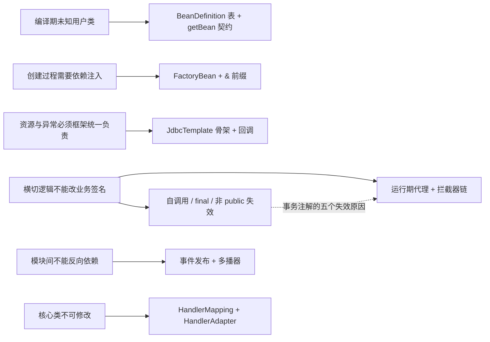
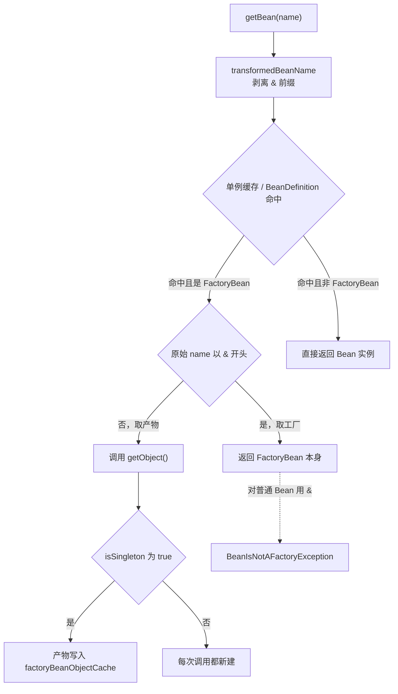
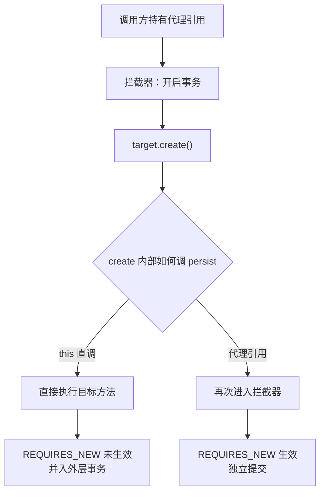
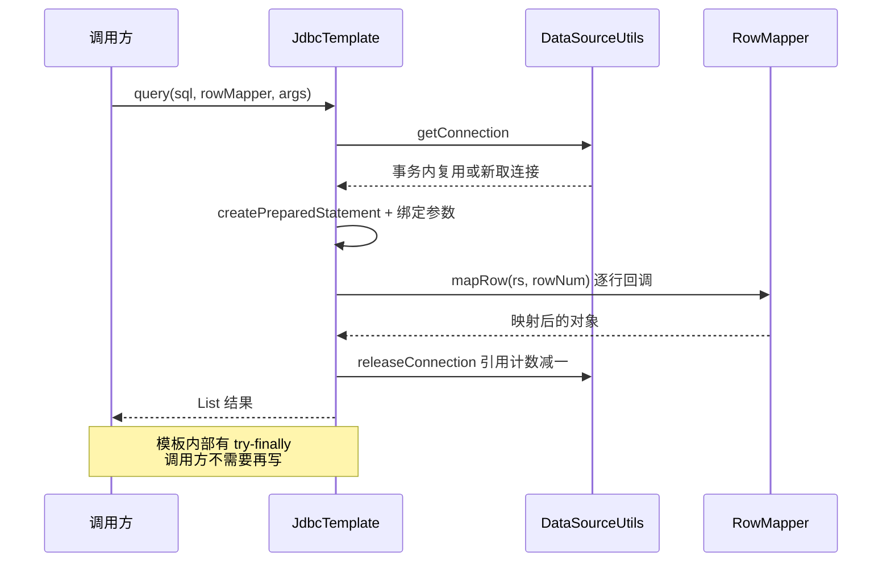
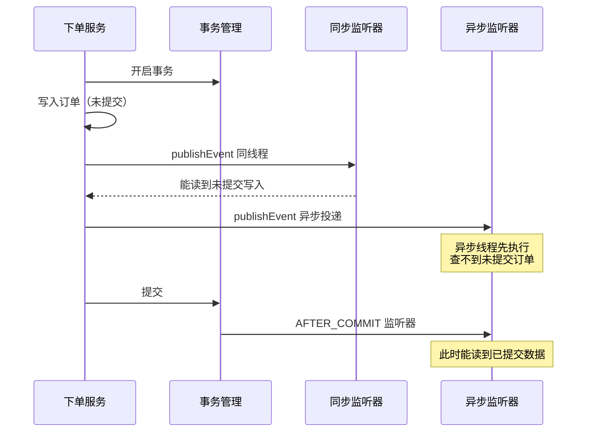
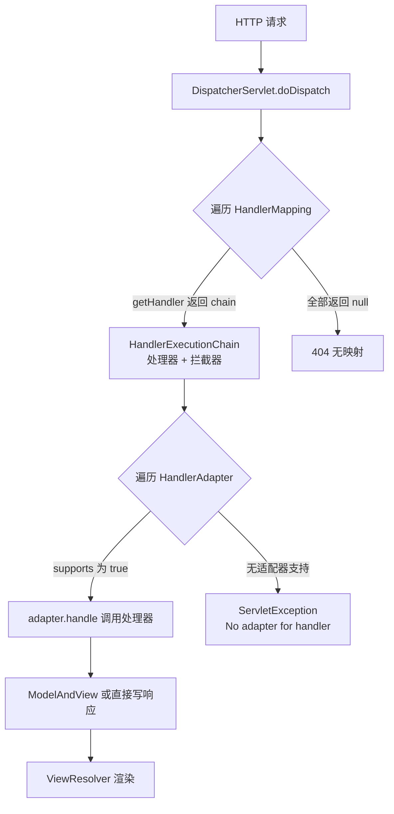

# 设计模式在Spring中的应用全景

**摘要：**

Spring 与设计模式的关系，常被讲成一份对应清单：IoC 是工厂方法，AOP 是代理，`JdbcTemplate` 是模板方法。清单本身没错，却回答不了工程里真正的问题——框架为什么非这么写不可，以及不这么写会在哪里出事。本篇换一个切法，把 Spring 的五个核心机制还原成框架自身面对的约束，看模式是被什么逼出来的。容器要在一个编译期未知的类集合上完成实例化，于是工厂方法的"创建决定"被外化成 `BeanDefinition` 表，`FactoryBean` 则把一次创建过程本身注册成 Bean，并用 `&` 前缀区分"取产物"与"取工厂"；AOP 要在不改业务签名的前提下插入横切逻辑，于是拦截点只能挂在调用方手里的引用上，自调用、非 `public` 方法、`final` 方法、类未被容器管理这几种情形因此一并失效；`JdbcTemplate` 要把连接与异常的责任收归框架，于是骨架固定、SQL 与映射退化为回调，调用方不再需要 `try-finally`；事件机制要把模块间依赖翻转为注册与通知，默认同步因此既保证了可预测性，也带来了"提交前发布"的可见性陷阱；Spring MVC 要在核心类发布后不可修改的前提下支持任意 Handler 类型，于是 `HandlerMapping` 与 `HandlerAdapter` 拆成两段。五条线索最后收束到同一判据：先看约束，再看形状。

---

## 第 1 章 框架的约束，与模式的形状

### 1.1 一个可以查证的时间戳

2003 年 3 月 8 日，`org.springframework.beans.factory.FactoryBean` 接口第一次出现在源码里，这个日期就写在它的 javadoc `@since` 上，比 Spring 1.0 正式发布还早一年。更早一些，`JdbcTemplate` 的 `@since` 记录的是 2001 年 5 月 3 日，它是 Rod Johnson 在《Expert One-on-One J2EE Design and Development》里那套"不要 EJB 也能做企业应用"的示例代码沉淀下来的产物。

这两个日期值得留意，因为它们说明 Spring 的模式不是先有一套设计图、再照着图纸施工；恰恰相反，是先有具体的技术难题，模式才在解题过程中被"长"出来。`JdbcTemplate` 早于容器出现，意味着它是为解决 JDBC 的资源泄漏与异常噪音而写的，与容器无关；`FactoryBean` 出现在容器成型之初，意味着它解决的是"容器如何管理一个自己不会造的对象"这个容器特有的问题。模式的形状由问题决定，不由 GoF 的目录决定。

### 1.2 三个反事实

要看清模式在框架里的位置，最省力的办法是设想不这么写会退化成什么。挑三处最典型的机制做反事实推演。

第一处是 Spring MVC 的请求分发。假设 `DispatcherServlet` 不用 `HandlerAdapter`，而是自己判断 handler 的类型：拿到 handler 后依次 `instanceof HandlerMethod`、`instanceof HttpRequestHandler`、`instanceof Servlet`，各走一段分支。第一版能跑通，问题出在扩展上——某个团队想把 gRPC 的网关方法也接进同一套 MVC 流程，他们能在自己的项目里写一个 handler 类，却改不了 `DispatcherServlet` 里的 `instanceof` 链，因为那个类在框架的 jar 包里。**框架不可修改**这一条约束，直接判了 if-else 方案的死刑。

第二处是 AOP。假设不用代理，而要求业务代码自己在方法里开事务、提交、回滚，那么每个需要事务的方法都要复制一遍七行样板代码；更麻烦的是缓存、日志、权限这些横切关注点，它们彼此正交，却要挤进同一个方法体里排序。改用编译期织入（AspectJ 的做法）能解决，代价是整个构建链要引入额外编译器或 JVM agent，部署单元不再是普通的 class 文件。Spring 选择运行期代理，是在"部署单元保持普通"与"拦截点必须挂在引用上"之间做了一次交换，**部署单元的普通性**优先。

第三处是 `JdbcTemplate`。假设它只提供 `getConnection()` 让调用方自己管，那么每个 DAO 方法都要写 `try-finally`，且必须记得先关 `ResultSet` 再关 `Statement` 再还 `Connection`；只要漏一层，连接池迟早被耗尽。把释放责任交给调用方，等于把最容易漏写的代码交给最容易忘记它的人。

三处反事实指向同一条线索：模式出现的位置，几乎都在"框架代码"与"用户代码"的接缝上。框架必须在编译期不知道用户写了什么类的前提下调用用户代码，必须在不修改用户调用点的前提下插入自己的逻辑，必须替用户管理用户自己不擅长管理的资源。这三件事都做不到用直白的顺序代码表达，才需要抽象。

### 1.3 约束表：机制是被什么逼出来的

把上面这些约束归并，可以得到一张不长的表。它不按 GoF 的分类组织，而按"框架付不起的代价"组织，这也是理解 Spring 模式的入口。

| 框架的约束 | 不满足时的后果 | 逼出来的机制 | 对应的模式角色 |
| --- | --- | --- | --- |
| 编译期不知道用户类的集合，实例化决定必须推迟到运行期 | 容器只能靠 `if-else` 硬编码类型，失去扩展性 | `BeanDefinition` 注册表 + `getBean` 契约 | 工厂方法的规模化 |
| 创建过程本身是一段需要依赖注入的程序，产物又不该由容器直接 `new` | 基础设施代码散落在配置类里，无法复用 | `FactoryBean`，以 `&` 区分产物与工厂 | 工厂方法 + 扩展点 |
| 横切逻辑必须插入调用链，但不能改业务签名与调用点 | 业务方法被样板代码淹没 | 运行期代理 + 拦截器链 | 代理 + 责任链 |
| 资源获取与释放、异常翻译必须由框架统一负责 | 连接泄漏、检查型异常污染业务签名 | 固定骨架 + 回调接口 | 模板方法 + 策略 |
| 模块之间不能反向依赖，发布者不该认识全部订阅方 | 新增下游就要改上游，模块缠成一张网 | `ApplicationEventPublisher` + 多播器 | 观察者 |
| 核心类发布后不可修改，第三方仍要能接入新类型 | 扩展必须改框架源码 | 两段式分发：先定位、后适配 | 适配器 + 策略 |

这张表里的每一行，都是"框架想活下去"被迫做出的选择。模式名只是事后贴上去的标签；标签有助于记忆，但理解必须回到约束本身。

### 1.4 判据：变化点由谁承担

那么，判断某处代码"是不是某个模式"，应当看什么？笔者给三个问题，按顺序问：

第一，变化点由谁承担。新增一种实现时，被迫修改的是调用方、是被调类、还是配置？调用方不用改、被调类不用改，只加一个新类——这通常是策略或适配器；调用方被迫加 `if`——说明变化点还留在调用方手里，模式其实没落地。

第二，不这样写会退化成什么。这一问用来排除"为模式而模式"：如果不用这个模式，代码只是多两行，那模式带来的间接层就是纯粹的成本。

第三，从调用方视角看，差别在哪。模式之间的辨析几乎都能落到这一问上：适配器让调用方看到统一协议，装饰器让调用方看到同一类型，代理让调用方看不到被代理者，责任链让调用方只认识链头。四者结构相似，调用方看到的东西完全不同。

后文每讲一处 Spring 的机制，都会回到这三个问题。第 7 章则反过来用它们拆掉一批牵强的对应关系——把每一个 Spring 类都套上一个模式名，看似旁征博引，实际是把"形状相似"误当成"职责相同"。

### 1.5 五条主线的位置

下图把本篇要展开的五条主线放在同一张图里，标注每条主线上"约束"与"机制"的对应关系。左侧是框架的约束，右侧是被逼出来的机制，中间的箭头是本文的叙述顺序。



---

## 第 2 章 容器：BeanFactory 与 FactoryBean

### 2.1 BeanFactory：把"new"挪到查表之后

工厂方法模式（Factory Method）在业务代码里的经典形态，是父类声明一个创建方法、子类决定实例化哪个具体类。这套结构在业务里用得并不算多，因为它把"选择哪个实现"从运行期挪回了编译期的继承关系里；但到了框架这一层，情况反过来：框架无法要求用户继承某个基类来注册自己的类，它必须接受"启动时才扫描到的一批未知类型"。于是工厂方法里的"子类"被替换成了一张表，创建哪个类、怎么创建、依赖什么，全部外化成 `BeanDefinition` 元数据，工厂只负责按名字查表、按图施工。

```java
// BeanFactory 的核心契约（精简，Spring 6.x）
public interface BeanFactory {
    String FACTORY_BEAN_PREFIX = "&";
    Object getBean(String name) throws BeansException;
    <T> T getBean(String name, Class<T> requiredType) throws BeansException;
    <T> T getBean(Class<T> requiredType) throws BeansException;
    ObjectProvider<T> getBeanProvider(Class<T> requiredType);
    boolean containsBean(String name);
    boolean isSingleton(String name) throws NoSuchBeanDefinitionException;
    boolean isPrototype(String name) throws NoSuchBeanDefinitionException;
    Class<?> getType(String name) throws NoSuchBeanDefinitionException;
    String[] getAliases(String name);
}
```

`getBean` 返回 `Object` 而不是泛型化的具体类型，常被当作"Spring 早期没写好"的证据，其实是工厂被推迟到运行期的必然结果：编译期容器手里只有一个 `Class` 对象和一个名字，没有任何类型信息可用于返回值推导。`<T> T getBean(String, Class<T>)` 这个重载就是为此补上的——类型校验发生在运行期，不匹配时抛 `BeanNotOfRequiredTypeException`，而不是编译期报错。

`BeanDefinition` 这个中间层的意义，可以借建筑图纸来理解。施工队（`BeanFactory`）不需要知道这栋楼是谁设计的，它只需要图纸（`BeanDefinition`）：几层、什么结构、用什么材料。图纸可以有多种来源——XML、注解、Java 配置类，在容器内部都被解析成同一种元数据表示。把"设计来源"抽象掉、把创建决定**元数据化**，正是工厂方法能被规模化的前提：容器只实现一次"按图施工"的流程，配置格式可以无限增加。

这一层抽象也解释了框架的扩展点为什么长在 `BeanFactoryPostProcessor` 上：图纸还没进施工队之前，是最容易改的。`PropertySourcesPlaceholderConfigurer` 之所以能把 `${db.url}` 替换成真实值，是因为它在施工开始前改图纸，而不是在施工中途改已经砌好的墙。

> [!info] 互补阅读
> `BeanFactory` 与 `ApplicationContext` 的层次关系、`ListableBeanFactory` 的按类型查询、父子容器的委派规则，在 [[02 IoC容器——BeanFactory与ApplicationContext的层次设计]] 里有更细的展开。本篇只关心"工厂方法在容器这一层为什么必须被数据化"。

### 2.2 FactoryBean：把自己注册成 Bean 的那类工厂

容器能把普通 Bean 造出来，靠的是反射调用构造器或工厂方法。但有一类对象的创建过程本身就是一段程序：MyBatis 的 `SqlSessionFactory` 要先读配置、建连接池、扫描并注册 mapper；Spring 自己的 `ProxyFactoryBean` 要先组装拦截器链、再决定用哪种代理；`JndiObjectFactoryBean` 要先查 JNDI、处理缓存与失败重试。把这些逻辑塞进一个 `@Bean` 方法当然也能跑，但那段代码没有容器能力的支撑——它拿不到 `Environment`，拿不到 `BeanFactory`，也享受不到生命周期回调。

`FactoryBean` 的解法是把这段创建程序本身注册成一个 Bean，让容器替它完成依赖注入与生命周期管理，对外暴露的却是 `getObject()` 的产物。

```java
public interface FactoryBean<T> {
    String OBJECT_TYPE_ATTRIBUTE = "factoryBeanObjectType";   // 5.2 起
    T getObject() throws Exception;
    Class<?> getObjectType();
    default boolean isSingleton() { return true; }            // 默认单例
}
```

一个最小的实现，注意它拿到的是容器注入的依赖，而不是自己 `new` 出来的：

```java
@Component
public class HttpClientFactoryBean implements FactoryBean<HttpClient>, BeanFactoryAware {
    private final HttpClientConfig config;          // 构造器注入，容器代劳
    private BeanFactory beanFactory;                // 需要别的 Bean 时程序化获取
    private HttpClient client;

    public HttpClientFactoryBean(HttpClientConfig config) { this.config = config; }

    @Override
    public HttpClient getObject() {                 // 真正的创建逻辑
        if (client == null) {
            client = HttpClient.newBuilder()
                    .connectTimeout(config.timeout())
                    .build();
        }
        return client;
    }

    @Override
    public Class<?> getObjectType() { return HttpClient.class; }

    @Override
    public void setBeanFactory(BeanFactory beanFactory) { this.beanFactory = beanFactory; }
}
```

这段代码里有三处容易踩的地方，恰好对应 `FactoryBean` 契约的三条边界。

第一处是 `&` 前缀。容器里同时存在两个"东西"：工厂 Bean 本身，和它产出的对象。`getBean("httpClientFactoryBean")` 拿到的是 `HttpClient`，`getBean("&httpClientFactoryBean")` 拿到的才是工厂本身。前缀常量定义在 `BeanFactory` 里（`FACTORY_BEAN_PREFIX = "&"`），`AbstractBeanFactory.doGetBean()` 的第一步 `transformedBeanName(name)` 会把这个前缀剥掉用于查找，随后 `getObjectForBeanInstance()` 依据"原始 name 是否带 `&`"决定返回值：带 `&` 就直接返回工厂实例，不带 `&` 且实例是 `FactoryBean` 就调用 `getObject()`。如果对一个普通 Bean 用了 `&`，容器抛 `BeanIsNotAFactoryException`，提示"这个 Bean 不是工厂"。`containsBean("&x")` 的语义也随之特殊：只有当 `x` 确实是 `FactoryBean` 时才返回 `true`。

第二处是产物的生命周期归属。`FactoryBean` 的 javadoc 写得很直白：容器只负责管理 `FactoryBean` 实例的生命周期，不负责管理它产出的对象，因此产物上的 `close()` 不会被自动调用。想让产物被正确关闭，工厂自己得实现 `DisposableBean`，在 `destroy()` 里把关闭动作代理下去。这一点在连接池、线程池这类资源上尤其致命：容器关闭时日志一片安静，连接池却没释放。

第三处是依赖注入的可用性。javadoc 同样写明，`FactoryBean` 是一个程序化契约，实现类不应依赖注解注入或其他反射设施，因为 `getObject()` 与 `getObjectType()` 可能在容器启动的很早阶段被调用，早于后置处理器装配完成。需要别的 Bean，就实现 `BeanFactoryAware` 或 `ApplicationContextAware` 自己去取，而不是在字段上挂 `@Autowired`。

下图把一次取值请求在容器内部的分派路径画出来，`&` 的作用就清楚了。



### 2.3 判据：什么时候用 FactoryBean，什么时候用 @Bean

`@Bean` 与 `FactoryBean` 都能把"创建逻辑"从调用方挪走，选错的代价却不对称：`@Bean` 选错只会让代码啰嗦一点，`FactoryBean` 选错会让容器失去对产物的掌控。下面这张表按五个维度对照，判断顺序建议从下往上——先看产物类型是否需要被容器按类型发现，再看生命周期归谁管。

| 维度 | `@Bean` 方法 | `FactoryBean` |
| --- | --- | --- |
| 产物类型的声明 | 方法返回类型即声明，容器据此做按类型匹配 | 依赖 `getObjectType()`；返回 `null` 时按类型注入会被容器忽略 |
| 产物生命周期 | 容器管理产物，`destroyMethod` 与 `@PreDestroy` 正常生效 | 容器只管理工厂，产物需工厂自己在 `DisposableBean` 里关闭 |
| 工厂自身的依赖注入 | 方法参数注入，直观 | 程序化契约，`@Autowired` 不可靠，需 `BeanFactoryAware` |
| 按名称创建多个同类对象 | 每个变体写一个方法，参数写死 | 天然支持：一个工厂类，多个 Bean 定义，各自持不同参数 |
| 典型使用场景 | 业务装配、一次性对象 | 基础设施与第三方集成：`ProxyFactoryBean`、`JndiObjectFactoryBean`、`SqlSessionFactoryBean` |

判断可以简化成一句话：当"创建过程"需要容器能力（依赖注入、`Environment`、`BeanFactory`），并且产物本身需要作为 Bean 被其他 Bean 按类型注入时，才值得用 `FactoryBean`；其余情形一律用 `@Bean`。Spring 自己的 javadoc 也承认，`FactoryBean` 用于自定义组件"通常只出现在基础设施代码里"，业务代码里手写 `FactoryBean` 多半是把简单问题复杂化了。

还有一个反直觉的坑：如果 `@Bean` 方法的返回类型声明成 `FactoryBean`，这个 Bean 就有两个身份——`getBean` 拿到的是产物，想拿工厂本身仍要加 `&`；而按类型注入产物时，容器得先通过 `getObjectType()` 推断产物类型，推断不出来（返回 `null`）就匹配不到，注入点会以"找不到 Bean"收场。业务代码里最干净的写法是让 `@Bean` 直接返回产物，把工厂留在基础设施层。

---
## 第 3 章 AOP：拦截点为什么必须挂在引用上

### 3.1 不改调用点的两种办法

横切逻辑要在方法执行前后插进来，而框架不能要求业务代码改签名、改调用方式。满足这个前提的实现路径只有两类：在编译期或类加载期把增强织进字节码，或者在运行期替换调用方手里的引用。前者是 AspectJ 的路线，后者是 Spring AOP 的路线。

两条路线的代价写得明明白白。织入路线没有运行期开销，自调用也不成问题，因为增强已经进了方法体；但它要求额外的编译步骤或 JVM 参数，产物不再是普通 class，且织入点与部署单元绑定。代理路线不碰字节码、不碰构建链，代价是拦截点挂在引用上——只有经过代理引用的调用才会被拦截。Spring 选后者，本质上是把"部署单元的普通性"排在"拦截的彻底性"之前。

这个交换的账单，就是后面所有失效场景的总根源。自调用失效、`final` 方法失效、非 `public` 方法失效、类没被容器管理时失效，表面上四条不相干的规则，落到机制上只有一句：**拦截点挂在引用上**，不挂在类型上。调用方手里握的是代理，拦截器就执行；握的是目标对象本身，拦截器就跳过。

### 3.2 两种代理，两套默认值

代理对象的生成有两套实现，各自的约束都由"如何生成"决定。

JDK 动态代理（`java.lang.reflect.Proxy`）在运行期生成一个实现了指定接口的类，方法调用转给 `InvocationHandler`。它的硬约束是目标类必须实现接口；生成出来的类与目标类没有继承关系，因此按实现类类型注入时会失败，容器抛 `BeanNotOfRequiredTypeException`。它的优势也来自接口：不需要读取目标类结构，生成快、内存占用小。

CGLib 走另一条路：继承目标类，覆写非 `final` 方法，在覆写方法里插入拦截逻辑。约束因此变成继承约束——`final` 类无法被继承，代理直接失败并报 `Cannot subclass final class`；`final` 方法无法被覆写，拦截器不会被调用，增强**静默失效**，不报错、不告警。这一对不对称的失败形态是排错时的陷阱：报错的还好办，静默的那个往往要等到事务没回滚、缓存没清掉时才被发现。Spring 用 Objenesis 直接分配代理实例、不执行父类构造器，所以"被代理类必须有无参构造器"这条在 Spring 场景里并不成立，那是裸用 CGLib 时的约束。

两种代理并存，选择权落在一个布尔属性上，而这个属性在两个入口上的默认值恰好相反：

| 配置入口 | 属性/参数 | 默认值 | 生效场景 |
| --- | --- | --- | --- |
| Spring Boot 自动配置 | `spring.aop.proxy-target-class` | `true`（Boot 2.0 起） | 引入 `spring-boot-starter-aop` 的应用 |
| Spring Framework 注解 | `@EnableAspectJAutoProxy(proxyTargetClass = ...)` | `false` | 纯 Framework 项目，未经过 Boot 自动配置 |

把两者混为一谈是极常见的误读。"Spring 6 默认用 CGLib"这句话在 Boot 应用里成立，在纯 Framework 项目里不成立：后者仍是接口优先，有接口用 JDK 代理，没接口才退回 CGLib。Boot 之所以把默认值翻过来，是因为"按实现类注入"和"注解写在实现类上"在实践中太常见，接口优先策略下这两种写法会轮流踩坑；代价是 `final` 类与 `final` 方法从此彻底不可增强，Kotlin 项目还得靠 `kotlin-spring` 编译插件给类补 `open`。这套选取细节与 `final` 方法的失效形态，在 [[04 结构型模式（上）——代理、适配器与装饰器]] 里已经从代理模式的实现角度拆过一遍，此处不再重复。

代理还有一个常被忽略的语义后果：注入到业务代码里的对象，类型可能不是业务类本身。`getClass()` 拿到的是 `$Proxy0` 或 CGLib 生成的子类；按 `getClass()` 做缓存 key、反射读注解、序列化写类名，全都会拿到代理类型。要拿原始类型，用 `AopUtils.getTargetClass(bean)` 或 `AopProxyUtils.ultimateTargetClass`；要读业务类上的注解，用能穿透代理的工具类。这类问题不报错，只让"注解明明写了却不生效"的困惑换个地方出现。

### 3.3 自调用：一次 `this` 造成的静默失效

代理能生效的前提是调用经过代理引用。一旦代码在目标对象内部用 `this` 调用自己的另一个方法，这次调用不经过代理，拦截器不会执行。

```java
@Service
public class OrderService {
    @Transactional
    public void create(Order order) {
        validate(order);
        this.persist(order);      // 用的是 this，不是代理
    }

    @Transactional(propagation = Propagation.REQUIRES_NEW)
    public void persist(Order order) {
        repository.save(order);   // REQUIRES_NEW 完全没被读到
    }
}
```

外部调用 `create` 时走代理，事务按 `REQUIRED` 开启；`persist` 由 `this` 调用，直接进目标方法体，`REQUIRES_NEW` 没有被解析，本该独立提交的记录跟着外层事务一起回滚。代码看起来毫无破绽，注解也写得规规矩矩，问题只在那一处 `this` 上。



修法有三条，取舍各不相同。

| 解法 | 前提 | 代价 | 适用 |
| --- | --- | --- | --- |
| 拆到另一个 Bean | 无 | 要重新划一次职责边界 | 首选，语义最干净 |
| 注入自身（`@Autowired` 本类） | 需要 `@Lazy` 或 `ObjectProvider` 规避早期初始化 | 类内出现自引用，容易被误读为循环依赖 | 方法确实属于同一职责但需独立事务 |
| `AopContext.currentProxy()` | 必须打开 `exposeProxy` | 依赖 `ThreadLocal`，跨线程与异步失效 | 不想改结构、又必须自调用 |

第三种解法要求 `@EnableAspectJAutoProxy(exposeProxy = true)`，因为默认的 `ProxyConfig.exposeProxy` 是关闭的——容器不会把当前代理放进 `AopContext` 的 `ThreadLocal`，`currentProxy()` 直接抛 `IllegalStateException`。即使打开了，跨线程、`@Async` 方法、线程池里取到的仍是空值，因为 `ThreadLocal` 不跟着任务走。这也是为什么三条解法里"拆类"被排在第一：它不依赖任何框架开关，也不引入隐式的线程绑定。

### 3.4 `@Transactional` 失效的五个原因

事务注解是 Spring 里被用得最多、也最容易"看起来生效"的注解。它不生效时几乎没有信号：应用启动正常，方法照常执行，只是回滚没发生、或者独立事务没有独立。把常见原因归并，五个足够覆盖绝大多数线上事故。

| 失效原因 | 典型表象 | 机制根因 | 修法 |
| --- | --- | --- | --- |
| 自调用 | 注解在，无异常，事务没开 | 拦截器挂在代理引用上，`this` 直调绕过代理 | 拆类／注入自身／`AopContext` |
| 方法非 `public` | 静默不生效，连日志都没有 | 属性源默认只处理 `public` 方法 | 提升可见性，或把事务边界移到 `public` 方法 |
| 异常类型不匹配 | 抛了异常，数据仍提交 | 默认只回滚非受检异常 | `rollbackFor`，或显式标记回滚 |
| 多数据源未指定事务管理器 | 启动报多个候选，或事务"开了"却不生效 | 按类型解析候选歧义；事务管理器与数据源不匹配 | 注解指定 qualifier，或 `@Primary` + 命名 |
| 类未被 Spring 管理 | 一切正常，就是没有事务 | 对象不是容器创建的，没有代理 | 交给容器创建，或改编程式事务 |

**自调用**。机制在上一节已经展开。这里补一个排错时的判据：如果注解方法在同类的另一个方法里被调用，且注解的传播行为是 `REQUIRES_NEW`、`NESTED` 这类需要在运行期改变事务语义的取值，那么失效是必然的；如果传播行为是默认的 `REQUIRED`，失效的表现会变成"看起来正常"——因为外层事务已经存在，内层本来也不需要新事务，问题被掩盖到某次回滚范围不符预期时才暴露。

**可见性问题**。非 `public` 方法上的注解会被忽略：`AnnotationTransactionAttributeSource` 的 `allowPublicMethodsOnly()` 默认返回 `true`，`AbstractFallbackTransactionAttributeSource` 在计算事务属性时会先看这个方法是否被允许——非 `public` 的方法直接返回 `null`，后面的事务拦截器连属性都拿不到，自然不会开启事务。这里有个容易想错的地方：CGLib 在技术上可以覆写 `protected` 方法，所以"CGLib 能拦 protected，所以 protected 上有事务"这个推论是错的——拦住与否由代理决定，属性有没有由属性源决定，两件事分开算。Spring 6.2 起提供了 `setPublicMethodsOnly(false)`，但那是给 AspectJ 织入场景准备的，用在代理场景只会让"哪些方法有事务"变得更难判断。

**异常类型不匹配**。默认规则只对 `RuntimeException` 与 `Error` 回滚，受检异常照常提交。三种变体会让这条规则更难发现：把受检异常往上抛（以为抛了就会回滚）、在方法内部 `catch` 住异常只记日志（异常根本没到拦截器）、把非受检异常包装成受检异常再抛。修法有三条路：`@Transactional(rollbackFor = Exception.class)` 让受检异常也回滚；`noRollbackFor` 反向排除某些异常；或者在必须回滚但不能抛异常的场景里，用 `TransactionAspectSupport.currentTransactionStatus().setRollbackOnly()` 显式标记。

```java
// 反例：抛了异常，事务照样提交
@Transactional
public void transfer(Long from, Long to, BigDecimal amount) throws IOException {
    accountDao.debit(from, amount);
    auditDao.write(from, to, amount);   // 若这里抛 IOException，前面扣款不回滚
}

// 正例：按业务语义声明回滚范围，比记住默认规则可靠
@Transactional(rollbackFor = Exception.class)
public void transfer(Long from, Long to, BigDecimal amount) throws IOException { /* ... */ }
```

**多数据源未指定事务管理器**。事务管理器解析的顺序是：先看注解上是否写了 qualifier，再看是否显式指定了事务管理器 Bean 名，最后按类型查找——多个候选时由 `@Primary` 决定，没有主候选就抛 `NoUniqueBeanDefinitionException`。这条错误的两种表现形态差异很大：一种是启动期就炸，报"期望单个匹配但找到两个"，很容易定位；另一种更隐蔽——两个数据源各有事务管理器，注解没指定，容器按 `@Primary` 选了一个，事务确实开了，但它绑定的是另一个数据源的连接，于是在这个数据源上的写入并不在事务里。事务管理器绑定的对象是"数据源 + 线程"，选错了管理器，事务边界画在了另一条连接上。

**类未被 Spring 管理**。对象如果是 `new` 出来的、或者由 `@Bean` 方法内部 `new` 后直接返回、或者来自某个工具类的静态工厂，它就不在容器里，也就没有代理。这类代码往往还能跑，因为不含事务的数据库操作本来也能执行，只是再也没有回滚。它常与"把 `@Service` 类当普通工具类 `new` 出来用"这种写法一起出现，在单元测试里最难发现——测试直接 `new` 目标类，本来就绕过了容器，测出来的行为与线上不一致。

> [!warning] 排错顺序
> 遇到"事务没生效"，按这个顺序查，比逐条猜快得多：一，确认对象是不是容器里的代理（`AopUtils.isAopProxy(bean)`）；二，确认调用是否经过代理引用（看调用点是不是 `this`）；三，确认方法可见性；四，确认异常类型与是否被 `catch`；五，确认事务管理器是否指向预期的数据源。在目标方法开头打一个断点，看 `TransactionSynchronizationManager.isActualTransactionActive()` 的返回值，能一次性把"到底有没有事务"这件事定性，比读注解快。

除了这五条，还有一种同族情形值得记住：`final` 方法上的 `@Transactional`。CGLib 无法覆写 `final` 方法，拦截器不会被调用，注解静默失效。它与"非 `public` 方法"经常被混为一谈，实际根因不同：前者是代理生成不了，后者是属性源不给属性。Kotlin 项目里这条尤其常见，因为类与方法默认 `final`，需要 `kotlin-spring` 插件在编译期补 `open` 才能被代理。

---

## 第 4 章 JdbcTemplate：把 try-finally 收进框架

### 4.1 一段必须被复制的样板代码

`JdbcTemplate` 的 javadoc 记录它始于 2001 年 5 月，比 Spring 1.0 早三年。它要解决的问题，用一段手写 JDBC 就能说明白：

```java
// 手写版本：每个 DAO 方法都要重复这一整套
public User findById(long id) {
    Connection conn = null;
    PreparedStatement ps = null;
    ResultSet rs = null;
    try {
        conn = dataSource.getConnection();
        ps = conn.prepareStatement("SELECT id, name FROM users WHERE id = ?");
        ps.setLong(1, id);
        rs = ps.executeQuery();
        if (rs.next()) {
            return new User(rs.getLong("id"), rs.getString("name"));
        }
        return null;
    } catch (SQLException e) {
        throw new RuntimeException(e);          // 检查型异常被随手包成运行时异常
    } finally {
        // 顺序错一个、漏一个，连接池就在某个深夜被耗尽
        if (rs != null) try { rs.close(); } catch (SQLException ignored) {}
        if (ps != null) try { ps.close(); } catch (SQLException ignored) {}
        if (conn != null) try { conn.close(); } catch (SQLException ignored) {}
    }
}
```

这段代码里真正随业务变化的部分只有两处：SQL 语句，以及 `ResultSet` 到 `User` 的映射。其余全是与业务无关的固定流程——取连接、建语句、绑参、执行、释放、异常转换。按模板方法模式的做法，骨架由父类固定、可变步骤留给子类；到了框架这一层，可变步骤连继承都不需要，直接做成接口由调用方传进来，这就是"模板方法 + 回调"的形态。

### 4.2 骨架固定了什么

`JdbcTemplate` 的骨架里，被固定的步骤比手写版本多两项，恰是这两项让调用方得以彻底摆脱 `try-finally`。

第一项是连接的获取与释放。模板不直接调 `dataSource.getConnection()`，而是走 `DataSourceUtils.getConnection(dataSource)`：如果当前线程已经绑定了一个事务连接（事务管理器通过 `TransactionSynchronizationManager` 把连接挂在线程上），就直接复用；否则才从池里取。释放时走 `DataSourceUtils.releaseConnection()`，它做的是引用计数意义上的"归还"——有事务绑定时，只是把 `ConnectionHolder` 的引用计数减一，物理连接要等事务结束才真正归还。这就是"调用方不写 `try-finally` 也不会把事务连接关掉"的机制：关闭责任在模板，而模板知道哪些连接不该真的关。

第二项是**异常翻译**。模板捕获 `SQLException`，交给 `SQLExceptionTranslator`（默认实现按厂商错误码匹配），翻译成 `org.springframework.dao` 包下的 `DataAccessException` 体系。这一步的意义不只是"异常更友好"：它把检查型异常转成非检查型，调用方的方法签名不必再声明 `throws SQLException`，接口才可能保持干净。异常翻译必须是骨架的一部分——如果留给调用方，每个 DAO 都要自己判断错误码，抽象就没有意义。

把这两项放回模板方法的结构里看：`execute`、`query`、`update` 这些公开方法是"模板方法"，它们按固定次序调用 `getConnection` → `createStatement` → 回调 → `releaseConnection`；可变步骤被拆成六个回调接口，每个对应一类变化点。

| 回调接口 | 承担的变化点 | 什么时候用它 |
| --- | --- | --- |
| `PreparedStatementCreator` | 如何创建语句（SQL 与参数绑定一起控制） | 需要动态拼 SQL、或要设置 `Statement` 选项 |
| `PreparedStatementSetter` | 只负责绑参，语句由模板创建 | 参数较多、需要复用一段绑定逻辑 |
| `ResultSetExtractor<T>` | 整个结果集如何映射为一个对象 | 聚合查询、一对多嵌套映射 |
| `RowMapper<T>` | 单行如何映射为一个对象 | 最常见的列表与单条查询 |
| `RowCallbackHandler` | 逐行处理，无返回值 | 大结果集流式写出，不驻留内存 |
| `StatementCallback<T>` | 在 `Statement` 上执行任意操作 | DDL、批处理、厂商特有语句 |

六个接口覆盖的是从"只给 SQL"到"接管整个 `Statement`"的不同控制粒度：`RowMapper` 只要单行映射，`ResultSetExtractor` 要自己遍历结果集，`StatementCallback` 连语句的创建与执行都接管。控制权越往调用方手里放，模板承担得越少、能替你做的事也越少，这两个方向永远此消彼长。这组接口本身就是策略模式的应用——模板持有接口引用，具体策略由调用方在调用点以 Lambda 或匿名类给出，与本文第 2 章的工厂方法、第 5 章的观察者一样，都是"把变化点外置"的不同粒度表达。



### 4.3 为什么这个模板不需要子类

模板方法模式的经典实现依赖继承：抽象类定义骨架，子类实现抽象步骤。`JdbcTemplate` 的做法把这条依赖拆掉了——它把可变步骤参数化为回调接口，于是变化不再通过子类表达，而是通过调用参数表达。它的 javadoc 直接写明：因为这个类可以通过回调接口与 `SQLExceptionTranslator` 参数化，所以"没有子类化的必要"（there should be no need to subclass it）。

这个取舍值得单独说一句，因为它代表了一类模式演进。继承式的模板方法有三个成本：子类与父类强耦合、一个类只能有一套步骤实现、父类改动会波及所有子类。把步骤换成回调之后，成本变成"调用点要多写一个 Lambda"，换来的是同一个模板实例可以被任意多个调用方以不同策略复用。这也是 [[06 行为型模式（上）——策略、模板方法与观察者]] 里"用回调替掉继承"那一条在框架层面的完整落点：模板方法没有被废弃，它把"可变步骤"的实现方式从继承换成了组合。

### 4.4 边界：什么时候不该抽模板

模板方法的收益来自"骨架稳定且步骤正交"。反过来，两种情形不适合抽模板：其一，流程本身还在变，今天三步明天五步，抽出来的骨架每两周改一次，所有调用方都要跟着重新验证；其二，步骤之间共享大量局部状态，参数列表会膨胀成一串出参入参，回调接口反而比顺序代码难读。

`JdbcTemplate` 自己也划出了边界。它支持流式查询（`queryForStream`），但返回的 `Stream` 必须由调用方在 `try-with-resources` 里关闭——资源释放责任在这里被部分交还给了调用方，因为流式结果集的生命周期无法由模板在一次方法调用内确定。这个例外说明模板方法的"资源归属"原则并非绝对：当资源的生命周期比方法调用更长时，模板无法替调用方决定何时释放，只能把约定写进返回值类型里。批处理、大结果集导出这类场景，判断的落点不是"模板方法好不好用"，而是"资源的生命周期是否落在方法调用之内"。

---

## 第 5 章 事件：观察者在容器里的三个语义

### 5.1 注册由容器完成，通知默认同步

手写观察者模式时，被观察者要维护一张监听器列表，提供 `register` 与 `unregister`，状态变化时遍历通知。Spring 的事件机制把这些事包进了容器：发布者只依赖 `ApplicationEventPublisher` 接口，调用 `publishEvent(Object)`；监听器是普通的 Bean，用 `@EventListener` 标注；两者的连接由容器在建上下文时完成，谁都不需要持有对方的引用。

依赖方向因此被翻转。没有事件机制时，下单服务要直接调用发券服务、积分服务、通知服务，新增一个下游就要改一次下单服务——这是被观察者反向依赖所有观察者的典型形态。有了事件机制，下单服务只认识"发布"这个动作，下游自己声明关心什么事件。第 6 章讲适配器时我们会看到同样的手法：把"调用谁"从编写期推迟到装配期，是框架降低耦合的通用办法。

通知的默认语义是同步。`ApplicationContext` 内部持有一个 `ApplicationEventMulticaster`，默认实现是 `SimpleApplicationEventMulticaster`，其 `taskExecutor` 等价于 `SyncTaskExecutor`——监听器在发布事件的线程里依次执行。这个默认值的好处是可预测：事件发布返回时，所有监听器都已执行完毕，异常会沿着调用栈传回发布者，事务的提交与回滚顺序是确定的。它的坏处同样明确：任何一次慢调用都会拖住主流程，任何一次异常都会中断后续监听器。

同步带来的一个后果常被低估：在事务方法内发布事件，监听器抛出的异常会传播给发布者，导致事务回滚。而如果监听器已经把邮件发出去、把消息投给了下游，这条通知就再也收不回来——数据回滚了，副作用却发生了。

异步要靠 `@Async`，且必须显式打开 `@EnableAsync`，否则注解只是装饰。打开之后，监听器在另一个线程执行，换来三个新问题：`ThreadLocal` 上下文丢失（事务绑定、`SecurityContext`、MDC 日志上下文都不跟着走）、任务在队列里堆积（Boot 默认的 `applicationTaskExecutor` 队列容量可配，监听器一阻塞就会堆积）、执行顺序不再与发布顺序一致。也可以换一种异步：给 `SimpleApplicationEventMulticaster` 配一个 `taskExecutor`，让所有监听器统一异步执行——这种做法影响全局，通常只在明确需要时使用。

| 执行方式 | 开关 | 事务上下文 | 失败后果 | 适用 |
| --- | --- | --- | --- | --- |
| 同步（默认） | 无 | 在发布者线程内，可见当前事务 | 异常传播给发布者，可致回滚 | 强一致、必须与主流程同生共死 |
| `@Async` 监听器 | `@EnableAsync` | 丢失，需显式传递 | 异常只在异步线程日志中 | 可容忍延迟与失败的通知 |
| 多播器统一 `taskExecutor` | 配置 `ApplicationEventMulticaster` | 全局丢失 | 同上，且影响所有监听器 | 全局异步化的特殊场景 |

### 5.2 事务感知的四个阶段

`@TransactionalEventListener` 把监听器挂到事务的生命周期上，四个阶段对应 `TransactionPhase` 的四个枚举值。它默认停在 `AFTER_COMMIT`，且默认 `fallbackExecution = false`——没有事务在跑时，事件直接被丢弃，连日志都不会留。

| 阶段 | 触发时机 | 能否影响原事务 | 能否读到已提交数据 | 典型用途 |
| --- | --- | --- | --- | --- |
| `BEFORE_COMMIT` | 提交前，仍在事务内 | 能，抛异常即回滚 | 能读到未提交的写入 | 提交前的最后校验、补写审计字段 |
| `AFTER_COMMIT` | 提交成功后 | 不能 | 能 | 发通知、投消息、触发下游流程 |
| `AFTER_ROLLBACK` | 回滚后 | 不能 | 不能 | 补偿、告警、清理已产生的副作用 |
| `AFTER_COMPLETION` | 提交或回滚后（两种情况都触发） | 不能 | 视提交结果而定 | 统一收尾、释放资源 |

四个阶段的差异，本质上是"事务同步回调"的差异。底层机制是 `TransactionSynchronizationManager`——它用 `ThreadLocal` 维护当前线程绑定的事务资源与一组 `TransactionSynchronization` 回调，事务管理器在提交、回滚、完成这几个点上依次回调它们。`@TransactionalEventListener` 的实现就是把自己的监听方法注册成这样一个同步回调。这里没有模式，只有线程绑定：它既不是观察者，也不是策略，而是一个上下文容器。把 `TransactionSynchronizationManager` 说成某种模式，是第 7 章要拆的那类牵强对应。

`AFTER_COMMIT` 有一个容易踩的细节，Spring 的 javadoc 专门加了警告：此时事务已经提交，但事务资源可能仍处于活动状态，在这个阶段触发数据访问，写入仍会"参与"原事务，只是不会被提交。也就是说，在 `AFTER_COMMIT` 监听器里直接更新数据库，写操作会静默丢失——事务已提交，连接却还绑在同步回调的上下文里。要在这个阶段写库，必须用一个独立的新事务（`@Transactional(propagation = Propagation.REQUIRES_NEW)`），把写入放到另一条连接上。

### 5.3 提交前发布的陷阱

"监听器查不到数据"是事件机制最经典的故障形态。它有三种成因，对应三种组合。

第一种是同步监听器在事务内执行。发布发生在 `@Transactional` 方法中间，监听器在同一线程、同一事务里被调用。此时它能看到本事务尚未提交的写入（因为用的是同一条连接），查不到的是别的事务的写入；如果监听器自己又开了新事务（`REQUIRES_NEW`），新事务在另一条连接上，同样看不到未提交的数据。

第二种是 `@Async` 监听器。发布线程还在事务里，异步线程已经拿着自己的连接去查了——未提交的写入对它不可见，于是"订单刚创建，通知里查不到订单"。这个竞态与机器快慢无关，只与提交先后有关，本地环境常常复现不出来。

第三种是没有事务却用了 `@TransactionalEventListener`。`fallbackExecution` 默认关闭，事件被直接丢弃，监听器一次都不会执行，表现为"功能没生效"而不是"查不到数据"。



正确的组合取决于"通知要读什么、失败了能不能重来"。要读已提交数据、又不能因通知失败回滚业务，就用 `AFTER_COMMIT` 加幂等消费；要保证通知一定发出，就得在 `AFTER_COMMIT` 里再配合重试与持久化（本地消息表、事务性 outbox），因为一旦进程在提交后、通知前崩溃，事件就永久丢失了——事件机制只保证"进程内、同一时刻"的投递，不保证跨进程的可靠投递。

还有一个常被写反的地方：事件对象里塞整个实体。事件在异步或延迟执行时，实体可能已被后续操作修改，监听器读到的是过期快照；正确做法是事件只携带标识与必要字段，监听器按标识回查。事件是消息，不是引用。

### 5.4 什么时候不该用事件

事件机制解决的是"同进程内的依赖倒置"，它的能力边界也在这里。三种情形不适合：需要跨进程或跨重启的可靠投递，应当用消息队列或 outbox；需要严格顺序或事务性保证，进程内事件给不了；事件链路过深，排错成本会超过解耦收益——一个下单请求触发十几个监听器、监听器里再发布事件，调用栈早已看不出真正的执行路径，这时隐式控制流的代价高于收益。

---

## 第 6 章 MVC：HandlerMapping 与 HandlerAdapter 的分工

### 6.1 两段式分发

`DispatcherServlet` 收到请求后的第一件事不是调用处理器，而是问"谁来处理"。这一步由 `HandlerMapping` 完成：它是一个有序的列表，每个实现负责一类映射规则，`getHandler(request)` 返回 `HandlerExecutionChain`（处理器加拦截器链），返回 `null` 表示自己不认识这个请求，交给下一个。

拿到处理器之后，第二件事是"怎么调"。处理器对象的类型可能完全不同：`@Controller` 里被 `@RequestMapping` 标注的方法，在容器里被包装成 `HandlerMethod`；实现 `HttpRequestHandler` 接口的类，自己接收 `HttpServletRequest` 与 `HttpServletResponse`；老式的 `Controller` 接口实现返回 `ModelAndView`；连 `jakarta.servlet.Servlet` 实例都可以作为处理器接入。它们的调用协议没有共同点，`HandlerAdapter` 的存在就是把这层差异隔开。

```java
public interface HandlerAdapter {
    boolean supports(Object handler);                 // 能力协商：能不能接这个处理器
    ModelAndView handle(HttpServletRequest request,
                        HttpServletResponse response,
                        Object handler) throws Exception;   // 统一调用协议
    default long getLastModified(HttpServletRequest request, Object handler) { return -1; }
}
```

`DispatcherServlet` 遍历注入的适配器列表，找第一个 `supports` 返回 `true` 的，然后调 `handle`。对分发器而言，所有处理器都被压缩成了一个调用：`adapter.handle(request, response, handler)`。这一点与第 4 章的 `JdbcTemplate` 结构上很像——调用方持有一个接口，具体实现由装配期决定；差别在于模板方法固定的是"步骤次序"，适配器统一的是"调用协议"。

下图把一次请求的分发路径画出来，注意 `HandlerMapping` 与 `HandlerAdapter` 各自是一个有序列表，分发器依次询问。



### 6.2 四种处理器与各自的适配器

| 处理器类型 | 对应适配器 | 注册方式 | 备注 |
| --- | --- | --- | --- |
| `@RequestMapping` 方法（包装为 `HandlerMethod`） | `RequestMappingHandlerAdapter` | MVC 默认装配 | 参数解析、返回值处理都在这层 |
| `HttpRequestHandler` 实现类 | `HttpRequestHandlerAdapter` | MVC 默认装配 | 自行处理请求与响应，常用作静态资源、代理转发 |
| 老式 `Controller` 接口实现类 | `SimpleControllerHandlerAdapter` | MVC 默认装配 | 返回 `ModelAndView`，早期 API |
| `jakarta.servlet.Servlet` 实例 | `SimpleServletHandlerAdapter` | 需要手动声明为 Bean | 默认不激活，且被包装的 Servlet 不会自动收到 init/destroy 回调 |

最后一行值得单独说：`SimpleServletHandlerAdapter` 的 javadoc 明确写着"默认不激活，需要在 `DispatcherServlet` 上下文里定义为 Bean"，并且被当作处理器的 Servlet 实例不会收到初始化与销毁回调，除非另外配置后处理器。这条注释本身就是适配器模式的一个注脚——适配器能统一调用协议，却统一不了生命周期语义；把 Servlet 接进 MVC 只是让它"能被调用"，它作为 Servlet 的那套生命周期契约并不会自动延续。

### 6.3 为什么不是 if-else

回到第 1 章的反事实：如果 `DispatcherServlet` 自己用 `instanceof` 判断处理器类型，代码量并不会大多少，八行分支足够。真正的差别不在行数，而在依赖方向。

if-else 写法下，`DispatcherServlet` 必须 import 每一种处理器类型，也就意味着它依赖所有处理器实现。这个依赖是编译期的、单向的、不可拆的：框架的核心类依赖了 `HandlerMethod`、`HttpRequestHandler`、`Servlet` 等一大票类型，任何人想新增一种处理器类型，都得改核心类。而核心类在框架的 jar 里，第三方改不了。

适配器写法把这条依赖反过来了：`DispatcherServlet` 只依赖 `HandlerAdapter` 这个接口，具体的处理器类型由各自的适配器认识。新增一种处理器类型时，要写的是"一个新处理器类 + 一个新适配器类"，再把适配器注册进容器，核心分发器一行不改。这就是开闭原则在框架层面的真正含义——它约束的不是"代码写得漂不漂亮"，而是"扩展方能不能在不拥有源码的情况下完成扩展"。

用第 1 章的三个问题复核：变化点由谁承担？新增处理器类型由新适配器承担，分发器不承担；不这样写会退化成什么？退化成核心类依赖全部处理器类型，扩展必须改框架源码；调用方视角有差别吗？有，分发器看到的是统一协议，处理器看到的是自己的原生协议，适配器站在中间翻译。三个问题的答案都指向适配器，而不是策略。

这里的辨析容易混淆：`HandlerMapping` 是策略，`HandlerAdapter` 是适配器。前者替换的是"查找算法"——同一个处理器可以被不同的映射规则找到，换一个 `HandlerMapping` 实现，路由规则就变了，而调用协议不变；后者替换的是"翻译方式"——同一个处理器对象，经过不同适配器，会被以不同的协议调用。两者同处一条分发链路上，承担的却是两类变化点，这也是 [[04 结构型模式（上）——代理、适配器与装饰器]] 里"适配器不改变被适配者的能力，只改变调用协议"那条判据在框架里的落点。

### 6.4 适配器的代价

适配器不是免费的。`supports` 的线性遍历意味着适配器越多，每次请求的判断次数越多，虽然数量级很小（MVC 默认只装配三个），但顺序敏感：一个写得过宽的 `supports`（比如对所有 `Object` 返回 `true`）会截胡后面所有适配器，表现为"某个 Controller 突然不走 MVC 那套参数解析了"。这类问题不会报错，只会让行为变得难以解释。另一个代价是错误信息：找不到适配器时抛的是 `ServletException`，提示 `No adapter for handler`，排查时往往要回到"这个处理器是怎么注册进来的"。

---

## 第 7 章 其余落点与四种反例

### 7.1 一句话带过的落点

还有一批机制不必单独成章，但值得各留一句，以免读者以为 Spring 的模式只有前五处。

`BeanPostProcessor` 是容器在 Bean 初始化前后依次调用的一组处理器，本质是有序回调链，`AnnotationAwareAspectJAutoProxyCreator` 正是在这条链上把 Bean 替换成代理，AOP 与容器的接合点就在这里；它在结构上更接近责任链，而不是观察者，展开见 [[07 行为型模式（中）——责任链、命令与迭代器]]。`Resource` 抽象把"从哪里读"从调用点抽走，`ClassPathResource`、`FileSystemResource`、`UrlResource` 是同一接口下的可替换实现，是策略模式；`ConversionService` 同理，把类型转换的规则外置成可注册的策略；`HandlerMapping` 与 `ViewResolver` 也是策略，前者换查找算法，后者换视图解析方式。`BeanDefinitionBuilder` 是建造者，服务于"用代码构造元数据"这一场景，见 [[03 创建型模式（下）——建造者与原型模式]]。`TransactionSynchronizationManager` 则不属于任何模式，它只是用 `ThreadLocal` 把事务资源与同步回调绑到当前线程，是上下文传递的机制。

这些机制与第 2 到 6 章的五条主线共享同一个特征：抽象出现的位置，都在框架与用户代码的接缝上，且抽象的形状由接缝处的约束决定。同一判据用于 JDK 侧时，会得到另一套落点：`InputStream` 装饰器族、`Runnable` 命令、`Iterator`、`Comparator` 策略、`Executor` 系列，清单见 [[10 设计模式在JDK源码中的应用全景]]。

### 7.2 反例一：给每个 Spring 类套一个模式名

把 Spring 的类逐个贴上模式标签，是这类文章的常见写法，也是最容易滑向牵强的地方。典型例子是一张"23 种 GoF 模式与 Spring 的对应表"：`BeanDefinition` 的父子合并被叫作备忘录，scope 的处理被叫作状态模式，`BeanDefinitionVisitor` 被叫作访问者，`BeanPostProcessor` 被叫作观察者。四个标签里，前三个站不住，第四个也值得商榷。

备忘录模式的契约是"在不破坏封装的前提下保存对象状态，并能在之后恢复"，它要求有恢复行为；`BeanDefinition` 的父子合并是一次解析过程，合并完就结束，没有"恢复到合并前"这一步。状态模式要求对象行为随内部状态改变而改变，且状态之间的转移是显式的；scope 只是 Bean 定义上的一个属性，`singleton` 与 `prototype` 的选择发生在创建之前，不构成状态机。访问者模式要求在不修改元素类的前提下为新操作留出双分派入口；`BeanDefinitionVisitor` 做的是遍历属性并回调，属于模板方法与回调的组合。`BeanPostProcessor` 与观察者的差别更清楚：观察者里有"被观察者状态变化 → 通知已注册的监听器"这条链路，`BeanPostProcessor` 没有订阅关系，也没有状态变化，它只是一串由容器在固定时点主动调用的回调。

这四处的错误有共同点：都是**按形状贴标签**，没有回答"变化点由谁承担"。贴标签的写法还有一层隐性代价——它把模式的判别力消耗掉了。如果任何类都能对应到某个模式名，那么"这里该不该用模式"这个问题就失去了答案，读者学到的是名词，不是判断。

### 7.3 反例二：把注解当开关

`@Transactional` 的滥用通常表现为四种：加在 DAO 方法上、加在循环体里、加在远程调用外层、加在 `private` 方法上。前三种都属于把事务边界画在了错误的粒度上。

加在 DAO 方法上，事务边界变成"每个数据库操作"，业务不变量跨多个 DAO 调用时无法保证原子性；加在循环体里，每轮开一次事务，连接与锁的持有次数随数据量线性增长；加在远程调用外层，事务从本地数据库一直开到网络另一端的超时时间里，连接被长时间占用，锁持有时间不可控，回滚段持续膨胀。非 `public` 那一种在 3.4 节已经说过，它甚至不会报错。

判断事务边界该画在哪，标准是业务不变量：一次"要么全成功、要么全失败"的业务动作，应当正好对应一个事务边界。注解是声明边界的手段，不是让方法"变得更安全"的开关。

### 7.4 反例三：在事件监听里做耗时操作

事件监听器最容易被写成"什么都干"的地方。同步监听器里发邮件、调外部接口，主流程的响应时间就被这些外部依赖接管；改成 `@Async` 之后，任务堆在队列里，队列满了要么丢任务、要么占内存；`AFTER_COMMIT` 里调用下游 HTTP 接口且没有重试，提交成功但通知失败时，事件就永久丢失了。

合理的分工是：监听器只做轻量、**幂等消费**、可重试的事，耗时或跨进程的部分交给消息队列、任务表或 outbox。事件机制保证的是同进程内的解耦，它不提供投递保证，也不提供重试——把可靠性要求压在它身上，等于要求一个观察者模式实现消息中间件的职责。

### 7.5 反例四：为"以后可能扩展"预埋抽象

最后一种反例方向相反：不是滥用 Spring 的模式，而是在业务代码里提前模仿框架的抽象。只有一个处理器就引入 `HandlerAdapter` 式的三层分发，只创建一个对象就写 `FactoryBean`，只有一个策略就抽出接口加注册表。这些抽象的收益要在"变化真的发生时"才兑现，成本却在写下时就支付了：多一层间接、多一次跳转、多一处需要同步修改的注册代码。

Spring 自己引入这些抽象，不是出于预防，而是被约束逼出来的：`FactoryBean` 存在，是因为框架内部有几十个基础设施对象需要"创建过程本身可注入"；`HandlerAdapter` 存在，是因为 MVC 必须同时支持注解方法、`HttpRequestHandler`、老式 `Controller` 与 Servlet 四种历史遗留形态。约束不存在时，抽象就是负债。判断该不该抽，回到第 1 章的三个问题即可，尤其是第二个：不这样写，真的会退化吗。

---

## 结语

把五条主线并排看，会发现它们回答的是同一个问题：框架在"编译期不认识用户代码"的前提下，怎样把控制权交出去又不失控。工厂方法把创建决定外化成元数据，代理把增强挂在引用上，模板方法把资源与异常的责任收归骨架，观察者把依赖方向翻转，适配器把调用协议从核心类里剥离。五个机制形态各异，落点一致——都在框架与用户代码的接缝上，都由接缝处的约束逼出来。

由此可以得出一个比"Spring 用了哪些模式"更有用的判据：看见一处抽象，先问它替谁承担了变化，再问不这样写会退化成什么。两个问题都答不上来的抽象，多半是过度设计；两个问题都答得清楚的地方，模式名只是事后贴上的标签，贴不贴都不影响它成立。

Spring 6 引入的 AOT 处理，把一部分原本在运行期完成的代理与反射决策提前到构建期。这意味着"运行期代理"这条路线在 native image 这类部署形态下需要重新计价，代理生成的时机、注解的读取方式都可能变。模式没有变，约束变了，权衡就要重做——这大概也是这套框架二十多年里反复出现的情节。

---

## 参考资料

1. Spring Framework Reference Documentation，《Core Container》，https://docs.spring.io/spring-framework/reference/core/beans.html
2. Spring Framework Reference Documentation，《Aspect Oriented Programming with Spring》，https://docs.spring.io/spring-framework/reference/core/aop.html
3. Spring Framework Reference Documentation，《Transaction Management》，https://docs.spring.io/spring-framework/reference/data-access/transaction.html
4. Spring Framework Reference Documentation，《Data Access with JDBC》，https://docs.spring.io/spring-framework/reference/data-access/jdbc.html
5. Spring Framework Reference Documentation，《DispatcherServlet》，https://docs.spring.io/spring-framework/reference/web/webmvc/mvc-servlet.html
6. Spring Framework 6.2.x API 文档：`FactoryBean`、`JdbcTemplate`、`TransactionalEventListener`、`SimpleServletHandlerAdapter`、`AnnotationTransactionAttributeSource`，https://docs.spring.io/spring-framework/docs/6.2.x/javadoc-api/
7. Spring Boot Reference Documentation，《Application Properties》（`spring.aop.proxy-target-class`），https://docs.spring.io/spring-boot/appendix/application-properties/index.html
8. Rod Johnson，《Expert One-on-One J2EE Design and Development》，Wrox，2002
9. Spring Framework 源码：`AbstractBeanFactory`、`DefaultAopProxyFactory`、`JdbcTemplate`，https://github.com/spring-projects/spring-framework

---

> [!note] 思考题
> 1. 一个对象的创建过程需要读取 `Environment`、按配置决定内部实现，且产物要被别的 Bean 按类型注入，但它只创建一次。此时该用 `FactoryBean` 还是 `@Bean`？把哪一个条件改掉，判据会翻转？
> 2. 线上出现"事务没生效"，你会先看注解、还是先看调用链？把这五个原因按"排查成本从低到高"重新排一遍，顺序是否与本文给出的不同？
> 3. `AFTER_COMMIT` 监听器里直接更新数据库，写入为什么会静默丢失？除了改用 `REQUIRES_NEW`，还有哪些做法能绕开这个约束？
> 4. 如果 `DispatcherServlet` 用 `Map<Class<?>, HandlerAdapter>` 代替 `supports` 的线性遍历，能否消除顺序敏感？代价转移到哪里去了？
> 5. 把模板方法的可变步骤换成回调之后，类层次消失了，复杂度是否也消失了？调试栈、可读性、可测试性各付出了什么？
> 6. 若要让 Spring MVC 支持一种全新的处理器类型，在不修改框架源码的前提下，需要新增哪些类、注册到哪些位置？这个数量说明了适配器方案的什么边界？
