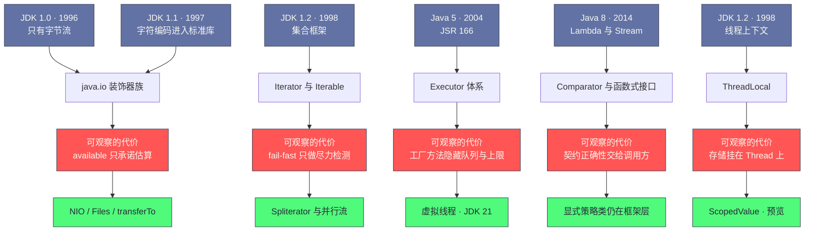
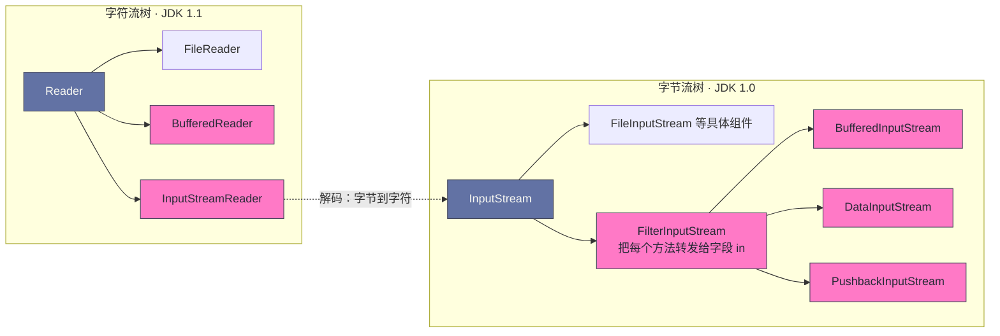
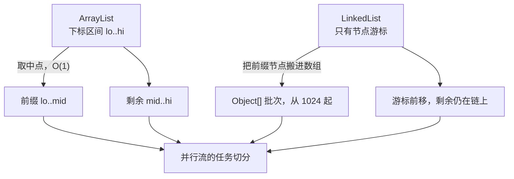
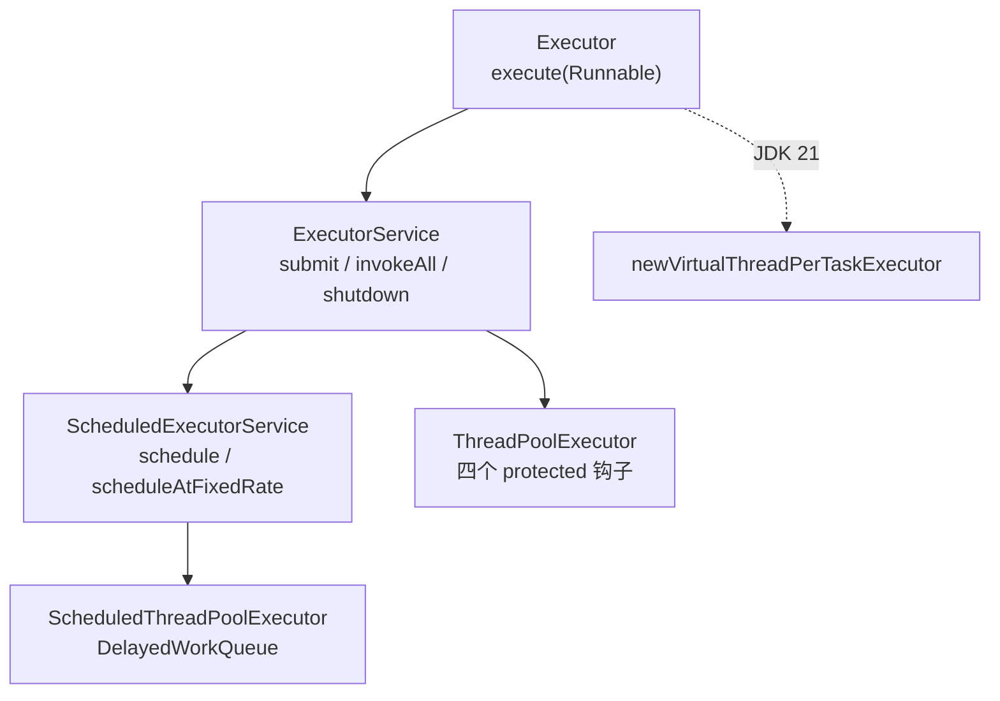
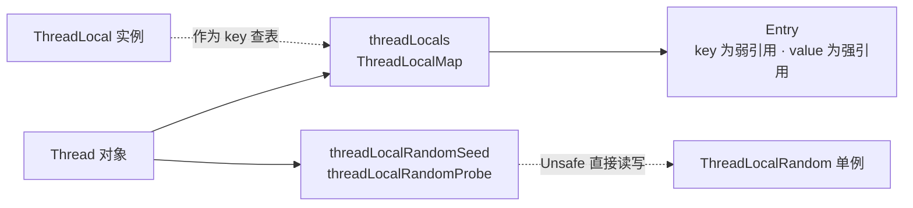
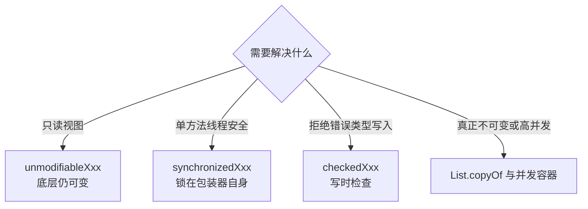

# 设计模式在JDK源码中的应用全景

**摘要：**

JDK 是一份被发布过三十年的代码，它的形状更多由约束决定，而不是由偏好决定。本文不逐条清点「JDK 用了哪些模式」，而是挑出五个最有说服力的落点，回到设计者当年的处境里看选择：`java.io` 的两棵流树如何被 JDK 1.1 的编码问题逼出来，`FilterInputStream` 这个空壳装饰器为什么必须存在，`available()` 为什么只敢承诺「估算」；`Comparator`、`Runnable`、`Callable` 如何把行为变成可传递的值，`@FunctionalInterface` 之后显式策略类为什么还在；`Iterator` 与 `Iterable` 为什么必须拆成两个类型，`Spliterator` 的前缀拆分契约给并行流留下了哪些坑；`Executor` 三层接口如何体现接口隔离，`ThreadPoolExecutor` 的四个钩子为什么是模板方法的教科书案例，而 `Executors` 的工厂方法把无界队列与 `Integer.MAX_VALUE` 藏在了名字背后；`ThreadLocal` 的变量实际存在 `Thread` 对象里，线程池下的泄漏从哪里来，`ThreadLocalRandom` 又靠什么绕开了 CAS 竞争。每一节都补上历史包袱与现代替代，最后用三个被贴错标签的类收束：`StringBuilder`、`HashMap`、双亲委派。读源码，读出的是约束下的选择，不是无约束的正确答案。

---

## 第 1 章 标准库的设计者被什么约束

### 1.1 三个不能被回退的发布窗口

1996 年 1 月 Java 1.0 发布时，标准库里只有字节流；1997 年 2 月的 1.1 补上了 `Reader`/`Writer` 与字符编码；1998 年 12 月的 1.2 才有集合框架；2002 年的 1.4 给出 NIO，2011 年的 Java 7 补上 `Files`/`Paths`；并发包要等到 2004 年的 Java 5。这些年份不是背景装饰，它们决定了每一处模式选择当时可用的语言材料：1.0 没有默认方法，装饰器只能落成抽象类加一个字段；1.5 之前没有泛型，`Collections.checkedXxx` 只能把类型检查推迟到运行时；Java 5 之前没有 `Callable`，命令模式在 JDK 里就长期只有 `Runnable` 这一个既无返回值、又不能抛受检异常的半成品。

把这些节点串起来看，会得到一个不太舒服的结论：标准库不是一次设计出来的，它被若干次不可回退的发布切成了地层。地层的性质是，上面一层可以压着下面一层，却不能把下面那层挖掉重铺。所以今天读 JDK 源码，读到的大部分不是最优解，而是「当时条件下可以接受、之后又无法反悔」的那个解。

### 1.2 三条约束

第一条是**二进制兼容**。已发布的公开签名不能改，公开类不能随便换父类，接口不能增加抽象方法——Java 8 之前连默认方法这个工具都没有。这条约束的直接后果是：模式一旦选错，唯一的补救方式是在旁边再开一条新路，把旧路标成弃用。`Reader` 之于 `InputStream`、`Callable` 之于 `Runnable`、`CompletableFuture` 之于 `Future`，都是这样长出来的第二棵树。

第二条是契约必须让所有实现者都能满足。`InputStream.available()` 的文档只承诺一个「不受阻塞即可读取的字节数的估算值」，estimate 这个词不是措辞上的谨慎，而是接口向 `InflaterInputStream` 这类实现妥协的结果：解压流在真正读到末尾之前，根本无法知道解压后还剩多少字节。契约一放宽，调用方就失去了依赖它的权利，这笔债要由二十年后每一个想拿它分配缓冲区的人来还。

第三条是标准库不能假设调用者是谁。同一套 `java.io` 要服务命令行脚本、应用服务器和 IDE 插件，所以它不能自带全局线程池、全局配置之类的隐性依赖。这条在 `ThreadLocal` 与 `CompletableFuture` 上被打破了一半：前者把状态挂在线程对象上，后者默认借用 `ForkJoinPool.commonPool()`，两处都成了后来被反复讨论的设计债。

### 1.3 五个落点

图 1 把这五个落点按定型年份排在一条时间轴上，并把每一处可观察到的代价与它的现代替代并排放。排在一起看，会发现一条规律：JDK 里的模式很少被推翻，多数是被绕过去——新的 API 在旁边长出来，旧的继续提供服务，两套并存二十年。



| 落点 | 定型年份 | 当年要解的约束 | 留下的包袱 | 现代替代 |
| --- | --- | --- | --- | --- |
| `java.io` 装饰器族 | 1.0 / 1.1 | 1.0 只认字节，1.1 才把编码纳入标准库 | `available()` 只承诺估算、关闭责任沿链传播、嵌套顺序无类型保护 | NIO 的 `Channel` + `Buffer`、`Files` 静态方法、`transferTo` |
| `Iterator` 与 `Iterable` | 1.2 | 遍历状态必须从容器里拆出来，`for-each` 要适用于所有容器 | fail-fast 只做尽力检测，不是并发安全 | `Spliterator` 与并行流 |
| `Comparator`、`Runnable`、`Callable` | 1.2 / 1.0 / 5 | 把行为变成可传递、可排队的值 | 契约正确性外置给调用方，编译器只能查签名 | 函数式接口与显式策略类并存 |
| `Executor` 体系 | 5 | 线程创建昂贵，需要池化与任务排队 | 工厂方法隐藏无界队列与线程上限 | 虚拟线程 |
| `ThreadLocal` | 1.2 | 隐式上下文传递，避免污染方法签名 | 存储挂在 `Thread` 上，线程池复用时泄漏 | `ScopedValue`（预览） |

表 1 的读法是先看第二列，再看第四列：某个落点定型的年份决定了它的形状，它留下的包袱又决定了后来替代品的方向。`java.io` 的装饰器链之所以被 `Channel` + `Buffer` 取代，正是因为链式的顺序语义无法被类型系统约束；`Spliterator` 之所以必须存在，正是因为 `Iterator` 的「一次一个元素」没法并行。至于模式本身，装饰器与代理、适配器的判据在 [[04 结构型模式（上）——代理、适配器与装饰器]] 里已经拆过，这里不再重复，只补 JDK 特有的那部分约束。

---

## 第 2 章 java.io：装饰器族与它没还完的债

### 2.1 两棵树的由来

JDK 1.0 的 I/O 只认字节。1997 年的 1.1 要处理中文、日文、俄文，必须先解决「字节到字符」的映射，而 1.0 的 `InputStream.read()` 没有编码概念，`int` 返回值只够表达 0 到 255 以及 -1。更麻烦的是多字节编码：一个字符可能横跨两次 `read()` 的边界，解码器必须持有「半个字符」的状态。这两件事都没法塞进 `InputStream` 的既有契约而不破坏兼容，于是标准库另起一棵 `Reader`/`Writer` 树，再用 `InputStreamReader` 把两棵树接起来。

所以 `InputStreamReader` 在模式上确实是一个适配器，但它的存在理由不是教科书里那句「接口不兼容所以要适配」，而是「1.0 的接口无法在保持兼容的前提下容纳编码状态」。这两句话的区别很重要：前一句是事后归纳，后一句是当事人当时的处境。图 2 画的是两棵树的形状，注意 `FilterInputStream` 这一层的特殊位置——它不在功能分支上，而在装饰分支的根部。



两棵树的代价直接写在了类型系统里：没有任何类型能表达「这是一个字符流」，只能靠类名与继承位置辨认；`FileReader` 长期使用平台默认编码，直到 JDK 11 才补上带 `Charset` 的构造器，而默认编码被固定为 UTF-8 要等到 JDK 18 的 JEP 400；`Reader` 一侧也没有 `available()` 的对应物，只有一个语义更弱的 `ready()`，它只回答「下一次读会不会阻塞」，连估算值都不给。

### 2.2 FilterInputStream 为什么是一个空壳

`FilterInputStream` 把 `InputStream` 的每个方法原样转发给字段 `in`，自己不加任何功能：

```java
public class FilterInputStream extends InputStream {
    protected volatile InputStream in;   // 装饰器必须持有的被装饰者

    public int read() throws IOException { return in.read(); }    // 全部转发
    public int available() throws IOException { return in.available(); }
    public void close() throws IOException { in.close(); }        // 连关闭都转发
}
```

它在装饰器模式里扮演的是抽象装饰者（Decorator）的角色，存在的唯一意义是提供一个「可以被继续包装的位置」。为什么是抽象类而不是接口？因为 1.0 的接口不能带实现，而装饰器需要一整套默认的委托行为。GoF 书里装饰器实现 `Component` 接口，在 JDK 里只能写成「继承 `InputStream` 抽象类 + 持有一个 `InputStream` 字段」，同一个模式被语言能力改写成了另一个形状。这是本篇第一个反复出现的主题：模式的落地形态由语言给了什么决定，不是由模式定义决定。

空壳的代价是这一层可以被违反。`FilterOutputStream.close()` 就不只是转发：它先 flush，再关闭底层流，flush 失败时仍尝试关闭并把两个异常按 suppressed 挂起来。也就是说，装饰器族里每个类都可以自行决定哪些方法真转发、哪些方法改写，而这个差异不会出现在类型上，调用方只能读源码或读文档。

### 2.3 顺序即语义

装饰器链最容易被低估的一点是：**顺序即语义**，而编译器不会替你看这个顺序。同样三层包装，换个顺序就是另一个程序。表 2 列了四种典型写法，紧随其后的代码给出最容易出错的两处。

| 写法 | 能力由谁决定 | 语义差异 | 典型误用 |
| --- | --- | --- | --- |
| `new BufferedInputStream(new DataInputStream(fis))` | 最外层，只有 `read()` | 缓冲在解码之外，`readInt()` 根本不可见 | 以为「套了缓冲就有缓冲」，实际拿不到 `readInt()` |
| `new DataInputStream(new BufferedInputStream(fis))` | 最外层，`readInt()` 可用 | 每次 `readInt()` 从 8KB 缓冲区取 4 字节 | 无，这是正确写法 |
| `new PushbackInputStream(new BufferedInputStream(fis))` | 最外层，`unread()` 可用 | 回退发生在缓冲层之上，语义正确 | 反过来包，`unread()` 影响不到已被缓冲的字节 |
| `new CheckedInputStream(new GZIPInputStream(fis), crc)` | 最外层，校验和可读 | 校验的是解压后的字节 | 与内层校验压缩字节的写法混用，校验和对不上 |

```java
// 正确：解码在外、缓冲在内，readInt 每次只碰内存里的缓冲区
DataInputStream good = new DataInputStream(
        new BufferedInputStream(new FileInputStream("data.bin")));

// 错误：缓冲在外，能力只剩 read()，想拿 readInt 得往下强转，强转出来的对象又不带缓冲
BufferedInputStream bad = new BufferedInputStream(
        new DataInputStream(new FileInputStream("data.bin")));

// 回退必须放在缓冲之外：反过来的话，BufferedInputStream 已经把字节读进自己的数组，
// PushbackInputStream 的 unread 只能回退到它自己那层，调用方看到的仍是重复字节
PushbackInputStream push = new PushbackInputStream(
        new BufferedInputStream(new FileInputStream("token.txt")), 1);
```

顺序之外还有一处历史包袱，是装饰器数量本身的膨胀。类并不会爆炸（一个装饰器一个类），爆炸的是调用点：业务代码里到处出现四层嵌套，IDE 的类型推断帮不上忙，异常栈里全是包装器的方法帧，而顺序错了照样编译通过。这就是「组合优于继承」在工程上要付的代价——灵活性从编译期移到了运行期，约束从类型系统移到了人的记忆里。

### 2.4 历史包袱：available()、close()、mark/reset

`available()` 的契约是估算，各家实现给出的东西完全不是一个量级，表 3 是笔者从 JDK 17 源码里核对过的对照。

| 实现 | `available()` 返回 | 能否当「剩余字节数」用 |
| --- | --- | --- |
| `FileInputStream` | 文件剩余字节数（精确，但只是快照） | 大致可以，仍应处理读到 -1 的情况 |
| `BufferedInputStream` | 缓冲区剩余（`count - pos`）加上底层的 `available()` | 不能，底层可能返回 0 或 1 |
| `InflaterInputStream` | 未到末尾返回 1，到末尾返回 0 | 完全不能，文档明说不要依赖它 |
| `ZipInputStream` | 当前条目未读完返回 1，读完返回 0 | 不能，它描述的是条目状态 |
| `Reader` 一侧 | 没有对应方法，只有 `ready()` | 连估算都没有 |

`available()` 之所以只能这样，是因为「可读字节数」在解压、解密、字符解码这三类流上根本没有定义——输入侧压缩了多少字节，和输出侧还能产生多少字节，没有线性关系。接口要给所有实现留活路，就只能把话说到最虚。调用方如果拿它去 `new byte[in.available()]`，在文件流上碰巧对，在压缩流上就退化成每次读 1 字节。

还有一处不常被提起的约定，藏在读方法自己的返回值里。`read()` 返回 `int` 是为了给 -1 留位置，实现上必须把 `byte` 扩成 0 到 255 的 `int`，调用方每次都要先判断是不是 -1；而 `read(byte[], int, int)` 只有在 `len == 0` 时才可能返回 0，其余情况要么至少读到一个字节，要么返回 -1。同一个「读」的动作，在两套签名下的返回值语义并不相同：前者用 -1 表达 EOF，后者用 0 表达「你要求读的长度是 0」。1.0 时代没有 `Optional`、也没有 `ByteBuffer`，这是唯一可行的写法，代价是每个写 I/O 的人都要在循环里额外记住一条规则。

`close()` 的问题在责任链而不是实现。`FilterInputStream.close()` 直接转发，于是关闭动作沿着包装链一层层往里走，这套机制成立的前提是每一层都老实地转发、且重复关闭是幂等的。现实里两个前提都会破：第三方流可能覆写 `close()` 却不调用 `super.close()`；`try-with-resources` 在显式关闭外层之后又会去关内层，于是同一个底层句柄被关两次。更要命的是关闭后再读的行为没有统一约定——多数实现抛 `IOException`，但那是实现选择，不是接口承诺。

`mark()`/`reset()`/`markSupported()` 是一组**可选操作**。`InputStream` 默认不支持标记，`BufferedInputStream` 支持，`PushbackInputStream` 不支持，而 `FilterInputStream` 只把 `markSupported()` 转发给底层。于是「能不能 mark」这个问题，答案取决于整条链的最内层是什么流，以及 `mark` 与缓冲的相对位置；`readlimit` 也只是「标记最多能活多远」的建议值。三个可选方法，加上链式顺序，构成了 I/O 里最难靠读代码判断行为的一片区域。

### 2.5 现代替代：Channel、Files、transferTo

NIO 在 2002 年的 Java 1.4 进场，思路换了一整套：不再用包装类叠功能，而是把「数据放在哪里」和「怎么搬运」拆开——数据放在 `Buffer` 里，搬运交给 `Channel`；编码交给显式的 `CharsetDecoder`，不再是流对象自带的默认行为。

```java
// 搬运显式：读多少、写多少、要不要零拷贝，都在调用处看得见
try (FileChannel in = FileChannel.open(src, StandardOpenOption.READ);
     FileChannel out = FileChannel.open(dst, StandardOpenOption.WRITE,
                                        StandardOpenOption.CREATE)) {
    in.transferTo(0, in.size(), out);   // 能否走 sendfile 由操作系统与文件系统决定
}

// 编码显式：默认行为不再参与决策
try (BufferedReader r = Files.newBufferedReader(path, StandardCharsets.UTF_8)) {
    r.lines().forEach(System.out::println);   // 注意：返回的 Stream 也持有文件句柄
}
```

把这两套东西与装饰器链放在一起看，能看出替代品为什么长成另一个样子。`Channel` + `Buffer` 把状态机的复杂度摆到明面上（`flip()`/`clear()`/`compact()` 各有含义），换来的好处是顺序不再是隐含语义：没有链，也就没有链的错序。`Files` 用静态方法把「打开、装饰、关闭」这套模板收进库，`Files.newBufferedReader(path, charset)` 一行就把编码、缓冲、关闭全定了。`InputStream.transferTo(OutputStream)` 是 JDK 9 补的兜底办法，内部就是 8KB 缓冲的循环搬运，让「复制一个流」不用再手写 while 循环。

代价也要说清楚。`InputStreamReader` 的解码错误默认用替换字符处理，坏字节静默变成 `U+FFFD`；`CharsetDecoder` 默认是 REPORT，会抛 `MalformedInputException`，想静默还得自己设 `onMalformedInput`。前者的「方便」正是后者要显式选择的那个策略，也就是说，装饰器把策略藏进了构造函数，NIO 把策略摆到了调用点。

---

## 第 3 章 把行为变成值：Comparator、Runnable、Callable

### 3.1 Comparator：策略的最小完整形态

`Comparator` 从 1.2 起就在集合框架里，与 `Comparable` 分工明确：`Comparable` 是「自然顺序」，绑在类上，一个类只能有一种；`Comparator` 是「外部可替换的比较算法」，一个类可以有无数种。这个分工本身就是策略模式的核心——把变化点从类型定义里拿出来，交给调用方在调用点传入。

```java
// 策略在调用点传入，排序算法本身不关心比较逻辑
employees.sort(Comparator.comparing(Employee::getDepartment)
                         .thenComparing(Employee::getName));

// 同一个策略接口的三种承载形式
Comparator<String> byLen = Comparator.comparingInt(String::length);  // lambda 派生
Comparator<String> ci    = String.CASE_INSENSITIVE_ORDER;            // JDK 自带的显式策略
Comparator<String> safe  = Comparator.nullsFirst(byLen);             // 策略组合
```

Java 8 给 `Comparator` 加了一批 `default` 与 `static` 方法——`reversed`、`thenComparing`、`comparing`、`naturalOrder`、`nullsFirst` 等等——这件事的意义比「加了几个方法」大得多：策略从「若干互相独立的实现类」变成了「可以代数式派生的值」。GoF 时代的策略模式，策略数量是类的数量；函数式之后，策略数量是组合的数量。策略模式的一般形态与「策略 vs 状态」的判据见 [[06 行为型模式（上）——策略、模板方法与观察者]]，这里只关心它在 JDK 里被压成了什么形状。

有一条容易被踩的边界，是 `Comparable` 与 `Comparator` 对「相等」的定义可以不同。`BigDecimal` 的 javadoc 明确写着它的自然顺序与 `equals` 不一致：`new BigDecimal("1.0")` 与 `new BigDecimal("1.00")` 的 `equals` 为 false，`compareTo` 却是 0。于是同一对对象放进 `HashSet` 是两个元素，放进 `TreeSet` 变成一个。策略外置之后，「什么叫相等」的定义权也随之外置了，判重、去重、分组这些看似与比较无关的操作，都会被比较器的语义悄悄改写。

### 3.2 Runnable 与 Callable：同一个命令，两笔签名债

`Runnable` 在 1.0 就有，那时候它只是 `Thread` 构造器的参数，命令模式的「接收者」就是线程本身。真正让 `Runnable` 变成命令对象的是 1.5 的 `Executor`：任务可以被排队、被延时、被取消、被记录，命令模式的全部价值——把一次请求变成一个可存储、可传递的对象——这时才兑现。同一个接口，换了调用环境，模式里的角色才完整，这说明模式不是接口的固有属性，而是「接口加上谁在调它」的关系。

`Callable` 的出现是一笔签名债的结果。`Runnable.run()` 不能抛受检异常，于是「提交一个可能失败的任务」在类型上就无法表达。为什么不在 `Runnable` 上加 `throws Exception`？因为它是 1.0 的公开接口，改签名会同时破坏二进制兼容与源码兼容——所有实现类都得跟着改，所有调用点都得处理一个原本不存在的受检异常。标准库的选择是另立 `Callable`，再用 `Executors.callable(Runnable)` 做适配，这是适配器模式在 JDK 里最小的一个样本：一个方法，一次接口翻译。

有了返回值，才需要「提货单」，于是有了 `Future`。`Future` 的五个方法（`cancel`、`isCancelled`、`isDone`、两个 `get`）把「提交」与「取结果」在时间上拆开，这个拆开带来了两个经典问题：`cancel(true)` 只能靠中断协作，任务不响应中断就停不下来（`Thread.stop` 早已弃用）；`submit` 会把任务包装成 `FutureTask`，任务抛出的异常被存进 `Future` 内部，而不是交给线程的 `UncaughtExceptionHandler`——调用方如果只 `submit` 不 `get`，异常就此蒸发。`execute` 与 `submit` 的这一点差别，是生产环境里最常见的一类「静默失败」。

### 3.3 函数式接口是策略的语法糖，但不是全部

`@FunctionalInterface` 不是语法糖本身，它只是一个编译期断言：接口有且仅有一个抽象方法。真正的语法糖是 lambda 与目标类型推导——它们让「**策略是一个值**」这件事的成本降到接近于零，`list.sort((a, b) -> a.id() - b.id())` 不再需要 `class IdComparator implements Comparator`。这也让策略的替换门槛几乎消失，同时带来一个反向问题：既然策略这么便宜，什么时候还需要写一个显式的策略类？

判据不在「代码长短」，在策略的生命周期。表 4 是笔者在实践中用的分法。

| 承载形式 | 适用场景 | 代价 |
| --- | --- | --- |
| lambda | 无状态、单方法、就地使用 | 无法命名复用，栈信息弱，不能承载配置 |
| 匿名类 | 需要捕获局部状态且只在一处 | Java 8 之后基本被 lambda 取代 |
| 枚举 | 策略集合有限，需要按名字查找或序列化 | 不能携带实例状态，扩展要改源码 |
| 显式类 + 注册表 | 需要注入依赖、多个方法、可被容器发现 | 类数量与配置成本 |

更实用的三条判据是：策略是否需要被「发现」（配置、注解、名字查找）；是否需要状态与生命周期（连接、计数器、线程池）；是否需要被多个调用方共享或被测试替身替换。三条里只要中一条，lambda 就不够用。反过来看框架层，`HandlerMapping`、`ViewResolver`、Jackson 的序列化器都还是显式类，原因正是它们需要被容器发现并装配——函数式接口解决了「策略是一个值」，没解决「策略需要被找到」。Spring 侧的同一条线索见 [[09 设计模式在Spring中的应用全景]]。

### 3.4 契约外置的代价：TimSort 的那句异常

把算法外置成策略，也把一部分正确性责任外置给了调用方。`Comparator` 的契约要求反对称与传递性，编译器只能检查签名，检查不了这两条。TimSort 从 Java 7 起取代了对象数组的旧归并排序，它的合并阶段一旦发现比较结果不自洽，就会直接抛异常：

```java
// 用减法实现比较，简洁但会溢出；溢出时符号翻转，传递性随之被破坏
Comparator<Point> bad = (a, b) -> a.x - b.x;

list.sort(bad);
// 数据量超过插入排序阈值、进入归并阶段后：
// java.lang.IllegalArgumentException: Comparison method violates its general contract!
```

这句异常值得记住，因为它把「模式把变化点外置」的代价说得最直白：策略模式让排序算法不必知道比较逻辑，代价是排序算法再也没法保证结果正确，只能在事后发现不自洽时报错。命令模式同理，`submit` 之后的异常要调用方自己去 `get`；装饰器同理，链的顺序要调用方自己保证。模式换来的灵活性，账都要有人付，多数时候付账的是调用方。

顺带说一句命令模式在全盛期的样子。带撤销栈、带事务脚本、带宏录制的命令，需要命令对象持有接收者、持有可逆操作、能被组合成一棵树，这些形态在框架层更常见，见 [[07 行为型模式（中）——责任链、命令与迭代器]]。JDK 里的 `Runnable` 是一个被削到最小的命令，只剩「可执行」这一件事。

---

## 第 4 章 Iterator 与 Iterable：把一个动作拆成两种类型

### 4.1 为什么必须分开

集合是数据结构，迭代器是游标。若把两者合成一个接口，一个容器就只能有一个遍历位置：嵌套遍历互相干扰，把遍历位置存起来稍后再用也不可能。分开之后，`iterator()` 每次返回一个独立的游标，一容器多游标，互不干扰。用图书馆打比方：书是集合，借阅卡是迭代器；你读同一本书读到第 3 页，不会让另一个人的借阅卡也停在第 3 页，图书馆本身更不会因此只剩第 3 页之后的书。

更关键的是 `Iterable` 与 `for-each` 的关系。增强 for 循环对 `Iterable` 调 `iterator()`，对数组走下标，这是编译期就定下来的规则——所以「可迭代」是一种类型能力，「迭代」是一次有状态的会话。分离的收益在于，集合可以只实现 `iterator()`，而 `forEach`、`spliterator` 这类默认方法由接口提供，容器不必逐个实现。

```java
// for-each 只是语法：编译器把它展开成显式的迭代器调用
for (String s : list) { use(s); }

for (Iterator<String> it = list.iterator(); it.hasNext(); ) {
    String s = it.next();   // 每次 next() 都可能抛 ConcurrentModificationException
    use(s);
}
```

顺带交代一段遗留。`Enumeration` 是 1.0 的接口，方法名是 `hasMoreElements()`/`nextElement()`，没有 `remove`，命名冗长。1.2 的集合框架另立了 `Iterator`，但旧接口不能删，于是 `Vector`/`Hashtable` 被改成同时提供两者：`elements()` 返回 `Enumeration`，`iterator()` 返回 `Iterator`。这类「新旧并存」在 JDK 里不是例外而是常态，它是第 1 章那条二进制兼容约束的直接产物。

### 4.2 fail-fast 是尽力而为，不是并发安全

`ArrayList` 的迭代器持有一个 `expectedModCount`，与容器里的 `modCount` 比对，不等就抛 `ConcurrentModificationException`。这个机制常被误读成「集合线程不安全，所以并发改会抛异常」，事实是：它既不是线程安全保证，也不是只在并发下触发。

```java
List<String> list = new ArrayList<>(List.of("a", "b", "c"));
for (String s : list) {
    if (s.equals("b")) list.remove(s);   // 单线程也会抛：迭代器看到的 modCount 变了
}
```

抛出点也值得注意：异常发生在「下一次检查」时——`next()`、`remove()`、`forEachRemaining()` 里——而不是在修改发生的那一刻。所以它叫 fail-fast 而不是「并发检测」：修改可能早就发生了，只是恰好在下一次遍历时才被发现，这套机制只能算**尽力而为**的检测，并不承诺任何并发正确性。正确做法是用 `iterator.remove()`、`removeIf()`，或改用 `CopyOnWriteArrayList` 这类写时复制的容器。

`removeIf` 值得单独看一眼，它是「把遍历与修改收进库」的正面例子：默认实现用 `iterator()` 遍历，命中条件时调 `iterator.remove()`，一次遍历、一次修改，`expectedModCount` 与 `modCount` 始终同步。JDK 8 之后新增的命令式集合操作大多是这个套路——不是绕开 fail-fast，而是把「边遍历边改」挪进库里，让调用方没有机会写错。`forEachRemaining` 则是另一个方向的优化：把逐个 `next()` 的虚调用合并成一次调用，遍历大集合时能省下可观的分派开销。

### 4.3 Spliterator 的拆分契约

到了 Java 8，遍历要并行，`Iterator` 的「一次取一个」成了瓶颈：要并行就得能把剩余元素切成互不重叠的若干块。`Spliterator` 为此而生，它的核心不是多了一个方法，而是多了一条契约：

```java
public interface Spliterator<T> {
    // 契约：返回的 Spliterator 覆盖「当前待遍历元素的前缀」，剩余部分留在自己身上；
    // 返回 null 表示不再拆（已经足够小，或数据结构不支持）
    Spliterator<T> trySplit();
    boolean tryAdvance(Consumer<? super T> action);
    long estimateSize();
    int characteristics();    // 位掩码，见下
}
```

**前缀**这两个字是并行的地基：前缀与剩余不重叠、不漏，任务切分才能保证每个元素恰好被处理一次。`characteristics()` 返回的位掩码也不是装饰，`ORDERED`（0x10）、`DISTINCT`（0x1）、`SORTED`（0x4）、`SIZED`（0x40）、`NONNULL`（0x100）、`IMMUTABLE`（0x400）、`CONCURRENT`（0x1000）、`SUBSIZED`（0x4000）各有消费方：`SIZED` 决定并行时能否预估工作量、能否预分配数组；`ORDERED` 决定 `forEachOrdered` 有没有意义；`SORTED` 让 `sorted()` 在比较器一致时退化为空操作；`DISTINCT` 让 `distinct()` 走捷径。谎报这些位不会在编译期报错，只会在运行时给出错误结果，而 `estimateSize()` 只是估算，只有 `SIZED` 才承诺精确。



图 3 对比了两种典型实现，这是「数据结构决定并行度」最硬的一处证据。`ArrayList` 的 `Spliterator` 按下标区间二分，`trySplit` 是 O(1)；`LinkedList` 的 `trySplit` 必须把前缀节点一个个搬进 `Object[]`，批次从 1024 开始增长、上限 2 的 25 次方，每次拆分本身就要线性遍历。所以 `linkedList.parallelStream()` 常常比串行还慢，慢的不是并行框架，是拆分。

### 4.4 并行流的成本账

并行流默认跑在 `ForkJoinPool.commonPool()` 上，并行度是处理器数减一。这个默认值带来三个必须知道的事实：阻塞型任务会占住工作线程，拖垮整个 JVM 里所有用默认池的并行流；有副作用的 lambda（在 `forEach` 里改外部集合）在并行下不再安全；`forEachOrdered` 为了保序会把并行收益吃掉大半。拆分本身也有成本，元素少、任务轻的时候，切分与合并的开销超过并行节省的时间。

归纳一下适用边界：数据结构支持低成本拆分（数组、区间、树），操作无状态且计算量足够大，才值得上并行流；链表、IO、锁竞争、需要保序，都不适合。这条判据和 JDK 的设计意图是一致的——`Spliterator` 把「能不能拆」交给数据结构回答，而不是让并行框架去猜。

把几代遍历接口排在一起看，分工与代价就清楚了（表 5）。

| 类型 | 定位 | 代价 |
| --- | --- | --- |
| `Enumeration` | 1.0 遗留，Vector/Hashtable 时代的游标 | 方法名冗长，无 `remove` |
| `Iterator` | 1.2 的游标，`for-each` 的基础 | 只能单向，`remove` 是可选操作 |
| `ListIterator` | `List` 专用，可双向、可改元素 | 只服务 `List` |
| `Spliterator` | Java 8，可拆分、可并行的遍历 | 拆分契约复杂，特征位必须诚实 |
| `Stream` | 声明式管道，延迟求值 | 一次性消费，调试与复用困难 |

---

## 第 5 章 Executor 体系：接口分层与模板方法

### 5.1 三层接口是接口隔离的样本

2004 年的 Java 5 引入了 `java.util.concurrent`，其中 `Executor` 只有一个方法 `execute(Runnable)`。这个极简设计是接口隔离原则（ISP）最干净的样本：只想要「执行」的调用方，不该被迫看见 `shutdown`、`submit`、`invokeAll` 这些生命周期方法。`ExecutorService` 才补上生命周期与任务提交，`ScheduledExecutorService` 再补上延时与周期。三层逐级加能力，每一层的调用方只依赖自己需要的部分。



图 4 里那条虚线是这套分层最大的回报：JDK 21 的虚拟线程执行器只需要实现 `Executor/ExecutorService`，调用方代码一行不用改。接口分对了，替换实现就是换一个对象。

`Executor` 为什么是接口而不是抽象类？因为它只有一个方法，接口更轻，且 Java 8 之后 `Executor e = Runnable::run` 这种写法让「执行策略」也能用 lambda 表达。这里可以提炼一条判据：需要共享实现时用抽象类（`AbstractList`、`AbstractQueuedSynchronizer`），只需要约定能力时用接口（`Executor`、`Comparator`、`Iterator`）。JDK 里这两类都有，区别不在风格，在「有没有骨架要复用」。

`AbstractExecutorService` 正好把这两类结合了一次。它把 `submit`、`invokeAll`、`invokeAny` 这些「用 `execute` 拼出来」的方法实现好，把 `execute` 本身留给子类：`submit` 的全部实现就是 `newTaskFor(task)` 之后调一次 `execute(ftask)`。于是 `ExecutorService` 是接口，「用 `execute` 实现 `submit`」这套骨架由抽象类提供，第三方只要实现一个方法就能拿到完整的 `ExecutorService`。接口约定能力、抽象类复用骨架，两者从不冲突，JDK 在这套并发框架里把分工划得很干净。

### 5.2 ThreadPoolExecutor 的四个钩子

`ThreadPoolExecutor` 是模板方法模式的教科书案例。父类把「取任务、执行任务、线程退出、状态迁移」这套骨架写死在 `runWorker` 与 `processWorkerExit` 里，把四个**钩子**留给子类覆写：

| 扩展点 | 定义位置 | 何时被调用 | 常见误用 |
| --- | --- | --- | --- |
| `beforeExecute` | `ThreadPoolExecutor` | 每个任务执行前 | 在里面抛异常，任务不执行且工作线程退出 |
| `afterExecute` | `ThreadPoolExecutor` | 任务正常或异常结束后 | 只处理 `thrown == null` 的分支，漏掉任务失败 |
| `terminated` | `ThreadPoolExecutor` | 状态进入 TERMINATED 时 | 在 `shutdown()` 之后立刻断言已完成 |
| `newTaskFor` | `AbstractExecutorService` | `submit` 把任务包装成 `Future` 时 | 覆写后只处理 `Callable`，漏掉 `Runnable` 分支 |

```java
// 前三个钩子在 ThreadPoolExecutor，最后一个在 AbstractExecutorService
class MonitoredPool extends ThreadPoolExecutor {
    @Override protected void beforeExecute(Thread t, Runnable r) { /* 打点：任务开始 */ }
    @Override protected void afterExecute(Runnable r, Throwable t) { /* t 非空即任务抛了异常 */ }
    @Override protected void terminated() { /* 池真正结束，可以释放外部资源 */ }
    @Override protected <T> RunnableFuture<T> newTaskFor(Callable<T> c) { /* 换成自定义 FutureTask */ }
}
```

表 6 里有两处容易踩空的行为细节，值得展开。其一，`beforeExecute` 抛异常会让当前工作线程以「突然退出」的方式结束，任务不执行、`afterExecute` 不调用，池随后补一个新线程——所以钩子里的代码必须自己兜住异常。其二，任务本身抛异常时 `afterExecute` 仍会被调用，且 `thrown` 非空，但如果任务是被 `submit` 提交的，异常先被 `FutureTask` 存住，`afterExecute` 拿到的 `thrown` 反而是 null，得去 `Future.get()` 里取。

钩子为什么是 `protected` 方法而不是可传入的回调接口？两个原因叠在一起：Java 5 没有 lambda，回调接口意味着每次构造池都要传一个对象；钩子与池的生命周期强绑定，用继承表达最直接，且零分配。这也是「模板方法」与「策略」的选择判据：扩展点少、与对象生命周期绑定、不需要运行期替换时用继承；扩展点多、需要多实现并存、需要运行期切换时用组合。JDK 在同一个类里两种都用了——钩子是继承的 `protected` 方法，拒绝策略是组合的 `RejectedExecutionHandler`，分工清楚。

### 5.3 Executors 的工厂方法隐藏了什么

`Executors` 提供了一批静态工厂方法，名字好记、参数少，代价是配置决策被藏进了实现里。以最常用的两个为例：

```java
// 名字只承诺「线程数固定」，实现里还有两个不固定的决定
public static ExecutorService newFixedThreadPool(int nThreads) {
    return new ThreadPoolExecutor(nThreads, nThreads,
                                  0L, TimeUnit.MILLISECONDS,
                                  new LinkedBlockingQueue<Runnable>());  // 无界，容量 Integer.MAX_VALUE
}

// 名字承诺「复用空闲线程」，实现里线程数上限是 int 的最大值
public static ExecutorService newCachedThreadPool() {
    return new ThreadPoolExecutor(0, Integer.MAX_VALUE,
                                  60L, TimeUnit.SECONDS,
                                  new SynchronousQueue<Runnable>());
}
```

| 工厂方法 | 展开后的关键参数 | 隐藏的代价 | 什么时候该自己 new |
| --- | --- | --- | --- |
| `newFixedThreadPool(n)` | 核心=最大=n，无界 `LinkedBlockingQueue`，keepAlive 0 | **无界队列**让拒绝策略永不触发，任务堆积到 OOM；核心线程默认不回收 | 任务量不可控、需要背压时 |
| `newCachedThreadPool()` | 核心 0，最大 `Integer.MAX_VALUE`，`SynchronousQueue`，60 秒空闲回收 | 线程数实际上无上限，突发流量可以拉起成千上万线程 | 任务短小、并发量有外部限制时 |
| `newSingleThreadExecutor()` | 核心=最大=1，无界队列，外面还套了一层不可重配置的委托 | 串行加无界队列，吞吐被单线程锁死 | 需要顺序保证但任务量可控时 |
| `newScheduledThreadPool(n)` | `DelayedWorkQueue` 无界，最大 `Integer.MAX_VALUE` | 延迟任务堆积，最大线程数没有实际约束 | 定时任务需要限并发时 |
| `newWorkStealingPool()` | 独立的 `ForkJoinPool`，并行度默认处理器数 | 阻塞任务会卡住工作线程，任务需可分治 | 分治型、CPU 密集型任务 |

表 7 里最重要的是最后一列的判据：这些工厂方法适合「任务量可控、失败可容忍」的场景，一旦任务由外部流量驱动，队列长度和线程上限就是必须显式决定的参数，应该直接 `new ThreadPoolExecutor(...)`。文档其实写了「shared unbounded queue」，问题在于工厂名只承诺了线程数固定，绝大多数调用方不会去读那半句。这是工厂方法这个模式最容易被忽略的一面：它用命名换来了可读性，同时把多个相互约束的配置参数一并固化，调用方失去了调整的入口。`ThreadPoolExecutor` 的七个参数如果交给调用方逐个传，就是 Builder 该出现的场合，判据见 [[03 创建型模式（下）——建造者与原型模式]]；JDK 没给 Builder，只给了四个构造器重载，那是 2004 年的 API 习惯。

还有一处反直觉的执行顺序，写在 `execute` 里：线程数未达核心数就新建线程；达到核心数后任务先进队列；只有队列满了才把线程数扩到最大值；仍失败才走拒绝策略。也就是说，核心线程数是常驻规模，最大线程数是「队列满了之后的应急」——很多人以为是「核心满了就扩到最大」，方向正好反了。这个顺序解释了为什么无界队列的池永远扩不到最大线程数：队列不会满，扩容分支永远走不到。

### 5.4 队列与拒绝策略的耦合

拒绝策略（`RejectedExecutionHandler`）有四个现成实现：`AbortPolicy`（抛异常，默认）、`CallerRunsPolicy`（在提交线程里执行）、`DiscardPolicy`（静默丢弃）、`DiscardOldestPolicy`（丢掉队列里最老的任务再重试）。默认选 `AbortPolicy` 是对的，因为它让失败可见；`CallerRunsPolicy` 能形成天然的**背压**，代价是阻塞提交方，如果提交方本身也在池里跑，就会拖慢整条链路；两个 `Discard` 系列只适合「丢了也不影响正确性」的指标与日志。

这里必须把队列和拒绝策略放在一起看：有界队列加 `AbortPolicy` 才能形成背压，无界队列会让所有拒绝策略变成死代码。表 6 里那几个工厂方法的隐患，本质上是队列选择已经把拒绝策略废掉了，而调用方以为自己还有一层保护。

与拒绝策略配套的是关闭语义，这一对方法经常被混用。`shutdown()` 把状态置为 SHUTDOWN：不再接新任务，但队列里的任务会继续执行完；`shutdownNow()` 置为 STOP：中断工作线程，并把队列里尚未执行的任务取出来作为返回值交还给你。前者是「让我把手上的事做完」，后者是「现在就停」，但两者都不保证正在运行的任务立刻结束——`shutdownNow()` 只能发中断，任务不响应中断就停不下来。所以正常关闭的写法是 `shutdown()` 之后 `awaitTermination()` 并检查返回值；只调 `awaitTermination()` 而不先 `shutdown()`，会一直等到超时。

### 5.5 从 Future 到 CompletableFuture

`Future` 只有五个方法，能表达「取一个结果」，表达不了「完成后接着做 A，再基于 A 做 B」。要组合只能三种写法：阻塞 `get`、轮询 `isDone`、或者嵌套回调。前两种浪费线程，第三种就是回调地狱。`CompletableFuture` 在 Java 8 进场，把这三种写法替换成链式组合：

```java
// 组合取代嵌套：每一步都是「在前一步的结果上声明下一步做什么」
CompletableFuture.supplyAsync(() -> fetchOrder(id), ioPool)
        .thenApply(Order::userId)
        .thenCompose(uid -> CompletableFuture.supplyAsync(() -> loadUser(uid), ioPool))
        .exceptionally(ex -> User.anonymous())         // 异常必须显式接住，否则静默丢失
        .thenAccept(user -> render(user));
```

它的内部结构值得看一眼，因为这是观察者模式的现代形态。每个 `CompletableFuture` 是一个节点，依赖它的节点注册在内部的**完成栈**上；当结果被设置时，`postComplete` 沿栈依次触发下游。与 `java.util.Observable` 相比，差别不在「有没有观察者」，而在结构：`Observable` 是被观察者持有一个 `Vector<Observer>`，通知顺序未定义，事件只能是一个 `Object`；`CompletableFuture` 是每个节点持有自己的依赖链，通知按依赖关系有序进行，值有类型。观察者模式从「一个主题广播给一群监听者」演变成了「一条计算链按依赖传递」，这才是它今天在 JDK 里的主要存在形式。

几个必须知道的坑：`thenApply` 里的函数在「完成上游的那个线程」上同步执行，如果不是 `Async` 变体，IO 线程会顺手把后续计算也做了；默认的异步执行器是 `ForkJoinPool.commonPool()`（并行度小于 2 时退化为每个任务一个线程），阻塞任务必须传自定义 `Executor`；`join()` 抛 `CompletionException` 而 `get()` 抛 `ExecutionException`；`allOf` 返回 `CompletableFuture<Void>`，结果要自己从各个 future 里取。JDK 19 起 `Future` 补了 `state()`、`resultNow()`、`exceptionNow()` 三个方法，能区分 RUNNING/SUCCESS/FAILED/CANCELLED，但组合能力仍然要靠 `CompletableFuture`。

### 5.6 虚拟线程推翻的那个假设

JDK 21 的虚拟线程（JEP 444）推翻了一个从 1.0 起就没变过的假设：线程昂贵。线程池存在的两个理由——复用昂贵的线程、限制并发数——第一个失效了，第二个并没有消失。`Executors.newVirtualThreadPerTaskExecutor()` 每个任务一个虚拟线程，池化这件事本身从「性能必需」变成了「反模式」；但「同时最多做多少件事」这个约束还在，只是从池大小转移到了信号量、连接池、限流器这些真正表达资源上限的地方。

约束没变的部分同样要留意：虚拟线程仍然是 `Thread` 对象，`ThreadLocal` 依然生效，量大之后每线程一份的存储成本会被放大；在 JDK 21 上，`synchronized` 块内的阻塞会钉住载体线程，后续版本才逐步消除这一限制。这也正好说明第 5.1 节那套接口分层的价值：`Executor` 的定义没有假设线程是昂贵的，所以虚拟线程可以直接顶替实现，而调用方不用知道脚下换了一层。

---

## 第 6 章 ThreadLocal 与 ThreadLocalRandom：存储模型而非模式

### 6.1 变量真正的存放位置

`ThreadLocal` 常被当成一种设计模式来讲，其实它更接近一个存储模型：变量不在 `ThreadLocal` 对象里，而在 `Thread` 对象里。`Thread` 有一个包级私有字段 `ThreadLocal.ThreadLocalMap threadLocals`，`ThreadLocal` 实例只是这张表的 key。`get()` 的实际动作是「取出当前线程，再拿自己当 key 去查那张表」，所以同一个 `ThreadLocal` 在不同线程上读到不同的值，是因为表不同，而不是对象不同。



图 5 里两条线并排画，是为了说明一件容易被忽略的事：`ThreadLocalRandom` 根本没有用 `ThreadLocal`。它把种子直接放在 `Thread` 的两个字段 `threadLocalRandomSeed`、`threadLocalRandomProbe` 里，用 `Unsafe` 读写，名字里的「ThreadLocal」指的是「每线程一份状态」，不是「用 `ThreadLocal` 实现」。

`ThreadLocalMap` 本身也不是 `HashMap`。它用开放寻址加线性探测，容量必须是 2 的幂，阈值是容量的三分之二；`ThreadLocal` 的散列值靠每次递增 `0x61c88647` 的斐波那契散列生成，目的是让 key 分布得足够均匀、减少探测次数。这些细节平时用不到，却解释了一件事：`ThreadLocalMap` 是为「每个线程上条数不多、访问极频繁」这个场景专门写的小表，不是通用容器，所以它既没有链表也没有树化，清理只能靠在探测过程中顺带清扫。

`ThreadLocal` 要解决的问题很实在：把一个上下文（用户身份、事务、跟踪号）从入口传到最深处，又不愿意让每一层方法签名都多一个参数。它把「线程」变成了一个隐式参数。代价在第 1 章已经提过——标准库不该假设调用者是谁，而这个隐式通道一旦被框架和业务代码同时使用，排查问题的难度会成倍上升。

### 6.2 线程池下的泄漏

`ThreadLocalMap` 的 `Entry` 继承 `WeakReference<ThreadLocal<?>>`，key 是弱引用，value 是强引用。这个不对称是有意为之：`ThreadLocal` 实例通常由框架持有，若 key 是强引用，框架卸载后就永远回收不掉。但弱引用只解决了 key，value 还在。当 `ThreadLocal` 对象被回收，`Entry` 的 key 变成 null，value 却仍被 `Entry` 强引用，而 `Entry` 又在 `Thread` 的表里——只有等这个线程下一次 `set`/`get`/`remove` 时，`expungeStaleEntry` 与 `cleanSomeSlots` 才会顺带清掉这些陈旧条目。清理是启发式的，不保证发生。

```java
static final ThreadLocal<byte[]> BUF = new ThreadLocal<>();

pool.execute(() -> {
    BUF.set(new byte[1 << 20]);       // 每提交一次，就在某个池线程的 map 上挂 1MB
    try { handle(); }
    finally { BUF.remove(); }         // 不写这一行，线程活多久就泄漏多久
});
```

在线程池里，「线程活多久」等于「池存活多久」，所以这里的不清理不是「延迟回收」，而是**永久占用**。修复方式很朴素：`finally` 里 `remove()`，或者用 `try-with-resources` 包一层。`ThreadLocal.withInitial` 只解决初始化，不解决泄漏。还有一个更隐蔽的变体：`InheritableThreadLocal` 的复制发生在 `Thread` 构造时，而池线程是复用的，子任务拿到的上下文来自「创建池线程的那个线程」，不是「提交任务的线程」——所以 MDC、跟踪号这类东西在线程池里必须靠装饰器（提交时把上下文搬进任务）或者专门的传递库。

### 6.3 ThreadLocalRandom 绕开了什么

`java.util.Random` 的种子是一个 `AtomicLong`，每次 `next()` 都要 CAS 更新。多个线程共享一个 `Random` 实例时，CAS 会在同一个缓存行上反复失败重试，争用越激烈越慢。`ThreadLocalRandom` 的做法是：种子放在 `Thread` 里，每个线程只动自己的那份，用 `Unsafe` 直接读写，既没有 CAS，也没有跨线程的可见性开销，**无竞争**的路径就是这么来的。

它的实现细节比「每线程一份种子」多两点。第一，初始化时种子由 `(线程 id << 1) + GOLDEN_GAMMA` 累加得到，保证周期最大化且各线程种子不同；第二，`probe` 字段提供一个非零散列值，用于 `ForkJoinPool` 等场景里按线程分散选择，避免线程刚创建时集中抢同一个位置。这些都是「特化换性能」的手法：`ThreadLocalRandom` 不能被继承、不能 `setSeed`（直接抛 `UnsupportedOperationException`）、不能跨线程共享。

最后一点常被忽略：`current()` 返回的是一个静态单例，把它存到字段里再给别的线程用不会报错，但实际取随机数时读的是「调用线程」自己的种子，语义就漂移了。它不是线程安全问题的反面教材，而是「隐式依赖当前线程」这个设计取向的必然结果。

### 6.4 继承与作用域

把上下文传递的几种方式放在一起看，取舍就清楚了（表 8）。显式参数最笨但最诚实；`ThreadLocal` 最方便但泄漏风险随线程生命周期放大；`InheritableThreadLocal` 在池化环境里基本不可用；`ThreadLocalRandom` 是特化到极致的个例；JDK 21 预览的 `ScopedValue`（JEP 446）则想同时拿到「不污染签名」和「有明确作用域」两个好处——绑定在作用域内只读，作用域结束即失效，天然适合虚拟线程与结构化并发。它还是预览特性，能不能成为标准要看后续版本的取舍。

| 机制 | 存储位置 | 能否跨线程 | 线程池下 | 代价 |
| --- | --- | --- | --- | --- |
| 显式参数 | 调用栈 | 天然 | 天然 | 签名污染，层层透传 |
| `ThreadLocal` | `Thread.threadLocals` | 不能 | 必须 `finally` 清理 | 泄漏风险随线程寿命放大 |
| `InheritableThreadLocal` | 同上，构造时复制 | 只向子线程 | 线程复用后失效 | 上下文来源容易误判 |
| `ThreadLocalRandom` | `Thread` 的种子字段 | 不能 | 每线程一份，无泄漏 | 不可注入、不可共享 |
| `ScopedValue`（预览） | 作用域 | 只读，可跨结构化并发 | 作用域关闭即失效 | 仍是预览特性 |

---

## 第 7 章 Collections 的三层包装

### 7.1 unmodifiableXxx 是视图

`Collections.unmodifiableList(list)` 返回的是一个**视图**，不是拷贝。原始列表后续的修改会穿过包装器被看到，因为包装器只是把读操作转发过去；写操作一律抛 `UnsupportedOperationException`。这一点在名字里没有体现，`unmodifiable` 说的是「不能通过我改」，不是「不会变」。

```java
List<String> raw  = new ArrayList<>(List.of("a", "b"));
List<String> view = Collections.unmodifiableList(raw);
raw.add("c");                       // 合法，view 立刻看到 c

// 真正的不可变是拷贝：List.of 与 List.copyOf 都不接受 null，也不反映后续修改
List<String> frozen = List.copyOf(raw);
```

还有两个细节。`unmodifiableList` 的实现类会按底层是否实现 `RandomAccess` 分成两支，`subList` 返回的仍是不可修改视图；`implNote` 里写明，若参数已经是不可修改包装，方法会直接把参数返回，所以层层包装不会叠加，也不会让你用类型判断出「包了几层」。视图的代价很轻（一次转发，JIT 通常能内联），换来的是同一份数据的多个视角；真正不可变（`List.of`、`List.copyOf`）换的是拷贝成本与更强的承诺。享元与不可变的判据见 [[05 结构型模式（下）——外观、桥接、组合与享元]]，这里只提一句：视图能成立，靠的正是「被包装者愿意被共享」。

### 7.2 synchronizedXxx 的锁在哪里

`Collections.synchronizedList(list)` 返回的包装器里，每个方法都 `synchronized (mutex)`，而 `mutex` 默认就是包装器自己。所以锁在包装器对象上，不在底层列表上，也不在调用方身上。这带来两个必须记住的后果。

其一，迭代不安全。迭代器是从底层列表拿的，`iterator()`、`hasNext()`、`next()` 三个动作之间没有锁保护，文档明确要求调用方自己 `synchronized`，而且必须锁在返回的那个包装器上。其二，复合操作不安全。`if (!list.isEmpty()) list.remove(0)` 是两个独立加锁的动作，中间可以插进别的线程。

```java
List<String> sync = Collections.synchronizedList(new ArrayList<>());
List<String> frozen = Collections.unmodifiableList(sync);

synchronized (sync) {                 // 锁必须加在持有 mutex 的那一层
    for (String s : frozen) { use(s); }
}

synchronized (frozen) {              // 锁错对象：迭代期间底层仍可能被其他线程修改
    for (String s : frozen) { use(s); }
}
```

这套包装的历史动因，是 1.2 的集合框架要把「同步」从容器实现里拆出来：`Vector`/`Hashtable` 把 `synchronized` 写在每个方法上，导致单线程也付锁的代价，新的框架选择默认不同步，需要时再包一层。这个决定本身是对的，**串行化**的代价被还给了需要的调用方。但它也制造了一个长期的错觉：`synchronizedXxx` 看起来线程安全，实际上只在单方法层面安全，多方法组合与迭代都要调用方自己补锁。现代替代是 `ConcurrentHashMap`、`CopyOnWriteArrayList`、`ConcurrentLinkedQueue` 这类真正的并发容器——它们保证的是并发语义，不是把每个方法串起来。

### 7.3 checkedXxx 给泛型擦除打补丁

`Collections.checkedList(list, String.class)` 返回的包装器在 `add`、`set`、`addAll` 这些写路径上做 `instanceof` 检查，类型不对就抛 `ClassCastException`。它是 Java 5 随泛型一起加的，针对的是一个很具体的问题：泛型在运行时被擦除，把一个 `List<String>` 传给遗留 API 再拿回来，编译器什么都检查不了，错误类型可能一直躺到某次读取才炸。`checkedXxx` 把爆炸点从「读取处」提前到「写入处」，这是有价值的快速失败。

它的边界也很清楚：只在写入时检查，读路径不检查，已经存在的错误元素不会被清理；每次写多一次类型判断。把它当成「校验外部数据」的工具是误用，它拦的是类型错误，不是数据错误。

### 7.4 包装顺序决定语义

三种包装可以叠，叠的顺序决定语义。`unmodifiableList(synchronizedList(list))` 是「对外不可变、内部同步」，每次读也要抢锁；`synchronizedList(unmodifiableList(list))` 的外层锁保护的是一个永远不允许写的对象，同步开销白付，而真正的写入仍然发生在底层，没人拦。判断顺序的方法很简单：问一句「谁需要这把锁」，锁要加在真正承载并发访问的那一层，而且调用方之后必须拿同一个对象当锁。图 6 按「要解决什么问题」把几种包装的分工重新排了一遍。



五种选择的语义与代价见表 9。

| 包装 | 语义 | 每次调用的代价 | 不解决的问题 |
| --- | --- | --- | --- |
| `unmodifiableXxx` | 只读视图，底层仍可变 | 一次转发 | 元素可变、底层仍在变 |
| `synchronizedXxx` | 每个方法一把锁，mutex 为包装器自身 | 串行化 | 迭代与复合操作仍需外部锁 |
| `checkedXxx` | 写入时检查元素类型 | 一次 `instanceof` | 已有错误元素、读路径不检查 |
| `List.of` / `List.copyOf` | 真正不可变（拷贝，拒绝 null） | 一次拷贝 | 不能包装已有对象 |
| 并发容器 | 并发语义（分段、无锁、写时复制） | 依实现而定 | 语义是并发，不是不可变 |

---

## 第 8 章 三个被贴错标签的类

### 8.1 StringBuilder 不是 GoF 的 Builder

`StringBuilder` 常被列进「JDK 里的建造者模式」。它不是。GoF 的 Builder 有两个要件：构建过程与最终表示分离（同一套步骤能产出不同表示），以及有一个指导者（Director）负责编排步骤、最后由 `build()` 交出产品。`StringBuilder` 只有一个可变缓冲区，`append` 是累积，`toString()` 是导出一份快照，没有 Director、没有步骤编排、没有「同一过程产不同产品」。

```java
// Builder：步骤由调用方编排，build 之前每一步返回的都是「半成品配置」
HttpRequest req = HttpRequest.newBuilder(uri)
        .header("Accept", "application/json")
        .timeout(Duration.ofSeconds(3))
        .GET()                        // 最后一步决定产品的种类
        .build();

// StringBuilder：一个可变序列，导出的是快照，没有「产品类型」这一步
String s = new StringBuilder().append("a").append(1).toString();
```

JDK 里名字带 `Builder` 的类，多数是「配置累积 + 冻结」的退化形态（`ProcessBuilder`、`HttpRequest.Builder`、`Locale.Builder`），它们的价值在于把可选参数从构造器里挪出来，而不是「用同一套步骤产出不同表示」。判据就一句：有没有「同一套步骤、不同产品」的需求。没有，就不是 Builder，叫它「可变累积器」或「配置收集器」更准确。

### 8.2 HashMap 不是享元

享元的核心是「内部状态共享，外部状态由调用方持有」，目标是让对象数量不随使用次数增长。`HashMap` 共享的是引用——任何容器存进去的都是引用，这是 Java 对象模型的基础，不是享元；它的本职是散列表，用 `hashCode` 定位桶。把 `HashMap` 说成享元，等于把「容器」和「共享」混成了一件事。

真正的享元落点有几个共同特征：对象不可变、按值复用、复用能实际减少对象数量。`Integer` 缓存（默认 -128 到 127，可用 `java.lang.Integer.IntegerCache.high` 调整上限）、`Boolean.TRUE`/`FALSE`、`String` 常量池、`Collections.emptyList()` 返回的共享空列表、`Optional.empty()`，都属于这一类。这里要顺手纠正一个常见说法：`String` 的不可变性在 JDK 9 之后由 `byte[] value` 加一个 `coder` 字段实现（JEP 254 紧凑字符串），不再是 `final char[]`，但「不可变」这个前提没变，享元能成立仍然靠它。另外，`Integer` 缓存只在装箱路径上生效，`new Integer(127)` 永远是新对象（该构造器 JDK 9 已标记弃用）。

### 8.3 一张「23 种模式」索引表的代价

把 23 种 GoF 模式逐个对上 JDK 里的类，做出一张对照表，看起来很像「全景」，实际是把读源码降级成了**贴标签**。标签贴错的地方，恰好是最需要理解的地方。

`ClassLoader` 的双亲委派经常被说成责任链。责任链的判据是：链上每个处理者有独立处理逻辑，处理不了就沿 `next` 引用传给下一个。双亲委派的结构不是这样：每个 `ClassLoader` 持有的是 `parent`，加载时先向上委托，父加载器抛 `ClassNotFoundException` 之后再回退到自己 `findClass`，方向是先上后下，且没有 `next` 链。它更接近「树形委托 + 缓存 + 回退」，而它真正的设计意图是命名空间隔离——同一个类名被不同加载器加载出来就是两个类。用「责任链」概括它，正好把这个意图盖掉了。

`java.util.Observer` 被列成观察者模式的范本，这一条不能算错，但它是反面教材。`Observable` 是类不是接口（不能多继承），通知顺序未定义，`changed` 标志与通知不是一一对应，事件只能传一个 `Object`。JDK 9 明确弃用它们，文档给出的理由就是这几条，并建议改用 `java.beans`、`java.util.concurrent` 的事件结构或 `java.util.concurrent.Flow`。一个模式被固化进标准库，却用错了抽象（该用接口的地方用了类），二十年后就只能被弃用——这是「标准库里的模式」最真实的一种历史包袱。

表 10 把这几种误读与对应的判据并排放在一起。

| 常见说法 | 判据 | 更准确的说法 |
| --- | --- | --- |
| `StringBuilder` 是建造者 | 同一套步骤能否产出不同表示 | 可变累积器，没有 Director 与产品分离 |
| `HashMap` 是享元 | 对象数量是否随使用次数下降 | 散列表，共享的是引用而非值对象 |
| 双亲委派是责任链 | 是否持有 `next` 并沿链传递 | 树形委托加缓存，先向上再回退 |
| `FutureTask` 是状态模式 | 状态是否对象化并改变行为 | 内部状态机，状态是 int 常量 |
| `java.util.Observer` 是范本 | 抽象是否可扩展 | 是观察者，但 JDK 9 已弃用 |

---

## 第 9 章 结语：约束比模式更值得学

把这五个落点串起来，能提取出三条比「认识多少种模式」更耐用的判据。

第一，模式在标准库里落地时，形状由语言能力决定。1.0 没有默认方法，装饰器只能写成抽象类加字段；1.5 之前没有泛型，类型检查只能推迟到运行时；Java 5 之前没有 lambda，钩子只能用继承而不是回调。今天回头看觉得笨拙的写法，多数是当时唯一可行的写法。

第二，契约的宽松度就是实现的自由度，代价是调用方不能依赖。`available()` 只承诺估算，`Iterator` 的 `remove` 是可选操作，`Spliterator` 的特征位靠实现者诚实申报——接口把话说到最虚，是为了让所有实现都活得下去，这笔账最后记在调用方的判断力上。

第三，结构一旦发布，就**只能加不能改**，所以标准库的设计错误会以「新接口加适配器」的方式长期共存。`Reader` 之于 `InputStream`、`Callable` 之于 `Runnable`、`CompletableFuture` 之于 `Future`、虚拟线程之于线程池，都是同一个模式：不动旧的，在旁边长新的，两边一起提供服务。理解了这一点，读 JDK 源码时就不会再去问「为什么不直接改掉」，而会去问「当年是什么挡着它改」。

---

## 参考资料

1. Gamma E., Helm R., Johnson R., Vlissides J. *Design Patterns: Elements of Reusable Object-Oriented Software*. Addison-Wesley, 1994.
2. Bloch J. *Effective Java*（第 3 版）. Addison-Wesley, 2018.
3. OpenJDK 源码仓库（JDK 17 与 JDK 21 分支）：<https://github.com/openjdk/jdk>
4. Java SE 21 API 文档：<https://docs.oracle.com/en/java/javase/21/docs/api/index.html>
5. JEP 444: Virtual Threads：<https://openjdk.org/jeps/444>
6. JEP 446: Scoped Values（Preview）：<https://openjdk.org/jeps/446>
7. JEP 400: UTF-8 by Default：<https://openjdk.org/jeps/400>
8. Goetz B. 等. *Java Concurrency in Practice*. Addison-Wesley, 2006.
9. Lea D. *Concurrent Programming in Java: Design Principles and Patterns*（第 2 版）. Addison-Wesley, 1999.

---

> [!note] 思考题
> 1. `available()` 的契约只承诺估算。如果把它改成「精确返回可读字节数」，哪些实现类会无法满足这条契约，它们又该拿什么替代？
> 2. `Reader`/`Writer` 另起一棵树是为了容纳编码状态。如果改用 `Channel` 加显式 `CharsetDecoder`，被省掉的复杂度转移到了哪里？
> 3. `Executors` 的工厂方法隐藏了队列容量与线程上限。如果让你设计一个新的池工厂，会把哪些参数暴露出来，用重载还是 Builder？
> 4. `ThreadLocalRandom` 把种子放进 `Thread` 字段、绕开 `ThreadLocalMap` 来换性能。这种特化手法在什么情况下不能复制到业务代码里？
> 5. `Spliterator` 的特征位靠实现者自觉申报，谎报 `SIZED` 会让并行流给出错误结果。为什么 JDK 不在运行时做校验？
> 6. 虚拟线程让「池化线程」失去意义之后，`Executor` 体系里还有哪些假设仍然成立，哪些需要重新表述？