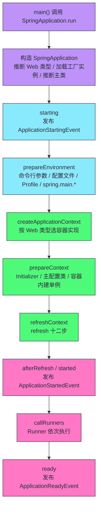
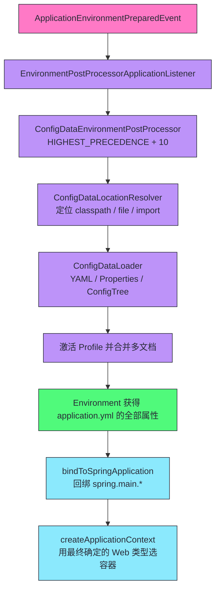
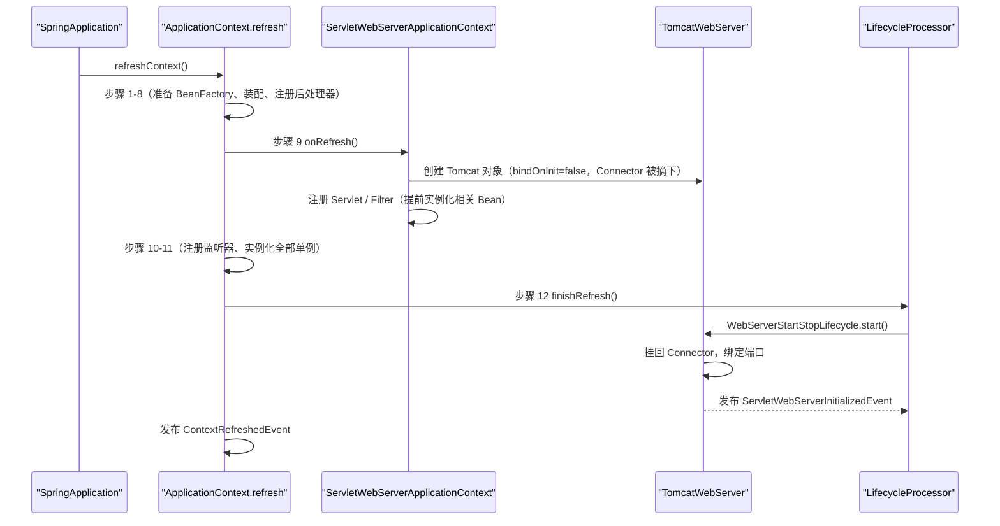
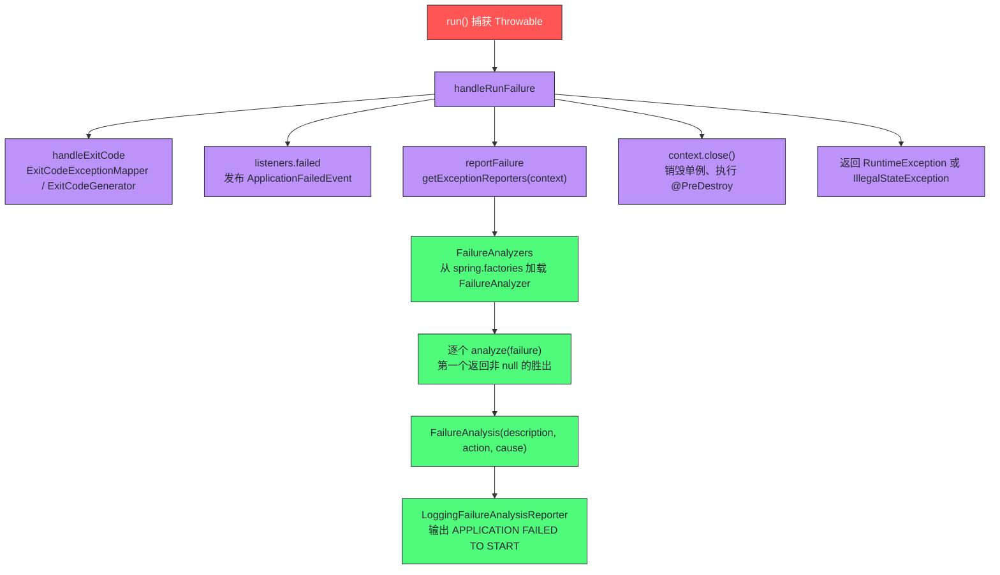
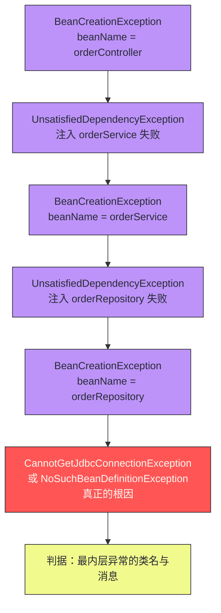

# 启动流程——从main方法到ApplicationContext就绪

**摘要：**
`SpringApplication.run(App.class, args)` 这一行代码背后，是一次被切成若干段、每段都有固定职责与扩展点的装配过程：构造 `SpringApplication` 时推断 Web 应用类型、从类路径加载工厂实例；`prepareEnvironment` 在容器还不存在的时候就把命令行参数、配置文件与 Profile 装进 `Environment`；`createApplicationContext` 与 `prepareContext` 搭出容器骨架并执行 `ApplicationContextInitializer`；`refreshContext` 完成 Bean 定义解析、条件装配与单例实例化；`afterRefresh`、`started` 与 Runners 收尾，最后由 `ready` 宣告应用可服务。本文以 Spring Boot 3.5 的源码为主线，逐段说明每段发生了什么、能在哪里挂扩展点，并给出各段对应的启动日志与耗时量级，让“启动走到哪一段了”可以直接从日志读出。随后把视角切到故障现场：`BeanCreationException` 的嵌套链怎么从外到内读，`FailureAnalyzer` 生成的报告来自哪条调用链，`--debug` 打开的 `ConditionEvaluationReport` 如何回答“为什么这个配置没有生效”，以及 `spring.main.*` 这类影响启动行为的配置该在哪里改、改了有什么代价。最后划清启动期与运行期的边界，说明为什么“启动失败”与“启动成功但请求失败”的排查路径完全不同。IoC 容器的内部实现不在本文展开，Bean 从定义到销毁的完整流程见 Spring Core 专栏。

---

## 第 1 章 启动期的边界与分段总览

### 1.1 什么才算“启动完成”

讨论启动流程之前，先要界定终点。一个 Spring Boot 进程在启动过程中会依次跨过**四个里程碑**：所有单例 Bean 创建完毕、端口开始监听、`CommandLineRunner` 与 `ApplicationRunner` 执行完毕、`ApplicationReadyEvent` 的监听器返回。这四个里程碑彼此相隔，而且顺序固定，任何一段失败都会让进程退出，但外部观察到的现象完全不同——端口可能已经能连上，HTTP 请求却全部超时，因为 `DispatcherServlet` 的 `init()` 默认被推迟到第一个请求（`spring.mvc.servlet.load-on-startup` 的默认值是 -1）。

笔者把“启动期”定义为从 `main` 方法调用 `SpringApplication.run` 开始，到 `ready` 回调返回为止。这个区间之外还有两件事值得记住：`run` 返回之后，Web 应用的 `main` 线程随即结束，真正撑住 JVM 的是 Tomcat 启动时创建的非守护 await 线程；启动期产生的所有状态（Bean 定义、条件评估结果、代理对象）在运行期都是只读的，而运行期产生的一切（请求、事务、下游调用）在启动期都不存在。这条边界的存在，决定了故障排查时该看哪一类证据。

### 1.2 分段的全景

`run()` 在 3.5 中的骨架没有大改，关键的调用与异常处理按下面的顺序排列，注释标出每一段的边界与失败出口。

```java
public ConfigurableApplicationContext run(String... args) {
    Startup startup = Startup.create();                       // 计时起点，决定 Started in 的数字
    if (this.properties.isRegisterShutdownHook()) {
        SpringApplication.shutdownHook.enableShutdownHookAddition();
    }
    DefaultBootstrapContext bootstrapContext = createBootstrapContext();
    ConfigurableApplicationContext context = null;
    configureHeadlessProperty();
    SpringApplicationRunListeners listeners = getRunListeners(args);      // 默认实现是 EventPublishingRunListener
    listeners.starting(bootstrapContext, this.mainApplicationClass);      // ApplicationStartingEvent
    try {
        ApplicationArguments applicationArguments = new DefaultApplicationArguments(args);
        ConfigurableEnvironment environment = prepareEnvironment(listeners, bootstrapContext, applicationArguments);
        Banner printedBanner = printBanner(environment);
        context = createApplicationContext();                 // 按 Web 类型选择容器实现
        context.setApplicationStartup(this.applicationStartup); // 容器与 SpringApplication 共用同一个记录器
        prepareContext(bootstrapContext, context, environment, listeners, applicationArguments, printedBanner);
        refreshContext(context);                              // 十二步，启动期绝大多数失败在这里
        afterRefresh(context, applicationArguments);          // 默认空实现
        startup.started();
        if (this.properties.isLogStartupInfo()) {
            new StartupInfoLogger(this.mainApplicationClass, environment).logStarted(getApplicationLog(), startup);
        }
        listeners.started(context, startup.timeTakenToStarted()); // ApplicationStartedEvent
        callRunners(context, applicationArguments);           // Runner 抛异常同样走失败处理
    }
    catch (Throwable ex) {
        throw handleRunFailure(context, ex, listeners);        // 发布 Failed 事件、生成报告、关闭上下文
    }
    try {
        if (context.isRunning()) {
            listeners.ready(context, startup.ready());         // ApplicationReadyEvent
        }
    }
    catch (Throwable ex) {
        throw handleRunFailure(context, ex, null);             // 监听器不可用，只做报告与关闭
    }
    return context;
}
```

把这段代码压成一张图：从左到右是方法调用，每段括号里是该段真正做的事情。



每一段的职责、可用的扩展点与典型失败形态可以对照下表。扩展点一栏里只列“在这一段执行”的接口，跨段生效的机制（如 `BeanPostProcessor`）不在此列。

| 阶段 | 入口方法 | 这一段发生的事 | 可挂的扩展点 | 失败形态 |
| --- | --- | --- | --- | --- |
| 构造 | `new SpringApplication(...)` | 推断 Web 类型，加载 `BootstrapRegistryInitializer`、`ApplicationContextInitializer`、`ApplicationListener`，推断主类 | 继承 `SpringApplication` 并覆盖方法；`setApplicationStartup`；`SpringApplicationHook`（3.0+） | 类型推断错误导致容器选型错误，进程能启动但没有 Web 容器 |
| starting | `listeners.starting(...)` | 创建 `BootstrapContext`，发布 `ApplicationStartingEvent`，设置 headless 属性 | `BootstrapRegistryInitializer`、`ApplicationListener<ApplicationStartingEvent>` | 监听器自身抛异常，此时连 `Environment` 都没有 |
| 环境准备 | `prepareEnvironment(...)` | 创建 `Environment`，加载命令行参数与配置文件，激活 Profile，回绑 `spring.main.*` | `EnvironmentPostProcessor`、`ApplicationListener<ApplicationEnvironmentPreparedEvent>` | 配置解析失败、属性名非法、`spring.config.import` 目标缺失 |
| 容器创建 | `createApplicationContext()` | 按 Web 类型实例化 `AnnotationConfigServletWebServerApplicationContext` 等 | `ApplicationContextFactory` | 类路径上 Servlet 与 Reactive 依赖混杂导致选型与预期不符 |
| 容器准备 | `prepareContext(...)` | 执行 Initializer，注册主配置类，注册内建单例，设置循环引用与覆盖开关 | `ApplicationContextInitializer`、`BeanNameGenerator` | Initializer 抛异常，主配置类无法注册 |
| 刷新 | `refreshContext(context)` | 解析配置类与自动配置，创建全部非懒加载单例，绑定端口，发布 `ContextRefreshedEvent` | `BeanFactoryPostProcessor`、`BeanPostProcessor`、`SmartLifecycle`、`SmartInitializingSingleton` | 装配与实例化阶段的绝大多数异常都在这里抛出 |
| 收尾 | `afterRefresh` / `started` | 扩展点回调，发布 `ApplicationStartedEvent` | 覆盖 `afterRefresh`、`ApplicationListener<ApplicationStartedEvent>` | 监听器抛异常会走启动失败处理 |
| 运行器 | `callRunners(...)` | 按 `@Order` 依次执行 `ApplicationRunner` 与 `CommandLineRunner` | `Runner` 实现类 | Runner 抛异常导致启动失败，但端口此时已监听 |
| 就绪 | `listeners.ready(...)` | 发布 `ApplicationReadyEvent` | `ApplicationListener<ApplicationReadyEvent>` | 监听器抛异常同样触发失败处理，且上下文会被关闭 |

“每一段挂什么”这件事有一个容易忽略的约束：容器还没创建时，扩展点只能是从 `spring.factories` 加载的纯 Java 类，不能依赖注入。`ApplicationStartingEvent` 的监听器拿不到任何 Bean，`ApplicationEnvironmentPreparedEvent` 的监听器同样如此，它们能用的只有 `SpringApplication` 实例、命令行参数与 `Environment`。这条约束把扩展点分成了**容器外**和**容器内**两族，选择扩展点时先确认自己需要哪一族的资源。

### 1.3 监听器回调与事件的一一对应

`SpringApplicationRunListener` 是启动流程的观测接口，3.5 中保留七个默认方法，默认实现 `EventPublishingRunListener` 把每次回调翻译成一个 Spring 事件。下表把回调、事件与此刻的容器状态对齐，它同时也是排查“为什么我的监听器收不到事件”的判据。

| 监听器回调 | 发布的事件 | 此刻的状态 |
| --- | --- | --- |
| `starting` | `ApplicationStartingEvent` | 容器与 `Environment` 都不存在，监听器来自类路径 |
| `environmentPrepared` | `ApplicationEnvironmentPreparedEvent` | `Environment` 就绪，配置文件刚加载完，容器未创建 |
| `contextPrepared` | `ApplicationContextInitializedEvent` | 容器已创建、Initializer 已执行、主配置类尚未注册 |
| `contextLoaded` | `ApplicationPreparedEvent` | 主配置类已注册为 BeanDefinition，尚未 refresh |
| `started` | `ApplicationStartedEvent` | refresh 完成、端口已绑定，Runner 尚未执行 |
| `ready` | `ApplicationReadyEvent` | Runner 已执行，应用可服务 |
| `failed` | `ApplicationFailedEvent` | 失败处理中，上下文即将关闭 |

这七个回调的粒度设计得相当克制：它们只标记“阶段边界”，不描述阶段内部细节，因此事件监听器天然适合做与启动阶段绑定的初始化或校验，而不适合做细粒度的耗时统计。2.x 中的 `running()` 回调在 3.x 已不存在，其职责由 `ready()` 承担，把 `ApplicationReadyEvent` 的发布收进 `ready()` 一个方法，事件语义因此不再依赖回调顺序。

---

## 第 2 章 构造 SpringApplication：运行之前就已确定的三件事

### 2.1 构造器里做的四件事

3.5 的构造器比 2.x 精简，但职责没有变化：确定 Web 应用类型、准备两组工厂实例与一组监听器、推断主类。源码的骨架如下，注释说明了每一步为什么要在这里做。

```java
public SpringApplication(ResourceLoader resourceLoader, Class<?>... primarySources) {
    this.resourceLoader = resourceLoader;
    this.primarySources = new LinkedHashSet<>(Arrays.asList(primarySources));
    // 推断结果存进 ApplicationProperties，而不是直接赋值给字段，
    // 这样后续 application.yml 里的 spring.main.web-application-type 才能覆盖它
    this.properties.setWebApplicationType(WebApplicationType.deduceFromClasspath());
    // Bootstrap 阶段的寄存器初始化器：容器创建之前就能注册可复用实例
    this.bootstrapRegistryInitializers = new ArrayList<>(
            getSpringFactoriesInstances(BootstrapRegistryInitializer.class));
    // 容器创建后、refresh 之前执行，用于给容器补配置（Spring Cloud 常用）
    setInitializers((Collection) getSpringFactoriesInstances(ApplicationContextInitializer.class));
    // 这些监听器在容器不存在时由 SpringApplication 自带的 multicaster 分发
    setListeners((Collection) getSpringFactoriesInstances(ApplicationListener.class));
    // 主类只影响日志与少量诊断信息，推断不到时为 null，不会阻断启动
    this.mainApplicationClass = deduceMainApplicationClass();
}
```

Web 应用类型的推断逻辑在 `WebApplicationType.deduceFromClasspath()` 中：类路径上有 `DispatcherHandler`、且没有 `DispatcherServlet` 与 Jersey 时判为 REACTIVE；连 `Servlet` 或 `ConfigurableWebApplicationContext` 都不存在时判为 NONE；其余情况判为 SERVLET。这个判断依赖“类是否存在”，不依赖任何配置，所以当工程同时引入 `spring-boot-starter-web` 与 `spring-boot-starter-webflux` 时，结果一定是 SERVLET，因为 MVC 的指示类先被命中。类路径同时存在两套 Web 栈在 Boot 3 里是一个不推荐但不会报错的组合，它的后果是响应式栈的自动配置大部分被条件装配挡掉。

### 2.2 spring.factories 与 AutoConfiguration.imports 的分工

构造器里的 `getSpringFactoriesInstances()` 在 3.5 中走 `SpringFactoriesLoader.forDefaultResourceLocation(classLoader).load(...)`，读取的仍然是 `META-INF/spring.factories`。这一点常被误解：`AutoConfiguration.imports`**只取代了自动配置类的注册入口**，而不是整个 SPI 机制。3.5 的 `spring-boot` 模块 `spring.factories` 里仍然挂着运行监听器、异常报告器、`ApplicationContextInitializer`、`ApplicationListener`、`EnvironmentPostProcessor`、`PropertySourceLoader` 与一整批 `FailureAnalyzer`；自动配置类则从 2.7 起迁移到 `META-INF/spring/org.springframework.boot.autoconfigure.AutoConfiguration.imports`，3.0 起彻底不再从 `spring.factories` 读取自动配置。两个入口的分工在后面的故障排查章节还会用到：自定义 `FailureAnalyzer` 要注册在 `spring.factories`，写在 `.imports` 里不会生效。

3.x 相对 2.x 的另一处差别是 Java 17 基线与 Jakarta 命名空间。`javax.servlet` 换成 `jakarta.servlet` 之后，Web 类型推断用的指示类名也随之改变，`ServletWebServerApplicationContext` 的 `doClose`、`createWebServer` 等方法签名里的类型全部来自 Jakarta 包。把 2.x 的示例代码直接搬进 3.x 工程时，编译错误大多出在命名空间上，而启动流程本身没有变化。

### 2.3 构造期的扩展点与误判形态

构造期的扩展点有三种：继承 `SpringApplication` 覆盖 `createApplicationContext`、`prepareContext`、`afterRefresh` 等模板方法；用 `setApplicationStartup` 装入自定义的 `ApplicationStartup`；用 3.0 新增的 `SpringApplicationHook` 在不继承的前提下插入一个额外的 `SpringApplicationRunListener`，`SpringApplication.from(main).with(...)` 就是基于它实现的测试辅助入口。第三种方式的价值在于它不需要改动生产代码的 `main` 方法，适合测试框架与诊断工具。

误判形态很少见，但一旦出现很难定位。典型场景是“工程依赖了一个会传递引入 `spring-boot-starter-web` 的公共包，业务本身只是一个定时任务进程”，此时推断结果是 SERVLET，容器会尝试创建 Web 服务器并绑定端口，如果端口被占用就直接启动失败；修复方式是在 `application.properties` 里写 `spring.main.web-application-type=none`，而这个属性之所以能在容器创建之前生效，靠的正是第 3 章要讲的 `bindToSpringApplication`。

---

## 第 3 章 starting 与 Environment：配置先于容器就位

### 3.1 BootstrapContext 与 starting

`run()` 的第一件事是 `Startup.create()` 记录起始时间，然后 `createBootstrapContext()` 依次调用 `BootstrapRegistryInitializer`。`BootstrapContext` 是一个极简的注册表，用来存放“容器还没创建、但后面要用”的实例，典型例子是配置中心客户端：连接在容器之前建立，实例先放进 BootstrapContext，容器创建后由 `bootstrapContext.close(context)` 释放未被消费的实例。这一机制解决的是“Bootstrap 阶段需要一个对象、但它不能由 BeanFactory 创建”的鸡生蛋问题。

紧接着 `listeners.starting(bootstrapContext, mainApplicationClass)` 发布 `ApplicationStartingEvent`。此时 `Environment` 与 `ApplicationContext` 都不存在，事件由 `EventPublishingRunListener` 内部的 multicast 分发给构造期加载的监听器，因此监听器不能依赖容器 Bean，也不应该做耗时操作——这一段耗时会被计入后面的“Started in”总时长。`LoggingApplicationListener` 就工作在这一段，它此时只做 `beforeInitialize()`，真正的日志系统初始化要等 `ApplicationEnvironmentPreparedEvent`。

### 3.2 prepareEnvironment 的六步

`prepareEnvironment` 是启动流程中信息密度最高的一段，它决定了后面所有代码能读到什么配置。3.5 的实现顺序如下：

```java
private ConfigurableEnvironment prepareEnvironment(SpringApplicationRunListeners listeners,
        DefaultBootstrapContext bootstrapContext, ApplicationArguments applicationArguments) {
    // 1. 按 Web 类型创建 Environment（SERVLET 对应 ApplicationServletEnvironment）
    ConfigurableEnvironment environment = getOrCreateEnvironment();
    // 2. 装入命令行参数、默认属性、转换服务
    configureEnvironment(environment, applicationArguments.getSourceArgs());
    // 3. 把 PropertySources 包一层 ConfigurationPropertySources，提供统一视图
    ConfigurationPropertySources.attach(environment);
    // 4. 发布 ApplicationEnvironmentPreparedEvent：配置文件在这里被加载
    listeners.environmentPrepared(bootstrapContext, environment);
    // 5. 把 Boot 内部的应用信息源与默认属性源移到末尾（最低优先级）
    ApplicationInfoPropertySource.moveToEnd(environment);
    DefaultPropertiesPropertySource.moveToEnd(environment);
    Assert.state(!environment.containsProperty("spring.main.environment-prefix"),
            "Environment prefix cannot be set via properties.");
    // 6. 把 spring.main.* 回绑到 SpringApplication 自身，再按需转换 Environment 类型
    bindToSpringApplication(environment);
    if (!this.isCustomEnvironment) {
        environment = new EnvironmentConverter(getClassLoader())
                .convertEnvironmentIfNecessary(environment, deduceEnvironmentClass());
    }
    ConfigurationPropertySources.attach(environment);
    return environment;
}
```

把这段顺序拆开看，几个设计决定值得记住。`ConfigurationPropertySources.attach`**被调用两次**，是因为第 4 步的 `environmentPrepared` 会往 `PropertySources` 里塞入新的源（`application.yml`、`application-{profile}.yml`、`spring.config.import` 引入的远程配置），第二次 attach 保证这些新源同样进入统一视图，后续 `Binder` 才能按松散绑定规则读取。`moveToEnd` 两次则是在给优先级排序：用户写在配置文件里的值与命令行参数必须高于框架内置默认值，而“默认属性”这一来源本身要被压到最低。`Assert` 那一行是极少数用硬断言拦截配置的地方——`spring.main.environment-prefix` 只能在代码里通过 `setEnvironmentPrefix` 设置，写在配置文件里会直接抛 `IllegalStateException`，因为前缀一旦被配置影响，环境变量解析的语义就不可控了。

`getOrCreateEnvironment()` 在 3.x 里返回 `ApplicationServletEnvironment`、`ApplicationReactiveWebEnvironment` 或 `ApplicationEnvironment`，2.x 时代对应的 `StandardServletEnvironment` 已被前者取代。差异主要在于属性源的初始集合与 Boot 自身的扩展，排查“某个属性为什么读不到”时，先确认当前 `Environment` 的实际类型往往能省下不少时间。

### 3.3 ConfigData：application.yml 与 Profile 的汇合点

第 4 步发布的 `ApplicationEnvironmentPreparedEvent` 由 `EnvironmentPostProcessorApplicationListener` 接收，它依次执行 `spring.factories` 中注册的 `EnvironmentPostProcessor`。其中 `ConfigDataEnvironmentPostProcessor`（顺序为 `HIGHEST_PRECEDENCE + 10`）负责 Config Data 的完整加载：定位 `application.yml`/`application.properties`、处理 `spring.config.import`、按 `spring.profiles.active` 与 `spring.profiles.include` 激活 Profile、合并多文档（`---` 分隔）配置、最后把结果写入 `Environment`。3.x 里 `configureProfiles` 是空实现，Profile 的解析完全交给 Config Data，这正是 Boot 2.4 重构配置加载后留下的结构。



加载顺序解释了三个常见现象。其一，`application.yml` 里的 `spring.main.lazy-initialization` 能生效，因为配置文件在容器创建之前就已经进入 `Environment`，而 `spring.main.*` 又在这个阶段被回绑。其二，`spring.profiles.active` 写在命令行、系统属性、环境变量、配置文件里都能生效，但优先级不同，`ConfigData` 按既定的源顺序取值；多个 Profile 同时激活时，各自的 `application-{profile}.yml` 都会加载，后激活的覆盖先激活的。其三，配置类上的 `@Value` 与 `@ConfigurationProperties` 拿到的一定是最终合并后的值，但如果在 `EnvironmentPostProcessor` 里手工读取，读到的可能是加载到一半的中间状态。

### 3.4 这一段能挂的扩展点与失败形态

“容器外”族里最有用的扩展点是 `EnvironmentPostProcessor`：实现类注册在 `spring.factories`，拿到 `Environment` 之后可以追加属性源、解密配置、注入随机值，Spring Cloud 的远程配置、Boot 自身的 `RandomValuePropertySource` 都走这条路。它比 `ApplicationContextInitializer` 更早、更底层，代价是这里没有容器，拿不到任何 Bean，也不能发容器事件。

失败形态集中在配置解析上。`spring.config.import` 指向一个不存在的目标时，`ConfigDataNotFoundFailureAnalyzer` 会给出报告，指出是哪个 import 位置无法解析；属性名不符合松散绑定规则（譬如包含大写字母或非法字符的 `@ConfigurationProperties` 前缀）时，`InvalidConfigurationPropertyNameFailureAnalyzer` 会指出具体的名字；YAML 语法错误则通常在 `YamlPropertySourceLoader` 抛出，异常信息里带文件名与行号，这类错误没有专门的分析器，只能读原始栈。这一段抛出的异常落在 `run()` 的 try 块内，会被 `handleRunFailure` 捕获，但此时 `context` 还是 null，异常报告器拿不到 `BeanFactory` 与 `Environment`，能给出的分析比装配期故障要少。

---

## 第 4 章 把日志当进度条：三类行标记四个段

### 4.1 启动日志的顺序语义

启动日志不是装饰，它是唯一一条不依赖额外工具、按时间排列的分段标记。一个 Servlet Web 应用的典型输出按下列顺序出现，每一行都对应一个明确的阶段位置。

| 日志行（关键字） | 所属阶段 | 这一行之后还会发生什么 |
| --- | --- | --- |
| `Starting OrderServiceApp using Java ...` | `starting` 之后 | 环境准备、容器创建、refresh 都还没开始 |
| `No active profile set, falling back to ...` | `prepareEnvironment` 内部 | 配置加载完成，即将创建容器 |
| `Tomcat initialized with port 8080 (http)` | `refresh` 第 9 步 `onRefresh` | 全部单例 Bean 尚未实例化 |
| `Root WebApplicationContext: initialization completed in ...` | `onRefresh` 内 Servlet 注册完成 | 紧随其后进入单例实例化 |
| `Tomcat started on port 8080 (http) with context path '/'` | `refresh` 第 12 步 | 单例已全部就绪，端口此时才真正绑定 |
| `Started OrderServiceApp in 4.732 seconds (process running for 5.281)` | `started` 之后 | Runners 与 `ApplicationReadyEvent` 尚未执行 |
| `Completed initialization in 12 ms`（首次请求） | 运行期 | `DispatcherServlet` 的延迟初始化，不属于启动期 |

把这张表和前面的分段表对照，会发现两个常被误读的位置。第一处是 `Tomcat initialized` 出现在日志很靠前的位置，容易被当作“Web 容器已经启动完毕”，实际它只表示 Tomcat 对象创建完成、Servlet 已经注册，**端口还没有绑定**。第二处是 `Tomcat started` 之后日志看似平静，但此时 Runners 还没跑、`ApplicationReadyEvent` 还没发，把“看到 Tomcat started”当作启动成功，是很多就绪探针误判的起点。

### 4.2 两个耗时数字的差

`Started ... in X seconds (process running for Y)` 这一行里的两个数字口径不同：X 从 `run()` 的第一行开始计时，到 `refresh` 与 `afterRefresh` 结束为止；Y 是 JVM 的运行时长，从进程启动算起。两者之差就是 `main` 之前的部分——类加载、静态初始化、依赖 jar 的元数据读取、JVM 自身的启动开销。在容器化环境里这个差值会被放大，因为镜像层首次加载、CPU 配额与 cgroup 限流都会拖慢类加载；如果 X 与 Y 相差很大，优化的方向**不在 Spring**，而在镜像体积、类路径与 JVM 参数。

### 4.3 为什么两行 Tomcat 日志之间夹着业务 Bean

`Tomcat initialized` 与 `Tomcat started` 之间夹着大量 Bean 的创建日志，原因有两层。第一层是 `onRefresh` 中的 `createWebServer()` 会通过 `getSelfInitializer()` 把 `ServletContextInitializer` 注册进 Tomcat，而 `ServletContextInitializerBeans` 在构造时就会按类型取出所有 `Servlet`、`Filter`、`EventListener` 与 `ServletContextInitializer` Bean，这一步直接触发这些 Bean 的实例化。也就是说，被 Filter 依赖的业务 Bean 在 `onRefresh` 阶段就被创建了，并不会等到第 11 步的单例实例化。第二层是单例实例化本身发生在第 11 步，它排在 `onRefresh` 之后、`finishRefresh` 之前，因此 `Tomcat initialized` 之后看到的大段 Bean 创建日志，绝大多数来自 `preInstantiateSingletons`。

这个顺序有一个直接的工程后果：如果某个 `Filter` 依赖的 Bean 初始化很慢（譬如在构造器里建连接池），它会被提前到 `onRefresh` 阶段执行，而 `onRefresh` 仍在 `refresh` 的 try 块内，异常会被包装成 `ApplicationContextException("Unable to start web server", ex)`，嵌套的 `BeanCreationException` 反而藏在 cause 链深处。排查“启动失败但错误信息只说 Web 服务器起不来”的问题时，顺着这条包装关系往下找，比盯着最外层消息有效得多。

---

## 第 5 章 createApplicationContext 与 prepareContext：骨架与 Initializer

### 5.1 三种容器与 Web 类型的再判定

`createApplicationContext()` 在 3.5 中只是把 `webApplicationType` 交给 `ApplicationContextFactory`。默认实现 `DefaultApplicationContextFactory` 会遍历 `spring.factories` 中注册的工厂，Servlet 场景命中 `ServletWebServerApplicationContextFactory`，返回 `AnnotationConfigServletWebServerApplicationContext`（AOT 模式下返回 `ServletWebServerApplicationContext`）；响应式场景命中 `AnnotationConfigReactiveWebServerApplicationContext`；NONE 场景返回 `AnnotationConfigApplicationContext`。三个容器类的差异在于刷新期间额外做了什么：Servlet 容器覆盖 `onRefresh` 创建 Web 服务器，响应式容器覆盖 `onRefresh` 创建响应式服务器，普通容器则什么都不加。

这里有一个容易被忽略的时序：传给工厂的 `webApplicationType` 是 `properties.getWebApplicationType()`，而 `bindToSpringApplication` 已经在 `prepareEnvironment` 末尾把 `spring.main.web-application-type` 绑进同一个 `properties` 对象。也就是说，配置文件中写的类型可以覆盖构造期的类路径推断，改动发生在容器创建之前。理解这一点，才能解释为什么“类路径上有 spring-webmvc、配置里声明 none”的进程确实不会创建 Web 容器。

### 5.2 prepareContext 的十步

容器对象创建出来之后还没有任何 Bean 定义，`prepareContext` 负责把它从空壳变成“可以 refresh 的状态”。3.5 的步骤可以逐条列出，每一步都对应一个可观察的行为。

```java
private void prepareContext(DefaultBootstrapContext bootstrapContext, ConfigurableApplicationContext context,
        ConfigurableEnvironment environment, SpringApplicationRunListeners listeners,
        ApplicationArguments applicationArguments, Banner printedBanner) {
    context.setEnvironment(environment);              // 1. 容器拿到已加载的 Environment
    postProcessApplicationContext(context);           // 2. 装入 BeanNameGenerator / ResourceLoader / ConversionService
    addAotGeneratedInitializerIfNecessary(this.initializers); // 3. AOT 模式下插入生成期 Initializer
    applyInitializers(context);                       // 4. 按 @Order 执行全部 Initializer
    listeners.contextPrepared(context);               // 5. 发布 ApplicationContextInitializedEvent
    bootstrapContext.close(context);                  // 6. 关闭 Bootstrap 阶段
    if (this.properties.isLogStartupInfo()) { logStartupInfo(context); }
    ConfigurableListableBeanFactory beanFactory = context.getBeanFactory();
    beanFactory.registerSingleton("springApplicationArguments", applicationArguments); // 7. 内建单例
    if (printedBanner != null) { beanFactory.registerSingleton("springBootBanner", printedBanner); }
    if (this.properties.isLazyInitialization()) {
        context.addBeanFactoryPostProcessor(new LazyInitializationBeanFactoryPostProcessor()); // 8. 全局懒加载
    }
    context.addBeanFactoryPostProcessor(new PropertySourceOrderingBeanFactoryPostProcessor(context));
    // 9. 只注册主配置类的 BeanDefinition，不解析 @ComponentScan
    load(context, getAllSources().toArray(new Object[0]));
    listeners.contextLoaded(context);                 // 10. 发布 ApplicationPreparedEvent
}
```

第 4 步的 `applyInitializers` 是这一段最常用的扩展点。`ApplicationContextInitializer` 能拿到刚创建的容器与已加载的 `Environment`，可以做注册 `BeanFactoryPostProcessor`、追加 `PropertySource`、设置 `BeanNameGenerator`、注册自定义作用域之类的事情，但此时 `refresh` 还没开始，容器里还没有业务 Bean，也没有事件多播器。Spring Cloud 的 bootstrap 时代大量依赖这个入口把配置中心的属性提前装进容器；3.x 之后更推荐用 `BootstrapRegistryInitializer` 配合 `BootstrapContext`，因为后者能在容器创建之前就复用同一个客户端实例。

第 9 步的 `load` 常被误解。`BeanDefinitionLoader` 对传入的 Class 使用 `AnnotatedBeanDefinitionReader` 注册一个 `BeanDefinition`，仅此而已；`@ComponentScan` 的包扫描、`@Import` 的导入、`@Bean` 方法的解析全部发生在 `refresh` 的第 5 步 `invokeBeanFactoryPostProcessors`。所以在 `prepareContext` 阶段查询“容器里有多少个 Bean 定义”只会得到一个极小的数字，这是正常现象。

### 5.3 ApplicationContextInitializer 的能力与边界

这个接口的流行来自它“恰到好处的位置”：比任何 Bean 都早，又比 `EnvironmentPostProcessor` 晚，手里已经有容器。它能做的事包括给容器添加 `BeanFactoryPostProcessor`、注册单例对象、设置 `allowBeanDefinitionOverriding` 这类开关；它不能做的事也很明确：不能读取业务 Bean，不能发布需要容器监听器接收的事件（事件多播器在第 8 步才初始化），不能保证 `Environment` 之后不再被修改。把重逻辑放进 Initializer 的代价，是它会把耗时计入 `spring.boot.application.context-prepared` 这一段，而且一旦抛异常，`prepareContext` 直接失败，`context.close()` 会执行，日志里只会看到 Initializer 类名与原始异常。

---

## 第 6 章 refresh 十二步：Boot 改了哪几处

### 6.1 十二步清单

`refreshContext` 最终调用 `AbstractApplicationContext.refresh()`，十二个步骤的顺序从 Spring 2.5 沿用至今。Boot 没有改动这个顺序，但在第 4、5、9、12 步替换或补充了实现，其中第 9 步和第 12 步的拆分尤其容易被误读。下表列出每一步做什么，以及 Boot 在这里的差异。

| 步骤 | 方法 | 做什么 | Boot 的差异或扩展点 |
| --- | --- | --- | --- |
| 1 | `prepareRefresh` | 记录启动时间戳、初始化占位符解析、校验必需属性 | 无差异；`ServletContext`/`ServletConfig` 属性源要等到第 9 步创建 Web 服务器时才补入 |
| 2 | `obtainFreshBeanFactory` | 创建或获取 `DefaultListableBeanFactory` | 容器构造时已建好，实质是返回现成实例 |
| 3 | `prepareBeanFactory` | 注册 `ApplicationContextAwareProcessor`、解析器、忽略依赖接口 | 注册 `ApplicationStartup` 等内建单例 |
| 4 | `postProcessBeanFactory` | 子类扩展 | `ServletWebServerApplicationContext` 在此注册 Web 作用域与 `ServletContextAware` 处理器 |
| 5 | `invokeBeanFactoryPostProcessors` | 执行 `BeanFactoryPostProcessor`，解析配置类 | `ConfigurationClassPostProcessor` 在此处理 `@ComponentScan`、`@Import`、自动配置与 `@Bean` |
| 6 | `registerBeanPostProcessors` | 按 `PriorityOrdered`/`Ordered` 排序并注册 | 自定义 `BeanPostProcessor` 的顺序问题都在这里暴露 |
| 7 | `initMessageSource` | 初始化国际化消息源 | 无差异 |
| 8 | `initApplicationEventMulticaster` | 初始化事件多播器 | 无差异 |
| 9 | `onRefresh` | 子类扩展，创建特殊 Bean | 创建 Tomcat 对象与 Servlet/Filter，补入 Servlet 属性源，端口尚未绑定 |
| 10 | `registerListeners` | 注册监听器 Bean 并补发早期事件 | 无差异 |
| 11 | `finishBeanFactoryInitialization` | 实例化全部非懒加载单例 | `@PostConstruct`、AOP 代理、`SmartInitializingSingleton` 都在这一步发生 |
| 12 | `finishRefresh` | 启动 `Lifecycle`、发布 `ContextRefreshedEvent` | 端口在此真正绑定；`WebServerStartStopLifecycle` 在此启动 |

第 5 步与第 6 步在启动步骤树里被 `spring.context.beans.post-process` 这一个父步骤包住，因此用 `/actuator/startup` 观察时，两者合起来显示为一段耗时，而不是两段。这个细节提醒我们：工具给出的分段粒度不等于源码的分段粒度，读工具结论前先确认它把哪些步骤合并了。

### 6.2 第 5 步：装配期的真正入口

`ConfigurationClassPostProcessor` 是 `BeanDefinitionRegistryPostProcessor`，它在第 5 步做的第一件事是找出所有候选配置类并解析，第二件事是处理 `@ComponentScan` 与 `@Import`，第三件事是把 `@Bean` 方法注册成 `BeanDefinition`。自动配置类通过 `@Import(AutoConfigurationImportSelector.class)` 进入这个流程，条件装配在解析阶段逐条评估，最终决定哪些配置类留下。这一段是“装配期”的本体，耗时通常占启动总时长的两成到四成（示例推算），工程上把类扫描范围收窄、减少无用自动配置候选，效果都落在这里。候选的筛选逻辑与条件的评估顺序由 `AutoConfigurationImportSelector` 与 `@Conditional` 家族决定，这一段不展开。

### 6.3 第 9 步：Web 容器对象与 Servlet 注册

第 9 步的 `onRefresh` 在 Servlet 容器里做两件事：创建 Web 服务器对象，注册 Servlet 相关的组件。3.5 的实现如下，注意端口绑定并不在这里。

```java
protected void onRefresh() {
    super.onRefresh();
    try {
        createWebServer();
    } catch (Throwable ex) {
        throw new ApplicationContextException("Unable to start web server", ex);
    }
}

private void createWebServer() {
    if (this.webServer == null && getServletContext() == null) {
        StartupStep step = getApplicationStartup().start("spring.boot.webserver.create");
        ServletWebServerFactory factory = getWebServerFactory();   // 从容器取 TomcatServletWebServerFactory
        this.webServer = factory.getWebServer(getSelfInitializer()); // 创建 Tomcat 对象并注册 Servlet
        step.tag("factory", factory.getClass().toString()).end();
        // 注册两个 SmartLifecycle，端口绑定要等第 12 步它们被启动
        getBeanFactory().registerSingleton("webServerStartStop",
                new WebServerStartStopLifecycle(this, this.webServer));
    }
    initPropertySources();
}
```

`TomcatWebServer` 的构造器会执行 `tomcat.start()`，但它在启动前做了两件事：给 Connector 设置 `bindOnInit=false`，并在 Context 启动事件里把 Connector 从 Service 上摘下。因此 `tomcat.start()` 只是把容器结构启动起来、触发 Servlet 注册，真正的端口绑定**被推迟到 `finishRefresh`**：第 12 步的 `lifecycleProcessor.onRefresh()` 触发 `WebServerStartStopLifecycle.start()`，由它再调用 `TomcatWebServer.start()`，因为前者是一个 `SmartLifecycle`。这个设计把“容器就绪”与“端口开放”分成了两个时刻，Boot 可以在两者之间完成剩余的单例初始化，也让失败时的清理更有章法。



### 6.4 第 11 步：单例实例化

`finishBeanFactoryInitialization` 调用 `preInstantiateSingletons()`，按注册顺序创建所有非懒加载单例。每个 Bean 的 `getBean` 都会开启一个 `spring.beans.instantiate` 启动步骤（步骤名来自 `AbstractBeanFactory.doGetBean`，标签里带 `beanName` 与 `beanType`），因此用 `ApplicationStartup` 观察时，这一段会呈现为成百上千个并列的子步骤，其中耗时最长的那几个就是启动优化的目标。Bean 的实例化、属性填充、初始化回调、代理生成、销毁回调的完整顺序见 [[Java/SpringCore/04 Bean的生命周期——从定义到销毁的完整流程]]，本文只关心它与启动分段的交界。

这个交界有三处值得单独说明。构造器注入的依赖解析发生在 `createBeanInstance` 内部的 `autowireConstructor` 中，失败抛 `UnsatisfiedDependencyException`；`BeanPostProcessor` 链在步骤 6 已经就位，所以每个 Bean 都会完整走一遍代理生成，AOP 配置错误在这里暴露；`SmartInitializingSingleton` 的 `afterSingletonsInstantiated` 在**全部单例创建完成之后**统一回调，`@EventListener` 的方法注册就发生在此时，这意味着在此之前发布的事件，`@EventListener` 注解的方法收不到。

---

## 第 7 章 Bean 生命周期的三个启动期卡点

Bean 生命周期本身有十余个扩展点，但在启动流程的语境下，真正影响“能不能起来”和“起来要多久”的只有三个卡点，其余细节属于容器内部机制。

第一个卡点是构造器注入的依赖解析。单例实例化是**串行**的，某个 Bean 的构造器等待另一个 Bean，就一直占着 `preInstantiateSingletons` 的线程；如果依赖链上有数据库连接、远程调用或文件扫描，启动时间会被整条链累加。构造器注入的好处是依赖不可变、失败早暴露，代价是它把初始化成本压在了启动期的关键路径上。

第二个卡点是代理生成。步骤 6 注册的 `BeanPostProcessor` 会在每个 Bean 初始化前后执行，事务、缓存、校验、异步这些能力都靠代理实现；代理生成失败（final 类配 CGLIB、缺少 `aspectjweaver`、切点表达式写错）会在步骤 11 抛异常，异常信息通常以 `BeanCreationException` 开头，真正的 `IllegalArgumentException` 或 `AopConfigException` 在 cause 链底部。

第三个卡点是 `SmartInitializingSingleton` 的末尾回调。它在所有单例就绪之后、`finishRefresh` 之前执行，`EventListenerMethodProcessor` 在这里扫描 `@EventListener` 并注册到事件多播器。由此可以推出一个实用结论：在 `@PostConstruct` 或 `InitializingBean.afterPropertiesSet` 里 `publishEvent`，事件的消费者若是 `@EventListener` 方法，大概率收不到；改用 `ApplicationListener` 接口实现的 Bean 则能收到，因为后者在第 10 步就注册进了多播器。

---

## 第 8 章 afterRefresh、started 与 Runners：最后一段可控代码

### 8.1 afterRefresh 为什么几乎没人用

`afterRefresh` 是 `SpringApplication` 留出的模板方法，默认空实现。要覆盖它必须继承 `SpringApplication` 并自己调用 `run`，而项目里通常直接用静态方法 `SpringApplication.run(...)`，所以这个扩展点在实践中极少出现。它能做的事情 `ApplicationStartedEvent` 的监听器都能做，且后者不需要改启动入口；两者的差别只在异常语义——`afterRefresh` 抛异常走启动失败处理，监听器抛异常同样如此，位置上的差异没有带来能力上的差异。

### 8.2 callRunners 的实现细节

3.5 的 `callRunners` 先从 BeanFactory 里按 `Runner` 类型取全部 Bean 名，再逐个 `getBean` 拿到实例，用带 `OrderSourceProvider` 的比较器排序（`@Order` 之外还能识别 `FactoryBean` 与工厂方法上的顺序信息），最后依次调用。排序规则是 `Ordered` 与 `@Order` 的常规语义，值越小越先执行。

```java
private void callRunners(ConfigurableApplicationContext context, ApplicationArguments args) {
    ConfigurableListableBeanFactory beanFactory = context.getBeanFactory();
    String[] beanNames = beanFactory.getBeanNamesForType(Runner.class);
    Map<Runner, String> instancesToBeanNames = new IdentityHashMap<>();
    for (String beanName : beanNames) {
        instancesToBeanNames.put(beanFactory.getBean(beanName, Runner.class), beanName);
    }
    // Runner 是包级私有的标记接口，ApplicationRunner 与 CommandLineRunner 都继承它
    instancesToBeanNames.keySet().stream()
            .sorted(getOrderComparator(beanFactory).withSourceProvider(
                    new FactoryAwareOrderSourceProvider(beanFactory, instancesToBeanNames)))
            .forEach((runner) -> callRunner(runner, args));
}
```

`ApplicationRunner` 与 `CommandLineRunner` 的差异只在参数类型上：前者拿 `ApplicationArguments`，可以区分选项参数（`--key=value`）与非选项参数；后者拿原始字符串数组，适合参数结构简单的场景。两者的执行时机完全相同，都在 `refresh` 完成、`ApplicationStartedEvent` 发布之后。

| 接口 | 方法签名 | 参数形态 | 典型用途 |
| --- | --- | --- | --- |
| `CommandLineRunner` | `run(String... args)` | 原始命令行数组 | 参数少、只需原样解析的启动任务 |
| `ApplicationRunner` | `run(ApplicationArguments args)` | 解析后的参数对象 | 需要区分选项参数、读取多值参数的启动任务 |

### 8.3 几个“启动后要做的事”的时机对比

同一个需求（譬如启动后预热缓存）可以挂在四个不同的位置，它们的时机、能力与失败后果如下表。选择哪一个，取决于你希望失败时进程退出还是继续服务。

| 扩展点 | 执行时机 | 能否注入全部 Bean | 抛异常的后果 | 适用场景 |
| --- | --- | --- | --- | --- |
| `@PostConstruct` | 步骤 11 内，单个 Bean 初始化时 | 只有已创建完成的依赖 | 包装为 `BeanCreationException`，启动失败 | 本 Bean 自身的轻量初始化 |
| `SmartInitializingSingleton` | 步骤 11 末尾，全部单例就绪后 | 可以（通过 BeanFactory 取） | 启动失败 | 需要感知全部单例的汇总型初始化 |
| `ApplicationRunner` | `refresh` 完成之后 | 可以 | 启动失败，上下文关闭，进程退出 | 预热、校验、初始化数据 |
| `ApplicationReadyEvent` 监听器 | Runners 之后 | 可以 | 启动失败，上下文关闭 | 服务注册、就绪通知、非关键任务 |

### 8.4 Runner 抛异常意味着什么

Runner 抛出的异常会被包装成 `IllegalStateException("Failed to execute ApplicationRunner", ex)`，随后进入 `handleRunFailure`，发布 `ApplicationFailedEvent`、关闭上下文、进程以非 0 状态退出。这个过程有一个尴尬的中间态：端口已经绑定、Web 服务器已经启动，外部探测可能已经连上端口，但几毫秒后进程就退出了。容器编排环境下这会被记录成一次“启动了但又失败”的 CrashLoop，而日志里最显眼的一行是 Runner 的异常，不是端口相关的信息。把预热逻辑放进 Runner 时，务必给外部依赖加上超时与降级，否则一个下游抖动就会把整个 Pod 打回重启循环。

---

## 第 9 章 启动失败的第一现场：APPLICATION FAILED TO START

### 9.1 handleRunFailure 的五件事

`run()` 的两个 try 块把所有异常都交给 `handleRunFailure`。3.5 的实现按固定顺序做五件事：根据 `ExitCodeExceptionMapper` 或 `ExitCodeGenerator` 计算退出码并发布 `ExitCodeEvent`；通知运行监听器发布 `ApplicationFailedEvent`；调用 `SpringBootExceptionReporter` 生成失败分析报告；关闭上下文；注销注册过的关闭钩子。最后把异常原样抛回（运行时异常）或包成 `IllegalStateException`。这段顺序里最容易被忽略的是“先发布失败事件、再生成报告”：`ApplicationFailedEvent` 的监听器如果自己也抛异常，只会被记录成警告，不会阻断报告生成。



### 9.2 FailureAnalyzer 的加载与匹配

`FailureAnalyzers` 通过 `SpringFactoriesLoader.forDefaultResourceLocation(classLoader)` 加载 `org.springframework.boot.diagnostics.FailureAnalyzer` 的全部实现，构造时把 `BeanFactory` 与 `Environment` 作为构造参数传给需要的分析器。匹配逻辑是线性的：按加载顺序逐个调用 `analyze(Throwable)`，第一个返回非空 `FailureAnalysis` 的胜出，其余不再执行；如果全部返回 null，报告器拿到 null，`FailureAnalyzers.reportException` 返回 false，于是退回默认行为——直接把原始异常打到日志里，日志中就不会出现 `APPLICATION FAILED TO START` 这个标题。

3.5 中内置的分析器覆盖了启动期最典型的几类故障，下表按“报告里给出的判断依据”归类，而不是按包名排列。

| 分析器 | 触发的异常 | 报告里能读到的关键信息 |
| --- | --- | --- |
| `PortInUseFailureAnalyzer` | 端口绑定失败（Tomcat Connector 启动异常） | 被占用的端口，以及“停止占用进程或改用其他端口”的动作建议 |
| `BeanCurrentlyInCreationFailureAnalyzer` | `BeanCurrentlyInCreationException` | 用箭头画出的循环依赖链，以及“不推荐依赖循环引用”的说明 |
| `NoSuchBeanDefinitionFailureAnalyzer` | `NoSuchBeanDefinitionException` | 缺失的 Bean 类型、注入点所在的类与字段/参数，以及定义该 Bean 的建议 |
| `NoUniqueBeanDefinitionFailureAnalyzer` | `NoUniqueBeanDefinitionException` | 多个候选 Bean 的名字，以及用 `@Primary`/`@Qualifier` 区分的建议 |
| `BeanDefinitionOverrideFailureAnalyzer` | `BeanDefinitionOverrideException` | 冲突的两个定义来源，以及开启覆盖的开关名 |
| `BindFailureAnalyzer` 与 `BindValidationFailureAnalyzer` | 配置绑定失败、校验失败 | 具体属性名、期望类型与实际值 |
| `DataSourceBeanCreationFailureAnalyzer` | 数据源创建失败 | 缺少驱动、URL 不被识别等具体原因，以及配置项建议 |
| `ConnectorStartFailureAnalyzer` | Connector 启动失败 | 端口与协议，常与端口占用或 SSL 配置错误相关 |

自定义分析器的成本很低，但注册位置**只有 `spring.factories` 一处**：实现 `FailureAnalyzer`（通常继承 `AbstractFailureAnalyzer<T>` 指定异常类型），返回 `new FailureAnalysis(描述, 动作, cause)`，然后在 `META-INF/spring.factories` 的 `org.springframework.boot.diagnostics.FailureAnalyzer` 键下登记实现类。3.x 的 `spring.factories` 仍然承担这个 SPI，登记到 `AutoConfiguration.imports` 里不会生效；分析器本身也不能被条件装配控制，因为它在容器之外被加载和使用。

### 9.3 报告的格式与阅读顺序

报告由 `LoggingFailureAnalysisReporter` 输出，格式固定为标题、`Description`、`Action` 三段，只有存在动作建议时才输出 `Action`。阅读顺序应当是先 `Action` 再 `Description`：`Action` 是框架给出的处置建议，往往直接指出配置项或依赖；`Description` 是自动生成的原因描述，信息量取决于具体分析器。如果 `Description` 读起来像通用描述（譬如只说某个 Bean 创建失败），说明命中的分析器粒度较粗，此时要回到原始异常链，用第 10 章的方法继续往下读。

有一类现象需要单独说明：报告已经输出，但紧接着又出现完整的堆栈。这通常发生在失败并非由 `run()` 主线程抛出，或者分析器返回的报告没有覆盖该异常类型时；`SpringBootExceptionHandler` 只在主线程上抑制重复的栈输出。日志里同时出现报告与堆栈并不矛盾，报告给出方向，堆栈给出位置。

---

## 第 10 章 读 BeanCreationException 的嵌套链

### 10.1 链的形状：每层一个 bean

启动期最常见的失败载体是 `BeanCreationException` 及其子类。它的结构不是“一个异常包一个原因”，而是“每一层都记录一个正在创建的 Bean 名，直到最内层记录真正的失败原因”。下图是一个典型链路的形状，箭头方向是 `getCause()` 的方向，每一层的 `getBeanName()` 都不同。



读这条链的目标**不是找到失败的 Bean**，那是最外层已经告诉你的信息，而是找到“为什么失败”。三个判据依次使用：最内层异常的类名（`NoSuchBeanDefinitionException` 指向缺依赖，`CannotGetJdbcConnectionException` 指向连接问题，`BeanInstantiationException` 指向类本身不可实例化）；异常消息里的属性名或字段名（`Unsatisfied dependency expressed through field 'repository'` 直接给出注入点）；异常的 `getResourceDescription()`（给出配置类、`@Bean` 方法或 XML 文件的位置，能定位到定义来源而不是使用位置）。

### 10.2 五步读法

第一步，在日志里定位第一条 `Error creating bean with name`，不要从 `Caused by` 开始往下翻，那会跳过 bean 名的上下文。第二步，从这一条开始沿 `nested exception is` 与 `Caused by` 往下读，每遇到一个新的 `beanName` 就记下来，得到一条从入口 Bean 到失败 Bean 的路径。第三步，在最内层异常里找“非创建类”的异常，那才是根因。第四步，用 `getResourceDescription()` 或堆栈里的业务类名定位定义位置。第五步，回到代码确认该 Bean 的依赖声明，判断是“缺 Bean”“多 Bean”“类型不符”“构造失败”中的哪一种。

前四步可以写成一个很小的诊断工具，在测试或本地启动失败时直接打印整条链，比肉眼翻日志可靠。

```java
// 打印整条 BeanCreationException 链：beanName + 异常类型 + 消息首行
static void dumpChain(Throwable ex) {
    int depth = 0;
    for (Throwable cur = ex; cur != null && depth < 32; cur = cur.getCause(), depth++) {
        String bean = "-";
        String resource = null;
        if (cur instanceof org.springframework.beans.factory.BeanCreationException bce) {
            bean = bce.getBeanName();
            resource = bce.getResourceDescription();
        }
        System.out.printf("%2d. %-48s bean=%-24s %s%n", depth,
                cur.getClass().getSimpleName(), bean,
                cur.getMessage() == null ? "" : cur.getMessage().split("\n")[0]);
        if (resource != null) { System.out.println("    resource=" + resource); }
    }
}
```

### 10.3 异常类型判据

`BeanCreationException` 家族的子类各自对应一种失败语义，下表按“异常类、语义、首要判据”排列，排在前面的出现频率更高。

| 异常类 | 语义 | 首要判据 |
| --- | --- | --- |
| `UnsatisfiedDependencyException` | 注入点无法满足（构造器参数、字段、方法参数） | 看它内部是 `NoSuchBeanDefinitionException` 还是 `NoUniqueBeanDefinitionException` |
| `BeanCurrentlyInCreationException` | 循环依赖（2.6 起默认被禁止） | 消息里出现 `Is there an unresolvable circular reference` |
| `NoSuchBeanDefinitionException` | 容器里没有该类型的 Bean | 检查是否被条件装配挡掉，或用 `--debug` 看条件报告 |
| `NoUniqueBeanDefinitionException` | 同类型有多个候选 | 用 `@Primary` 或 `@Qualifier` 消歧，或检查是否重复扫描 |
| `BeanInstantiationException` | 类不可实例化或构造器抛异常 | 抽象类、接口、缺少无参构造器、构造器内部异常都会落到这里 |
| `BeanDefinitionOverrideException` | 同名 BeanDefinition 冲突 | 检查 `spring.main.allow-bean-definition-overriding` 与重复的组件名 |
| `BeanNotOfRequiredTypeException` | 类型不匹配 | 常见于只按名字注入、但实际类型与声明不符 |
| `BeanDefinitionStoreException` | 配置类解析或注册失败 | 常见于 `@Configuration` 类的方法签名非法、XML 格式错误 |
| `FactoryBean` 包装异常 | `FactoryBean` 创建对象失败 | 消息为 `FactoryBean threw exception on object creation`，根因在 cause 里 |

### 10.4 三个常见误读

第一个误读是把最外层消息当结论。最外层只说“创建 X 失败”，而 X 往往只是调用链的起点，真正的失败发生在它的第三层依赖上。第二个误读是 grep 第一个 `Caused by` 就停下。Spring 经常在中间插入一层 `BeanCreationException` 作为包装，第一个 `Caused by` 指向的通常还是“某个 Bean 创建失败”，不是根因。第三个误读是忽略 `suppressed` 异常。启动失败时 `ServletWebServerApplicationContext.refresh` 会停掉并销毁 Web 服务器，这个清理过程自身抛出的异常会被 `addSuppressed` 挂在原异常上，日志里以 `Suppressed:` 开头，它往往能解释“为什么端口没有被释放”之类的次生问题。

---

## 第 11 章 --debug 与 ConditionEvaluationReport

### 11.1 一个属性如何变成 DEBUG 日志

`--debug` 在 `Environment` 里就是一个名为 `debug` 的属性，命令行参数被 `SimpleCommandLinePropertySource` 放在属性源队首，所以 `--debug` 能与 `debug=true` 等价。`LoggingApplicationListener` 在收到 `ApplicationEnvironmentPreparedEvent` 时读取这个属性（值为 `false` 时视作未开启），把 `org.springframework.boot` 这个 logger 与 `web`、`sql` 两个 logger group 调到 DEBUG；其中 `web` 组包含 `org.springframework.web`、`org.springframework.http` 等，`sql` 组包含 `org.springframework.jdbc.core`、`org.hibernate.SQL` 等。

条件报告本身由 `ConditionEvaluationReportLoggingListener` 输出。它作为 `ApplicationContextInitializer` 注册（在 `spring-boot-autoconfigure` 的 `spring.factories` 中），在 `ContextRefreshedEvent` 时以 DEBUG 级别打印报告，在 `ApplicationFailedEvent` 时以 INFO 级别打印并附带“用 debug 重新运行可查看完整报告”的提示。所以“启动成功时看不到报告、启动失败时反而看到一段提示”不是矛盾，而是同一份报告在两个事件上的两种输出级别。既然报告默认是 **DEBUG 级别**，`--debug` 把 `org.springframework.boot` 调到 DEBUG 正是让它显形的开关。

### 11.2 报告的四个段落

报告按结论类型分成四段，每段的读法不同。

| 报告段落 | 内容 | 关注点 |
| --- | --- | --- |
| Positive matches | 条件成立的配置类与方法，附命中的条件类型 | 谁“抢先”注册了 Bean，尤其是 `@ConditionalOnMissingBean` 退让前的赢家 |
| Negative matches | 条件不成立的配置类，附未命中的原因 | 你期望生效的自动配置为什么没生效 |
| Exclusions | 被 `exclude` 排除或通过属性排除的配置类 | 排除是你做的还是依赖引入的 |
| Unconditional classes | 没有条件注解、必然生效的配置类 | 排查“某个配置类为什么总在” |

`Negative matches` 里最常见的三条说明是：`@ConditionalOnClass did not find required class`（类路径缺依赖）、`@ConditionalOnMissingBean found beans of type`（已有同类 Bean，自动配置退让）、`@ConditionalOnProperty` 的 `did not find property`（开关未开启）。把这三条与 `spring-boot-starter` 的依赖树对照，绝大多数“自动配置没生效”的问题能在几分钟内定位。

### 11.3 怎么用报告回答“为什么没生效”

使用顺序建议反过来：先看 `Negative matches` 里目标配置类的具体未命中条件，再看 `Positive matches` 里同一类型 Bean 的提供者。举例来说，自定义的 `OrderRepository` 没有被注入，`Negative matches` 显示 `JdbcTemplateAutoConfiguration` 未命中因为缺少 `javax.sql.DataSource`，`Positive matches` 显示 `DataSourceAutoConfiguration` 命中了但内部 `DataSource` Bean 方法未匹配，两条合起来就能判断问题出在驱动或 URL 配置上，而不是出在 `@Repository` 扫描上。报告的价值在于它把“条件装配的推理过程”显式化，而不是让人从最终结果反推。

### 11.4 边界：报告是装配期快照

`ConditionEvaluationReport` 在容器刷新期间收集，反映的是那一刻的类路径、Bean 定义与属性状态。运行期新增的 Bean 定义（`registerSingleton`、动态注册）、后来变化的属性都不会出现在报告里，所以不能用它解释运行期行为。报告在运行期仍可回看：引入 Actuator 后 `/actuator/conditions` 端点复用的是同一份数据，适合在容器里不方便重启加 `--debug` 时使用。另一个边界是日志量：`--debug` 不只打开条件报告，还会打开 Web 与 SQL 相关包的 DEBUG 日志，生产环境临时开启要有明确的关闭计划。

---

## 第 12 章 启动耗时的构成与优化

### 12.1 先测量：ApplicationStartup 与 BufferingApplicationStartup

Spring Framework 6 定义的 `ApplicationStartup` 是启动步骤的记录接口，Boot 在 `SpringApplication` 上暴露了 `setApplicationStartup`。默认实现是 `ApplicationStartup.DEFAULT`，它什么也不记录；要拿到数据必须换成 `BufferingApplicationStartup`，并把容量设得足够大。

```java
public static void main(String[] args) {
    SpringApplication app = new SpringApplication(OrderServiceApp.class);
    // 只在 SpringApplication 上设置才会生效：容器里的 ApplicationStartup 单例是由它注册进去的
    BufferingApplicationStartup startup = new BufferingApplicationStartup(4096);
    // 只保留耗时可能较长的步骤，避免 buffer 被大量 bean 步骤占满
    startup.addFilter(step -> !step.getName().equals("spring.beans.instantiate"));
    app.setApplicationStartup(startup);
    app.run(args);
}
```

步骤名与启动分段的对应关系是固定的：`spring.boot.application.starting`、`spring.boot.application.environment-prepared`、`spring.boot.application.context-prepared`、`spring.boot.application.context-loaded`、`spring.boot.application.started`、`spring.boot.application.ready`、`spring.boot.application.failed` 覆盖 `run()` 的七个回调；`spring.context.refresh` 覆盖整个刷新过程，其内部的 `spring.context.beans.post-process` 覆盖第 5、6 步；`spring.beans.instantiate` 由 `doGetBean` 逐个 Bean 记录；`spring.boot.webserver.create` 覆盖 Web 服务器的创建。配合 Actuator 的 `/actuator/startup` 端点（需要容器中存在 `BufferingApplicationStartup` 类型的 Bean，端点才会注册）可以把这棵树按耗时排序查看。

缓冲区有一个必须知道的边界：`BufferingApplicationStartup` 的容量写死在构造参数里，容量耗尽之后的新步骤会被**静默丢弃**，不会报错也不会截断提示。如果把容量设成 512，而单例实例化产生了上千个 `spring.beans.instantiate` 步骤，被丢掉的很可能正好是最后几个、也是最慢的步骤，于是结论完全失真。稳妥的做法是给一个明显富余的容量，或者用 `addFilter` 过滤掉高频低价值的步骤，再或者用 `drainBufferedTimeline()` 在读完之后清空缓冲。

### 12.2 分段量级

下表给出一个中等规模订单服务（示例推算，非基准测试结果）的耗时分段，用于判断优化应该落在哪一段，而不是当作精确数字引用。真实数值受 classpath 大小、CPU 配额、磁盘 IO 与外部依赖影响，可能相差数倍。

| 分段 | 典型量级（示例推算） | 主要成本 | 可压缩手段 |
| --- | --- | --- | --- |
| JVM 启动与 run 之前的类加载 | 200-600 ms | 镜像层、classpath 长度、CPU 配额 | CDS 归档、精简依赖、提高 CPU limit |
| 构造 SpringApplication | 10-50 ms | `spring.factories` 文件解析与反射 | 减少无用 starter |
| Environment 与 ConfigData | 20-200 ms | YAML 解析、远程配置导入 | 本地缓存、减少 `spring.config.import` 链 |
| 类扫描与条件装配（第 5 步） | 100-800 ms | ASM 元数据读取、自动配置候选评估 | 收窄扫描包、排除无用自动配置、AOT |
| 单例实例化（第 11 步） | 300 ms-3 s | 构造器逻辑、连接池、ORM 元数据 | 懒加载、延后重活、连接池延迟初始化 |
| Web 容器创建与 Servlet 注册（第 9 步） | 50-300 ms | Connector 创建、Filter/Servlet 实例化 | 减少 Filter 数量、避免 Filter 依赖重 Bean |
| 端口绑定与 Lifecycle 启动（第 12 步） | 5-50 ms | Socket 绑定 | 基本不可压缩 |
| Runners 与应用预热 | 0-10 s | 业务逻辑、下游调用 | 异步化、加超时、移出启动关键路径 |

### 12.3 可压缩手段与代价

懒加载是最省事的手段，`spring.main.lazy-initialization=true` 会把所有单例标成懒加载，启动时间通常能下降三成左右（示例推算），代价是第一个请求变慢、装配错误延后到运行期、`@PostConstruct` 的执行时机全部改变。它适合开发环境与“启动时间敏感、流量可预测”的场景，不适合把装配正确性当作启动门禁的系统。

AOT 与 Native Image 是另一条路。AOT 处理在构建期完成 Bean 定义解析、条件评估与代理类生成，运行期直接使用生成产物，启动时间能降到百毫秒量级甚至更低；代价是构建复杂度上升、反射与动态代理需要显式提示、部分框架能力受限。使用 JVM 模式配合 CDS（类数据共享）是一个折中：把类元数据归档，运行期直接映射，能省下相当一部分类加载时间，而不用改动业务代码。

JVM 参数方面，`-XX:TieredStopAtLevel=1` 只做 C1 编译，能明显降低启动期的 JIT 开销，代价是稳定运行后的峰值性能下降，适合短生命周期任务与 CLI，不适合长期驻留的 Web 服务。`-Xverify:none` 在较新的 JDK 上已被标记为废弃，输出会带警告，也不该再写进生产启动脚本。

数据源与数据库迁移是启动期最不可控的一段。连接池的 `minimum-idle` 调小、`initialization-fail-timeout` 设为 -1 可以让启动不因数据库暂时不可达而失败，代价是把失败推迟到第一个请求；Flyway/Liquibase 的迁移在启动期同步执行，迁移时间直接叠加到启动时间，大表变更要用独立的迁移作业，而不是挂在应用启动上。

### 12.4 测量纪律

启动优化最容易犯的错误是“凭直觉改参数”。合理的顺序是先用 `ApplicationStartup` 拿到分段占比，只优化占比最大的那一段，每次只改一个变量，对三次冷启动取中位数，并在与生产同规格的 CPU 配额下测量。容器环境里 cgroup 的 CPU 限流会让所有分段一起变慢，此时优化代码没有意义，先把配额调够。还有一个常被忽略的口径问题：如果测量包含镜像拉取、JVM 启动与类加载，那测到的是“部署耗时”；如果只想看应用自身的启动，从 `Starting ...` 那一行开始计时更公平。

---

## 第 13 章 三类反例与 spring.main.* 配置

### 13.1 反例一：在 @PostConstruct 里做重活

`@PostConstruct` 在单例初始化阶段同步执行，位置在步骤 11 内部，串行于 `preInstantiateSingletons`。在这里发起远程调用、加载大表、扫描目录，等于把这段耗时直接加到启动关键路径上；更麻烦的是失败语义：异常会被包装成 `BeanCreationException`，报告只指出“某个 Bean 创建失败”，看不到业务原因，排查时要一路翻到最内层才看得到真正的超时或空指针。此外，`@PostConstruct` 执行时容器还没有完成全部单例的创建，`@EventListener` 尚未注册，任何依赖“其他组件已就绪”的假设都不成立。

替代方案按可靠性排序：需要在启动期完成且失败即退出的，用 `ApplicationRunner` 并自行加上超时与重试；允许失败但不该阻断启动的，用 `ApplicationReadyEvent` 监听器并把异常吞掉记录；需要参与容器生命周期顺序的，用 `SmartLifecycle` 并指定 phase。轻量的字段初始化留在 `@PostConstruct` 没有问题，判断标准是“这段代码是否依赖外部资源”。

### 13.2 反例二：用 @Lazy 掩盖循环依赖

Spring Boot 2.6 起默认禁止循环引用（`spring.main.allow-circular-references` 默认为 false），于是一个常见的“修复”是在环的一侧加 `@Lazy`：注入点拿到的是代理，启动期不触发真实解析，启动确实能过。代价是问题**被推到第一次调用**，此时抛出的还是 `BeanCurrentlyInCreationException`，但栈里已经没有启动期的 Bean 创建链，排查难度更高；更隐蔽的情况是代理在容器就绪前被调用，拿到一个未完成初始化的对象，表现为难以复现的空指针。

循环依赖本身是设计信号：两个 Bean 互相持有，通常说明职责边界没划清，或者应该用事件、`ObjectProvider`、接口回调来解耦。`@Lazy` 在少数场景下是合理手段（譬如框架回调与业务 Bean 之间的反向依赖），但它应该是有意识的取舍，而不是让启动变绿的开关。

### 13.3 反例三：盲目 exclude 自动配置

`@SpringBootApplication(exclude = DataSourceAutoConfiguration.class)` 这类写法常见于“我不需要数据库”的工程，但自动配置之间存在依赖关系：某个 starter 的配置类可能依赖被排除的配置所注册的 Bean，启动时表现为 `NoSuchBeanDefinitionException`，而错误信息里完全看不到“排除”这个动作。排除还会绕过 `@ConditionalOnMissingBean` 的退让机制，让本该由你的自定义 Bean 接管的场景变成两个来源都不存在。升级 Boot 版本时，自动配置类被拆分或改名会让 `exclude` 里的类名失效，编译期报错还算幸运，用 `excludeName` 写的字符串则要到运行期才暴露。

更稳妥的做法是让条件装配自己退让：定义同类型的 Bean 会触发 `@ConditionalOnMissingBean`，把自动配置挤出去；确实要关掉某个能力时，优先用它自己的开关属性（如 `spring.xxx.enabled=false`），而不是整类排除。只有在确认该自动配置不会影响其他组件时，才用 `exclude`。

### 13.4 spring.main.* 配置表

这些属性在 `prepareEnvironment` 末尾由 `Binder` 绑定到 `SpringApplication` 内部对象，因此写在 `application.yml`、命令行、环境变量里都能生效，作用点是“容器创建之前”。下表列出与启动行为直接相关的项。

| 属性 | 默认值 | 作用点 | 代价或注意点 |
| --- | --- | --- | --- |
| `spring.main.web-application-type` | 按类路径推断 | 覆盖构造期推断，决定容器实现 | 设为 none 后 Web 相关自动配置全部失效 |
| `spring.main.banner-mode` | console（结构化日志时 off） | 控制 Banner 输出 | 对耗时影响可忽略，影响日志可读性 |
| `spring.main.log-startup-info` | true | 控制启动信息与 Profile 日志 | 关掉后失去“Started in”这一基准行 |
| `spring.main.register-shutdown-hook` | true | 是否注册 JVM 关闭钩子 | 关闭后容器不会随 JVM 退出而优雅关闭 |
| `spring.main.allow-bean-definition-overriding` | false | 是否允许同名 BeanDefinition 覆盖 | 打开后覆盖顺序依赖加载顺序，难以推理 |
| `spring.main.allow-circular-references` | false | 是否允许循环引用 | 打开只是让容器能建，环本身仍在 |
| `spring.main.lazy-initialization` | false | 全局懒加载 | 装配错误延后到运行期，首请求变慢 |
| `spring.main.sources` | 空 | 追加配置源（类名、包名、XML 位置） | 配置源增多会拖慢类扫描 |
| `spring.main.keep-alive` | false | 无守护线程时是否保持进程存活（3.2+） | 非 Web 应用需要常驻时使用，注意停机语义 |
| `spring.main.environment-prefix` | 空 | 环境变量前缀 | 只能在代码里设置，写进配置会直接抛异常 |
| `spring.main.cloud-platform` | 自动探测 | 覆盖云平台判定 | 影响 Actuator 的平台相关行为，容器环境建议显式声明 |

---

## 第 14 章 启动期与运行期的分界

### 14.1 四个就绪里程碑

把前面各章的时间点串起来，一个 Web 应用的就绪可以分成四层：全部单例就绪（第 11 步结束）、端口绑定（第 12 步 `finishRefresh`）、Runner 执行完毕、`ApplicationReadyEvent` 发布。四个里程碑里，只有最后一个能代表“可以接流量”，因为 Runner 可能还在做数据预热，而 `DispatcherServlet` 的初始化甚至可能还没发生。Kubernetes 的 `startupProbe` 与 `readinessProbe` 分别对应“进程是否完成启动”和“是否可以接流量”，把探针绑定在 Actuator 的 readiness 状态上，比用端口探测准确得多。

### 14.2 排查路径为什么不同

启动期失败与运行期失败的证据来源完全不同，下表把差异列清楚。

| 维度 | 启动期失败 | 启动成功但请求失败 |
| --- | --- | --- |
| 进程状态 | 通常退出，退出码非 0 | 存活，端口监听 |
| 现场证据 | main 线程栈、失败分析报告、条件报告 | 请求级日志、trace ID、指标、访问日志 |
| 错误载体 | `APPLICATION FAILED TO START` 或原始堆栈 | HTTP 状态码、异常处理器输出、超时 |
| 关键问题 | 装配图是否完整、条件是否命中、外部依赖能否初始化 | 路由是否命中、参数是否绑定、事务与下游是否正常 |
| 第一动作 | 读嵌套链最内层、用 `--debug` 看条件报告 | 看该请求的处理链路与下游耗时 |

差异的根源在于**状态是否已被冻结**。启动期失败时，容器可能只建了一半，Bean 定义图、条件评估结果都在生成过程中，唯一的现场是当前线程栈与失败报告；运行期失败时，装配期的一切已经固化，条件报告、Bean 图、代理对象都可以回看，缺的是这一次请求的上下文。用运行期的手段（看访问日志、查 trace）去查启动失败，通常一无所获，因为请求根本没进来；用启动期的手段（`--debug` 看条件、`/actuator/conditions`）去查请求失败，也解释不了运行期状态。

### 14.3 懒加载把边界后移

`spring.main.lazy-initialization=true` 或者散落在各处的 `@Lazy`，本质上是在把“装配期”的一部分搬到“运行期”。结果是启动时间下降，但原本在启动期暴露的错误（缺 Bean、类型不符、外部资源不可用）变成了首个请求的 500，堆栈出现在业务调用点而不是启动点，排查时容易误判为“业务代码的问题”。当团队选择懒加载时，配套措施是完善的首请求压测与就绪检查，让被推迟的初始化在流量进入之前完成一次。

### 14.4 一个误判：端口可达不等于启动成功

Runner 抛异常、`ApplicationReadyEvent` 监听器抛异常，都会导致上下文关闭与进程退出，但在那之前的几十毫秒里端口已经监听，负载均衡或探针可能已经建立连接。外部观测到的现象是“服务能连上，随后消失”，日志里则是 Runner 的异常。判断方法很简单：看日志里有没有 `Started ... in ...` 这一行，有它说明 `refresh` 已完成；再看进程是否仍在运行，两者同时成立才算启动成功。

---

## 结语

把 `run()` 拆成若干段之后，启动流程就不再是一串需要背诵的调用，而是一张可以定位的地图：每一段有明确的输入输出、可挂的扩展点、以及特有的失败形态。启动失败的排查之所以有章法，是因为异常链的形状与分段一一对应——环境准备的失败没有上下文容器，装配期的失败有 `BeanCreationException` 嵌套链与条件报告，收尾阶段的失败则表现为“端口已开、进程退出”。

启动耗时的优化同样落在分段上：把耗时从启动期搬到编译期（AOT、CDS）或搬到运行期（懒加载、异步预热），总工作量并没有消失，只是换了一个承担者。选择哪一种搬法，取决于系统更怕启动慢还是更怕首请求慢，这仍然是因地制宜的取舍，没有普适答案。

> [!info] 一句话索引
> 容器内部机制（Bean 定义、解析、实例化、销毁）见 [[Java/SpringCore/04 Bean的生命周期——从定义到销毁的完整流程]]；自动配置候选的加载与筛选见 [[Java/SpringBoot/02 自动装配原理——@EnableAutoConfiguration与spring.factories]]，条件注解的评估细节见 [[Java/SpringBoot/03 条件装配——@Conditional家族的实现机制]]；内嵌 Web 容器的创建与调优见 [[Java/SpringBoot/04 嵌入式Web容器——Tomcat、Jetty、Undertow的启动与配置]]；配置源的优先级与 Profile 合并规则见 [[Java/SpringBoot/05 配置体系——application.yml、Profile与配置优先级]]。

---

## 参考资料

1. Spring Boot Reference Documentation, "SpringApplication"：https://docs.spring.io/spring-boot/reference/features/spring-application.html
2. Spring Boot Reference Documentation, "Externalized Configuration"：https://docs.spring.io/spring-boot/reference/features/external-config.html
3. Spring Boot Reference Documentation, "Logging"：https://docs.spring.io/spring-boot/reference/features/logging.html
4. Spring Boot Reference Documentation, "Actuator Endpoints"：https://docs.spring.io/spring-boot/reference/actuator/endpoints.html
5. `SpringApplication` 源码（3.5.x）：https://github.com/spring-projects/spring-boot/blob/3.5.x/spring-boot-project/spring-boot/src/main/java/org/springframework/boot/SpringApplication.java
6. `ServletWebServerApplicationContext` 与 `WebServerStartStopLifecycle` 源码（3.5.x）：https://github.com/spring-projects/spring-boot/blob/3.5.x/spring-boot-project/spring-boot/src/main/java/org/springframework/boot/web/servlet/context/
7. `FailureAnalyzers` 与 `LoggingFailureAnalysisReporter` 源码（3.5.x）：https://github.com/spring-projects/spring-boot/blob/3.5.x/spring-boot-project/spring-boot/src/main/java/org/springframework/boot/diagnostics/
8. `ConditionEvaluationReportLoggingListener` 源码（3.5.x）：https://github.com/spring-projects/spring-boot/blob/3.5.x/spring-boot-project/spring-boot-autoconfigure/src/main/java/org/springframework/boot/autoconfigure/logging/ConditionEvaluationReportLoggingListener.java
9. `AbstractApplicationContext.refresh()` 源码（Spring Framework 6.2.x）：https://github.com/spring-projects/spring-framework/blob/6.2.x/spring-context/src/main/java/org/springframework/context/support/AbstractApplicationContext.java
10. `AbstractBeanFactory.doGetBean()` 源码（Spring Framework 6.2.x）：https://github.com/spring-projects/spring-framework/blob/6.2.x/spring-beans/src/main/java/org/springframework/beans/factory/support/AbstractBeanFactory.java
11. `BufferingApplicationStartup` API 文档：https://docs.spring.io/spring-boot/api/java/org/springframework/boot/context/metrics/buffering/BufferingApplicationStartup.html
12. `FailureAnalyzer` API 文档：https://docs.spring.io/spring-boot/api/java/org/springframework/boot/diagnostics/FailureAnalyzer.html

---

> [!note] 思考题
> 1. Spring Boot 2.7 引入 `META-INF/spring/org.springframework.boot.autoconfigure.AutoConfiguration.imports` 替代 `spring.factories` 中的自动配置注册，3.0 彻底移除旧入口，但运行监听器、`EnvironmentPostProcessor`、`FailureAnalyzer` 仍然留在 `spring.factories`。这个“只迁移一部分”的取舍，对一个自定义 Starter 的兼容性意味着什么？当初迁移的动机里，启动期的类加载开销与配置的可维护性各占多少分量？
> 2. 如果自定义的 `DataSource` Bean 依赖了自动配置提供的 `JdbcTemplate`，而后者又依赖 `DataSource`，在启动期会以什么样的异常链呈现？`@ConditionalOnMissingBean` 的退让在这种双向依赖下还能按预期工作吗？
> 3. `@AutoConfigureBefore`/`@AutoConfigureAfter` 只约束自动配置类之间的顺序，不约束用户配置与自动配置之间的顺序。什么场景下这种约束缺失会导致启动失败，而 `--debug` 的条件报告能提供什么线索？
> 4. `BufferingApplicationStartup` 的容量耗尽后新步骤会被静默丢弃，怎样设计一次启动测量，才能避免得出“某个 Bean 很快”的错误结论？
> 5. 把预热逻辑从 `@PostConstruct` 移到 `ApplicationRunner` 之后，失败语义发生了哪些变化？如果业务要求“预热失败也能对外服务”，应该把这段逻辑放在哪里？