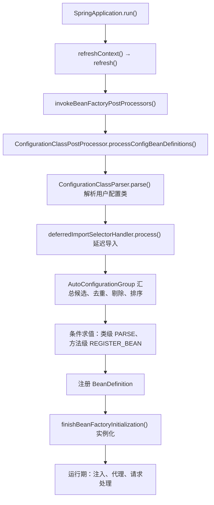
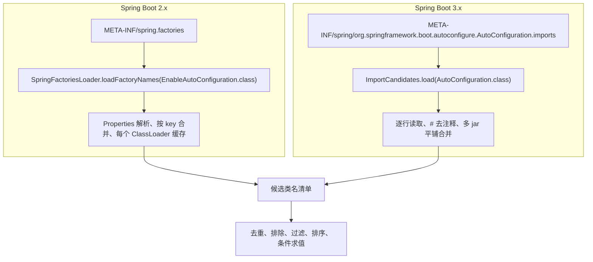
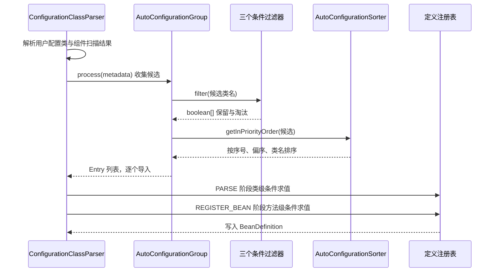
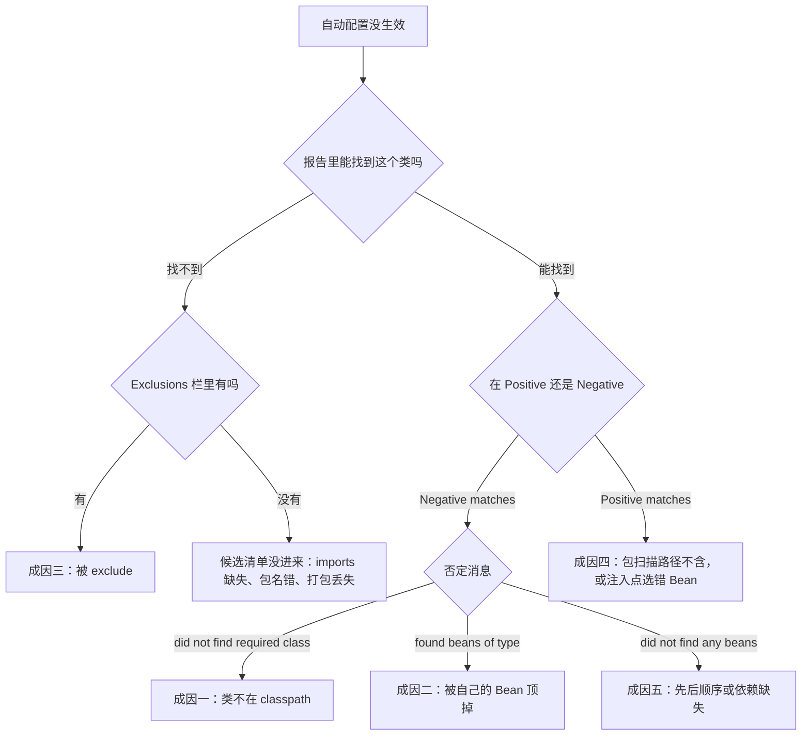

# 自动装配原理——@EnableAutoConfiguration与spring.factories

**摘要：**

Spring Boot 最出名的承诺是"引入一个 starter，对应的组件就能用"，但这条承诺的背后是一场发生在容器启动早期、任何 Bean 实例化之前的装配谈判：框架先列出全部候选自动配置类，再用三道闸门——导入过滤器、排序器、条件求值——把它们裁到当前工程真正需要的那几条，最后以普通 `BeanDefinition` 的身份注册进容器。本文只盯装配期这一段机制，先把 `@EnableAutoConfiguration` 经 `AutoConfigurationImportSelector` 拿到候选清单的链路拆开，讲清 3.x 的 `META-INF/spring/org.springframework.boot.autoconfigure.AutoConfiguration.imports` 为什么以及如何取代 2.x 的 `spring.factories`，再逐层拆解 `AutoConfigurationImportFilter` 的预判、排序注解的三级裁决、以及 `@Conditional` 为什么只能在 `ConfigurationClassPostProcessor` 阶段求值、因而永远看不到对象。后半程转向排查，把"自动配置没生效"拆成类不在 classpath、被自己的 Bean 顶掉、被 exclude、包扫描路径不含、条件求值先后五种成因，并给出 `--debug` 报告的四栏读法与 `ConditionEvaluationReport` 的编程式访问。标题里的 `spring.factories` 是 2.x 的注册入口，3.x 已由 imports 文件取代，这段迁移本身就是装配期演进史里最值得单独讲清的一节；读懂它，也就读懂了 Spring Boot 为什么能在不做任何显式配置的前提下，让容器里恰好出现该出现的那批 Bean。

---

## 第 1 章 自动装配究竟在解决什么问题

### 1.1 三份重复配置与一个失效的复用机制

设想一个订单服务，它要连 Redis 做购物车缓存，要序列化 `LocalDateTime`，还要一个数据源。在没有自动装配的年代，这三件事各对应一段配置：`RedisConnectionFactory` 与 `RedisTemplate` 的构造、`ObjectMapper` 上挂 `JavaTimeModule`、`DataSource` 与连接池参数的装配。这段配置会在十个工程里被复制十遍，复制之后开始各自漂移——一个工程给连接池配了超时，另一个没配；一个用 Lettuce，另一个换了 Jedis。漂移之后，任何一次依赖升级都变成考古。

Spring Framework 其实已经提供了复用手段：把配置类打成 jar，下游用 `@Import` 引入，或者让 `@ComponentScan` 扫到。但这套手段有一个结构性的缺口，被引入的配置类无法感知下游工程是否已经自己准备了同名组件。它可以硬写，后果是覆盖掉用户的定制；它可以不写，后果是用户的定制被绕过。自动装配补上的正是这一层协商语义：**在不被告知的情况下猜你需要什么，并且在你自己已经准备好的时候主动退让**。

这层协商分三段落地，彼此不可替代。版本对齐由 Maven 的 BOM 与 starter 的依赖聚合完成，属于构建期；默认配置由自动配置类里的 `@Bean` 方法提供，属于装配期；礼让机制由 `@Conditional` 家族承担，同样属于装配期。比较常见的误解是把三段混成一段，以为"引入 starter 就有 Bean"是依赖管理的结果，其实依赖只管把类放进 classpath，真正把类变成容器里对象的是装配期那一段代码。

### 1.2 装配期与运行期的分界

本文说的装配期，指 `AbstractApplicationContext.refresh()` 中 `invokeBeanFactoryPostProcessors` 到所有 `BeanDefinition` 注册完成这一段；运行期指此后的 Bean 实例化、属性注入、代理生成与请求处理。这个分界不是学术划分，它决定了哪些判断能写在条件里、哪些永远写不成。

装配期手里只有元数据：类名、注解、`BeanDefinition`、`Environment`、`BeanFactory` 的定义注册表。它没有对象。所有"按约定推断"的动作都在这个约束下完成，于是推断必须谨慎、必须可撤销、必须在用户已经表态时让位。一旦有人把"需要对象"的判断塞进装配期，比如在自定义 `Condition` 里 `getBean` 一个业务 Bean 来判断开关，得到的结果不是错，而是更麻烦的东西：那个 Bean 被提前实例化，绕过了后置处理器的时机，容器随后打印出 `is not eligible for getting processed by all BeanPostProcessors` 这类告警，而真正的装配语义已经被污染了。

### 1.3 贯穿案例：订单服务的两个症状

后文一直用同一组症状做靶子。订单服务 `order-service` 引入 `spring-boot-starter-web`、`spring-boot-starter-data-redis`、`spring-boot-starter-jdbc`，启动后出现两个问题。

症状 A 是静默的：开发同学在 `@Configuration` 里写了一个 `@Bean ObjectMapper`，只加了 `PropertyNamingStrategies.SNAKE_CASE`，结果接口里 `LocalDateTime` 字段的序列化直接抛 `InvalidDefinitionException: Java 8 date/time type java.time.LocalDateTime not supported by default`，`application.yml` 里的 `spring.jackson.date-format` 也一起失效。症状 B 是尖锐的：某个环境启动即失败，`NoSuchBeanDefinitionException: No qualifying bean of type 'org.springframework.data.redis.core.RedisTemplate'`。

一个静默、一个崩溃，恰好对应装配期的两类失败。前者是条件判错——自动配置"正确地"退让了，但退让之后没人补上默认配置；后者是候选或条件缺失——链路上某一环干脆没走到。后面的五种成因都能回到这两个症状上，读者不妨先记住它们。

---

## 第 2 章 装配期的骨架：从 refresh() 到 BeanDefinition

### 2.1 自动装配发生的准确位置

自动装配不在 `SpringApplication.run` 的显眼位置，它藏在一串后处理器里。`run()` 调用 `refreshContext()`，`refresh()` 在第 5 步 `invokeBeanFactoryPostProcessors(beanFactory)` 里依次执行 `BeanFactoryPostProcessor`，其中最关键的 `ConfigurationClassPostProcessor` 是个 `BeanDefinitionRegistryPostProcessor`。它负责解析配置类，解析过程中才发生自动配置的选择、过滤、排序与注册。这个后处理器的优先级取最低一档（`Ordered.LOWEST_PRECEDENCE`，以对应版本源码为准），用意是让其他"注册型"后处理器先把各自的候选配置类交上来，它最后统一处理。

由此可以得到一条贯穿全文的推论：装配期操作的是 `BeanFactory` 的**定义注册表**，`getBean` 在此阶段基本不发生。理解这一点，后面关于条件求值时机的所有困惑都会自行消解。



### 2.2 @EnableAutoConfiguration 的两个出口

`@EnableAutoConfiguration` 的源码只有三行有效信息：`@AutoConfigurationPackage`、`@Import(AutoConfigurationImportSelector.class)`，以及一个常量 `ENABLED_OVERRIDE_PROPERTY = "spring.boot.enableautoconfiguration"`。两个出口分工不同。

`@AutoConfigurationPackage` 通过 `ImportBeanDefinitionRegistrar` 把导入类所在的包登记成 `AutoConfigurationPackages` 的 base package，登记结果是一个可注入的 `BasePackages` Bean。它不做组件扫描，只提供一个"默认从哪儿找"的答案，供 JPA 找实体、供 MyBatis 找 Mapper 这类需要扫描起点的框架使用。

`@Import(AutoConfigurationImportSelector.class)` 才是自动配置的入口。另外一个不常被提到的事实是总开关：`isEnabled` 会读取 `spring.boot.enableautoconfiguration` 属性，默认 true；把它设成 false，整条自动装配链路直接返回空导入，候选、过滤、排序全部不发生。排查"到底是不是自动配置在作怪"时，这比列一长串 `exclude` 干净得多，测试里也很适合用它做对照组。

这个开关的实现里藏着一个陷阱，值得单独指出：`isEnabled` 只在本类被直接使用时才读属性，判断条件是 `getClass() == AutoConfigurationImportSelector.class`，一旦有人继承它做自定义选择器，这个方法会直接返回 true，属性开关随之**失效**。自研框架把自动配置选择器包装一层之后再想用 `spring.boot.enableautoconfiguration` 关掉全部自动配置，就会得到"配置写了、没反应"的结果，而这类失效既不报错也不进报告。要保住语义，子类必须自己覆写 `isEnabled` 并把父类逻辑抄回去。

base package 的登记同样有约定：默认取导入类所在的包，`@AutoConfigurationPackage` 也可以显式给出包或类的范围（属性名以对应版本文档为准）。它登记的是一个字符串列表，供 `AutoConfigurationPackages.get(beanFactory)` 取用，JPA 的 `EntityScanPackages`、MyBatis 的 Mapper 扫描都会读它。**注意它不等于组件扫描**，把类放进 base package 并不会让容器认识它，这条区分在 7.5 会出现两次。

`@SpringBootApplication` 是这三件事的打包：`@SpringBootConfiguration`、`@EnableAutoConfiguration`，以及一个带两个 `TypeExcludeFilter` 的 `@ComponentScan`。第二个过滤器 `AutoConfigurationExcludeFilter` 专门防止 imports 文件里登记的类又被组件扫描收编，它的判断条件是"这个类被 `@Configuration` 元注解过，并且要么被 `@AutoConfiguration` 注解，要么出现在 imports 候选清单里"。这条规则是第 7 章那个 `@Component` 反例的技术依据，此处先记下。

### 2.3 为什么必须延迟到用户配置解析之后

如果 `AutoConfigurationImportSelector` 只是一个普通 `ImportSelector`，`selectImports` 会在解析到 `@Import` 的那一刻被调用，而那一刻当前配置类之后的配置类尚未解析。后果不是性能问题，而是语义问题：自动配置的 `@Bean` 定义会先于用户定义进入注册表，`@ConditionalOnMissingBean` 于是会把"用户稍后要注册的 Bean"当成不存在，从而抢注一个同名同类型的默认实现。用户随后注册的 Bean 与它并存，注入点必须靠 `@Primary`、`@Qualifier` 或改名字才能消歧，而这类消歧一旦出现在框架内部，普通开发者几乎无法预测。

所以它实现的是 `DeferredImportSelector`，`selectImports` 被推迟到 `ConfigurationClassParser.parse` 的末尾，由 `deferredImportSelectorHandler.process()` 统一调度。此时所有普通 `@Configuration` 类、所有被 `@ComponentScan` 扫到的组件都已解析完毕，它们的 `BeanDefinition` 也已经在注册表里。用户配置优先的语义由此成立。

但延迟只解决"用户类先于自动配置类"，不解决"用户类之间"的先后，更不解决"两个自动配置类之间"的先后。后者由第 5 章的排序器负责，这是两件不同的机制，混为一谈是排查时最常见的思维误区。

### 2.4 AutoConfigurationGroup 汇总的三件事

延迟导入还带来一个技术问题：多个 `@EnableAutoConfiguration` 入口可能同时存在，比如主应用、测试切片、以及通过 `@ImportAutoConfiguration` 引入的局部配置，各自都会产出一份 `AutoConfigurationEntry`。`AutoConfigurationImportSelector.getImportGroup()` 返回的 `AutoConfigurationGroup` 就是用来收口的。

它的 `process` 方法把每个入口的结果并入 `entries`，用 `putIfAbsent` 按类名去重；`selectImports` 再把所有 entry 的配置并成一个 `LinkedHashSet`、合并全部排除项、剔除，然后交给 `AutoConfigurationSorter.getInPriorityOrder` 排序，最后以 `Entry` 列表交回解析器。三件事——去重、排除收敛、排序——都发生在这一个点上，它也是整条链路里唯一做排序的地方。

去重看似琐碎，实际很关键：同一个自动配置类被多个 jar 的 imports 文件同时声明，在生态里并不罕见（一个场景是某公司把 Boot 的某个自动配置复制进自家 starter 又保留了原依赖）。没有去重，同一个类会被重复当成候选处理一遍；解析器对同名配置类还有一层合并，所以重复通常不会变成两个 Bean，但解析、排序与事件通知的开销会翻倍，报告里也会出现重复条目，排查时误导性强。

---

## 第 3 章 候选清单的来源：imports 取代 spring.factories

### 3.1 2.x：SpringFactoriesLoader 的做法与代价

2.x 的候选清单来自 `SpringFactoriesLoader.loadFactoryNames(EnableAutoConfiguration.class, classLoader)`。它扫全类路径上的 `META-INF/spring.factories`，用 `Properties` 解析，把同一个 key 下的多个 value 用逗号拆开、按 key 合并到一个 `Map`，最后对每个 `ClassLoader` 缓存一份结果。

这套实现能用，代价也很具体。第一，语义混杂：同一个文件里装自动配置类、`ApplicationContextInitializer`、`ApplicationListener`、`EnvironmentPostProcessor`、`FailureAnalyzer`，一个 starter 作者要在别人的文件里追加自己的 key，合并规则全靠约定。第二，文件里没有条件信息，框架要判断"这条自动配置该不该装"，必须再读一遍类元数据，于是额外生成了 `META-INF/spring-autoconfigure-metadata.properties` 来补位。第三，构建期工具（AOT 处理、Native Image 的静态分析）要从一个 key-value 大文件里精确取出"自动配置类"这一类条目，比读一份行式清单麻烦得多。

### 3.2 3.x：ImportCandidates 的路径派生与行式格式

3.x 把自动配置类单独搬进一个文件，路径由注解全限定名派生而来。`ImportCandidates` 里写死了模板 `META-INF/spring/%s.imports`，把 `AutoConfiguration` 的全限定名填进去，就得到本文反复提到的那个长路径。读取方式也简单了：`classLoader.getResources` 拿到所有 jar 里的同名文件，逐行读，去掉 `#` 之后的注释，`trim` 后跳过空行，每行一个全限定类名，不解析 key，也不要求顺序。

格式的简化并非只为好看。行式清单让"平铺合并"成为默认行为——不同 jar 的条目天然拼成一个列表，不需要约定谁会覆盖谁；`#` 注释让清单可以分区标注来源；而缺省顺序意味着顺序完全交给排序器，文件作者的书写习惯不会影响装配结果。

清单为空时，`getCandidateConfigurations` 会用一个 `Assert.state` 直接失败，报错信息把期望的路径写全了：`No auto configuration classes found in META-INF/spring/org.springframework.boot.autoconfigure.AutoConfiguration.imports`。这条信息在自研 starter 或自定义 `@EnableXxx` 变体里出现的概率远高于主应用，因为主应用只要引入 `spring-boot-autoconfigure` 就一定有清单。

自己造一个入口注解时，路径会随注解全限定名变化。`AutoConfigurationImportSelector` 内部有一个包级可见的构造器接收注解类，包外的子类拿不到它，能动的只有覆写：

```java
// 包外自定义变体：候选清单与属性读取都指向自己的注解
public class MyImportSelector extends AutoConfigurationImportSelector {

    @Override
    protected List<String> getCandidateConfigurations(AnnotationMetadata metadata,
            AnnotationAttributes attributes) {
        // 读取 META-INF/spring/<MyEnableAutoConfiguration 全限定名>.imports
        return ImportCandidates.load(MyEnableAutoConfiguration.class, getBeanClassLoader()).getCandidates();
    }

    @Override
    protected Class<?> getAnnotationClass() {
        // getAttributes 依赖它读取 exclude / excludeName，漏了会抛找不到属性的断言
        return MyEnableAutoConfiguration.class;
    }
}
```

两个覆写要成对出现，只改候选清单不改 `getAnnotationClass`，`getAttributes` 会在启动时抛 `No auto-configuration attributes found`，因为它在按 `EnableAutoConfiguration` 找属性，而你的注解上并没有那份属性。这类错误消息指向的是注解，根因却在选择器，属于"报错位置与根因错位"的典型。

### 3.3 迁移的时间线与硬边界

迁移分两步。2.7 引入 imports 文件，同时保留 `spring.factories` 的读取，属于双读兼容期，新写法成为推荐。3.0 只读 imports，`spring.factories` 里的 `EnableAutoConfiguration` 键不再被读取。所谓"不再被读取"有一个容易被忽略的细节：文件本身仍然会被其他 SPI 读取，所以文件合法、条目合法、没有警告、没有异常，只是没人再看那一条。

判断一个第三方 starter 是否完成了迁移，看它的 jar 里有没有 imports 文件就够，不用猜版本。更进一步的证据可以从 Boot 自己的发布包里取：3.5 的 `spring-boot-autoconfigure` 的 `spring.factories` 里已经没有 `org.springframework.boot.autoconfigure.EnableAutoConfiguration` 键，但仍然保留着 `AutoConfigurationImportFilter`、`AutoConfigurationImportListener`、`FailureAnalyzer`、`TemplateAvailabilityProvider`、`ApplicationContextInitializer` 等一批键。也就是说，spring.factories 作为一个通用 SPI 注册表继续存在，被迁走的只有"自动配置类清单"这一项。

| 维度 | 2.x（2.7 为兼容期） | 3.x |
| --- | --- | --- |
| 注册文件 | `META-INF/spring.factories`，key 为 `EnableAutoConfiguration` 全限定名 | `META-INF/spring/org.springframework.boot.autoconfigure.AutoConfiguration.imports` |
| 文件格式 | Properties，key-value，逗号分隔多值 | 行式，每行一个类名，`#` 注释 |
| 读取器 | `SpringFactoriesLoader.loadFactoryNames` | `ImportCandidates.load` |
| 标注注解 | `@Configuration` | `@AutoConfiguration`（`proxyBeanMethods = false`） |
| 排序声明 | 独立的 `@AutoConfigureBefore` / `@AutoConfigureAfter` | `@AutoConfiguration` 的 `before` / `after` 属性，独立注解仍可用 |
| 语言基线 | Java 8 | Java 17 |
| 命名空间 | `javax.*` | `jakarta.*` |
| 清单为空 | 静默得到空列表 | `Assert` 失败并给出期望路径 |
| 其他 SPI 键 | 正常 | 正常，未迁移 |

### 3.4 spring.factories 没有消失，只是不再登记自动配置类

这个区分值得单独强调，因为它是"3.x 里到底该不该保留 spring.factories"这个问题的一半答案。3.5 的 `spring-boot-autoconfigure` 仍在用它登记 `ApplicationContextInitializer`（其中就有第 8 章要讲的 `ConditionEvaluationReportLoggingListener`）、`AutoConfigurationImportFilter`（三个条件过滤器）、`AutoConfigurationImportListener`、`FailureAnalyzer`、`TemplateAvailabilityProvider`。自定义 starter 若提供 `EnvironmentPostProcessor` 或自定义 `FailureAnalyzer`，这些条目仍然必须写在 `spring.factories` 里。

所以正确的迁移动作不是"删掉 spring.factories"，而是"把自动配置类从 spring.factories 挪到 imports 文件，其他键原地保留"。把整个文件删掉会造成另一类故障：某个 `EnvironmentPostProcessor` 没被注册，配置在极早期就不完整，而报错会出现在离它很远的地方。

### 3.5 类名替换表与模块搬迁

3.5 在候选处理链路里还加了一层 `AutoConfigurationReplacements`：在排除校验、排序、以及过滤之前，按一张映射表把旧类名替换成新类名。它的用途是兼容自动配置类在模块之间搬迁造成的旧类名引用——一个工程在 `exclude` 里写的老类名，或者某个 starter 的 `after` 指向的老类名，不必因为类搬了家就立刻失效。映射表的资源位置与格式随版本演进，具体以对应版本文档或源码为准。

这层替换本身不改变装配语义，但它提醒一件事：自动配置的**类名**也是公开契约的一部分。团队在做模块拆分时，若打算搬动自动配置类的包，需要同时维护替换表，否则下游的 `exclude` 会从"生效"变成"静默无效"——这正是 7.3 里提到的静默路径之一。



---

## 第 4 章 过滤链：三道闸门与一次预判

### 4.1 getAutoConfigurationEntry 的七步裁剪

候选清单拿到之后并不直接注册，`getAutoConfigurationEntry` 先做一轮裁剪，七步的顺序不是随手排的。

```java
protected AutoConfigurationEntry getAutoConfigurationEntry(AnnotationMetadata annotationMetadata) {
    if (!isEnabled(annotationMetadata)) {                 // ① 总开关 spring.boot.enableautoconfiguration
        return EMPTY_ENTRY;
    }
    AnnotationAttributes attributes = getAttributes(annotationMetadata);
    List<String> configurations = getCandidateConfigurations(annotationMetadata, attributes); // ② 读 imports，合并全部 jar
    configurations = removeDuplicates(configurations);    // ③ 按类名去重，保持首次出现的顺序
    Set<String> exclusions = getExclusions(annotationMetadata, attributes); // ④ 注解 exclude/excludeName + 属性
    checkExcludedClasses(configurations, exclusions);     // ⑤ 排除项必须是真实存在的自动配置类
    configurations.removeAll(exclusions);
    configurations = getConfigurationClassFilter().filter(configurations);  // ⑥ 提前过滤，不加载类
    fireAutoConfigurationImportEvents(configurations, exclusions);          // ⑦ 通知监听器，报告据此记录
    return new AutoConfigurationEntry(configurations, exclusions);
}
```

这个顺序有几处必须如此。去重放在排除校验之前，因为校验判断的是"候选集合里有没有这个类"，重复项会干扰语义。排除放在过滤之前，因为被排除的类不该再参与条件求值，否则报告里会同时出现"你排除了它"和"它条件不满足"两条互相矛盾的信息。过滤放在排序之前，因为排序要为每个候选读一次 ASM 元数据，先把集合裁小能省掉大量 IO。事件放在最后，保证监听器看到的是最终候选，`ConditionEvaluationReport` 里的排除项与无条件类清单正是从这次事件写入的。

### 4.2 提前过滤靠的不是类文件，而是编译期元数据

`getConfigurationClassFilter()` 构造时加载 `META-INF/spring-autoconfigure-metadata.properties`。这个文件由 `spring-boot-autoconfigure-processor` 在编译期生成，内容形如 `类名.ConditionalOnClass=类名列表`、`类名.AutoConfigureAfter=...`、`类名.AutoConfigureOrder=...`。有了它，过滤器只看字符串就能判断"该自动配置要求的类在不在 classpath 上"，根本不用加载自动配置类本身。

`OnClassCondition` 的实现里还有一个值得注意的优化：当候选数量大于 1 且处理器多于一个时，它把一半的工作交给一个后台线程，然后 `join` 等结果。源码注释写得很克制——只加一个线程收益最好，线程更多反而更差，因为判断本身是轻量的类存在性检查，瓶颈在同步开销上。这类细节通常不会出现在文档里，但它解释了为什么启动时能看到"条件求值只花了十几毫秒"。

没有这批元数据时，`getOutcomes` 返回 null，过滤器什么都不判，把判断完整留给后续的条件求值。源码注释的原话是"后面还有一次机会"。这条回退路径保证了正确性：元数据只可能**漏判**（该淘汰的没淘汰），不可能**误判**（把该留的淘汰掉）。自研 starter 加不加 `spring-boot-autoconfigure-processor`，差别就在这几十毫秒里，而不是正确性。

```xml
<!-- 只参与编译期生成，用 optional 避免它进入下游的运行时依赖 -->
<dependency>
    <groupId>org.springframework.boot</groupId>
    <artifactId>spring-boot-autoconfigure-processor</artifactId>
    <optional>true</optional>
</dependency>
```

不少自研 starter 漏了这一行，功能上完全看不出来，只是每次启动都要把几十个候选完整求值一遍。要不要补，取决于这个 starter 会不会被装进大量应用、以及应用对启动时长是否敏感；一个内部工具库不值得为此增加构建复杂度，一个要在几百个 Pod 里滚动发布的公共组件则值得。

`FilteringSpringBootCondition.match` 里还有一层容易被忽略的设计：它不只在返回值里给出淘汰结论，还把否定结论写进了 `ConditionEvaluationReport`。也就是说，被提前过滤掉的类仍会出现在报告的 Negative matches 里，并带上 `(OnClassCondition)` 这样的来源标注。这解释了为什么很多"类不在 classpath"的故障，报告里能直接看到原因，而不是一片空白。

### 4.3 三道闸门各自能判什么、判不了什么

三道闸门由 `spring.factories` 的 `AutoConfigurationImportFilter` 键注册，实现是 `OnBeanCondition`、`OnClassCondition`、`OnWebApplicationCondition`，它们都继承 `FilteringSpringBootCondition`，从而同时是 `Condition` 与 `AutoConfigurationImportFilter`。

`OnClassCondition` 判类存在性，值是 `@ConditionalOnClass` / `@ConditionalOnMissingClass` 的字符串数组，判的时候走 `Class.forName(name, false, classLoader)`，只加载不初始化，所以不会触发静态块。

`OnBeanCondition` 在过滤期只能覆盖 `@ConditionalOnBean` 与 `@ConditionalOnSingleCandidate`，而且判的是"这个类型在 classpath 上有没有"，本质上仍是类存在性检查换了个来源。`@ConditionalOnMissingBean` 不在其中，原因很硬：过滤发生时，注册表里连自动配置类的 `@Bean` 定义都还没进去，谈"有没有同类 Bean"毫无意义。这个缺席直接导致一个常见误读——把 `@ConditionalOnMissingBean` 当成"和 `@ConditionalOnClass` 同级的早期判断"，实际它是三类判断里最晚的一种。

`OnWebApplicationCondition` 判容器类型，依据 `WebApplicationType` 的推断结果与 `spring.main.web-application-type` 配置项，测试里换一种 ApplicationContext 就会改变结论。

| 判断层 | 触发位置 | 可见数据 | 是否加载类 | 能覆盖的条件 |
| --- | --- | --- | --- | --- |
| 提前过滤 | `ConfigurationClassFilter.filter` | 候选类名 + `spring-autoconfigure-metadata.properties` | 否 | `OnClass`、`OnBean` 的类存在性部分、`OnWebApplication` |
| 解析期 | `ConfigurationClassParser.processConfigurationClass` | 类元数据、`Environment`、已注册定义 | 按需（ASM 为主） | 普通 `Condition`（非 `ConfigurationCondition`） |
| 注册期 | `ConfigurationClassBeanDefinitionReader` | `BeanDefinition` 注册表全集 | 是（要解析 `@Bean` 方法） | `ConfigurationCondition` 的 `REGISTER_BEAN` 型 |

### 4.4 排除名单的三条来源与校验异常

排除有三条来源：`@EnableAutoConfiguration(exclude = ...)` 的类字面量、`excludeName` 的字符串、以及配置项 `spring.autoconfigure.exclude`。第三条通过 `Binder` 绑定成 `String[]`，所以 YAML 列表、逗号分隔、占位符都能用；它是唯一能在不改代码的前提下生效的一条。测试通道另有 `@SpringBootTest(excludeAutoConfiguration = ...)` 与测试切片自带的排除，这些在设计排查方案时要一并搜。

`checkExcludedClasses` 做了一件容易被低估的事：逐个检查排除项的类在 classpath 上是否存在、是否出现在候选清单里，若存在却不在清单中，直接抛 `IllegalStateException`，消息是 `The following classes could not be excluded because they are not auto-configuration classes`。这条校验的价值在于把"我以为我排除了它"提前变成启动失败，因为排除一个不存在的自动配置类通常意味着类名拼错、版本对不上，或者那个类根本不是自动配置类。

但校验有一个前提：类必须在 classpath 上。若类根本不存在，校验无从判断，排除项被静默忽略。于是"写了一行排除、现象毫无变化"这种诡异情况有了第一个解释，第 7 章还会给另外两个。

---

## 第 5 章 排序：顺序本身就是语义

### 5.1 三级排序的实现

`AutoConfigurationSorter.getInPriorityOrder` 分三步。先复制一份候选并按类名排序，得到字母序的基准；再按 `@AutoConfigureOrder` 的值稳定排序，缺省值取 `AutoConfigureOrder.DEFAULT_ORDER`；最后按 `@AutoConfigureBefore` / `@AutoConfigureAfter` 做一次深度优先的拓扑排序，`processing` 集合负责检测环，命中环时通过 `Assert.state` 抛出 `IllegalStateException`，消息形如 `AutoConfigure cycle detected between A and B`。

环检测不是防御性代码，而是必需品。装配期的顺序依赖一旦成环，就没有"运行期重试"这种兜底手段，只能让启动失败，把矛盾暴露给写标注的人。相比之下，一个静默的任意顺序会让装配结果随类名变动而漂移，那才是最难查的故障——笔者见过的最难定位的一次启动异常，根因就是两个第三方自动配置在字典序上恰好与预期相反，而双方都没有声明任何顺序。

排序读的是 ASM 元数据，`AutoConfigurationClass` 用 `MetadataReaderFactory` 读类文件，读不到就视为该类的依赖关系不可解析。还有一处容易被忽略：排序的输入是**过滤后的候选清单**，不是"最终通过条件的类"。因此排序器会为一堆最终不会装配的类计算顺序，这不影响正确性，但意味着报告里相邻两行的先后关系不具备因果意义。

### 5.2 before/after 的属性设计与元注解限制

3.x 的 `@AutoConfiguration` 是 `@Configuration(proxyBeanMethods = false)` 加 `@AutoConfigureBefore` 加 `@AutoConfigureAfter` 的组合，自己带 `value`、`before`、`after`、`beforeName`、`afterName` 五个属性，但并不包含 `@AutoConfigureOrder`——要调整全局序号仍需单独标注。

`before()` 与 `beforeName()` 并存的原因写在注解的文档里，而且理由相当具体：`before()` 收的是 `Class` 字面量，注解值在字节码里只是类型描述符，解析时不需要加载该类，所以可以安全地写一个"最终可能不在 classpath 上"的类；一旦 `@AutoConfiguration` 被当作元注解组合进自定义注解，属性合并的路径会去解析类值，指向不存在的类就有失败风险，于是官方要求元注解场景改用 `beforeName()` 字符串。这个细节对写 starter 的人很实用：自定义组合注解不是"把属性抄一遍"那么简单。

### 5.3 循环依赖与"排序只影响定义注册"

排序决定的是 `ConfigurationClassParser` 与 `ConfigurationClassBeanDefinitionReader` 处理这些配置类的先后，也就是 `BeanDefinition` 进入注册表的顺序。它不决定实例化顺序——实例化顺序由依赖图、`@DependsOn`、`@Lazy` 与初始化回调共同决定，两者是两套机制。

但它会通过一个后门影响实例集合：`@ConditionalOnMissingBean` 在注册期求值，看的就是当时注册表里有什么。前一个配置类先注册了同类型的 Bean，后一个配置类的条件就判否。所以排序虽然只安排"定义注册"的次序，最终却决定了"哪些定义被注册"。这是排序被称作语义而非优化手段的原因，也是 7.5 那个成因的机理。

### 5.4 排序能保证什么、不能保证什么

| 排序手段 | 作用范围 | 读取者 | 不解决的问题 |
| --- | --- | --- | --- |
| 类名字典序 | 兜底，保证同一候选集合下结果确定 | `AutoConfigurationSorter` | 不表达任何依赖意图 |
| `@AutoConfigureOrder` | 候选之间的全局粗排 | `AutoConfigurationSorter` | 不处理 `@Configuration` 用户类 |
| `before` / `after` | 候选之间的偏序 | `AutoConfigurationSorter` | 指向的类不在候选清单时只作参考 |
| `@Order` / `@Priority` | 用户配置类之间的先后 | Spring 的配置类排序 | 不影响自动配置类的相对顺序 |

能保证的是：同一份候选清单、同一版本依赖、同一台机器上，装配结果稳定可复现，顺序由"序号、偏序、类名"三级兜底决定。不能保证的是三件事：普通 `@Configuration` 用户类不受 `@AutoConfigureOrder` 约束；`before`/`after` 指向的类如果不在候选清单里，只在排序时作为参考节点，最终会被 `retainAll` 剔掉；`@ConditionalOnMissingBean` 所依赖的那个 Bean 若来自用户配置类而不是自动配置，排序注解完全无能为力。

现实中的典型例子是各类"消费 `DataSource`"的自动配置，它们必须声明自己排在 `DataSourceAutoConfiguration` 之后，否则数据源定义还没进注册表，条件与注入都会出错；MyBatis 的 spring-boot starter 就是这么写的（版本差异以对应版本源码为准）。而自定义的自动配置类往往在包名上占便宜——`com.acme.order` 字典序小于 `org.springframework.boot`——于是默认排在官方类之前。这个细节在 7.5 会以故障形式再出现一次。

---

## 第 6 章 条件求值的时机：为什么条件里拿不到对象

### 6.1 三个求值舞台

`@Conditional` 不是"在需要时求值一次"，它在装配期有两个正式舞台，加上第 4 章的过滤期，一共三个位置，各自能看到的数据完全不同。

过滤期只有类名与编译期元数据，连 `BeanFactory` 都没被用来判断。解析期在 `ConfigurationClassParser.processConfigurationClass` 里，通过 `conditionEvaluator.shouldSkip(metadata, ConfigurationPhase.PARSE_CONFIGURATION)` 判断整个配置类是否跳过。注册期在 `ConfigurationClassBeanDefinitionReader` 里注册 `@Bean` 方法时，逐个方法调用 `shouldSkip(metadata, REGISTER_BEAN)`。

三个阶段有一个共同点：**都没有对象**。区别只在于"定义看得到多少"——过滤期看不到定义，解析期看到的是截至目前已注册的定义，注册期看到的是全部已解析配置类的定义。所谓"条件判断对象还没准备好"，准确说法是"条件判断的定义还没齐"。

### 6.2 ConfigurationCondition 与 shouldSkip 的分流

`ConfigurationCondition` 接口只比 `Condition` 多一个方法，`getConfigurationPhase()`，返回 `PARSE_CONFIGURATION` 或 `REGISTER_BEAN`。`ConditionEvaluator.shouldSkip` 遇到阶段不匹配的条件会直接跳过它，把判断留给对应的阶段。这条分流规则是理解条件时机差异的钥匙。

`OnBeanCondition` 实现了 `ConfigurationCondition`，阶段是 `REGISTER_BEAN`。所以类上写 `@ConditionalOnMissingBean` 时，解析期必须先放过它，等到注册期再判；而 `@ConditionalOnClass`、`@ConditionalOnProperty` 的实现是普通 `Condition`，解析期就会求值，求值不通过，整个配置类连同里面的 `@Bean` 方法一起不注册。注册期这一侧的类级判断在读取阶段完成：`ConfigurationClassBeanDefinitionReader` 用一个 `TrackedConditionEvaluator` 补做 `REGISTER_BEAN` 型条件，并顺着 `importedBy` 链向上逐级判断，整类被跳过时会连已注册的配置类定义一起撤销。

两个阶段不能混着用，Spring Framework 6.2 起甚至会直接报错：一个配置类若同时带 `@ComponentScan` 与 `REGISTER_BEAN` 型条件，容器抛 `ApplicationContextException`，消息写明组件扫描不能与注册期条件共用。原因很直白，扫描发生在解析期，而条件要到注册期才有结论，框架宁可在启动时把矛盾摆出来，也不接受一个时松时紧的扫描范围。

由此可以解释一个常见困惑：为什么同一个自动配置类里，类级的 `@ConditionalOnClass` 不满足时，报告里连它的 `@Bean` 方法都不出现？因为类在解析期就被整体跳过了，方法级条件根本没有机会求值。

### 6.3 @ConditionalOnMissingBean 只看得到定义

`OnBeanCondition` 的判定路径值得逐句读。它从 `ConditionContext` 取 `ConfigurableListableBeanFactory`，对每个待查类型调用 `getBeanNamesForType(type, true, false)`——第二个参数允许非单例，第三个参数 `allowEagerInit` 为 false，意味着**只查定义，不实例化**。拿到名字后再按 `autowireCandidate`、`defaultCandidate` 过滤，剔除 `scopedTarget` 之类的内部名，最后按 `SearchStrategy` 合并，默认是 `ALL`，即包含父容器。

这段代码揭示了三个直接后果。第一，它能看到"稍后才被实例化"的定义，但看不到"还没被注册"的定义，于是顺序敏感。第二，`@Bean(autowireCandidate = false)` 或 `defaultCandidate = false` 的 Bean 对条件是隐形的，自动配置照装，你以为覆盖了其实并存。第三，父容器里同类型的 Bean 会让子容器的自动配置退让，多上下文结构的工程要留意这条。

`allowEagerInit` 传 false 不是随手的选择。为 true 时，`getBeanNamesForType` 为了推断 `FactoryBean` 的产品类型，会先创建 `FactoryBean` 实例再调 `getObjectType()`，这在装配期等于提前实例化，既可能打乱后置处理器的时序，也可能因为环境尚未就绪而失败；传 false 就把这类"必须先造对象才知道类型"的 Bean 排除在判断之外，宁可漏判也不误伤。

顺带说清 `@ConditionalOnSingleCandidate` 与它同源但语义更严：它不是"有没有"，而是"有且只有一个候选"。容器里有两个 `DataSource` 时它判否，`JdbcTemplate`、`JpaTransactionManager` 这一类依赖"唯一数据源"的自动配置会整体不装，这正是多数据源工程最常见的启动现象。它的判定还认 `@Primary` 与非 fallback 标记，两个候选里若恰好有一个 `@Primary`，条件仍成立——所以多数据源工程的通行做法是给主数据源加 `@Primary`，而不是逐个排除官方自动配置。

官方文档对这个条件的措辞比代码更直白：它只能匹配到"目前已经被容器处理过的 Bean 定义"，因此强烈建议只在自动配置类上使用；如果候选 Bean 可能由另一个自动配置创建，必须保证使用该条件的那个排在后面。这句话把第 5 章与本章接上了——排序不是锦上添花，而是条件正确性的前提。

### 6.4 由此推出的四条约束

第一条，不要在业务 `@Component`、`@Service` 上用 `@ConditionalOnMissingBean`。这个条件的语义是"自动配置礼让用户"，方向必须是自动配置在判断、用户在声明；反过来写在用户类上，就变成"用户礼让自动配置"，而用户类之间的先后不受 `@AutoConfigureOrder` 保护，结果只能靠包名与文件顺序碰运气。

第二条，跨自动配置的条件依赖必须显式声明顺序。源码里看起来"更基础"的类并不因此先注册，字典序才是默认裁决者。

第三条，条件里不能依赖实例。譬如在自定义 `Condition` 里 `getBean`，就会触发提前实例化，该 Bean 拿不到完整的后置处理器链，容器会打印 `is not eligible for getting processed by all BeanPostProcessors` 告警；更隐蔽的后果是代理没生成，注入点拿到的是原始对象。

第四条，需要"运行时有没有这个 Bean"时，改用运行期手段：注入 `ObjectProvider<T>`，或者实现 `ApplicationContextAware` 后用 `getBeanNamesForType` 在启动末尾判断，或者干脆用 `SmartInitializingSingleton`。

### 6.5 条件里可以可靠依赖什么

`Environment` 是最可靠的：此阶段 profile 已激活、`application.yml` 与配置中心扩展写入的属性源都已就位，`@ConditionalOnProperty` 所以稳定。类路径次之，`ClassUtils.isPresent` 走的是只加载不初始化的路径。再次是 `BeanFactory` 的注册表，能读定义、名字、注解与 `BeanDefinition` 元信息，读不到实例。

| 求值阶段 | 能读到 | 读不到 | 典型条件 |
| --- | --- | --- | --- |
| 提前过滤 | 候选类名、编译期元数据 | 任何 Bean 定义 | `@ConditionalOnClass` 的类存在性、`@ConditionalOnWebApplication` |
| 解析期 | 类元数据、`Environment`、部分已注册定义 | 全量定义、实例 | `@ConditionalOnClass`、`@ConditionalOnProperty`、`@Profile` |
| 注册期 | 全量 `BeanDefinition`、`Environment` | 除已注册单例外的实例 | `@ConditionalOnMissingBean`、`@ConditionalOnSingleCandidate` |



---

## 第 7 章 自动配置没生效的五种成因

### 7.1 排查的三段论

先定位问题落在哪一段，再谈成因，可以少走很多弯路。第一段看候选：报告里能不能找到这个类名，找不到说明它没进候选清单，问题在 imports 文件、包名或打包。第二段看过滤与条件：类名出现但落在 Negative matches，说明候选进来了、被判否，问题在条件本身。第三段看结果：类名在 Positive matches 里却"没起作用"，说明自动配置装上了，问题在你的覆盖方式或注入点。

这三段对应三种完全不同的处置，混在一起会得出错误结论，比如把"类不在 classpath"当成"条件写错了"去改条件。

### 7.2 成因一：类不在 classpath 上

症状就是订单服务的症状 B：`NoSuchBeanDefinitionException`，且在依赖注入点爆炸。报告里的典型行是 `- @ConditionalOnClass did not find required class 'org.springframework.data.redis.core.RedisOperations' (OnClassCondition)`。

三个高频变体。第一个是依赖范围写错：`optional` 与 `provided` 的传递依赖在运行时不在 classpath 上，starter 里这种做法很常见，但下游工程若直接依赖某个库而非 starter，就会缺类。第二个是 Jakarta 命名空间错配：3.x 的自动配置引用 `jakarta.servlet.*`，2.x 时代的第三方 starter 引用 `javax.servlet.*`，后者在 Boot 3 的 classpath 上不存在，条件判否，整套自动配置静默失效，直到某个注入点撑不住才报错。第三个是 exclusions 打穿了 starter 的核心依赖：为了换 Redis 客户端在依赖里排掉 `lettuce-core` 却没引入 `jedis`，`RedisConnectionFactory` 便没有任何实现，`RedisAutoConfiguration` 里那两个带 `@ConditionalOnSingleCandidate(RedisConnectionFactory.class)` 的 `@Bean` 方法随之全部判否，`RedisTemplate` 消失——这条链路上的三跳，在报告里能一眼看全。

判据是 `dependency:tree` 加 `jar tf`：确认类在不在、由谁提供。处置是补依赖或换回 starter，而不是调条件。

### 7.3 成因二：被自己的 Bean 顶掉，或者根本没顶掉

这个成因有两个方向，症状完全相反，混在一起是排查效率最低的做法。

方向一，顶掉了但你不想要。`@ConditionalOnMissingBean` 的语义是"容器里没有该类型（或该名字）的 Bean 才装配"，你在配置类里定义了 `@Bean ObjectMapper`，`JacksonAutoConfiguration` 里那个带 `@ConditionalOnMissingBean` 的 `ObjectMapper` 就退让。退让本身没有错，错在这份默认配置的能力挂在另一个 Bean 上：Boot 提供的 `Jackson2ObjectMapperBuilder` 才是注册默认模块（含 `JavaTimeModule`）、应用 `spring.jackson.*` 配置的入口，你在自己的配置类里 `new ObjectMapper()`，那个 builder 便无人使用，默认配置一项都补不上，于是 `LocalDateTime` 直接抛 `InvalidDefinitionException`，`date-format` 也形同虚设。这就是订单服务的症状 A。处置不是去调 `@Conditional`，而是改用 `Jackson2ObjectMapperBuilderCustomizer` 做增量定制，或者注入 builder 来构建。

方向二，没顶掉，变成两个。`RedisAutoConfiguration` 的 `redisTemplate` 方法用的是名字条件 `@ConditionalOnMissingBean(name = "redisTemplate")`，你定义了一个叫 `orderRedisTemplate` 的 Bean，名字对不上，自动配置照装，容器里于是有两个 `RedisTemplate`，按类型注入的地方报 `NoUniqueBeanDefinitionException`。名字条件的用意是允许"同类型多实例"的合法场景，代价是对覆盖行为的要求更严格：想顶掉它，Bean 名必须叫 `redisTemplate`。

还有第三种更隐蔽的情形：`@Bean(autowireCandidate = false)` 或 `defaultCandidate = false` 的定义对条件不可见，自动配置照装，你以为覆盖了其实并存，而且这种并存连 `NoUniqueBeanDefinitionException` 都不会给，直到某个按类型注入的点先命中你的 Bean、后命中框架的 Bean，行为随注入点漂移。报告里的证据长这样：`- @ConditionalOnMissingBean (types: com.acme.order.OrderObjectMapper; SearchStrategy: all) found beans of type 'com.acme.order.OrderObjectMapper' orderObjectMapper (OnBeanCondition)`。

### 7.4 成因三：被 exclude 掉

三条来源在第 4 章已经列过，这里只补两个排查要点。

第一，被排除的类**不会出现在 Negative matches 里**，它出现在 Exclusions 栏。理由很简单：排除发生在条件求值之前，被排除的类根本没有进入条件求值的名单。这一点极容易误判——报告里既没有它在 Positive 也没有在 Negative，如果不去看 Exclusions，就会得出"报告里没提它，说明它没问题"的错误结论。而如果连 Exclusions 里也没有，那就要往下一段走：它可能连候选清单都没进。

第二，排除项静默失效的三种情形：类名拼错、类不在 classpath、类根本不是自动配置类。第三种在类存在时会抛校验异常，前两种则完全静默。分环境配置里藏一行 `spring.autoconfigure.exclude` 也是常见来源，搜的时候要连 `application-*.yml`、配置中心的远端配置一起搜。

### 7.5 成因四：包扫描路径不含

这里有两条不同的"包"容易被混为一谈：组件扫描根（`@SpringBootApplication` 所在包，或 `scanBasePackages` 指定的包），以及 `@AutoConfigurationPackage` 登记的 base package（供 JPA 找实体、供 MyBatis 找 Mapper）。前者决定你的类能不能进容器，后者决定框架能不能找到你的领域对象。

第一条路径上的症状是"我以为我覆盖了，其实没有"。把 `@Configuration` 放在扫描根之外的同级包里，它不会被注册；自动配置的 `@ConditionalOnMissingBean` 于是判定"用户没有"，照常装配默认实现。你改的文件没错，条件也没错，只是那个类从未参与装配。第二条路径上的症状更直白：实体类不在 base package 之下，`LocalContainerEntityManagerFactoryBean` 不扫它，启动时报 `Not a managed type`；MyBatis 的 `@MapperScan` 配错包时同理。

判据是 `AutoConfigurationPackages.get(beanFactory)` 返回的包列表，把它和你以为的包比一比就清楚了。处置是把启动类放到根包，或者用 `@EntityScan`、`@MapperScan` 显式指定扫描范围，而不是靠移动代码来迁就注释。

### 7.6 成因五：条件求值的先后

两个自动配置类都注册同类型的 Bean 时，谁先注册，后者的 `@ConditionalOnMissingBean` 就判否。前提是两者之间没有任何顺序声明，而候选清单的默认裁决是类名字典序。

这里有一个与直觉相反的事实：自定义自动配置类的包名通常是 `com.` 或 `cn.` 开头，字典序小于 `org.springframework.boot.`，于是默认排在官方类之前。也就是说，"我的自动配置先注册、官方自动配置退让"是默认行为，而不是需要刻意制造的例外。典型场景是自研的 `OrderJdbcAutoConfiguration` 注册了一个 `JdbcTemplate`，官方 `JdbcTemplateAutoConfiguration` 里带 `@ConditionalOnMissingBean(JdbcOperations.class)` 的 `@Bean` 就此判否，`spring.jdbc.template.*` 下的超时、fetch size 配置全部失效——自动配置确实生效了，只是生效的是你那份没有默认配置的实现。

报告里的证据是 `- @ConditionalOnMissingBean (types: org.springframework.jdbc.core.JdbcOperations; SearchStrategy: all) found beans of type 'org.springframework.jdbc.core.JdbcTemplate' orderJdbcTemplate (OnBeanCondition)` 这样的行：条件判否的原因写得很清楚，但报告不告诉你"对方为什么先注册"。要拿到后者，只能读排序注解或自己算字典序。

处置有三条：给"应该优先的一方"声明 `before`，让礼让方向回到设计意图；不能改源码时用 `spring.autoconfigure.exclude` 排掉一方，把控制权收到自己手里；或者把自研那份改成显式 `@Configuration`，脱离装配期排序，改用普通的 Bean 覆盖规则。

### 7.7 三个反例

第一个反例是把 `spring.factories` 当成 3.x 的写法。文件合法、条目合法、没有警告、没有异常，症状就是"什么都没有发生"。3.x 的 `AutoConfigurationImportSelector` 不再读那个 key，`SpringFactoriesLoader` 仍然能读它，只是没人调用。判据是打开 jar 看有没有 imports 文件；报告里既不会出现这个类名，也不会出现在 Exclusions。修正动作是把类挪进 imports 文件，并且把注解从 `@Configuration` 换成 `@AutoConfiguration`，`spring.factories` 里的其他键原样保留。

第二个反例是用 `@Component` 代替 `@AutoConfiguration`。这两种标注在装配期走的是完全不同的通道，而后果有两个方向。类若在扫描路径之外——第三方 starter 的常态——它根本不会被任何人注册，整个模块静默失效，连候选都算不上。类若在扫描路径之内，`@ComponentScan` 会把它收编成普通配置类，而解析器对"已被扫描的同类"有明确的处置规则：后到的导入不会被重复解析，扫描那一份胜出。于是这个类不再受 imports 通道的排序、去重与"最后装配"保护，它在解析阶段就被处理，`@Bean` 方法比所有自动配置类都更早进注册表，`@ConditionalOnMissingBean` 的结论与设计意图可能完全相反。`AutoConfigurationExcludeFilter` 之所以拦不住它，是因为那个过滤器只剔除"被 `@Configuration` 元注解过、且是自动配置"的类，`@Component` 不在判断范围内。

第三个反例是依赖注册顺序却不声明。把 `@ConditionalOnMissingBean` 用在用户配置类上去"顶掉"官方 Bean，等于把礼让方向用反：条件本意是自动配置判断、用户声明，反过来用之后，官方那份是否退让取决于你的类何时注册，而注册顺序又由解析顺序决定，结果无法从代码静态推出。另一个变体是在配置类的构造器或字段上 `@Autowired` 一个由别的自动配置提供的 Bean，拿它当"有没有"的开关来判断行为，这等于把运行期能力借到装配期用：解析成功与否取决于配置类被实例化的时机，而不是你以为的装配早期，两种结果都会在升级依赖时悄悄翻转。正确做法是用 `ObjectProvider` 延迟取，或者把这类判断挪到 `SmartInitializingSingleton`、`ApplicationRunner` 之后。

| 成因 | 典型症状 | 报告落点 | 关键判据 | 处置 |
| --- | --- | --- | --- | --- |
| 类不在 classpath | 注入点 `NoSuchBeanDefinitionException` | Negative matches，`did not find required class` | `dependency:tree`、`jar tf` | 补依赖、修命名空间、还原 exclusions |
| 被自己的 Bean 顶掉 | 默认配置整体失效，或两个同类型 Bean | Negative matches，`found beans of type` | 报告里的 bean 名与类型 | 改用 Customizer，或对齐 Bean 名 |
| 被 exclude | 报告里彻底没有该类 | Exclusions 栏 | 搜注解与 `spring.autoconfigure.exclude` | 删排除项，或确认排除意图 |
| 包扫描路径不含 | 覆盖无效、实体或 Mapper 找不到 | Positive matches（自动配置装上了） | `AutoConfigurationPackages.get` | 移动启动类、显式指定扫描范围 |
| 条件求值先后 | 生效的是错误的那一份实现 | Negative matches（对方被判否） | 排序注解与类名字典序 | 声明 before/after，或排除一方 |



---

## 第 8 章 读报告：CONDITIONS EVALUATION REPORT

### 8.1 报告是何时、由谁打印的

报告不是 `--debug` 直接生成的，它的生产者是 `ConditionEvaluationReportLoggingListener`，一个通过 `spring.factories` 的 `ApplicationContextInitializer` 键注册的初始化器。它给自己挂一个监听器，监听 `ContextRefreshedEvent`（正常启动完成）与 `ApplicationFailedEvent`（启动失败），在这两个事件上以 DEBUG 级别打印报告。3.0 起提供了 `forLogLevel(LogLevel.INFO)` 工厂方法，测试里可以把它提升到 INFO，免得为了看一眼条件结论去翻日志配置。

报告对象来自 `ConditionEvaluationReport.get(beanFactory)`，在容器里以一个名为 `autoConfigurationReport` 的单例存在。候选清单与排除项由 `AutoConfigurationImportListener` 在导入阶段写入，条件结论由各 `Condition` 在求值时写入，过滤期的否定结论则由 `FilteringSpringBootCondition.match` 直接调用 `recordConditionEvaluation` 记下——最后这一条解释了为什么"类缺失"能出现在 Negative matches 里。

`--debug` 的作用是打开一小撮核心 logger 的 DEBUG 级别，其中就包括这个报告 logger；在配置文件里写 `debug: true` 等价。启动失败时若报告没能打印，日志里会出现一句固定提示：`Error starting ApplicationContext. To display the condition evaluation report re-run your application with 'debug' enabled.`。

### 8.2 四栏的读法与三个片段

报告分四栏：Positive matches（条件全满足）、Negative matches（至少一个条件不满足）、Exclusions（被显式排除）、Unconditional classes（候选里没有任何条件注解的类）。每行的格式是 `- 条件消息 (条件类的短名)`；Negative matches 下先列 `Did not match:`，再列 `Matched:`，后者只在该类部分条件满足时出现。类级条件失败会向下传染，内部配置类会多出一条 `- Ancestor ... did not match (AncestorMatchedCondition)`，读到这一行时应该往上看它的外部类。

```
============================
CONDITIONS EVALUATION REPORT
============================

Positive matches:
-----------------

   JdbcTemplateAutoConfiguration matched:
      - @ConditionalOnClass found required classes 'javax.sql.DataSource', 'org.springframework.jdbc.core.JdbcTemplate' (OnClassCondition)

Negative matches:
-----------------

   RedisAutoConfiguration:
      Did not match:
         - @ConditionalOnClass did not find required class 'org.springframework.data.redis.core.RedisOperations' (OnClassCondition)

   JacksonAutoConfiguration.JacksonObjectMapperConfiguration#jacksonObjectMapper:
      Did not match:
         - @ConditionalOnMissingBean (types: com.fasterxml.jackson.databind.ObjectMapper; SearchStrategy: all) found beans of type 'com.fasterxml.jackson.databind.ObjectMapper' orderObjectMapper (OnBeanCondition)

Exclusions:
-----------

    org.springframework.boot.autoconfigure.jdbc.DataSourceAutoConfiguration

Unconditional classes:
----------------------

    org.springframework.boot.autoconfigure.context.ConfigurationPropertiesAutoConfiguration
```

读法是先按类名搜，再按否定消息定性。第一段否定消息说明类缺失，去查依赖；第二段说明被用户 Bean 顶掉，去查覆盖方式；Exclusions 栏有内容说明某处显式排除了它，去搜配置与注解。三段之外还有一类情况：类名在整个报告里都不出现，那说明候选清单里就没有它，问题在 imports 文件、包名或打包，与条件无关。

需要提醒的是，报告只记录"求值过的条件"。第 4 章的提前过滤虽然会把否定结论记进来，但只记录那些在 `getOutcomes` 里有明确结论的项；元数据缺失导致判不了的类，要到解析期才留下痕迹。因此"报告里没有"永远只是一个线索，**不能当成结论**。

### 8.3 编程式访问

比翻日志更可靠的方式是直接读报告对象。`ConditionEvaluationReport.find(beanFactory)` 在能拿到 `BeanFactory` 的地方都好用，`get(ConfigurableListableBeanFactory)` 在没有时创建一个空报告并注册成单例。`getConditionAndOutcomesBySource()` 返回按来源分组的全量结论，`getExclusions()` 与 `getUnconditionalClasses()` 对应报告后两栏，`getDelta(previous)` 用来对比两次上下文加载，只保留结论发生变化的条目，适合做"启动行为基线"。

```java
// 在测试或诊断端点里读报告，比翻日志更精确
ConditionEvaluationReport report = ConditionEvaluationReport.find(beanFactory);
report.getConditionAndOutcomesBySource().forEach((source, outcomes) -> {
    if (source.contains("RedisAutoConfiguration") && !outcomes.isFullMatch()) {
        outcomes.forEach(item -> log.info("{} -> {}", source, item.getOutcome()));
    }
});
```

测试场景里更常见的是 `ApplicationContextRunner` 搭配 `AutoConfigurations.of(...)`：把候选清单替换成指定的一小组类，用 `hasSingleBean`、`doesNotHaveBean`、`hasFailed` 之类断言直接验证条件结论，不必启动整个应用。这类写法的价值在于它绕开了 `@SpringBootApplication` 的组件扫描，把"条件是否成立"与"业务代码是否有副作用"彻底解耦。

### 8.4 报告读不出来的时候

三种常见情形。第一，日志级别被覆盖：应用自己配了 logback，把 `org.springframework.boot.autoconfigure` 的级别设成 INFO，报告就不会输出；此时把 `debug: true` 换成显式配置该 logger 的级别更可靠。第二，报告只覆盖当前上下文：父子容器结构下，父容器的结论在 `getParent()` 返回的报告里，子容器的报告不会替它回答。第三，条件在测试切片里被大量裁掉：切片的候选清单是缩小过的，报告自然只反映那一小撮，拿它去解释生产环境的现象会对不上号。

---

## 第 9 章 边界：自动装配不该承担的事

### 9.1 与 Starter、扩展点机制的分工

自动装配解决的是"类路径上有什么，就按约定补什么"，Starter 解决的是"依赖怎么打包、版本怎么对齐、配置怎么暴露"，两者是打包与装配的分工，不是同一件事。一个 starter 完全可以只做依赖聚合（空 starter），把自动配置放在另一个 `autoconfigure` 模块里；也可以把两者合一，代价是依赖粒度变粗。这些取舍属于 Starter 的设计范畴，`[[06 Starter开发——自定义starter的最佳实践]]` 有完整展开，本文不重复。

另一条边界在 Bean 注册与容器扩展点上。`ConfigurationClassPostProcessor` 本身是 `BeanDefinitionRegistryPostProcessor`，`AutoConfigurationImportSelector` 是一个特殊的 `ImportSelector`，这些都属于 Spring Framework 的容器机制；它们怎么被调度、`BeanPostProcessor` 与 `BeanFactoryPostProcessor` 的时序如何影响装配结果，属于 `[[Java/SpringCore/10 Spring扩展点全景——BeanPostProcessor、BeanFactoryPostProcessor与Aware接口]]` 的范围。条件注解家族的完整划分——每个 `@ConditionalOnXxx` 的语义与实现差异——留给 `[[03 条件装配——@Conditional家族的实现机制]]`，本文只讲它们在装配期的位置与时机。

### 9.2 代价与适用面

自动装配的代价集中在三处。启动期成本：候选清单要合并、要读编译期元数据、要对上百个候选做类存在性判断，这些都在毫秒级，但它是每个应用启动都要付的固定开销，自研 starter 提供元数据能把这块压下去。可解释性成本：条件越多，装配结果越依赖类路径的微妙差异，譬如同一个工程换掉一个 starter 的传递依赖，容器里的 Bean 集合就可能换一套，报告因此从"可选工具"变成"必备工具"。AOT 场景下的语义位移：装配期条件被前移到构建期求值，构建时 classpath 上没有的类、没有激活的 profile，其条件结论会被固化下来，运行时再改属性也换不回那批 Bean；打算用 `@ConditionalOnProperty` 做多环境开关的工程，需要把这条限制写进设计约定。

适用面也要说清楚。应用工程应当尽量依赖自动装配，把"默认能跑"当成基线，只在确有定制需求时用 `@ConditionalOnMissingBean` 的反向——即自定义 Bean——去覆盖。库与中间件的作者则要谨慎：自动配置类应由使用者决定是否引入，条件要保守（**宁可少装**），排序要显式（不要指望字典序），`spring.factories` 与 imports 文件的分工要分清。团队规模变大之后，常见的一种取舍是主动关闭部分自动装配，用显式配置换可读性——这不是退步，而是把"猜"换成了"写"，代价是代码量，收益是任何人读配置就能知道容器里有什么。

### 9.3 启动成本的量级感

装配期的开销可以粗略拆成三段：读 imports 文件与合并（纯 IO，量级在个位数毫秒）、提前过滤（类存在性判断，每个候选一次 `Class.forName` 的非初始化加载）、条件完整求值（会读元数据、解析 `@Bean` 方法、查注册表）。

以下是一组**示例推算**，只用于建立量级感，不是实测值：假设一份清单有 140 个候选，提前过滤能淘汰其中七成，也就是剩下 42 个进入完整求值；若每个候选的完整求值（含元数据解析与条件判定）按 1 毫秒量级估算，省下的就是近 100 毫秒的量级。同一组假设反过来也说明一件事：如果某个 starter 没提供编译期元数据，它那几个候选会被完整求值，代价按候选数量线性叠加，不会因为"条件写得简单"而消失。真实环境里这三个阶段的比例随依赖面差异很大，最终仍要以应用自身的启动日志与 AOT 处理结果为准。

这也解释了一个常见误判：把启动慢归因于"自动配置太多"，往往并不准确。多数应用的瓶颈在类加载、Bean 实例化与网络初始化，装配期通常只占启动耗时的一小部分；真正值得优化的是候选数量异常膨胀（某个 starter 引入了整片技术栈）与元数据缺失（自研 starter 未生成属性文件）这两种情况。

---

## 总结

自动装配的本质是一次发生在 `refresh()` 早期、只有元数据没有对象的协商。候选清单由 imports 文件提供（3.x）或由 `spring.factories` 提供（2.x），`AutoConfigurationImportSelector` 拿到清单后去重、剔除显式排除项、用三个 `AutoConfigurationImportFilter` 做保守预判，`AutoConfigurationSorter` 按序号、偏序、类名三级裁决顺序，`@Conditional` 在解析期与注册期两次求值，最后以 `BeanDefinition` 收场。这条链路上每一步都在做同一件事：在信息不全的前提下，给出一个可撤销的默认值。

"没生效"的排查因此可以还原成三段：候选有没有进来、条件为什么判否、装上了为什么不起作用。五种成因——类不在 classpath、被自己的 Bean 顶掉、被 exclude、包扫描路径不含、条件求值先后——分别落在这三段的不同位置，报告的四栏则是把这三段串起来的索引。真正需要记住的不是五个名字，而是那个统一的分界：装配期只有定义，运行期才有对象；把需要对象的判断写进装配期，得到的不是错误答案，而是时机错位之后的连锁反应。

至于什么时候该让框架猜、什么时候该自己写，答案取决于团队对"可解释"的定价。自动装配把默认值变成零成本，也把"为什么容器里是这个样子"变成需要工具才能回答的问题；显式配置把答案写在代码里，代价是每一行都要有人维护。两者之间没有高下，只有取舍。

---

## 参考资料

1. Spring Boot 3.5.x 源码 `AutoConfigurationImportSelector`：[GitHub](https://github.com/spring-projects/spring-boot/blob/3.5.x/spring-boot-project/spring-boot-autoconfigure/src/main/java/org/springframework/boot/autoconfigure/AutoConfigurationImportSelector.java)
2. Spring Boot 3.5.x 源码 `AutoConfigurationSorter`：[GitHub](https://github.com/spring-projects/spring-boot/blob/3.5.x/spring-boot-project/spring-boot-autoconfigure/src/main/java/org/springframework/boot/autoconfigure/AutoConfigurationSorter.java)
3. Spring Boot 3.5.x 源码 `AutoConfiguration` 注解：[GitHub](https://github.com/spring-projects/spring-boot/blob/3.5.x/spring-boot-project/spring-boot-autoconfigure/src/main/java/org/springframework/boot/autoconfigure/AutoConfiguration.java)
4. Spring Boot 3.5.x 源码 `OnClassCondition` 与 `OnBeanCondition`：[GitHub](https://github.com/spring-projects/spring-boot/blob/3.5.x/spring-boot-project/spring-boot-autoconfigure/src/main/java/org/springframework/boot/autoconfigure/condition/OnBeanCondition.java)
5. Spring Boot 3.5.x 源码 `FilteringSpringBootCondition`：[GitHub](https://github.com/spring-projects/spring-boot/blob/3.5.x/spring-boot-project/spring-boot-autoconfigure/src/main/java/org/springframework/boot/autoconfigure/condition/FilteringSpringBootCondition.java)
6. Spring Boot 3.5.x 源码 `ConditionEvaluationReport` 与 `ConditionEvaluationReportLoggingListener`：[GitHub](https://github.com/spring-projects/spring-boot/blob/3.5.x/spring-boot-project/spring-boot-autoconfigure/src/main/java/org/springframework/boot/autoconfigure/condition/ConditionEvaluationReport.java)
7. Spring Boot 3.5.x 源码 `ImportCandidates`：[GitHub](https://github.com/spring-projects/spring-boot/blob/3.5.x/spring-boot-project/spring-boot/src/main/java/org/springframework/boot/context/annotation/ImportCandidates.java)
8. Spring Boot 3.5.x `spring-boot-autoconfigure` 的 `META-INF/spring.factories`：[GitHub](https://github.com/spring-projects/spring-boot/blob/3.5.x/spring-boot-project/spring-boot-autoconfigure/src/main/resources/META-INF/spring.factories)
9. Spring Boot 3.0 Migration Guide：[GitHub Wiki](https://github.com/spring-projects/spring-boot/wiki/Spring-Boot-3.0-Migration-Guide)
10. Spring Boot 参考文档「Auto-configuration」：[docs.spring.io](https://docs.spring.io/spring-boot/reference/using/auto-configuration.html)

---

> [!note] 思考题
> 1. 把 `@ConditionalOnMissingBean` 从自动配置类挪到你自己的 `@Configuration` 上，为什么往往给出与预期相反的结果？请结合 `ConfigurationCondition` 的 phase 与用户配置类的解析顺序说明。
> 2. 一个只提供 `spring.factories` 条目的 2.x 时代 starter，在 3.x 工程里会以什么症状出现？你能设计一条启动期自检来提前发现它吗？
> 3. 两个自动配置类都注册同类型 Bean，且都没有声明 `before` / `after`，装配结果由什么决定？把这个结论变成一条可复现的判据。
> 4. AOT 与原生镜像把装配期条件前移到构建期，这对"用 `@ConditionalOnProperty` 做多环境开关"的做法意味着什么？哪些开关必须改成运行期判断？
> 5. `@ConditionalOnMissingBean` 的 `SearchStrategy` 默认是 `ALL`，父容器里存在同类型 Bean 时子容器会如何表现？这条语义会怎样影响你的上下文分层设计？
> 6. 如果要为团队固一条"装配期排查纪律"，你会把哪些信息固定进启动日志或诊断端点，让下一次故障不必从 `--debug` 重新开始？