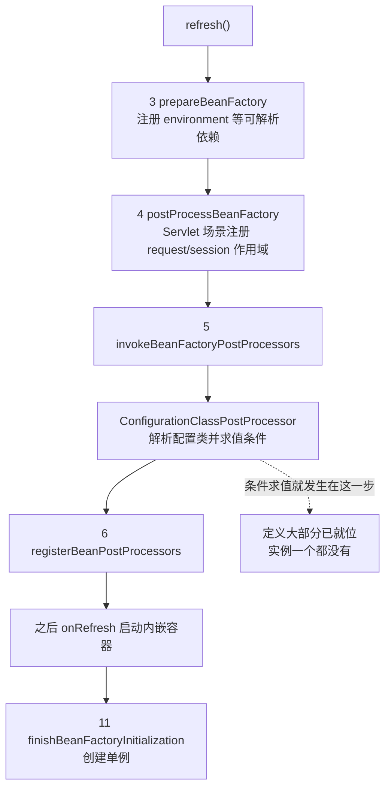
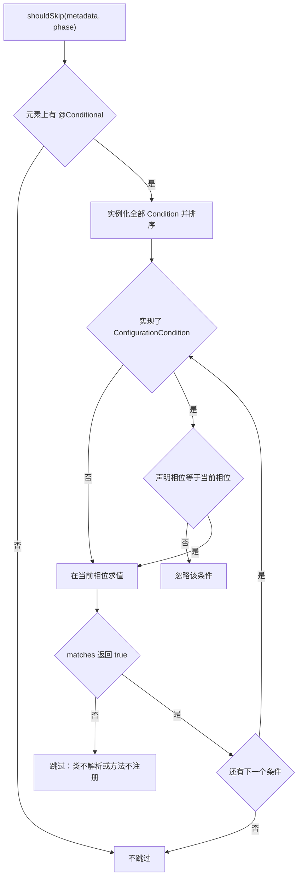
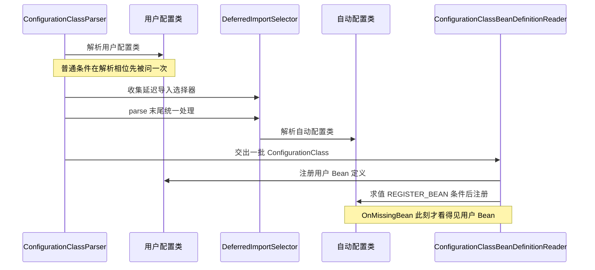
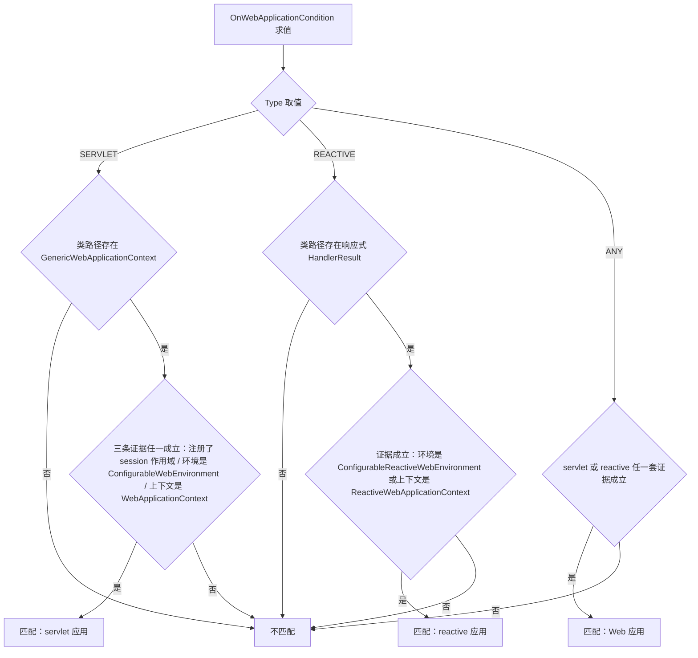
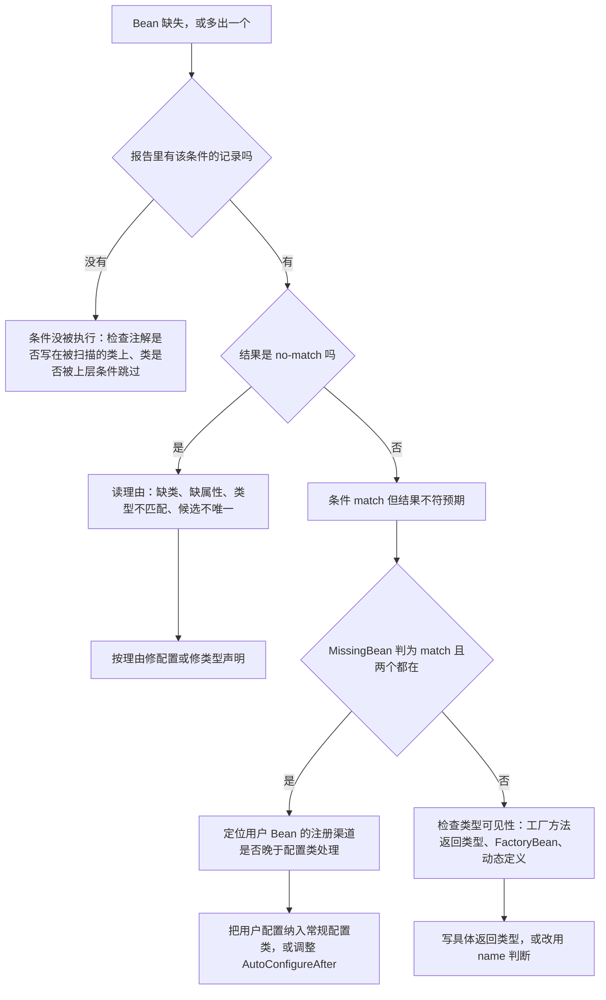

# 条件装配——@Conditional家族的实现机制

**摘要：**

条件装配看起来只是给配置类挂几个注解，真正的难度却在求值时机：`@Conditional` 不是等到 Bean 创建时才判断，而是在 `ConfigurationClassPostProcessor` 解析配置类、注册 BeanDefinition 的两遍流程里就给出了答案，那时容器里只有一部分定义、一个实例都没有。本文从这个时间点切入，先交代求值时容器里有什么、没什么，再拆解 `Condition` 的两个入参——`ConditionContext` 与 `AnnotatedTypeMetadata`——各自能拿到什么、拿不到什么，随后把 `@ConditionalOnClass`、`@ConditionalOnBean`、`@ConditionalOnMissingBean`、`@ConditionalOnProperty`、`@ConditionalOnSingleCandidate`、`@ConditionalOnResource`、`@ConditionalOnExpression`、`@ConditionalOnWebApplication` 的实现逐个讲透，并指出全族只有 Bean 存在性条件声明了 `REGISTER_BEAN` 相位，其余普通条件在解析阶段就要先答一次。重点落在两条主线：一是 `@ConditionalOnMissingBean` 依赖的顺序契约——用户配置必须先于自动配置注册，否则自动配置不会让步，同一配置类内后声明的 `@Bean` 对先声明的条件同样不可见；二是条件判错的排查方法，包括 `ConditionEvaluationReport` 的编程式导出、四类典型反例，以及一棵先区分"条件没跑"与"条件跑了但答错"的决策树。文末给出自定义条件的两个禁区与条件装配的适用边界，并划清与 Bean 注册流程的分工：注册流程决定容器里有什么，条件装配只决定是否参与。

---

## 第 1 章 求值时点：容器尚未成形

### 1.1 一个只在预发复现的序列化差异

问题出在预发环境的一处时间格式上。订单服务自己在配置类里定义了一个 `ObjectMapper`，自动配置也提供了一个 `ObjectMapper`，两个同类型 Bean 同时躺在容器里，某个注入点按类型取到的是自动配置那一个，于是订单创建时间在预发被序列化成带时区的长格式，在生产却是另一种短格式。代码没有改，配置文件也没有改，差异只来自一次依赖升级。

沿着依赖往上查，`@ConditionalOnMissingBean` 就在自动配置的 `@Bean` 方法上，写法没有任何问题。它之所以没有让步，是因为在对它求值的那一刻，用户的 `ObjectMapper` 还没有作为 BeanDefinition 进入注册表——条件看到的是"容器里没有"，于是它按默认逻辑注册了自己的那份。等到用户那份随后注册进来，两边的判断都已经生效，容器里就多了第二个。

条件判错的绝大多数原因不在注解写错，而在**求值瞬间容器里有什么**。 这句话听起来像陈词滥调，但把它落实到源码，就是下面几个具体事实：求值发生在 refresh 的第几步、那一刻哪些定义已经注册、哪些条件会被求值两次。把这些点串起来，本章开头这种现象就不再神秘。

### 1.2 refresh() 的第五步

Spring 容器的启动是一串固定的步骤，`AbstractApplicationContext.refresh()` 依次执行 `prepareRefresh`、`obtainFreshBeanFactory`、`prepareBeanFactory`、`postProcessBeanFactory`、`invokeBeanFactoryPostProcessors`、`registerBeanPostProcessors`、初始化消息源与事件广播器、`onRefresh`、注册监听器、`finishBeanFactoryInitialization`、`finishRefresh`。条件求值全部发生在第五步 `invokeBeanFactoryPostProcessors` 内部，执行者是 `ConfigurationClassPostProcessor`。

这个类同时实现了 `BeanDefinitionRegistryPostProcessor` 与 `PriorityOrdered`，源码里的 `getOrder()` 直接返回 `Ordered.LOWEST_PRECEDENCE`，注释写着"within PriorityOrdered"——意思是它虽然不是最早的，但在必须早于普通 `Ordered` 的处理器这一档里排最后，从而保证所有需要先于它注册定义的处理器都排在它前面，而所有普通的 `BeanFactoryPostProcessor` 都排在它后面。它的 `postProcessBeanDefinitionRegistry` 方法调用 `processConfigBeanDefinitions`，后者正是配置类解析与条件求值的入口。

由此可以立刻推出三个边界。第一，条件求值早于 `registerBeanPostProcessors`，此刻容器里没有任何 `BeanPostProcessor` 实例，任何指望 `@Autowired`、`Aware` 回调、`@PostConstruct` 的状态都还没有发生。第二，它更早于 `finishBeanFactoryInitialization`，非懒加载单例一个都没有创建，`getBean` 一旦被条件调用，就是在容器还不会正确创建 Bean 的时刻强行创建。第三，`postProcessBeanFactory` 已经在它之前跑完，这一步在内嵌 Servlet 容器场景下注册了 `request` 与 `session` 两个作用域——后文会看到，`@ConditionalOnWebApplication` 正是靠这份作用域名单来判断自己身处何种应用的。

### 1.3 解析与注册是两遍

`processConfigBeanDefinitions` 的主体是一个 `do-while` 循环，每轮先 `parser.parse(candidates)`，再 `this.reader.loadBeanDefinitions(configClasses)`，然后检查注册表里是否出现了新的配置类候选，有就再来一轮。解析与注册分属两个类，这一点是理解全部顺序问题的钥匙。

`ConfigurationClassParser` 负责读懂配置类：处理 `@PropertySource`、`@ComponentScan`、`@Import`、`@ImportResource`、`@Bean` 方法，把解析结果汇总成一组 `ConfigurationClass` 对象。`ConfigurationClassBeanDefinitionReader` 负责把这份模型翻译成 BeanDefinition 并注册进注册表。前者不做注册（组件扫描是例外，扫描器会当场把扫到的候选注册掉），后者只做注册，不再回头解析注解。

这个分法带来一个容易忽略的后果：类和方法的条件虽然都能写在配置类上，求值点却分属两遍。类级别的 `@Conditional` 会被问两次——解析时由 `ConfigurationClassParser` 按 `PARSE_CONFIGURATION` 相位问一次，注册时由 `TrackedConditionEvaluator` 按 `REGISTER_BEAN` 相位再问一次；每一次是否真正执行，取决于条件有没有声明相位：不声明则两次都执行，声明了 `REGISTER_BEAN` 则第一次被跳过、第二次才执行。`@Bean` 方法级别的条件只在注册阶段、按方法逐个求值。**类级条件会被问两遍**，这是后文许多"条件行为诡异"现象的直接来源。把这个顺序画出来，求值时点与容器状态的关系就一目了然。



### 1.4 那一刻，容器里有什么

把常见的东西列成一张表，比任何解释都直观。表里的"解析期"指 `PARSE_CONFIGURATION` 相位，"注册期"指 `REGISTER_BEAN` 相位，两者的可见范围并不相同。

| 对象 | 解析期可见性 | 注册期可见性 | 原因 |
| --- | --- | --- | --- |
| `@ComponentScan` 扫出的定义 | 可见 | 可见 | 扫描发生在解析期，命中即注册 |
| 容器创建前已加载的 XML 定义 | 可见 | 可见 | 在 `ConfigurationClassPostProcessor` 之前已进入注册表 |
| `@ImportResource` 与 `ImportBeanDefinitionRegistrar` 的定义 | 不可见 | 按配置类顺序逐个可见 | 由 reader 在处理该配置类时加载 |
| 父容器的 Bean 定义 | 可见（受 `search` 约束） | 可见（受 `search` 约束） | BeanFactory 层级在 refresh 之前已建立 |
| 本批用户配置类的 `@Bean` 定义 | 不可见 | 按配置类顺序逐个可见 | reader 在 parse 之后才执行 |
| 自动配置类的 `@Bean` 定义 | 不可见 | 晚于用户配置类 | 延迟导入选择器把它们排在最后 |
| 任何 Bean 实例 | 不可见 | 不可见 | 尚未进入单例创建阶段 |
| `BeanPostProcessor` 实例 | 不可见 | 不可见 | 注册后处理器的步骤在第五步之后 |
| `ApplicationContext` 对象本身 | 不可见 | 不可见 | 条件只持有注册表与 BeanFactory |
| `ServletContext` 与监听端口 | 不可见 | 不可见 | 内嵌容器在 `onRefresh` 才启动 |
| CGLIB 增强后的配置类 | 不可见 | 不可见 | 增强动作在本后处理器末尾才执行 |

最后一行需要单独交代：`@Configuration` 类会被 CGLIB 增强，以保证 `@Bean` 方法之间的相互调用返回同一个实例，但增强发生在 `enhanceConfigurationClasses` 里，位于条件求值之后，所以条件面对的始终是原始类与它的注解元数据，而不是代理对象。

---

## 第 2 章 两个入参的能力边界

### 2.1 ConditionContext 的五个出口

`Condition` 接口只有一个方法，两个入参：`ConditionContext` 与 `AnnotatedTypeMetadata`。前者是环境与容器状态的只读视图，后者是注解元数据的只读视图。把 `ConditionContext` 的五个方法逐个看一遍，就能明白条件为什么不能当"半个 Bean 工厂"用。

```java
public interface ConditionContext {
    BeanDefinitionRegistry getRegistry();                       // 注册表：能看定义，能改定义
    @Nullable ConfigurableListableBeanFactory getBeanFactory(); // 容器：能看类型，也能 getBean
    Environment getEnvironment();                                // 属性、Profile、占位符
    ResourceLoader getResourceLoader();                          // classpath:、file: 等资源
    @Nullable ClassLoader getClassLoader();                      // 类路径判断的基线
}
```

`getBeanFactory()` 之所以标了 `@Nullable`，看 `ConditionEvaluator` 的内部实现就清楚了：它在构造时接收一个 `BeanDefinitionRegistry`，然后尝试把注册表"推导"成 `ConfigurableListableBeanFactory`，只有当注册表本身是 BeanFactory 或 `ConfigurableApplicationContext` 时才能拿到，否则为 `null`。`@ConditionalOnExpression` 遇到 `null` 会直接返回不匹配，并在诊断信息里写明"no BeanFactory available"，这就是一个条件在缺少上下文时的正确姿态——失败要可解释。

`getEnvironment()` 永远不会为 `null`，缺省时给一个 `StandardEnvironment`；`getResourceLoader()` 缺省给 `DefaultResourceLoader`；`getClassLoader()` 依次从资源加载器、BeanFactory、线程上下文类加载器兜底。这几个兜底意味着条件可以在"半成品"环境里被调用，也意味着条件不能假设自己运行在一个完整的 Spring Boot 上下文里，同样的实现可能被用在测试切片、子上下文甚至手工构造的 `ApplicationContextRunner` 中。

| 出口 | 能拿到 | 什么时候失真 | 误用后果 |
| --- | --- | --- | --- |
| `getRegistry` | 已注册的 BeanDefinition 名与定义 | 某些场景注册表为空，取用会断言失败 | 在条件里注册定义，破坏解析与注册的一致性 |
| `getBeanFactory` | 类型查询、定义查询、`getBean` | 注册表不可推导时为 `null` | 调 `getBean` 会提前实例化，绕过生命周期 |
| `getEnvironment` | 全部属性源与激活 Profile | AOT 场景读到的是构建期环境 | 把运行时状态写进条件，镜像内结果被冻结 |
| `getResourceLoader` | `classpath:`、`file:` 等资源 | `file:` 依赖执行机器 | 路径条件在容器之间不可移植 |
| `getClassLoader` | 类加载基线 | 极端类加载器结构下可能为空 | 自定义类判断失败时静默返回 false |

### 2.2 AnnotatedTypeMetadata 是一袋注解

`AnnotatedTypeMetadata` 提供的能力比名字暗示的还要窄：`isAnnotated` 判断是否带某个注解（含元注解），`getAnnotationAttributes` 与 `getAllAnnotationAttributes` 读取注解属性，`getAnnotations` 返回 `MergedAnnotations` 以便做注解合并。它描述的是"这个元素上写了什么注解"，而不是"这个元素是什么"。

这些元数据在解析阶段来自 ASM 字节码读取，而不是反射。`SpringBootCondition.getCandidates` 调用 `getAllAnnotationAttributes(annotationType.getName(), true)`，第二个参数 `classValuesAsString=true` 要求把注解里的 `Class` 值以类名字符串的形式返回——这个细节是 `@ConditionalOnClass` 能在目标类缺席时依然工作的前提，后文第 4 章会展开。

| 想做的事 | 接口是否支持 | 说明 |
| --- | --- | --- |
| 判断是否被某注解标注 | 支持，`isAnnotated` | 元注解也算命中 |
| 读取注解属性 | 支持，`getAnnotationAttributes` | ASM 来源时类值为字符串 |
| 遍历全部注解 | 支持，`getAnnotations` | 可做注解合并与重复注解展开 |
| 取被注解方法的名字 | 无直接 API | 只能 `instanceof MethodMetadata` 后自取，Boot 自己就是这么做的 |
| 取方法参数、返回值、泛型 | 不支持 | 类型信息要么在 `BeanDefinition` 里，要么在方法签名里 |
| 取被注解元素的实例 | 不支持 | 元数据不是对象，也不持有对象 |

方法名那一行藏着接口设计的取舍。`SpringBootCondition` 里有一个 `getClassOrMethodName`，实现方式正是先判断 `metadata instanceof MethodMetadata`，再拼出 `类名#方法名` 这样便于阅读的来源标识。普通 `Condition` 想拿到同样的信息，只能复制这段判断；接口本身不承诺提供元素结构，这是刻意为之的窄接口设计。

### 2.3 拿不到的三种东西

第一种是 Bean 实例。条件能通过 BeanFactory 查询"有没有某类型的定义"，也能强行 `getBean`，但后者意味着在 `BeanPostProcessor` 尚未注册时创建单例，代理不会生成、属性不会绑定、初始化回调不会执行，对象处于半成品状态并被提前放进单例缓存。譬如有人为了判断"有没有自定义的连接池"而在条件里 `getBean(DataSource.class)`，拿到的连接池既没有走完初始化，也会因为提前进入单例缓存而错过后续的代理与监控包装。Spring Boot 文档在 `@ConditionalOnExpression` 一节里专门警告过：在表达式里引用 Bean 会导致该 Bean 在 refresh 早期被初始化，因而无法参与后置处理，状态可能不完整。

第二种是 `ApplicationContext` 与 Web 运行时对象。条件拿到的是注册表与 BeanFactory，不是上下文；内嵌容器尚未启动，`ServletContext`、端口、`WebServerApplicationContext` 的运行时状态都不存在。这解释了一个常被误会的现象：`@ConditionalOnWebApplication` 并不检查 `ServletContext`，它检查的是类路径、容器与作用域、环境类型这几类可得的证据。

第三种是尚未被解析的配置类。解析阶段，本批配置类的 `@Bean` 方法还停留在模型里，没有变成定义；注册阶段，虽然前面的配置类已经注册完毕，后面的自动配置类还没轮到。任何"看看容器里最终有什么"的期望都是错的，条件只能看到"到目前为止处理过什么"。

---

## 第 3 章 相位、排序与短路

### 3.1 ConfigurationCondition 的意义

Spring Framework 4.0 引入条件装配时，就预料到了"某些条件只能在特定阶段才有意义"，于是给出 `ConfigurationCondition` 接口，让条件实现类自己声明相位。

```java
public interface ConfigurationCondition extends Condition {
    ConfigurationPhase getConfigurationPhase();

    enum ConfigurationPhase {
        PARSE_CONFIGURATION,  // 解析配置类时
        REGISTER_BEAN         // 注册 BeanDefinition 时
    }
}
```

`ConditionEvaluator.shouldSkip` 的判定逻辑很直白：把元素上的 `Condition` 全部实例化、按 `AnnotationAwareOrderComparator` 排序，逐个检查；如果条件实现了 `ConfigurationCondition` 且声明的相位与当前相位不同，就跳过它；否则调用 `matches`，一旦返回 false 立即返回"跳过"。普通 `Condition` 没有相位声明，因此**每次被问到都会真的执行**——这是理解"同一条件跑多遍"的关键，也是把副作用写进条件会造成麻烦的原因。

反编译 3.5 的条件包可以看到一个很容易被想当然的事实：**只有 `OnBeanCondition` 声明了相位**，它的 `getConfigurationPhase()` 直接返回 `ConfigurationPhase.REGISTER_BEAN`，`@ConditionalOnBean`、`@ConditionalOnMissingBean`、`@ConditionalOnSingleCandidate` 三个注解都落在它身上。其余成员，包括 `OnClassCondition`、`OnPropertyCondition`、`OnResourceCondition`、`OnExpressionCondition`、`OnWebApplicationCondition`、`OnJavaCondition`，全都只是普通 `Condition`，没有相位声明。

这个分布不是遗漏，而是语义决定的。Bean 存在性判断的是"已经注册的定义"，只能在注册阶段才有意义，若允许它在解析阶段跑，答案必然是"没有"，自动配置会成片消失。类路径、属性、资源这类判断与容器状态无关，放在哪个相位都答得出来，框架于是在解析与注册两个阶段各问一次：解析阶段的那一次决定"配置类还要不要继续解析、`@ComponentScan` 还要不要执行"，注册阶段的那一次决定"这个类要不要注册为 Bean"。两次结论理应一致，但如果条件读了会变化的外部状态，两次就可能不一致——这是普通条件被反复求值带来的额外风险，而不只是性能问题。

### 3.2 同一份条件，两次求值

类级条件在注册阶段的那次求值，来自 `ConfigurationClassBeanDefinitionReader` 内部的 `TrackedConditionEvaluator`。它在处理每个配置类之前先问一句"这个类该跳过吗"，首次见到某个类时调用 `conditionEvaluator.shouldSkip(metadata, REGISTER_BEAN)`，并把结果缓存进一个 `HashMap<ConfigurationClass, Boolean>`；如果这个类是被 `@Import` 进来的，还要先看导入它的那些类是否全部被跳过，全部跳过才认定自己也被跳过。

这段缓存带来两个推论。其一，一个类级条件在一次启动里只会得到一次"注册阶段"的结论，即使同样的条件在别处被独立求值；其二，`@Import` 关系在这里被显式处理——导入链上游全灭，下游一并作废，不会出现"父配置被跳过、子配置还在注册"的孤岛。

解析阶段还有一处容易被忽略的求值：`doProcessConfigurationClass` 在处理 `@ComponentScan` 之前会再做一次 `shouldSkip(metadata, REGISTER_BEAN)`，只有不被跳过才执行扫描。注意这次调用的相位参数是 `REGISTER_BEAN`，所以连只在注册相位说话的 `OnBeanCondition` 也会在这里被问一次。检查发生在解析期，而解析期本批配置类的 `@Bean` 定义还没注册，于是带 `@ComponentScan` 又带类级 `@ConditionalOnBean(X)` 的用户配置类，会因为"X 还没注册"而整片扫描被跳过——症状是包扫描"失效"，所有组件都找不到。这类故障排查起来极费时间，因为报错信息只会说某个 Bean 不存在，不会说是扫描没有发生。下图把一次 `shouldSkip` 的判定路径摊开，分歧点就在相位比较这一步。



### 3.3 AND 语义、排序与短路

同一元素上的多个条件之间是 AND：全部通过才保留。`ConditionEvaluator` 用 `AnnotationAwareOrderComparator` 排序后依次求值，遇到 false 立即返回，后面的条件不再执行。这个短路带来两个实践后果。

其一是性能上的顺序安排有意义。把便宜的类路径条件写在前面、把需要 IO 或复杂计算的条件写在后面，可以让大量不匹配的候选在前几步就被淘汰。Spring Boot 自己的自动配置类几乎都遵循这个习惯：`@ConditionalOnClass` 在最前，`@ConditionalOnProperty` 居中，`@ConditionalOnMissingBean` 收尾。

其二是诊断信息会出现偏差。短路的条件不会出现在报告里，于是一个类在报告里只显示"第一条不满足的条件"，把它修好之后才会暴露第二条。排查时不能假设"报告里没出现的问题就不存在"，只能假设"报告记录的是当前这一轮实际执行到的判断"。

条件之间的顺序由 `Ordered` 或 `@Order` 决定，未标注时按声明顺序；这个顺序只影响求值次序，不影响最终语义（AND 是可交换的）。相位带来的不直观更值得警惕：同一个元素上的条件并不总是在同一时刻被问，声明 `PARSE_CONFIGURATION` 的条件在解析阶段答一次、注册阶段被跳过，声明 `REGISTER_BEAN` 的条件反过来，没有声明的条件两个阶段都要答。三类条件混挂在一个类上时，报告里的记录会分散在两次求值中，读起来像"同时满足"，实际是几次不同世界观下的回答。

---

## 第 4 章 类路径条件：OnClass 与 OnMissingClass

### 4.1 OnClassCondition 的实现骨架

`@ConditionalOnClass` 与 `@ConditionalOnMissingClass` 共用一个条件类 `OnClassCondition`，它继承 `FilteringSpringBootCondition`，后者又实现了 `AutoConfigurationImportFilter`，因此这个条件同时承担"导入候选的提前过滤"和"正式求值"两种职责。正式求值的骨架大致如下。

```java
class OnClassCondition extends FilteringSpringBootCondition {

    @Override
    public ConditionOutcome getMatchOutcome(ConditionContext context,
            AnnotatedTypeMetadata metadata) {
        ClassLoader classLoader = context.getClassLoader();
        ConditionMessage matchMessage = ConditionMessage.empty();

        // 1. 从注解元数据里取出全部类名，value 与 name 合并处理
        List<String> onClasses = getCandidates(metadata, ConditionalOnClass.class);
        if (onClasses != null) {
            // 2. 找出其中无法加载的类
            List<String> missing = filter(onClasses, ClassNameFilter.MISSING, classLoader);
            if (!missing.isEmpty()) {
                return ConditionOutcome.noMatch(
                        ConditionMessage.forCondition(ConditionalOnClass.class)
                                .didNotFind("required class", "required classes")
                                .items(Style.QUOTE, missing));
            }
            matchMessage = matchMessage.andCondition(ConditionalOnClass.class)
                    .found("required class", "required classes")
                    .items(Style.QUOTE, onClasses);
        }

        // 3. OnMissingClass 反向判断：存在才不匹配
        List<String> onMissingClasses = getCandidates(metadata, ConditionalOnMissingClass.class);
        if (onMissingClasses != null) {
            List<String> present = filter(onMissingClasses, ClassNameFilter.PRESENT, classLoader);
            if (!present.isEmpty()) {
                return ConditionOutcome.noMatch(
                        ConditionMessage.forCondition(ConditionalOnMissingClass.class)
                                .found("unwanted class", "unwanted classes")
                                .items(Style.QUOTE, present));
            }
        }
        return ConditionOutcome.match(matchMessage);
    }
}
```

有两个实现细节在源码里很显眼。第一，`getCandidates` 同时读取 `value` 与 `name` 两个属性，把结果拼成类名字符串列表，所以两种写法在运行期的语义完全一致，差别只在编译期。第二，`resolve` 的最终动作是 `Class.forName(name, false, classLoader)`——加载但不初始化；`filter` 内部对 `Throwable` 做兜底，把链接失败也当作"类不可用"处理。

### 4.2 为什么不是 Class.forName

很多人第一次手写条件时都会写下 `Class.forName("org.example.Feature")`，然后发现某些依赖上出现了静态块被执行的副作用，或者在依赖缺一半的工程里抛出 `NoClassDefFoundError` 而不是安静地返回 false。两处差异正好对应 Boot 的实现选择。

| 写法 | 是否触发静态初始化 | 依赖缺失时的行为 | 适用场景 |
| --- | --- | --- | --- |
| `Class.forName("X")` | 触发 | 抛 `ClassNotFoundException` 或 `NoClassDefFoundError` | 确实需要类初始化时 |
| `Class.forName("X", false, loader)` | 不触发 | 抛 `ClassNotFoundException` 或 `LinkageError` | 仅判断"在不在" |
| `ClassUtils.isPresent("X", loader)` | 不触发 | 捕获后返回 false | 通用判断 |
| ASM 读注解元数据 | 不触发 | 完全不需要类存在 | 判断注解属性里的类名 |

触发静态初始化意味着调用方无法预料的外部行为：譬如某个 SDK 的静态块可能读取系统属性、初始化日志框架、甚至发起网络连接。仅仅为了判断"这个类在不在"而执行别人的静态初始化，是把启动期的控制权交给了被判断方。Boot 选择"只加载、不初始化"，把判断成本压到最低。

链接失败是第二个原因。`Class.forName` 抛出的 `ClassNotFoundException` 只覆盖"类文件找不到"这一种情况，而真实的类路径问题往往是"类找到了，但它引用的另一个类没找到"，此时抛的是 `NoClassDefFoundError` 一类的 `Error`。`ClassNameFilter` 内部用 `catch (Throwable)` 把这个错误也吞掉并视为不可用，避免了条件求值把整个启动炸掉。`SpringBootCondition.matches` 的模板方法之所以还单独 `catch (NoClassDefFoundError)` 并包成 `IllegalStateException`，是因为条件在正式求值时若真的把缺失类型加载进来，就属于"本不该发生"的编程错误，需要更醒目的报错。

多核机器上还有一层优化：`OnClassCondition.getOutcomes` 在 `availableProcessors` 大于 1 时会走 `ThreadedOutcomesResolver`，把候选自动配置类的类路径检查分给多个线程。几十上百个候选类的 `Class.forName` 可以并行，启动时间能省下可观测的一截。这段实现只对"提前过滤"的批量接口生效，单个条件的 `matches` 仍然是串行的。

### 4.3 value 与 name 的真实分界

原稿容易把这条规则简化成"外部类用 name，否则编译不过"。更准确的表述要分三层。

第一层是编译期依赖。`@ConditionalOnClass(Foo.class)` 里的 `Foo` 必须是当前模块编译期可见的类型，如果模块根本没有这个依赖，代码无法通过编译，此时只能用 `name` 写字符串。这是唯一与"编译"有关的限制。

第二层是运行期类路径。官方文档明确说明：注解元数据由 ASM 解析，`value` 指向的类即使不在运行期类路径上也能被安全读取，因为条件拿到的是类名字符串，而不是加载好的 `Class`。所以一个模块用 `optional` 或 `provided` 方式引入了某个依赖、编译期可见而运行期未必存在时，`value` 依然可用。

第三层是类体的连累。真正致命的地方在于配置类自身的方法签名与字节码引用：JVM 在加载一个类时需要解析它的方法描述符，若返回类型、参数类型或方法体引用了缺失的类型，加载就会失败。官方文档对此的说法是，这套机制对 `@Bean` 方法并不成立，"在方法上的条件生效之前，JVM 已经加载了类并可能处理了方法引用"。解法是把条件下沉到嵌套的静态配置类，让外层不引用缺失类型，缺失时整块嵌套配置被跳过、类根本不会被加载。

```java
@AutoConfiguration
public class OrderStoreAutoConfiguration {

    // 外层不引用任何可能缺失的类型，缺失时下面的嵌套类不会被加载
    @Configuration(proxyBeanMethods = false)
    @ConditionalOnClass(name = "org.example.store.OrderStoreClient")
    static class OrderStoreClientConfiguration {

        @Bean
        @ConditionalOnMissingBean
        OrderStoreClient orderStoreClient(OrderStoreProperties properties) {
            return new OrderStoreClient(properties.getEndpoint());
        }
    }
}
```

还有一个常被忽略的规则：把 `@ConditionalOnClass` 作为元注解组合进自定义注解时，必须用 `name`。原因是组合注解经过元注解合并后，`value` 上的类引用无法稳定地还原为类名，官方文档直接把这条写成限制。它与第二层的"`value` 很安全"并不矛盾——安全的前提是注解被直接读取，一旦经过合并就可能丢失类值。

`@ConditionalOnMissingClass` 的用途是做降级实现：类路径上存在新版 SDK 时走新实现，不存在时走旧实现。它不适合用来猜版本，因为"某个类缺失"与"版本较低"不是等价命题——同名类可能随版本移除、迁移包名、或者被拆成独立模块。用类缺失表达版本判断，等于把版本兼容问题伪装成类路径问题，迟早会在某个补丁版本上翻车。

### 4.4 早期过滤与正式求值

自动配置候选清单确定后、配置类被解析前，`AutoConfigurationImportSelector` 会调用一组 `AutoConfigurationImportFilter` 对候选做批量过滤。这组过滤器注册在 `spring.factories` 的 `org.springframework.boot.autoconfigure.AutoConfigurationImportFilter` 条目下，3.5 中包括 `OnBeanCondition`、`OnClassCondition`、`OnWebApplicationCondition` 三个。

| 维度 | 早期过滤 | 正式求值 |
| --- | --- | --- |
| 时机 | 候选清单确定后、解析之前 | 解析与注册两个阶段 |
| 执行者 | `AutoConfigurationImportFilter.match` 批量接口 | `Condition.matches` 逐个调用 |
| 输入 | 候选类名数组与 `AutoConfigurationMetadata` | `ConditionContext` 与 `AnnotatedTypeMetadata` |
| 上下文 | 只有注入的 BeanFactory 与类加载器 | 完整 `ConditionContext` |
| 能判断 | 类路径、Web 类型、Bean 注解里类型的类存在性 | 全部条件语义 |
| 误判代价 | 整个自动配置类被永久排除 | 单个类或方法不注册 |

`OnBeanCondition` 在过滤阶段的行为最能说明这套设计的克制。它读取候选类上的 `@ConditionalOnBean` 与 `@ConditionalOnSingleCandidate` 注解，只检查注解里列出的类型**是否存在于类路径**，存在就不发表意见（返回 null 表示保留），不存在才排除。这个阶段完全不判断"容器里有没有这个 Bean"，因为它知道那一刻不会有任何用户定义可看。**早期过滤只做能力判断，不做状态判断**，这条分界线是 Boot 避免误杀的关键。

候选清单如何被加载、如何按 `@AutoConfigureOrder` 排序，属于自动装配入口的话题，细节见 [[02 自动装配原理——@EnableAutoConfiguration与spring.factories]]；本文关注的是清单交出之后，每个配置类被逐个求值的过程。

---

## 第 5 章 Bean 存在性条件：OnBean 与 OnMissingBean

### 5.1 属性与语义

`@ConditionalOnBean` 与 `@ConditionalOnMissingBean` 共用 `OnBeanCondition`，两者的属性略有差异：`@ConditionalOnMissingBean` 多出 `ignored` 与 `ignoredType`，用来把某些类型从比较中排除，`@ConditionalOnBean` 没有这两个属性。

| 属性 | 语义 | 常见陷阱 |
| --- | --- | --- |
| `value` / `type` | 按类型匹配，列出多个类型时须同时满足 | 类型取自 Bean 定义的声明类型，取不到运行期实际类型 |
| `name` | 按 Bean 名称匹配 | 用户改了 Bean 名就失效，与类型条件叠加时要求同时满足 |
| `annotation` | 按 Bean 定义上的注解匹配 | 只能看到已注册的定义，注解来自类或工厂方法 |
| `search` | `ALL`、`CURRENT`、`ANCESTORS`，控制是否查父容器 | 显式写 `CURRENT` 会在父子容器场景漏看父容器 |
| `parameterizedContainer` | 匹配容器泛型，如 `List<OrderStore>` | 只匹配声明出的泛型，通配与推断类型不参与 |
| `ignored` / `ignoredType`（仅 MissingBean） | 排除指定类型后再判断"是否缺失" | 只影响类型比较，不影响按名称的判断 |

放在 `@Bean` 方法上时，若没有显式写出类型，`@ConditionalOnBean` 与 `@ConditionalOnMissingBean` 会把方法的返回类型当作目标类型。官方文档对此给了一条很实用的建议：尽量在返回类型上写具体类，而不是接口或 `Object`，因为条件只能依靠方法签名里能拿到的类型信息。**类型声明越模糊，判断越容易出错**。

### 5.2 类型信息从哪来

`OnBeanCondition` 的核心查询是 `ListableBeanFactory.getBeanNamesForType(ResolvableType, true, false)`：第一个布尔值表示包含非单例，第二个布尔值是 `allowEagerInit`，传入 false 意味着**不会为了确定类型而提前实例化 FactoryBean**。这个选择保证了条件求值不触发 Bean 创建，代价是类型信息只能来自声明本身。

由此产生三类盲区。第一类是 `FactoryBean`：它的产物类型可能要调用 `getObjectType()` 才能确定，而某些实现只有在 `getObject()` 之后才有准确类型，`allowEagerInit=false` 时这类 Bean 可能对条件不可见，于是自动配置误以为"没有"，注册了自己的默认实现，最终容器里出现两个。第二类是声明类型过宽：工厂方法返回 `Object`、接口、或者父类型，条件按子类型查询时匹配不到。第三类是动态注册：通过 `BeanDefinitionRegistry` 手工塞进去的定义如果只给了类名或 supplier，没有可解析类型，同样可能在类型查询里缺席。

`parameterizedContainer` 是较新加入的能力，用来表达"容器里存在 `List<OrderStore>` 这样的聚合 Bean"。实现上它会构造 `ResolvableType.forClassWithGenerics(容器类型, 元素类型)` 再去查询，因此只认声明出来的泛型实参；用 `Object` 装元素、或用通配符声明的集合，都不能被它识别。

### 5.3 search 策略与容器层级

`SearchStrategy` 有三个取值：`ALL` 表示当前容器与所有祖先容器，`ANCESTORS` 表示只看祖先，`CURRENT` 表示只看当前容器，默认是 `ALL`。按名称匹配时，对应的是 `containsBean` 与 `containsLocalBean` 的分叉；按类型匹配时，对应的是是否沿着 `getParentBeanFactory` 递归。

父子容器在 Spring Boot 单体应用里不常见，但在 Spring Cloud、Spring MVC 传统部署、以及某些测试框架里仍然存在。把 `search` 写成 `CURRENT` 后，父容器里明明存在的 `DataSource` 对子容器的自动配置不可见，症状与"没有配置数据源"完全一样，日志里却能看到父容器已经创建了连接池。排查这类问题时，先确认条件到底查了几个容器，比盯着条件注解本身有效得多。

### 5.4 顺序契约：为什么用户配置一定在前

`@ConditionalOnMissingBean` 能成立，依赖的是一条看不见的约定：用户配置类必须先于自动配置类注册。这条约定由 `DeferredImportSelector` 与"解析、注册两遍"共同保证。

`AutoConfigurationImportSelector` 实现的是 `DeferredImportSelector`，`ConfigurationClassParser.processImports` 遇到它时不会立刻处理，而是交给 `DeferredImportSelectorHandler` 收集起来；等 `parse` 方法把所有普通配置类解析完，最后一行才调用 `deferredImportSelectorHandler.process()`，此时才把自动配置类导入解析。于是解析结果的顺序天然是"用户配置在前、自动配置在后"，随后 `ConfigurationClassBeanDefinitionReader` 按这个顺序逐个注册，用户 `@Bean` 的定义自然先进入注册表。这个过程在时间轴上的形状，正是顺序契约的由来。



这个顺序还有两个补丁需要记住。其一，`processConfigBeanDefinitions` 是 `do-while` 循环，如果某个 `ImportBeanDefinitionRegistrar` 在注册阶段又追加了新的配置类，下一轮会重新解析并注册，这些"迟到"的配置类看不到它们之前的求值结果，反而能看到更多已注册定义。其二，自动配置类之间的相对顺序由 `@AutoConfigureOrder`、`@AutoConfigureBefore`、`@AutoConfigureAfter` 决定，但它们整体都在用户配置之后——这条"整体在后"的性质，比任何单个自动配置类的顺序都重要。

### 5.5 为什么我的 Bean 和自动配置的 Bean 同时存在

这条顺序契约只在"用户配置类通过常规途径注册"时成立。一旦某个环节跳出常规，`@ConditionalOnMissingBean` 就会漏判。下表列出四种常见成因，以及各自的判据与处置。

| 成因 | 机制 | 判据 | 处置 |
| --- | --- | --- | --- |
| 注册渠道晚于配置类处理 | 某个 `BeanDefinitionRegistryPostProcessor` 或 `BeanFactoryPostProcessor` 在 `ConfigurationClassPostProcessor` 之后才注册用户的定义 | 报告里自动配置的 `@ConditionalOnMissingBean` 显示 match，但容器里两个同类型 Bean | 把用户配置纳入常规配置类，或让自动配置改用 `@AutoConfigureAfter` 依赖明确的顺序 |
| 类型信息不可见 | `FactoryBean` 产物、返回 `Object` 的工厂方法、只给类名的动态定义 | 按名称能查到，按类型查不到 | 工厂方法写具体返回类型，条件改用 `name` 或补充 `type` |
| 名称判断与用户命名不一致 | 条件写 `name = "orderObjectMapper"`，用户 Bean 叫别的名字 | 报告显示条件 match，两个 Bean 并存 | 统一 Bean 名，或改用类型判断并保证类型可见 |
| 条件写在用户自己的配置类上 | 用户配置类之间顺序不确定，先注册者的条件看不到后注册者 | 两次启动行为可能不同，报告里 match/no-match 摇摆 | 用户配置里不要用 `@ConditionalOnMissingBean`，只在自动配置里用 |

第一行最常见，也最难查。它不是"条件写错了"，而是"条件问的时候对象还没到"。判断方法很直接：在报告里确认该条件的求值来源是自动配置类的方法，再看用户的 Bean 名有没有出现在同一份报告的"已注册"世界里；如果报告里根本没有用户 Bean 的定义记录，就说明它是在配置类处理完之后才进场的。

第四行则提醒一件事：`@ConditionalOnMissingBean` 是一种**自动配置与用户之间的协商协议**，协议的一方必须固定为"自动配置"。把它用在用户自己的配置类上，相当于让两个对等方互相协商谁先说话，结果取决于扫描顺序，不具备可移植性。

### 5.6 同一个配置类里的先后

即使在一个配置类内部，`@Bean` 方法的注册也是按顺序逐个进行的：`ConfigurationClass.getBeanMethods()` 是一个 `LinkedHashSet`，顺序就是解析时遇到方法的顺序，`ConfigurationClassBeanDefinitionReader` 遍历它、为每个方法求条件并注册。于是同一个类里，写在前面的方法先注册，写在后面的方法后判断。

```java
@Configuration(proxyBeanMethods = false)
public class OrderMessagingConfiguration {

    // 先注册：此时 orderEventPublisher 还没注册
    @Bean
    @ConditionalOnBean(OrderEventPublisher.class)   // 永远不成立
    OrderEventConsumer orderEventConsumer(OrderEventPublisher publisher) {
        return new OrderEventConsumer(publisher);
    }

    @Bean
    OrderEventPublisher orderEventPublisher() {
        return new OrderEventPublisher();
    }
}
```

上面这段代码里，消费者永远不会被注册，因为条件检查的 Bean 在同一个类里排在它后面。把两个方法的位置对调就能让它生效——这种"改个顺序就好了"的修复方式最危险，因为下一次有人整理方法顺序，故障会无声无息地回来。

同样的机理可以解释另一种困惑：`@ConditionalOnMissingBean` 写在 `@Bean` 方法 A 上，而同类里后面的方法 B 会提供同类型 Bean，A 的条件必然 match，结果是两个同类型 Bean 都注册。表面上像是"自动配置没有让路"，实际是"判断的时候对方还没报名"。

顺带说清类级条件与方法级条件的差别。官方文档给出的说法是，类级条件与方法级条件唯一的区别在于前者不匹配时会阻止配置类本身被注册为 Bean，方法级则只影响该方法。这句话的正确读法是：类级条件失败时，整个类连 Bean 都不算；方法级条件失败时，类照常存在，只是少一个 Bean。两者对"顺序"的敏感程度是一样的，都只看得见已经处理过的定义。

### 5.7 OnSingleCandidate 的数量语义

`@ConditionalOnSingleCandidate` 用来表达"容器里这个类型只有一个候选"，在多数据源、多 `CacheManager`、多消息模板的场景里是默认实现的护栏。3.5 的实现里没有独立的 `OnSingleCandidateCondition`，注解的元注解指向的仍是 `OnBeanCondition`，条件类在内部按"单候选"的规则判断。

判定规则可以概括为：类型匹配的 Bean 恰好一个，或者有多个但其中恰好一个标了 `@Primary`。多个且没有 `@Primary` 时不匹配，因为此时按类型注入本身就有歧义，自动配置不应该替使用者做一个它无法预知的选择。这个语义与依赖注入的解析规则一致，因此用户看到的症状也一致：注入点报"expected single matching bean but found N"，而自动配置提供的默认实现压根没有参与。

`@ConditionalOnSingleCandidate` 的底层条件同样声明了 `REGISTER_BEAN` 相位。在多个数据源的配置里，它常与 `@ConditionalOnMissingBean` 成对出现：用户配了带 `@Primary` 的数据源，条件成立，自动配置注册 `JdbcTemplate`；用户配了两个都没有 `@Primary`，条件不成立，`JdbcTemplate` 不注册，注入失败的信息会清楚指向"没有唯一候选"，而不是"没有配置"。

### 5.8 可靠用法清单

把上面几节压缩成几条可执行的规则，排序按可靠性从高到低。

1. 类路径条件可以写在任何地方，因为它只依赖类加载器，与容器状态无关。
2. `@ConditionalOnMissingBean` 只写在自动配置类的 `@Bean` 方法上，这是它被设计出来的位置。
3. 自动配置类之间的依赖用 `@AutoConfigureAfter` 显式声明，不要指望命名或包顺序。
4. 类级 `@ConditionalOnBean` 只用于自动配置类，且必须能证明被检查的 Bean 由更早处理的自动配置提供。
5. 用户配置类里不要使用 `@ConditionalOnBean` 与 `@ConditionalOnMissingBean`，改用 `@Profile`、属性开关或显式的 `@Import` 选择。
6. 需要在"某个 Bean 存在时才生效"的用户配置，用 `@Import` 加一个带条件的嵌套配置类，把顺序问题交给自动配置体系，而不是塞进自己类里的方法顺序。

---

## 第 6 章 属性、资源、表达式与 Web 类型

### 6.1 OnProperty 的精确匹配

`@ConditionalOnProperty` 基于 `Environment` 判断，是功能开关与灰度开关的标准写法。`OnPropertyCondition.Spec` 的实现先调 `PropertyResolver.containsProperty(key)` 判断键是否存在，存在再调 `getProperty(key)` 取值，两个动作都走 `Environment`，而 `Environment` 背后是属性源列表的直接查找。

```java
public @interface ConditionalOnProperty {
    String[] value() default {};          // 与 name 互斥
    String prefix() default "";
    String[] name() default {};           // 与 value 互斥
    String havingValue() default "";      // 空串表示"存在且不为 false"
    boolean matchIfMissing() default false;
}
```

`value` 与 `name` 互斥，同时写会抛出配置错误，源码里对应的报错文案是"The name and value attributes of @... are exclusive"。`havingValue` 为空时，只要属性存在且值不是字符串 `false` 就算匹配，这个宽松语义是多数开关场景想要的效果，但也意味着写 `enabled=0`、`enabled=no` 都无法关闭功能，只有字面量 `false` 才关。

3.5 的 `@ConditionalOnProperty` 支持重复标注，容器注解是 `ConditionalOnProperties`；此外还提供了专门的 `@ConditionalOnBooleanProperty`，属性是布尔字面量，语义更窄也更明确。两个注解共用 `OnPropertyCondition`，求值时把两组注解一起收集、逐个判定，任何一个不满足即整体不匹配。

### 6.2 宽松绑定的边界

`@ConditionalOnProperty` 不支持宽松绑定，这条规则经常被误用，需要把边界说清楚。宽松绑定发生在把属性绑定到 `@ConfigurationProperties` 对象时，由 `Binder` 完成名字归一化；条件求值不经过 `Binder`，它直接用注解里的字符串去 `Environment` 里查键。因此配置文件中写 `app.my-feature.enabled`，条件里就必须写同样的名字。

| 配置来源 | 键的实际形态 | 条件写 `app.my-feature.enabled` | 条件写 `app.myFeature.enabled` |
| --- | --- | --- | --- |
| `application.yml` | 按字面保存 | 命中 | 不命中 |
| 命令行参数 | 按字面保存 | 命中 | 不命中 |
| 环境变量 | `APP_MY_FEATURE_ENABLED` | 命中（属性源自身会做转换） | 不命中 |
| `@PropertySource` 的 properties 文件 | 按字面保存 | 命中 | 不命中 |
| 配置中心下发的层级键 | 取决于下发的键名 | 以实际键名为准 | 以实际键名为准 |

第三行是唯一的例外：`SystemEnvironmentPropertySource` 自身在解析键时会把点与横线替换成下划线并尝试大写形式，所以条件里写 kebab 形式依然能命中环境变量。这不是条件做了宽松绑定，而是那个属性源本身宽松。

从 `@ConfigurationProperties` 复制属性名到条件注解，是这条规则最常见的翻车方式：绑定类上用驼峰字段、`@ConfigurationProperties(prefix = "order.quote")`，条件里顺手写 `order.quote.externalUrl`，配置文件里实际写的是 `external-url`，条件永远不匹配。

### 6.3 OnResource

`@ConditionalOnResource` 通过 `ResourceLoader.getResource` 拿到资源并调用 `exists()` 判断，注解上的 `resources` 支持占位符，求值时先经 `Environment.resolvePlaceholders` 解析再加载。它适合表达"某个本地配置或标记文件存在时才启用"，例如只在地上有 `classpath:order/quote-local.properties` 的开发环境启用本地桩。

使用它的代价要写明白。资源被定位在**当前进程所在的机器**上，容器镜像里是否存在、路径挂载是否一致，都会直接改变装配结果；在 AOT 场景下，`exists()` 在构建期执行，构建机的文件系统与运行机不同，镜像里得到的结论可能与预期相反。它也很容易被误用成"探测远程服务是否可达"——`file:` 与 `classpath:` 只回答"这个位置有没有文件"，远程可达性属于另一个问题，把它塞进资源条件只会让启动依赖网络状态。

### 6.4 OnExpression

`@ConditionalOnExpression` 把判断交给 SpEL。`OnExpressionCondition` 的实现是先把 `value` 包成 `#{...}` 形式（若尚未包裹），再用 `Environment.resolvePlaceholders` 解析占位符，最后取 `beanFactory.getBeanExpressionResolver()` 求值，求值上下文是 `BeanExpressionContext`。这条链路决定了它的能力与风险。

能力方面，它可以用 `${...}` 取属性、用逻辑运算符组合多个开关、用 `T(...)` 调用静态方法。风险方面，SpEL 的 `@beanName` 语法由 `BeanFactoryResolver` 实现，而它的 `resolve` 方法就是 `beanFactory.getBean(beanName)`——**在条件里引用 Bean 等于提前实例化**。官方文档对此有一句明确的警告：表达式引用 Bean 会导致该 Bean 在 refresh 早期被初始化，无法参与后置处理，状态可能不完整。

第二层风险是性能。表达式的解析结果被缓存在 `StandardBeanExpressionResolver` 的表达式缓存里，重复求值不重复解析，但每次求值仍要建立求值上下文，`T()` 调用还要走类型定位器。把它用在自动配置的类级条件上，影响尚可接受；用在成百上千个 Bean 方法上，就会成为启动时间的可观开销。需要组合开关时，优先用多个 `@ConditionalOnProperty` 叠加（AND 语义原生支持），而不是写一段 SpEL。

### 6.5 OnWebApplication 的证据链

`@ConditionalOnWebApplication` 与 `@ConditionalOnNotWebApplication` 共用 `OnWebApplicationCondition`，否定版本只是把结论取反。它并不检查 `ServletContext`，因为在条件求值的时点，内嵌容器还没有启动。它检查的是一组可得的间接证据，按优先级依次是类路径、容器与作用域、环境类型。

官方文档把 servlet 应用定义为"使用 Spring `WebApplicationContext`、定义了 `session` 作用域、或具备 `ConfigurableWebEnvironment`"三者之一；实现里第一道门槛是类路径上存在 `GenericWebApplicationContext`，通过之后再看容器是否注册了 `session` 作用域、上下文是否为 `WebApplicationContext`、环境是否为 `ConfigurableWebEnvironment`。响应式应用的第一道门槛是类路径上的响应式类（如 `HandlerResult`），之后看环境是否为 `ConfigurableReactiveWebEnvironment`、上下文是否为 `ReactiveWebApplicationContext`。`session` 作用域这一条最可靠，因为 `ServletWebServerApplicationContext` 在 refresh 第四步 `postProcessBeanFactory` 里注册了 `request` 与 `session`，正好早于第五步的条件求值。证据链的取舍顺序可以画成下面这棵树。



这套证据链解释了几种"看起来该匹配却没有匹配"的情形。在普通 `AnnotationConfigApplicationContext` 里跑测试，没有 Web 作用域，条件不成立；用 `ApplicationContextRunner` 测 Web 相关自动配置，需要改用 `WebApplicationContextRunner`；用 `ServletWebServerApplicationContext` 但没引入 Spring MVC 时，类路径证据不足，条件同样不成立。判断这类问题不要猜，直接把 `Type` 显式写成 `SERVLET` 或 `REACTIVE`，让报告里的条件信息告诉你它按哪套证据判断。

### 6.6 家族全景

把 3.5 的成员排成一张表，可以看清哪些条件依赖容器状态、哪些只依赖类路径或环境，也就知道哪些天然安全、哪些必须关心顺序。

| 注解 | 判据 | 底层条件类 | 相位 | 备注 |
| --- | --- | --- | --- | --- |
| `@ConditionalOnClass` / `OnMissingClass` | 类是否可加载 | `OnClassCondition` | 未声明 | 解析与注册两个阶段都答 |
| `@ConditionalOnBean` / `OnMissingBean` | 已注册定义 | `OnBeanCondition` | `REGISTER_BEAN` | 全族唯一声明相位的实现，顺序敏感 |
| `@ConditionalOnSingleCandidate` | 单候选或唯一 `@Primary` | `OnBeanCondition` | `REGISTER_BEAN` | 与 OnBean 同源 |
| `@ConditionalOnProperty` | 属性键值 | `OnPropertyCondition` | 未声明 | 精确匹配，解析期即可否定 |
| `@ConditionalOnBooleanProperty` | 布尔属性 | `OnPropertyCondition` | 未声明 | 3.5 提供，与上者共用条件 |
| `@ConditionalOnResource` | `Resource.exists` | `OnResourceCondition` | 未声明 | 依赖文件系统，解析期即做文件判断 |
| `@ConditionalOnExpression` | SpEL 结果 | `OnExpressionCondition` | 未声明 | 引用 Bean 会提前实例化 |
| `@ConditionalOnWebApplication` / `Not` | 类路径与作用域证据 | `OnWebApplicationCondition` | 未声明 | 不看 `ServletContext` |
| `@ConditionalOnJava` | JVM 版本 | `OnJavaCondition` | 未声明 | 按版本范围比较 |
| `@ConditionalOnCloudPlatform` | 云平台枚举 | `OnCloudPlatformCondition` | 未声明 | Kubernetes 等 |
| `@ConditionalOnWarDeployment` / `Not` | 是否部署为 WAR | `OnWarDeploymentCondition` | 未声明 | 内嵌容器场景不匹配 |
| `@ConditionalOnJndi` | JNDI 名称可解析 | `OnJndiCondition` | 未声明 | 解析期就会做 JNDI 查找 |
| `@ConditionalOnThreading` | 线程模型 | `OnThreadingCondition` | 未声明 | 虚拟线程相关 |
| `@Profile` | 激活的 Profile | `ProfileCondition`（Framework） | 未声明 | 非 Boot 注解，两个阶段都跑 |

表中"相位"一列是整篇文章里最容易被忽略的一格。只有 Bean 存在性条件声明了 `REGISTER_BEAN`，因此它被解析阶段跳过、只在注册阶段说话；其余所有成员都是普通条件，解析阶段就要给出答案，而解析阶段恰恰是"本批用户 `@Bean` 定义还没注册"的时刻。这意味着 `@ConditionalOnProperty`、`@ConditionalOnResource`、`@ConditionalOnExpression` 的第一次求值都发生在容器信息最少的时候，它们能影响 `@ComponentScan` 是否执行，也能把一个配置类在解析阶段就整体抹掉。

`@ConditionalOnBean` 的例外同样有代价：它虽然声明了相位，但解析期那次"扫描前检查"请求的正是 `REGISTER_BEAN`，所以它照样会被问到，而此刻本批配置类的 `@Bean` 定义尚未注册，答案通常是"不匹配"，于是扫描被跳过。相位声明保护的是"不参与解析阶段的类级判断"，保护不了"被注册相位的请求提前问到"，两个机制咬合在一起，构成了类级 `@ConditionalOnBean` 在用户配置上不可靠的最直接证据。

---

## 第 7 章 自定义 Condition：正确写法与两个禁区

### 7.1 SpringBootCondition 的模板方法

直接实现 `Condition` 只能返回布尔值，条件不满足时日志里往往只有一句"did not match"，排查要重新翻源码。Spring Boot 提供 `SpringBootCondition` 抽象类，把"求值、记录、写日志"拆成模板方法：`matches` 是 `final` 的，先取来源标识，再调用子类的 `getMatchOutcome` 拿到带原因的结果，然后写 debug 日志、登记到 `ConditionEvaluationReport`，最后返回结果；如果求值过程中抛出 `NoClassDefFoundError`，它会包装成 `IllegalStateException`，把"条件判断本身触发了类加载失败"这种编程错误暴露出来。

```java
// 简化示意：日志与异常分支保留主干，细节从略
public abstract class SpringBootCondition implements Condition {

    @Override
    public final boolean matches(ConditionContext context, AnnotatedTypeMetadata metadata) {
        String classOrMethodName = getClassOrMethodName(metadata);
        try {
            ConditionOutcome outcome = getMatchOutcome(context, metadata);
            logOutcome(classOrMethodName, outcome);
            recordEvaluation(context, classOrMethodName, outcome);
            return outcome.isMatch();
        }
        catch (NoClassDefFoundError ex) {
            throw new IllegalStateException("Could not evaluate condition on " + classOrMethodName, ex);
        }
    }

    public abstract ConditionOutcome getMatchOutcome(ConditionContext context,
            AnnotatedTypeMetadata metadata);
}
```

自定义条件继承它，最大的收益不是少写几行，而是**条件不满足时能给出可读的理由**，这份理由会出现在 `--debug` 报告与 `/actuator/conditions` 端点里。

### 7.2 一个可用的实现

下面的例子给订单服务加一个"外部报价服务可用才装配报价客户端"的条件，属性键可以通过注解参数覆盖，判断只用 `Environment`，不碰任何外部 IO。

```java
@Target({ElementType.TYPE, ElementType.METHOD})
@Retention(RetentionPolicy.RUNTIME)
@Documented
@Conditional(QuoteServiceConfiguredCondition.class)
public @interface ConditionalOnQuoteService {

    // 允许调用方换一个属性键，默认与订单服务约定一致
    String property() default "order.quote.endpoint";
}

public class QuoteServiceConfiguredCondition extends SpringBootCondition {

    @Override
    public ConditionOutcome getMatchOutcome(ConditionContext context,
            AnnotatedTypeMetadata metadata) {

        // 条件可以读取被注解元素上的属性，这是 AnnotatedTypeMetadata 的主要用途
        Map<String, Object> attributes = metadata.getAnnotationAttributes(
                ConditionalOnQuoteService.class.getName());
        String key = (attributes != null && attributes.get("property") != null)
                ? (String) attributes.get("property")
                : "order.quote.endpoint";

        Environment environment = context.getEnvironment();
        String endpoint = environment.getProperty(key);

        if (!StringUtils.hasText(endpoint)) {
            return ConditionOutcome.noMatch(
                    ConditionMessage.forCondition(ConditionalOnQuoteService.class)
                            .didNotFind("property").items(Style.QUOTE, key));
        }
        if (endpoint.startsWith("http://")) {
            // 生产环境的报价服务必须走 TLS，明文地址视为未配置
            return ConditionOutcome.noMatch(
                    ConditionMessage.forCondition(ConditionalOnQuoteService.class)
                            .found("insecure endpoint").items(Style.QUOTE, endpoint)
                            .because("https scheme is required in production"));
        }
        return ConditionOutcome.match(
                ConditionMessage.forCondition(ConditionalOnQuoteService.class)
                        .found("quote endpoint").items(Style.QUOTE, endpoint));
    }
}
```

这段实现有几个刻意的选择：只读环境，不做连接测试；只读注解元数据，不解析业务语义；不匹配时把键名与原因写清楚。条件是一个判断函数，不是初始化逻辑，它应当又快又纯。

### 7.3 禁区一：在 matches 里注册 Bean

最常见的越界是"条件里顺手注册一个 Bean"。例如在 `matches` 里调用 `context.getRegistry().registerBeanDefinition(...)`，或者修改某个已注册定义。这类写法在单次求值时看似可行，但会立刻撞上三件事。

第一，条件是会被重复求值的。挂在类上的普通 `Condition` 在解析与注册两个相位都会执行，带 `@ComponentScan` 的配置类还会在扫描前被多问一次，同一个类上挂多个条件时求值次数更多。每次求值都注册一次，结果是重复注册、覆盖注册、或者与 `TrackedConditionEvaluator` 的缓存结论打架。第二，注册动作的时机不可控，可能发生在解析器还没读完配置类的时候，此时新注册的定义不会被当成配置类候选继续解析，容器状态进入一种"注册了但没被处理"的中间态。第三，它破坏了 `Condition` 的语义纯度——条件本应是只读判断，注册属于 `ImportBeanDefinitionRegistrar` 或 `BeanDefinitionRegistryPostProcessor` 的职责，把职责挪进条件，等于把两套生命周期混在一起。

正确的做法是：条件只回答"要不要"，注册交给配置类本身，或者交给专门的注册器。需要"条件成立才注册一批动态 Bean"时，用 `@Import` 引入一个 `ImportBeanDefinitionRegistrar`，在注册器内部判断后再注册。

### 7.4 禁区二：依赖实例与外部状态

第二个禁区是在条件里依赖 Bean 实例，或者依赖外部状态。依赖实例的两种写法都要避免：一是 `context.getBeanFactory().getBean(...)`，二是 `@ConditionalOnExpression` 里写 `@beanName`。前者把单例创建提前到 `BeanPostProcessor` 注册之前，后者经由 `BeanFactoryResolver` 走到同一个结果。对象虽然能拿到，但它是未经后置处理的半成品，配置绑定、代理增强、初始化回调全部缺失，而且会被放进单例缓存，后续再拿到的都是这份不完整实例。

依赖外部状态的危害在于不可重复。系统时间、可用内存、网络是否通、临时文件是否存在，这些量在条件求值的那一刻被固化，而条件求值可能发生在开发机、CI、容器构建期和运行期四个不同的环境里。AOT 处理会把条件求值提前到构建期，此时拿到的是构建机的答案，镜像里不会重新判断一次；即使不用 AOT，同一份镜像在两次滚动发布中也可能因为外部状态不同而产生不同的装配结果，这类不一致极难复现。

判断标准可以简化成一句：**只读与执行机器无关的输入**。类路径、已注册的定义、Environment 里的显式配置、Profile 都符合；连接状态、文件内容、时间、随机数都不符合。

### 7.5 条件实例的生命周期

还有一个容易被忽视的事实：`ConditionEvaluator` 每次求值都会用 `BeanUtils.instantiateClass` 新建一个条件实例，没有跨求值的缓存。这意味着构造函数会随求值次数反复执行，字段无法用来跨求值传递状态，静态缓存虽然可写但会引入线程安全与陈旧数据问题。

由此推出两条实现纪律。第一条，条件应当无状态、构造廉价，任何耗时初始化都不要放在构造函数里。第二条，不要在条件里做"只做一次"的假设，也不要依赖求值次数做计数或限流——同一个条件在启动过程中被调用几次，取决于它挂在类上还是方法上、类是否带扫描、是否有多个注解叠加，这不是一个稳定的契约。

---

## 第 8 章 把误判变成证据

### 8.1 报告的结构

Spring Boot 把每次条件求值都记录进 `ConditionEvaluationReport`，启动时由 `ConditionEvaluationReportLoggingListener` 打印出来——默认日志级别下看不到，开启 DEBUG（例如以 `--debug` 启动）后才会出现在控制台。报告分成四段：`Positive matches`、`Negative matches`、`Exclusions`、`Unconditional classes`。每一段的条目是一个来源（配置类名，或 `类名#方法名`），下面挂着该来源上每个条件的结果与理由。

```text
CONDITIONS EVALUATION REPORT

Positive matches:
-----------------
   OrderStoreAutoConfiguration matched:
      - @ConditionalOnClass found required class 'org.example.store.OrderStoreClient' (OnClassCondition)

   OrderStoreAutoConfiguration#orderStoreClient matched:
      - @ConditionalOnMissingBean did not find any beans (OnBeanCondition)

Negative matches:
-----------------
   QuoteAutoConfiguration:
      Did not match:
         - @ConditionalOnProperty did not find property 'order.quote.endpoint' (OnPropertyCondition)

Exclusions:
-----------
   None

Unconditional classes:
----------------------
   org.springframework.boot.autoconfigure.context.ConfigurationPropertiesAutoConfiguration
```

报告里最容易被忽略的是 `Positive matches`。多数人只在"Bean 没出现"时去翻 `Negative matches`，而"Bean 多了一个"恰恰要看 `Positive matches` 里那条 `@ConditionalOnMissingBean did not find any beans`——它告诉你条件在求值时确实没看到任何同类型 Bean，问题不在条件，而在时序。

### 8.2 编程式导出

`--debug` 的输出适合人读，不适合归档与比对。`ConditionEvaluationReport` 提供了公开 API，可以在启动完成后导出成结构化文本：`ConditionEvaluationReport.get(beanFactory)` 取出单例（不存在时新建），`getConditionAndOutcomesBySource()` 返回以来源为键、以 `ConditionAndOutcomes` 为值的映射，后者可以 `stream()` 出每个 `ConditionAndOutcome`，从中拿条件实例与结果；`getExclusions()`、`getUnconditionalClasses()`、`getParent()` 提供另外三块信息。

```java
@Component
@ConditionalOnProperty(name = "order.diagnostics.condition-report", havingValue = "true")
public class ConditionReportExporter implements ApplicationRunner {

    private final ConfigurableApplicationContext context;

    public ConditionReportExporter(ConfigurableApplicationContext context) {
        this.context = context;
    }

    @Override
    public void run(ApplicationArguments args) throws Exception {
        ConditionEvaluationReport report =
                ConditionEvaluationReport.get(context.getBeanFactory());

        StringBuilder md = new StringBuilder();
        md.append("| 来源 | 结果 | 条件 | 理由 |\n|---|---|---|---|\n");
        report.getConditionAndOutcomesBySource().entrySet().stream()
                .sorted(Map.Entry.comparingByKey())
                .forEach(entry -> entry.getValue().stream().forEach(outcome -> {
                    String verdict = outcome.getOutcome().isMatch() ? "match" : "no-match";
                    String condition = outcome.getCondition().getClass().getSimpleName();
                    String reason = outcome.getOutcome().getMessage().replace("|", "\\|");
                    md.append("| ").append(entry.getKey()).append(" | ").append(verdict)
                      .append(" | ").append(condition).append(" | ").append(reason).append(" |\n");
                }));

        md.append("\n## 被排除的类\n\n");
        report.getExclusions().forEach(name -> md.append("- ").append(name).append('\n'));

        Files.writeString(Path.of("target/condition-report.md"), md, StandardCharsets.UTF_8);
    }
}
```

这份 Markdown 至少有三个用途：发版前把它和上一版的报告做 diff，能立刻看出哪条自动配置的判定翻转了；把它挂在预发环境的启动脚本里，出现问题时有现场证据；把它作为工单附件，比贴一段启动日志更容易定位。

### 8.3 两次启动的差异

`getDelta(previousReport)` 返回一份只包含差异的报告，适合比较"同一套代码在不同配置下"或"升级前后"的条件结论。测试侧还有一个更轻的入口：`ApplicationContextRunner` 配合 `ConditionEvaluationReportLoggingListener.forLogLevel(LogLevel.INFO)`，可以在单元测试里把条件报告打出来；配合 `FilteredClassLoader` 可以模拟"某个依赖不在类路径上"，直接验证类路径条件的两个分支。

测试自动配置时，值得覆盖的用例通常有四类：属性开与关、用户自定义 Bean 是否让自动配置退让、依赖缺失时是否整体失效、多候选场景是否按 `@Primary` 选择。这四类正好对应条件判错的高发区，用 `ApplicationContextRunner` 跑一遍比在真实环境里反复重启便宜得多。

### 8.4 四类反例

| 反例 | 症状 | 机制 | 处置 |
| --- | --- | --- | --- |
| 在条件里做 IO | 启动耗时抖动、偶发启动失败、AOT 镜像行为不一致 | 条件求值可能在解析与注册两个相位重复发生，IO 失败会从 `matches` 抛出并中断启动 | 条件只读配置，连接与探测推迟到 Bean 初始化或健康检查 |
| 用 `@ConditionalOnBean` 判断同类里后注册的 Bean | 条件永远不成立，或两个同类型 Bean 并存 | 同一配置类内 `@Bean` 方法按声明顺序注册，后声明者对先声明者不可见 | 拆到两个配置类并用 `@AutoConfigureAfter` 排序，或改为方法参数注入 |
| 把 `@Profile` 与 `@Conditional` 混用到语义混乱 | 某些环境两个都注册、某些环境一个都没有 | `@Profile` 是普通条件、两个相位都求值；`@ConditionalOnMissingBean` 只在注册相位说话；两者叠加是 AND 而非 OR | 一个元素上只表达一种语义，环境差异用 Profile，用户覆盖用 MissingBean |
| `@ConditionalOnExpression` 里引用 Bean | 目标 Bean 提前初始化、配置未绑定、代理缺失 | SpEL 的 `@bean` 由 `BeanFactoryResolver` 实现，等价于 `getBean` | 表达式只引用 `Environment`，或改用属性条件 |

第三行需要多解释一句。把 `@Profile("dev")` 与 `@ConditionalOnMissingBean` 写在同一个 `@Bean` 上，语义是"dev 环境且用户没定义"，两者是 AND。很多人把它读成"dev 环境或者用户没定义"，于是在生产环境发现默认实现被注册了，又在 dev 环境发现用户定义覆盖失败，两种症状看起来矛盾，其实都源于对 AND 的误读。更麻烦的是 `@Profile` 会在解析阶段就参与判断，它影响配置类是否被处理、甚至影响 `@ComponentScan` 是否执行，而 `@ConditionalOnMissingBean` 只在注册阶段有效，两个注解影响的阶段不同，排查时必须分开看。

### 8.5 一棵可落地的决策树

把前面几节的判据整理成一棵树，排查时从树根逐层收窄，可以避免一上来就盯着注解本身。



决策树的第一层刻意从"报告里有没有记录"开始，因为这是区分"条件没跑"与"条件跑了但答案错"的分水岭。条件没跑的原因多半在扫描与上层条件，条件跑了但答案错的原因多半在时序与类型可见性，两条路的修法完全不同。

---

## 第 9 章 边界与取舍

条件装配适合表达**能力探测**：类路径上有没有某个库、是不是 Web 应用、JVM 版本够不够、用户有没有自定义某个组件。这些问题的答案在装配期就确定，且与运行期的业务状态无关，用条件表达最自然。

它不适合表达**业务分支**。把"是否是 VIP 用户""订单金额是否超过阈值"这类判断写进条件，等于把运行期数据搬到启动期求值，条件只能在启动时读一次配置，读不到之后的业务变化；即便用 SpEL 引用环境变量，也只会在启动时求一次。这类分支应当放在 Bean 内部的服务逻辑里，用策略模式与配置开关驱动。

它也不适合替代配置管理。用条件做"多环境差异化"看似优雅，实际会与 Profile、配置中心、环境变量三套机制重叠，最终没人说得清某个环境到底加载了哪些配置。Profile 已经提供了环境维度的表达，条件应当用来处理"能力有无"，而不是"环境不同"。

还有一个常被忽略的取舍是成本。条件不是零成本的：每个候选自动配置类都要过一遍类路径检查与条件判断，自定义条件如果包含复杂逻辑，会在启动的关键路径上累积。以笔者的经验估算（示例推算，非实测数据），一个中等规模的微服务引入几十个自定义自动配置、每个自动配置平均 5 个条件方法时，条件求值的耗时会从毫秒级上升到数十毫秒级；这个量级对单次启动不构成问题，但在测试切片、函数计算、以及每次请求都重建上下文的场景里会变得明显。把自定义条件写轻、把重逻辑挪到 Bean 初始化，是把这笔成本控制住的主要手段。

需要划清的另一条边界在 Bean 注册流程本身。本文讨论的是条件在什么时刻求值、能看到什么；至于 BeanDefinition 如何被构建、如何从 XML 迁移到注解驱动、注册表内部如何存放这些定义，属于容器的基础机制，细节见 [[Java/SpringCore/03 Bean的定义与注册——从XML到注解驱动]]。两者的关系可以这样理解：注册流程决定容器里"有什么"，条件装配决定"是否参与"；前者是地基，后者是地基之上的分流器。

回到开头的那个序列化差异。修法不是给自动配置再加一个条件，而是让用户配置在自动配置之前进入注册表，或者更稳妥地用 `@Import` 把用户配置显式纳入配置类体系。条件装配从来不承诺"总是正确判断容器里有什么"，它承诺的是"在给定的求值瞬间，按当时可见的信息做一致判断"。理解这句话，就不会再期待它去解决时序问题——那是配置类组织方式的职责。

---

## 参考资料

1. Spring Boot 3.5 参考文档，[Creating Your Own Auto-configuration](https://docs.spring.io/spring-boot/3.5/reference/features/developing-auto-configuration.html)，条件注解读法与顺序建议的官方出处。
2. Spring Boot 3.5 API 文档，[ConditionEvaluationReport](https://docs.spring.io/spring-boot/3.5/api/java/org/springframework/boot/autoconfigure/condition/ConditionEvaluationReport.html)。
3. Spring Boot 3.5 API 文档，[ConditionEvaluationReportLoggingListener](https://docs.spring.io/spring-boot/3.5/api/java/org/springframework/boot/autoconfigure/logging/ConditionEvaluationReportLoggingListener.html)。
4. Spring Framework 6.2 API 文档，[Condition](https://docs.spring.io/spring-framework/docs/6.2.x/javadoc-api/org/springframework/context/annotation/Condition.html) 与 [ConfigurationCondition](https://docs.spring.io/spring-framework/docs/6.2.x/javadoc-api/org/springframework/context/annotation/ConfigurationCondition.html)。
5. Spring Framework 6.2 API 文档，[ConfigurationClassPostProcessor](https://docs.spring.io/spring-framework/docs/6.2.x/javadoc-api/org/springframework/context/annotation/ConfigurationClassPostProcessor.html)。
6. Spring Framework 源码，[ConfigurationClassParser.java](https://github.com/spring-projects/spring-framework/blob/v6.2.0/spring-context/src/main/java/org/springframework/context/annotation/ConfigurationClassParser.java)（相位判定与延迟导入）。
7. Spring Framework 源码，[ConfigurationClassBeanDefinitionReader.java](https://github.com/spring-projects/spring-framework/blob/v6.2.0/spring-context/src/main/java/org/springframework/context/annotation/ConfigurationClassBeanDefinitionReader.java)（`TrackedConditionEvaluator`）。
8. Spring Boot 源码，[OnBeanCondition.java](https://github.com/spring-projects/spring-boot/blob/v3.5.16/spring-boot-project/spring-boot-autoconfigure/src/main/java/org/springframework/boot/autoconfigure/condition/OnBeanCondition.java)。
9. Spring Boot 源码，[OnClassCondition.java](https://github.com/spring-projects/spring-boot/blob/v3.5.16/spring-boot-project/spring-boot-autoconfigure/src/main/java/org/springframework/boot/autoconfigure/condition/OnClassCondition.java)。
10. Spring Boot 测试文档，[ApplicationContextRunner 与条件报告](https://docs.spring.io/spring-boot/3.5/reference/features/developing-auto-configuration.html#features.developing-auto-configuration.testing)。

---

> [!note] 思考题
> 1. 如果把一个类级 `@Conditional` 从配置类上挪到每个 `@Bean` 方法上，除了"配置类本身是否注册为 Bean"这一差别，还有哪些行为会变？请结合解析与注册两个相位说明。
> 2. `@ConditionalOnMissingBean` 依赖"用户配置先于自动配置注册"，这条契约在父子容器、多 `ApplicationContext`、以及动态注册三种场景下是否仍然成立？哪一场景最先失效？
> 3. 为什么 `@ConditionalOnWebApplication` 不直接检查 `ServletContext`，而要靠类路径与作用域推断？如果要求它在 `onRefresh` 之后才判断，会对自动配置的可用性造成什么影响？
> 4. 在 AOT 与原生镜像场景里，条件求值被提前到构建期。哪些常见的自定义条件会在这一变化下失效？如何判断一个条件是"构建期可判定"的？
> 5. 如果让你设计一个"条件装配的可观测性"指标，除了导出的报告文本，还会采集哪些量来区分"条件没跑"与"条件跑了但答错"？