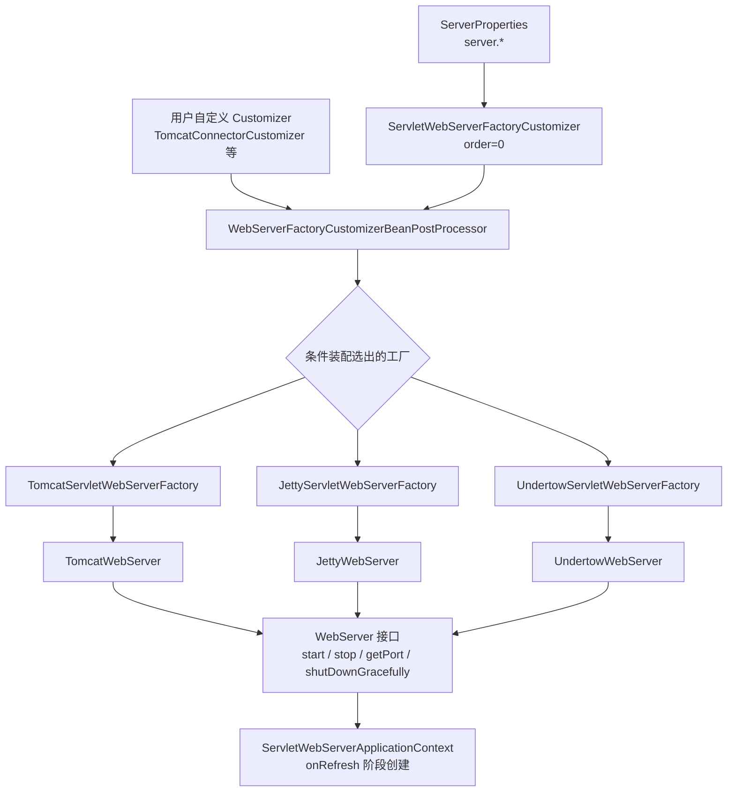
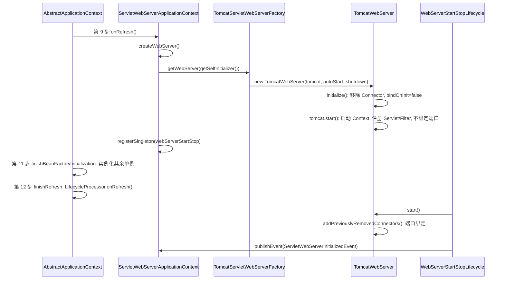
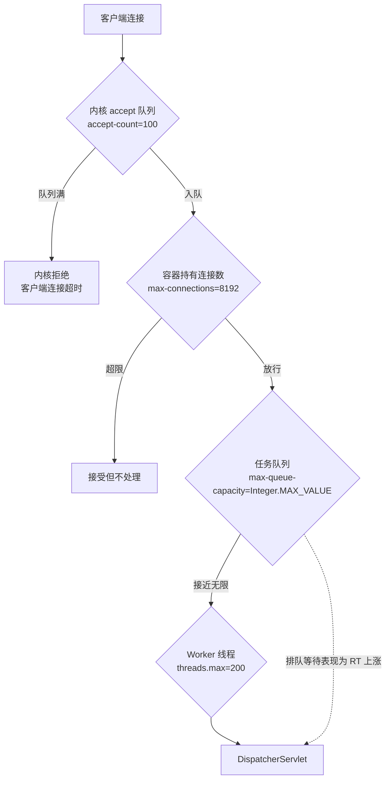
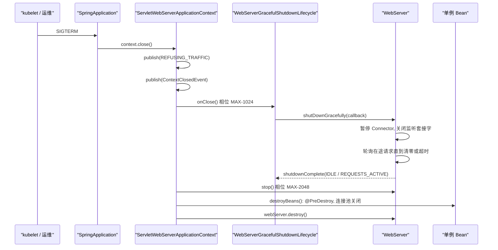

# 04 嵌入式Web容器——Tomcat、Jetty、Undertow的启动与配置

**摘要：**

Spring Boot 把 Web 服务器从"应用的宿主"改成了"应用的依赖"：`spring-boot-starter-web` 顺带把 `tomcat-embed-core` 拉进 Fat JAR，`java -jar` 起来的进程既是应用也是服务器。这个翻转把问题的性质换掉了——容器的创建时机、端口绑定、配置归属与停机顺序，从此都是启动链路里的一段代码，而不是服务器上一份独立的 XML。本文以 Spring Boot 3.5、Tomcat 10.1、Jetty 12、Undertow 2.3 的源码为基准，沿 `ServletWebServerApplicationContext.onRefresh()`、`ServletWebServerFactory.getWebServer()`、`WebServerStartStopLifecycle.start()` 这条链路拆开容器被创建与被启动的全过程，并纠正一处流传很广的误读：Servlet 上下文的启动与端口绑定并不发生在同一个阶段，`@PostConstruct` 执行时端口尚未监听。后半部分转向生产：三种容器并发模型的可量化差异、`server.tomcat.*` 里几道闸门的真实语义、优雅停机的相位顺序与超时预算、HTTPS 与 HTTP/2 与压缩的落点，以及启动失败时第一行错误该往哪里读。全文用一个订单服务贯穿，落点是：容器选型与参数调优的判据来自业务阻塞比例和部署形态，而非基准测试排行榜上的数字。读完之后应当能回答两个问题：容器在启动链路里究竟于哪一步被创建、哪一步开始监听；以及一份部署在 Kubernetes 上的服务，其容器配置的每一个旋钮背后在拿什么换什么。

---

## 第 1 章 从"宿主"到"依赖"

### 1.1 外置容器留下的三笔账

在 Spring Boot 出现之前，一个 Java Web 应用的部署形态是固定的：运维先在机器上装好 Tomcat 或 WebLogic，把 `webapps` 目录的属主、JVM 参数、`server.xml` 里的 Connector 调好，开发再把 WAR 包交过去。这套分工在"一台机器跑五个应用、中间件由运维统管"的年代是合理的，职责切得干净，代价则记在另外三本账上。

第一本是环境账。`server.xml` 里的 `maxThreads`、`connectionTimeout`、`URIEncoding` 属于"部署环境"，不在版本控制里，开发机上的 Tomcat 8.5 与生产上的 Tomcat 9 对同一个请求可能给出不同行为。第二本是构建账。WAR 包的构建产物只包含应用与依赖，容器版本是运行期才确定的变量，"在我机器上能跑"这类问题没有技术手段可以排除，只能靠流程和规范兜住。第三本是启动账。容器的启动、应用的初始化、连接池的建立由不同的进程和不同的配置文件驱动，出问题时日志分散在 `catalina.out` 与业务日志两处，第一现场经常不完整。

这三本账在微服务里被放大了：服务实例数从个位数涨到三位数，每一次"机器上 Tomcat 版本不一致"都变成一次不可复现的线上问题。

### 1.2 翻转的实质是把版本钉进构建产物

Spring Boot 的做法不是"把 Tomcat 塞进 JAR"这一句话能概括的，真正的变化是把 Web 服务器从运行环境降级为一个普通依赖。`tomcat-embed-core` 是一个不含启动脚本、不含 `conf/` 目录、可以直接 `new Tomcat()` 的库，它和 Jackson、HikariCP 一样由 Maven 解析、由 BOM 锁定版本、被打进 Fat JAR。容器的版本因此进入了代码仓库，构建产物与运行环境重新合一。

代价是容器的生命周期没人管了。外置容器时代，容器的启停由运维的脚本和 service 单元负责；内嵌之后，谁创建 Connector、什么时候绑定端口、什么时候停止接受连接、什么时候销毁 Servlet 上下文，这些原本属于运维的决策全部下沉成启动链路里的一步。Spring Boot 的回答是三件东西：`ServletWebServerApplicationContext` 负责"谁创建容器"，`WebServer` 与 `ServletWebServerFactory` 负责"创建什么"，`Lifecycle` 的相位负责"什么时候启动、按什么顺序停"。

| 维度 | 外置容器 | 内嵌容器 |
| --- | --- | --- |
| 容器版本决定时机 | 部署时，由运维选择 | 构建时，由 BOM 锁定 |
| 配置归属 | `server.xml` 与 `context.xml`，在部署环境 | `application.yml` 的 `server.*`，随代码走 |
| 启动入口 | 容器进程先起，应用被容器加载 | JVM 主类先起，容器在 `refresh()` 中被创建 |
| 停机顺序 | 容器停 → 应用销毁 | 应用控制容器：摘流 → 等在途 → 停容器 → 销毁 Bean |
| 环境一致性 | 依赖流程约束 | 由构建产物保证 |
| 单机多应用 | 天然支持，共享容器 | 一个进程一个容器，靠进程密度换隔离 |

### 1.3 一个贯穿全篇的订单服务

笔者把后面所有讨论都挂在一个具体的服务上：`order-service`，Spring Boot 3.5，默认引入 `spring-boot-starter-web` 因而使用 Tomcat，对外只暴露 REST 接口，下游有 MySQL 与两个内部 HTTP 服务，部署在 Kubernetes 上，副本数按 QPS 水平扩缩。这个服务的特征是读多写少、单请求耗时以数据库 IO 为主、P99 目标是 200ms 以内。它的容器配置要不要改、改成什么样，取决于后面几章拆开的机制，而不是取决于某个调优清单。

---

## 第 2 章 抽象层：四件事、一个方法与一个后处理器

### 2.1 WebServer 只承诺四件事

Spring Boot 用一个极窄的接口屏蔽三家服务器的差异。3.5 的 `WebServer` 只有四个方法：`start()`、`stop()`、`getPort()`、`shutDownGracefully(callback)`，以及一个默认实现为空的 `destroy()`。这个接口刻意不暴露任何容器特有的概念——没有 Connector，没有 Handler，没有 XNIO 的 Worker，因为暴露了就失去抽象的意义。需要容器特有能力的场景，走的是定制器（customizer）而不是这个接口。

`getPort()` 的语义需要单独说一句：它返回的是实际监听端口，而非配置端口。`server.port=0` 时配置端口是 0，实际端口要等连接器完成绑定后才确定，这也是为什么测试里拿随机端口必须通过事件或 `@LocalServerPort`，而不能读配置。

```java
public interface WebServer {

    void start() throws WebServerException;

    void stop() throws WebServerException;

    // 实际监听端口；server.port=0 时只有绑定完成后才有意义
    int getPort();

    // 默认实现直接回调 IMMEDIATE，即"不支持优雅停机"
    default void shutDownGracefully(GracefulShutdownCallback callback) {
        callback.shutdownComplete(GracefulShutdownResult.IMMEDIATE);
    }

    default void destroy() {
    }
}
```

三个实现类分别是 `TomcatWebServer`、`JettyWebServer`、`UndertowWebServer`，各自持有一个原生服务器对象（`org.apache.catalina.startup.Tomcat`、`org.eclipse.jetty.server.Server`、`io.undertow.Undertow`）。抽象层到这里就结束了，剩下的复杂度全在工厂里。

### 2.2 ServletWebServerFactory 只有一个方法

`ServletWebServerFactory` 是函数式接口，唯一的方法是 `getWebServer(ServletContextInitializer... initializers)`。参数是一个可变数组，含义是"容器启动时要执行的初始化器"——Spring MVC 的 `DispatcherServlet`、所有 `Filter`、所有 `ServletRegistrationBean`，最终都以这个形式交给容器。这个设计把"注册 Servlet"这件容器相关的事，转换成了"提供一组回调"这件与容器无关的事。

`ServletWebServerFactory` 的继承链分三层接口，每层加一批能力，最后落在一个公共抽象实现上：

| 类型 | 职责 | 典型方法 |
| --- | --- | --- |
| `WebServerFactory` | 标记接口，无方法 | — |
| `ConfigurableWebServerFactory` | 端口、地址、SSL、HTTP/2、压缩、错误页 | `setPort`、`setSsl`、`setSslBundles`、`setHttp2`、`setCompression`、`setErrorPages` |
| `ConfigurableServletWebServerFactory` | Servlet 专属：上下文路径、Session、JSP、MIME、文档根 | `setContextPath`、`setSession`、`setRegisterDefaultServlet`、`addMimeMappings` |
| `AbstractServletWebServerFactory` | 公共实现，持有 `initializers` 合并逻辑 | `mergeInitializers`、`getValidDocumentRoot` |

错误页挂在 `ConfigurableWebServerFactory` 上（它同时继承 `ErrorPageRegistry`），这个位置很关键：容器级错误页是工厂的职责，不是 MVC 的职责，两者的差别在第 8 章展开。

### 2.3 工厂是怎么被选出来的

三个工厂不是"启动时探测一下有没有 Tomcat"这么随意，它们由 `ServletWebServerFactoryAutoConfiguration` 通过嵌套配置类按条件导入，每个嵌套类都带 `@ConditionalOnMissingBean(ServletWebServerFactory.class, search = SearchStrategy.CURRENT)`。`SearchStrategy.CURRENT` 意味着只检查当前上下文，不往父上下文找，避免父子容器各有一个工厂时行为漂移。

```java
// ServletWebServerFactoryAutoConfiguration.java
@AutoConfiguration(after = SslAutoConfiguration.class)
@AutoConfigureOrder(Ordered.HIGHEST_PRECEDENCE)
@ConditionalOnClass(ServletRequest.class)
@ConditionalOnWebApplication(type = Type.SERVLET)
@EnableConfigurationProperties(ServerProperties.class)
@Import({ ServletWebServerFactoryAutoConfiguration.BeanPostProcessorsRegistrar.class,
        ServletWebServerFactoryConfiguration.EmbeddedTomcat.class,
        ServletWebServerFactoryConfiguration.EmbeddedJetty.class,
        ServletWebServerFactoryConfiguration.EmbeddedUndertow.class })
public class ServletWebServerFactoryAutoConfiguration {
}

// ServletWebServerFactoryConfiguration.java
@Configuration(proxyBeanMethods = false)
class ServletWebServerFactoryConfiguration {

    @Configuration(proxyBeanMethods = false)
    @ConditionalOnClass({ Servlet.class, Tomcat.class, UpgradeProtocol.class })
    @ConditionalOnMissingBean(value = ServletWebServerFactory.class, search = SearchStrategy.CURRENT)
    static class EmbeddedTomcat {

        @Bean
        TomcatServletWebServerFactory tomcatServletWebServerFactory(
                ObjectProvider<TomcatConnectorCustomizer> connectorCustomizers,
                ObjectProvider<TomcatContextCustomizer> contextCustomizers,
                ObjectProvider<TomcatProtocolHandlerCustomizer<?>> protocolHandlerCustomizers) {
            TomcatServletWebServerFactory factory = new TomcatServletWebServerFactory();
            factory.getTomcatConnectorCustomizers().addAll(connectorCustomizers.orderedStream().toList());
            factory.getTomcatContextCustomizers().addAll(contextCustomizers.orderedStream().toList());
            factory.getTomcatProtocolHandlerCustomizers().addAll(protocolHandlerCustomizers.orderedStream().toList());
            return factory;
        }
    }
}
```

条件判定用的是"类是否在类路径上"，因此切换容器的标准做法是排除默认 starter 再引目标 starter：排掉 `spring-boot-starter-tomcat` 之后 `Tomcat.class` 不可见，`EmbeddedTomcat` 整体不生效；引入 `spring-boot-starter-jetty` 之后 Jetty 的条件满足，工厂随之注册。业务代码一行不改。

这里的反向失败很常见，也容易被误诊：只排除了 Tomcat 却没有引入其他 starter，三个条件全不满足，上下文里一个 `ServletWebServerFactory` 都没有，`getWebServerFactory()` 抛 `MissingWebServerFactoryBeanException`，日志里看不到任何与 Tomcat 相关的错误行，只有 `Unable to start ServletWebServerApplicationContext due to missing ServletWebServerFactory bean`。第二个反向失败是"不小心有两个"：手工声明了一个 `TomcatServletWebServerFactory` 而自动配置又没被排除，启动时报 `Unable to start ServletWebServerApplicationContext due to multiple ServletWebServerFactory beans`，异常信息里直接列出两个 Bean 名。

### 2.4 定制器与那个后处理器

`server.*` 的配置是怎样落到容器上的？路径是 `ServerProperties` → `ServletWebServerFactoryCustomizer` → 工厂的字段 → 容器原生对象。`ServletWebServerFactoryCustomizer` 实现 `WebServerFactoryCustomizer<ConfigurableServletWebServerFactory>` 且 `getOrder()` 返回 0，它是一个普通 Bean，靠 `WebServerFactoryCustomizerBeanPostProcessor` 在工厂 Bean 初始化的**前一步**被调用：

```java
public class ServletWebServerFactoryCustomizer
        implements WebServerFactoryCustomizer<ConfigurableServletWebServerFactory>, Ordered {

    private final ServerProperties serverProperties;

    @Override
    public int getOrder() {
        return 0;
    }

    @Override
    public void customize(ConfigurableServletWebServerFactory factory) {
        PropertyMapper map = PropertyMapper.get().alwaysApplyingWhenNonNull();
        map.from(this.serverProperties::getPort).to(factory::setPort);
        map.from(this.serverProperties::getAddress).to(factory::setAddress);
        map.from(this.serverProperties.getServlet()::getContextPath).to(factory::setContextPath);
        map.from(this.serverProperties::getSsl).to(factory::setSsl);
        map.from(this.serverProperties.getServlet()::getSession).to(factory::setSession);
        map.from(this.serverProperties::getCompression).to(factory::setCompression);
        map.from(this.serverProperties::getHttp2).to(factory::setHttp2);
        map.from(this.serverProperties.getShutdown()).to(factory::setShutdown);
        map.from(() -> this.sslBundles).to(factory::setSslBundles);
        // ...
    }
}
```

用后处理器而不是直接改工厂 Bean，换来的是"多个定制器可以共存且顺序可控"：所有 `WebServerFactoryCustomizer` 被收集起来按 `Order` 排序，依次调用。用户自己的定制器只要实现同一个接口就能插进这条链，不需要 `@Primary` 也不需要覆盖自动配置。定制器可以定义成 `@Component`，也可以在配置类里用 `@Bean` 声明——前者在组件扫描范围内，后者更便于按 Profile 控制。

定制器能做的事情远不止改字段，譬如给 Tomcat 挂 `Valve`、改 `Connector` 的 `maxPostSize`、往 `Context` 里塞 `Manager`：

```java
@Component
public class OrderTomcatCustomizer implements WebServerFactoryCustomizer<TomcatServletWebServerFactory> {

    @Override
    public void customize(TomcatServletWebServerFactory factory) {
        factory.addContextValves(new AccessLogValve());          // 容器级访问日志，先于 Filter 执行
        factory.addConnectorCustomizers((connector) ->
                connector.setMaxPostSize(10 * 1024 * 1024));     // 单个请求体上限 10MB
    }
}
```

三层抽象的协作关系如下：工厂由条件装配选出，`ServletWebServerApplicationContext` 在 `onRefresh()` 里向工厂要一个 `WebServer`，`WebServer` 的实现把原生服务器包起来交给 `Lifecycle` 管理。



`WebServerFactoryCustomizerBeanPostProcessor` 的时机值得单独记一笔：它在工厂 Bean 初始化前调用定制器，因此定制器看到的是"已经被 `ServerProperties` 改过一遍"的工厂对象；如果定制器里直接 `setPort`，会覆盖 `server.port`，而不是被 `server.port` 覆盖。这个先后顺序解释了一类"配了 `server.port` 却不生效"的困惑：默认顺序下，代码里硬编码的 `setPort` 会覆盖配置值，除非给定制器显式设一个负的 `Order` 抢在自动配置之前执行。

---

## 第 3 章 启动链路：一次 refresh，两段启动

### 3.1 onRefresh 在 refresh() 的第 9 步

`AbstractApplicationContext.refresh()` 是十二步的固定序列：`prepareRefresh` → `obtainFreshBeanFactory` → `prepareBeanFactory` → `postProcessBeanFactory` → `invokeBeanFactoryPostProcessors` → `registerBeanPostProcessors` → `initMessageSource` → `initApplicationEventMulticaster` → `onRefresh` → `registerListeners` → `finishBeanFactoryInitialization` → `finishRefresh`。`ServletWebServerApplicationContext` 覆写的是第 9 步：

```java
@Override
protected void onRefresh() {
    super.onRefresh();
    try {
        createWebServer();
    }
    catch (Throwable ex) {
        throw new ApplicationContextException("Unable to start web server", ex);
    }
}
```

这一步的位置决定了两件事：它发生在所有 `BeanFactoryPostProcessor` 与 `BeanPostProcessor` 注册之后，因此容器创建时自动配置和 AOP 基础设施已经就位；它发生在 `finishBeanFactoryInitialization` 之前，因此绝大多数单例 Bean（`@Service`、`@Repository`、`@Controller`）此刻还没有被创建。第 1 章说"容器在启动链路里被创建"，精确的说法是在这一步。

### 3.2 createWebServer 做了三件事

```java
private void createWebServer() {
    WebServer webServer = this.webServer;
    ServletContext servletContext = getServletContext();
    if (webServer == null && servletContext == null) {
        StartupStep createWebServer = getApplicationStartup().start("spring.boot.webserver.create");
        ServletWebServerFactory factory = getWebServerFactory();
        createWebServer.tag("factory", factory.getClass().toString());
        this.webServer = factory.getWebServer(getSelfInitializer());
        createWebServer.end();
        getBeanFactory().registerSingleton("webServerGracefulShutdown",
                new WebServerGracefulShutdownLifecycle(this.webServer));
        getBeanFactory().registerSingleton("webServerStartStop",
                new WebServerStartStopLifecycle(this, this.webServer));
    }
    // ...
    initPropertySources();
}
```

第一件是拿到唯一的工厂 Bean，第二件是向工厂要 `WebServer`，第三件是把两个 `SmartLifecycle` 单例注册进 BeanFactory。注意第三件事的时机：`registerSingleton` 发生在 `finishBeanFactoryInitialization` 之前，因此这两个生命周期对象会作为"已存在的单例"参与后面的 `LifecycleProcessor` 处理，而不会被当作普通 Bean 去初始化。

第二件事里的 `getSelfInitializer()` 是一个方法引用，指向 `selfInitialize(ServletContext)`：容器在启动过程中回调它，它负责把当前 `ApplicationContext` 发布成 `ServletContext` 的根上下文、注册 application scope，然后逐个调用 `ServletContextInitializer` Bean 的 `onStartup`。`DispatcherServlet`、`Filter`、`ServletRegistrationBean` 都是在这一刻被真正注册进容器的。

### 3.3 TomcatWebServer 的构造：上下文启动，端口不绑

`TomcatServletWebServerFactory.getWebServer()` 组装完 `Tomcat` 对象后调用 `new TomcatWebServer(tomcat, getPort() >= 0, getShutdown())`，构造函数的第一件事是 `initialize()`。3.5 的 `initialize()` 里有三个动作值得逐字读：

```java
private void initialize() throws WebServerException {
    logger.info("Tomcat initialized with " + getPortsDescription(false));
    synchronized (this.monitor) {
        // ...
        Context context = findContext();
        context.addLifecycleListener((event) -> {
            if (context.equals(event.getSource()) && Lifecycle.START_EVENT.equals(event.getType())) {
                // 移除 Connector，避免服务启动时发生协议绑定
                removeServiceConnectors();
            }
        });
        disableBindOnInit();
        // 启动服务器，触发初始化监听器
        this.tomcat.start();
        // 把容器线程里的启动异常搬到主线程抛出
        rethrowDeferredStartupExceptions();
        // Tomcat 的线程都是 daemon，需要一条非 daemon 线程把 JVM 撑住
        startNonDaemonAwaitThread();
    }
}
```

`disableBindOnInit()` 给每个 Connector 设置 `bindOnInit=false`，配合监听器里移除 Connector 的动作，`tomcat.start()` 只启动 Engine、Host、Context 这一层，Servlet 容器完成了初始化，`TomcatStarter` 回调了 `selfInitialize`，`DispatcherServlet` 完成 `init`，但监听端口这件事被推迟到了后一个方法。日志在这里打的是 `Tomcat initialized with port 8080 (http)`，注意动词是 initialized 而不是 started。

端口在后一个方法里才绑定：

```java
@Override
public void start() throws WebServerException {
    synchronized (this.monitor) {
        if (this.started) {
            return;
        }
        addPreviouslyRemovedConnectors();      // Connector 重新加回 Service，此时 bind
        Connector connector = this.tomcat.getConnector();
        if (connector != null && this.autoStart) {
            performDeferredLoadOnStartup();    // load-on-startup 的 Servlet 在这里实例化
        }
        checkThatConnectorsHaveStarted();
        this.started = true;
        logger.info(getStartedLogMessage());   // "Tomcat started on port 8080 (http)"
    }
}
```

`start()` 的调用者是 `WebServerStartStopLifecycle`，一个 `SmartLifecycle`，相位是 `WebServerGracefulShutdownLifecycle.SMART_LIFECYCLE_PHASE - 1024`，即 `Integer.MAX_VALUE - 2048`。所有 `SmartLifecycle` 的 `start()` 在 `refresh()` 的第 12 步 `finishRefresh()` 里由 `LifecycleProcessor.onRefresh()` 统一调用，相位小的先启动。

把三段拼起来，就得到完整的顺序：



Jetty 与 Undertow 用不同手法达到同一效果。`JettyWebServer` 的构造函数里就调了 `server.start()`，但在启动前先 `getConnectors()` 把 Connector 数组缓存下来、再 `setConnectors(null)`，注释写得很明白：阻止请求在应用上下文就绪前被处理；`JettyWebServer.start()` 里把 Connector 装回去并逐个 `connector.start()`，端口到这一步才绑定，`BindException` 也在这一步被翻译成 `PortInUseException`。`UndertowWebServer` 更彻底：构造时只持有 `Undertow.Builder`，`start()` 里才 `builder.build()` 再 `start()`。

三家的手法不同，目的一致：让 Servlet 上下文先就绪，让监听后发生，并把"开始监听"这个事件交给 `Lifecycle` 的统一调度。

### 3.4 于是 @PostConstruct 里到底有什么

这段链路能推出一个与直觉相反的结论：普通单例 Bean 的 `@PostConstruct` 执行时，Servlet 上下文已经启动、`DispatcherServlet` 已经完成初始化，但端口还没有开始监听。

`@PostConstruct` 的触发点在 `finishBeanFactoryInitialization`，它排在 `onRefresh` 之后、`finishRefresh` 之前。端口绑定在 `finishRefresh` 里。所以在这个时间点上：`Environment` 完全可用（第 1 至 4 步就准备好了）；`WebServer` 实例可取（`ServletWebServerApplicationContext.getWebServer()` 非空）；`getPort()` 拿到的是**未绑定状态**的值（`connector.getLocalPort()` 此时返回 -1）；试图用 `RestTemplate` 调用自己的端口会得到连接被拒绝。

这解释了一类反复出现的问题：有人在 `@PostConstruct` 里调自己的健康检查接口做"启动自检"，本地偶尔能通、容器里必然失败，因为自检代码跑在端口监听之前。正确的挂点是 `ApplicationReadyEvent` 或 `ServletWebServerInitializedEvent` 的监听器——后者的发布点就在 `WebServerStartStopLifecycle.start()` 里，`webServer.start()` 之后一行。

| 时机 | 在 refresh 的哪一步 | 端口是否监听 | 适合做什么 |
| --- | --- | --- | --- |
| `@PostConstruct`（普通单例） | 第 11 步 | 否 | 校验配置、预热本地缓存、初始化连接池 |
| `ServletWebServerInitializedEvent` 监听器 | 第 12 步，`webServer.start()` 之后 | 是，且 `getPort()` 已返回真实端口 | 记录实际端口、向注册中心注册自身、自检回调 |
| `ApplicationReadyEvent` 监听器 | `refresh()` 返回之后，`SpringApplication.run` 末尾 | 是 | 启动流量、打印就绪日志、触发预热任务 |
| `@PreDestroy` / `DisposableBean` | `context.close()` 的 `destroyBeans()` | 端口已关闭，在途请求已结束或超时 | 释放资源、刷缓冲、注销注册 |

`server.port=0` 的场景把这个顺序问题放大。取随机端口有三种写法，可靠性依次递减：监听 `ServletWebServerInitializedEvent` 读 `getPort()` 最稳；用 `@LocalServerPort`（测试上下文里由 `LocalServerPort` 注入）次之，它内部也是从前面的初始化事件取值；直接读 `Environment` 的 `local.server.port` 属于"碰运气"，因为这个属性是容器启动后回写的，读的时机不对就拿到空值。集成测试里 `@SpringBootTest(webEnvironment = RANDOM_PORT)` 之所以能用 `TestRestTemplate` 直接打真实端口，靠的正是"事件已经发布、端口已经绑定"这个前提。

### 3.5 为什么要把启动拆成两段

如果只为"启动一个服务器"，`initialize()` 里直接绑定端口、直接 `start()` 就够了，Boot 却拆成两段并由 `Lifecycle` 调度，动机在代码结构里看得很清楚。

其一是让启动与停机共用一套顺序表。`LifecycleProcessor` 启动时按相位升序、关闭时按相位降序，`WebServerStartStopLifecycle` 与 `WebServerGracefulShutdownLifecycle` 只需声明相位，就自动获得"优雅停机先于容器停止、容器停止先于 Bean 销毁"的顺序，不需要任何硬编码的回调链。其二是让绑定失败仍然落在 refresh 的异常路径里。绑定发生在第 12 步，异常从 `LifecycleProcessor` 抛回 `refresh()`，`ServletWebServerApplicationContext.refresh()` 的 catch 会统一 `webServer.stop()` 再 `destroy()`，把已经启动的上下文和半开的端口一起回收，进程以非零码退出；这条回收路径只写一次，无论失败发生在哪一步。其三是给测试与延迟启动留口：`autoStart=false` 的场景（用于只装配不监听的测试切片）在 `TomcatWebServer` 里是显式支持的参数。

理解了这两段，后面所有关于"启动慢""端口冲突""停机超时"的讨论才有落点：报 `Tomcat initialized` 与报 `Tomcat started` 之间的时间差是 Bean 初始化耗时，报 `Tomcat started` 之后才是端口真正对外可用。

---

## 第 4 章 三种容器的并发模型

### 4.1 Tomcat：一条 Acceptor、一条 Poller、一池 Worker

Tomcat 10.1 的 `NioEndpoint` 是三班倒的结构。一条 Acceptor 线程阻塞在 `ServerSocket.accept()` 上，把新连接注册进 Poller；Poller 线程持有 `Selector`，等某个连接上有字节可读或可写时，把连接包装成任务投给 Executor；Worker 线程执行 HTTP 解析、进入 `DispatcherServlet`、跑完业务代码、写回响应，这一步是阻塞的。

三班倒的分工决定了两者的数量级关系：Acceptor 与 Poller 属于 IO 侧，条数固定且极少（10.1 的 `NioEndpoint` 里各一条）；Worker 属于业务侧，条数由 `server.tomcat.threads.max` 控制，默认 200。所谓"NIO 高并发"，准确含义是"用两条 IO 线程看着上万个连接，只在有真实请求时才占用 Worker"，空闲的 Keep-Alive 连接在 Poller 的 `Selector` 上不消耗 Worker。

Worker 线程的复用点值得一看：请求结束后 `Processor` 不销毁，而是回收到 `processorCache`（默认 200，与默认线程数一致），下一个请求直接复用，省掉对象分配。这个缓存的容量与线程数强相关，线程数被改成几千而 `processor-cache` 不动时，多出来的线程会不断创建和丢弃 `Processor`，把一次调参变成一次额外的 GC 压力。

### 4.2 Jetty 12：多个 ManagedSelector 加一个队列线程池

Jetty 12 的 IO 侧比 Tomcat 宽：`SelectorManager` 管理多个 `ManagedSelector`，条数的默认计算是"有线程池时取 `max(1, min(CPU 核数 / 2, 池大小 / 16))`，否则取 `max(1, CPU 核数 / 2)`"。在 16 核、200 线程的订单服务上，这个公式给出 8 条 Selector 线程，是 Tomcat 的八倍，因此单条 Selector 上的事件压力更小，连接数极大时更不容易出现"某条 Selector 打嗝导致一批连接同时慢"。

业务侧是 `QueuedThreadPool`，默认 `min 8 / max 200`，空闲线程 60 秒后回收（`server.jetty.threads.idle-timeout`）。Jetty 的请求处理走 Handler 责任链：`SessionHandler` → `SecurityHandler` → `ServletHandler`，每一层都能短路，也能把处理权交给异步回调。链式设计让 Jetty 在"连接长期挂着、偶尔有事件"的场景里写起来更自然，WebSocket、SSE、长轮询都属于这一类。

Jetty 12 的坐标系必须交代清楚，这是升 3.x 时最容易踩的一处：Spring Boot 3.5 依赖的是 `org.eclipse.jetty.ee10` 命名空间下的 Jetty 12，`JettyServletWebServerFactory` 用到的 `WebAppContext`、`ServletContextHandler` 全部来自 `org.eclipse.jetty.ee10.*`。Jetty 11 的 `org.eclipse.jetty.webapp.WebAppContext` 在类路径上不满足条件，`EmbeddedJetty` 不会生效，最终表现为"排掉了 Tomcat、加了 Jetty 11 依赖、启动时报没有 WebServerFactory"。Jetty 12、Jakarta EE 10、Servlet 6.0 是一条链上的三个坐标，不能拆开挑。

### 4.3 Undertow：XNIO 的两层线程

Undertow 建立在 XNIO 之上，线程分两层：IO 线程与 Worker 线程。IO 线程跑 XNIO 的事件循环，负责收发数据、解析 HTTP 头；当请求需要进入阻塞代码（读数据库、调下游、跑 Servlet）时，IO 线程把任务交给 Worker，自己继续转。这一层分离比 Tomcat 更彻底——Tomcat 的 Poller 也做部分协议解析，Undertow 的 IO 线程则严格不碰业务。

Worker 的默认值来自 Undertow 自己的 `Builder`：`ioThreads = max(CPU 核数, 2)`，`workerThreads = ioThreads * 8`。16 核机器上就是 16 条 IO、128 条 Worker。Spring Boot 的 `server.undertow.threads.io` 与 `server.undertow.threads.worker` 默认留空，意味着不覆盖 Undertow 的推导值——这一点与 Tomcat 不同，Tomcat 的 200 是写死在 `ServerProperties` 里的。

每个连接的缓冲区也是 Undertow 的一处特色：`Builder` 按 JVM 最大堆推断缓冲策略，堆小于 64MB 用 512 字节堆内缓冲，小于 128MB 用 1KB 直接缓冲，再大就用约 16KB 的直接缓冲（`1024 * 16 - 20`，减去 20 字节留给协议头）。缓冲走池化，不随连接数线性增长，但直接内存的上限仍要留够，否则会在连接数上来之后收到 `OutOfMemoryError: Direct buffer memory`。

```mermaid
%%{init: {'theme': 'dracula'}}%%
graph TD
    subgraph T["Tomcat 10.1 (NIO)"]
        TA["Acceptor x1<br/>accept 新连接"] --> TP["Poller x1<br/>Selector 扫描就绪连接"]
        TP --> TW["Worker 池<br/>200 线程, min-spare 10"]
        TW --> TS["DispatcherServlet"]
    end
    subgraph J["Jetty 12"]
        JA["SelectorManager<br/>max(1, min(cores/2, threads/16))"] --> JB["QueuedThreadPool<br/>8 - 200 线程"]
        JB --> JC["Handler 责任链<br/>Session > Security > Servlet"]
    end
    subgraph U["Undertow 2.3 (XNIO)"]
        UA["IO 线程<br/>max(cores, 2)"] --> UB["Worker 线程<br/>io * 8"]
        UB --> UC["Servlet 部署<br/>DeploymentManager"]
    end
```



### 4.4 可量化的差异维度

三家的差异不在"谁更快"，而在"资源花在哪里、默认值由谁决定、换版本时哪个坐标会疼"。下面这张表把可比的部分列全，数值取自 Spring Boot 3.5 的配置元数据与各容器 3.5 时的依赖版本。

| 维度 | Tomcat 10.1 | Jetty 12 | Undertow 2.3 |
| --- | --- | --- | --- |
| 依赖坐标 | `tomcat-embed-core`（starter 默认引入） | `org.eclipse.jetty.ee10:*` | `io.undertow:undertow-core` 等 |
| IO 侧线程 | Acceptor 1 + Poller 1 | ManagedSelector ≈ CPU 核数 / 2 | IO 线程 = max(核数, 2) |
| 业务线程默认 | `threads.max` 200，`min-spare` 10 | `threads.max` 200，`min` 8 | Worker = IO 线程 × 8 |
| 每连接缓冲 | 读、写各 8192 字节（`socket.appReadBufSize` 等） | 由 `HttpConfiguration` 的输出缓冲决定 | 按堆大小推断，大堆时约 16KB 直接缓冲 |
| HTTP/2 | 自带 h2 与 h2c，无需额外依赖 | 需额外引 `jetty-http2-server`，h2 还需 ALPN 实现 | 通过 `UndertowOptions.ENABLE_HTTP2` 打开 |
| Servlet 规范 | 6.0（Jakarta EE 10） | 6.0，EE10 处理器 | 6.0 |
| 优雅停机实现 | 暂停 Connector + 关闭监听套接字 + 轮询在途 | `Connector.shutdown()` + 轮询活跃请求数 | `GracefulShutdownHandler` 暂停并等待 |
| 显式配置入口 | `TomcatConnectorCustomizer`、`TomcatContextCustomizer`、`TomcatProtocolHandlerCustomizer` | `JettyServerCustomizer` | `UndertowBuilderCustomizer`、`UndertowDeploymentInfoCustomizer` |

### 4.5 三笔可以自己算的账

所有基准测试的排名都可以被机型、JDK、TLS、请求体大小翻盘，但有几笔账可以用公开默认值算出来，结论与业务无关。以下数字都是**示例推算**，用于建立量级感，不是实测值。

线程栈：现代 JVM 的 `-Xss` 默认为 1MB（以对应 JDK 版本文档为准），200 条 Worker 线程意味着约 200MB 的栈地址空间被预留。这只是保留，不是驻留，但如果把 `threads.max` 调到 4000，光栈就是 4GB 的地址空间，32 位 JVM 直接起不来，64 位 JVM 也会因为页表和调度开销让 GC 线程的暂停变长。

连接缓冲：Tomcat 每个连接有一对 8KB 的读写缓冲，8192 个连接全占满时约 128MiB。这笔开销与 `max-connections` 成正比，与 `threads.max` 无关——这是"连接数"和"并发处理数"是两个维度的最直接证据。

Multipart：Tomcat 文档给过一个上界公式，`maxPartHeaderSize × maxPartCount × maxConnections × 2`，按默认的 512 字节、50、8192 计算约 400MB。也就是说，只要开着文件上传接口，`max-connections` 就是内存预算的乘数，调它之前先把上传接口的鉴权和大小限制理清楚。

| 推算项 | 公式 | 订单服务的量级（示例） |
| --- | --- | --- |
| Worker 栈空间预留 | `threads.max × Xss` | 200 × 1MB ≈ 200MB 地址空间 |
| Tomcat 连接缓冲 | `max-connections × (读 + 写)` | 8192 × 16KB ≈ 128MiB |
| Multipart 上界 | `maxPartHeaderSize × maxPartCount × maxConnections × 2` | 512B × 50 × 8192 × 2 ≈ 400MB |
| Undertow Worker | `max(核数, 2) × 8` | 16 核 → 128 条 |
| Jetty Selector | `max(1, min(核数/2, 池大小/16))` | 16 核、200 线程 → 8 条 |

### 4.6 选型判据

选型讨论经常被"哪个快"绑架，但对订单服务这类以数据库 IO 为主的应用，容器的吞吐差异被下游的等待时间淹没。真正决定取舍的是三件事：默认配置与业务形态是否匹配、需要的特性是否在 starter 里、出问题时能不能找到答案。

Tomcat 的默认值是"保守但够用"：200 线程对上万 QPS 的短请求服务是够的，8192 的连接上限对长连接客户端偏紧。Jetty 的长处是异步与长连接，但对订单服务这种同步阻塞的 REST 接口没有额外收益，反而多了一层 `jetty-http2-server` 的依赖管理。Undertow 的默认值最"自动"——IO 与 Worker 都由核数推导，容器镜像小，启动快，代价是社区资料少，遇到 XNIO 层的问题需要读源码。

笔者把判据压成三句话：团队里有 Jetty 或 Undertow 的运维经验，就选那个；需要 WebSocket、SSE、长轮询为主的场景，优先 Jetty；其余情况保持 Tomcat 默认，把注意力放在线程数、连接数与超时上。这三条的权重远高于任何 benchmark。

---

## 第 5 章 关键配置项与它们的代价

### 5.1 端口与地址

`server.port` 默认 8080，`server.address` 绑定地址，两个都落在 `ConfigurableWebServerFactory` 上。`server.port=0` 的含义是"由操作系统分配一个空闲端口"，实际端口要等绑定完成才知道，因此它只适合两类场景：集成测试里的 `RANDOM_PORT`，以及同一镜像要在一台机器上起多个实例的临时环境。生产环境用 0 会让 Service 的 `targetPort` 无从配置，健康检查也没法固定，几乎一定是错的。

`server.address` 在容器里也有讲究：不设时绑定 `0.0.0.0`，Pod 内其他容器与 kubelet 的探针都能访问；设成 `127.0.0.1` 会让探针失败，设成具体 Pod IP 会在重启换 IP 后失效。

### 5.2 四道闸门：连接从内核到 Servlet 要过四关

一个 HTTP 请求进入订单服务，要依次穿过**四道闸门**，每一道对应一个不同的配置项，把它们混为一谈是调参失序的根源。

第一道是内核的 accept 队列。`server.tomcat.accept-count`（默认 100）设置的是 `ServerSocket` 的 backlog，当 Worker 满、`max-connections` 也满时，新连接在这里排队，队列耗尽后内核直接拒绝，客户端看到的是连接超时或 `Connection reset`。

第二道是 `server.tomcat.max-connections`（默认 8192），它限制的是容器同时**持有**的连接数，包含空闲的 Keep-Alive 连接。达到上限后 Tomcat 仍接受一个连接但不处理它，OS 队列继续吸收后续连接。NIO 模式下把它设为 -1 表示不限制计数。

第三道是任务队列。`server.tomcat.threads.max-queue-capacity` 的默认值是 `Integer.MAX_VALUE`，意味着 Worker 池满之后任务几乎无限排队。这一条的后果需要说透：Tomcat 的默认行为不是拒绝过载，而是**把过载变成延迟**。压测时看到 QPS 上不去、RT 线性上涨、CPU 不高，队列里却堆着几千个任务，就是这道闸门在起作用。

第四道才是 Worker 线程池，`server.tomcat.threads.max` 与 `min-spare`。



### 5.3 超时与 Keep-Alive

`connection-timeout` 在 Tomcat 里是"接受连接后等请求行到达"的时间，Tomcat 自身默认 60000 毫秒，自带 `server.xml` 里写 20000，Spring Boot 的 `server.tomcat.connection-timeout` 默认留空即沿用 Tomcat 的值；`server.connection-timeout` 是跨容器的统一配置项。

`keep-alive-timeout` 默认留空，取 `connectionTimeout` 的值；`max-keep-alive-requests` 默认 100，表示一条长连接上最多处理 100 个请求后关闭。这两个值共同决定"空闲连接占用连接位"的时长，在高并发短请求的服务里，把 `max-keep-alive-requests` 保持默认、把 `keep-alive-timeout` 调小，可以显著降低 `max-connections` 的压力；反过来，如果前面有一层 Nginx 且它保持长连接，那么调小容器的 Keep-Alive 只会让 Nginx 频繁重连。

`connection-timeout` 最容易踩的坑是把它当作"请求处理超时"。它只管"连上来之后多久没发完整请求行"，业务慢查询与它无关；请求处理超时要么靠 HTTP 客户端侧设置，要么靠 `spring.mvc.async.request-timeout`（异步场景）。

### 5.4 线程数怎么估

定线程数之前先分清业务形态。CPU 密集型（加解密、图片处理、复杂计算）的线程数应接近核数，超出的线程只会抢 CPU；IO 密集型（数据库、下游 HTTP）可以用利特尔法则粗估：并发线程数 ≈ QPS × 单请求耗时（秒）。订单服务在 2000 QPS、平均耗时 20ms 时，需要的并发数是 40；P99 若到 200ms，按尾部估算则是 400，此时 200 线程会成为瓶颈，但把线程提到 400 之前要先看下游连接池是否撑得住——线程只是"等待的名额"，连接池只有 20 个连接时，加线程只会让更多线程排队等连接。

虚拟线程改变了这条规则。`spring.threads.virtual.enabled=true` 之后，Tomcat 用虚拟线程执行请求，`server.tomcat.threads.max` 不再起作用（配置元数据里对这个属性的描述明确写了"虚拟线程启用时无效"），线程数的约束从"操作系统线程上限"变成"每个请求的内存占用"。虚拟线程的细节属于 3.x 新特性的范围，见 [[10 3.x新特性——GraalVM Native Image与虚拟线程]]，这里只需记住一条：开了虚拟线程就别再调 `threads.max`，把精力放到连接池与信号量上。

### 5.5 那些容易被忽略的乘数

`server.tomcat.processor-cache` 默认 200，与默认线程数一致。它的作用是复用 `Processor` 对象，线程数被显著调大而它不动时，缓存命中率下降，每次请求都要新建 `Processor` 并让旧对象等 GC。

`server.tomcat.max-swallow-size` 默认 2MB，控制容器在请求体未被应用读取时愿意"吞掉"多少字节以保持连接可复用；把它调小会让大请求体在出错时直接断开连接，调大则意味着并发上传时容器愿意占更多内存。与之相关的 `max-http-form-post-size` 默认同样是 2MB，Spring MVC 的文件上传上限则是 `spring.servlet.multipart.max-file-size`（默认 1MB），三个限制分别位于容器、表单解析、`MultipartResolver` 三层，任何一个没放开都会让上传失败，而错误信息各不相同。

| 配置项 | 默认值 | 作用层 | 调大的代价 |
| --- | --- | --- | --- |
| `server.port` | 8080 | 绑定 | 0 只能用于测试或多实例临时环境 |
| `server.tomcat.threads.max` | 200 | 业务执行 | 栈内存、上下文切换、`processor-cache` 失配 |
| `server.tomcat.max-connections` | 8192 | 连接持有 | 每连接约 16KB 缓冲，multipart 场景放大为数百 MB |
| `server.tomcat.accept-count` | 100 | 内核队列 | 队列变长只增加等待，不增加吞吐 |
| `server.tomcat.threads.max-queue-capacity` | `Integer.MAX_VALUE` | 任务排队 | 过载被转成延迟，P99 无声劣化 |
| `server.tomcat.connection-timeout` | 留空（Tomcat 60000ms） | 首行读取 | 与业务超时无关，调大只延迟坏连接的回收 |
| `server.tomcat.max-keep-alive-requests` | 100 | 长连接复用 | 调大省握手，但空闲连接占连接位更久 |
| `server.tomcat.processor-cache` | 200 | 对象复用 | 调大占内存，调小增加分配 |
| `server.tomcat.max-part-count` | 50 | 分段上传 | 与 `max-connections` 相乘决定内存上界 |

---

## 第 6 章 优雅停机的真实时序

### 6.1 默认值在 3.4 变了

`server.shutdown` 的默认值在 Spring Boot 3.4 从 `immediate` 改成了 `graceful`，3.4 的发布说明写得很直白：内嵌 Web 服务器的优雅停机改为默认启用，需要恢复旧行为就显式设成 `immediate`。这意味着在 3.5 上升级上来、什么都没配的服务，已经在走优雅停机路径——但"开启"与"配好"是两件事，超时预算没对齐时，优雅停机只是把停机时间拉长，最终仍会被 `SIGKILL` 截断。

### 6.2 关闭链上的相位顺序

一次 `SIGTERM` 触发的关闭链，顺序由 `LifecycleProcessor` 的相位决定，各步的责任非常清楚：

1. `SpringApplication` 注册的 shutdown hook 被调用，`context.close()` 开始。
2. `ServletWebServerApplicationContext.doClose()` 先发布 `AvailabilityChangeEvent(REFUSING_TRAFFIC)`，把就绪状态切到"拒绝流量"。`/actuator/health/readiness` 从这个时刻开始返回 `OUT_OF_SERVICE`（HTTP 503），负载均衡据此把流量转走。
3. `AbstractApplicationContext.doClose()` 发布 `ContextClosedEvent`。
4. `LifecycleProcessor.onClose()` 按相位**降序**停止 `SmartLifecycle`。`WebServerGracefulShutdownLifecycle` 的相位是 `Integer.MAX_VALUE - 1024`，先执行：暂停连接器、关闭监听套接字、轮询在途请求，直到清零或相位超时。
5. `WebServerStartStopLifecycle`（相位 `Integer.MAX_VALUE - 2048`）接着执行 `webServer.stop()`，把 Connector 从 Service 上摘掉。
6. `destroyBeans()` 销毁所有单例：`@PreDestroy`、`DisposableBean.destroy()`、连接池关闭依次发生。
7. `ServletWebServerApplicationContext.doClose()` 的末尾调用 `webServer.destroy()`，释放 Tomcat 的 Engine、Host、Context 等对象。

第 4 步与第 6 步的先后是关键：在途请求必须在 **Bean 销毁**之前结束，否则请求线程会撞上已经关闭的 `DataSource`，报出 "Connection is closed" 这类二次故障。相位设计保证了这一点，而这份保证成立的前提是优雅停机真的生效——`WebServer.shutDownGracefully()` 的默认实现直接回调 `IMMEDIATE`，不支持优雅停机的容器（或 `server.shutdown=immediate`）会跳过第 4 步，第 5、6 步之间的窗口就此暴露。



### 6.3 三家容器怎么"等在途"

Tomcat 的实现最能说明"优雅"到底等了什么。`GracefulShutdown` 起一条名为 `tomcat-shutdown` 的线程，对每个 Connector 先 `pause()` 再 `closeServerSocketGraceful()`，前者让连接器不再接受请求，后者关闭监听套接字但允许已建立的连接读完；随后每 50 毫秒轮询一次，判据是两个计数：`StandardContext.getInProgressAsyncCount()` 大于 0 表示还有异步请求没完成，`StandardWrapper.getCountAllocated()` 大于 0 表示还有请求占着 Servlet 实例。两个计数都归零才回调 `IDLE`，被 `abort()` 打断则回调 `REQUESTS_ACTIVE`。日志上对应三行：`Commencing graceful shutdown`、`Graceful shutdown complete`、`Graceful shutdown aborted with one or more requests still active`。

Jetty 的做法是对每个 `Connector` 调用 `shutdown()`，拿到 `Future` 后等待，然后用 `StatisticsHandler.getRequestsActive()` 每 100 毫秒轮询。Undertow 则依赖 `GracefulShutdownHandler`：请求进入时计数加一，`shutdown()` 之后拒绝新请求并等待计数归零。三家的判据都是"在途请求数"，差别只在轮询间隔与计数来源，这也解释了为什么优雅停机的时长总是"略大于最慢的那个请求"。

### 6.4 超时是"每个相位"的预算

`spring.lifecycle.timeout-per-shutdown-phase` 默认 30s，它的语义是**每个相位**的超时，不是整次关闭的总时长。默认配置下，优雅停机相位最多等 30 秒，之后的 Bean 销毁另有自己的时间。超时不是错误：`LifecycleProcessor` 会打一条 INFO 日志 `Shutdown phase ... still running after timeout of 30000ms`，然后继续往下走，在途请求被强行中断。

这带来一条预算约束：Kubernetes 的 `terminationGracePeriodSeconds`（默认 30 秒）必须大于"优雅停机相位超时 + Bean 销毁耗时 + 一点余量"。默认值下两者都是 30 秒，属于**预算倒挂**——kubelet 会在优雅停机还没走完时发 `SIGKILL`，前面所有的等待都白费。订单服务的处理方式是把 `terminationGracePeriodSeconds` 设成 60，`spring.lifecycle.timeout-per-shutdown-phase` 保持 30s，中间留 30 秒给销毁与内核回收。

### 6.5 与 Kubernetes 的配合

kubelet 发送 `SIGTERM` 与 Endpoints 摘除是并行的，因此存在"进程已开始停机、流量还在进来"的窗口，`preStop` 的 `sleep` 与就绪探针的配合是解决这个窗口的手段，这部分属于 Kubernetes 的领域，机制细节见 [[04 优雅停机与滚动更新的零停机]]。对本文的边界而言，只需记住两个接口：容器侧提供"先切 REFUSING_TRAFFIC、再等在途、最后销毁 Bean"的顺序，编排侧负责"先摘流量、再发信号、给出足够的宽限期"。

| 停机阶段 | 谁在等 | 超时来自哪里 | 超时的后果 |
| --- | --- | --- | --- |
| 摘流量 | Endpoints 控制器、就绪探针 | `preStop` 与探针周期 | 仍有新请求打到正在停机的实例 |
| 等在途请求 | `WebServer.shutDownGracefully` | `spring.lifecycle.timeout-per-shutdown-phase` | 在途请求被中断，客户端看到连接重置 |
| 停容器 | `WebServerStartStopLifecycle` | 同一相位机制 | 一般不会超时 |
| 销毁 Bean | `destroyBeans()` | 无统一超时，取决于连接池与线程池实现 | 进程迟迟不退出，最终被 `SIGKILL` |

---

## 第 7 章 HTTPS、HTTP/2 与压缩的落点

### 7.1 server.ssl.* 没有被废弃

先澄清一处流传中的说法：`server.ssl.*` 在 Spring Boot 3.5 里并没有被标记为废弃，`Ssl` 类上的 `key-store`、`key-store-password`、`key-store-type`、`key-alias`、`enabled-protocols`、`ciphers`、`client-auth` 等属性全部有效，`server.ssl.enabled` 的默认值仍是 `true`。真正新增的是 SSL Bundle（3.1 起）：把证书、私钥、密码、协议打包成一个具名 bundle，放在 `spring.ssl.bundle.jks.<name>` 或 `spring.ssl.bundle.pem.<name>` 下，容器用 `server.ssl.bundle=<name>` 引用。

两种写法并存，取舍在于复用范围。`server.ssl.*` 只能描述"这台服务器用的证书"；bundle 能被 HTTP 客户端、RestTemplate、Kafka 等组件共同引用，改证书时只改一处。bundle 的另一个好处是支持 PEM 格式（`certificate` 加 `private-key` 两个文件），不必先转成 PKCS12，配合 `spring.ssl.bundle.watch.file.quiet-period`（默认 10s）可以在文件变更后重载——具体能力以对应版本文档为准，但方向很清楚：证书轮换正在从"重启发布"变成"换文件"。

### 7.2 HTTPS 在容器里的四个坑

第一个坑是证书位置与镜像的冲突。`server.ssl.key-store: classpath:keystore.p12` 把证书打进 JAR，好处是自包含，坏处是每次换证书都要重新构建、重新发布镜像；`file:/etc/tls/keystore.p12` 更符合容器习惯，密钥由 Secret 挂载，但要求启动时文件已经就位。两者没有对错，不过取舍标准很具体：团队是否接受"换证书等于一次发布"。

第二个坑是密码进配置文件。`server.ssl.key-store-password` 一旦写进 `application.yml`，就跟着代码进了仓库。可行做法是把密码放进环境变量（`SERVER_SSL_KEY_STORE_PASSWORD`），配置里写 `${TLS_KEYSTORE_PASSWORD}`。

第三个坑是双端口。同时开 HTTP 与 HTTPS 需要额外加一个 Connector，`TomcatServletWebServerFactory.addAdditionalTomcatConnectors()` 是标准做法；Jetty 用 `JettyServerCustomizer` 加 `ServerConnector`，Undertow 用 `UndertowBuilderCustomizer` 加 `addHttpListener`。三家的写法完全不同，这也是抽象层故意不统一的部分——多端口属于容器特有概念，硬统一会削掉必要的表达力。

```java
@Bean
WebServerFactoryCustomizer<TomcatServletWebServerFactory> additionalHttpConnector() {
    return (factory) -> {
        Connector http = new Connector(TomcatServletWebServerFactory.DEFAULT_PROTOCOL);
        http.setPort(8080);
        http.setScheme("http");
        http.setSecure(false);
        http.setRedirectPort(8443);      // 只有配合 security-constraint 才会真正跳转
        factory.addAdditionalTomcatConnectors(http);
    };
}
```

第四个坑是 `redirectPort` 不会自动跳转。设了 `redirectPort` 只是告诉容器"需要安全通道时该去哪个端口"，真正的跳转依赖 Servlet 的 `security-constraint` 配置，或者干脆在前面用网关做 301。把 `redirectPort` 当成"HTTP 自动跳 HTTPS"是常见误解。

### 7.3 HTTP/2 的依赖差异

`server.http2.enabled=true` 打开的是容器级的 HTTP/2 支持，实际协议取决于是否启用 SSL：启用 SSL 走 h2（ALPN 协商），未启用走 h2c（明文升级）。三家容器的依赖成本完全不同：

Tomcat 自带 h2c 与 h2，`TomcatServletWebServerFactory` 在 http2 开启时给 Connector 加一个 `Http2Protocol` 升级协议，无需额外依赖。Jetty 需要额外引入 `org.eclipse.jetty.http2:jetty-http2-server`，`spring-boot-starter-jetty` 不含这个包，缺了它启动时会抛 `NoClassDefFoundError: org/eclipse/jetty/http2/server/HTTP2CServerConnectionFactory`；要用 h2 还需要 ALPN 实现（`jetty-alpn-java-server` 用 JDK 自带支持，或 `jetty-alpn-conscrypt-server`）。Undertow 通过设置 `UndertowOptions.ENABLE_HTTP2` 打开，h2c 与 h2 都由 `undertow-core` 提供。

HTTP/2 还会改变第 5 章那道"连接数"闸门的含义。多路复用把多条并发请求折叠进一条 TCP 连接，`max-connections` 的消耗速度明显下降，但每条连接上的并发流数量受 `SETTINGS_MAX_CONCURRENT_STREAMS` 约束，压测工具的默认值往往很小，容易得出"开了 HTTP/2 反而更慢"的错误结论。

### 7.4 压缩：容器做还是网关做

`server.compression.enabled` 默认关闭，开启后默认只压缩大于 2KB 的响应（`min-response-size`），MIME 类型默认是一组文本类型（`text/html`、`text/xml`、`text/plain`、`text/css`、`text/javascript`、`application/javascript`、`application/json`、`application/xml`）。这些默认值放在 `Compression` 对象上，由 `ServerProperties` 映射到工厂。

压缩的取舍不在"开不开"，而在"在哪一层开"。容器压缩的优点是省一段网络往返的配置，缺点是占用 Worker 线程的 CPU（Tomcat 在写响应时同步压缩），且压缩发生在业务线程的尾部，会直接抬高 RT。网关或 CDN 压缩的优点是 CPU 花在专门的机器上、可以对静态资源统一处理、能使用 Brotli，缺点是内网这一段是明文。两者同时开启会出现重复压缩或双重开销：网关看到容器返回的 `Content-Encoding: gzip` 通常不会再压，但如果配置不当，就会出现"gzip 套 gzip"，客户端解一层得到乱码。

Brotli 不在内嵌容器的能力范围内，容器只提供 GZIP。想要 Brotli，要么在网关，要么引入额外的 Filter 实现，后者的代价是又多一段需要在容器里跑的代码。

| 能力 | Tomcat | Jetty | Undertow | 配置入口 |
| --- | --- | --- | --- | --- |
| HTTPS | 原生 | 原生 | 原生 | `server.ssl.*` 或 `server.ssl.bundle` |
| mTLS | `client-auth: need` | 同左 | 同左 | `server.ssl.client-auth` |
| HTTP/2 h2c | 自带 | 需 `jetty-http2-server` | 自带 | `server.http2.enabled` |
| HTTP/2 h2 | 自带 | 另需 ALPN 实现 | 自带 | 同上，且需启用 SSL |
| GZIP | 原生 | 原生 | 原生 | `server.compression.*` |
| Brotli | 不支持 | 不支持 | 不支持 | 交给网关或自定义 Filter |
| 双端口 | `addAdditionalTomcatConnectors` | `JettyServerCustomizer` | `UndertowBuilderCustomizer` | 编程式 |

### 7.5 反向代理之后 HTTPS 的隐形失真

订单服务部署在网关后面，TLS 在网关终止，容器看到的是明文 HTTP。此时 `request.getScheme()` 返回 `http`、`getServerPort()` 返回 8080，由此派生的 URL 全部失真：`ServletUriComponentsBuilder.fromCurrentRequest()` 拼出的地址是 `http://`，`response.sendRedirect()` 跳到 http，`Set-Cookie` 如果按 `secure` 规则判断也可能给出错误结果。

修复手段是让容器（或框架）信任代理头。两个开关：`server.forward-headers-strategy=native` 让 Tomcat 启用 `RemoteIpValve`、Jetty 启用 `ForwardedRequestCustomizer`、Undertow 启用对应的 listener，在容器层把 `scheme`、`remoteAddr`、`serverPort` 改写；`framework` 则注册一个 `ForwardedHeaderFilter`，在 Spring 层改写请求包装。前者的收益是 Servlet 层看到的就是真实信息，后者的收益是不依赖容器实现、行为在三个容器上一致。

**信任代理头**意味着信任 `X-Forwarded-*`，因此必须确保容器只接受来自网关的连接——直接暴露到公网又开着 `forward-headers-strategy`，攻击者可以伪造 `X-Forwarded-For` 绕过基于 IP 的限流。

---

## 第 8 章 静态资源与错误页

### 8.1 静态资源到底由谁处理

Spring Boot 默认把 `classpath:/META-INF/resources/`、`classpath:/resources/`、`classpath:/static/`、`classpath:/public/` 四个位置的资源当作静态资源，由 Spring MVC 的 `ResourceHttpRequestHandler` 处理。容器自带的 `DefaultServlet` 默认不注册，`server.servlet.register-default-servlet` 的默认值是 `false`——这一条经常被忽略，却决定了一个关键行为：静态文件的读取路径上多了一层 DispatcherServlet，`Filter`、`HandlerInterceptor`、安全链都会作用到静态资源上。

把 `register-default-servlet` 打开会让 Tomcat 再注册一个名为 `default` 的 `DefaultServlet` 并映射到 `/`，源码里把它标成 `overridable`，意思是 `DispatcherServlet` 的 `/` 映射可以覆盖它。于是静态资源出现两套处理路径，请求最终落到哪一套取决于映射解析结果与初始化顺序，`Filter`、安全链的覆盖范围也跟着变，排查成本远高于收益。对订单服务这类以 API 为主的应用，默认值就是最优解：静态资源只有 Swagger UI 与少量图标，交给 MVC 处理没有性能问题。

### 8.2 缓存的三个开关

`spring.web.resources.cache.period` 控制 `Cache-Control` 的 `max-age`，默认不设，也就是不带缓存头；`spring.web.resources.cache.cachecontrol.max-age` 是更细的替代写法；`use-last-modified` 默认开启，让容器返回 `Last-Modified` 并支持条件请求。三者叠加时的优先级容易搞混：`cachecontrol` 下的配置优先于 `period`。

真正能解决缓存问题的不是这几个时长，而是内容哈希版本化。`spring.web.resources.chain.strategy.content.enabled=true` 会把资源 URL 改写成 `/app-<hash>.js`，配合一年期的 `max-age`，既能长期缓存又不会读到旧文件。这套机制只对模板里通过 `@{}` 或 `ResourceUrlProvider` 生成的链接有效，硬编码的 `/static/app.js` 不会被改写——这是它最容易被误判为"没生效"的原因。

### 8.3 错误页的两层结构

错误页有两个层次，混在一起谈就会互相打架。

第一层是容器级：`ErrorPageRegistry`（`ConfigurableWebServerFactory` 继承了它）接受一组 `ErrorPage`，描述"某个状态码或某个异常应该转发到哪个路径"。这层是容器的能力，即使请求根本没进 `DispatcherServlet`（譬如 URL 不符合任何映射、请求头非法被容器直接拒绝），错误页也能生效。写法有两种：实现 `ErrorPageRegistrar` 并声明成 Bean，由 `ErrorPageRegistrarBeanPostProcessor` 收集；或者在自己的 `WebServerFactoryCustomizer` 里调用 `factory.addErrorPages(...)`。

```java
@Bean
ErrorPageRegistrar orderErrorPages() {
    return (registry) -> registry.addErrorPages(
            new ErrorPage(HttpStatus.NOT_FOUND, "/404.html"),
            new ErrorPage(HttpStatus.INTERNAL_SERVER_ERROR, "/500.html"));
}
```

第二层是框架级：Spring MVC 的 `BasicErrorController` 映射 `/error`，由 `server.error.*` 控制输出内容（`include-stacktrace`、`include-message`、`include-binding-errors` 默认都是 `never`，`include-exception` 默认 `false`，`whitelabel` 默认开启）。`server.error.path` 默认 `/error`，容器捕获到异常后 forward 到该路径，再由 `BasicErrorController` 生成 JSON 或 HTML。

两层的关系是"容器兜底、框架出内容"：没有自定义容器错误页时，容器把错误转发给 `/error`；一旦声明了状态码级错误页，该状态码的错误就不再走 `BasicErrorController`，而是直接返回静态页。这意味着自定义错误页时容易丢掉 API 的 JSON 错误体——给 API 服务加 `/404.html` 之前，先确认前端是否需要结构化的错误码。

`ErrorPageFilter` 是第三种东西，只在 WAR 部署、容器自己管理错误页时才需要，内嵌容器里它不参与。

| 配置 | 默认值 | 作用位置 | 常见误判 |
| --- | --- | --- | --- |
| `spring.web.resources.static-locations` | 四个 classpath 目录 | MVC `ResourceHttpRequestHandler` | 以为容器 `DefaultServlet` 在处理 |
| `server.servlet.register-default-servlet` | `false` | 容器 Servlet 注册 | 打开后与 DispatcherServlet 抢映射 |
| `spring.web.resources.cache.period` | 不设 | 响应头 | 与 `cachecontrol.max-age` 混用 |
| `spring.web.resources.chain.strategy.content.enabled` | `false` | URL 改写 | 硬编码 URL 不生效 |
| `server.error.path` | `/error` | 容器 → `BasicErrorController` | 改路径后忘记同步安全规则 |
| `server.error.include-stacktrace` | `never` | 错误响应体 | 生产误开导致泄露调用栈 |
| `ErrorPageRegistry` | 空 | 容器错误页 | 覆盖状态码后丢失 JSON 错误体 |

### 8.4 容器级还有两个开关

`server.mime-mappings` 把扩展名映射到 MIME 类型，默认值由容器与 Spring 各自的表拼起来，Tomcat 的 `conf/web.xml` 有一份，Spring Boot 又补了一份。冲突时以 `server.mime-mappings` 为准，它由 `ServletWebServerFactoryCustomizer` 调 `factory.addMimeMappings` 落到容器上。改这个配置最典型的场景是让 `.json` 返回 `application/json;charset=UTF-8` 之外的类型，或者给内部的二进制格式指定下载行为；改错的表现是浏览器把 JSON 当文件下载，或者 `Content-Type` 与 `Accept` 协商不上导致 406。

`server.servlet.context-path` 影响的是所有对外路径。设成 `/order` 之后，应用的每个 URL 都要带这个前缀，容器错误页里的 `/404.html` 按 Servlet 规范相对上下文根解析，实际对应的是 `/order/404.html`，因此错误页本身不会因为前缀而失效。真正会失效的是代码里写死的绝对路径：前端模板里的 `/css/app.css`、重定向里的 `/login`、健康检查里硬编码的 `http://localhost:8080/actuator/health`，它们打在根路径上，返回 404 却看不出与 `context-path` 有关。排查时先确认请求路径里有没有前缀，再确认这个前缀是不是由网关或 Ingress 剥掉。

---

## 第 9 章 启动失败定位

### 9.1 端口占用：`PortInUseException`

端口被占是启动失败里最常见的一类。Spring Boot 3.x 为此专门定义了 `PortInUseException`，`TomcatWebServer.start()` 里会先尝试把 `BindException` 识别成端口绑定问题再抛出，异常信息本身是 `Port 8080 is already in use`，`ConnectorStartFailureAnalyzer` 会把它渲染成一段更完整的失败分析：`The Tomcat connector configured to listen on port 8080 failed to start. The port may already be in use or the connector may be misconfigured.`，并附一条 `Verify the connector's configuration, identify and stop any process that's listening on port 8080, or configure this application to listen on another port.`

定位手段是 `ss -ltnp | grep 8080` 或 `lsof -i :8080`，在容器里则是 `kubectl exec` 进去看。需要区分的是"真的被占"与"上一个进程还没退干净"：优雅停机没走完就被重启时，旧进程可能还握着监听套接字，`SO_REUSEADDR` 只在 `TIME_WAIT` 状态下有用，`LISTEN` 状态的套接字不会被复用。滚动更新时新 Pod 用同一个端口不受影响（端口是 Pod 网络命名空间内的），但同一个容器里重启主进程就会出现这类失败。

`server.port=0` 在这种场景下是有用的诊断手段：改成 0 后能启动，说明问题确实在端口冲突，而不是容器创建失败。

### 9.2 Servlet 注册冲突

`DispatcherServlet` 的映射、`Filter` 的顺序、`ServletRegistrationBean` 的 URL 模式，最终都会落到 `ServletContext` 上，冲突时抛的是 `IllegalArgumentException`，信息里带着重复的名字或模式。三类冲突最常见：

一是同一个 `Servlet` 被注册两次。`@ServletComponentScan` 扫描到的 `@WebServlet` 与手工声明的 `ServletRegistrationBean` 指向同一个类，容器里会出现两个同名或同映射的 Servlet。

二是 `DispatcherServlet` 被声明成普通 `@Bean` 同时又由 `DispatcherServletAutoConfiguration` 注册，`ServletWebServerApplicationContext` 的自动注册逻辑（单个 Servlet 映射 `/`，多个 Servlet 用 Bean 名作前缀）会把映射关系改得与预期不同。容器初始化时会把所有 `ServletContextInitializer` 依次执行，重复注册不会报错到日志里，只会在第一次请求时表现为路由行为与预期不符。

三是 `Filter` 与 `DelegatingFilterProxyRegistrationBean` 同时在同一个 URL 模式上，顺序不确定导致鉴权失效。这类问题不会在启动时报错，只在运行时表现为"某些请求绕过了过滤器"。

### 9.3 读懂 `WebServerException` 的异常链

容器启动失败的异常通常有三层，从外往里读才能找到根因：

最外层是 `ApplicationContextException: Unable to start web server`，来自 `onRefresh()` 的 catch 块，只说明"Web 服务器没起来"。

中间层是 `WebServerException: Unable to start embedded Tomcat`，来自 `TomcatWebServer.initialize()` 的 catch，此时 `stopSilently()` 与 `destroySilently()` 已经把半启动的容器回收了，端口不会残留。这一层的关键信息在 `getCause()` 里。

最内层通常是业务代码抛出的异常。Tomcat 的 `TomcatStarter` 会把容器线程里 `ServletContextInitializer.onStartup` 抛出的异常暂存到 `startUpException` 字段，`initialize()` 随后调用 `rethrowDeferredStartupExceptions()` 把它搬回主线程——这就是为什么一个 `BeanCreationException` 会以"启动 Web 服务器失败"的形式出现。看到 `Unable to start embedded Tomcat` 时，往下翻到 `Caused by` 的最深处，那里才是真正没创建出来的 Bean。

另一类中间层异常是 `ConnectorStartFailedException`，它表示 Connector 处于 `FAILED` 状态但没有抛出 `BindException`，常见于协议处理器初始化失败（譬如 SSL 证书密码错误、密码套件不合法）。这类异常的排查入口是 Connector 的启动日志与 `ConnectorStartFailedException` 携带的端口号，而不是 Bean 创建链。

### 9.4 找不到工厂或找到多个

`MissingWebServerFactoryBeanException` 的含义是"上下文里没有任何 `ServletWebServerFactory`"，异常信息是 `Unable to start ServletWebServerApplicationContext due to missing ServletWebServerFactory bean`，典型成因是排除了默认 starter 却没引入替代品。失败分析会补一句 `Check the configured web application type.`，因为它同样会在 Web 应用类型推断错误时出现。

另一种是"有多个"：`Unable to start ServletWebServerApplicationContext due to multiple ServletWebServerFactory beans: tomcatServletWebServerFactory,myFactory`。这通常来自手工声明工厂 Bean 又没排除自动配置，处理方式是用 `@ConditionalOnMissingBean` 或排除自动配置类。

还有一种隐蔽情况是容器根本没被创建：显式设了 `spring.main.web-application-type=none`，或者在 `SpringApplication` 上手动调了 `setWebApplicationType(WebApplicationType.NONE)`。此时 `ApplicationContext` 正常刷新、日志显示启动成功、端口却不监听，`ServletWebServerApplicationContext` 被换成了普通的 `AnnotationConfigApplicationContext`。查证方法是看启动日志里有没有 `Tomcat initialized` 那一行。

| 症状 | 关键日志或异常 | 判据 | 处置 |
| --- | --- | --- | --- |
| 启动即失败，提示端口被占 | `PortInUseException`、`Port 8080 is already in use` | `ss -ltnp` 能看到监听者 | 杀掉旧进程或改端口，诊断时可用 `server.port=0` |
| `Unable to start embedded Tomcat` | `WebServerException` 包着 `BeanCreationException` | 异常链最内层是业务 Bean | 修 Bean，与容器无关 |
| 启动报 `ConnectorStartFailedException` | Connector 状态 `FAILED` | SSL 配置或协议处理器初始化失败 | 检查证书密码、协议与密码套件 |
| 无 WebServerFactory | `MissingWebServerFactoryBeanException` | 依赖树里没有容器实现 | 引入目标 starter |
| 多个 WebServerFactory | `multiple ServletWebServerFactory beans` | 手工声明与自动配置冲突 | 排除自动配置或用条件注解 |
| 启动成功但不监听 | 日志里没有 `Tomcat initialized` | `web-application-type` 被设为 none | 恢复 SERVLET 类型或去掉显式设置 |
| Servlet 重复注册 | `IllegalArgumentException` 带 Servlet 名或 URL 模式 | 注册来源重复 | 去掉 `@ServletComponentScan` 或手工注册之一 |

---

## 第 10 章 四类反例与一张基线

### 10.1 反例一：把 threads.max 调到几千

"线程数越多并发越高"是最贵的直觉。把 `server.tomcat.threads.max` 从 200 调到 4000，会同时发生四件事：栈空间预留从 200MB 量级涨到 4GB 量级；CPU 在 4000 条线程之间切换，缓存局部性被破坏，`vmstat` 的 `cs` 列暴涨；`processor-cache` 仍是 200，多出的线程反复创建 `Processor`，年轻代 GC 频率上升；`max-queue-capacity` 是 `Integer.MAX_VALUE`，线程变多只是让队列里排队的任务更快被取走，一旦下游变慢，4000 条线程会一起阻塞在数据库连接池上，把"过载"从"延迟升高"升级成"线程全部不可用"。

按利特尔法则反推更可靠：2000 QPS、平均 20ms 需要 40 条并发线程，P99 200ms 的场景按尾部算是 400。真实需求往往在百级别，把线程调到几千通常是掩盖了下游的慢。先看连接池大小（HikariCP 默认 10，生产常见 20 到 50），线程数超过"连接池大小 + 少量 CPU 任务"之后，多出来的线程只是在等连接。

### 10.2 反例二：开了 graceful 却不设预算

3.4 之后优雅停机默认开启，于是很多服务"以为配好了"。真实的失败长这样：`terminationGracePeriodSeconds` 用默认 30 秒，`spring.lifecycle.timeout-per-shutdown-phase` 也用默认 30 秒，kubelet 在 30 秒到点发 `SIGKILL`，而容器此时可能刚好走完在途等待、正在销毁连接池。表现是发布时偶发的 `Connection reset by peer`，比例不高、难以复现。

修法不是把两个值都调大，而是让预算有明确的分层：`terminationGracePeriodSeconds` 大于等于"优雅停机相位超时 + 销毁耗时 + 余量"，譬如 60 = 30 + 20 + 10。另外要注意"在途请求"的判定只覆盖容器关心的请求，如果请求里还有异步任务（`@Async`、自建线程池）在跑，容器计数清零并不代表业务真的做完了，这类任务需要自己接到 `ContextClosedEvent` 上做等待。

### 10.3 反例三：为了"新特性"换 Jetty

换容器的动机常常是"Jetty 更轻"或"Jetty 对异步支持更好"，踩坑则集中在依赖坐标上。第一个坑是 Jetty 版本与命名空间：Boot 3.5 要 Jetty 12 的 `org.eclipse.jetty.ee10`，依赖里混入 Jetty 11 的 `org.eclipse.jetty.webapp.WebAppContext` 会让 `EmbeddedJetty` 的条件不成立，报错却指向"没有 WebServerFactory"。第二个坑是 HTTP/2 依赖：`spring-boot-starter-jetty` 不含 `jetty-http2-server`，开了 `server.http2.enabled` 就在启动时 `NoClassDefFoundError`。第三个坑是把 Tomcat 特有的 API 写进了业务代码，`Valve`、`TomcatConnectorCustomizer`、`RemoteIpValve` 在 Jetty 上都不存在，换容器时这些定制器要么删除要么重写。

这三类坑的共同点是"编译能过、启动才炸"，因为容器类都是运行期才加载的。还有一个容易误判的细节：`spring-boot-starter-jetty` 与 `spring-boot-starter-undertow` 都会把 `tomcat-embed-el` 作为 EL 实现带进来，依赖树里出现 tomcat 字样不代表容器没切，判断依据要落在 `org.apache.catalina.startup.Tomcat` 这个类是否存在上。换容器之前用 `mvn dependency:tree` 核对依赖，用 `--debug` 的自动配置报告确认选中的工厂，比翻文档更快。

### 10.4 反例四：压缩与静态资源两头都做

容器开 GZIP、网关也开 GZIP，静态资源既要容器缓存又要 CDN 缓存，结果是"每一层都做了，每一层都没做对"：容器压缩占用了业务线程的 CPU，网关压缩又对已经压缩的响应再判一次类型；容器返回的 `Cache-Control` 与 CDN 的规则冲突时，以哪一层为准取决于响应头合并策略，排查成本远高于收益。合理的切法是按内容类型分工：静态资源与可缓存的 GET 响应交给 CDN 或网关，API 的 JSON 交给容器压缩，两者用 `mime-types` 区分，不要重叠。

### 10.5 订单服务的生产基线

把前九章的结论落成一份可以直接对照的基线。数值不是标准答案，而是"从默认值出发需要显式确认的项"。

| 配置 | 基线值 | 理由 |
| --- | --- | --- |
| `server.port` | 8080（容器内固定） | 生产不用 0，探针与 Service 需要固定端口 |
| `server.tomcat.threads.max` | 200，压测后按尾部耗时调整 | 默认已覆盖多数 IO 密集场景，先测再调 |
| `server.tomcat.threads.min-spare` | 20 | 避免流量突增时集中创建线程 |
| `server.tomcat.max-connections` | 8192，长连接网关前置时降到 2048 | 每连接约 16KB 缓冲，与内存预算挂钩 |
| `server.tomcat.accept-count` | 200 | 少量余量给突发握手，不必过大 |
| `server.tomcat.max-keep-alive-requests` | 100（默认） | 与网关的 Keep-Alive 策略对齐 |
| `server.shutdown` | `graceful`（3.4 起默认） | 显式写出以免升级后行为漂移 |
| `spring.lifecycle.timeout-per-shutdown-phase` | 30s | 与 `terminationGracePeriodSeconds=60` 形成分层预算 |
| `server.compression.enabled` | 由网关决定，容器侧按需 | 避免两层重复压缩 |
| `server.ssl.bundle` | 网关终止 TLS 时不设 | 容器内再做 TLS 会多一跳解析与证书管理 |
| `server.forward-headers-strategy` | `framework` | 网关后的 scheme 与客户端 IP 需要还原 |
| `server.error.include-stacktrace` | `never` | 避免错误响应泄露实现细节 |

### 10.6 落点

容器这一层没有"最优解"，只有**与部署形态匹配的默认值**。订单服务选 Tomcat，是因为团队熟悉它、排障资料多、`spring-boot-starter-web` 已经把它带来，而它的默认线程数与连接数对以数据库 IO 为主的服务是够用的；换成 Jetty 或 Undertow，收益主要体现在异步与长连接形态，代价是依赖坐标与定制器要重写一遍。

同样的判断适用于每个配置项：`threads.max` 的默认 200 不是拍脑袋，而是"多数服务的并发需求在一百上下"这一经验分布的中位；`max-connections` 的 8192 是"连接比线程多一个数量级"的体现；`server.shutdown` 从 `immediate` 改成 `graceful` 是把"停机期间的在途请求"当作正常情况而非异常。理解这些默认值背后的假设，才能在假设不成立时（长连接、大文件上传、超高 QPS）准确地把哪个旋钮拧到哪一边。

---

## 参考资料

1. `org.springframework.boot.web.servlet.context.ServletWebServerApplicationContext` 源码（3.5.x）：https://github.com/spring-projects/spring-boot/blob/3.5.x/spring-boot-project/spring-boot/src/main/java/org/springframework/boot/web/servlet/context/ServletWebServerApplicationContext.java
2. `org.springframework.boot.web.servlet.context.WebServerStartStopLifecycle` 源码（3.5.x）：https://github.com/spring-projects/spring-boot/blob/3.5.x/spring-boot-project/spring-boot/src/main/java/org/springframework/boot/web/servlet/context/WebServerStartStopLifecycle.java
3. `org.springframework.boot.web.context.WebServerGracefulShutdownLifecycle` 源码（3.5.x）：https://github.com/spring-projects/spring-boot/blob/3.5.x/spring-boot-project/spring-boot/src/main/java/org/springframework/boot/web/context/WebServerGracefulShutdownLifecycle.java
4. `org.springframework.boot.web.embedded.tomcat.TomcatWebServer` 源码（3.5.x）：https://github.com/spring-projects/spring-boot/blob/3.5.x/spring-boot-project/spring-boot/src/main/java/org/springframework/boot/web/embedded/tomcat/TomcatWebServer.java
5. `org.springframework.boot.web.embedded.tomcat.GracefulShutdown` 源码（3.5.x）：https://github.com/spring-projects/spring-boot/blob/3.5.x/spring-boot-project/spring-boot/src/main/java/org/springframework/boot/web/embedded/tomcat/GracefulShutdown.java
6. `org.springframework.boot.autoconfigure.web.ServerProperties` 源码（3.5.x，`server.shutdown` 默认值见 `Shutdown.GRACEFUL`）：https://github.com/spring-projects/spring-boot/blob/3.5.x/spring-boot-project/spring-boot-autoconfigure/src/main/java/org/springframework/boot/autoconfigure/web/ServerProperties.java
7. `org.springframework.boot.autoconfigure.web.servlet.ServletWebServerFactoryAutoConfiguration` 源码（3.5.x）：https://github.com/spring-projects/spring-boot/blob/3.5.x/spring-boot-project/spring-boot-autoconfigure/src/main/java/org/springframework/boot/autoconfigure/web/servlet/ServletWebServerFactoryAutoConfiguration.java
8. Spring Boot 3.5 参考文档 · Embedded Web Servers（SSL、HTTP/2、压缩与定制器）：https://docs.spring.io/spring-boot/3.5/how-to/webserver.html
9. Spring Boot 3.5 参考文档 · Graceful Shutdown：https://docs.spring.io/spring-boot/3.5/reference/web/graceful-shutdown.html
10. Spring Boot 3.5 参考文档 · SSL Bundles：https://docs.spring.io/spring-boot/3.5/reference/features/ssl.html
11. Spring Boot 3.5 附录 · Common Application Properties（默认值来源）：https://docs.spring.io/spring-boot/3.5/appendix/application-properties/index.html
12. Spring Boot 3.4 Release Notes（优雅停机默认值变更）：https://github.com/spring-projects/spring-boot/wiki/Spring-Boot-3.4-Release-Notes
13. Apache Tomcat 10.1 · HTTP Connector 配置（`maxConnections`、`maxThreads`、`connectionTimeout`、`acceptCount` 与 multipart 内存公式）：https://tomcat.apache.org/tomcat-10.1-doc/config/http.html
14. Jetty 12 · Programming Guide：https://eclipse.dev/jetty/documentation/jetty-12/programming-guide/index.html
15. Undertow 2.3 源码仓库（`Undertow.Builder` 的 IO 线程、Worker 线程与缓冲默认值）：https://github.com/undertow-io/undertow/tree/2.3.x
16. Jakarta Servlet 6.0 规范：https://jakarta.ee/specifications/servlet/6.0/
17. Spring Framework 6.2 · `AbstractApplicationContext` Javadoc（`refresh()` 十二步）：https://docs.spring.io/spring-framework/docs/6.2.x/javadoc-api/org/springframework/context/support/AbstractApplicationContext.html

---

> [!note] 思考题
> 1. 如果把优雅停机的相位超时调到 30 秒，而某个请求在数据库上卡了 40 秒，停机时会发生什么？这个请求的客户端会看到什么，容器日志里会留下哪一行？
> 2. `server.tomcat.threads.max-queue-capacity` 默认是 `Integer.MAX_VALUE`，等于把过载转成排队。如果把它改成 200，过载时客户端会看到什么行为，与 `accept-count` 溢出时的表现有何不同？
> 3. 同一个服务在灰度环境里用 `server.port=0` 启动，注册中心需要拿到真实端口才能注册。你会在哪个时机、用哪种方式取这个端口，为什么不能在 `@PostConstruct` 里取？
> 4. 网关终止 TLS 之后，容器里的 `request.getScheme()` 是 `http`。`server.forward-headers-strategy` 取 `native` 与 `framework` 的差别体现在哪一层，各自的适用条件是什么？
> 5. 把 Tomcat 换成 Undertow 后，`server.tomcat.threads.max` 不再生效，压测时线程数变成了 `max(核数, 2) × 8`。这个默认值在什么业务形态下会显得太小，你会用哪个指标判断是否需要显式设置 `server.undertow.threads.worker`？