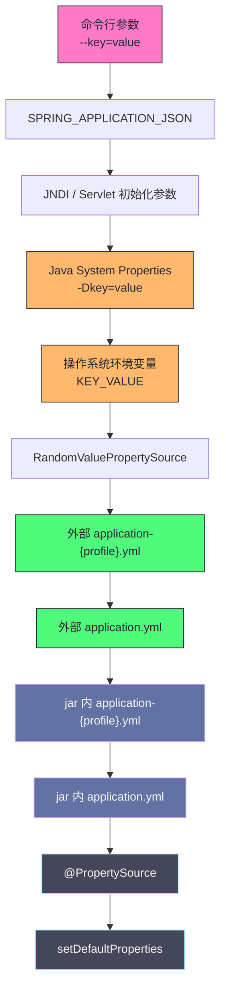
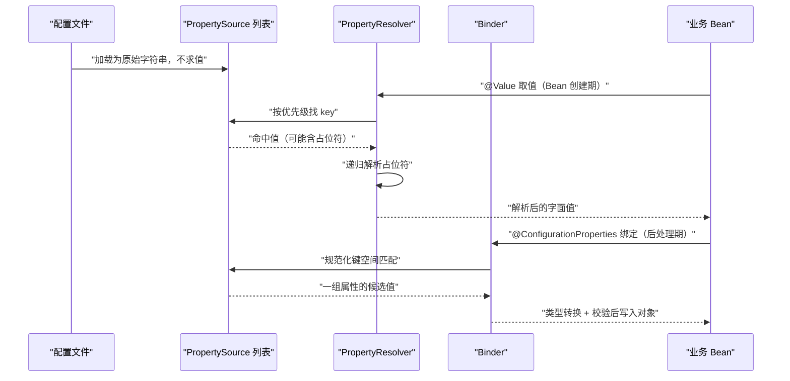
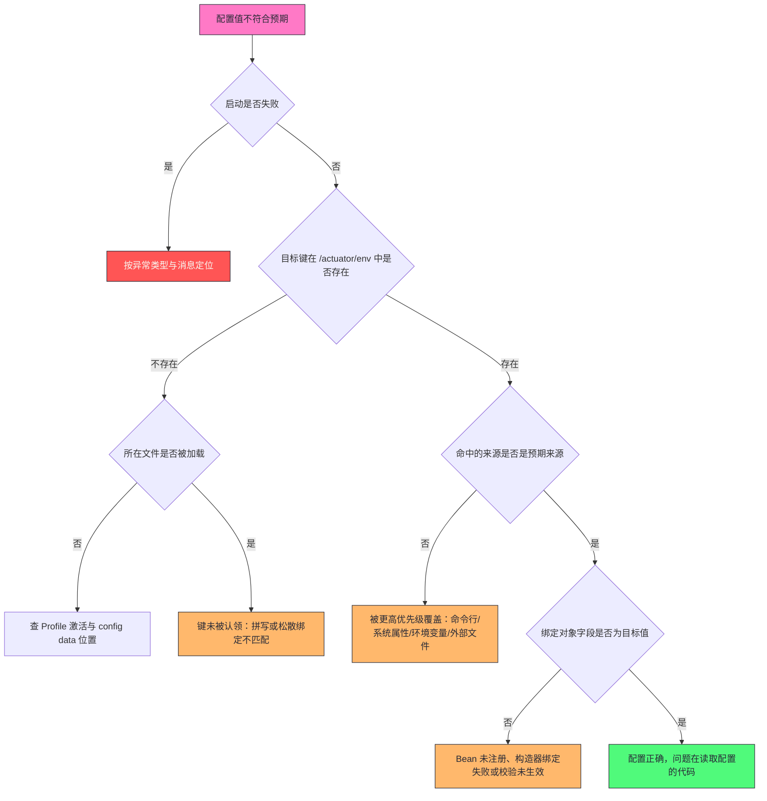
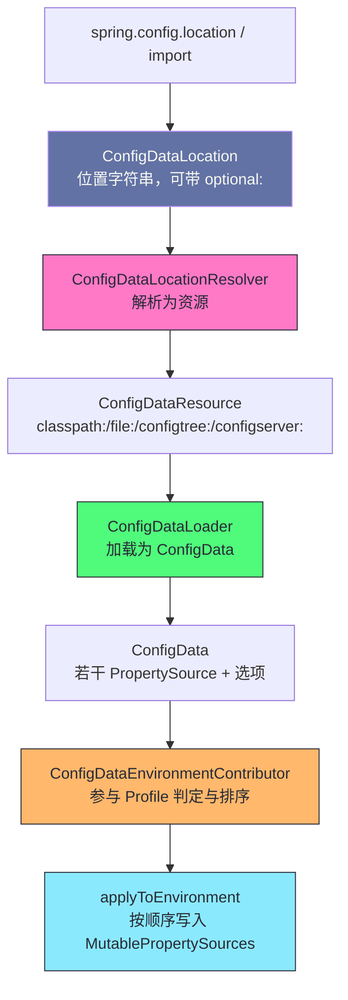

# 配置体系——application.yml、Profile与配置优先级

**摘要：**

配置问题是 Spring Boot 里最容易被归到"玄学"的一类故障：代码没有改，注解没有动，改了一行 yml，重启之后行为却和改之前一样；或者本地一切正常，进了容器就连上了开发库。这类现象背后并不是框架在随机行事，而是一套可以完整枚举的规则在起作用——`Environment` 持有一个有序的 `PropertySource` 列表，取值时从前往后第一个命中的来源获胜；Profile 决定哪些文档有资格进入这个列表；而在 2.4 之后，配置文件的发现、导入与激活又被重写成了一条由 `ConfigDataLocationResolver` 与 `ConfigDataLoader` 组成的 SPI 链路。本文以同一个订单服务贯穿，先把 `Environment` 的两层结构讲透，给出完整的优先级链条并解释"为什么是这个顺序"，再拆解松散绑定与环境变量映射、占位符的解析时机、`@Value` 与 `@ConfigurationProperties` 的分工，然后把 Profile 的四件机制（active、include、group、`@Profile`）逐个落到源码阶段上，最后用五种"配了不生效"的成因、2.4 起的 `spring.config.*` 新模型、敏感配置的外部化与四条可直接复现的反例收束。读完之后，你应当能在三十秒内判断一个配置值"为什么是这个值"。

---

## 第 1 章 一次"配置不生效"的现场

### 1.1 改了池大小，线上纹丝不动

订单服务 order-service 在大促前的压测里出现连接等待，DBA 建议把 HikariCP 的连接池从 10 调到 50。工程师在 `src/main/resources/application.yml` 里把 `spring.datasource.hikari.maximum-pool-size` 从 `10` 改成 `50`，提交、打包、滚动更新，然后看启动日志：

```text
HikariPool-1 - configuration:
  maximumPoolSize.................................................. 10
```

值没有变。于是他怀疑是缓存、怀疑是镜像没有更新、怀疑是部署平台回滚了版本，重新打了一次 tag，再发布一次，日志里仍然是 10。整个过程里唯一没有被质疑的假设是："我改的那个文件，就是生效的那个文件"。

真正的原因往往朴素得让人无言：运维在发布模板里给容器注入了一份 `/app/config/application.yml`（来自 ConfigMap），而外部目录的文件优先级高于 jar 内的同名文件；工程师改的是 jar 内那一份，被外部那一份按属性级覆盖掉了。更隐蔽的版本是：容器里还挂着 `SPRING_DATASOURCE_HIKARI_MAXIMUMPOOLSIZE=10` 这样的环境变量，而环境变量的优先级高于所有配置文件。

这两条都算不上框架的 bug，问题出在优先级链条上某个没人想到的位置。配置体系的全部复杂性，几乎都可以还原成一个问题：同一个 key，最后是谁的值赢了，以及为什么是它赢。

### 1.2 配置故障的四种表象

把这类故障按表象分类，有助于先确定往哪个方向查。笔者在实践中见到的大致是四类：

第一类是**完全不生效**，改了等于没改，启动日志里的值与修改前完全一致。这一类多半是高优先级来源压住了修改点，或者 Bean 根本没有被注册。

第二类是**部分生效**，同一个前缀下的标量值变了，但列表或 Map 没有按预期变化。这一类几乎总能追到两个原因：复杂类型整体替换而非合并，或者松散绑定没有按以为的规则命中。

第三类是**启动即失败**，抛出的异常类型直接指向配置加载阶段，譬如 `InvalidConfigDataPropertyException`、`ConfigDataLocationNotFoundException`、`UnsupportedConfigDataLocationException`。这一类反而最好处理，异常消息里通常带着来源位置与替换建议。

第四类是**环境错配**，配置本身"生效"了，只是生效的那一套属于另一个环境——生产容器激活了 `dev`，或者 `application-prod.yml` 压根没有被加载。它的破坏力最大，因为系统跑得起来，只是连错了库、写错了消息队列。

### 1.3 两层结构，一次讲清

要能快速判断"谁赢了"，需要先在心里建立 `Environment` 的两层结构。

第一层是**有序的属性来源列表**。`Environment` 持有一个 `MutablePropertySources`，里面按优先级排列着若干 `PropertySource`，取值时从头到尾扫描，第一个返回非 `null` 值的来源即获胜，后面的来源连被看一眼的机会都没有。

第二层是**Profile 这组筛选条件**。它不是"覆盖"，而是"准入"：哪些文档、哪些 `@Profile` 标注的 Bean 有资格参与这一局，由激活的 Profile 决定。Profile 的麻烦之处在于它不是静态配置，而是在配置加载过程中被推演出来的——推演的依据又来自配置本身，这就构成了后文要专门处理的循环依赖。

---

## 第 2 章 Environment 的两层结构

### 2.1 有序列表与"先找到的赢"

`Environment` 在 Spring Framework 里的定义很克制：它继承 `PropertyResolver`，额外提供 `Profiles` 相关的方法，实现类 `AbstractEnvironment` 把属性来源放在一个 `MutablePropertySources` 字段里。`MutablePropertySources` 本身只是一个 `List<PropertySource<?>>` 的包装，提供了 `addFirst`、`addLast`、`addBefore`、`remove` 这些按位置操作的方法，谁是第一谁就最优先。

取值动作发生在 `PropertySourcesPropertyResolver#getProperty`：它按顺序遍历所有来源，逐个调用 `PropertySource#getProperty`，遇到第一个非 `null` 就返回，同时把"命中来源"记录下来用于日志。这个实现细节解释了两个常见现象。

其一，空值不能用来"清空"低优先级的配置。`null` 在解析器眼里就是"没有这个属性"，而不是"这个属性的值是空"。官方文档在讲 `SPRING_APPLICATION_JSON` 时明确写了这条：JSON 里的 `null` 会进入属性来源，但 `PropertySourcesPropertyResolver` 把它视为缺失，因此无法用 `null` 压掉更低优先级的同名属性。想要清空某个值，只能在最高优先级那一层给一个空字符串，或者让更低优先级的那一层根本不出现这个键。

其二，属性的来源是逐 key 决定的，不是逐文件决定的。同一个 `application.yml` 里，`server.port` 可能被命令行参数覆盖，而 `logging.level.root` 仍然来自这个文件。这一点是理解后文所有"局部覆盖"现象的前提：覆盖发生在属性级别，不发生在文件级别。

### 2.2 为什么 `@ConfigurationProperties` 能松散绑定

如果只有上面那一层，`@ConfigurationProperties` 的松散绑定就无从谈起——`PropertySource#getProperty("my.main-project.person.firstName")` 只会做一次字符串比较，不会尝试 `first-name`、`first_name`、`FIRSTNAME` 这些变体。

真正让松散绑定成立的是第二层的一个适配器：`ConfigurationPropertySources`。它在配置准备完成后调用 `attach(environment)`，往 `MutablePropertySources` 的**最前面**插入一个名为 `configurationProperties` 的 `ConfigurationPropertySourcesPropertySource`（源码里 `sources.addFirst(attached)`，常量 `ATTACHED_PROPERTY_SOURCE_NAME = "configurationProperties"`）。这个属性来源不存值，而是把所有底层来源包装成 `ConfigurationPropertySource`，用 `ConfigurationPropertyName` 对键做规范化——点分隔、小写、去掉非字母数字字符——再由 `Binder` 在这个规范化空间里匹配。

于是 `my.main-project.person.first-name`、`my.main-project.person.firstName`、`my.main-project.person.first_name` 在规范化之后都落到同一个 `ConfigurationPropertyName` 上，绑定自然成立。而 `@Value` 走的是 `PropertyResolver` 的原生取值路径，它在属性来源适配层只做了很有限的名字变体尝试，因此能不能命中取决于占位符里写的形态，而不是目标字段的形态；两者的能力差异从这一层就已经注定。

顺带解释一个常被忽略的细节：`attach` 放在最前面，意味着 `Binder` 看到的键空间永远优先于任何人直接 `getProperty` 的结果。所以 `@ConfigurationProperties` 与 `@Value` 在极少数情况下会对同一个 key 给出不同的解析结果，根源不在绑定器，而在两条查找路径的规范化程度不同。

### 2.3 Profile 是筛选器，不是覆盖器

Profile 决定的是"哪些文档、哪些 Bean 参与这一局"，这一点在文档层面体现得非常直接：`application-prod.yml` 只有在 `prod` 激活时才被加载，被 `spring.config.activate.on-profile` 关掉的 YAML 文档整段不参与属性合并，`@Profile("prod")` 标注的配置类在 `prod` 未激活时连 Bean 定义都不会注册。

因此把一个配置项写进不同 Profile 的文件里，最终效果是"参与者被替换"：未激活的文档里那个 key 根本不存在，低优先级的默认值就显形了。误判这一点会带来一类很难查的问题——本地开发时 `application-dev.yml` 里有一份完整的数据库配置，一切正常；到了生产，`prod` 激活了，但 `application-prod.yml` 里只写了 URL 没写用户名，于是用户名不是"没被覆盖"，而是"从更低的默认值落下来"，最终连的是一个意料之外的账号。

| 部件 | 类型 | 职责 | 出问题时表现为 |
| :--- | :--- | :--- | :--- |
| 属性来源列表 | `MutablePropertySources` | 按顺序保存所有 `PropertySource`，先命中者胜 | 值被意料之外的来源覆盖 |
| 键空间适配 | `ConfigurationPropertySources` | 把来源包装成规范化键空间，供 `Binder` 使用 | `@ConfigurationProperties` 绑不上、`@Value` 却取得到 |
| Profile | `Profiles` | 决定哪些文档与 Bean 有资格参与 | 配置文件整份没加载、配置类没装配 |
| 转换与占位符 | `ConversionService`、占位符解析器 | 字符串到目标类型的转换、`${...}` 求值 | 类型不匹配、占位符解析失败 |

有了这两层，任何一次取值都可以拆成两个问题：它所在的那一份文档有没有进列表，它在列表里排第几。接下来要补齐的就是"排第几"的规则。

---

## 第 3 章 完整的优先级链条

### 3.1 从高到低的十五项

Spring Boot 3.x 官方文档给出的顺序是"从低到高"排列的，为了排查方便，笔者把它反过来写成从高到低，并把 config data 的四层展开：

| 优先级 | 来源 | 典型用法 | 备注 |
| :--- | :--- | :--- | :--- |
| 1 | Devtools 全局设置 | `$HOME/.config/spring-boot/` | 仅 devtools 激活时存在 |
| 2 | `@TestPropertySource` | 测试类注解 | 仅测试 |
| 3 | `@DynamicPropertySource` | 测试里动态注册 | 仅测试 |
| 4 | `@SpringBootTest(properties=...)` 等测试属性 | 测试切片 | 仅测试 |
| 5 | 命令行参数 | `--server.port=9090` | 单次覆盖的首选 |
| 6 | `SPRING_APPLICATION_JSON` | 内联 JSON | 用来绕开环境变量命名的限制 |
| 7 | `ServletConfig` 初始化参数 | WAR 部署 | 少用 |
| 8 | `ServletContext` 初始化参数 | WAR 部署 | 少用 |
| 9 | JNDI `java:comp/env` | 传统应用服务器 | 少用 |
| 10 | Java System Properties | `-Dserver.port=9090` | 高过环境变量 |
| 11 | 操作系统环境变量 | `SERVER_PORT=9090` | 容器注入的主力 |
| 12 | `RandomValuePropertySource` | `random.*` | 只提供 `random.*` |
| 13a | 外部 profile 特定文件 | `./config/application-prod.yml` | 外部目录 |
| 13b | 外部通用文件 | `./config/application.yml` | 外部目录 |
| 13c | jar 内 profile 特定文件 | `classpath:/application-prod.yml` | 打包内容 |
| 13d | jar 内通用文件 | `classpath:/application.yml` | 打包内容 |
| 14 | `@PropertySource` | 注解导入的属性文件 | 刷新期才进 Environment |
| 15 | `SpringApplication.setDefaultProperties` | 编程式默认值 | 被框架强制移到列表末尾 |

有些资料把这份清单称作"17 种配置来源"，那个数字来自 2.x 时代包含 bootstrap 语境的老版本，3.x 的参考文档列的是上面这些。数量本身不重要，重要的是记住三条分界线：命令行参数在所有文件与环境变量之上；系统属性在环境变量之上；外部文件在 jar 内文件之上，profile 特定文件在通用文件之上。绝大多数"改不动"的现场，都能在这三条分界线里找到答案。



上图的箭头方向就是覆盖方向：上面的赢下面的。把它当作查表的索引，比背十条口诀有效——被覆盖的一方通常是"更静态、更接近打包产物"的那一方。

### 3.2 为什么是这个顺序

这份顺序不是随手排的，背后有三条可以明确表述的原则。

第一条，越接近运行时、越"这一次启动才确定"的配置，优先级越高。命令行参数就是这条原则的极端形态：它只对这一次进程有效，连重启都不保留，因此没有任何理由被持久化的文件压住。反过来，打包进 jar 的 `application.yml` 是最后一次构建的产物，是最"陈旧"的一层。

第二条，越显式的配置，优先级越高。环境变量需要有人显式注入，系统属性需要显式写在启动脚本里，两者都表达了"我现在就要覆盖"的意图；而 `setDefaultProperties` 是代码里的兜底，语义上就是"没人给的时候用这个"，所以它被排到最后，并且由框架主动 `DefaultPropertiesPropertySource.moveToEnd(propertySources)` 钉死在列表末尾，防止有人用 `addLast` 之类的操作把它顶上来。

第三条，同一份"配置数据"内部，按 profile 与内外位置排定的顺序合并，而不是按文件名排。这条是 2.4 才清晰的规则，也是后文第 7 章要展开的部分。

### 3.3 命令行参数为什么这么好用

`SpringApplication` 会把所有以 `--` 开头的参数解析成一个 `CommandLinePropertySource`，并在 `prepareEnvironment` 阶段 `addFirst` 到列表最前面。因此 `java -jar order-service.jar --spring.datasource.hikari.maximum-pool-size=50` 是对"临时改一个值做验证"最直接的手段，比改配置、重新打包、重新发布快得多。

它有一个容易忽略的限制：命令行参数只在"当作程序参数"时生效。`java -jar app.jar --spring.config.location=file:/etc/order/` 之所以能生效，是因为 `spring.config.*` 属于会被极早读取的那部分属性——文档里明确要求 `spring.config.name`、`spring.config.location`、`spring.config.additional-location` 必须以环境变量、系统属性或命令行参数的形式给出，原因就在这里：它们要在配置文件被找到之前就可用。如果把它们写进 `application.yml`，逻辑上就是自指，框架不会去解析。

同样地，如果某个部署场景不希望命令行参数有最高权威，可以调用 `SpringApplication.setAddCommandLineProperties(false)` 把它们整体禁用。这个开关在"启动脚本由平台生成、参数不完全可控"的环境里有实用价值。

### 3.4 系统属性为什么压过环境变量

很多人默认"环境变量优先级最高"，实际上 Spring Boot 的链条里 `-Dkey=value` 比 `KEY_VALUE=...` 高一层。原因在 `StandardEnvironment`：它的 `customizePropertySources` 依次 `addLast` 了 `systemProperties` 与 `systemEnvironment`，前者因此排在更前面。

这个差异在 Kubernetes 里很少被感知，因为容器里通常只注入环境变量；但在传统部署、或者启动脚本同时用了 `-D` 与环境变量时，它会造成"我明明在容器环境里配了却没用"的困惑。排查时的第一反应应该是：先看有没有 `-D`，再看环境变量。

### 3.5 同一目录下 `.properties` 赢 YAML

官方文档给了一条明确的规则：如果同一个位置同时存在 `.properties` 与 YAML 两种格式的配置文件，`.properties` 优先。这条规则的实际含义是两份文件都会被加载、按属性级合并，只是在同一个位置上 `.properties` 排在后面（更优先）。

它带来的典型事故是"历史遗留文件"：项目早期用 `application.properties`，后来团队统一迁到 YAML，旧文件没有删，留在仓库里成了隐形的主配置。工程师在 `application.yml` 里改了半天没有效果，因为 `.properties` 里的旧值赢了他。文档因此建议整应用只用一种格式，这条建议的价值远大于"风格统一"。

### 3.6 Config data 的位置顺序与 location group

配置文件本身还有一层位置顺序。3.x 默认从五类位置查找，位置越靠后优先级越高：

1. `classpath:/`
2. `classpath:/config/`
3. `file:./`
4. `file:./config/`
5. `file:./config/*/`

默认位置里已经包含 `config/*/` 这一条通配符，它专为 Kubernetes 设计：把 Redis 配置与 MySQL 配置分别挂到 `/config/redis/application.yml` 与 `/config/mysql/application.yml`，两个文件都会被处理，不必拼成一份大文件。

更细的规则是 location group。位置之间用逗号分隔表示"顺序处理"，用分号分隔表示"同一层并列"。文档给过一个能体现差异的例子：`spring.config.location=classpath:/cfg/,classpath:/ext/` 会先处理完 `/cfg` 的所有文件再处理 `/ext`；而 `classpath:/cfg/;classpath:/ext/` 把两者放在同一层，`prod` 与 `live` 两个 Profile 的 profile-specific 文件就按"同一层里 profile 后者胜"的规则交错处理。这个差别只在多 Profile 同时激活时才会显形，但一旦踩上，覆盖关系会与直觉完全相反。

| 想达成的效果 | 该动哪一层 | 不该动哪一层 |
| :--- | :--- | :--- |
| 压测时临时调大连接池 | 命令行参数或 `-D` | 不改 jar 内配置 |
| 生产环境注入数据库密码 | 环境变量或 Secret 卷 | 不写进任何 yml |
| 本地开发覆盖共享开发库 | 外部 `file:./config/application-local.yml` | 不提交个人配置 |
| 同一镜像分发到多环境 | 外部目录 + Profile | 不重新打包 |
| 给所有环境一个兜底值 | jar 内 `application.yml` | 不放在 `@PropertySource` |
| 测试里固定某个开关 | `@SpringBootTest(properties=...)` | 不改生产配置 |

---

## 第 4 章 application.yml 内部：松散绑定与占位符

### 4.1 YAML 到扁平键空间

Spring Boot 的 `Environment` 只有一层扁平的键空间，YAML 的层级结构必须被压平。压平规则是文档里写明的：`environments`、`dev`、`url` 这样的三层结构会压成 `environments.dev.url` 一个键，列表用 `[0]`、`[1]` 这样的下标，`my.map[/key1]` 这样的写法可以保留 key 里的特殊字符（不加方括号时，斜杠这类非字母数字字符会被去掉）。

多文档的规则在 2.4 之后变得极简：同一份文件里，位置在后的文档覆盖位置在前的文档，与 `.properties` 里"后面的行覆盖前面的行"一致。2.4 之前那种"文档之间的顺序取决于 profile 激活时序"的猜测空间被彻底取消了，这本身就是那次重构最重要的收益之一。

### 4.2 松散绑定的四种写法

松散绑定（Relaxed Binding）指同一个属性可以有多种写法，绑定到同一个 Java 字段时等价。官方文档用 `my.main-project.person.firstName` 举例，四种写法都成立：

| 写法 | 示例 | 适用场合 |
| :--- | :--- | :--- |
| kebab-case | `my.main-project.person.first-name` | 推荐用于 `.properties` 与 YAML |
| camelCase | `my.main-project.person.firstName` | 等价写法，历史代码常见 |
| snake_case | `my.main-project.person.first_name` | 等价写法 |
| 大写加下划线 | `MY_MAINPROJECT_PERSON_FIRSTNAME` | 环境变量推荐格式 |

三个限定条件必须一起记住。其一，`@ConfigurationProperties` 的 `prefix` 必须写成 kebab-case，`@ConfigurationProperties("my.mainProject")` 不会被接受。其二，松散绑定只对 `Binder` 路径生效，也就是 `@ConfigurationProperties`、`Binder` 的手工调用、以及 Spring Boot 自己的绑定；`@Value` 走的是另一条路。其三，不同来源支持的写法不同：环境变量只认大写加下划线，系统属性与配置文件认三种写法。

`@Value` 的"有限松散绑定"值得单独说明，因为这里最容易误判；它与 SpEL 的关系另见 [[Java/SpringCore/09 SpEL表达式与属性解析]]。官方文档的表述是：`@Value` 的松散绑定能力是受限的，建议在占位符里使用规范形式（全小写 kebab-case）。文档给的例子很能说明问题——`@Value("${demo.item-price}")` 能取到配置文件里的 `demo.item-price` 与 `demo.itemPrice`，也能取到环境变量 `DEMO_ITEMPRICE`；而写成 `@Value("${demo.itemPrice}")` 时，`demo.item-price` 就不再被考虑。也就是说，`@Value` 能不能命中，取决于你在占位符里写的那个形式恰好是不是规范化后的形式。

### 4.3 环境变量名与 key 的映射规则

环境变量名不允许出现点号与中划线，Spring Boot 给出的转换规则只有三步：**把点号换成下划线、把中划线删掉、转成大写**。文档里的例子是 `spring.main.log-startup-info` 对应 `SPRING_MAIN_LOGSTARTUPINFO`——注意中划线是被删掉而不是被换成下划线。

这条规则是"环境变量名与 key 的映射搞混"这一反例的根源。很多工程师凭语感写出 `SPRING_MAIN_LOG_STARTUP_INFO`，看起来更整齐，实际对应的 key 是 `spring.main.log.startup.info`，与目标键毫无关系，于是既不报错也不生效。

更麻烦的是列表与 Map。列表元素的下标也要写成下划线分隔的段：`my.service[0].other` 对应 `MY_SERVICE_0_OTHER`。Map 的 key 会被小写化——绑定 `Map` 时，Spring Boot 会先把环境变量名整体转小写，因此 `MY_PROPS_VALUES_KEY=VALUE` 绑定出来的 Map 是 `{"key"="VALUE"}`，值保留原样，键变成小写。这条细节在对接大小写敏感的配置（譬如某些中间件的用户名、Topic 名）时会直接导致鉴权失败。

还有一条容易忽略的边界：环境变量的松散绑定默认只作用于名为 `systemEnvironment` 的属性源，以及名称以 `-systemEnvironment` 结尾的额外属性源。自己手工塞进 `Environment` 的 `PropertiesPropertySource` 不会获得这套映射，得自己做规范化。

### 4.4 占位符的解析时机

`${...}` 是配置体系里最容易被误解的一层，因为它的求值时机在"取用这个值时"，不在"加载配置时"。

配置文件被解析成 `PropertySource` 时，值就是一段原始字符串，`${DB_HOST:localhost}` 不会被立即替换。真正的替换发生在 `PropertySourcesPropertyResolver#getProperty` 里：取到值之后，如果包含占位符，再用占位符解析器递归解析，把里面的 key 当成一次新的取值请求。这意味着两件事：

其一，占位符引用的值按优先级重新查找，而不是在同一个文件里找。`application-prod.yml` 里写 `url: jdbc:mysql://${DB_HOST}:3306/order_db`，`DB_HOST` 来自环境变量、命令行或任何更高优先级的来源都可以，甚至可以是另一个配置文件里的键。这让"配置文件只描述结构、具体的值由运行环境提供"成为可能。

其二，占位符里可以带默认值，语法是 `${KEY:默认值}`，冒号之后的部分包含嵌套占位符时也能正确解析。默认值只在该 key 完全取不到时生效；如果键存在但值是空字符串，默认值不会兜底——缺失与空值在解析器眼里是两件事。

在 `spring.config.import` 的声明里，占位符还有一层额外限制：此时配置数据还在加载过程中，能被引用的只有环境变量、系统属性、命令行参数以及已经处理过的文档。指望在 import 声明里引用"同一个文件稍后才出现的键"是行不通的，因为那条语句被处理的时候，那个键还没有进入可见范围。

### 4.5 @Value 与 @ConfigurationProperties 的分工

两者最本质的差别在时机与范围：`@Value` 在 Bean 创建时对单个字段注入一个解析后的值，`@ConfigurationProperties` 在 Bean 后处理阶段把一整个前缀下的属性绑定成一个对象。

| 维度 | `@Value` | `@ConfigurationProperties` |
| :--- | :--- | :--- |
| 绑定范围 | 单个属性 | 一个前缀下的一整组属性 |
| 松散绑定 | 受限，取决于占位符写的是否为规范形式 | 完整支持 |
| SpEL | 支持 `#{...}` 表达式，占位符 `${...}` 另行解析 | 不支持 |
| 元数据与 IDE 补全 | 无 | 有，配合配置处理器生成元数据 |
| 校验 | 无 | 配合 `@Validated` 与 JSR-303 注解 |
| 类型转换 | 依赖转换服务，能力有限 | 支持 `Duration`、`DataSize`、嵌套对象、集合 |
| 失败表现 | 缺 key 直接抛异常 | 缺 key 沿用字段默认值 |

选择建议可以压成一句话：成组的配置一律用 `@ConfigurationProperties`，只有在需要 SpEL 或者单个离散属性时才用 `@Value`。成组配置用 `@Value` 的代价不只是"写得多"，而是丢掉了校验、元数据、类型转换与松散绑定这四样能力，而它们恰好是配置"配错能被发现"的主要手段。

### 4.6 一个隐性的时机陷阱

官方文档里有一条容易被跳过的说明：`@ConfigurationProperties` 类里用字段初始化器写的默认值，**不会反映到 `Environment` 里**。绑定出来的对象是 `false`，但 `Environment` 里并不存在 `my.service.enabled=false` 这条属性。

这条规则的杀伤力在于它同时影响两处：用 `@Value("${my.service.enabled}")` 去取会直接抛异常，在 `Condition` 实现里查询该属性也会拿不到。解法是显式给出默认值，或者在需要查询的地方提供一个 `getProperty(key, Boolean.class, false)` 的兜底。

同属"时机"这一类的还有列表的合并规则：多个来源配置同一个列表时，做的是**整表替换**，不是逐元素合并。低优先级里配了三个元素、高优先级里配了一个，最终结果只有一个元素。这一点与很多人对"配置是叠加的"的直觉相反，也是第 1 章里"部分生效"那类故障最常见的技术原因。



图中两条路径的分叉点就是 `@Value` 与 `@ConfigurationProperties` 的分野：前者是"一次取值加一次占位符解析"，后者是"按前缀整体扫描加类型绑定"。

---

## 第 5 章 Profile 的四件事

### 5.1 active：写在 application.yml 里的鸡生蛋

`spring.profiles.active` 的作用是声明"当前是哪一套环境"。它在写法上有多种选择：命令行 `--spring.profiles.active=prod`、环境变量 `SPRING_PROFILES_ACTIVE=prod`、系统属性 `-Dspring.profiles.active=prod`、编程式 `SpringApplication.setAdditionalProfiles("local")`，以及写进 `application.yml`。

最后一种在文档里是合法的，但它有一个结构性的问题：决定"读哪些配置文件"的信息，本身写在配置文件里。这个循环由一个分阶段的处理过程解开，而循环的每一处棱角都会以异常的形式暴露出来。

第一处棱角：`spring.profiles.active` 不能出现在 profile-specific 文档里。`application-prod.yml` 里写一行 `spring.profiles.active: metrics`，启动时直接抛 `InvalidConfigDataPropertyException`，消息形如 `Property 'spring.profiles.active' imported from location '...' is invalid in a profile specific resource [origin: ...]`。文档里同样的限制也适用于 `spring.profiles.include`、`spring.profiles.default` 与 `spring.profiles.group`；其中 active、include、default 三者会被这段检查直接判定为非法。理由很直白：如果 `application-prod.yml` 能激活新 Profile，那么"哪些文件被读取"就依赖于"哪些文件已经被读取"，这正是 2.4 重构要消灭的不确定性。

第二处棱角：`spring.profiles.active` 不能出现在被 `spring.config.activate.on-profile` 激活的文档里。写在 `on-profile: dev` 的文档里，等于"我要先激活 dev，才能读到激活别的东西的配置"，同样是循环。注意这类错误的异常类型与上面不同：当绑定器在一个并未激活的文档里读到这个属性时，抛出的是 `InactiveConfigDataAccessException`。

第三处棱角：它自身也受优先级链条约束。jar 内 `application.yml` 里写 `active: dev`，命令行传 `--spring.profiles.active=prod`，最终激活的是 `prod`，因为命令行在更高一层。这看起来是"覆盖"在起作用，但当覆盖方与被覆盖方都参与"哪些文档可以加载"的判定时，人的直觉很难跟上。笔者见过的真实事故是这样：`application.yml` 里留了一行 `active: dev`，Kubernetes 清单里环境变量被写成了 `SPRING_PROFILE_ACTIVE`（少了一个 S），一切照常启动，只有日志里的 `The following 1 profile is active: "dev"` 说明它是连开发库跑的。

所以工程上更可靠的做法是把它交给配置文件之外的那一层：容器里用环境变量，脚本里用命令行，测试里用 `@SpringBootTest(properties=...)`；jar 内最多只保留 `spring.profiles.default`，用来给"完全没有人指定"的场景定一个保守的兜底值。

### 5.2 include：加在 active 之前

`spring.profiles.include` 的语义是"在已激活的 Profile 之外，再追加几个"。与 active 的差别是它不替换只追加，并且在处理顺序上有一个反直觉的细节：文档明确写了 included profiles 会被加在 `spring.profiles.active` 指定的 Profile **之前**。也就是说，`include` 进来的 Profile 在"多个 Profile 同时激活时后者胜"的规则里处于更早的位置，优先级低于 active 里的 Profile。

它是按属性源逐个处理的，因此对列表没有复杂类型的合并规则——每个属性源里的 include 都会被独立读取并累加。这条特性在把一组公共能力（譬如 `common`、`tracing`）拆成独立 Profile 时很好用，但同样只能出现在非 profile-specific 文档里。

### 5.3 group：把一个名字展开成一组

Profile 分组（Profile Group）解决的是"部署上想只说一个名字，代码里却用了好几个 Profile"的矛盾。order-service 的数据库、消息队列、监控分别用 `proddb`、`prodmq`、`prodmetrics` 三个 Profile 控制 `@Profile` 装配，部署时却只需要激活 `production`：

```yaml
spring:
  profiles:
    group:
      production:
        - proddb
        - prodmq
        - prodmetrics
      local:
        - localdb
        - mockmq
```

配合 `--spring.profiles.active=production` 启动，三个子 Profile 会一起激活，对应的 `application-proddb.yml` 等文件也一并加载。它比 `include` 更可控的地方在于：分组是显式声明在非 profile-specific 文档里的，不会出现"A 激活 B、B 又激活 C"的隐式链式传播。同样的限制依然存在——group 也只能写在非 profile-specific 文档中。

### 5.4 @Profile：Bean 级别的准入

前面三项控制的是"配置文件"，`@Profile` 控制的是"Bean 定义"。`@Component`、`@Configuration`、`@ConfigurationProperties` 都可以标注它，未激活时对应的 Bean 定义不会注册（Bean 定义如何进入容器见 [[Java/SpringCore/02 IoC容器——BeanFactory与ApplicationContext的层次设计]]），自然不会实例化。

对 `@ConfigurationProperties` 来说，`@Profile` 该写在哪个类上有讲究，官方文档专门写了这条：如果用 `@EnableConfigurationProperties` 手工注册，`@Profile` 要写在持有该注解的 `@Configuration` 类上；如果用 `@ConfigurationPropertiesScan` 扫描注册，`@Profile` 可以直接写在 `@ConfigurationProperties` 类上。写错位置的后果是"Profile 没激活，属性绑定类却仍然存在（或者反过来）"，表现出来就是配置类里的默认值突然顶替了本该报错的缺失值。

`@Profile` 支持表达式：`@Profile("prod & !test")`、`@Profile({"prod", "staging"})`（任一同名激活即可）。表达式能力在"生产环境且非金丝雀"这类组合条件下有用，但也会让装配条件变得更难推断，团队里最好约定只用简单名字。

### 5.5 默认 Profile 与名字校验

如果没有任何 Profile 被激活，`Environment` 会使用一组默认 Profile，默认值是 `default`，因此 `application-default.yml` 会在这种场景下被加载。这一点常被用来放"本地开发的兜底配置"，但它同时意味着：一个忘了设置环境变量的生产 Pod，会安静地加载 `application-default.yml`。如果不希望有这份兜底，把 `spring.profiles.default` 设成一个不可能存在的名字（文档示例用的是 `none`），让配置缺失直接以启动失败的形式暴露，比让它悄悄跑到默认值上更安全。

3.5 的参考文档里还有一条 Profile 名的合法性校验：默认只允许字母、数字以及 `-`、`_`、`.`、`+`、`@`，并且必须以字母或数字开头结尾。历史遗留的奇怪名字（带空格、带中文）会被直接拒绝，可用 `spring.profiles.validate=false` 关闭，但这应当被当作过渡手段。

| 机制 | 作用对象 | 语义 | 出现在 profile 特定文档里 |
| :--- | :--- | :--- | :--- |
| `spring.profiles.active` | 配置文件集合 | 替换式指定当前环境 | 非法，抛 `InvalidConfigDataPropertyException` |
| `spring.profiles.include` | 配置文件集合 | 追加，且加在 active 之前 | 非法 |
| `spring.profiles.group` | 配置文件集合 | 一个名字展开为一组 | 非法 |
| `@Profile` | Bean 定义 | 决定 Bean 是否注册 | 与文档无关，取决于类所在位置 |

### 5.6 Profile 激活的三个阶段

理解 Profile 与配置数据的交互，最省力的方式是记住 `ConfigDataEnvironment` 的处理阶段。它先处理"不依赖 Profile"的部分，从这些文档里推演出激活了哪些 Profile，再带着这份激活上下文回头处理 profile-specific 的文档。

```mermaid
%%{init: {'theme': 'dracula'}}%%
graph LR
    A["processInitial<br/>处理 import，无激活上下文"] --> B["createActivationContext<br/>建立初始上下文"]
    B --> C["processWithoutProfiles<br/>处理不依赖 Profile 的贡献"]
    C --> D["withProfiles<br/>绑定 spring.profiles.active / include"]
    D --> E["processWithProfiles<br/>加载 profile-specific 文档"]
    E --> F["applyToEnvironment<br/>校验非法属性、检查强制位置"]
    F --> G["写入 Environment<br/>setActiveProfiles / setDefaultProfiles"]

    style A fill:#6272a4,stroke:#bd93f9,color:#f8f8f2
    style D fill:#ff79c6,stroke:#282a36,color:#282a36
    style E fill:#50fa7b,stroke:#282a36,color:#282a36
    style F fill:#ffb86c,stroke:#282a36,color:#282a36
    style G fill:#8be9fd,stroke:#282a36,color:#282a36
```



这个顺序解释了前文所有"棱角"：`withProfiles` 这一阶段读不到尚未激活的文档里的值，所以写在 `on-profile` 文档里的 `active` 无法生效；`processWithProfiles` 之后才处理 profile-specific 文件，所以 `application-prod.yml` 永远不可能反过来激活 `prod`；`applyToEnvironment` 阶段会统一做一次非法属性检查，所以那些位置错误的属性不是"静默忽略"，而是启动失败。

---

## 第 6 章 配置不生效的五种成因

### 6.1 成因一：键拼错，而松散绑定让某些拼法看着像对的

HikariCP 的属性名是 `maximumPoolSize`，Spring Boot 在 `spring.datasource.hikari` 前缀下按松散绑定接受 `maximum-pool-size`、`maximumPoolSize`、`maximum_pool_size`。这三种都能命中，因为它们规范化后是同一个键。

但 `max-pool-size` 命中不了。它规范化后是 `maxpoolsize`，与 `maximumpoolsize` 不是同一个键。绑定器遇到未知键时不会报错——`@ConfigurationProperties` 的默认行为是忽略不认识的属性——于是这一行安静地躺在配置里，池子仍然是默认的 10。

同类幻觉还有大小写与"多一个后缀"：`spring.datasource.hiraki` 这种拼写错误一眼能看出，而 `my.app.timeout` 与 `my.app.timeout-ms` 是合法的两个不同键——绑定器只会认领后者，前者安静地成为孤儿。

判据很明确：用绑定结果而不是原始文本判断配置是否生效。`/actuator/configprops` 展示的是绑定后的对象字段，`/actuator/env` 展示的是属性来源里的键值，两者对照就能看出"我的键有没有被认领"。如果 `configprops` 里那个字段还是默认值，而 `env` 里能看到你写的键，那么这个键就是一个未被认领的孤儿。

### 6.2 成因二：被更高优先级的来源覆盖

这是第 1 章那个案例的成因。配置确实写在文件里，也确实被加载了，只是在列表里排在别人后面。

判据是 `/actuator/env/{key}` 的返回：它会给出命中来源的名称、脱敏后的值与 `origin`（精确到文件与行号）。同一个 key 在多处出现时，这个接口能直接指出谁赢了。命令行里也可以先做一次对照实验：用 `--key=新值` 启动一次，如果值变了，说明覆盖链在起作用；如果值没变，问题在"键没被认领"或"Bean 没装配"这一侧，与优先级无关。

需要注意的是，覆盖链上的"来源"不只是文件，还包括容器编排注入的环境变量、启动脚本里的 `-D`、以及 `SPRING_APPLICATION_JSON`。排查时按"命令行 → `-D` → 环境变量 → 外部 config 目录 → jar 内文件"的顺序逐层看，比盲猜快得多。

### 6.3 成因三：`@ConfigurationProperties` 类根本没有成为 Bean

`@ConfigurationProperties` 只是一个绑定声明，它本身不会让类变成 Spring Bean。要让它成为 Bean，必须满足以下三种之一：

- 类上同时有 `@Component`（或其他构造型注解）与 `@ConfigurationProperties`；
- 在某个 `@Configuration` 上用 `@EnableConfigurationProperties(OrderProperties.class)` 注册；
- 主类或配置类上有 `@ConfigurationPropertiesScan`，且该类在扫描范围之内（默认从注解所在包向下）。

三种方式都不满足时，注解本身完全无害，也不会报错，只是那个类永远不会被实例化；业务代码里 `@Autowired` 它时会抛"找不到 Bean"，而如果业务代码是可选注入，故障就变成了"配置不生效"。

即便 Bean 被注册了，还有两个静默失败的分支。其一是绑定方式：没有 setter、又没有用构造器绑定（构造器绑定需要类以 `-parameters` 编译，Spring Boot 的 Maven/Gradle 插件与 `spring-boot-starter-parent` 会自动加上这个编译参数）的类，绑定器会放弃写入，字段保持默认值。其二是校验：`@Validated` 只有在类路径上存在 JSR-303 实现时才真正参与校验，缺少实现时校验注解形同注释。

### 6.4 成因四：Profile 没有激活

`application-prod.yml` 存在、内容正确、也没有被覆盖，但它压根没有被加载，因为没有人激活 `prod`。判据是启动日志里的 `The following N profile(s) are active:` 那一行，以及 `/actuator/env` 返回的 `activeProfiles`。

比"文件没加载"更难查的是"Bean 没装配"：订单服务里有一个 `@Profile("prod")` 的 `PaymentClient` 配置类，`prod` 没激活时它不装配，而某个自动配置类里带有 `@ConditionalOnMissingBean` 的默认实现接管了这个位置（条件装配的完整机制见 [[03 条件装配——@Conditional家族的实现机制]]）。系统正常启动，但走的是降级实现。这类问题的判据在条件评估报告里——启动时加 `--debug`，报告里会写明哪个自动配置类因为 `@ConditionalOnMissingBean` 而匹配，反过来就能推出"本该存在的 Bean 没有出现"。

### 6.5 成因五：`spring.config.import` 的依赖或前缀对不上

`spring.config.import` 是 2.4 引入的显式导入语句，它把"从哪里读配置"从一个隐式的约定变成了可声明的指令。这条语句有三种典型的失败形态。

第一种是前缀没有解析器。`spring.config.import=configserver:` 需要类路径上有提供该前缀解析器的依赖；依赖缺失时，Boot 抛 `UnsupportedConfigDataLocationException`，消息是 `Unsupported config data location 'configserver:'`。这类失败比"配置静默丢失"好得多，异常里直接给了位置。

第二种是位置不存在且没有 `optional:` 前缀。`spring.config.import=file:./local-overrides.yml` 在文件缺失时抛 `ConfigDataLocationNotFoundException`，应用不启动。加 `optional:` 前缀才允许缺失。如果希望全局放宽，可以把 `spring.config.on-not-found` 设为 `ignore`，但这等于放弃了"配置缺失要早失败"的保护，应当只在确认安全的场景使用。

第三种是依赖在了但没写 import。Spring Cloud Config 客户端会做一次启动检查：类路径上存在 Config Client 却没有声明 `spring.config.import=configserver:` 时，启动失败，描述是 `No spring.config.import property has been defined`，处置建议里给出了两条——要么补上 import 语句，要么设置 `spring.cloud.config.import-check.enabled=false`。这个检查存在的理由是：2.4 之后远程配置不再靠 bootstrap 阶段隐式注入，不写 import 就等于没有远程配置。

| 成因 | 典型判据 | 快速验证 |
| :--- | :--- | :--- |
| 键拼错 | `env` 里有键、`configprops` 里字段仍是默认值 | 把键改成规范 kebab-case 再试 |
| 被高优先级覆盖 | `/actuator/env/{key}` 的 `source` 指向别处 | 命令行传同 key 看是否变化 |
| Bean 未注册 | 找不到 Bean、字段永远默认值 | 检查三种注册方式是否满足 |
| Profile 未激活 | 启动日志 active profiles 不含目标 | 命令行加 `--spring.profiles.active` |
| import 失败 | 异常类型即原因 | 补依赖、加 `optional:` 或补 import |



---

## 第 7 章 2.4 起的新模型：spring.config.*

### 7.1 旧机制为什么必须被替换

2.3 及以前，配置文件由 `ConfigFileApplicationListener` 在 `ApplicationEnvironmentPreparedEvent` 中加载。它工作的方式是硬编码的：先找 `application.properties`/`application.yml`，再按激活的 Profile 找 `application-{profile}.*`，遇到 `spring.profiles.active` 时"重新走一遍"。这套逻辑有三个无法根治的毛病。

第一是来源固化。它只会找本地文件，想让 Nacos、Vault、Consul 这类外部配置中心接进来，只能写 `EnvironmentPostProcessor` 往里塞属性源，而塞进去的位置决定了它的优先级，不同客户的实现位置各不相同。

第二是 Profile 语义混乱。2.3 的多文档 YAML 里，`spring.profiles: dev` 决定文档是否生效，`spring.profiles.include` 可以级联激活，而"哪个文档先被处理"又取决于 Profile 的激活时机，于是同一个文件在不同启动参数下可能出现不同的覆盖关系。

第三是拓扑不可预测。文档之间互相激活、互相覆盖，工程上没法给出一个可以推理的模型。

2020 年 8 月，Spring Boot 团队在博客里预告了这次重构，核心是两条决定：文档按定义顺序加载，Profile 不能再从 profile-specific 文档里激活。2.4 之后，实现换成了 `ConfigDataEnvironmentPostProcessor` 与 `ConfigDataEnvironment`。

### 7.2 核心类型的分工

| 类型 | 职责 | 扩展者关注点 |
| :--- | :--- | :--- |
| `ConfigDataEnvironmentPostProcessor` | 作为 `EnvironmentPostProcessor` 的入口，`order` 为 `Ordered.HIGHEST_PRECEDENCE + 10` | 想介入配置加载的扩展点 |
| `ConfigDataEnvironment` | 协调所有位置、阶段与贡献者 | 理解加载顺序时的主入口 |
| `ConfigDataLocationResolver` | 把位置字符串解析为 `ConfigDataResource` | 自定义协议（如 `configserver:`） |
| `ConfigDataLoader` | 把 `ConfigDataResource` 加载为 `ConfigData` | 自定义存储格式（如远端 KV） |
| `ConfigData` | 加载结果，含属性来源与行为选项（如 `IGNORE_PROFILES`） | 决定该文档是否参与 Profile 判定 |
| `ConfigDataImporter` | 处理 `spring.config.import`，保证同一资源只加载一次 | 排查 import 未生效 |
| `BootstrapContext` | 在真正启动前共享早期对象 | 远程配置客户端注册 |

两个 SPI 点（`ConfigDataLocationResolver` 与 `ConfigDataLoader`）是这次重构最实质的收益：外部配置中心不再需要往 `Environment` 里打补丁，而是像普通文件一样参与同一套位置、顺序与激活规则。这也是为什么 Nacos、Vault、Config Server 的客户端在 2.4 之后陆续提供 `spring.config.import` 形式的接入方式——它们实现的是同一套契约。



### 7.3 三个阶段的收尾动作

第 5 章已经给过阶段图，这里补上收尾时做的四件事，它们解释了若干"启动失败"的具体表现。

`applyToEnvironment` 先调用 `checkForInvalidProperties`，把所有贡献者过一遍非法属性表——`spring.profiles`（旧的复数写法）与 `spring.profiles.active/include/default` 在 profile-specific 文档中的出现都属于这里。这也是 2.3 升级到 2.4 时最常见的启动失败：旧的多文档写法 `spring.profiles: dev` 会被判定为非法，错误信息里直接给出替换建议 `spring.config.activate.on-profile`。

接着调用 `checkMandatoryLocations`，列出所有"声明了但没加载到"的强制位置，抛 `ConfigDataLocationNotFoundException`。只有带 `optional:` 的位置、或者 `spring.config.on-not-found=ignore` 时才放过。

再调用 `applyContributor`，把活跃的贡献者按顺序写成 `PropertySource` 加进 `MutablePropertySources`，未激活的贡献者在 TRACE 日志里留下 `Skipping inactive property source '...'`。最后 `DefaultPropertiesPropertySource.moveToEnd` 把默认属性钉到末尾，`setActiveProfiles` 与 `setDefaultProfiles` 把推演结果写回 `Environment`。

### 7.4 name / location / additional-location

三个属性解决的是不同层面的问题，混用会带来完全不同的结果：

| 属性 | 语义 | 是否替换默认位置 | 优先级影响 |
| :--- | :--- | :--- | :--- |
| `spring.config.name` | 改基础文件名，默认 `application` | 否 | 不影响顺序 |
| `spring.config.location` | 指定位置列表，**替换**默认位置 | 是 | 按声明顺序，后者覆盖前者 |
| `spring.config.additional-location` | 追加位置，保留默认位置 | 否 | 追加的位置整体高于默认位置 |

`spring.config.location` 的"替换"语义经常被低估：一旦设置了它，`classpath:/`、`file:./config/` 这些默认位置就都不再被搜索。官方文档给的例子很直观：设成 `optional:classpath:/custom-config/,optional:file:./custom-config/` 之后，完整的位置集合就只有这两个，jar 内的 `application.yml` 也不在列表里。想保留默认位置就必须换成 `additional-location`，后者会把追加的位置排在默认位置之后处理，因此在优先级上更高——这正是"用挂载文件覆盖 jar 内配置"的标准手法。

配套的还有几个细节。目录型位置必须以 `/` 结尾，运行时会被拼上 `spring.config.name` 得到的文件名；文件型位置则直接导入。目录与文件都会展开 profile-specific 变体，所以 `classpath:myconfig.properties` 也会去找 `myconfig-{profile}.properties`。通配符必须只含一个 `*` 且以 `*/` 结尾，按绝对路径字典序排序，并且只在外部目录生效——`classpath:` 上不能用通配符。

### 7.5 import 的四个反直觉

`spring.config.import` 的语义文档写得清楚，但四条规则都与直觉相反，值得逐条记住。

第一，被导入的文档优先级高于导入它的文档。文档原话是：导入的属性会被视为插在声明它的文档"紧接其下"的文档，因此来自被导入文件的属性会覆盖导入者。`application.yml` 里写 `spring.config.import=optional:file:./dev.properties`，`dev.properties` 里的同名键会赢过 `application.yml`。

第二，同一资源只导入一次。多处声明同一个位置不会重复加载，第二次声明在 TRACE 日志里留下 `Already loaded resource ... ignoring location ...`。

第三，位置分"固定"与"相对于导入文件"两种。以 `/` 开头或带 URL 风格前缀（`file:`、`classpath:`）的是固定位置；其余的相对位置会相对于声明它的文件解析。`/demo/app.jar` 旁边的 `application.properties` 里写 `optional:core/core.properties`，实际解析到 `/demo/core/core.properties`；如果 `core.properties` 里再写 `optional:extra/extra.properties`，则以 `/demo/core/` 为基准。`optional:` 前缀不影响这个判定。

第四，不同格式的位置需要不同写法。云平台挂载的文件常常没有扩展名，`spring.config.import=file:/etc/order/myconfig[.yaml]` 里的方括号是给加载器的提示。此外还有 `env:` 前缀（把某个环境变量的内容当作 properties 解析）与 `configtree:` 前缀（把目录树当作属性，文件名即键），后文讲 Kubernetes 外部化时会用到。

### 7.6 2.4 的破坏性变更清单

升级时最容易踩的五条，可以当作迁移检查表：

- 多文档顺序改为"按定义顺序，后者覆盖前者"；
- `spring.profiles` 这个旧的复数键被 `spring.config.activate.on-profile` 取代，继续写会抛 `InvalidConfigDataPropertyException`；
- Profile 不能从 profile-specific 文档或 `on-profile` 激活的文档中声明，`active`、`include`、`group`、`default` 都受限；
- `spring.config.import` 成为接入外部配置的正规方式，隐式的 bootstrap 注入需要显式声明；
- 2.x 期间提供的 `spring.config.use-legacy-processing` 过渡开关，在 3.x 里已经没有对应的回退分支，`ConfigDataEnvironment` 的源码里不再保留这条路径，想靠它恢复旧行为在 3.x 上是行不通的。

---

## 第 8 章 配置的安全与外部化

### 8.1 敏感项的四种处置层级

把密码、令牌、证书放进 `application.yml`，是安全审计里最常见的发现项。处置方式从弱到强大致分四层：

| 层级 | 做法 | 优点 | 主要风险 |
| :--- | :--- | :--- | :--- |
| 一 | 明文写在 yml 里 | 简单 | 进镜像、进仓库、进构建缓存，一旦泄露不可追溯 |
| 二 | 加密后写 `ENC(...)` | 配置文件可提交 | 解密密钥仍需外部化，只是把问题挪了一层 |
| 三 | 环境变量注入 | 不进镜像 | 值出现在编排清单、Pod 描述与进程环境中 |
| 四 | 外部 Secret 系统 / 卷挂载 | 进程环境不出现明文、可轮换 | 引入外部依赖，启动路径变长 |

Spring Boot 官方文档在"Encrypting Properties"一节里把态度写得很明确：它不提供内建的加密支持，只提供 `EnvironmentPostProcessor` 这个可以改写属性值的钩子；如果需要安全的凭据存储，官方指向 Spring Cloud Vault。也就是说，配置文件加密属于社区方案（Jasypt 是其中最常见的一个），并不在框架的核心能力里。

### 8.2 为什么 `ENC(...)` 不是终点

Jasypt 的用法是：配置里写 `password: ENC(密文)`，启动时通过环境变量提供解密口令。它的价值在于配置文件可以安全地进入仓库；但它并没有消除"密钥必须有地方放"这件事——解密口令仍然要作为环境变量或启动参数注入，而这个口令的泄露等价于所有密文的泄露。

更实际的问题是故障形态：解密口令缺失时，应用通常在启动阶段失败，异常信息里出现解密失败的明确提示；口令写错时，失败点可能推迟到数据源初始化。这两类故障在容器编排里表现为"Pod 反复重启、日志第一屏就是解密失败"，排查成本不低。

### 8.3 Kubernetes 上的三种注入方式

容器里把配置交给应用，常见三种方式，优先级与安全属性都不同。

挂载完整文件：把 ConfigMap 或 Secret 的某个键挂成 `/app/config/application.yml`，依赖默认搜索路径里的 `file:./config/`，无需任何代码配合。改配置的流程是改 ConfigMap、滚动重启 Pod；应用本身不会感知文件变化，因为 Spring Boot 没有内建的配置热加载。

注入环境变量：`SPRING_DATASOURCE_URL` 这类变量自动映射为 `spring.datasource.url`，优先级高于所有配置文件。它的优点是简单直接，缺点是值会出现在 Pod 描述与进程环境中，且一旦写错，排查需要回头核对环境变量名的拼写——也就是第 4 章那套"点换下划线、删中划线、转大写"的规则。

使用 `configtree:`：这是最贴合 Secret 的方式。把 Secret 挂成目录，每个文件是一个键：

```yaml
spring:
  config:
    import: "optional:configtree:/etc/order/secrets/"
```

目录下 `db/password` 文件对应 `db.password`，文件名里的点也被正确映射。相比环境变量，它避免了命名映射的坑，也让"值只以文件形式存在"这件事成立；`configtree:` 位置以 `/*/` 结尾时还能一次导入所有子目录。

### 8.4 配置中心的失败语义

把配置外置到 Config Server 是另一种外置化，而它的价值有一半在**失败语义**上。

`spring.config.import=optional:configserver:` 的含义是"连不上就继续启动"，去掉 `optional:` 就变成"连不上就启动失败"。官方文档的表述是：移除 `optional:` 前缀会让客户端在无法连接时失败；等价地设置 `spring.cloud.config.fail-fast=true` 也是同样效果。

这个选择没有普适答案，取决于配置中心里放了什么。如果远程配置只是几项可以降级的开关，`optional:` 更合适；如果远程配置包含数据源、队列地址这类启动必需项，缺了它启动起来也只会是"健康的错误状态"，那么不加 `optional:`、让它快速失败更好。

失败语义还有两个细节。第一是重试：想让客户端在配置中心偶发不可用时重试，需要 `spring.cloud.config.fail-fast=true` 加上 `spring-retry` 与 `spring-boot-starter-aop`；而如果 import 语句写在 profile-specific 文档里，重试参数必须以 URL 查询参数的形式写进 import 语句（如 `?fail-fast=true&max-attempts=10`），因为此时那些 `spring.cloud.config.retry.*` 属性还没有被绑定。第二是多个地址：`spring.config.import` 里声明多个位置时按顺序处理、后者优先，但 `fail-fast` 为 `true` 时第一个地址失败就会终止。

### 8.5 脱敏不是安全边界

Actuator 的 `/env` 与 `/configprops` 从 3.0 起改了默认行为：所有值都被完整脱敏为 `******`，而不只是敏感键；2.7 及以前只按敏感键名脱敏，非敏感键的原值是直接显示的。要看到原值必须显式设置 `management.endpoint.env.show-values=always` 或 `when-authorized`（配合 `management.endpoint.env.roles` 限定角色），并且没有自定义 `SanitizingFunction` 生效。这个差别在看老文章排障时很容易误会——按 2.x 的预期去读 3.x 的返回，会以为属性全都丢了。

这条设计的意义是明确的：属性端点本来是排障工具，不是数据出口。反过来说，任何进入 `Environment` 的明文都不应被视为"已被保护"——脱敏只影响 HTTP 响应，值在进程内存里、在日志里、在被注入的 Bean 里都是明文。真正的边界在"值从哪来"，不在"值怎么显示"。

---

## 第 9 章 调试：把"谁赢了"变成可观察

### 9.1 从 `/actuator/env` 读优先级

`/actuator/env` 返回当前 `Environment` 的 `activeProfiles` 与全部属性来源，每个来源下列出它贡献的键。3.x 的默认配置下值是脱敏的，但来源与 `origin` 仍然可见，排查"这个值从哪来"通常只需要来源信息。

`/actuator/env/{key}` 更进一步：返回该键的命中来源与脱敏后的值，`origin` 里带有资源路径与行号（形如 `class path resource [application-prod.yml] - 3:11`）。看到行号意味着可以直接跳到那一行，这在几份配置互相覆盖时非常有效。

需要提醒的是分寸：这个端点会把大量结构信息暴露出来，生产环境应当只对受控角色开放，并且不要为了排查方便长期开启 `show-values=always`。

### 9.2 `/actuator/configprops` 看绑定结果

`env` 看的是"属性来源里有什么"，`configprops` 看的是"绑定到 Bean 上是什么"，这个端点的用法在 [[07 Actuator——健康检查、指标暴露与自定义端点]] 里有完整说明。两者对照是判定"键有没有被认领"的最快方法：`env` 里有、`configprops` 里字段仍是默认值，就是第 6 章那几种绑定失败；两边都有值但不相等，就是覆盖或类型转换的问题。

### 9.3 `--debug` 与配置包的 TRACE 日志

启动时加 `--debug`（或用 `-Ddebug`）会打开自动配置条件评估报告，报告分 Positive matches 与 Negative matches 两部分。它回答的是"哪些自动配置生效了、为什么没生效"，对于第 6 章成因四（Profile 未激活导致 Bean 缺失、默认实现接管）是最直接的证据来源。

配置加载本身的过程日志不在条件报告里，而在 `org.springframework.boot.context.config` 包下。把这个包的日志级别调到 TRACE，可以看到与源码一一对应的记录：`Processing initial config data environment contributors without activation context`、`Deducing profiles from current config data environment contributors`、`Considering resource ... from location ...`、`Loaded resource ... from location ...`、`Skipping inactive property source '...'`、`Adding imported property source '...'`、以及收尾时的 `Setting active profiles: ...`。这份日志的价值在于它把"哪份文件被加载、哪份被跳过、按什么顺序"完整摊开，比读配置文件猜时序可靠得多。

### 9.4 `EnvironmentPostProcessor` 这个扩展点

`EnvironmentPostProcessor` 是比 `ConfigDataLoader` 更底层的钩子，在 `ApplicationContext` 刷新之前拿到 `ConfigurableEnvironment`，可以任意增删属性源。它的注册件是 `META-INF/spring.factories`：

```properties
org.springframework.boot.env.EnvironmentPostProcessor=com.example.order.OrderEnvPostProcessor
```

它有两个必须清楚的性质。第一是顺序：`ConfigDataEnvironmentPostProcessor` 的 `order` 是 `Ordered.HIGHEST_PRECEDENCE + 10`，几乎最早；自定义实现的 `order` 若大于它，就在配置数据加载之后执行，可以读到最终结果；若小于它，则在配置数据之前执行，此时 `application.yml` 还没加载。第二是位置决定权威：在这个钩子里 `addFirst` 一个属性源，优先级可以压过命令行参数，这既是它强大之处，也是事故来源——同事在依赖库里加了一个 `addFirst` 的 `EnvironmentPostProcessor`，从此所有环境的行为都以它为准，排查时没有任何配置文件能解释得通。

正因如此，官方在讲配置导入时把 `ConfigDataLocationResolver` 与 `ConfigDataLoader` 摆在推荐位置：它们参与既有的顺序与激活规则，不破坏"谁赢了"的可预测性。只有在真的需要改写已有属性值、或者处理配置数据加载之前的早期状态时，才值得动 `EnvironmentPostProcessor`。

### 9.5 一条可以照着走的排查顺序

综合前文，实践中可以按下面的顺序推进，每一步都以一个可观察的结果收尾：

1. 看启动日志里的 `The following N profile(s) are active:` 与数据源初始化日志，确认"是哪一套环境、池子多大"。
2. `/actuator/env` 确认目标键是否存在、命中的来源是谁、`origin` 指向哪个文件哪一行。
3. `/actuator/configprops` 确认绑定对象的字段值，判断"未认领"还是"被覆盖"。
4. 命令行传一次同键值做对照实验，区分"覆盖链问题"与"键/Bean 问题"。
5. 若涉及 import 或外部配置中心，把 `org.springframework.boot.context.config` 调到 TRACE，看位置是否被解析、是否被跳过。
6. 若涉及 Bean 缺失，用 `--debug` 的条件报告确认自动配置的匹配结果。

---

## 第 10 章 反例与边界

### 10.1 反例一：把 `spring.profiles.active` 写进 `application.yml`

```yaml
# 不要这样做
spring:
  profiles:
    active: dev
server:
  port: 8080
```

这段配置在本地能跑，在 CI 里跑测试也能跑，于是它被留在仓库里。危害在于它把"环境选择"从部署侧挪到了构建产物里：容器编排没有注入 `SPRING_PROFILES_ACTIVE` 时，生产 Pod 会安静地以 `dev` 启动；而一旦有人试图在 `application-dev.yml` 里再写 `active` 来做"级联"，就会撞上第 5 章那两类异常。

可行的替代是：把环境选择放在启动参数或环境变量里，jar 内只保留 `spring.profiles.default`；如果确实需要一组固定搭配，用 `spring.profiles.group` 在非 profile-specific 文档里声明分组，由部署侧激活分组名。

### 10.2 反例二：按"看着像"的规则拼环境变量名

```bash
# 意图：spring.datasource.hikari.maximum-pool-size
SPRING_DATASOURCE_HIKARI_MAX_POOL_SIZE=50   # 错：中划线应删掉
SPRING_DATASOURCE_HIKARI_MAXIMUMPOOLSIZE=50 # 对：MAXIMUMPOOLSIZE
SPRING_DATASOURCE_HIKARI_MAXIMUM_POOL_SIZE=50 # 也对：下划线是分隔符
```

三种写法里只有第一种是错的，而它恰恰是最符合语感的一种。第二个与第三个都能命中，因为下划线在规范化之后就等价于分隔。这类错误的特征是不报错、不生效，唯一的判据是 `/actuator/env` 里那个键是否被认领。

更稳的做法是：本地启动一次，用 `/actuator/env` 打印出目标键，把容器里的变量名与之逐字对照，而不是凭记忆拼写。再进一步，可以在部署模板里把环境变量名写成从配置键机械转换的产物（脚本生成），从流程上消灭手写。

### 10.3 反例三：用 Profile 隔离密钥

```yaml
# application-prod.yml
spring:
  datasource:
    password: Pr0d_P@ssw0rd
```

"只有 prod 才加载"不等于"安全"。这份文件在镜像里、在制品仓库里，任何拿到镜像的人 `unzip` 一次就能读到；而 Profile 只决定它是否被加载，不决定谁能看到它。把密钥放在 profile 文件里，本质是把"环境隔离"误当成"权限隔离"。

正确的处置是第 8 章的四层模型：至少做到环境变量注入，更彻底的是外部 Secret 系统或卷挂载；同时用 `@ConfigurationProperties` 加 `@Validated` 保证缺失时快速失败，而不是带着空密码启动。

### 10.4 反例四：用错机制去做绑定

四种常见的机制误用，症状各不相同，根因都在"选错了工具"。

用 `@Value` 去接一个配置对象，会丢掉校验、元数据与松散绑定，最终写成十几个 `@Value` 字段，其中一个拼错就静默注入 `null`；用 `@PropertySource` 去加载 YAML，会得到一个键名被按 properties 格式硬拆出来的属性来源（默认的 `DefaultPropertySourceFactory` 只认 properties），多文档文件更是明确不支持；期待列表在多处定义时"合并"，会在覆盖链上任一处配了列表就直接替换掉整张表。

还有一类更隐蔽的误用：把 `@PropertySource` 当成"外置化"手段。它确实能把属性加进 `Environment`，但官方文档明确写了这些属性源要等到上下文刷新时才加入，因此 `logging.*`、`spring.main.*` 这类在刷新前就要读取的配置对它无效。想让外置配置参与早期决策，必须走 config data 的位置与 import。

### 10.5 边界：配置体系何时成为复杂度本身

这套机制的灵活度是有代价的：一个键可以在十五个位置中的任何一处定义，可以经由占位符再引用另一处，可以被 Profile 整份替换，还能被导入的外部系统二次覆盖。单个特性都很合理，组合起来就难以推理。

笔者见过的最小失控案例是：同一个 `spring.datasource.url` 同时出现在 jar 内 `application.yml`、外部挂载的 `application.yml`、`application-prod.yml` 与一组环境变量里，四处的值互不相同，四个环境各取所需，而没有人能说清生产到底取的是哪一处——直到某次故障复盘时用 `/actuator/env` 才把这条链还原出来。

控制复杂度的办法不复杂，但需要纪律：**同一个键只允许有一个定义处**，其余位置只能通过占位符引用；把"必须由环境提供"的键整理成白名单，启动时用 `ApplicationRunner` 或 `@ConfigurationProperties` 的校验快速失败；把配置中心与外置文件的职责划清——文件管结构，环境变量管值，Secret 系统管凭据；部署模板里的环境变量名由脚本从配置键生成，不手写。

> [!warning] 一条容易忽略的边界
> `spring.config.import` 的强制位置检查、`@ConfigurationProperties` 的 `@Validated` 校验、以及 `spring.profiles.default` 的兜底，三者解决的是同一个问题的不同层次："配置缺失时，是安静地用一个错误的值跑起来，还是立刻失败"。在这个问题上，把默认值设得越"安全"，故障暴露得越晚。

归根到底，配置体系的设计目标从来不是"让配置尽可能灵活"，而是在灵活性与可预测性之间找一个团队能承受的平衡点。位置越多、来源越杂，覆盖链越难推理，出问题时需要的排查成本也越高；反过来，把来源收窄成一个明确的链条，牺牲的只是少数临时覆盖的便利。至于具体落在哪一侧，取决于团队规模、发布频率与故障的代价，没有一个放之四海皆准的答案。

---

## 参考资料

1. [Spring Boot 3.5 Reference — Externalized Configuration](https://docs.spring.io/spring-boot/3.5/reference/features/external-config.html)：属性来源顺序、config data 位置、`spring.config.import`、松散绑定与环境变量映射、`@ConfigurationProperties` 的启用与校验。
2. [Spring Boot 3.5 Reference — Profiles](https://docs.spring.io/spring-boot/3.5/reference/features/profiles.html)：`spring.profiles.active/include/group/default` 的使用限制、Profile 分组、Profile 名校验。
3. [Spring Boot 3.5 Reference — Actuator Endpoints](https://docs.spring.io/spring-boot/3.5/reference/actuator/endpoints.html)：`env`/`configprops` 端点的默认脱敏行为与 `show-values` 配置。
4. [Spring Boot 3.5 How-to — Customize the Environment Before It Starts](https://docs.spring.io/spring-boot/3.5/how-to/application.html)：`EnvironmentPostProcessor` 的注册方式与示例。
5. [Spring Boot 3.5 Appendix — Common Application Properties](https://docs.spring.io/spring-boot/3.5/appendix/application-properties/index.html)：`spring.config.*` 与 `spring.profiles.*` 属性的完整清单。
6. [Config file processing in Spring Boot 2.4（2020-08-14）](https://spring.io/blog/2020/08/14/config-file-processing-in-spring-boot-2-4)：本次重构的设计动机、文档顺序规则与 Profile 限制的来源。
7. [ConfigDataEnvironment 源码（v3.5.0）](https://github.com/spring-projects/spring-boot/blob/v3.5.0/spring-boot-project/spring-boot/src/main/java/org/springframework/boot/context/config/ConfigDataEnvironment.java)：分阶段处理流程、`applyToEnvironment` 的收尾动作与 TRACE 日志文本。
8. [InvalidConfigDataPropertyException 源码（v3.5.0）](https://github.com/spring-projects/spring-boot/blob/v3.5.0/spring-boot-project/spring-boot/src/main/java/org/springframework/boot/context/config/InvalidConfigDataPropertyException.java)：非法属性的判定表与异常消息格式。
9. [ConfigDataImporter 源码（v3.5.0）](https://github.com/spring-projects/spring-boot/blob/v3.5.0/spring-boot-project/spring-boot/src/main/java/org/springframework/boot/context/config/ConfigDataImporter.java)：导入去重与 TRACE 日志文本。
10. [Spring Cloud Config — Client](https://docs.spring.io/spring-cloud-config/reference/client.html)：`spring.config.import=configserver:` 的失败语义、`fail-fast` 与重试参数。
11. [Spring Framework Javadoc — StandardEnvironment](https://docs.spring.io/spring-framework/docs/6.2.x/javadoc-api/org/springframework/core/env/StandardEnvironment.html)：`systemProperties` 与 `systemEnvironment` 的注册顺序。

---

> [!note] 思考题
> 1. 如果要求"任何配置键都必须在启动时被某个 Bean 认领，否则启动失败"，你会基于 `Binder` 的哪一部分来实现这个检查，又需要处理哪些必然存在的例外（譬如 `spring.*` 框架键与占位符引用键）？
> 2. `spring.config.import` 让被导入文件覆盖导入者，这个方向既反直觉又与"就近覆盖"原则不完全一致；如果由你设计，你会保留这个方向还是反过来，理由是什么？
> 3. 配置中心不可用时，`optional:` 与 `fail-fast` 的选择实质上是在"可用性"与"正确性"之间取舍；在你的系统里，哪些配置项值得为它牺牲可用性？
> 4. 松散绑定让 `maximum-pool-size`、`maximumPoolSize`、`maximum_pool_size` 都能命中，这种宽容在多大程度上降低了配置的可审计性，又如何与"单一写法"的团队约定共存？
> 5. `EnvironmentPostProcessor` 可以用 `addFirst` 压过命令行参数，这种能力应该被当作扩展点还是被当作危险品？你们团队会用什么机制约束它的使用？