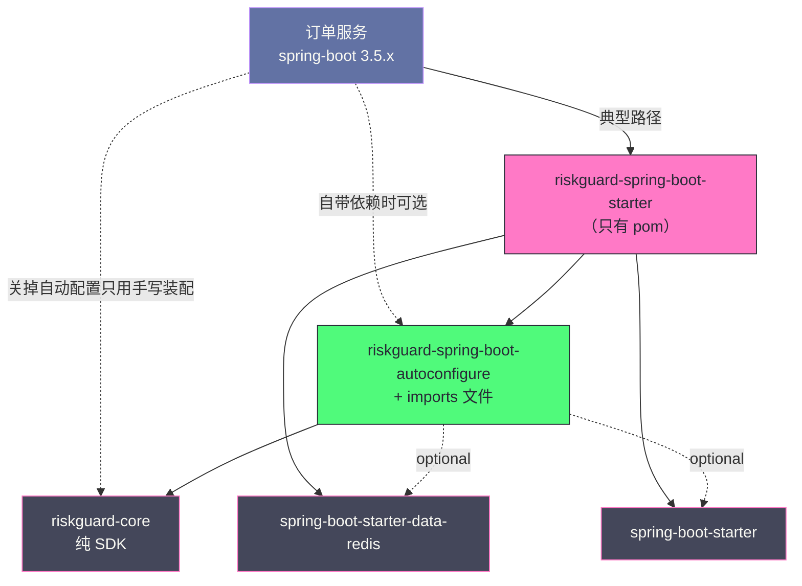
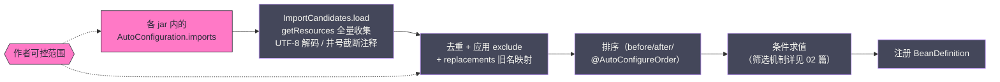
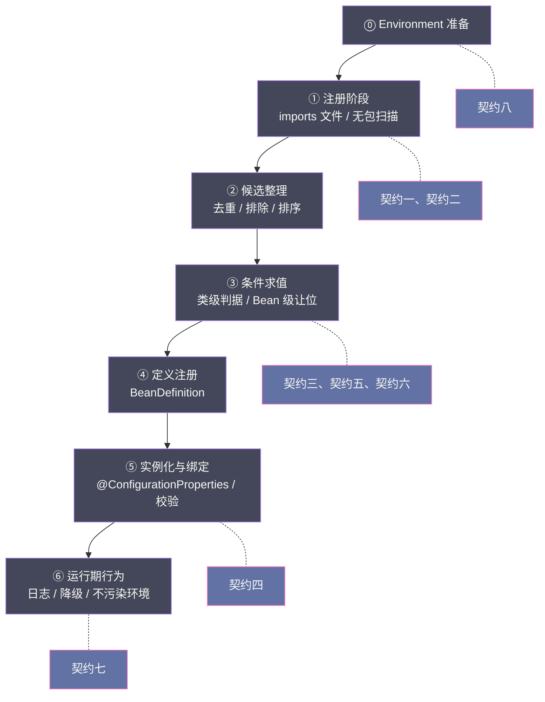
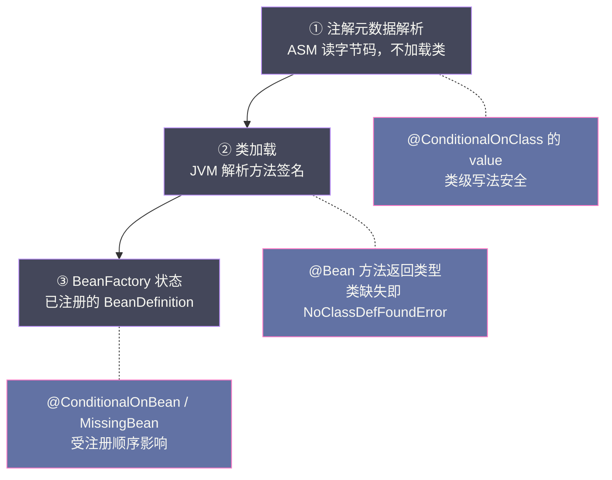
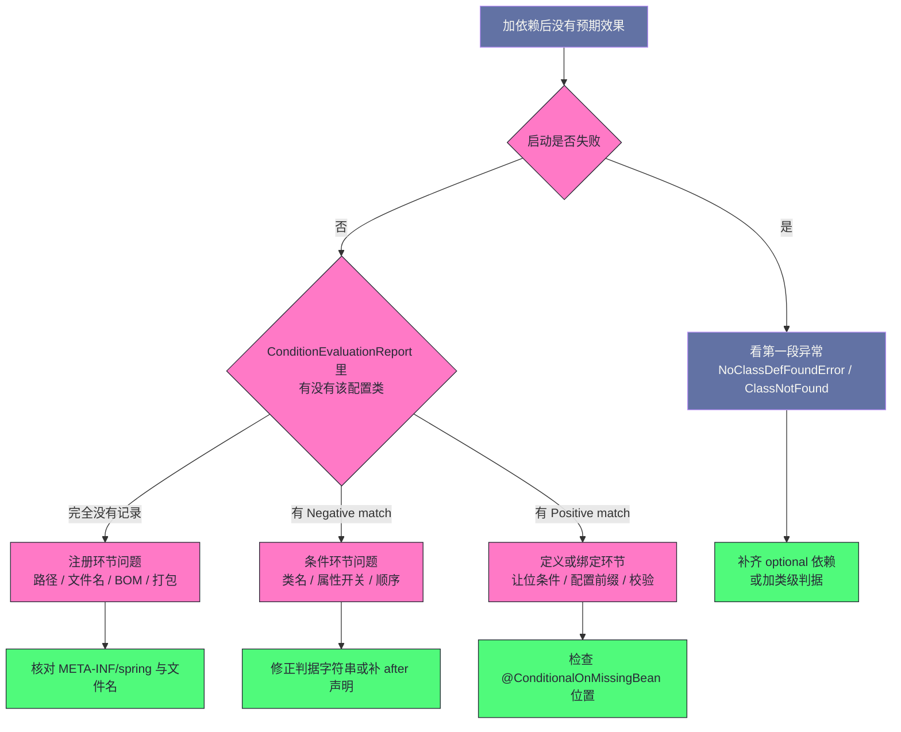

# Starter开发——自定义starter的最佳实践

**摘要：**

Spring Boot 的 Starter 常被当成"加一行依赖就自动配好"的便利设施来讲，但它真正的产物是一份契约：作者承诺在什么条件下装配、装配出哪些 Bean、用户如何接管、配置键叫什么、跨大版本如何演进；使用方则以这份契约为前提，决定是否接受那一行依赖。本文把 Starter 当作一份需要双方共同遵守的设计契约来拆解：先回到 2014 年 Spring Boot 1.0 把依赖聚合与自动配置一起打包进 starter 的来历，说明这两件事其实是可分离的产品；再解释 `xxx-spring-boot-autoconfigure` 与 `xxx-spring-boot-starter` 为何要切成两段——理由不在框架的要求，而在 `compile` 依赖会一路传给每个使用方，把"要不要引入可选实现"的决定权夺走。随后逐条展开八条设计契约：不自带 `@ComponentScan`、用 `@AutoConfiguration` 而非 `@Configuration`、必须挂 `@ConditionalOnClass`、配置走可校验的 `@ConfigurationProperties`、`@ConditionalOnMissingBean` 让位、不假设用户已有 Bean、日志克制、不修改用户 `Environment`。在此基础上补齐 3.x 的注册方式与 `ImportCandidates` 的加载细节、配置元数据的两层来源与合并规则、类级条件与 Bean 级条件的分层、"Starter 不生效"的四类症状与决策树、`before`/`after` 与 `@AutoConfigureOrder` 的分工、把契约写成断言的测试形状，最后用四种坏 Starter 的反例与"何时不该做 Starter"的边界收束。

---

## 第 1 章 一行依赖背后的两份产品

2014 年 4 月，Spring Boot 1.0.0 发布时，官方参考文档第一次把 `spring-boot-starter-web`、`spring-boot-starter-data-jpa` 这样一类型号摆到显眼的位置：使用方在 `pom.xml` 里写一个坐标，内嵌容器、Jackson、错误处理、约定式目录结构就一并就位，`main` 方法跑起来就是一个能对外服务的进程。在那之前，同一件事要交出去的是三样东西：一份几十行的依赖清单（版本还得自己对齐）、一份 `web.xml` 或者 `WebApplicationInitializer`、一份手写的 `@Configuration`。三者之间靠人的记忆维持一致，任何一处漏改，都要等到启动时看见 `NoSuchBeanDefinitionException` 才能发现。

Spring Boot 1.0 的贡献不在于发明了新机制，而在于把这三样东西压成了一个能被 Maven 解析的构件。压的方式很像机场卖的联程票——值机一次，行李直挂到底，中转不用再排队；代价是行李丢了之后，你得知道该找哪一段承运人。Starter 的两个面正是从这张票里长出来的：一面是 pom 里的传递依赖（行李直挂），一面是运行时的自动配置（中转调度）。

### 1.1 依赖聚合与自动配置是两件独立的事

把 Starter 拆开看，它做了两件互不依赖的事。

其一是**依赖聚合**，纯粹发生在构建期：声明一组坐标，让使用方的 classpath 一次性凑齐某个技术栈需要的东西，顺带用 BOM 把版本对齐。其二是**自动配置**，发生在运行期：按类路径、配置属性、已有 Bean 等条件，决定是否注册一批 `BeanDefinition`。这两件事可以只做一件——Spring 官方的 `spring-boot-starter-actuator` 依赖聚合意味很浓，而很多内部组件库恰恰只做自动配置、把依赖留给使用方。

分开看的意义在于它们的失效方式完全不同。依赖聚合失效，症状是编译不过或者启动时 `ClassNotFoundException`，报错位置明确；自动配置失效，症状可能只是"某个功能静默不工作"，连日志都没有一行。前者是构建工具的领域，后者是框架的领域，混在一起讲就会在排查时找错方向。

### 1.2 没有 Starter 的三种成本

设想一个内部限流 SDK，我们叫它 `riskguard`：基于 Redis 做令牌桶，提供注解式与编程式两种调用方式。它要被订单、支付、履约、结算、网关五个服务使用。如果只是发一个普通的 jar，让各服务自己接，成本会落在三处。

第一处是样板代码的漂移。五个服务各自写一份 `RiskGuardConfig`，起初一模一样，半年后就开始分化：有人在里面加了 Prometheus 埋点，有人把 `StringRedisTemplate` 换成了自己的封装，有人忘了设置 Lua 脚本的超时。同一份装配逻辑出现五个版本，SDK 升级时你要去五个仓库里改。

第二处是版本对齐。`riskguard-core` 依赖了某个 Redis 客户端版本，各服务的 `dependencyManagement` 又锁着另一个版本，Maven 的最近者优先规则会把它们仲裁成一个谁也没测过的组合。这类问题的排查成本远高于修复成本。

第三处是配置语义的不透明。没有统一的属性前缀和文档，`keyPrefix`、`key-prefix`、`redisKeyPrefix` 三种写法会同时存在于五个服务的 yml 里，运维改配置时只能翻代码。

Starter 把这三处成本一次性收敛到作者身上。收敛的代价在下文还会反复出现：作者从此要为五个使用方的升级节奏负责，也要为"不生效"这类静默故障兜底。

### 1.3 贯穿案例与本文范围

后文统一用 `riskguard` 这个案例：SDK 本体叫 `riskguard-core`，自动配置模块 `riskguard-spring-boot-autoconfigure`，聚合模块 `riskguard-spring-boot-starter`，配置前缀 `riskguard`，对外暴露的接口是 `RateLimitPolicyEvaluator`。订单服务是第一个接入方，它同时也是最挑剔的使用方——因为它既想在测试环境关掉限流，又想在生产替换成自己的本地实现。

先划定范围。自动装配候选如何被 `@EnableAutoConfiguration` 选出、`@Conditional` 在装配期如何求值，属于装配期机制，本篇只引用结论：被列进注册文件的全限定类名会先经过筛选与排序，再逐个求值条件，最后注册 `BeanDefinition`。细节属于另一条主线（见 [[02 自动装配原理——@EnableAutoConfiguration与spring.factories]]）。本篇关心的是另一侧：作为 Starter 的作者，你交出去的那份契约该长什么样。

| 维度 | 手写 `@Configuration` | 内部 SDK + 接入文档 | Starter |
|---|---|---|---|
| 新增一个使用方的成本 | 复制几十行配置，逐处改名 | 读文档、抄代码、对齐版本 | 加一个坐标 |
| 升级一个版本要改几处 | 每个使用方各改一次 | 每个使用方各查一次 | 改 Starter 版本号 |
| 配置键的合法性 | 无校验，错了运行时才炸 | 靠文档约束 | `@Validated` 启动期拦下 |
| 失效时的可观测性 | 报错位置精确 | 报错位置精确 | 静默失效，需要工具排查 |
| 谁承担演进责任 | 各使用方 | 文档作者 | Starter 作者 |

表格最后一行是本篇的题眼：Starter 用"作者承担演进责任"换来了"使用方零成本接入"。这笔交换是否划算，取决于使用方数量与升级频率，第 12 章会回到这个判断上。

---

## 第 2 章 两段结构：autoconfigure 与 starter 的职责切割

两段结构常被误读成"官方偏好"，其实它是一条依赖边界规则。打个比方，`autoconfigure` 是菜谱，`starter` 是按菜谱配好的食材包：只想照做的人可以只买菜谱、自己采购，图省事的人可以直接拿食材包。菜谱不该规定你去哪家超市，食材包才是那个替你做选择的角色——两者的职责在厨房里从来分得清，在 POM 里却经常搅在一起。

### 2.1 一个最小可用的双模块布局

官方推荐的两段结构，落到目录上就是两个平级的 Maven 模块：

```text
riskguard-spring-boot/
├── riskguard-spring-boot-autoconfigure/        # 自动配置：有 Java 代码
│   ├── src/main/java/com/example/riskguard/autoconfigure/
│   │   ├── RiskGuardAutoConfiguration.java
│   │   └── RiskGuardProperties.java
│   └── src/main/resources/META-INF/
│       ├── spring/org.springframework.boot.autoconfigure.AutoConfiguration.imports
│       └── additional-spring-configuration-metadata.json
└── riskguard-spring-boot-starter/              # 聚合：只有 pom
    └── pom.xml
```

两个 pom 的写法能直接看出分工。自动配置模块把框架依赖标成 `optional`，它自己只在编译期需要这些类，运行期是否出现由使用方决定：

```xml
<!-- riskguard-spring-boot-autoconfigure/pom.xml 摘录 -->
<dependency>
    <groupId>org.springframework.boot</groupId>
    <artifactId>spring-boot-autoconfigure</artifactId>
    <optional>true</optional>
</dependency>
<dependency>
    <groupId>org.springframework.boot</groupId>
    <artifactId>spring-boot-configuration-processor</artifactId>
    <optional>true</optional>
</dependency>
<dependency>
    <groupId>com.example.riskguard</groupId>
    <artifactId>riskguard-core</artifactId>
</dependency>
<dependency>
    <groupId>org.springframework.data</groupId>
    <artifactId>spring-data-redis</artifactId>
    <optional>true</optional>
</dependency>
```

聚合模块反过来，用非 `optional` 的依赖表达"我推荐的组合是什么"：

```xml
<!-- riskguard-spring-boot-starter/pom.xml 摘录：整个模块只有依赖声明 -->
<dependencies>
    <dependency>
        <groupId>com.example.riskguard</groupId>
        <artifactId>riskguard-spring-boot-autoconfigure</artifactId>
        <version>${project.version}</version>
    </dependency>
    <dependency>
        <groupId>org.springframework.boot</groupId>
        <artifactId>spring-boot-starter</artifactId>
    </dependency>
    <dependency>
        <groupId>org.springframework.boot</groupId>
        <artifactId>spring-boot-starter-data-redis</artifactId>
    </dependency>
</dependencies>
```

依赖方向的规则只有一条：starter 依赖 autoconfigure，autoconfigure 永不反向依赖 starter。反了就是循环依赖，Maven 会直接拒绝构建，但更常见的是作者图省事把自动配置类写进 starter 模块，结果两个模块退化成一个，拆分白做。

下面这张图把三方的依赖关系画清楚，注意使用方可以直接指向 autoconfigure 而绕过 starter：



### 2.2 官方说"并非必要"，那什么时候才必要

Spring Boot 3.5 的参考文档在"Creating Your Own Starter"一节里写得很克制：把模块拆成两个"并非必要"（in no way necessary）；如果 autoconfigure 没有多种形态、没有可选特性，把两个模块合一完全可行。这句话常被引用成"不必拆"，但它前面还有半句条件——"如果 acme 有几种风味、选项或可选特性，那么把自动配置分离出来更好"。

真正的判据是**可选依赖**。只要 `riskguard` 同时支持 Redis 与本地内存两种实现，那么 Redis 客户端与 Caffeine 就都是可选依赖；此时如果只有一个模块，这些依赖只能标 `optional` 或者干脆不写，使用方就得自己去猜"我要用哪种实现该引什么"。拆开之后，这个判断被固化成构件边界：`autoconfigure` 说"我能适配这些实现，但我自己不带"，`starter` 说"我押注 Redis 这条路，你拿走就能跑"。第三方库想给社区提供选择权，拆两段几乎是唯一优雅的做法。

反过来说，纯内部的、只有一个使用方、依赖非常稳定的工具，拆两段只会让人在两个 pom 之间来回跳。取舍点在第 2.4 节。

### 2.3 POM 污染的四种形态

"POM 依赖污染"是个笼统说法，拆开看是四种可观测的现象。

一是**传递依赖**的强制性。`compile` 作用域的依赖会一路传下去，使用方没有选择权。如果 `autoconfigure` 把 `spring-data-redis` 写成必选，那么只想用本地实现的订单服务也会被迫引入 Lettuce 客户端、连接工厂、序列化器，classpath 上凭空多出几十个类。

二是版本仲裁的暗箱。使用方的 `dependencyManagement` 一旦锁死某个版本，Starter 内部测过的组合就被覆盖。真正危险的是这种覆盖不会报错：编译通过，启动通过，只是运行到某个分支时才出现 `NoSuchMethodError`。作者的测试矩阵与用户的运行时版本不一致，是三方库最难查的一类缺陷。

三是`optional` 的语义误读。标了 `optional` 的依赖不会传给使用方，但这不意味着"白拿"：自动配置里凡是用到它的地方，都必须有对应的类级条件判据，否则条件命中时找不到类，启动直接抛 `NoClassDefFoundError`。`optional` 与 `@ConditionalOnClass` 是一对孪生约束，只能同时出现。

四是构建插件与注解处理器的传染。`spring-boot-configuration-processor` 只应该在编译期出现，写成普通 `compile` 依赖会传进使用方的 classpath；虽然大多数情况下无害，但它额外提供了一套注解处理器，可能与其他处理器争抢处理轮次。正确写法是 `optional`，或者按官方文档改用 `maven-compiler-plugin` 的 `annotationProcessorPaths`。

### 2.4 三种拆法

| 拆法 | 适用情形 | 收益 | 代价 |
|---|---|---|---|
| 单模块（只有 starter，代码与聚合合一） | 依赖稳定、无可选实现、使用方仅内部少数服务 | 仓库与发布简单 | 可选依赖只能靠文档说明；使用方无法只拿装配逻辑 |
| 双模块（autoconfigure + starter） | 有多种实现、有可选特性、要给社区提供选择权 | 依赖边界清晰，使用方可绕过聚合 | 两个模块的版本要同步发布，构建链变长 |
| 双模块 + test starter | 需要给使用方提供测试替身（如内存实现、Mock 客户端） | 测试期依赖与生产依赖隔离 | 多一个构件要维护 |

`riskguard` 落在第二行：它有 Redis 与本地两种实现，还希望给测试环境提供第三种替身，因此再追加一个 `riskguard-spring-boot-starter-test`，把测试用的自动配置与替身实现装进去，作用域 `test`。

### 2.5 依赖方向之外的一条隐性约束

模块边界之外还有一条常被忽略的约束：自动配置模块的包名要与使用方的包名彻底分开。`autoconfigure` 里的类不应放在使用方可能扫描到的前缀下（譬如 `com.example.order` 与本篇的 `com.example.riskguard` 共享 `com.example` 前缀），否则使用方的 `@SpringBootApplication` 扫描到自己包下的 `autoconfigure` 子包时，会把这些类当成普通配置类提前注册，条件求值的顺序假设随即失效。这个问题在第 7 章有一整节的排查路径。

---

## 第 3 章 注册：从 spring.factories 到 AutoConfiguration.imports

### 3.1 2.x 的写法与它带来的混乱

Spring Boot 2.x 时代，一个自动配置类的注册方式是往 `META-INF/spring.factories` 里追加一条键值对：

```properties
# Spring Boot 2.x 的写法（3.x 下不再生效）
org.springframework.boot.autoconfigure.EnableAutoConfiguration=\
  com.example.riskguard.autoconfigure.RiskGuardAutoConfiguration
```

这个文件是通用 SPI 抽屉：`ApplicationListener`、`EnvironmentPostProcessor`、`FailureAnalyzer`、`SpringApplicationRunListener` 全塞在里面，自动配置只是其中一个键。抽屉的代价是解析成本与语义混淆：properties 格式要处理续行符与转义，加载时得把整份文件读成 `Map<String, List<String>>` 再按键取；而"自动配置"与"生命周期钩子"共用同一种表达方式，让人误以为两者是同一层机制。

### 3.2 2.7 双读，3.0 单读

Spring Boot 2.7 引入了 `@AutoConfiguration` 与新的 imports 文件，但为了向后兼容，读取逻辑同时走两条路。这一点可以直接从源码看出来——2.7.18 的 `AutoConfigurationImportSelector.getCandidateConfigurations` 里，先调 `SpringFactoriesLoader.loadFactoryNames`，再把 `ImportCandidates.load` 的结果并进去，注释里写明"for backward compatible reasons"。

到了 3.0.0，`getCandidateConfigurations` 只剩一句 `ImportCandidates.load(AutoConfiguration.class, getBeanClassLoader())`，2.7 的**双读**收敛成**单读**。也就是说，2.x 时代写在 `spring.factories` 里的 `EnableAutoConfiguration` 条目，在 3.x 里被彻底忽略。迁移时的症状非常"静默"：应用能启动，日志没有警告，只是自动配置的 Bean 一个都没有。这类问题的排查思路在第 7 章展开。

### 3.3 imports 文件是怎样被读进内存的

读源码能把这条路径钉死。`ImportCandidates`（`org.springframework.boot.context.annotation`，2.7 引入）里有一个常量：

```java
private static final String LOCATION = "META-INF/spring/%s.imports";
```

`load` 方法用 `String.format` 把注解的全限定名拼进去，得到 `META-INF/spring/org.springframework.boot.autoconfigure.AutoConfiguration.imports`，再通过 `classLoader.getResources(location)` 收集 classpath 上所有同名文件——注意是"所有"，多个 jar 各带一份 imports 文件时会被依次读入并合并，这也是第三方 Starter 能同时生效的原因。

读入过程的几个细节都写在源码里，值得记住：文件按 UTF-8 解码（`new InputStreamReader(..., StandardCharsets.UTF_8)`）；每行先按 `#` 截断注释再 `trim()`，空行跳过；一行一个全限定类名。`#` 截断发生在行内任意位置，所以行尾注释是安全的，类名中间不可能出现 `#`。非顶层类要用 `$` 连接，官方文档里给的例子是 `com.example.Outer$NestedAutoConfiguration`。

### 3.4 spring.factories 在 3.x 并未退场

把"3.x 废弃了 spring.factories"当结论会误导排查。准确的说法是：3.x 不再从 `spring.factories` 读取自动配置候选，但该文件仍被 `SpringFactoriesLoader` 用于其他 SPI。前面读过的 3.5 源码里，`AutoConfigurationImportSelector` 还有两处 `SpringFactoriesLoader.loadFactories`——一处加载 `AutoConfigurationImportFilter`，一处加载 `AutoConfigurationImportListener`。

这条区分在排查时很有用：如果你的自定义 `EnvironmentPostProcessor` 没生效，要查的是 `spring.factories` 有没有写对；如果自动配置类没生效，要查的是 imports 文件。两者在同一个 jar 里，但走的是两条完全不同的加载路径。

### 3.5 旧类名搬家：replacements 文件

一旦自动配置类的全限定名被外部引用——`before`/`after` 里写了它，或者使用方用 `spring.autoconfigure.exclude` 排除了它——改名就成了破坏性变更。Spring Boot 3.5 的参考文档给出了一种优雅的迁法：在同目录下放一个 `META-INF/spring/org.springframework.boot.autoconfigure.AutoConfiguration.replacements`，用 properties 格式声明旧类名到新类名的映射：

```properties
# META-INF/spring/org.springframework.boot.autoconfigure.AutoConfiguration.replacements
com.example.riskguard.autoconfigure.RiskGuardAutoConfiguration=\
  com.example.riskguard.autoconfigure.core.RiskGuardAutoConfiguration
```

`AutoConfigurationImportSelector` 会在处理排序与排除时调用 `replaceAll` 把旧名替换成新名，而 imports 文件里只保留新类名。对第三方库来说，这意味着可以分两个版本完成搬迁：先发一版加 replacements 并保留旧类名的薄壳，下一版再删掉旧类。

### 3.6 双版本兼容的代价

同时支持 Boot 2.x 与 3.x 的 Starter，需要两个文件都写：

```text
META-INF/spring/org.springframework.boot.autoconfigure.AutoConfiguration.imports
META-INF/spring.factories      # 供 2.7 及更早版本读取
```

代价不只是多一个文件。3.x 的依赖树里，`javax.servlet` 已经换成 `jakarta.servlet`，`javax.validation` 换成 `jakarta.validation`，任何在条件判据或方法签名里出现的这些类都得分版本维护。实践中双版本支持通常靠两条发布分支（`2.x` 与 `3.x` 各一条），而不是一份代码里的条件分支——后者会让 `@ConditionalOnClass` 的判据成倍膨胀，可读性迅速崩塌。

| 项目 | Spring Boot 2.x | Spring Boot 3.x |
|---|---|---|
| 注册文件 | `META-INF/spring.factories` 的 `EnableAutoConfiguration` 键 | `META-INF/spring/...AutoConfiguration.imports` |
| 加载类 | `SpringFactoriesLoader` + `ImportCandidates`（2.7 起双读） | 只有 `ImportCandidates` |
| 注解 | `@Configuration` + `@AutoConfigureAfter` | `@AutoConfiguration(after = ...)` |
| 命名空间 | `javax.*` | `jakarta.*` |
| Java 基线 | 8 | 17 |
| 注释语法 | 续行符 `\`，转义陷阱 | `#` 行内注释，一行一个类名 |

下图把注册环节的三段处理画出来，重点标注作者可控的只有最左边一段：



---

## 第 4 章 八条设计契约

八条契约合起来回答一个问题：使用方凭什么相信"加一行依赖"不会把自己的应用搞坏。契约的分量在于它是**单向承诺**——使用方不需要读 Starter 的源码，只需要相信作者守约；一旦作者违约，后果由使用方承担，且往往以静默方式出现，这正是要把它写成清单的理由。

### 4.1 契约一：不自带 `@ComponentScan`

官方文档在这一条上不留余地：自动配置类只能通过 imports 文件被加载，必须定义在独立的包空间里，绝不能成为组件扫描的目标；同时自动配置类自身不应该开启组件扫描去发现其他组件，需要引入时用具体的 `@Import`。

组件扫描的破坏力在于它会越过条件机制。`@ComponentScan` 一开，被扫到的 `@Component`、`@Configuration`、`@Service` 会作为普通 Bean 定义注册进容器，不走 `@ConditionalOnMissingBean` 的让位逻辑，也不受 `@ConditionalOnProperty` 的开关控制。使用方想用 `riskguard.enabled=false` 关掉整套功能，结果发现容器里仍然有一个拦截器在跑——因为它不是自动配置产物，而是被扫描进来的普通组件。

正例只需要 `@Import` 加 `@Bean`：

```java
@AutoConfiguration
@ConditionalOnClass(RateLimitPolicyEvaluator.class)
public class RiskGuardAutoConfiguration {

    @Bean
    @ConditionalOnMissingBean
    RateLimitPolicyEvaluator rateLimitPolicyEvaluator(RiskGuardProperties properties,
                                                      ObjectProvider<RedisConnectionFactory> redis) {
        RedisConnectionFactory factory = redis.getIfAvailable();
        return (factory != null)
            ? new RedisPolicyEvaluator(factory, properties)
            : new LocalPolicyEvaluator(properties);
    }
}
```

### 4.2 契约二：用 `@AutoConfiguration` 而不是 `@Configuration`

3.x 里两者的差别不是语义上的等价替换。`@AutoConfiguration` 的源码定义是 `@Configuration(proxyBeanMethods = false)` 加上 `@AutoConfigureBefore`、`@AutoConfigureAfter` 两个元注解，并新增了 `before`、`beforeName`、`after`、`afterName` 四个属性。它带来两件事：一是强制 lite 模式，不生成 CGLIB 子类；二是让这个类进入"自动配置集合"，从而参与 `AutoConfigurationSorter` 的排序体系。

用 `@Configuration` 写的类如果被 imports 文件列进去，条件之类的机制仍然工作，但排序请求会被忽略——`@AutoConfigureOrder` 只对参与自动配置排序的类生效。这个失效同样是静默的：你的配置类没有排在你依赖的那个配置之后，`@ConditionalOnBean` 判断时对方还没注册，于是你的 Bean 没被创建，启动日志一片干净。

### 4.3 契约三：必须有 `@ConditionalOnClass`

任何一个需要可选依赖才能工作的自动配置，都必须挂类级判据。缺少它时，条件全部命中的那一刻，`optional` 依赖并不在 classpath 上，JVM 在解析方法签名时抛出 `NoClassDefFoundError`。这个错误比 `ConditionalOnClass` 未命中难查得多，因为它发生在类加载阶段，堆栈里出现的是 Starter 自己的类名，看不出"某某库没引入"这层因果。

`@ConditionalOnClass` 的用法有层次差异，第 6 章展开。这里先记住判据的写法原则：类级用 `value` 写类字面量，元注解组合与 Bean 级条件用 `name` 写字面量字符串。

### 4.4 契约四：配置必须走 `@ConfigurationProperties`

配置项是 Starter 对外的公开 API，`@Value` 撑不起这个角色：它不能绑定松散命名（`riskguard.key-prefix` 与 `riskguard.keyPrefix`），不能校验，不能生成元数据，也不支持嵌套结构。用 `@ConfigurationProperties` 定义一个 POJO 或 record，一次性拿回绑定、校验、元数据三样东西，且字段 Javadoc 会直接变成 IDE 里的说明文字。

### 4.5 契约五：`@ConditionalOnMissingBean` 让位给用户

自动配置提供的每个 Bean 都应该允许被用户接管，这正是**让位**的含义。`@ConditionalOnMissingBean` 的 Javadoc 里有一句关键的限定：这个条件只能匹配"到目前为止已经被处理过的 Bean 定义"，因此强烈建议只用在自动配置类上；如果候选 Bean 可能由另一个自动配置创建，必须保证使用该条件的类排在其后。

这三句话解释了为什么"让位"是有条件的：让位的前提是用户的 Bean 定义已经注册进来。自动配置类天然满足这一点，因为它是被延迟导入的，排在用户配置之后。所以 `@ConditionalOnMissingBean` 必须写在自动配置类里，写在用户的 `@Configuration` 里毫无意义——那时候还没有 Bean 定义可以被它看见。

### 4.6 契约六：不假设用户已有 Bean

`@ConditionalOnBean(RedisConnectionFactory.class)` 这种写法看起来合理，实际很脆弱：它把装配结果绑定在"某个 Bean 在某一时刻已经注册"上，而这个时刻取决于排序。用户可能通过 `RedisAutoConfiguration` 得到它，也可能自己定义，还可能用了别的 Redis 客户端。三种情况下判据命中的时机都不一样。

稳妥的做法是把强依赖变成可选输入：用 `ObjectProvider` 或者 `@Autowired(required = false)` 接收，在方法体里决定降级策略。前面 `RiskGuardAutoConfiguration` 的示例就是这么写的——有 `RedisConnectionFactory` 走 Redis 实现，没有就走本地实现。这让 Starter 可以在更多部署形态下工作，也让"用户没配 Redis"从启动失败变成一种被明确定义的行为。

### 4.7 契约七：日志只在需要时输出

Starter 的日志会出现在每个使用方的日志文件里，它的读者是使用方的运维。启动时打一行"RiskGuard 初始化成功，QPS=1000，策略=REJECT"看着友好，放到有二十个 Starter 的应用里就是二十行噪音，而且容易泄露配置细节。

克制的做法是三条：启动成功不打 INFO，配置详情放 DEBUG；涉及降级、跳过、忽略的分支打 INFO 或 WARN，因为那是使用方需要知道的行为变化；异常信息里带键名与判据，不带完整配置值。第三点尤其重要——限流键里常常拼了用户标识，把它打进日志等于把敏感信息落盘。

### 4.8 契约八：不修改用户的 `Environment`

自动配置模块里注册 `EnvironmentPostProcessor` 是常见越界。这类处理器通过 `spring.factories` 注册，在 `Environment` 准备阶段执行，此时还没有 `ApplicationContext`，它的影响范围是整个应用而不是某个 Bean。用它给配置补默认值、改 profile、注入占位符，等于替使用方做了决定，而且这个决定发生在所有配置源合并之前，优先级关系会变得极难推理。

如果确实需要给某个属性补默认值，正确位置是 `@ConfigurationProperties` 字段的初始值，或者 record 的 `@DefaultValue`；`additional-spring-configuration-metadata.json` 只影响 IDE 提示，不影响实际取值。需要在属性缺失时给出可读的错误，用校验注解与 `@Validated`，不要用改环境变量的方式绕过。

八条契约与它们的违反症状汇总如下。这张表可以直接当作 Starter 的代码评审清单：

| 契约 | 违反后的典型症状 | 检查手段 |
|---|---|---|
| 不自带 `@ComponentScan` | `enabled=false` 后仍有组件在工作 | 全局搜索 `@ComponentScan`、`@Component` |
| 用 `@AutoConfiguration` | 排序声明被忽略，`@ConditionalOnBean` 判断错位 | 检查 imports 文件列出的类是否都有注解 |
| 必须 `@ConditionalOnClass` | 缺依赖时抛 `NoClassDefFoundError` | 每个可选依赖配一个类级判据 |
| 配置走 `@ConfigurationProperties` | 松散命名不生效，IDE 无提示 | 搜索 `@Value` |
| `@ConditionalOnMissingBean` 让位 | 用户自定义实现被无视，出现两个同类型 Bean | 每个默认 Bean 上都应有一个让位条件 |
| 不假设用户已有 Bean | 换客户端或换部署形态即启动失败 | 检查 `@ConditionalOnBean` 的出现位置 |
| 日志克制 | 日志噪音、敏感值落盘 | 检查 INFO 级别输出与异常消息内容 |
| 不改用户 `Environment` | 配置优先级诡异，profile 行为异常 | 搜索 `EnvironmentPostProcessor` 注册 |

把八条契约放到装配流程上看，各自的落点是不同的。有的约束发生在文件层面（注册），有的发生在条件求值阶段（装配），有的发生在实例化之后（行为）：



---

## 第 5 章 配置属性：绑定、校验与元数据

笔者更愿意把配置项看成 Starter 唯一对外的**文字接口**，而元数据像药品说明书：它不参与药效，但没有它，用药的人只能靠猜。这个接口要同时满足三类消费者：写配置的人（需要提示与默认值）、读配置的代码（需要类型安全的对象）、排查问题的人（需要明确的报错位置）。`@ConfigurationProperties` 加上注解处理器，恰好把这三类需求接在同一份声明上。

### 5.1 三种绑定形态

第一种是 JavaBean 绑定，字段加 setter，兼容性最好。第二种是构造器绑定：类里只有一个带参构造器时，Spring Boot 3.x 会直接按构造器绑定，不再需要 `@ConstructorBinding`；只有当类里有多个构造器时，才需要用它指定用哪个。第三种是 record 绑定，本质是构造器绑定的语法糖，代价是字段说明只能写在类级 Javadoc 的 `@param` 上——record 没有实例字段可以挂注释。

构造器绑定还有三条容易被忽略的前提：类必须通过 `@EnableConfigurationProperties` 或配置属性扫描启用，不能是普通 `@Component` 或 `@Bean` 产出的对象；编译时必须带 `-parameters`，否则参数名丢失、绑定静默失效（继承 `spring-boot-starter-parent` 的工程默认已开启，第三方库不走 parent 时要自己加 `<parameters>true</parameters>`）；想退回 JavaBean 绑定，把构造器标成 `@Autowired` 或者改成 `private`。

```java
@ConfigurationProperties(prefix = "riskguard")
@Validated
public record RiskGuardProperties(
        /*
         * 是否启用限流。关闭后自动配置整体不生效。
         */
        boolean enabled,
        /*
         * 默认 QPS 上限，注解未指定 limit 时使用。
         */
        @Positive int defaultQps,
        /*
         * Redis 键前缀，多应用共用实例时用于隔离。
         */
        @NotBlank String keyPrefix,
        /*
         * 令牌桶窗口大小，最小 100ms。
         */
        @DurationMin(millis = 100) Duration window,
        /*
         * WAIT 策略下最长等待时间，必须小于 window。
         */
        Duration maxWait) {

    public RiskGuardProperties {
        // 字段级注解覆盖不了跨字段约束，交给紧凑构造器
        if (window != null && maxWait != null && maxWait.compareTo(window) >= 0) {
            throw new IllegalArgumentException(
                "riskguard.max-wait 必须小于 riskguard.window，否则等待没有意义");
        }
    }
}
```

记录类里那个紧凑构造器值得单独说明：JSR-380 注解能覆盖"单个字段是否合法"，覆盖不了"字段之间的组合是否合法"。`maxWait` 只有在小于窗口大小时才有意义，这类约束写在构造器里，启动期就会失败，比运行到某个分支才炸要早得多。

### 5.2 校验发生在哪个时刻

加了 `@Validated` 之后，绑定与校验都发生在 `ConfigurationPropertiesBindingPostProcessor` 这个 `BeanPostProcessor` 里，也就是 Bean 实例化之后、初始化回调之前。校验失败时抛出的根因是 `BindValidationException`（`org.springframework.boot.context.properties.bind.validation`），消息形如 `Binding validation errors on riskguard`，后面逐条列出字段与原因；外层通常还能看到 `ConfigurationPropertiesBindException`，它负责说明是哪个类、哪个前缀出的问题。

启动失败的第一段信息最关键，它把前缀、字段、被拒绝的值三样一次给全：

```text
***************************
APPLICATION FAILED TO START
***************************

Binding validation errors on riskguard
   - Field error in object 'riskguard' on field 'defaultQps': rejected value [-1];
     codes [Positive.riskguardProperties.defaultQps,...]; default message [必须是正数]
```

没有校验的 Starter 在这个场景下会一路跑到业务代码，某个请求进来时才发现除零或者负数窗口，堆栈里全是业务方法名——排查成本差一个量级。

一个容易被忽略的前提是校验依赖的可用性。`@Validated` 只有在 classpath 上存在 JSR-380 实现（`hibernate-validator`）时才真正生效，`ConfigurationPropertiesBinder` 里有一个 `jsr303Present` 标志控制这件事，取决于应用上下文里是否存在 JSR-380 的类。也就是说，如果使用方把校验实现排除掉了，`@Validated` 会静默失效。Starter 若把校验当作契约的一部分，应该在自己的 starter 模块里显式引入 `spring-boot-starter-validation`。

### 5.3 元数据生成的边界

`spring-boot-configuration-processor` 是一个编译期注解处理器，扫描 `@ConfigurationProperties` 类生成 `META-INF/spring-configuration-metadata.json`。生成的准确性取决于源码是否参与了本次编译，这条边界决定了很多"元数据不全"的现象：

字段 Javadoc 会变成 `description`，且只支持纯文本，不支持 HTML 与 `{@link}`；字段初始化值会被推断成 `defaultValue`，但推断要求默认值是编译期可见的静态值，引用另一个类的常量就推断不出来，集合类型的默认值也推断不出来；嵌套的内部类会被展开成子命名空间，非内部类要加 `@NestedConfigurationProperty` 才会被当作嵌套；枚举类型的取值会自动生成 `hints`，IDE 据此给出下拉列表。

配置方式上，Spring Boot 3.5 文档推荐 Maven 用 `maven-compiler-plugin`（3.12.0 及以上）的 `annotationProcessorPaths`，Gradle 用 `annotationProcessor` 配置。把处理器写成 `optional` 依赖也能工作，且更省事，但会让处理器出现在编译类路径上，与其他处理器共处；两种方式选一种并固定下来即可，不要混用。

### 5.4 `additional-spring-configuration-metadata.json` 的四种用途

注解处理器只认自己编译的源码。碰到以下几种情况，就得手工补一份 `META-INF/additional-spring-configuration-metadata.json`，处理器会在生成主文件时把这份内容合并进去（合并时只需给出 `name`，其余字段按需覆盖）：

第一，给无法推断的默认值补 `defaultValue`，典型是集合与引用常量的场景。第二，给字符串型属性补 `hints`，让 IDE 给出候选值，`riskguard.key-prefix` 可以提示 `${spring.application.name}` 这种推荐写法。第三，给属性附加语义提供者（provider），譬如把某个 `String` 声明为 `class-reference`，IDE 就会按类名补全。第四，用 `ignored` 段排除掉被误判的属性，避免 IDE 一直报"未知属性"警告。

```json
{
  "properties": [
    {
      "name": "riskguard.key-prefix",
      "defaultValue": "riskguard",
      "description": "限流键前缀，多应用共用实例时用于隔离。"
    }
  ],
  "hints": [
    {
      "name": "riskguard.key-prefix",
      "values": [
        { "value": "risk-limit", "description": "固定前缀" },
        { "value": "${spring.application.name}", "description": "按应用名隔离（推荐）" }
      ]
    }
  ]
}
```

这里有个 **Gradle** 特有的坑值得提前记下：官方文档明确要求，使用 additional 文件时 `compileJava` 任务要声明依赖 `processResources`（`tasks.named('compileJava') { inputs.files(tasks.named('processResources')) }`），否则处理器运行时资源还没就位，合并结果为空。症状是本地 IDE 里一切正常，CI 构建出来的 jar 里元数据却少了手工补的那几条。

### 5.5 为什么不该用 `@Value`

`@Value` 在 Starter 里几乎总是错的。它按字面键名取值，不认松散命名；它不做类型转换之外的任何校验，写错类型只会在使用时抛 `NumberFormatException`；它不参与元数据生成，IDE 无法提示；它在 `@RefreshScope` 下的刷新语义与 `@ConfigurationProperties` 不同，后者作为一个整体重新绑定，前者逐字段重新注入。最要命的是键名分散：十个 `@Value("${riskguard.xxx}")` 分布在五个类里，重构时没有任何工具能帮你找全。

| 源码元素 | 生成的 JSON 字段 | IDE 表现 |
|---|---|---|
| 字段 Javadoc | `description` | 悬停提示 |
| 字段初始值（静态可推断） | `defaultValue` | 输入时的默认值提示 |
| 枚举类型的取值 | `hints.values` | 下拉候选 |
| 内部类字段 | 展开为 `prefix.inner.xxx` 的子属性 | 层级补全 |
| `additional-...json` 的 `hints.providers` | 语义提供者 | 按语义补全（类名、logger 名等） |
| `@Deprecated` / `@DeprecatedConfigurationProperty` | `deprecation` | 划线与替代键提示 |

---

## 第 6 章 条件装配的分层：类级与 Bean 级

条件注解看着都是一行声明，实际分布在三个不同的求值层次上：注解元数据解析层、类加载层、BeanFactory 状态层。搞混层次，就会写出"看起来该生效却永远不生效"或者"该跳过时直接崩"的配置。这一节只讲 Starter 作者必须分清的分层，条件求值本身的实现细节属于 `@Conditional` 家族的主线（见 [[03 条件装配——@Conditional家族的实现机制]]）。

### 6.1 ASM 与类加载的分界线

`@ConditionalOnClass` 的 Javadoc 把这条线写得很清楚：写在 `@Configuration` 类上时，`value` 可以直接写类字面量，因为注解元数据是用 ASM 在类被加载之前解析的，即使那个类不在运行期 classpath 上也不会出错；如果写在 `@Bean` 方法上，情况反过来——JVM 会先加载声明该方法的类，并处理方法签名中的类型引用，类不存在时直接失败，条件根本没机会求值。

官方给出的处理方式是拿一个嵌套的静态 `@Configuration` 类把条件隔离出去：

```java
@AutoConfiguration
@ConditionalOnClass(RateLimitPolicyEvaluator.class)
public class RiskGuardAutoConfiguration {

    // 只在 Servlet Web 环境注册拦截器：条件隔离在嵌套类上
    @Configuration(proxyBeanMethods = false)
    @ConditionalOnClass(name = "org.springframework.web.servlet.DispatcherServlet")
    @ConditionalOnWebApplication(type = ConditionalOnWebApplication.Type.SERVLET)
    static class RiskGuardWebConfiguration implements WebMvcConfigurer {

        private final RiskGuardInterceptor interceptor;

        RiskGuardWebConfiguration(RateLimitPolicyEvaluator evaluator,
                                  RiskGuardProperties properties) {
            this.interceptor = new RiskGuardInterceptor(evaluator, properties);
        }

        @Override
        public void addInterceptors(InterceptorRegistry registry) {
            registry.addInterceptor(this.interceptor).addPathPatterns("/**");
        }
    }
}
```

这段代码里有三处值得注意。嵌套类是 `static` 的，否则它需要外部类的实例，配置类无法注册；条件挂在嵌套类上而不是 `@Bean` 方法上；判据写成字符串 `name`，让这段代码在编译期完全不依赖 `spring-webmvc`。类级判据用 `value` 本身是安全的（ASM 解析不加载类），换成 `name` 换来的是编译期解耦。

三个层次的边界可以用一张图固定下来。箭头表示求值发生的先后，不代表依赖关系：



### 6.2 元注解组合只能用 `name`

如果把 `@ConditionalOnClass` 组合进自己的注解，`value` 就不可用了。文档的措辞是"必须使用 `name`，因为以类字面量引用在此场景下不会被处理"。原因还是 ASM：解析组合注解时，框架只能拿到注解的字符串形式，类字面量在元注解链上无法被安全解析。

```java
// 组合注解必须用 name，不能用 value
@Target(ElementType.TYPE)
@Retention(RetentionPolicy.RUNTIME)
@ConditionalOnClass(name = "org.springframework.data.redis.core.RedisOperations")
public @interface ConditionalOnRedis {
}
```

这条限制常被忽略，因为编译器不会报警，运行期只是条件永不命中。

### 6.3 条件依赖条件时的顺序纪律

`@ConditionalOnBean` 依赖另一个自动配置的产物时，顺序必须显式声明。Spring Boot 文档的说法是：Bean 条件只能基于"已经处理过的 Bean 定义"求值，所以这两个注解最好只用在自动配置类上（它们保证在用户定义之后加载）；如果候选 Bean 可能由另一个自动配置创建，就得保证使用条件的那个排在其后。

现实中的绕法有三种，按推荐度排：一是用 `@AutoConfiguration(after = XxxAutoConfiguration.class)` 显式声明，保留条件的启动期语义；二是把条件倒过来写，用 `@ConditionalOnMissingBean` 表达"用户没提供我才给默认"，绕开对他人产物的依赖；三是用 `ObjectProvider` 在方法体里判断，彻底放弃条件表达。第三种牺牲了启动期的失败快速性，换来与排序彻底解耦，在 Starter 里通常是更合适的选择。

### 6.4 `@ConditionalOnProperty` 与 3.5 的布尔属性条件

用配置开关控制整套功能时，`@ConditionalOnProperty(prefix = "riskguard", name = "enabled", havingValue = "true", matchIfMissing = true)` 是标准写法。`matchIfMissing = true` 表达"默认开启"，这个选择本身是个产品决策：默认开意味着升级 Starter 会改变现有应用的行为，默认关意味着用户必须显式打开才有功能。官方 Starter 大多默认开，内部 Starter 建议默认开但在文档里明示。

Spring Boot 3.5 新增了 `@ConditionalOnBooleanProperty`，专为布尔属性设计，`havingValue` 从字符串变成了 `boolean` 类型，`matchIfMissing` 的语义保持一致。它的价值在于消除字符串比较带来的拼写风险——`havingValue = "ture"` 这种错字在旧注解里不会报错，只会让开关永远不生效。

### 6.5 Web 条件的两种上下文

`@ConditionalOnWebApplication` 有三种取值：`SERVLET`、`REACTIVE`、`ANY`。对 Starter 来说，这个条件决定了一批 Bean 该不该注册：`WebMvcConfigurer`、`HandlerInterceptor` 只在 servlet 上下文里有意义，注册到 reactive 应用里不会被使用，却可能因为缺少依赖而抛出 `NoClassDefFoundError`。

反过来，一个同时支持两种栈的 Starter 通常需要两套嵌套配置类，各自挂一个 Web 条件，再加一个公共的自动配置类提供与容器无关的部分。这是"一个 Starter 覆盖两种运行时"的标准形状，代价是类数量翻倍，收益是使用方不必关心自己用的是哪种栈。

| 条件注解 | 建议放置层级 | 判据来源 | 常见误用 |
|---|---|---|---|
| `@ConditionalOnClass` | 类级（`value`） | ASM 解析的注解元数据 | 放在 `@Bean` 方法上，类缺失时直接崩 |
| `@ConditionalOnClass` | 元注解 / 嵌套类（`name`） | 字符串类名 | 组合注解里用 `value`，条件永不命中 |
| `@ConditionalOnMissingBean` | 自动配置类的 `@Bean` 上 | 已注册的 Bean 定义 | 写在用户配置类上，看不到任何定义 |
| `@ConditionalOnBean` | 自动配置类，且显式声明 after | 已注册的 Bean 定义 | 不声明顺序，结果依赖类路径偶然顺序 |
| `@ConditionalOnProperty` | 类级或 `@Bean` | `Environment` | `havingValue` 拼写错误导致静默不生效 |
| `@ConditionalOnWebApplication` | 嵌套静态配置类 | Web 应用类型 | 挂在公共 Bean 上，reactive 应用也注册 |

条件的分层可以用一个比喻收束：类的存在性是"证件"，由 ASM 在门口查验，查的是纸上信息而不是真人；Bean 的存在性是"行李"，必须等旅客本人到场、行李过机之后才知道。把这两件事写在同一层，等于要求边检在旅客登机前就检查托运行李。

---

## 第 7 章 "Starter 不生效"的排查

Starter 的故障几乎都发生在使用方，作者拿到的是转述："加了依赖，但没生效。"这句话背后可能是四种完全不同的原因，排查的第一步不是看代码，而是把症状归类。思路与查一封没送到的信相同：先确认信有没有投进邮筒，再看地址写得对不对，最后才问收件人为什么不在家。

### 7.1 四种症状与它们的分岔点

第一种是**静默不生效**：应用正常启动，日志干净，需要的 Bean 一个都没有。路径问题、类名拼写错误、条件判据错误都会落到这里。第二种是启动崩溃：`ClassNotFoundException`、`NoClassDefFoundError`、`BeanDefinitionStoreException`，通常与注册文件、可选依赖、包扫描有关。第三种是配置不生效：Bean 在，但读到的值不对，或者 IDE 一直报未知属性。第四种是 Bean 冲突：出现两个同类型 Bean，或者用户自己的实现被无视。

分岔点在于"自动配置类有没有被当成候选"。这一步没通过，后面所有条件、排序、绑定的排查都是白做。

### 7.2 imports 文件的五个细节

第一个细节是路径。目录必须是 `META-INF/spring/`，不是 `META-INF/`，也不是 `META-INF/spring/autoconfigure/`。放错目录不会有任何提示。

第二个细节是文件名。它必须与注解的全限定名逐字符一致：`org.springframework.boot.autoconfigure.AutoConfiguration.imports`。少一个字母、多一个复数、把 `autoconfigure` 写成 `autoConfigure`，都会让整个文件失效。这个失效**非常彻底**：框架是按注解全名拼出待查找位置的，拼错了就找不到你的文件，于是认为这个 jar 没有自动配置。整个应用里一个候选都没有时（譬如用 `ApplicationContextRunner` 只装了自定义 jar），会抛出 `IllegalStateException`，消息里带着 `No auto configuration classes found in META-INF/spring/...` 这一句——它同时是"文件没被读到"的判据。

> [!warning] 第三个细节最容易漏：文件编码
> `ImportCandidates` 按 UTF-8 解码，类名本身全是 ASCII 所以编码一般无害，但 **UTF-8 BOM** 是个例外。若文件以 BOM 开头，第一行的类名前面会多出 `\uFEFF`，`trim()` 不会移除它（它大于 `\u0020`），拼出的类名非法，加载时报 `ClassNotFoundException`，且报错内容里的类名看起来完全正常，肉眼极难发现。Windows 上生成的资源文件要特别注意。

第四个细节是注释与空白。`#` 之后的内容会被截断，所以行尾写注释是安全的；空行被跳过；行尾多余空格会被 `trim()` 掉。反过来说，不要试图在一行里写两个类名用逗号分隔，`spring.factories` 那套续行符语法在这里不适用。

第五个细节是打包。文件必须落在 `target/classes/META-INF/spring/` 下。用 Maven 的 `resources` 插件做过滤、把资源目录改成 `src/main/java` 之外的路径、或者用 `shade` 插件重写包结构，都可能让文件最终没进 jar。验证方式很直接：`unzip -l xxx.jar | grep imports`。

### 7.3 `@ConditionalOnClass` 的类名写法

用 `value` 写类字面量时，编译器会参与检查；只要限制在类级使用，即使类在运行期缺失也安全，因为 ASM 解析不加载类。真正的风险在 `name`：它是普通字符串，拼错不会有任何编译期提示，条件永远不命中，表现为静默不生效。这类错误在排查时**最费时间**，因为字符串看起来和真实类名几乎一样。

一个实用的自检办法是给每个 `name` 都写一个与之对应的测试，用 `FilteredClassLoader` 把类"藏起来"，断言条件确实不命中（写法见第 9 章）。测试能覆盖到的判据，就不会在发布后静默失效。

还有一层语法约束：注解属性必须是编译期常量。想用 `SomeClass.class.getName()` 拼出类名会直接编译不过，因为那不是常量表达式；把类名字符串提到 `static final String` 里再引用可以编译（常量会被内联进注解），但等于把判据的正确性藏到了别处，改名时也不会有人提醒你。以笔者的经验，`name` 只该用在两个场合：类级判据里指向可选依赖中的类型，以及组合注解内部。其余情况下用 `value` 加类字面量，让编译器替你校验。

Bean 级的写法要改结构而不是改注解：把条件挪到嵌套静态配置类上，让 JVM 在加载外层类时看不到那个可选类型。第 6 章的嵌套静态配置类就是这个形状。

### 7.4 包扫描误判

使用方的 `@SpringBootApplication` 会扫描自己所在包及其子包。如果 Starter 的自动配置类恰好落在那个前缀下——很多内部团队都从 `com.example` 起包——它会被当作普通配置类在扫描阶段注册，早于自动配置的延迟导入。于是 `@ConditionalOnMissingBean` 看到的"已处理定义"集合里混进了它自己，让位逻辑与条件判断全部错位。

处置方式是包名隔离：Starter 用自己独立的命名空间（`com.example.riskguard.autoconfigure`），并确保它不在任何使用方的主包之下。必要时在自动配置包上放一个 `package-info.java` 说明用途，防止后人把业务类加进来。

### 7.5 依赖没有传递到使用方

自动配置类命中了条件，但需要的类不在使用方 classpath 上，症状是 `NoClassDefFoundError`。常见成因有四种：自动配置模块把依赖写成 `optional`，而 starter 模块忘了把它引进来；依赖写成了 `provided`，只在编译与测试期可用；使用方的 `dependencyManagement` 锁定了另一个版本，把传递依赖降级或升级到不兼容的 API；使用方的某条依赖带了 `<exclusions>`，顺手把 Starter 需要的类排掉。

Gradle 项目还有一层：`implementation` 不会传递到消费方的编译类路径，`api` 才会。Starter 给使用方提供的类型如果出现在公开 API 的方法签名上，就必须用 `api`，否则使用方编译时找不到类型。

### 7.6 三件排查工具

第一件是 `--debug` 开关，它让 `ConditionEvaluationReportLoggingListener` 把条件评估报告打到日志里，分四段：Positive matches（命中的自动配置与原因）、Negative matches（未命中的与原因）、Exclusions（被排除的）、Unconditional classes（无条件类）。Negative matches 段里会给出具体判据，譬如 `OnClassCondition` 报告某个类缺失、`OnPropertyCondition` 报告 `riskguard.enabled` 的值不满足。

第二件是 Actuator 的 `conditions` 端点，它把同一份报告以 JSON 形式暴露出来，适合在测试环境比对两台机器的差异（健康检查、端点暴露与安全边界的细节见 [[07 Actuator——健康检查、指标暴露与自定义端点]]）。

第三件是自定义 `AutoConfigurationImportListener`。它是一个通过 `spring.factories` 注册的 SPI，在候选整理完成、条件求值之前收到事件，能拿到最终参与评估的类名列表与排除列表。当怀疑"文件没被读到"时，在监听器里打一行日志就能确认，比翻 jar 快得多。

还有一条容易被当成工具用的旁路：`spring.autoconfigure.exclude` 或 `@SpringBootApplication(exclude = ...)`。如果写进去的类不是自动配置类，框架会抛 `IllegalStateException`，消息是"The following classes could not be excluded because they are not auto-configuration classes"。这条报错反过来是一个判据——它说明你排除的那个类没有被识别为自动配置，问题多半出在 imports 文件上。

| 症状 | 判据 | 根因 | 处置 |
|---|---|---|---|
| 静默无 Bean | `--debug` 里没有该类的 Positive/Negative 记录 | imports 文件路径或文件名错误 | 核对 `META-INF/spring/` 与文件名 |
| 静默无 Bean | Negative matches 显示类条件不满足 | `name` 拼错或类确实缺失 | 改用 `value` 或修正字符串 |
| 启动 `ClassNotFoundException` | 报错类名看起来正常但加载失败 | imports 文件带 UTF-8 BOM | 以无 BOM 的 UTF-8 重存 |
| 启动 `NoClassDefFoundError` | 堆栈指向 Starter 自己的类 | 可选依赖缺失但条件命中 | 补依赖或补类级判据 |
| 关闭开关无效 | 容器里仍有该组件 | 自动配置类被组件扫描提前注册 | 隔离包名，移除 `@ComponentScan` |
| 配置值不对 | 绑定对象字段为 null 或默认值 | 键名与松散命名不匹配、前缀写错 | 统一用 `@ConfigurationProperties` |
| 出现两个同类型 Bean | `beans` 端点显示双份 | 用户实现先注册但条件未让位 | 把让位条件放回自动配置的 `@Bean` |
| exclude 报错 | "could not be excluded ..." | 被排除类未被识别为自动配置 | 查 imports 文件与注解 |

排查的顺序可以固化成一张决策树，先确认"候选有没有进来"，再确认"条件为什么没命中"，最后才看"命中后的行为对不对"：



---

## 第 8 章 版本与兼容：3.x 的硬约束

### 8.1 Java 17 与 Jakarta 命名空间

Spring Boot 3.0 把基线抬到 Java 17，同时把整个生态从 Java EE 迁到了 Jakarta EE 9 及以后：`javax.servlet` 变成 `jakarta.servlet`，`javax.validation` 变成 `jakarta.validation`，`javax.persistence` 变成 `jakarta.persistence`。这两条约束对 Starter 作者是硬性的，没有兼容模式可用。

后果最直接的一种情形：第三方 SDK 还在用 `javax.servlet` 的 API。这时 3.x 应用里根本没有 `javax.servlet` 的类，自动配置的类级判据无法命中；改用 `jakarta` 版本又要 SDK 本身支持。可行的处置只有三条：推动 SDK 升级；在 Starter 里写适配层，把 SDK 的接口包在 `jakarta` 一侧；明确声明本 Starter 仅支持 2.x，并在 README 第一行写出来。第三条最不受欢迎，但比让使用方自己撞墙要好。

Java 17 的影响常被低估。SDK 若用了在 17 上被废弃或收紧的 API（`SecurityManager` 已被标记为废弃待移除、`finalize` 语义收窄、旧版 `Unsafe` 用法），可能直接抛异常，也可能在 AOT 处理阶段暴露。Starter 的构建与测试应当直接以 17 为基线，不要用 11 编译再声称支持 17。

### 8.2 `before`/`after` 与 `@AutoConfigureOrder` 的分工

两个机制的用途不同。`before`/`after` 是**相对约束**，表达"我必须在某个自动配置之后"，语义明确但要求你能引用对方的类；`@AutoConfigureOrder` 是**绝对序号**，表达"我领的号牌是多少"，用于那些彼此不必互相知道的自动配置之间。

`@AutoConfigureOrder` 的 Javadoc 把它定义为 `@Order` 的自动配置专用变体，作用范围限定在自动配置类之间，不影响传给 `AnnotationConfigApplicationContext.register` 的普通配置类。这句话反过来读就是答案：`@Order` 对自动配置类无效，写了也不会参与 `AutoConfigurationSorter` 的排序。

`before`/`after` 还有 `beforeName`/`afterName` 两个变体，接收字符串类名。它们解决的是编译期依赖问题：如果对方自动配置类来自一个可选依赖，你在编译期拿不到它的类字面量，就只能用字符串名引用。代价是失去编译期校验，改名时不会报错，只能靠 `replacements` 文件兜住。

```java
// 引用可选依赖里的自动配置：用 afterName 避免编译期依赖
@AutoConfiguration(afterName = "org.springframework.boot.autoconfigure.data.redis.RedisAutoConfiguration")
@ConditionalOnClass(name = "org.springframework.data.redis.core.RedisOperations")
public class RiskGuardRedisAutoConfiguration {
}

// 彼此无引用关系的自动配置：用绝对序号
@AutoConfigureOrder(Ordered.HIGHEST_PRECEDENCE + 100)
@AutoConfiguration
public class RiskGuardTracingAutoConfiguration {
}
```

### 8.3 顺序只影响定义，不影响实例化

文档在这一处说得非常明确：自动配置类的先后只影响"它们的 Bean 定义被注册的先后"，不影响 Bean 被创建的先后；后者由依赖关系与 `@DependsOn` 决定。这条区分解释了为什么两类问题不能用同一种手段解决。

如果问题出在"条件判断时对方还没注册"，那是定义顺序问题，用 `before`/`after`。如果问题出在"我的 Bean 初始化时对方的 Bean 还没准备好"，那是实例化顺序问题，用构造器注入或者 `@DependsOn`。用 `after` 去修实例化问题不会生效，用 `@DependsOn` 去修条件判断问题更不会生效，这两类误用在排查时经常同时出现。

### 8.4 兼容矩阵怎么维护

对第三方库而言，兼容性声明是契约的一部分。务实的做法是列一张二维表：横轴是 Starter 的主版本，纵轴是 Spring Boot 的主版本，交叉格写"支持 / 不支持 / 未验证"。表要比口头承诺可靠，也让使用方在升级 Boot 时能自行判断风险。

实现层面，双版本支持通常靠两条发布分支而不是一份代码里的条件分支。`@ConditionalOnClass` 可以在同一份代码里处理"库在不在"，处理不了"`javax` 还是 `jakarta`"——那是两个不同的类名空间，判据会成倍膨胀，最终没人看得懂。

| 维度 | Spring Boot 2.x | Spring Boot 3.x |
|---|---|---|
| Java 基线 | 8 | 17 |
| EE 命名空间 | `javax.*` | `jakarta.*` |
| 注册文件 | `spring.factories`（2.7 起双读） | `AutoConfiguration.imports` |
| 排序声明 | `@AutoConfigureBefore/After/Order` | 同上，另有 `@AutoConfiguration` 的 `before/after` 属性 |
| 顺序语义 | 仅影响 Bean 定义注册顺序 | 同左，机制未变 |
| AOT 支持 | 无 | 有条件求值在构建期固化，需按构建 profile 声明环境 |
| 属性条件 | `@ConditionalOnProperty` | 同上，3.5 起另有 `@ConditionalOnBooleanProperty` |

---

## 第 9 章 把契约写成断言

Starter 的测试与普通业务代码的测试目标不同。业务代码验证"输入到输出"，Starter 要验证的是"条件组合到装配结果"——这是一张远大于代码行数的矩阵：类在/不在、属性开/关、用户给 Bean/不给 Bean、Web/非 Web。用 `@SpringBootTest` 表达这张矩阵，启动成本会高到没人愿意写。

### 9.1 `ApplicationContextRunner` 的四类断言

`ApplicationContextRunner` 为每个用例建一个最小上下文，只装被测的自动配置类。它支持四类断言，覆盖前文契约的关键分支。

第一类验证条件命中与否。第二类验证用户 Bean 让位：用 `withUserConfiguration` 提供一个自定义实现，断言拿到的是用户那个。第三类验证属性绑定与校验，包括用户配置错了之后启动是否失败。第四类验证类路径缺失，用 `FilteredClassLoader` 把某个类藏起来，断言自动配置正确地退让。

```java
class RiskGuardAutoConfigurationTest {

    private final ApplicationContextRunner runner = new ApplicationContextRunner()
        .withConfiguration(AutoConfigurations.of(RiskGuardAutoConfiguration.class));

    @Test
    void backsOffWhenUserProvidesEvaluator() {
        RateLimitPolicyEvaluator custom = key -> true;
        runner.withUserConfiguration(UserConfig.class)
              .run(ctx -> {
                  assertThat(ctx).hasSingleBean(RateLimitPolicyEvaluator.class);
                  assertThat(ctx.getBean(RateLimitPolicyEvaluator.class)).isSameAs(custom);
              });
    }

    @Test
    void disabledByProperty() {
        runner.withPropertyValues("riskguard.enabled=false")
              .run(ctx -> assertThat(ctx).doesNotHaveBean(RateLimitPolicyEvaluator.class));
    }

    @Test
    void skippedWhenCoreAbsent() {
        runner.withClassLoader(new FilteredClassLoader(RateLimitPolicyEvaluator.class))
              .run(ctx -> assertThat(ctx).doesNotHaveBean(RateLimitPolicyEvaluator.class));
    }

    @Test
    void failsFastOnInvalidWindow() {
        runner.withPropertyValues("riskguard.window=10ms")
              .run(ctx -> assertThat(ctx).hasFailed());
    }

    @Configuration(proxyBeanMethods = false)
    static class UserConfig {
        @Bean
        RateLimitPolicyEvaluator custom() { return key -> true; }
    }
}
```

`FilteredClassLoader` 那个用例是整组测试里最有价值的。它验证的正是"可选依赖缺失"这一在真实部署中最常见的故障形态，而这类故障在开发机上永远复现不出来——因为开发机的 classpath 里什么都有。

### 9.2 覆盖 Web 上下文

`WebApplicationContextRunner` 与 `ReactiveWebApplicationContextRunner` 分别模拟 Servlet 与 Reactive 上下文，用于验证挂在 `@ConditionalOnWebApplication` 上的嵌套配置。二者不能合并成一个用例：同一份自动配置在两种上下文里的装配结果不同，而使用方究竟是哪种上下文，作者无法预先知道。

### 9.3 直接断言资源文件

有一类错误无法用条件测试覆盖：imports 文件里的类名拼错、元数据文件漏了属性、BOM 混进了资源。这些属于打包产物的正确性，断言方式是直接读 classpath 资源。

```java
@Test
void importsFileListsAutoConfiguration() throws IOException {
    Resource resource = new ClassPathResource(
        "META-INF/spring/org.springframework.boot.autoconfigure.AutoConfiguration.imports");
    String content = resource.getContentAsString(StandardCharsets.UTF_8);
    assertThat(content).contains(RiskGuardAutoConfiguration.class.getName());
    assertThat(content.charAt(0)).isNotEqualTo('\uFEFF');
}
```

这三行断言的成本极低，挡住的是最难查的一类故障。若一个项目只允许写一个 Starter 测试，选它比选任何条件测试都划算。

### 9.4 矩阵测试与切片测试的分工

`ApplicationContextRunner` 适合表达**条件组合**，`@SpringBootTest` 适合验证"真实集成"，两者的边界应当清楚：前者放在 `autoconfigure` 模块，随模块一起构建，毫秒级；后者放在独立的集成测试模块，跑在 CI 的集成阶段，秒级到分钟级。分层测试的整体策略属于另一条主线（见 [[09 测试——@SpringBootTest与分层测试策略]]），在 Starter 这里只强调一点：条件矩阵不要用完整上下文来跑。

| 断言 API | 验证对象 | 对应契约 |
|---|---|---|
| `hasSingleBean` / `doesNotHaveBean` | 装配结果有无与唯一性 | 条件判据、让位逻辑 |
| `hasFailed` / `getStartupFailure` | 启动期失败 | 校验、依赖缺失 |
| `withPropertyValues` | 属性绑定与开关 | 配置契约 |
| `withUserConfiguration` | 用户优先 | `@ConditionalOnMissingBean` |
| `withClassLoader(new FilteredClassLoader(...))` | 类路径缺失 | `@ConditionalOnClass` |
| `withInitializer(ConditionEvaluationReportLoggingListener...)` | 条件原因 | 排查友好度 |

---

## 第 10 章 四种坏 Starter

前面几章讲"该怎么做"，这一章换到反面：四种在代码评审中最常见的坏写法，以及它们为什么坏。

### 10.1 反例一：自动配置类上挂 `@ComponentScan`

```java
// 错误：自动配置类自带组件扫描
@AutoConfiguration
@ComponentScan("com.example.riskguard")
public class RiskGuardAutoConfiguration {
}
```

症状是开关失效。`riskguard.enabled=false` 之后，自动配置类本身不会被处理，但被扫描到的那些类在扫描阶段就已经注册了，与自动配置类的条件无关。第二个症状更隐蔽：使用方如果也定义了同名 Bean，容器里会出现两个，其中一个来自意外的扫描路径。

正确写法只有一条：删掉 `@ComponentScan`，需要的类用 `@Import` 或 `@Bean` 显式引入。官方文档在这一条上的措辞是"自动配置类绝不应成为组件扫描的目标，也不应开启组件扫描去寻找额外组件"。

### 10.2 反例二：`@ConditionalOnMissingBean` 放错位置

三种错法都常见。第一种写在用户的 `@Configuration` 里：

```java
// 错误：用户配置类上的让位条件看不到任何后续定义
@Configuration
public class UserConfig {
    @Bean
    @ConditionalOnMissingBean
    RateLimitPolicyEvaluator myEvaluator() { ... }
}
```

这里的条件在用户配置被处理时求值，此时容器里确实没有 `RateLimitPolicyEvaluator`，条件永远命中，让位语义完全丢失。它不会报错，只是看起来在让位，实际没有。

第二种是在同一个自动配置类里让两个 `@Bean` 方法互相依赖声明顺序。`@ConditionalOnMissingBean` 的求值顺序与 `@Bean` 方法的声明顺序相关，但这是实现细节而不是契约，改动方法顺序就可能改变结果。需要表达"我有 A 才创建 B"时，用方法参数注入或 `ObjectProvider`，不要用条件去模拟顺序。

第三种是挂在 `@Component` 上。`@ConditionalOnMissingBean` 的目标包括 `TYPE`，写在组件类上语法合法，但组件的注册由扫描决定，条件求值时机与自动配置完全不同，行为不可预期。

### 10.3 反例三：`@Configuration` + `@Bean` 再叠 `@ConditionalOnBean`

```java
// 错误：用 @ConditionalOnBean 表达"用户提供了 X 我才装配"
@Configuration
public class RiskGuardAutoConfiguration {

    @Bean
    @ConditionalOnBean(RedisConnectionFactory.class)
    RateLimitPolicyEvaluator redisEvaluator(RedisConnectionFactory factory) {
        return new RedisPolicyEvaluator(factory);
    }
}
```

这段代码有两个问题叠在一起。其一，`@ConditionalOnBean` 依赖"此刻已注册"的定义集合，而 `RedisConnectionFactory` 可能由另一个自动配置在更晚的时候注册，结果取决于排序；不声明 `after` 就会时灵时不灵，声明了又会在换客户端时失效。其二，类上用的是 `@Configuration` 而不是 `@AutoConfiguration`，它不参与自动配置排序，任何与顺序相关的假设都无法表达。

正确的形状是把"可选输入"写进方法参数，把"默认实现"交给让位条件：

```java
@AutoConfiguration
@ConditionalOnClass(RateLimitPolicyEvaluator.class)
public class RiskGuardAutoConfiguration {

    @Bean
    @ConditionalOnMissingBean
    RateLimitPolicyEvaluator rateLimitPolicyEvaluator(RiskGuardProperties properties,
                                                      ObjectProvider<RedisConnectionFactory> redis) {
        RedisConnectionFactory factory = redis.getIfAvailable();
        return (factory != null)
            ? new RedisPolicyEvaluator(factory, properties)
            : new LocalPolicyEvaluator(properties);
    }
}
```

`ObjectProvider` 的语义是"有就用，没有就给我 null"，它不依赖注册顺序，也不要求用户必须提供。装配结果从"可能失败"变成"明确的两条路径"，这两条路径都应该在测试里各有一个用例。

### 10.4 反例四：无条件创建重资源 Bean，顺手改环境

最后一个反例不在条件注解上，而在装配的副作用上。自动配置里 `@Bean` 一个连接池、线程池、定时任务、远程客户端，看起来是"开箱即用"，实际是把资源消耗强加给每个使用方：测试环境里跑单元测试会启动一堆连接，本地开发会看到莫名其妙的线程。

规范的做法是把重资源 Bean 与轻量的策略对象分开：策略对象默认创建，重资源由配置开关控制，或者干脆不创建、只提供工厂方法让使用方决定何时初始化。判断标准是"创建它的代价是否与使用方的实际使用量无关"——无关的就不该默认创建。

同一章里还要点名另一种副作用：在自动配置类里注入 `Environment` 并 `addFirst` 一个 `PropertySource`，或者注册 `EnvironmentPostProcessor` 改默认值。前者的影响范围是整个应用，后者更早，两者都会让使用方的配置优先级推理失效。需要默认值时，写在 `@ConfigurationProperties` 的字段初始值上，那是唯一有明确优先级的做法。

| 反例 | 症状 | 正确写法 |
|---|---|---|
| 自动配置类带 `@ComponentScan` | 开关失效、Bean 重复、扫描越界 | 删除扫描，用 `@Import` 或 `@Bean` |
| 让位条件写在用户配置类上 | 用户实现被无视，出现双份 Bean | 让位条件放回自动配置的 `@Bean` |
| 同类的 `@Bean` 靠声明顺序互相让位 | 调整方法顺序即改变装配结果 | 改用参数注入或 `ObjectProvider` |
| `@ConditionalOnBean` 表达可选依赖 | 排序敏感，换客户端即失效 | 参数用 `ObjectProvider`，默认实现加让位 |
| 无开关创建连接池/线程池 | 测试与开发环境资源滥用 | 重资源加开关或不默认创建 |
| 注入 `Environment` 改属性源 | 配置优先级不可推理 | 用字段初始值或 `@DefaultValue` |

---

## 第 11 章 发布与演进：把内部 SDK 变成可维护的产品

写好一个 Starter 是工程问题，维护一个 Starter 是产品问题。产品意味着有人依赖你的版本节奏，有版本号承诺，有弃用策略。

### 11.1 坐标与命名

官方文档给了明确的命名规则：模块名不要以 `spring-boot` 开头，即使 `groupId` 不同也不行，那一段命名空间是留给官方 Starter 的；合并成一个模块时，模块名就是 `{name}-spring-boot-starter`；拆成两个模块时，自动配置模块叫 `{name}-spring-boot`，聚合模块叫 `{name}-spring-boot-starter`；如果还提供测试用的 Starter，叫 `{name}-spring-boot-starter-test`。

现实里还有另一套写法：Spring 自己的 `spring-boot-autoconfigure`、MyBatis 的 `mybatis-spring-boot-autoconfigure` 都带 `-autoconfigure` 后缀，本篇的 `riskguard-spring-boot-autoconfigure` 也沿用这一套。两种都能工作，差别只在可读性——后缀把"这是自动配置"写在名字里，对使用者更友好。要紧的是同一组织内保持一致，不要一半带后缀一半不带。

命名一致性的收益在依赖树里体现：使用方在 `mvn dependency:tree` 的输出里看到 `riskguard-spring-boot-autoconfigure` 被传递进来，能立刻判断它是自动配置而不是业务依赖。

### 11.2 BOM 而不是 parent

第三方库通常不该用 `parent` 传递版本。`spring-boot-starter-parent` 是为应用工程设计的：它预置插件版本、资源过滤、`repackage` 目标与编码设置，库工程继承它等于把这些与自身无关的约定揽进构建。更现实的限制是父 POM 只能继承一个，使用方若也有自己的 `parent`，就必须在两者之间取舍。

正确做法是导入 BOM：

```xml
<dependencyManagement>
    <dependencies>
        <dependency>
            <groupId>org.springframework.boot</groupId>
            <artifactId>spring-boot-dependencies</artifactId>
            <version>3.5.16</version>
            <type>pom</type>
            <scope>import</scope>
        </dependency>
    </dependencies>
</dependencyManagement>
```

`import` 作用域只是把版本管理引入当前工程，不会传递依赖。使用方自己的 `dependencyManagement` 优先级更高，这也是前文强调"版本仲裁暗箱"的原因——作者的测试矩阵未必等于用户的运行时。

### 11.3 scope 的选择

| scope | 是否传给使用方 | 典型用途 | 注意事项 |
|---|---|---|---|
| `compile`（默认） | 是 | starter 模块推荐给使用方的依赖 | 会强制进入使用方 classpath |
| `optional` | 否 | autoconfigure 对可选实现的依赖 | 必须配类级判据，否则条件命中即崩 |
| `provided` | 否 | 需要容器或运行环境提供的 API | 编译期有、运行期未必有，需判据 |
| `runtime` | 是 | 运行期才需要的实现（驱动、桥接） | 使用方编译期看不到类型 |
| `test` | 否 | 测试替身、Testcontainers | 不进入生产包 |

选择 scope 的判断标准是"谁来决定这个依赖存不存在"：由 Starter 决定，用 `compile`；由使用方决定，用 `optional` 加判据。两者混用是 POM 污染的主要来源。

### 11.4 弃用、搬家与版本节奏

Starter 的公开接口有三类：配置键、Bean 类型、自动配置类名。三者都可以演进，但都需要过渡期。

配置键弃用用 `@DeprecatedConfigurationProperty`，它会同时在元数据里写入 `deprecation` 信息，IDE 据此给出划线提示与替代键建议。Bean 类型可以用默认方法或适配器过渡。自动配置类改名用第 3.5 节介绍的 `replacements` 文件，让旧的 `before`/`after` 引用与 `exclude` 配置继续有效一个版本。

版本节奏上，一种务实的约定是：Starter 主版本跟随 Spring Boot 主版本，次版本跟随 SDK 功能版本，补丁版本只修缺陷不改行为。这样使用方看到 `3.x` 就知道对应 Boot 3 线与 Jakarta 命名空间，看到 `2.x` 就知道是 `javax` 那一侧。约定写进 README 的第一段，比写在发布说明里有效。

---

## 第 12 章 边界：什么时候不该做 Starter

Starter 是一种封装，封装的收益来自复用次数，成本来自契约维护。当复用次数不足以摊平维护成本时，做 Starter 就是把简单问题复杂化。

不该做的第一种情形是只有一个使用方。一个服务用的内部工具，写一个 `@Configuration` 类就够了，它就在使用方的代码里，改起来比跨仓库发版快一个数量级。Starter 的价值在第二个使用方出现时才成立。

第二种情形是使用方都在一起构建。多模块工程里共享装配，用 `@Import` 一个公共配置类即可，不需要走 jar 发布、版本对齐、元数据生成这套流程。Starter 的核心成本是跨构件边界的协作成本，同一次构建内的模块共享没有这个成本。

第三种情形是团队里没有人愿意长期维护它。Starter 的隐性成本在于"不生效"类问题的排查责任会落到作者头上，而这类问题往往出现在别人的应用里、别人的日志里。没有明确的维护人，Starter 会在半年后变成一个没人敢升级的构件，使用方宁可绕开它自己写配置。

第四种情形是库本身与框架耦合很浅。一个纯算法库、一个序列化工具，没有生命周期、没有资源、没有容器概念，包装成 Starter 只有"加一行依赖"的便利，却把库的版本节奏与 Boot 的大版本绑在一起。这种情况下发布普通 jar 加一份接入示例更合适。

反过来，做 Starter 的正当理由也很清楚：多个使用方需要同一套装配语义；装配过程涉及条件判断与资源管理；配置项需要统一的文档、校验与提示；团队愿意为一次升级承担所有使用方的回归责任。

把这件事放回**复杂度守恒**的视角会更清楚。Starter 没有消灭复杂度，只是把它从一个地方搬到另一个地方：五个使用方各自的样板代码、版本对齐、配置文档，被搬进一个构件，由作者统一持有。判断该不该搬，看的是**搬运次数**——搬得足够多次，一份维护成本换五份节省，划算；只搬一次，就是纯粹的负债。

> [!note] 契约的分量
> 使用方之所以敢在 `pom.xml` 里加那一行，是因为作者承诺了条件的边界、让位的方式、配置的语义与版本的方向。这份承诺写得越明确，使用方的接入成本越低；写得越含糊，问题就会以"没生效"的形式，回到作者这里。

---

## 参考资料

1. Spring Boot 3.5 Reference — [Creating Your Own Auto-configuration](https://docs.spring.io/spring-boot/3.5/reference/features/developing-auto-configuration.html)
2. Spring Boot 3.5 Reference — [Configuration Metadata: Format](https://docs.spring.io/spring-boot/3.5/specification/configuration-metadata/format.html)／[Providing Manual Hints](https://docs.spring.io/spring-boot/3.5/specification/configuration-metadata/manual-hints.html)／[Generating Metadata by the Annotation Processor](https://docs.spring.io/spring-boot/3.5/specification/configuration-metadata/annotation-processor.html)
3. Javadoc — [`@AutoConfiguration`](https://docs.spring.io/spring-boot/3.5.16/api/java/org/springframework/boot/autoconfigure/AutoConfiguration.html)、[`@ConditionalOnClass`](https://docs.spring.io/spring-boot/3.5.16/api/java/org/springframework/boot/autoconfigure/condition/ConditionalOnClass.html)、[`@ConditionalOnMissingBean`](https://docs.spring.io/spring-boot/3.5.16/api/java/org/springframework/boot/autoconfigure/condition/ConditionalOnMissingBean.html)、[`@AutoConfigureOrder`](https://docs.spring.io/spring-boot/3.5.16/api/java/org/springframework/boot/autoconfigure/AutoConfigureOrder.html)
4. 源码 — [`ImportCandidates`](https://github.com/spring-projects/spring-boot/blob/v3.5.0/spring-boot-project/spring-boot/src/main/java/org/springframework/boot/context/annotation/ImportCandidates.java)（3.5.0）
5. 源码 — [`AutoConfigurationImportSelector`](https://github.com/spring-projects/spring-boot/blob/v3.5.0/spring-boot-project/spring-boot-autoconfigure/src/main/java/org/springframework/boot/autoconfigure/AutoConfigurationImportSelector.java)（3.5.0），对照 [v2.7.18 版本](https://github.com/spring-projects/spring-boot/blob/v2.7.18/spring-boot-project/spring-boot-autoconfigure/src/main/java/org/springframework/boot/autoconfigure/AutoConfigurationImportSelector.java) 可见双读逻辑
6. 源码 — [`AutoConfigurationReplacements`](https://github.com/spring-projects/spring-boot/blob/v3.5.0/spring-boot-project/spring-boot-autoconfigure/src/main/java/org/springframework/boot/autoconfigure/AutoConfigurationReplacements.java)（`.replacements` 文件格式）
7. 源码 — [`AutoConfigureAnnotationProcessor`](https://github.com/spring-projects/spring-boot/blob/v3.5.0/spring-boot-project/spring-boot-tools/spring-boot-autoconfigure-processor/src/main/java/org/springframework/boot/autoconfigureprocessor/AutoConfigureAnnotationProcessor.java)（生成 `spring-autoconfigure-metadata.properties`）
8. 源码 — [`BindValidationException`](https://github.com/spring-projects/spring-boot/blob/v3.5.0/spring-boot-project/spring-boot/src/main/java/org/springframework/boot/context/properties/bind/validation/BindValidationException.java)（校验失败的消息构造）

---

> [!note] 思考题
> 1. 一个只有单一使用方的内部限流 SDK，拆成 `autoconfigure` 与 `starter` 两个模块之后，使用方的依赖树干净了，但两个模块的版本必须同步发布。在什么信号出现时，这个拆分才算开始回本？
> 2. `@ConditionalOnMissingBean` 承诺"用户优先"，但它的判据是"此刻已注册的定义"。如果用户把自定义实现放在一个更晚被处理的配置类里，让位逻辑是否仍然成立？这两种处理顺序分别由什么决定？
> 3. imports 文件按 UTF-8 读取，`#` 之后全部截断。假如一个内部约定要求在文件里写"负责人邮箱"，写在行尾与写在行首，后果有什么不同？
> 4. Starter 的 `enabled` 开关默认值该是 true 还是 false？请分别从"升级后的行为变化"与"新接入方的心智负担"两个角度权衡。
> 5. 你的 Starter 依赖一个仍是 `javax.servlet` 的第三方 SDK，而使用方已经迁移到 Boot 3.x。适配层、推动 SDK 升级、声明不兼容，这三种做法各自的长期成本落在谁身上？
