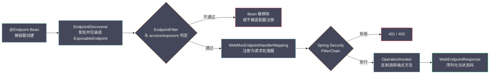
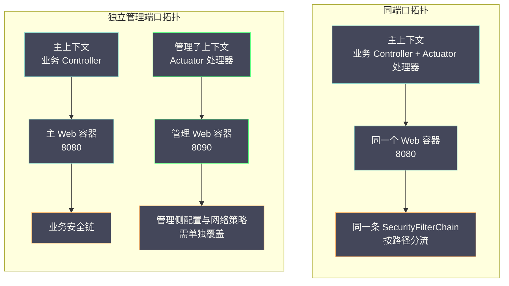
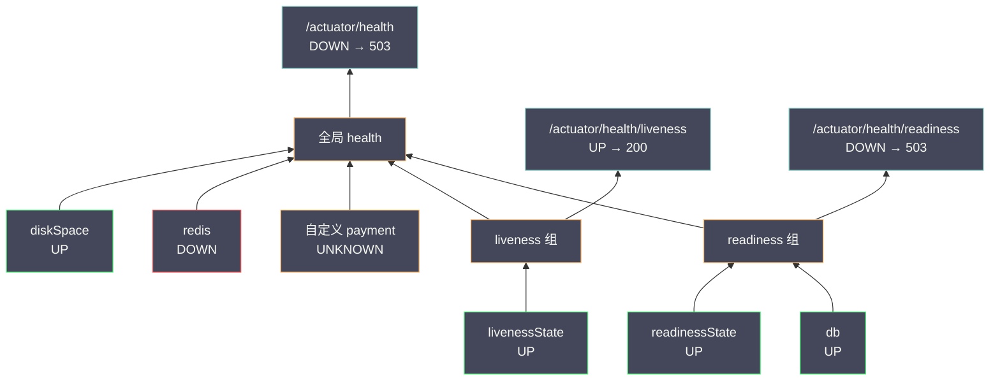
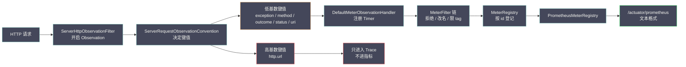
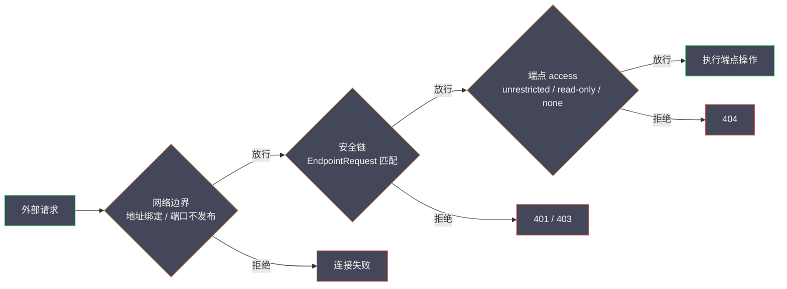

# Actuator——健康检查、指标暴露与自定义端点

**摘要：**

Actuator 常被当成"引入一个 starter 就自动拥有"的监控功能，但它真正扮演的角色，是应用向运维体系交出的一组生产就绪性（Production-ready）接口：编排系统靠它判断生死，时序库靠它采集度量，值班工程师靠它在事故现场动手术。这三类读者对环境的要求完全不同，把它们绑在同一条暴露策略上，正是绝大多数 Actuator 事故的起点。本文从"端点凭什么能被外部访问"这个问题切入，把端点的可见性拆成存在性、暴露通道、访问控制三层，逐层讲清 `management.endpoints.web.exposure.include` 的默认值、`management.endpoint.<id>.access` 在 3.4 之后的收敛、以及 `management.server.port` 独立管理端口带来的第二个 Web 容器与子上下文代价；随后分别拆解 Health 的聚合树与探针组、Micrometer 的注册表模型与 `http.server.requests` 的标签来源，指出"标签基数爆炸"的真实入口；再讨论自定义端点绕过 Spring MVC 规则所带来的安全与内存代价，落到 `/actuator/env`、`/actuator/heapdump`、`/actuator/shutdown` 三个高危端点的处置。读完本文，你应当能回答两个问题：一套 Actuator 配置究竟由哪几层开关共同决定，以及这些开关在什么条件下会整体失效。

---

## 第 1 章 生产就绪性：一个被低估的接口面

### 1.1 从"进程活着"到"状态可被接管"

一个 Spring Boot 应用能启动、能响应业务请求，与它能否被运维体系接管，是两件不同的事。前者由 `SpringApplication.run` 的收尾动作保证，后者取决于应用愿不愿意把内部状态翻译成一套外部可读、可判断、可操作的接口。Actuator（执行器）就是这套接口的官方实现。

这套接口的必要性是被部署形态逼出来的。单体时代，运维判断一个进程是否正常，手段是登录服务器看日志、用 `jstat` 看堆、用 `jstack` 抓线程栈；节点只有十几台时，这套手工流程勉强维持得住。到了容器编排的时代，节点变成几百个随时重建的 Pod，IP 每次发布都变，SSH 通道在最小化镜像里根本不存在，而 kubelet 判断一个 Pod 该不该重启、该不该摘流量，依据只有它自己发起的 HTTP 探测。此刻如果应用没有对外暴露一个"我很健康"的接口，编排系统就只能靠端口能否连通来猜，而端口能连通与业务能否服务之间，隔着连接池耗尽、依赖不可用、线程死锁一大段距离。

Actuator 的定位，就是把这段距离填上：它不负责采集、不负责存储、不负责展示，只负责**把内部状态与可执行操作交出去**，形式是 HTTP 或 JMX。采集与存储的工程问题属于指标平台，本文只在必要处点一句，细节路由到 [[可观测/指标/02 指标数据模型与采集——vmagent 与 Prometheus 协议|指标采集]]。

### 1.2 端点交出的三样东西

把 Actuator 内置的二十余个端点和自定义端点归并一下，它们其实只交出三样东西，而这三样东西的读者、频率与风险等级都不一样。

**状态（Status）**。`health` 端点回答"这个实例现在能不能干活"。它的读者是编排系统与监控探针，调用频率最高、容忍延迟最低，且它的输出直接触发"重启"或"摘流量"这类不可逆动作。

**度量（Metrics）**。`metrics`、`prometheus` 端点回答"这个实例过去一段时间发生了什么"。它的读者是时序库，调用频率中等（通常 15 秒到 60 秒一次），单次响应体却可能达到几百 KB 到数 MB。

**操作（Operation）**。`loggers`、`threaddump`、`heapdump`、`shutdown` 以及自定义端点，回答的是"能不能在不重启的前提下改变或取出点什么"。它的读者是事故现场的人，调用频率极低，但每一次调用都可能改变运行状态或泄漏大量内部信息。

三类读者对暴露范围的要求恰好相反：探针要求路径稳定、可匿名访问、必须在主端口上可达；时序库要求路径固定、能被网络策略放行；操作类端点则要求**除了值班的人之外谁都进不来**。一套 `exposure.include` 同时服务这三类读者，冲突无法避免——端点的暴露策略不是一项配置，而是一次读者分层。

### 1.3 端点的三重身份

工程师第一次接触 Actuator，往往把它当成"加了依赖就有的功能"，于是注意力全放在"怎么把想要的端点打开"上；但每个端点在运行期同时具备三重身份，只看见第一重，就会在第二、第三重上翻车。

第一重身份是**一个 HTTP 接口**：它有路径、有方法、有请求体约束、有响应状态码，和 `@RestController` 暴露的接口在协议层面没有任何区别。

第二重身份是**一组配置开关的计算结果**。同一个 `HealthEndpoint` Bean 是否存在于上下文中、是否被 Web 适配器注册成处理器、绑定在哪条路径上、绑定在哪个端口上，分别由不同的属性决定，任何一层关掉，结果都表现为 404。

第三重身份是**一块攻击面**。`/actuator/env` 会把整棵配置树连同来源一起交出来，`/actuator/heapdump` 会交出整个堆的快照，`/actuator/shutdown` 会让进程优雅退出；它们不需要任何漏洞就能被利用，只需要一次粗心的暴露。

打个不太精确的比方：Actuator 像机房里那块巡检面板，仪表、指示灯、应急按钮都装在同一个面上。面板装在哪面墙上（端口）、面板外面的柜门是否上锁（安全链）、哪个按钮带护盖（端点级访问控制），是三件独立的事；把面板做好看，与把柜门锁上，从来没有关系。

### 1.4 版本口径与 2.x 到 3.x 的变化

本文以 Spring Boot 3.x 为准，具体属性名与默认值对照 3.5 的官方文档与源码，遇到随版本漂移的细节会标注。有三处变化会直接影响写法。

其一，命名空间迁移。3.x 基于 Spring Framework 6 与 Jakarta EE 9+，Actuator 的注解与接口从 `javax.*` 迁到 `jakarta.*`，Servlet 相关端点的类型签名随之改变；从 2.x 升级的代码在编译期就会暴露这类问题，不会拖到运行期。

其二，访问控制模型收敛。3.4 引入了 `management.endpoint.<id>.access`（取值 `unrestricted`、`read-only`、`none`）与全局的 `management.endpoints.access.default`，并在 3.5 的文档里把旧的 `management.endpoint.<id>.enabled` 与 `management.endpoints.enabled-by-default` 标注为已被取代。这个变化不只是改名：旧的 `enabled` 只能表达"存在或不存在"，新的 `access` 能表达"只读"，才有办法在不删除端点的前提下把 `loggers`、`caches` 这类端点降级成只读。

其三，度量采集机制换代。2.x 的 HTTP 指标由 `WebMvcMetricsFilter` 配合 `WebMvcTagsProvider` 产生，3.x 换成 Micrometer 的 Observation 机制：`ServerHttpObservationFilter` 负责埋点，`ServerRequestObservationConvention` 负责决定标签。这个换代解释了后文的标签来源问题。

---

## 第 2 章 端点的可见性：从 Bean 到 URL 的四段流水线

### 2.1 一条端点请求要穿过什么

讨论配置之前，先要有一个正确的运行期模型。一个 `@Endpoint` 标注的 Bean，从被容器创建，到能响应 `GET /actuator/xxx`，中间要穿过四段彼此独立的处理，任何一段不成立，外部看到的结果都只是 404 或 403，而修复手段完全不同。



图中的前两段由 Spring Boot 的端点基础设施负责：`EndpointDiscoverer` 把容器里的端点 Bean 包装成 `ExposableEndpoint`，并交给 `EndpointFilter` 链做一次"是否暴露"的判定；第三段由 Web 适配器 `WebMvcEndpointHandlerMapping` 把端点操作映射成具体的路径、HTTP 方法与请求谓词；第四段才是 Spring Security 的过滤器链。这四段的存在顺序决定了排查顺序：**先确认存在，再确认暴露，再确认路径方法，最后才怀疑权限**。

### 2.2 第一段：端点是否存在于上下文

第一段由几个层次的属性共同决定，而 3.4 之后它们的含义被重新划分过，值得单独说清。

第一组是端点级的 `management.endpoint.<id>.access`，取值 `unrestricted`、`read-only`、`none`；第二组是全局的 `management.endpoints.access.default`，为所有端点设定默认档。此外还有一个封顶阀 `management.endpoints.access.max-permitted`，它的优先级高于端点级设置——即便把某个端点写成 `unrestricted`，只要封顶阀设成 `read-only`，它也只会是只读。

这里有一个与直觉相反的机制：**不可访问的端点不是被"遮挡"，而是被整个移出应用上下文**。官方文档对 `access` 的描述明确写到，不可访问的端点会从上下文中被完全移除。这个设计有它的合理性——少一个 Bean 就少一份攻击面，自动配置也能依据 `@ConditionalOnAvailableEndpoint` 决定是否装配依赖项——但它直接影响故障排查：把 `management.endpoint.threaddump.access` 设为 `none` 之后，`threaddump` 端点相关的自动配置也随之退出，此时改 `exposure.include` 不会有任何反应，因为已经没有东西可以被暴露了。

3.5 的默认值在安全上是偏保守的，这一点很多人没注意到：`health` 的 `access` 是 `unrestricted`，而 `shutdown` 与 `heapdump` 的 `access` 默认都是 `none`。也就是说，在新版本里这两个高危端点不仅需要显式写进 `exposure.include`，还必须先把 `access` 打开，两道闸缺一不可。旧版本里"heapdump 只要暴露就能下载"的经验，在 3.5 上会失效。

旧的 `management.endpoint.<id>.enabled` 仍然可用，语义近似于 `access` 的两个极端取值：`false` 等价于 `none`，`true` 等价于"使用该端点的默认档"。两套属性并存期间，把 `enabled` 与 `access` 混着写，容易得到"看起来设了却没生效"的结果，取舍办法是统一改写为 `access`，让语义只有一处定义。

### 2.3 第二段：走哪个通道暴露

第二段由 exposure 属性控制，Web 与 JMX 是两条彼此独立的通道：`management.endpoints.web.exposure.include` 与 `management.endpoints.jmx.exposure.include`，两者默认值都只有 `health`。三个细节经常被忽略。

其一，`exclude` 的优先级高于 `include`。`include: "*"` 配合 `exclude: env,beans` 是常见写法，作用是留下全部端点而单独摘掉两个；这条规则在 3.x 上没有变化，但它只影响"暴露"，不影响"存在"，被 `exclude` 摘掉的端点 Bean 依然在上下文里，也可能依然通过 JMX 对外可达。

其二，YAML 里的 `*` 必须加引号。`*` 在 YAML 中是别名指示符，不写引号时解析出的不是字符串，配置绑定会失败或得到意外的值；这个错误在启动期不一定报错，表现为"明明写了全开却只有 health 可用"。

其三，JMX 通道常被当成不存在。容器里监听 1099 的 JVM 一旦被同宿主机或同 Pod 网络的进程连上，`env`、`loggers` 这类端点的效果与 HTTP 通道完全等价，而网络策略通常只针对 HTTP 端口写。把 JMX exposure 收敛到 `health` 甚至关掉远程 JMX，是管理面收敛里成本最低的一步。

路径本身还有三个可调项：`management.endpoints.web.base-path`（默认 `/actuator`）、`management.endpoints.web.path-mapping.<id>`（按端点改路径）、以及发现页开关 `management.endpoints.web.discovery.enabled`。发现页是 `/actuator` 根路径上那份"端点清单"，它会告诉任何能访问它的人"这台机器上还有哪些端点"，在对外暴露的场景里等于一份免费的侦察报告。有一个连带规则值得记住：当管理上下文路径被设为 `/` 时，发现页会被自动禁用，以免与其他映射冲突；而一旦配置了自定义的管理上下文路径，发现页的位置会从 `/actuator` 移到该路径的根上。

如果暴露策略需要按运行时条件动态决定（譬如只在某个 Profile 下暴露调试端点），官方给出的扩展点是注册 `EndpointFilter` Bean，而不是在配置里堆叠表达式。

### 2.4 第三段与第四段：路径注册与权限是两件事

第三段的分工需要单独强调：路径注册只决定"这个操作是否有一个 URL 可以到达"，权限决定"到达之后是否允许执行"。两者的关系是逻辑与，但失效表现不同——路径没注册是 404，权限不足是 401 或 403。把这两类失败混为一谈，是排查管理面问题时最常见的低效。

### 2.5 独立管理端口：第二个容器与子上下文

把 Actuator 挪到独立端口，是生产环境里被推荐最多的做法，但它的实现代价常被低估。设置 `management.server.port` 与业务端口不同之后，Spring Boot 会为管理端点单独创建子上下文（child context），并在这个子上下文里再起一个 Web 服务器。代价随之一并出现。



独立端口能拿到的收益是清晰的：网络策略可以只对 8090 放行特定来源，Ingress 可以把 8090 直接禁掉，管理面的过滤器链、SSL 证书、连接队列都与业务完全分开。文档甚至给出了配套的用法——管理端口可以配自己的 SSL，让业务走 HTTPS 而管理面留在 HTTP 内网，或者两边各用一套证书。

但成本也是实打实的。管理端点不再享受主应用的 Web 基础设施，这句话在文档里被用来解释探针的"假阳性"：**管理端点的探测成功，不代表主应用能接受连接**。主容器线程池打满、连接队列溢出、Servlet 过滤器抛异常，这些故障在 8090 上的 `/actuator/health` 看来可能一切正常，因为那个请求走的是另一套线程与另一套队列。这是"隔离"这件事的必然后果：隔离让故障不互相传染，也让健康信号不再能代理主应用的可用性。

配置层面还有三个易错点。`management.server.address` 只在管理端口与业务端口不同时才允许设置，同端口下设置会被忽略；把 `management.server.port` 设为 `-1` 可以彻底关闭 HTTP 端点通道，这比逐个 `exclude` 更彻底；`management.endpoints.web.base-path` 的解析基准会随端口是否独立而改变——同端口时它相对 `server.servlet.context-path`（响应式应用相对 `spring.webflux.base-path`），独立端口时相对 `management.server.base-path`，跨环境复制配置时这条基准差异会导致路径整体偏移。

| 维度 | 同端口 | 独立管理端口 |
| --- | --- | --- |
| 容器与线程 | 与业务共用，管理请求争抢工作线程 | 独立容器，互不争抢，但同受 JVM 堆与 GC 约束 |
| 网络策略 | 必须按路径放行，粒度受七层设备能力限制 | 可按端口整体放行或封禁，粒度最细 |
| 安全链 | 一条链内按 `EndpointRequest` 分流 | 需确认管理容器的链是否按预期生效，并单独配置 |
| 探针可信度 | 探针失败通常意味着主应用也不可用 | 探针成功不代表主应用可用，需补主端口探针 |
| 暴露面 | 管理面天然继承业务入口的所有暴露风险 | 管理端口成为第二个必须被防火墙覆盖的入口 |

### 2.6 端口隔离能解决什么，不能解决什么

独立端口解决的是"谁能在网络层摸到这个接口"，不解决"摸到之后能做什么"。它无法替代认证，也无法改变端点本身的破坏力：`/actuator/shutdown` 挂在内网端口上依然是关机按钮，`/actuator/heapdump` 挂在内网端口上依然能拖走整堆快照。把端口隔离当成安全方案的全部，等价于把保险柜搬进储藏室就当它上了锁。

它同样不解决同 JVM 的资源竞争。`heapdump` 触发的堆遍历、`threaddump` 触发的全线程暂停、`prometheus` 端点序列化几万条时序，消耗的都是业务进程的 CPU 与堆；管理端口只是让这些操作从另一个网卡进来，没有让它们变便宜。真正的成本控制要靠端点级的限流与超时约束。

---

## 第 3 章 Health 的分层：从 Contributor 树到探针组

### 3.1 Health 的数据结构与状态语义

`health` 端点的返回体由两部分构成：状态（`status`）与明细（`details`）。状态是编排系统唯一关心的字段，明细则是人看的字段，两者的可见性控制完全独立，这个分离是理解后续所有配置的前提。

内置状态有四个：`UP`、`DOWN`、`OUT_OF_SERVICE`、`UNKNOWN`。其中 `OUT_OF_SERVICE` 常见于主动摘流量的场景——应用自己知道接下来要停机维护，于是把状态挂到"暂停服务"，而不是假装健康或直接宣告死亡。非内置状态码也能用，`Health.status("FATAL")` 是合法写法，但此时聚合器不认识它，除非配置 `management.endpoint.health.status.order` 显式给出严重度顺序，或提供一个自定义的 `StatusAggregator`。

状态到 HTTP 状态码的映射有一个必须记住的默认：`DOWN` 与 `OUT_OF_SERVICE` 映射到 503，`UP`、`UNKNOWN` 以及其他未映射状态都映射到 200。这里有两点容易出错。

第一点是 `UNKNOWN` 返回 200。这意味着一个"判断不出来"的应用，在编排系统眼里是健康的。当某个 indicator 因为依赖超时、配置缺失而无法给出结论时，它可能返回 `UNKNOWN`，探针照样放行，故障被推迟到用户请求失败的那一刻才暴露。想让未知被视为不健康，必须显式改写映射。

第二点更隐蔽：**一旦配置了自定义的 `status.http-mapping`，`DOWN` 与 `OUT_OF_SERVICE` 的默认映射会被整体取消**，文档明确要求把这两个默认项一并重写。只加一行 `fatal: 503` 而忘了重写 `down: 503`，结果是 `DOWN` 退回 200，探针永远成功，Kubernetes 永远不会重启一个已经死掉的应用。这类配置错误不会报错、不会告警，只会安静地把健康检查变成装饰。

### 3.2 聚合是取最严重，不是投票

多个 indicator 的聚合由 `StatusAggregator` 负责，默认实现按一个有序状态列表排序，取排序结果中的第一条作为整体状态；如果没有任何 indicator 返回聚合器认识的状态，整体状态退化为 `UNKNOWN`。用一句话概括：**任何一个 indicator 说 DOWN，整体就是 DOWN**，没有多数票，没有加权。



这张图刻意画出了一个不对称：全局 `health` 因为 `redis` 与 `payment` 而 `DOWN`，而 `liveness` 组只看 `livenessState`，仍然是 `UP`。这正是探针组存在的理由——**"服务整体是否健康"与"这个进程该不该被杀掉"是两个问题**。把全局 `/actuator/health` 直接当作 liveness 探针，等于把"依赖抖动"翻译成"重启全部实例"，一个 Redis 的短暂不可用会被放大成整个集群的滚动重启。探针的语义与时序细节属于编排层的账，这里只留一句路由：[[云原生/Kubernetes/kubernetes生命周期管理和服务发现/03 健康检查与就绪探针|健康检查与就绪探针]]。

### 3.3 show-details 的三档与泄露面

`details` 里装的东西比多数人以为的多：`db` 的 indicator 会给出数据库产品与版本、验证查询语句、连接池里活跃与空闲连接的计数；`redis` 会给出服务端版本；`diskSpace` 会给出磁盘路径、剩余阈值与当前值；自定义 indicator 往往直接把异常消息写进 `details`，而异常消息里可能出现表名、SQL 片段、内网地址、账号名。这些信息单看都不致命，凑起来是一份相当完整的架构素描。

控制这份素描可见性的属性是 `management.endpoint.health.show-details`，三档取值：

| 取值 | 未认证访问者 | 已认证访问者 | 典型用途 |
| --- | --- | --- | --- |
| `never`（默认） | 只看到 `status` | 只看到 `status` | 面向公网、面向探针 |
| `when-authorized` | 只看到 `status` | 看到完整 `details` | 内部服务、有统一认证 |
| `always` | 看到完整 `details` | 看到完整 `details` | 单机调试、完全隔离的内网 |

`when-authorized` 里的"授权"由 `management.endpoint.health.roles` 定义：配置了角色时，用户必须命中其中之一；没有配置角色时，**任何已认证用户都算授权**。后一条是隐蔽的放宽口——只要应用里有普通业务账号体系，任何一个登录成功的用户都能看到 health 明细。

还有一个与 `show-details` 并列的属性 `management.endpoint.health.show-components`，它控制的是"组件名列表"这一级的可见性；未显式设置时会沿用 `show-details` 的取值。之所以要多这一级，是因为有些场景下组件名本身（`db`、`redis`、`paymentGateway`）就足以暴露技术栈，而明细反而不想给。

选 `always` 时有一个容易踩的前提：如果应用接了 Spring Security，`always` 要求安全配置同时对已认证与未认证用户放行 health 端点。只放行已认证用户再加 `always`，结果是未认证请求被 401 挡在门外，看起来像 `never`，排查时容易误判成配置没生效。

### 3.4 探针组：把"该不该活"和"能不能接活"分开

Spring Boot 用健康组（Health Group）实现 liveness 与 readiness。健康组本身是一个通用机制：用 `management.endpoint.health.group.<name>.include` 或 `.exclude` 从全部 contributor 里挑出一个子集，通过 `/actuator/health/<name>` 单独访问。探针组是它最著名的用法。

两个自动配置的 indicator 需要先知道它们的默认状态：`LivenessStateHealthIndicator` 与 `ReadinessStateHealthIndicator` 默认不启用，对应开关是 `management.health.livenessstate.enabled` 与 `management.health.readinessstate.enabled`；而 `liveness` 与 `readiness` 两个健康组只在 Kubernetes 环境中自动启用，其他环境要手动把 `management.endpoint.health.probes.enabled` 设为 `true`；3.5 的文档里，旧写法 `management.health.probes.enabled` 已被标注为被前者取代，旧名目前仍走迁移路径。

组的内容默认极简：`liveness` 只含 `livenessState`，`readiness` 只含 `readinessState`，Spring Boot 明确不会往里添加任何外部依赖检查。这个"什么都不加"的默认值是被事故教育出来的：liveness 失败会触发重启，重启对共享依赖的故障毫无帮助，只会把单点故障放大成雪崩；readiness 失败会摘流量，而摘流量是否优于带错误继续服务，取决于该依赖是否为所有实例共享——如果所有实例都连同一个数据库，把数据库检查塞进 readiness 的后果是全部实例一起变 unready，Service 直接没有可用后端。

组还可以配置出更细的能力，这些能力在需要的时候很好用。`validate-group-membership` 默认为 `true`，意味着组里 include 或 exclude 了一个不存在的 indicator 时启动会失败——这是一个把配置错误提前到部署期的好设计，唯一代价是引用的 indicator 被条件装配掉之后需要同步改配置。复合 contributor 可以按全限定名选到子组件，譬如 `test/primary` 表示复合体 `test` 下的 `primary`。组可以单独覆盖 `show-details`、`roles`、状态顺序与状态码映射，也可以通过 `@Qualifier("组名")` 注入专属的 `StatusAggregator` 或 `HttpCodeStatusMapper`。

组还能挂到"额外路径"上：`management.endpoint.health.group.<name>.additional-path` 支持 `server:` 与 `management:` 两种前缀，前者把组暴露到主服务器端口，后者暴露到管理端口，路径必须是单段。Spring Boot 为探针提供了一个快捷开关 `management.endpoint.health.probes.add-additional-paths=true`，打开后 `liveness` 组出现在主端口的 `/livez`、`readiness` 组出现在 `/readyz`。

这个快捷开关要解决的问题，就是第 2 章留下的那个坑：管理端口独立时，管理容器的探针成功不代表主应用可用。把存活与就绪的判定放回主端口，等于让探针重新经过业务容器的那套线程与队列，代价是探针也要承受业务容器的过载——探针在业务线程池打满时超时，进而被判定失败，这未必是误判，因为主容器确实已经无法处理请求。两种拓扑的取舍在于你更怕"假阳性"还是更怕"探针与业务同归于尽"，没有同时消除两者又能保留隔离收益的办法。

### 3.5 失败形态清单

把 health 相关的常见故障按"症状、判据、根因"整理一遍，比记住属性名更有用。

**症状一：探针一直成功，业务已经全挂。** 判据是手工请求 `/actuator/health` 返回 200 且 `status` 为 `UP`，但业务接口 5xx 或超时。根因常见三种：状态码映射被自定义改坏（3.1 的坑）；健康组把关键 indicator 排除了；管理端口独立而探针打在管理端口上（第 2 章的坑）。

**症状二：启动直接失败，日志指向 health 组配置。** 判据是启动异常里出现组成员校验失败的提示。根因是 `validate-group-membership` 为 `true` 而引用了不存在的 indicator，通常发生在把某个依赖临时移除之后。

**症状三：健康检查本身把应用拖慢。** 判据是 `health` 请求耗时上升、探针开始超时、重启次数变多。根因是某个 indicator 执行了真实的外部调用（SQL、`PING`、HTTP 请求），而它的耗时随依赖劣化而增长；Spring Boot 对单个 indicator 超过 10 秒的情况会打印警告，阈值可用 `management.endpoint.health.logging.slow-indicator-threshold` 调整，但调阈值只是让日志闭嘴。真正的处置是给 indicator 加超时，或者把它从探针路径上挪开、只留在全局 health 里。

**症状四：状态变化要等很久才被感知。** 判据是故障发生与探针失败之间存在固定延迟。根因是 `management.endpoint.health.cache.time-to-live`（默认 `0ms`，即不缓存）被调大，缓存时长与探针周期叠加后放大了判定延迟。健康检查的缓存只在极少数场景下值得开，譬如 indicator 特别昂贵且业务能容忍延迟。

内置 indicator 的开关与 key 也值得记一张表，因为属性名与实际组件名并不总是一致：

| key（属性与开关） | 自动配置的 indicator | 默认启用 | 备注 |
| --- | --- | --- | --- |
| `db` | `DataSourceHealthIndicator` | 是（有 DataSource 时） | 会执行验证查询，路由数据源可按目标库展开 |
| `diskspace` | `DiskSpaceHealthIndicator` | 是 | 响应中的组件名是 `diskSpace`，属性名是全小写 |
| `redis` | `RedisHealthIndicator` | 是（类路径有 spring-data-redis 时） | 执行 `PING`，受连接超时配置影响 |
| `ssl` | `SslHealthIndicator` | 是（配了 SSL 时） | 支持到期预警阈值 |
| `ping` | `PingHealthIndicator` | 是 | 恒返回 `UP`，仅用于证明端点通道可用 |
| `livenessstate` | `LivenessStateHealthIndicator` | 否 | 探针组依赖它，需显式启用 |
| `readinessstate` | `ReadinessStateHealthIndicator` | 否 | 同上 |

全局开关是 `management.health.defaults.enabled`，单独关某一个用 `management.health.<key>.enabled`。关掉 indicator 与排除出组是两件不同的事：前者让它从所有组和全局 health 里消失，后者只影响某个组。

---

## 第 4 章 Metrics 的模型：注册表、标签与限流

### 4.1 MeterRegistry 是注册表，不是管道

Micrometer 的核心抽象只有一个：`MeterRegistry`。它不是"把指标推出去的管道"，而是一张注册表——应用第一次用某个指标名加某组标签创建指标时，registry 生成一个 `Meter` 并在内部登记；此后每次观测都作用在同一个 `Meter` 实例上。同一个 id 重复创建是幂等的，拿回的是同一个对象。

这条幂等规则是理解后面所有基数问题的钥匙：**每种指标名与标签值的组合，都是时序库里一条独立的序列**。标签不是"备注"，是序列的主键。

Spring Boot 自动配置的是一个组合注册表（Composite `MeterRegistry`）：类路径上有几个后端实现，就往组合里挂几个子 registry，应用只跟组合打交道，写入时广播给所有子 registry。几个相关的收敛开关值得记住——`management.<registry>.metrics.export.enabled` 关掉单个后端（依赖还在、数据不出），`management.defaults.metrics.export.enabled` 统一关掉所有未单独指定的后端，`management.metrics.use-global-registry` 控制是否把自动配置的 registry 挂到 `Metrics` 类的全局静态注册表上（测试隔离时常用）。

配置注入点有三层，职责不同：`MeterRegistryCustomizer` 在**注册表创建之后、任何 meter 注册之前**执行，适合加公共标签与注册表级设置；`MeterFilter` 在**每个 meter 注册时**拦截，可以拒绝、改名、改标签；`MeterBinder` 则是往注册表里批量绑定一组 meter 的入口，框架的大量内置指标都通过它完成。三层之中，只有 `MeterFilter` 能看到每一个 meter 的完整 id，因此所有"限流与整形"的诉求最终都落在它身上。

### 4.2 一次请求如何变成一条时序

`http.server.requests` 是几乎每个 Spring Boot 应用都有的指标，也是基数问题最集中的地方。它的诞生链路值得逐步看一遍，因为每一步都在做一次"减维"。



图中 E 到 G 这条分叉是框架的第一道防线：高基数键值（完整 URL）由 convention 单独归入高基数集合，而写指标的 handler 只取低基数集合。也就是说，在默认配置下，`http.server.requests` 的标签空间是被刻意压小的，压小的手段就是把 "URL 原文" 换成 "URL 模板"。第 1 章提到的机制换代在这里落地：2.x 由 `WebMvcTagsProvider` 提供的 tag 集合，在 3.x 由 `ServerRequestObservationConvention` 提供，名字变了，思路没变。

### 4.3 uri 标签到底放什么

`uri` 是 `http.server.requests` 上最容易被怀疑的一个标签，因为直觉上"每个接口一条序列"听起来就不便宜。3.x 的默认实现比直觉温和：convention 先取请求匹配到的路径模板（path pattern），拿到就用模板作为 `uri`，譬如 `/orders/{orderId}`；模板为空时记为 `root`；拿不到模板时按响应状态兜底——3xx 记为 `REDIRECTION`，404 记为 `NOT_FOUND`，其余记为 `UNKNOWN`。真实 URL 不会进入 `uri`。

这个兜底逻辑解释了为什么"扫描器拿随机路径打应用"这类事故在 3.x 上不容易把指标打爆：几千个随机路径最终都落进 `NOT_FOUND` 这一个标签值里。它同时也解释了另一个现象——如果某个接口的 `uri` 标签常年是 `UNKNOWN`，说明观测上下文没拿到路径模板，这通常意味着请求在进入处理器之前就被过滤器短路了，或者路由注册方式（譬如函数式端点、部分网关转发）绕过了模板的填充逻辑。

**`uri` 之外才是真正常见的爆炸点**。按发生频率排一下：第一是业务自定义标签，把订单号、用户 ID、租户 ID、设备 ID、请求 ID 直接当标签值，这类标签的取值空间与业务量同阶；第二是把变量拼进指标名而不是标签，譬如 `order.created.physical`、`order.created.virtual` 这样按维度展开成不同的指标名，名字空间同样会膨胀，且比标签更难治理；第三是异常信息被当作标签值，`exception` 在标准 convention 里只取异常类的简单类名（有界），但自己实现的 handler 可能把异常消息整个放进去，消息里带的主键会让基数失控；第四是某些"正在处理中"的 gauge 为每个业务对象注册一个 meter，注册表本身就成了业务对象表的副本。

关于最后一点要补一句机制：计数器与计时器做的是聚合，标签相同就累加；而 `Gauge` 只持有被观测对象的引用、每次采集现取值，它不会"合并"。给每个订单创建一个 gauge，等于给注册表里塞几十万个条目，同时让每次序列化 `/actuator/prometheus` 都要遍历它们。

`management.metrics.web.server.max-uri-tags`（默认 100）是框架给出的兜底阀：一旦某个指标名的 `uri` 取值超过上限，后续带新 `uri` 值的 meter 会被 filter 拒绝。它的作用域只有 `uri` 这一维度，且只对 HTTP 服务端指标生效，**不能指望它兜住业务标签**——把它当成整体护栏，是把它用错了地方。

### 4.4 公共标签与 MeterFilter 的分工

公共标签解决的是"所有指标都要带上环境信息"这个诉求，它有两条实现路径，选哪条取决于标签值从哪来。属性路径 `management.metrics.tags.*` 由 Spring Boot 内置的 `PropertiesMeterFilter` 在注册时追加标签，好处是能被配置中心、命令行参数、环境变量覆盖，同一份镜像在不同环境自动带上不同标签；代码路径是注册 `MeterRegistryCustomizer` 并调用 `registry.config().commonTags(...)`，好处是能写判断逻辑（譬如只在某个 Profile 下追加），坏处是标签值被编译进镜像。两条路径同时使用时顺序由执行时机决定：customizer 在 meter 注册前生效，属性 filter 在注册时生效，最后的标签集合是并集，同名标签的取舍要实际验证一次，不要靠推测。

真正需要精细控制的场景，`MeterFilter` 提供了几类能力，它们的副作用差别很大：

| 目的 | 典型 API | 副作用 |
| --- | --- | --- |
| 整体拒绝某类指标 | `MeterFilter.denyNameStartsWith(...)`、`deny(...)` | meter 不进入注册表，导出与查询同时消失，排障时容易误以为功能没埋点 |
| 拒绝特定条件 | `MeterFilter.deny(id -> ...)` | 判定在每个 meter 注册时执行一次，条件写复杂了会拖慢首请求 |
| 重命名标签 | `MeterFilter.renameTag(前缀, 旧名, 新名)` | 仪表盘与告警里的旧标签名立刻失效，需要同步改查询 |
| 限制标签取值数量 | `MeterFilter.maximumAllowableTags(...)` | 超限后的新取值被静默丢弃，指标仍然"有数"，只是少了一部分，必须配合告警才不至于无感 |
| 给某些指标追加标签 | `MeterFilter.commonTags(...)` | 与全局公共标签叠加，标签数变多同样增加序列数 |

`maximumAllowableTags` 容易被高估。它的语义是"超过 N 个不同取值之后，新的取值不再注册"，因此它能保住时序库不被写爆，但代价是**数据静默缺失**：被丢弃的那部分流量不会在指标里留下任何痕迹，仪表盘上的 QPS 会比实际低，而且看不出缺了哪些。合理的用法是给它配一个"超限时触发"的回调，把丢弃这件事故意变成一个可观测事件，而不是让它安静地发生。同理，`deny` 类 filter 只能阻止数据外流，不能阻止业务代码继续为每个请求构造新的 `Meter.Id` 并做一次查表，那部分 CPU 开销依然在原地。

### 4.5 分布口径：summary 还是 histogram

`Timer` 在 Prometheus 上的默认导出形态是 summary：一组客户端计算好的分位数，加上 `_count` 与 `_sum`。它在单实例上足够精确，但**分位数不可跨实例聚合**——把十台机器的 p99 取平均，得到的不是集群的 p99。要在多实例上算聚合分位数，需要打开直方图（`publishPercentileHistogram()`，或属性 `management.metrics.distribution.percentiles-histogram.<prefix>=true`），让每个实例导出分桶计数，由查询层用 `histogram_quantile` 计算。

这个选择直接决定了序列数量级。以 `http.server.requests` 为例做一次示例推算（数字为说明规模而设，非实测）：若一个服务有 40 个路径模板、常见的 4 种 HTTP 方法、8 种状态码，实际出现的组合可能有 900 余种；summary 形态下，每组组合贡献 `_count`、`_sum` 与每个已发布分位数各一条序列，3 个分位数即 5 条，总量约 4500 条；换成直方图，每组组合贡献 `_count`、`_sum` 与十几个桶，总量升到一万多条。可见分位数的代价并不比标签小，它只是在另一个维度上花序列。

口径选择属于指标工程的公共话题，这里只留结论与路由：探针式的"看一眼"用 summary 够用，SLO 式的"跨实例算达标比例"必须用直方图，两者混用会导致同一个接口在两块仪表盘上给出不同的数。细节见 [[可观测/指标/02 指标数据模型与采集——vmagent 与 Prometheus 协议|指标采集]] 与 [[可观测/指标/09 指标工程落地与 SLO 体系|SLO 体系]]。

最后补一个实用的自检入口：`/actuator/metrics` 端点（不是 `/actuator/prometheus`）可以在应用内部列出指标名、某个指标的可用标签与当前取值组合。在怀疑基数问题、又不想在 Prometheus 上写 `count by` 查询时，它是最快的确认手段——它读的是应用自己的注册表，看到的就是这个实例真实登记了什么。

---

## 第 5 章 自定义的三种形态与端点的代价

### 5.1 三种自定义，三种代价

"自定义 Actuator"其实有三个不同的入口，它们的成本差一个数量级，混在一起讨论会把结论搞反。

最轻的一种是自定义 `HealthIndicator`，只往里加判断，不新增对外路径——它的输出天然并入已有的 `health` 树，暴露策略、安全策略、探针配置全部复用。中等成本的是自定义 `MeterBinder` 或直接往注册表里写指标，新增的是数据维度而不是接口路径，风险集中在基数。最重的一种才是自定义 `@Endpoint`，它新增一个对外可调用的操作面，要单独考虑暴露、权限、返回值规模与副作用。

前两种的价值往往被低估。一个需要观察的业务依赖，写成 health contributor 就自动获得了聚合、状态码映射、组包含、探针复用这一整套；写成端点则要自己承担全部安全与规模问题。复合结构也是现成的：`CompositeHealthContributor` 可以把一组相关检查组织成一棵子树，响应里自然形成嵌套，任何一个子项 DOWN 都会把父项拉成 DOWN。

```java
@Component("externalServices")
public class ExternalServicesHealthIndicator implements CompositeHealthContributor {

    private final Map<String, HealthContributor> indicators = new LinkedHashMap<>();

    public ExternalServicesHealthIndicator(PaymentClient payment, NotifyClient notify) {
        // 用 Map 保证顺序稳定，响应体的字段顺序才不会在两次请求间跳动
        this.indicators.put("payment", (HealthIndicator) () -> check(() -> payment.ping()));
        this.indicators.put("notify", (HealthIndicator) () -> check(() -> notify.ping()));
    }

    private Health check(Runnable call) {
        long begin = System.nanoTime();
        try {
            call.run();
            long costMs = (System.nanoTime() - begin) / 1_000_000;
            // 明细只在 show-details 打开时才会出现在响应里
            return Health.up().withDetail("costMs", costMs).build();
        } catch (Exception ex) {
            // 只放异常类型，不放消息：消息里常有内网地址与主键
            return Health.down().withDetail("error", ex.getClass().getSimpleName()).build();
        }
    }

    @Override
    public HealthContributor getContributor(String name) {
        return this.indicators.get(name);
    }

    @Override
    public Iterator<NamedContributor<HealthContributor>> iterator() {
        return this.indicators.entrySet().stream()
                .map(e -> NamedContributor.of(e.getKey(), e.getValue()))
                .iterator();
    }
}
```

这段代码里有两处刻意的选择。其一，明细只放耗时与异常类名，不放异常消息——前者是稳定的低基数信息，后者会把内网拓扑写进响应体。其二，每个子项都包在 `try` 里：indicator 抛出的异常会被 Actuator 转成 `DOWN`，但堆栈信息同时也会进日志，在依赖整体不可用时这条日志路径会被刷爆，所以先在这里收敛。

### 5.2 `@Endpoint` 的实现契约

需要新增操作面时，才轮到 `@Endpoint`。它的契约不复杂，但细节都在"不生效"的那一侧。

标了 `@Endpoint(id = "xxx")` 的 Bean，其 `id` 同时决定 URL 段与 JMX 条目名。三个操作注解决定 HTTP 方法：`@ReadOperation` 对应 GET，`@WriteOperation` 对应 POST，`@DeleteOperation` 对应 DELETE。方法参数从 URL 查询参数与 JSON 请求体中按名字绑定，默认必填，加 `@Nullable` 可变为可选。参数类型只能是简单类型——这是"技术无关"的代价：端点要同时适配 HTTP 与 JMX，所以不能声明一个自定义 DTO 让框架替你反序列化，只能一个字段一个参数地接收。参数名的解析依赖 `-parameters` 编译选项，Spring Boot 的 Maven 插件与 `spring-boot-starter-parent` 会自动带上，自建构建配置时需要自己确认。

路径变量的映射靠 `@Selector`，加在参数上即成为路径中的一段；要让最后一段吞掉剩余路径，用 `@Selector(Match = ALL_REMAINING)` 并声明为 `String[]` 兼容类型。类型转换走 `ApplicationConversionService` 以及带 `@EndpointConverter` 限定的转换器。

响应状态码有一套固定规则，不写清楚很容易误判自己的接口坏了：读操作有返回值返回 200，返回 `void` 或 `null` 返回 404；写操作与删除操作有返回值返回 200，返回 `void` 或 `null` 返回 204；缺少必填参数或参数无法转换时，方法根本不会被调用，直接返回 400。内容类型也由框架推导：写操作接受 `application/vnd.spring-boot.actuator.v2+json` 与 `application/json`，返回 `Resource` 时产出 `application/octet-stream`，其余情况产出 actuator 的 JSON 媒体类型。

下面这个缓存端点把上述规则都用上了：列表与单查走两个读操作，清除走删除操作，`@Selector` 区分缓存名。

```java
@Component
@Endpoint(id = "cache")
public class CacheEndpoint {

    private final CacheManager cacheManager;

    public CacheEndpoint(CacheManager cacheManager) {
        this.cacheManager = cacheManager;
    }

    // GET /actuator/cache，返回计数而非条目，避免把整库内容序列化出去
    @ReadOperation
    public Map<String, Object> summary() {
        Map<String, Object> result = new LinkedHashMap<>();
        for (String name : this.cacheManager.getCacheNames()) {
            result.put(name, sizeOf(name));
        }
        return result;
    }

    // GET /actuator/cache/orders
    @ReadOperation
    public Map<String, Object> detail(@Selector String cacheName) {
        Map<String, Object> body = new LinkedHashMap<>(sizeOf(cacheName));
        body.put("realized", this.cacheManager.getCache(cacheName) != null);
        return body;
    }

    // DELETE /actuator/cache/orders，有返回值时为 200
    @DeleteOperation
    public Map<String, String> clear(@Selector String cacheName) {
        Cache cache = this.cacheManager.getCache(cacheName);
        if (cache == null) {
            // 删一个不存在的缓存不算错误：返回说明，而不是让它落到 204
            return Map.of("cleared", cacheName, "result", "ABSENT");
        }
        cache.clear();
        return Map.of("cleared", cacheName, "result", "CLEARED", "at", Instant.now().toString());
    }

    private Map<String, Object> sizeOf(String name) {
        Cache cache = this.cacheManager.getCache(name);
        if (cache == null) {
            return Map.of("present", false);
        }
        Object nativeCache = cache.getNativeCache();
        // 不同缓存实现的统计接口不同，这里退化为类型名 + 存在性
        return Map.of("present", true, "type", nativeCache.getClass().getSimpleName());
    }
}
```

需要 HTTP 专有能力——自定义响应头、文件下载、内容协商——时用 `@WebEndpoint` 配合 `WebEndpointResponse`，代价是它不再进入 JMX。给已有端点补一个 web 专属操作则用 `@EndpointWebExtension`，同一个端点每种扩展最多一个。

```java
@Component
@WebEndpoint(id = "export")
public class OrderExportEndpoint {

    private final OrderExporter exporter;

    public OrderExportEndpoint(OrderExporter exporter) {
        this.exporter = exporter;
    }

    @ReadOperation
    @Produces(MediaType.APPLICATION_OCTET_STREAM_VALUE)
    public WebEndpointResponse<Resource> export(@Selector String format,
                                                @Nullable String month) {
        // 返回 Resource 而不是 byte[]，写出时才逐块读取，避免整份数据在堆里再复制一遍
        Resource resource = this.exporter.open(format, month);
        return new WebEndpointResponse<>(resource, 200,
                Map.of("Content-Disposition", "attachment; filename=orders-" + month + "." + format));
    }
}
```

### 5.3 它不在 Spring MVC 的规则体系里

这是自定义端点最需要写进评审记录的一条：**端点方法不被 Spring MVC 的横切机制覆盖**。它不是你写的 `@RequestMapping` 方法，因此方法级权限注解、参数校验、拦截器、全局异常处理、内容协商定制，都不会自动套用到它身上。很多团队以为"我们的接口都加了 `@PreAuthorize`，Actuator 也一样安全"，这个假设在端点上不成立。

端点能依靠的门只有一道：Spring Security 过滤器链对 URL 的匹配。用 `EndpointRequest.toAnyEndpoint()` 做匹配器时，自定义端点会被一并覆盖，这是推荐写法；风险出在手写路径匹配上——`/actuator/**` 这种硬编码在有自定义 `base-path` 时直接失效，在有独立管理端口时匹配不到管理容器里的请求，在用了 `path-mapping` 之后同样错位。

第二个风险来自"自动获得暴露"。若 `exposure.include` 写成 `*`，任何新增的 `@Endpoint` Bean 都会立刻对外可见，而这次变更不会出现在接口评审里，因为它没有改任何 Controller。把自定义端点逐个列名暴露，是让"新增对外接口"这件事重新变得显眼的低成本手段。

第三个风险来自 JMX 通道。`@Endpoint` 会同时注册到 JMX，只写 `@WebEndpoint` 才会被限制在 HTTP；如果 JMX exposure 被放宽过，HTTP 侧的安全链对 JMX 一侧完全没有约束力。

### 5.4 返回值就是内存占用

`@ReadOperation` 的返回值会被序列化后写出去，序列化过程本身是流式的，但**组装返回值的过程不是**。返回一个查询出来的 `List<Order>`，这条语句执行完时整份数据已经在堆里；十万行订单意味着这次端点调用要临时占用几十到几百 MB 堆，而这个调用通常发生在系统已经处于高负载、正在排障的时刻。

更糟的是这类端点通常没有超时、没有分页、没有背压：调用方一旦断开，容器线程要等写出失败才能回收；端点方法跑在 Web 容器的工作线程上，一次十秒的读操作就占掉一个业务线程，探针与正常请求一起排队。

几种写法的代价可以排一下序。返回完整集合：实现最省事，内存峰值与数据量同阶，故障时最容易把应用推向 OOM。返回计数与摘要：内存恒定，信息量打折，适合做成默认行为。返回 `Resource` 流式写出：内存峰值取决于生成逻辑而非结果大小，适合导出，但生成过程若先落到内存缓冲，收益会被吃掉。异步触发 + 结果落盘：把长任务挪出请求线程，代价是要维护任务状态并新增一个查询入口。

可落地的约束有三条：端点内部硬编码返回条数上限，超过就截断并在响应里带上 `truncated: true`；把可能耗时的读操作改成两次调用（第一次只返回总量，第二次带分页参数）；对写操作与导出类操作限定在内网地址上、并对调用频率做限制。

### 5.5 什么时候不该写端点

有三类需求经常被塞进端点，但都不合适。一是一次性排障需求，譬如"看一下某个开关的当前值"——`loggers` 端点已经能改日志级别，`env` 能看到配置来源，`threaddump` 能看线程状态，为一次性的观察新增一条代码路径，等于给未来留下一块没人维护的接口。二是需要业务数据权限的场景，譬如"查某个用户的订单"——这类操作必须走业务 API 与业务鉴权，放进 Actuator 就绕过了数据权限模型。三是大数据量导出，Actuator 端点不是下载通道，它的鉴权与限流能力都远弱于业务出口。

真正值得写端点的场景，特征很一致：操作对象是应用自身的运行状态，读者是运维，频率低，且必须在没有 SSH、没有重启的前提下完成。

---

## 第 6 章 安全边界：三道门与三个高危端点

### 6.1 默认保护在什么条件下整体让位

Actuator 与 Spring Security 的集成有一个非常干净但也非常脆弱的默认行为：**类路径上有 Spring Security、且容器里没有其他人声明 `SecurityFilterChain` 时**，Spring Boot 会把除 `health` 之外的所有端点保护起来；**一旦你声明了任意一条自己的 `SecurityFilterChain`，这套自动保护就整体回退**，此后管理面是否安全，完全取决于你写的那几条规则。

这条规则制造了一类反复出现的事故：团队为业务接口写了一条链，规则里有 `anyRequest().permitAll()` 或者干脆只放行了业务路径，结果 `/actuator/env`、`/actuator/loggers` 落在同一条链的兜底规则里被放行。代码评审时没人会注意到，因为改的是业务安全配置，与 Actuator 无关。

可靠的写法是把管理面单独拎成一条链，用 `securityMatcher` 限定它的作用域，让它只负责端点路径：

```java
@Bean
@Order(1) // 顺序在前：匹配范围窄的链要先于兜底链
SecurityFilterChain actuatorChain(HttpSecurity http) throws Exception {
    http.securityMatcher(EndpointRequest.toAnyEndpoint())
        .authorizeHttpRequests(auth -> auth
            .requestMatchers(EndpointRequest.to("health")).permitAll()   // 探针与负载均衡器
            .requestMatchers(EndpointRequest.to("prometheus")).hasRole("MONITOR")
            .requestMatchers(EndpointRequest.toAnyEndpoint()).hasRole("OPS"))
        .httpBasic(Customizer.withDefaults())
        .csrf(csrf -> csrf.ignoringRequestMatchers(EndpointRequest.toAnyEndpoint()));
    return http.build();
}
```

这段配置能成立，靠的是 `EndpointRequest` 而不是手写路径。它把"端点 id → 实际 URL"的换算交给框架，因此自定义 `base-path`、`path-mapping`、独立管理端口都不会让它错位。

一次管理面请求在到达端点操作之前，要连续通过三道互不替代的关卡，任何一道没配好，下一道都不会替你兜住：



三道关卡失败的信号不同（连接失败、401 或 403、404），这正是分开排查的依据：404 先查暴露与 `access`，401 或 403 才查安全链，连不上则说明边界已生效。

### 6.2 `EndpointRequest` 的匹配语义

`EndpointRequest` 的几个方法各有适用范围，写错会得到"看起来配了权限，实际没生效"的结果。

`toAnyEndpoint()` 匹配所有端点，**并且包含基线路径上的发现页**；需要单独把某个端点排除出这条链，用它的 `.excluding(...)` 变体。`to("health", "info")` 接受 id 字符串或端点类，匹配范围是端点根路径及其所有子路径——也就是说 `to("health")` 同时覆盖 `/actuator/health`、`/actuator/health/liveness`、`/actuator/health/readiness`。`toLinks()` 只匹配发现页，用于给发现页单独定规则。

`toAdditionalPaths(...)` 是给额外路径准备的匹配器，它接受 `WebServerNamespace` 参数，区分 `server` 与 `management` 两个命名空间。这一项之所以存在，是因为第 3 章讲过的 `additional-path`：把探针组挂到主端口的 `/livez` 之后，这些路径的 URL 前缀不再是 `/actuator`，`toAnyEndpoint()` 也不认它们，必须用额外路径匹配器单独处理。忘记这一步的后果是探针路径落进业务链的兜底规则，要么被登录页挡住，要么被 `permitAll` 放行到没人预期的位置。

独立管理端口时要额外小心：`EndpointRequest` 需要判断请求属于哪个端口，这套判断在跨端口时并不总符合直觉。判断办法不是读代码推断，而是实测——分别对业务端口与管理端口各发一次请求，看响应是 200、401 还是 403。

### 6.3 CSRF 与"管理面 POST"

`loggers` 改级别、`shutdown` 触发停机、自定义端点里的写操作与删除操作，走的都是 POST 或 DELETE。Spring Security 6 默认开启 CSRF 防护，于是用 curl 直接调 `POST /actuator/loggers/xxx` 会得到 403，而日志里往往看不出原因。

处理方式有两种，代价不同。其一是在管理链上对端点路径忽略 CSRF（上面那段配置里的 `ignoringRequestMatchers`），前提是管理面不使用基于 Cookie 的会话认证——如果管理面复用浏览器登录态，关掉 CSRF 就是把跨站请求伪造的风险引了进来。其二是保持 CSRF 开启，让每次调用先取 token，代价是脚本化运维变复杂，事故现场没人愿意先走一遍取 token 的流程。

多数团队选了第一种，然后忘了补上网关条件，最后把管理面挂在了浏览器可达的域名下面。这类配置失误的判据很简单：管理端口的入口是否只有运维工具链能到达，如果是，关 CSRF 可以接受；如果能被办公网浏览器直接打开，就不能。

### 6.4 三个高危端点

三个端点的危险级别不同，处置方式也不同。先看一张对照表：

| 端点 | 3.5 默认 `access` | 主要风险 | 处置建议 |
| --- | --- | --- | --- |
| `env`、`configprops` | `unrestricted`，但值默认全遮蔽 | 键名与来源本身就是架构信息；一旦放行取值，密码、令牌、连接串全部落地 | 保持值遮蔽，按需 `when-authorized` + 限定角色 |
| `heapdump` | `none` | 交出整堆快照，其中含明文凭证、会话、业务数据；下载体积与堆占用同阶 | 保持 `none`，确需时临时打开并限定来源 |
| `shutdown` | `none` | 一次 POST 让进程退出，可被用来反复重启服务 | 保持 `none`，用滚动更新与停机钩子替代 |

`env` 与 `configprops` 有两把独立的锁，很多人只看到第一把。第一把是取值清洗（Sanitization）：`/env`、`/configprops`、`/quartz` 返回的值默认被替换成 `******`，自定义 `SanitizingFunction` 可以按 key 精确放行某些非敏感项，一旦存在适用的 `SanitizingFunction`，属性级开关就不再起作用。第二把是 `show-values`：取值 `never`（默认）、`always`、`when-authorized`，配合端点级 `roles` 决定谁能看原值。两把锁的关系是"与"：清洗函数先拦，属性再决定要不要给。

即使两把锁都锁着，`env` 依然有价值也有风险——它按优先级列出全部 `propertySources`，任何能读它的人都能看清配置从哪些来源来、谁覆盖了谁。配置优先级本身的机制属于外部化配置的话题，见 [[05 配置体系——application.yml、Profile与配置优先级]]；而键名清单本身就足以让攻击者判断该往哪个方向找突破口。

`heapdump` 在 3.5 里的默认值是 `none`，这是版本升级带来的实质安全收益，也意味着"网上抄来的 heapdump 用法"在新版本上会拿到 404，排查时要先看 `access` 而不是怀疑路径。它一旦被打开，`GET` 会返回二进制快照——HotSpot 上是 HPROF 格式，OpenJ9 上是 PHD 格式——体积与堆占用量级相当，几百 MB 起步、上 GB 也属常见。除了信息泄露，它还有两个次生代价：导出过程会遍历整个堆、带来明显的暂停，以及临时文件会落到容器文件系统上，可能把临时盘写满。

`shutdown` 的默认值同样是 `none`，并且它只在 jar 打包方式下有效。它的语义是关闭应用上下文，再配合 `server.shutdown=graceful` 才会走优雅停机流程；如果配置是默认的立即停机，正在处理的请求会被直接掐断。这个端点的危险不在于"关不掉"，而在于"谁都能关"：在多副本场景里，攻击者可以用它制造反复重启，把一次调用放大成一轮全量抖动。真正需要停机的场景，滚动更新与编排层的驱逐已经覆盖，端点的边际价值很低。

### 6.5 网络层：把一部分安全从代码里挪出去

代码里的规则有两个天然弱点：随版本漂移，以及在"没有人声明链"或"某人加了一条链"时整体失效。网络层的规则没有这个问题，它的成本是运维复杂度。

可用的手段按强度递增。把管理端口绑定到 `management.server.address=127.0.0.1`，管理面就只能从本机访问，适合与业务同 Pod 的 sidecar 采集；用 NetworkPolicy 限定来源命名空间，能在集群内划出真正的边界——注意 Service 只映射声明的端口，但 Pod IP 在集群内是直连可达的，把管理端口从 Service 里摘掉并不等于它不可达；在 Ingress 与网关层面不配置管理端口的转发规则，能挡住外部流量；管理端口配独立证书与 mTLS，能把"内网可信"这个假设换成可验证的双向认证。

一段收敛后的配置大致是这个形状：

```yaml
management:
  server:
    port: 8090
    address: 127.0.0.1        # 只有本机与同网络命名空间的 sidecar 能连
    base-path: /management     # 管理上下文前缀，端点落在 /management/actuator 下
  endpoints:
    web:
      base-path: /actuator
      exposure:
        include: health,prometheus   # 逐个列名，不用通配
      discovery:
        enabled: false               # 不对外提供端点清单
  endpoint:
    health:
      probes:
        enabled: true
      show-details: when-authorized
      roles: OPS
    env:
      show-values: never
    heapdump:
      access: none
    shutdown:
      access: none
```

顺带说一个常被忽略的端点：`loggers`。它默认 `access` 是 `unrestricted`，能力却相当于远程改代码行为——把某个包的日志级别调到 `DEBUG`，可以让日志量在一个小时内涨两个数量级，把日志盘写满或把 Loki 的配额打穿。

```bash
# 查看某包当前生效级别
curl -s http://127.0.0.1:8090/actuator/loggers/com.example.order

# 临时打开 DEBUG，排查完必须调回，否则磁盘与日志平台一起承压
curl -s -X POST http://127.0.0.1:8090/actuator/loggers/com.example.order \
  -H 'Content-Type: application/json' -d '{"configuredLevel":"DEBUG"}'

# 恢复继承自上级的级别
curl -s -X POST http://127.0.0.1:8090/actuator/loggers/com.example.order \
  -H 'Content-Type: application/json' -d '{"configuredLevel":null}'
```

这个端点的正确用法是"临时打开、立刻调回、有审计记录"，而不是"常备一把万能钥匙"。

---

## 第 7 章 与 Kubernetes 的配合：Actuator 侧只有三件事

探针怎么配、阈值怎么算、失败怎么退避，属于编排层的账，见 [[云原生/Kubernetes/kubernetes生命周期管理和服务发现/03 健康检查与就绪探针|健康检查与就绪探针]]。站在 Actuator 这一侧，需要做的只有三件事。

第一件是给出两个语义正确的路径。前面几章铺垫过的分组配置，在 Deployment 里最终表现为两段 `httpGet`：

```yaml
livenessProbe:
  httpGet:
    path: /actuator/health/liveness
    port: 8090
  periodSeconds: 10
  failureThreshold: 3
readinessProbe:
  httpGet:
    path: /actuator/health/readiness
    port: 8090
  periodSeconds: 5
  failureThreshold: 2
```

这里的 `port` 要填端点实际所在的端口：管理端口独立时填 8090，同端口时填 8080。若用了 `probes.add-additional-paths=true`，探针应改打主端口的 `/livez` 与 `/readyz`。启动慢的应用还可以加一个 `startupProbe`，指向同一个 liveness 路径，让 kubelet 在启动窗口内不因存活判定失败而杀进程。

第二件是保证返回码可信。探针只看 HTTP 状态码，不看响应体里的 `status` 字段，因此第 3 章那两处坑（自定义 `http-mapping` 覆盖了 `DOWN`、`UNKNOWN` 映射为 200）在 Kubernetes 上是致命的：应用明明 DOWN，探针却拿到 200。判断办法是直接看响应码，而不是看 JSON。

第三件是保证探针路径的稳定。探针路径一旦写进 Deployment，它就成了对外契约；后续有人为了"统一路径"改 `base-path` 或 `path-mapping`，探针会静默失效，而 Kubernetes 在探针报 404 时按失败处理，表现就是所有实例被反复重启。这类变更必须与 Deployment 同一次发布，或者干脆不改。

需要主动表达"暂时别给我流量"时，用应用可用性（Application Availability）机制，而不是自己造一个指标：

```java
// 数据迁移或缓存预热期间，主动摘下流量；完成后恢复
AvailabilityChangeEvent.publish(context, ReadinessState.REFUSING_TRAFFIC);
doMigration();
AvailabilityChangeEvent.publish(context, ReadinessState.ACCEPTING_TRAFFIC);
```

这两个事件会被 `ReadinessStateHealthIndicator` 读取，进而反映到 `/actuator/health/readiness` 上，kubelet 下一次探测就会把实例从 Service 的后端列表里摘掉。这是唯一不需要动编排配置的摘流手段。

---

## 第 8 章 反例集与一份可用的基线

### 8.1 反例：`exposure.include: "*"`

这是最常见的一行配置，通常诞生在开发期——为了让 `/actuator/beans`、`/actuator/conditions` 随手可查，顺手写了通配，然后跟着代码一起进了生产。

它的危害是复合的。端点是动态集合：升级一个 starter、引入一个新的数据访问库、写一个自定义 `@Endpoint`，都会让"已暴露集合"变大，而这次变化不在任何一次接口评审里。加上 `discovery.enabled` 默认为 `true`，`/actuator` 根路径会把清单直接列出来，扫描器一次请求就能完成资产测绘。

判据很直白：能打开 `/actuator` 并看到端点清单，就说明暴露范围已经不受控。处置也很直白：改成列名，关掉发现页，把"新增端点"变成一次显式的配置变更。

### 8.2 反例：`show-details: always`

`always` 的动机通常是"监控平台要读依赖明细"。代价是这份明细对所有人开放：数据库产品与版本、连接池计数、磁盘路径与阈值、自定义检查里的异常类名，甚至某些框架会把连接串的主机部分写进明细。

它的次生影响常被忽略：明细越大，`health` 响应体越大，序列化与网络开销越高，而探针每几秒就要打一次。

判据：不带任何凭证请求 `/actuator/health`，若能看到 `components` 字段，就说明明细已经外泄。处置是把默认值保持 `never`，需要明细的监控平台走带认证的通道，或者只对内部的健康组开 `when-authorized` 并限定角色。

### 8.3 反例：管理端口对公网可达

这个反例通常不是一笔写错，而是三笔叠加：`management.server.port` 设了 8090 却忘了限制 `address`，容器端口映射把 8090 一起发布出去，Service 用了 `NodePort` 或 `LoadBalancer` 把两个端口都暴出去。更隐蔽的一种是 Ingress 用通配路径把 `/actuator` 转发到业务端口——此时端口隔离的收益被完全抵消，因为请求从 443 进来了。

一旦可达，`env` 与 `heapdump` 就不再需要任何漏洞：前者给出配置骨架，后者给出内存里的明文凭证与业务数据；`shutdown` 则提供了一种把服务反复打挂的廉价手段。

判据只有一个，必须从集群外部验证：在办公网或公网环境 `curl` 管理端口的 `/actuator/env`，看到 401、403 或连接拒绝都算通过，看到 200 就是不合格。处置按第 6.5 节的顺序叠加：绑定回环地址、网络策略收敛、入口不转发、端口不发布。

### 8.4 反例：标签基数爆炸

这个反例的杀伤面不在应用内部，而在指标平台。触发方式通常不是 `uri`，而是业务自行添加的标签：某个需求方要"按用户看下单量"，于是在计数器上加了一个 `userId` 标签。

做一次示例推算（数字为说明量级而设，非实测）：假设服务有 30 个接口模板，20 万活跃用户会触发过下单，两者相乘是 600 万个潜在组合，实际出现过的组合假设为其中的十分之一，也有 60 万条序列；若这个计时器同时发布了三个分位数，序列数再翻几倍。单实例几十万条序列、上百个实例，就足以让抓取超时、让时序库的索引与内存占用上一个数量级，最终触发平台的序列数上限，把**同一租户下其他服务的指标一起挡在门外**。

判据有三级：应用侧用 `/actuator/metrics/<指标名>` 看某个指标的标签取值数量；查询侧用 `count by (标签名)` 估算实际出现的组合；平台侧看抓取耗时与序列数增长曲线。处置的顺序是先把高基数标签从指标上摘掉——用户维度属于日志与链路的领域，不属于指标；确实需要聚合的维度改用低基数分桶（譬如把金额分档、把地区归到大区）；最后才用 `maximumAllowableTags` 做兜底，并给它配一个超限告警，因为那意味着数据已经在静默缺失。

### 8.5 一份可用的基线与验证清单

把前面各章的结论收成一份可以直接抄的基线：管理端口独立且只监听回环、暴露范围列名、发现页关闭、health 明细默认不外露、探针组显式启用、两个高危端点保持 `none`、`env` 取值永不放行。

配置之外，还需要一组"上线前必须亲手过一遍"的验证动作，因为这几类问题的共同点是配置写对了但效果没到位：

| 验证动作 | 期望结果 | 说明 |
| --- | --- | --- |
| 从集群外请求管理端口 | 连接超时或被拒绝 | 验证网络层边界，而不是只看配置 |
| `GET /actuator` 发现页 | 404 | 验证发现页已关闭 |
| 不带凭证 `GET /actuator/health` | 只有 `status` 字段 | 验证明细未外泄 |
| `GET /actuator/heapdump` | 404 | 验证 `access` 仍为 `none` |
| `POST /actuator/shutdown` | 404 | 同上，且确认未被通配暴露 |
| `GET /actuator/prometheus` | 200 且有目标序列 | 验证采集链路，同时观察响应体大小与耗时 |
| 业务端口与管理端口各调一次探针路径 | 分别 200 与 404（按拓扑预期） | 验证探针没打错容器 |

最后用一条命令确认指标口径没有被意外改坏：

```bash
curl -s http://127.0.0.1:8090/actuator/prometheus \
  | grep -E '^http_server_requests_seconds_(count|sum)' | head -5
```

看到 `uri` 标签是路径模板（譬如 `/orders/{orderId}`）而不是真实 ID，说明观测约定没被自定义 convention 改坏；若 `UNKNOWN` 占多数，说明有请求绕过了模板填充。

### 8.6 边界：什么时候"全开"是合理的

把结论说成"永远不要全开"是另一种教条。以下几种场景里，全开甚至是最优解：本地开发机上的调试期，单机部署且只监听回环地址的内部工具，以及挂在与业务同 Pod 的 sidecar 采集器上、从不对外发布的内网实例。这些场景的共同点是**管理面与不可信网络之间没有路径**，此时暴露范围带来的边际风险接近零，而便利性收益很实在。

判断标准不是环境名（"生产"或"测试"），而是那条路径是否真实存在。测试环境一旦接了办公网、一旦有外部系统联调，它就不属于上面任何一类；反过来，一个内网单机采集代理所在的环境，即便叫生产，全开管理端点也可以接受。

---

## 小结

Actuator 的复杂度不在端点的数量，而在于它把三个原本分离的问题压进了同一个配置面：**接口面**（哪些操作对外存在）、**拓扑面**（从哪个端口、哪条路径可达）、**信任面**（谁被允许走到哪一步）。三层里的任何一层被误解，另外两层写得再细致也不会生效——通配暴露让拓扑隔离失去意义，自建安全链让默认保护整体让位，独立管理端口让探针失去代理主应用可用性的能力。

把三层拆开来看，结论会变得朴素：端点该逐个列名，而不是通配；管理面该有独立的网络边界，而不是靠路径难以匹配的通配规则；健康状态该按语义分组，而不是把依赖抖动翻译成重启；指标的标签该是低基数的环境维度，而不是业务主键。这些判断都不新鲜，但它们的失效方式很一致：不报错，只是安静地不生效，直到某次事故把它们翻出来。

最后回到那条贯穿全文的取舍：隔离与保真是反向的。端口隔离、上下文隔离、链路隔离都能缩小故障半径，代价是健康信号不再能代表整体；暴露范围收敛能缩小攻击面，代价是排障时少了一堆顺手的接口。选哪一边，取决于这套系统更怕"被误重启"还是更怕"被看不见的故障拖住"——这个问题没有统一答案，但必须先被问出来。

---

## 参考资料

1. Spring Boot 3.5 Reference — Endpoints（端点清单、`access` 模型、健康组、探针、自定义端点、安全）：https://docs.spring.io/spring-boot/3.5/reference/actuator/endpoints.html
2. Spring Boot 3.5 Reference — Monitoring and Management Over HTTP（`base-path`、管理端口、管理侧 SSL、地址绑定）：https://docs.spring.io/spring-boot/3.5/reference/actuator/monitoring.html
3. Spring Boot 3.5 Reference — Metrics（注册表、公共标签、`MeterFilter`、逐指标属性、`http.server.requests`）：https://docs.spring.io/spring-boot/3.5/reference/actuator/metrics.html
4. Spring Boot 3.5 Appendix — Common Application Properties（`management.*` 默认值）：https://docs.spring.io/spring-boot/3.5/appendix/application-properties/index.html
5. Spring Boot 3.5 Appendix — Deprecated Application Properties（`enabled` 到 `access` 的迁移关系）：https://docs.spring.io/spring-boot/3.5/appendix/deprecated-application-properties/index.html
6. Spring Boot 3.5 API — `EndpointRequest` javadoc（`toAnyEndpoint`、`excluding`、`toAdditionalPaths`）：https://docs.spring.io/spring-boot/3.5/api/java/org/springframework/boot/actuate/autoconfigure/security/servlet/EndpointRequest.html
7. Spring Boot 3.5 API — Heap Dump 端点（HPROF 与 PHD 格式说明）：https://docs.spring.io/spring-boot/3.5/api/rest/actuator/heapdump.html
8. Spring Framework 源码 — `DefaultServerRequestObservationConvention`（`uri` 标签的模板与兜底逻辑）：https://github.com/spring-projects/spring-framework/blob/main/spring-web/src/main/java/org/springframework/http/server/observation/DefaultServerRequestObservationConvention.java
9. Micrometer Reference — Meter Filters（`maximumAllowableTags` 等过滤器语义）：https://docs.micrometer.io/micrometer/reference/concepts/meter-filters.html
10. Kubernetes 文档 — Configure Liveness, Readiness and Startup Probes：https://kubernetes.io/docs/tasks/configure-pod-container/configure-liveness-readiness-startup-probes/

---

> [!note] 思考题
> 1. 你的应用在管理端口独立之后，探针打的是哪个端口？如果打的是管理端口，主容器的线程池打满时探针还会成功吗？
> 2. `show-details` 当前是什么取值？不带凭证请求一次 `/actuator/health`，你能看到 `components` 吗？
> 3. 团队为业务接口写安全链时，有没有人确认过 `/actuator/**` 会落进哪条规则？默认保护还在吗？
> 4. 自定义端点上一次被新增是什么时候，它的暴露是走通配还是列名？这次变更进过接口评审吗？
> 5. 你负责的服务当前有多少条活跃时序？其中占比最高的标签是哪个，它的基数由什么决定？