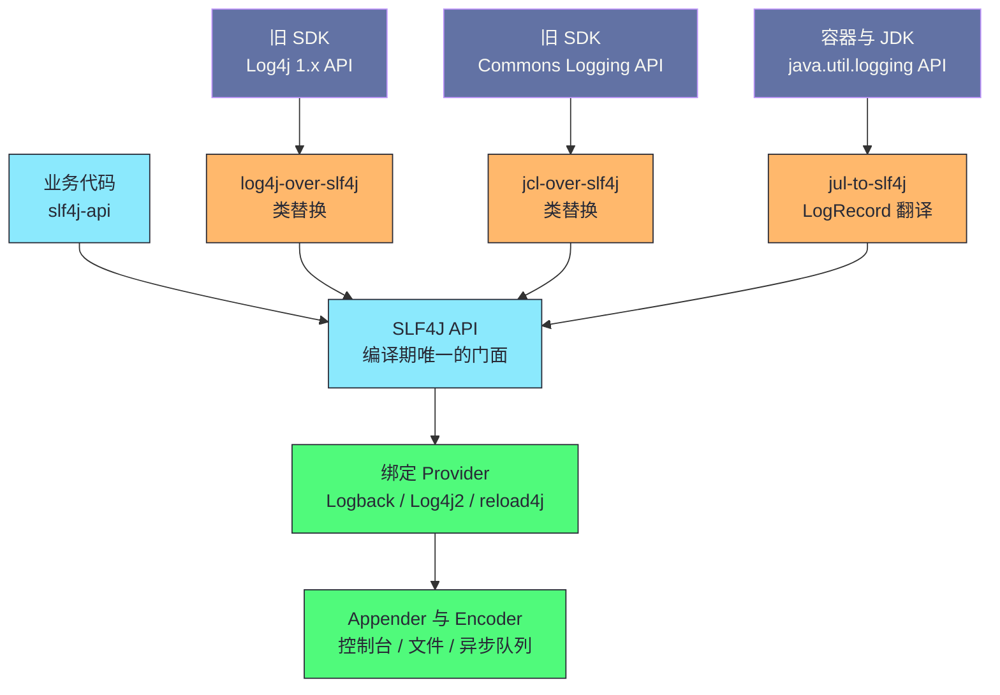
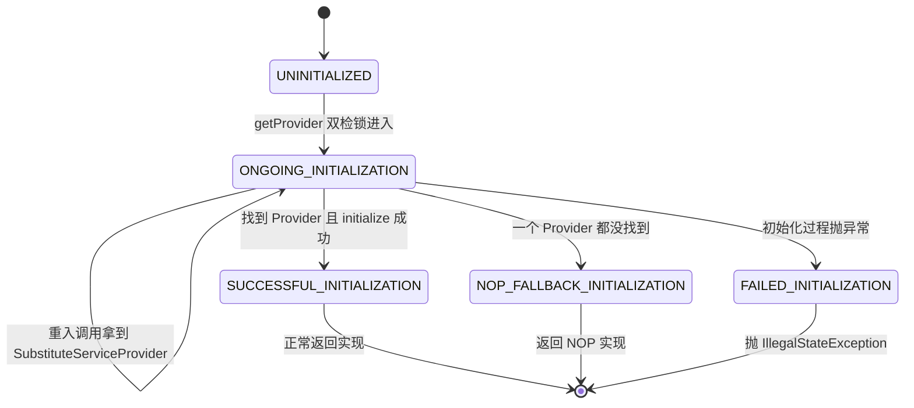
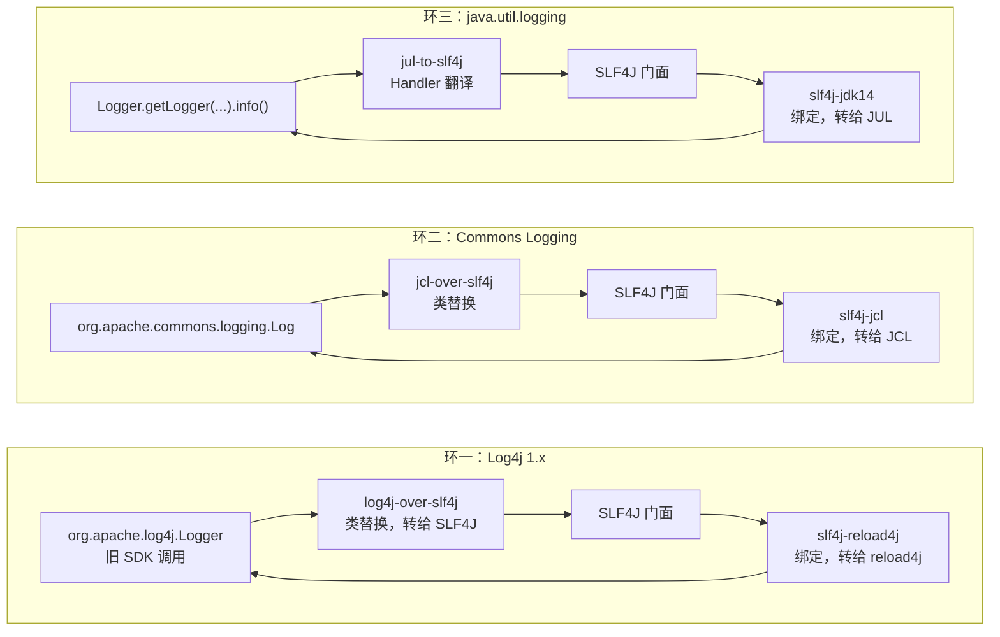
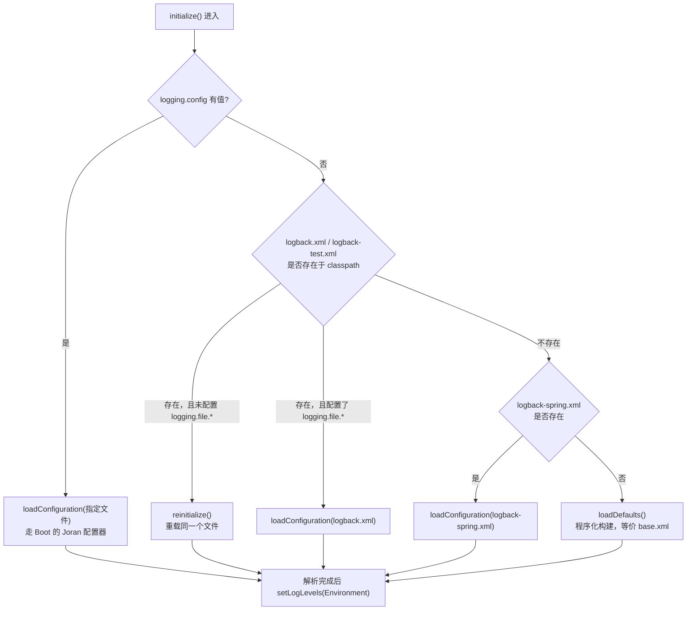
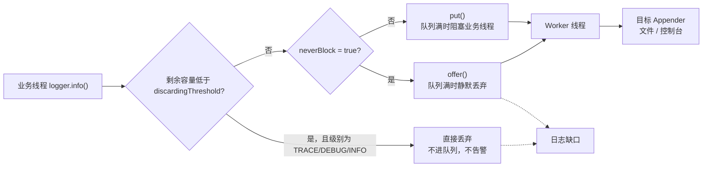

# 日志体系——SLF4J、Logback与日志桥接

**摘要：**

日志是应用最早拥有的可观测性手段，也是 Java 生态里历史包袱最重的一块：门面、绑定、桥接、实现四层叠在一起，任意两层配错，轻则日志重复或消失，重则启动即栈溢出、磁盘被打满。本文不按"如何配置 Logback"的教程顺序展开，而是沿着一次真实的日志治理走：先交代 1999 年到 2021 年间五套 API 如何各自长出来，说明门面（Facade）为什么必须是编译期绑定而不是运行时发现；再把 `LoggerFactory` 初始化那几毫秒拆开，讲清五个状态、`SubstituteLogger` 的事件重放、多绑定与无绑定的精确日志特征；接着给出完整的桥接矩阵与三对成环禁忌，配上 `mvn dependency:tree` 的排查路径；然后进入 Spring Boot 的配置模型——`logback.xml` 与 `logback-spring.xml` 的加载时机差异、`logging.*` 到系统属性的映射、`logging.level.*` 为什么能覆盖 XML 里的级别；最后压到生产面：`AsyncAppender` 在队列满时的两条路、`totalSizeCap` 被静默忽略的条件、容器里写文件为何是反模式。读完之后，你应当能回答两个问题：日志在哪个环节可能被静默丢弃，以及每一项日志配置的代价落在谁的线程上。

---

## 第 1 章 五套 API 与一次必要的分层

### 1.1 混乱不是设计失误，是时间差

把 Java 日志史按年份铺开，会看到一条并不罕见的曲线：标准迟到，社区先行，先行者各自成派，标准落地时已经无法收编。

1999 年前后，服务端记录运行信息的常规手段还是 `System.out.println`；2001 年 Apache Log4j 1.x 发布，`Logger.getLogger(xxx).info(msg)` 成为事实标准，配置从代码挪进 `log4j.properties`，这是第一次把"记录什么"和"记录到哪"分开。2002 年，JDK 1.4 引入 `java.util.logging`（JUL），API 由 `Logger`、`Handler`、`Formatter` 三段构成，设计更规整，但落地太晚——已经在生产里跑了两年的系统没有动力为一个标准库替换掉手上那套配置体系。同年，Apache Commons Logging（JCL）发布，试图用一层极薄的门面把选择权推迟到运行时：代码里写 `LogFactory.getLog(...)`，跑起来再按类加载器能找到的实现决定落到 Log4j 还是 JUL。

JCL 的思路在单 ClassLoader 的普通应用里没问题，但它把"发现实现"押在类加载器上，一旦进了 OSGi、WebLogic、Tomcat 这类存在父子委派与多应用隔离的容器，同一个 JVM 里不同 ClassLoader 看到不同的实现，`LogFactory` 会给出互相矛盾的答案，于是出现了著名的类加载死锁与内存泄漏问题族。

2006 年，Log4j 的作者 Ceki Gülcü 离开 Apache 之后做了两件事：写了 SLF4J（Simple Logging Facade for Java）和 Logback。SLF4J 的关键取舍是**把绑定从运行时挪到类路径**——不再探测，而是约定类路径上必须有一个实现，类路径是构建期确定的，于是"发现"这件事被消灭了，随之而来的一致性问题也一起消失了。2012 年 Apache 重写发布 Log4j 2.x，把异步、插件化、配置热加载补上；2021 年 12 月 Log4Shell（CVE-2021-44228）爆发，Log4j 2.x 的 JNDI lookup 成为史上影响面最大的 Java 漏洞之一，连锁反应是 2015 年就已宣布停止维护的 Log4j 1.x 被人重新翻出来审视，2022 年初出现了它的安全分支 reload4j（坐标 `ch.qos.reload4j:reload4j`），SLF4J 2.0 也配套提供了 `slf4j-reload4j` 这个绑定模块。

这段历史留下的现状是：一个从 Spring Boot 2.x 升级上来的订单服务，依赖树里同时躺着 `slf4j-api`、`logback-classic`、`log4j-to-slf4j`、`jul-to-slf4j`，再接一个写着 `org.apache.log4j.Logger` 的旧 SDK，于是 `log4j:log4j` 也被拖进来。它们各自都能工作，但输出的目的地不同、格式不同、级别开关也不同。

### 1.2 为什么门面必须是编译期绑定

门面的价值不在于"统一了 API 写法"，而在于它把两类人的诉求隔开了。库作者需要一套稳定的、不会被使用方替换掉的 API——他不能假设使用方用 Logback 还是 Log4j2；使用方需要一套能统一收口、统一配置、统一输出目的地的实现——他不能允许每个库自己决定往哪写。

JCL 与 SLF4J 都在解这道题，差别在"什么时候做决定"。JCL 把决定推迟到运行时，好处是同一个 jar 能适配任意环境，代价是决定过程本身引入了不确定性；SLF4J 把决定固定在构建期，好处是运行时零探测、行为完全由类路径决定，代价是类路径一旦被传递依赖污染，问题就只能在运行期以"日志消失"或"栈溢出"的形式暴露出来。

后者听起来更糟，其实更好排查：类路径是静态的、可枚举的、能用 `mvn dependency:tree` 打印出来的，而类加载器在容器里的委派行为是动态的、依赖部署顺序的。**SLF4J 用"配置错误可枚举"换掉了"运行时行为不可预测"**，这笔交换是它胜出的根本原因。

分层之后，一个日志调用要穿过四段：

- 业务代码调用 `org.slf4j.Logger`（门面 API）；
- `LoggerFactory` 在类路径上找到唯一的绑定（Provider）；
- 绑定把事件交给具体实现（Logback 的 `LoggerContext`）；
- 实现按 `Appender`、`Encoder`、`Filter` 把事件写到目的地。

旧框架的调用则由桥接模块在入口处改道。下面这张图把四段和三条改道合在一起，也是本篇后续所有讨论的地形图。



图里有两个容易看漏的地方：桥接器只处理 API 层，它不负责"把旧框架的配置文件读进来"；绑定只有一个，但它可以被误配成多个。这两点分别是第 3 章和第 2 章的主题。

### 1.3 分层的账单

分四层意味着配错的可能性从"一处"变成"三处"。按发生频率排，错的形态有三类：绑定缺失（日志一条不出）、绑定多余（日志出两份或者出到错误的地方）、桥接成环（进程启动即崩）。三者都不属于"配置写错了，改一下就好"的级别——它们的共同特征是不报业务错误，只在启动瞬间留下几行容易被忽略的控制台输出。

> [!warning] 这三行字值得记住
> 控制台上出现 `No SLF4J providers were found.`、`Class path contains multiple SLF4J providers.`、`Class path contains SLF4J bindings targeting slf4j-api versions 1.7.x or earlier.` 中任意一行，说明日志体系已经处于降级或不确定状态，后面无论日志看起来多正常，都不要再往上叠配置。

本篇后续用一个贯穿案例承载这些机制：`order-service`，一个 Spring Boot 3.5 的服务，从 2.7 升级而来，依赖树里混进了一个使用 Log4j 1.x 的对账 SDK，运维把日志写在容器内目录，某次大促日志量翻了十倍把节点磁盘写满。第 2 章到第 8 章分别对应这个服务暴露出来的一层问题。

---

## 第 2 章 绑定机制：初始化的那几毫秒

### 2.1 1.7 及以前：约定式绑定

SLF4J 1.7.x 的绑定靠一个约定：实现方在自己的 jar 里提供 `org.slf4j.impl.StaticLoggerBinder` 这个类，`LoggerFactory` 在初始化时用 `Class.forName` 去加载它。这不是接口，没有编译期约束，实现方只要写错包名或者漏了类，`LoggerFactory` 就退化成无操作（NOP）实现，控制台打印 `Failed to load class "org.slf4j.impl.StaticLoggerBinder"`。

这个机制的坏处是隐式：类路径上出现两个 `StaticLoggerBinder`（譬如同时有 `logback-classic` 与 `slf4j-log4j12`），SLF4J 会打印多绑定警告，然后按类路径顺序取第一个——取到谁完全取决于 jar 的排列，而 jar 的排列在 Maven 与 Gradle 下都不稳定。

### 2.2 1.8 与 2.0：ServiceLoader 与 Provider

从 SLF4J 1.8.0-beta 开始，绑定改成了标准 SPI：实现方在自己的 jar 里放一个 `META-INF/services/org.slf4j.spi.SLF4JServiceProvider` 文件，内容是实现类的全限定名；`LoggerFactory` 用 `ServiceLoader.load(SLF4JServiceProvider.class)` 加载。Logback 1.5.x 提供的文件内容是一行 `ch.qos.logback.classic.spi.LogbackServiceProvider`。

`SLF4JServiceProvider` 接口把绑定需要的四样东西一次性交出：`getLoggerFactory()`、`getMarkerFactory()`、`getMDCAdapter()`、`getRequestedApiVersion()`，加一个 `initialize()`。MDC 也在这一步绑定——`LoggerFactory.bind()` 在 `PROVIDER.initialize()` 之前先调用 `earlyBindMDCAdapter()`，把 `MDC` 静态类的适配器换掉。这解释了一个常见疑问：`MDC` 的适配器不是凭空来的，它由 Provider 提供。在没有 Provider 的环境里调 `MDC.put()`，2.0 抛出的是一句 `MDCAdapter cannot be null`，而不是看起来无害的空操作。

Spring Boot 3.5 管理的是 SLF4J 2.0.17、Logback 1.5.18、Log4j 2.24.3，三者都属于 ServiceLoader 一代，`StaticLoggerBinder` 已经不存在；但 2.0 的 `LoggerFactory` 仍保留一段针对旧绑定的探测逻辑，专门用于在类路径上还留着 1.7 时代绑定 jar 时给出告警，后文会用到这个细节。

### 2.3 五个状态与事件重放

`LoggerFactory` 的初始化不是一次函数调用，而是一个带锁的状态机。它维护一个 `volatile int INITIALIZATION_STATE`，取值有五个：`UNINITIALIZED`、`ONGOING_INITIALIZATION`、`FAILED_INITIALIZATION`、`SUCCESSFUL_INITIALIZATION`、`NOP_FALLBACK_INITIALIZATION`。



关键在重入那一条。日志初始化本身要打印日志（Logback 在解析配置时会写 status），这条日志又会回来调 `LoggerFactory.getProvider()`，此时状态是 `ONGOING_INITIALIZATION`，方法返回的是 `SubstituteServiceProvider`——它构造出的 `SubstituteLogger` 不直接输出，而是把事件塞进一个 `LinkedBlockingQueue`。等 `bind()` 走完，`postBindCleanUp()` 做三件事：把真正的 Logger 委托给那些 `SubstituteLogger`，按每批 128 条重放队列里的事件（这一过程叫**事件重放**），然后清空队列。重放时打印的告警是 `A number (N) of logging calls during the initialization phase have been intercepted and are now being replayed.`

这段逻辑解释了启动日志里两个常见现象。其一是首行日志的时间戳晚于实际发生时刻，因为它是被重放的。其二是重放受最终生效的过滤器约束——如果这行日志在重放时已经不满足级别条件，它就被丢弃，你在日志文件里永远看不到它。

Spring Boot 在这里做了一个额外的等待：`LogbackLoggingSystem.getLoggerFactory()` 会循环检查 `LoggerFactory.getILoggerFactory()`，只要拿到的还是 `SubstituteLoggerFactory`，就 `Thread.sleep(50)` 再试一次。原因是 Boot 要在拿到 `LoggerContext` 之后才能设置级别、装过滤器，而初始化尚未完成时拿到的是替身工厂，直接强转会失败。

### 2.4 无绑定：日志凭空消失

类路径上没有任何 Provider 时，`LoggerFactory` 打印三行告警并落到 `NOP_FALLBACK_INITIALIZATION`：

```text
SLF4J(W): No SLF4J providers were found.
SLF4J(W): Defaulting to no-operation (NOP) logger implementation
SLF4J(W): See https://www.slf4j.org/codes.html#noProviders for further details.
```

症状的特征是"程序完全正常，日志目录是空的"。业务代码里的 `logger.info` 不抛异常、不报错，因为 NOP 实现就是空方法。这类问题在本地开发时几乎不会出现（IDE 里依赖齐全），偏偏在打包后出现，因为打包插件可能把某个 scope 为 `provided` 的绑定排除掉了。

在 Spring Boot 里还有一种更容易误判的形态：`logback-classic` 在类路径上，但没有实现 `SLF4JServiceProvider` 的版本（譬如被某个依赖锁到了 1.2.x 这类老版本），于是 Provider 列表为空，Boot 走到 `LogbackLoggingSystem.getLoggerContext()` 时发现 `LoggerFactory.getILoggerFactory()` 不是 `LoggerContext`，抛出的信息是：

```text
LoggerFactory is not a Logback LoggerContext but Logback is on the classpath.
Either remove Logback or the competing implementation (class ... loaded from ...).
```

这行报错把"版本不匹配"说成了"竞争实现"，很容易把排查方向带偏。遇到它，先查 `logback-classic` 的实际版本，再查有没有别的 Provider。

### 2.5 多绑定：告警之后谁是赢家

类路径上出现两个及以上 Provider 时，`LoggerFactory` 打印告警并**取列表里的第一个**：

```text
SLF4J(W): Class path contains multiple SLF4J providers.
SLF4J(W): Found provider [ch.qos.logback.classic.spi.LogbackServiceProvider@...]
SLF4J(W): Found provider [org.slf4j.simple.SimpleServiceProvider@...]
SLF4J(W): See https://www.slf4j.org/codes.html#multiple_bindings for an explanation.
SLF4J(I): Actual provider is of type [ch.qos.logback.classic.spi.LogbackServiceProvider@...]
```

"第一个"由 `ServiceLoader` 的迭代顺序决定，也就是类路径上 `META-INF/services` 文件的枚举顺序。这个顺序在 Maven 里取决于依赖声明顺序，在 Spring Boot 的可执行 jar 里取决于 `BOOT-INF/lib` 内的 jar 排列，在容器镜像里还取决于构建工具版本。换一台机器构建出不同顺序、日志落到不同实现的情况是真实存在的。

常见的多绑定组合有四类：`logback-classic` 加上 `slf4j-simple`（某个库为了自测引入了它）、`logback-classic` 加上 `log4j-slf4j2-impl`（换 Log4j2 时忘了排除 starter）、`slf4j-jdk14` 与 `logback-classic` 并存（结果取决于谁先被枚举到）、以及旧版 `slf4j-log4j12` 与新版 Provider 并存。

最后一类有一个特别的坑：1.7 时代的绑定 jar 提供的是 `StaticLoggerBinder`，而 2.0 的 `LoggerFactory` 不再加载它，只会在 Provider 列表为空时补一句"忽略"的告警：

```text
SLF4J(W): Class path contains SLF4J bindings targeting slf4j-api versions 1.7.x or earlier.
SLF4J(W): Ignoring binding found at [jar:file:/.../slf4j-log4j12-1.7.36.jar!/org/slf4j/impl/StaticLoggerBinder.class]
```

也就是说，把一个 Boot 2.x 项目升到 Boot 3.x 时，若依赖树里还挂着 `slf4j-log4j12:1.7.x` 而没有新的 Provider，日志会安静地全部消失，控制台只有上面两行——它们走的是 `System.err`，很容易被部署脚本吞掉。SLF4J 2.0.9 起提供了一个逃生口：`-Dslf4j.provider=全限定类名` 可以绕过 ServiceLoader 强制指定 Provider，前提是这个类确实实现了接口，否则会打印 `Failed to instantiate the specified SLF4JServiceProvider` 并回退到 ServiceLoader。

> [!info] 一行代码确认实际绑定
> 在启动日志里打一行 `LoggerFactory.getILoggerFactory().getClass().getName()`，比读告警更可靠。若它返回 `NOPLoggerFactory`，问题在绑定缺失；若返回的不是 `ch.qos.logback.classic.LoggerContext`，问题在绑定被抢走。Boot 自己在初始化时就在做同样的检查，只是报错文案没把版本因素写进去。

---

## 第 3 章 桥接矩阵与成环禁忌

### 3.1 两种手法：类替换与适配

桥接器的实现方式有两种，混淆这两种是排查时走弯路的根源。

第一种是**类替换**。`log4j-over-slf4j` 把 Log4j 1.x 里最常用的几个类原样重新实现了一遍——`org.apache.log4j.Category`、`Logger`、`Priority`、`Level`、`MDC`、`BasicConfigurator`——方法签名一致，内部却把调用转给 SLF4J。它的生效条件是原来的 `log4j.jar` 不在类路径上，否则同名类会按类路径顺序二选一，行为变得不可预测。属于这一类的还有 `jcl-over-slf4j`（重新实现 `org.apache.commons.logging` 那套接口）与 Log4j 官方的 `log4j-1.2-api`（把 Log4j 1.x API 转到 Log4j 2）。

第二种是**适配器**。`jul-to-slf4j` 做不到类替换，因为 JUL 的包在 `java.util.logging` 下，属于 JDK 模块，无法用 jar 覆盖。它提供的是一个 `java.util.logging.Handler` 实现 `SLF4JBridgeHandler`，装到 JUL 的根 Logger 上，把进来的 `LogRecord` 翻译成 SLF4J 事件。`log4j-to-slf4j`（Log4j 2 API 转 SLF4J）也属于这一类，它替换的是 Log4j 2 的 Provider 而不是类文件。

这一区别决定了两件事。类替换型的桥接要求"原实现必须被排除"；适配器型的桥接要求"桥必须被安装或注册"。前者的失败症状是类冲突或行为随机，后者的失败症状是日志不经过桥——`jul-to-slf4j` 在 jar 里躺着但 Handler 没装，JUL 的日志就照旧走它自己的控制台输出，看起来"日志有，只是格式不一样，过滤也不生效"。

### 3.2 完整矩阵

把两代绑定与三种桥接排在一起，可以得到下面这张表。表里"冲突对象"一列是排查时最省时间的信息：拿到依赖树之后先看有没有同时命中左右两侧。

| 模块 | 方向 | 手法 | 冲突对象 | 冲突后果 |
|---|---|---|---|---|
| `logback-classic` | SLF4J → Logback（绑定） | 实现 `SLF4JServiceProvider` | 任何其他 Provider | 多绑定告警，按类路径顺序取第一个 |
| `log4j-slf4j2-impl` | SLF4J → Log4j 2（绑定） | 实现 `SLF4JServiceProvider` | `log4j-to-slf4j` | 调用成环，栈溢出 |
| `slf4j-reload4j` | SLF4J → reload4j（绑定） | 实现 `SLF4JServiceProvider` | `log4j-over-slf4j` | 调用成环，栈溢出 |
| `slf4j-jdk14` | SLF4J → JUL（绑定） | 实现 `SLF4JServiceProvider` | `jul-to-slf4j` | 调用成环，栈溢出 |
| `slf4j-simple` / `slf4j-nop` | SLF4J → 极简实现（绑定） | 实现 `SLF4JServiceProvider` | 任何其他 Provider | 静默降级或无输出 |
| `jul-to-slf4j` | JUL → SLF4J（桥接） | 安装 `SLF4JBridgeHandler` 翻译 `LogRecord` | `slf4j-jdk14` | 调用成环；未装 Handler 则完全不生效 |
| `jcl-over-slf4j` | JCL → SLF4J（桥接） | 类替换 `org.apache.commons.logging` | `slf4j-jcl`、`commons-logging` | 调用成环；与真 JCL 并存则类重复 |
| `log4j-over-slf4j` | Log4j 1.x API → SLF4J（桥接） | 类替换 `org.apache.log4j` 常用类 | `slf4j-reload4j`、`slf4j-log4j12`、`log4j:log4j`、`log4j-1.2-api` | 调用成环或类重复 |
| `log4j-to-slf4j` | Log4j 2 API → SLF4J（桥接） | 替换 Log4j 2 的 Provider | `log4j-slf4j2-impl` | 调用成环，栈溢出；无 `log4j-core` 时 Log4j2 的实现能力全部不可用 |
| `log4j-1.2-api` | Log4j 1.x API → Log4j 2（桥接） | 类替换 `org.apache.log4j` | `log4j-over-slf4j`、`log4j:log4j` | 类重复，取到谁不确定 |

表里有两行容易被忽略。`log4j-over-slf4j` 只实现了"最常用"的那几个类，若旧代码直接引用了 Log4j 1.x 的 Appender、Filter 或 `PropertyConfigurator`，桥接就撑不住——SLF4J 文档对此的措辞是"当应用直接引用 appender、filter 或 PropertyConfigurator 时，`log4j-over-slf4j` 不足以替代 log4j"。此时要么升级那个库，要么保留 Log4j 1.x 并把两条日志流分别接走。另一行是 `log4j-to-slf4j`：它只桥接 API，Log4j 2 的 `log4j-core` 提供的实现能力（异步 Disruptor、插件、lookup）都不在了，因此"只想用 Log4j2 的异步性能却保留 Logback 作为实现"这件事在架构上不成立，因为桥接之后真正干活的是 Logback。

### 3.3 `jul-to-slf4j` 的三个特例

`jul-to-slf4j` 是矩阵里唯一无法类替换的模块，也因此有三个特例值得单独展开。

第一，它必须被安装。SLF4J 文档给的用法是调用 `SLF4JBridgeHandler.install()`。Spring Boot 替你做了一半：`LogbackLoggingSystem.beforeInitialize()` 里会检查两件事——`org.slf4j.bridge.SLF4JBridgeHandler` 这个类在不在类路径上，以及 JUL 根 Logger 当前的 Handler 数量是否为 0，或者是否为 1 且那一个是 `java.util.logging.ConsoleHandler`。两个条件都满足才会安装，同时把那个 `ConsoleHandler` 摘掉，避免同一条日志走两条路。也就是说，只要有人先装了自己的 JUL Handler（很多老 SDK 会这么做），**Boot 的桥接安装就会放弃**，此后 JUL 的日志不进 SLF4J，级别控制与格式统一都失效。这是"日志有两套格式"问题最常见的成因。

第二，安装只是入场券，代价在翻译。SLF4J 文档写得很直白：`jul-to-slf4j` 不走类替换，它必须先把 `LogRecord` 构造出来，无论对应的 SLF4J 级别是否开启；因此对**被禁用的日志语句**，翻译开销可以达到 60 倍，对已启用的语句也有可测量的额外开销。文档同时给出了解法：Logback 0.9.25 之后可以用 `LevelChangePropagator` 把级别变化同步给 JUL，让 JUL 自己在入口就挡住被禁用的记录。Boot 正是这么做的——`LogbackLoggingSystem.stopAndReset()` 在检测到桥接 Handler 已安装时，会往 `LoggerContext` 上挂一个 `setResetJUL(true)` 的 `LevelChangePropagator`。

第三，容器部署下它被有意关掉。Spring Boot 文档明确说明：应用部署到 Servlet 容器或应用服务器时，用 JUL 打的日志不会被路由到应用的日志里，目的是避免容器自身与其他应用的日志混进来。所以"本地能看到某条日志、上容器就没了"这类问题，先分清它是 JUL 打的还是 SLF4J 打的。

### 3.4 成环：三对死循环

成环的机制非常对称：桥接把 A 的调用转给 B，绑定把 B 的调用转给 A，一次 `logger.info()` 就在两者之间来回弹，直到栈耗尽。



三对组合在 SLF4J 文档里被逐一点名：`log4j-over-slf4j` 与 `slf4j-log4j12`（或 2.0 起的 `slf4j-reload4j`）不能同时存在；`jcl-over-slf4j` 与 `slf4j-jcl` 不能同时存在；`jul-to-slf4j` 与 `slf4j-jdk14` 不能同时存在（后者还依赖 Handler 已安装这个前提）。除此之外还有一对同构组合：`log4j-to-slf4j` 与 `log4j-slf4j2-impl`，前者把 Log4j 2 API 转给 SLF4J，后者把 SLF4J 转给 Log4j 2，机制与前两对完全一样。

成环的症状不总是 `StackOverflowError`。如果第一次日志调用发生在类的静态初始化块里，栈溢出会被包装成 `ExceptionInInitializerError`，JVM 随后把那个类标记为 `NoClassDefFoundError`，于是你看到的是"某个类加载失败"，而栈顶的几百帧都淹在 `java.lang.reflect` 与日志调用之间。笔者见过一次排查走了两天，最终定位靠的是在栈里找交替出现的两个包名：`org.apache.log4j` 与 `org.slf4j` 的帧严格一对一地交替，就是**环的指纹**。

有一类情况容易和成环混淆：`logback-classic` 与 `slf4j-log4j12` 同时存在。这不是环（Logback 不会把调用转回 SLF4J），而是多绑定，结果取决于枚举顺序。

### 3.5 排查与收敛

依赖层面的排查分三步，成本从低到高。

第一步，只打印与日志相关的子树，避免被业务依赖淹没：

```bash
mvn dependency:tree \
  -Dincludes=org.slf4j:*,ch.qos.logback:*,log4j:log4j,org.apache.logging.log4j:*,commons-logging:commons-logging
```

输出里要检查三件事：`slf4j-api` 是否只有一个版本（有多个时 Maven 按最近者优先仲裁，被仲裁掉的版本可能正是绑定的依赖）；`log4j:log4j` 是否还在（在就说明有旧 SDK，且它和 `log4j-over-slf4j` 会打架）；`org.apache.logging.log4j:log4j-core` 与 `log4j-slf4j2-impl` 是否同时出现（同时出现意味着 Log4j2 已经接管了实现，此时 `log4j-to-slf4j` 必须排除）。

第二步，把结论写进构建，而不是写进文档。`maven-enforcer-plugin` 的 `bannedDependencies` 可以把危险组合钉死：

```xml
<plugin>
  <groupId>org.apache.maven.plugins</groupId>
  <artifactId>maven-enforcer-plugin</artifactId>
  <executions>
    <execution>
      <id>ban-legacy-logging</id>
      <goals><goal>enforce</goal></goals>
      <configuration>
        <rules>
          <bannedDependencies>
            <excludes>
              <exclude>log4j:log4j</exclude>
              <exclude>commons-logging:commons-logging</exclude>
              <exclude>org.slf4j:slf4j-log4j12</exclude>
              <exclude>org.slf4j:slf4j-simple</exclude>
            </excludes>
            <message>旧日志绑定会把 SLF4J 拖回 1.7 时代，请改用 spring-boot-starter-logging</message>
          </bannedDependencies>
        </rules>
      </configuration>
    </execution>
  </executions>
</plugin>
```

Gradle 对应的是 `resolutionStrategy` 或 `modules { module("log4j:log4j") { replacedBy(...) } }`，Spring Boot 官方文档在讲 Log4j2 替换时给的就是模块替换的写法。

第三步，排除。排除有两种落点：在引入方排除（自己写的依赖，`<exclusions>` 精确可控），或在顶层统一加固（为所有传递依赖声明 `provided` scope，SLF4J FAQ 推荐的 `commons-logging` 处理方式）。订单服务的做法是前者——只在那个对账 SDK 上排除 `log4j:log4j`，再显式加入 `log4j-over-slf4j`，同时确认依赖树里没有 `slf4j-reload4j`。

### 3.6 Boot 的默认组合为什么是安全的

Spring Boot 3.5 的 `spring-boot-starter-logging` 只声明三个依赖：`logback-classic`、`log4j-to-slf4j`、`jul-to-slf4j`。这个组合刻意避开了所有环：没有 `log4j-core`，所以 `log4j-to-slf4j` 只是把 Log4j 2 的 API 调用转给 SLF4J，不构成双向；没有 `slf4j-reload4j`，所以不存在与 `log4j-over-slf4j` 成环的条件；没有 `jcl-over-slf4j`，因为 Boot 的 JCL 由 `spring-jcl` 承担，而 `spring-jcl` 是重写的 API 实现，本身就会把调用路由到 SLF4J。

换实现时的安全路径只有两条：要么用 `spring-boot-starter-log4j2`（它声明 `log4j-slf4j2-impl`、`log4j-core`、`log4j-jul`），要么排除 `spring-boot-starter-logging` 后手工搭。危险路径是在不改 starter 的前提下"补上"`log4j-core` 与 `log4j-slf4j2-impl`——此时 `log4j-to-slf4j` 还在，环就成立了。这类误配在只升级依赖版本、没有重新审视 starter 的存量项目里很常见。

---

## 第 4 章 Boot 的日志配置模型：谁在什么时候读什么

### 4.1 一次启动里的五个动作

Spring Boot 的日志初始化由 `LoggingApplicationListener` 承担，分两个时点：`ApplicationStartedEvent` 时调用 `beforeInitialize()`，`ApplicationEnvironmentPreparedEvent` 时完成配置加载，后者发生时 `Environment` 已就绪、Bean 容器还没开始装配。合起来是五件事：

1. 把 `logging.*` 配置翻译成系统属性（`LoggingSystemProperties.apply`），并把 `logging.file.name` 或 `logging.file.path` 换算成 `LogFile`；
2. 调用 `LoggingSystem.beforeInitialize()`：对 Logback 而言是装 JUL 桥接 Handler、往 `LoggerContext` 上挂一个拒绝所有事件的 `TurboFilter`，用于在配置加载期间静音日志；
3. 调用 `LoggingSystem.initialize(context, configLocation, logFile)`，这是决定"读哪个配置文件"的地方；
4. 摘掉那个静音过滤器，此后日志正常输出；
5. 调用 `initializeFinalLoggingLevels()`，绑定 `logging.group.*`，再把 `logging.level.*` 逐条 `setLogLevel`。

第五步的位置决定了优先级：**`application.yml` 里的 `logging.level.*` 会覆盖 XML 里写的 `<root level="...">` 或 `<logger level="...">`**，因为级别设置发生在配置文件加载之后。有人把 XML 改了三遍没生效，问题就出在这一步——他的级别是在 yml 里被覆盖掉的。

第三件事的细节值得单独画出来，因为它是"日志配置为什么不生效"这类问题的总入口。



图里需要盯住的是那条分支：只要 `logback.xml` 存在，`logback-spring.xml` 就永远不会被查找。Boot 判断"有没有自初始化配置"只看文件在不在（`ClassPathResource.exists()`），存在就认定 Logback 已经自己初始化过了，于是走 `reinitialize()`（配置了 `logging.file.*` 时换另一条分支，重新 `loadConfiguration` 同一个文件），重载的仍是那个 `logback.xml`。两个文件同时放进 `resources` 目录，是"我明明写了 `springProfile` 却不生效"的经典现场。

### 4.2 `logback.xml` 与 `logback-spring.xml` 的真实差别

官方文档的说法是：标准的 `logback.xml` **加载得太早**，因此不能在其中使用扩展；要用扩展，要么改名 `logback-spring.xml`，要么显式设置 `logging.config` 指向它。

"太早"具体指什么？Logback 自己有一套默认配置查找逻辑，在 `LoggerContext` 第一次被使用时就会去 classpath 根目录找 `logback-test.xml`、`logback.xml` 并解析。这个时机早于 Spring 创建 `Environment`，而 `<springProfile>` 与 `<springProperty>` 分别需要"当前激活的 Profile"与"可查询的 Environment"，两样都还不存在。更要命的是 Joran 规则本身：`springProfile` 这个元素名在标准 Logback 里没有对应的 Action，解析器会记录一条错误状态然后跳过整段内容——不抛异常，配置照常完成，只是那几段被静默丢弃。

Boot 之后确实会用自己的 Joran 配置器（`SpringBootJoranConfigurator`）重新加载同一个文件，此时扩展规则是注册过的，看上去"也许能生效"。但这是一条官方没有承诺、内部顺序随时可能变动的路径，而且它有一个可观察的破绽：若配置里开了 `scan="true"` 让 Logback 监听文件变化，每次热加载都由 Logback 自己重新解析一遍，官方文档明确警告这一幕会反复报下面这种错：

```text
ERROR in ch.qos.logback.core.joran.spi.Interpreter@4:71 - no applicable action for [springProperty], current ElementPath is [[configuration][springProperty]]
ERROR in ch.qos.logback.core.joran.spi.Interpreter@4:71 - no applicable action for [springProfile], current ElementPath is [[configuration][springProfile]]
```

顺带记一个通用特征：配置文件里真有语法错误时，Boot 的 `loadConfiguration` 会把 status 列表里 `ERROR` 级别的条目拼成 `IllegalStateException("Logback configuration error detected: ...")` 抛出；而上面这种"元素不认识"的情况不会抛出，只是静默少了一段配置——能抛异常的错反而不难查。

所以笔者倾向于把结论落在原因上：这不是文件名的问题，是"由谁解析"的问题——扩展必须落到 Boot 的配置器手里才有效。若因为历史原因必须保留 `logback.xml` 这个名字，写一行 `logging.config=classpath:logback.xml` 就能把它纳入 Boot 的加载路径，扩展随即可用。

下面这份配置是订单服务最终采用的版本，覆盖了三个场景：开发期只出控制台、生产走异步文件、非预期 Profile 时退回控制台并给出提示。

```xml
<?xml version="1.0" encoding="UTF-8"?>
<configuration>
    <!-- 引入 Boot 的转换规则与默认 pattern，避免自己重写 %clr、%wEx 这些转换词 -->
    <include resource="org/springframework/boot/logging/logback/defaults.xml"/>

    <!-- springProperty 能读到 Environment，这是 logback.xml 拿不到的能力 -->
    <springProperty scope="context" name="appName" source="spring.application.name"
                    defaultValue="order-service"/>

    <appender name="CONSOLE" class="ch.qos.logback.core.ConsoleAppender">
        <encoder>
            <pattern>${CONSOLE_LOG_PATTERN}</pattern>
            <charset>UTF-8</charset>
        </encoder>
    </appender>

    <!-- 只在生产与预发落地文件；其余环境不写盘，避免开发机留下无主文件 -->
    <springProfile name="prod | staging">
        <appender name="FILE" class="ch.qos.logback.core.rolling.RollingFileAppender">
            <file>${LOG_PATH:-/var/log}/${appName}.log</file>
            <encoder>
                <pattern>${FILE_LOG_PATTERN}</pattern>
                <charset>UTF-8</charset>
            </encoder>
            <rollingPolicy class="ch.qos.logback.core.rolling.SizeAndTimeBasedRollingPolicy">
                <fileNamePattern>${LOG_PATH:-/var/log}/${appName}.%d{yyyy-MM-dd}.%i.log.gz</fileNamePattern>
                <maxFileSize>100MB</maxFileSize>
                <!-- maxHistory 必须写：它是 totalSizeCap 生效的前提 -->
                <maxHistory>14</maxHistory>
                <totalSizeCap>2GB</totalSizeCap>
                <cleanHistoryOnStart>false</cleanHistoryOnStart>
            </rollingPolicy>
        </appender>

        <appender name="ASYNC_FILE" class="ch.qos.logback.classic.AsyncAppender">
            <!-- discardingThreshold=0：队列再满也不丢 INFO，代价是业务线程可能被阻塞 -->
            <queueSize>1024</queueSize>
            <discardingThreshold>0</discardingThreshold>
            <!-- 不采集调用方数据，%line / %file 会输出问号，换掉一点性能 -->
            <includeCallerData>false</includeCallerData>
            <maxFlushTime>5000</maxFlushTime>
            <appender-ref ref="FILE"/>
        </appender>

        <root level="INFO">
            <appender-ref ref="ASYNC_FILE"/>
        </root>
    </springProfile>

    <springProfile name="dev">
        <root level="INFO">
            <appender-ref ref="CONSOLE"/>
        </root>
        <logger name="com.example.order" level="DEBUG"/>
    </springProfile>

    <!-- 没有显式指定 Profile 时的兜底，避免容器静默无输出 -->
    <springProfile name="!(prod | staging | dev)">
        <root level="INFO">
            <appender-ref ref="CONSOLE"/>
        </root>
    </springProfile>
</configuration>
```

`<springProfile>` 的 `name` 支持 Profile 表达式，官方示例使用了 `dev | staging`、`!production`、`production & (eu-central | eu-west)` 这类写法，语法与 Spring Framework 的 Profile 表达式一致。`<springProperty>` 的 `source` 必须是 kebab-case 形式（譬如 `my.property-name`），取值的宽松绑定由 `Environment` 负责。

### 4.3 `logging.file.name` 与 `logging.file.path`

这两个属性在 2.4 之前是同一个 `logging.file`，拆分之后语义更清楚，但也更容易同时写。规则不复杂：`name` 是文件路径，可以是绝对路径或相对工作目录；`path` 是目录，文件名固定为 `spring.log`；两个都写时 `path` 被忽略。

| `logging.file.name` | `logging.file.path` | 实际行为 |
|---|---|---|
| 空 | 空 | 只输出控制台，不写文件 |
| `my.log` | 空 | 写到工作目录下的 `my.log` |
| 空 | `/var/log` | 写到 `/var/log/spring.log` |
| `my.log` | `/var/log` | 写到 `my.log`，`/var/log` 被忽略 |

同一个事实在 Boot 内部有两套表达：属性层面是 `logging.file.*`，Logback 层面是 `LOG_FILE` 与 `LOG_PATH` 两个系统属性，`file-appender.xml` 里的 `${LOG_FILE}` 用的就是它。所以自己写 XML 时用 `${LOG_FILE}` 还是 `${LOG_PATH}` 不是风格问题——用 `${LOG_PATH}` 拼目录意味着你必须自己补文件名，而 Boot 的默认文件名是 `spring.log`。

### 4.4 配置项到系统属性的映射

Boot 的日志配置之所以能在 XML 里被引用，是因为它在初始化时把 `logging.*` 翻译成了系统属性。记住这张映射表，就能判断某个 XML 占位符到底从哪里取值。

| 配置项 | 系统属性 | 说明 |
|---|---|---|
| `logging.file.name` | `LOG_FILE` | 日志文件完整路径 |
| `logging.file.path` | `LOG_PATH` | 日志目录，文件名为 `spring.log` |
| `logging.pattern.console` | `CONSOLE_LOG_PATTERN` | 控制台 pattern |
| `logging.pattern.file` | `FILE_LOG_PATTERN` | 文件 pattern |
| `logging.pattern.level` | `LOG_LEVEL_PATTERN` | 级别段 pattern，MDC 常插在这里 |
| `logging.pattern.dateformat` | `LOG_DATEFORMAT_PATTERN` | 时间格式 |
| `logging.exception-conversion-word` | `LOG_EXCEPTION_CONVERSION_WORD` | 异常栈转换词，默认 `%wEx` |
| `logging.charset.console` / `logging.charset.file` | `CONSOLE_LOG_CHARSET` / `FILE_LOG_CHARSET` | 编码，默认取 `file.encoding` |
| `logging.logback.rollingpolicy.*` | `LOGBACK_ROLLINGPOLICY_*` | 五个滚动策略参数 |
| `logging.structured.format.console` / `.file` | `CONSOLE_LOG_STRUCTURED_FORMAT` / `FILE_LOG_STRUCTURED_FORMAT` | 3.4 起的内建结构化日志 |
| 进程号 | `PID` | 由 `ProcessIdUtil` 探测后写入 |

有两个细节踩过的人不少。其一，在 `application.yml` 里给日志属性写占位符时要用 Spring 的语法，默认值分隔符是 `:`，不是 Logback 的 `:-`；写成 `:-` 会被当成值的一部分。其二，`logging.level.*` 用环境变量设置时会被宽松绑定转成小写，因此只能按包级别配置，无法为单个类指定级别；要给单个类指定，得用 `SPRING_APPLICATION_JSON` 这类保留原始大小写的方式。

### 4.5 `logging.group` 与 `--debug` 的真实行为

Boot 预置了两个日志组：`web` 包含 `org.springframework.core.codec`、`org.springframework.http`、`org.springframework.web` 与 Actuator 端点相关的几个包；`sql` 包含 `org.springframework.jdbc.core`、`org.hibernate.SQL` 等。自己的组用 `logging.group.<name>=pkg1,pkg2` 定义，再用 `logging.level.<组名>=DEBUG` 一次性调整。它的价值不在省字符，而在把"一组包的级别"变成一个可命名的对象——这个对象之后能通过 Actuator 的 `loggers` 端点整体调整，也能在配置中心里作为单个键下发。

启动参数 `--debug`（或 `debug=true`）经常被误解成"把所有日志调到 DEBUG"。实际它只把一组核心 logger（内嵌容器、Hibernate、Spring Boot 自身）调到 DEBUG，业务包的级别完全不动；官方文档对此的措辞是"启用 debug 模式不会把应用配置成打印所有 DEBUG 级别消息"。这个开关的设计意图是输出条件评估报告、自动装配报告这类装配期诊断信息，要看全量日志仍然得显式写 `logging.level.root=DEBUG`。

### 4.6 换掉 `LoggingSystem`

Boot 在类路径上按优先级挑选 `LoggingSystem` 的实现，顺序是 Logback、Log4j2、JUL——这是"只要 starter 引入就会用 Logback"的机制来源，与有没有显式配置无关。选择结果可以用系统属性 `-Dorg.springframework.boot.logging.LoggingSystem=全限定类名` 覆盖，把它设成 `none` 则完全关闭 Boot 的日志初始化，交给使用方自行管理。后者只有一个合理场景：应用以 war 部署进外部容器，而容器的日志治理已由平台统一接管，Boot 再插一手只会造成两套配置互相覆盖。

配置加载失败时的报错也在这条路径上。若 `logging.config` 指向的文件不存在，`LoggingApplicationListener` 会先向 `System.err` 打印 `Logging system failed to initialize using configuration from '...'` 再抛出 `IllegalStateException`，此处刻意不用 `logger` 输出——日志系统尚未初始化成功，用它报错本身不可靠。这也是排查"启动时只有一行看不懂的异常"时该看的地方：异常的 cause 里通常是 `FileNotFoundException`。

---

## 第 5 章 Logback 的运行时结构

### 5.1 Logger 树与有效级别

Logback 的 `Logger` 按名称组成树，`root` 是根，名称以 `.` 分段。级别只在设置了 `level` 的节点上存在，"有效级别"由最近的祖先决定。把 `com.example.order.repository` 设成 `WARN`、不动它的父节点，是生产上常做的降噪手段——SQL 层的日志量大且重复，而业务层的 `INFO` 有价值。

`TurboFilter` 与普通 `Filter` 的区别值得记住：`Filter` 挂在 Appender 上，作用于已经通过级别判断的事件；`TurboFilter` 挂在 `LoggerContext` 上，在级别判断之前介入，可以作用于所有 Logger。Boot 用这个能力实现了配置加载期间的静音（`SUPPRESS_ALL_FILTER`），也用它在初始化时避免自己打印的日志污染输出。自己写 `TurboFilter` 能做全局采样、全局脱敏，代价是每次日志调用都要过一遍所有 TurboFilter——包括被禁用的语句。

### 5.2 Appender 与 additivity

一个 Logger 可以有多个 Appender，事件会投给全部；`additivity` 默认为 `true`，意味着事件在投递完自己的 Appender 之后，还会沿 Logger 树向上传播，直到 `root`。这是**双份日志**的来源：

```xml
<appender name="CONSOLE" class="ch.qos.logback.core.ConsoleAppender">...</appender>

<root level="INFO">
    <appender-ref ref="CONSOLE"/>
</root>

<!-- additivity 默认 true：这条日志先走自己的 CONSOLE，再传播到 root 的 CONSOLE -->
<logger name="com.example.order" level="DEBUG">
    <appender-ref ref="CONSOLE"/>
</logger>
```

`additivity="false"` 让事件在这一层被消费掉。选 `additivity="false"` 还是"只给子 Logger 挂不同的 Appender 而不给 root 挂"，取决于你希望默认行为是什么：前者适合"这条链路的日志完全独立"，后者适合"只是往默认输出里多收一路"。

### 5.3 Encoder 与转换词

`Encoder` 负责把事件变成字节数组，`PatternLayoutEncoder` 是常用实现，内部是 `PatternLayout` 加一个字符集。Boot 在 `defaults.xml` 里注册了几个自定义转换词：`clr`（按级别着色）、`wEx` / `wex`（带缩进的异常栈）、`applicationName`、`correlationId`、`esb`（加方括号）。`%clr` 只在支持 ANSI 的控制台有意义，往文件里写时应避免，否则日志里会混入转义序列，grep 时会看到一堆 `[0;39m`。

### 5.4 Appender 全景与各自的代价

Appender 是"日志事件离开进程"的最后一道门，选型时真正要问的是"这条路的失败会拖累谁"。

| Appender | 目的地 | 典型用途 | 代价 |
|---|---|---|---|
| `ConsoleAppender` | 标准输出 | 容器部署的唯一出口 | 与所有写日志的线程共享一把内部锁 |
| `FileAppender` | 单个文件 | 本地调试 | 无滚动，文件只增不减 |
| `RollingFileAppender` | 滚动归档文件 | 裸机或虚拟机长期留存 | 滚动时的重命名与 gzip 压缩会抢占 I/O |
| `AsyncAppender` | 内存队列加下游 Appender | 高吞吐写盘 | 队列满时只能在阻塞与丢弃里选一个 |
| `SMTPAppender` | 邮件 | ERROR 即时通知 | 默认异步发送，但触发时要在业务线程上做环形缓冲快照；SMTP 不通时事件积压在内存 |
| `DBAppender` | 数据库表 | 审计留痕 | 与业务争抢连接池，事务边界与业务事务不一致 |

表格里 `SMTPAppender` 与 `DBAppender` 这两行最容易被当成"顺手就用了"。它们的共同问题是把日志的可靠性绑定在另一个外部依赖上：邮件服务器被封禁、数据库连接池打满，日志就在最需要它的时刻失效，而业务线程还在等这个失败的操作返回。

### 5.5 Filter 与 Marker：把审计日志分道

审计日志与诊断日志是两类数据：前者需要长期留存、不可篡改、字段固定；后者需要能临时开关、可以丢弃、格式可变。把它们塞进同一个文件，滚动策略与保留期限只能二选一。Logback 的解法是用 `Marker` 给事件打标签，再用 `Filter` 把带标签的事件分流到另一个 Appender。

```xml
<!-- 审计通道：只接受带 AUDIT 标记的事件，其余一律拒绝 -->
<appender name="AUDIT_FILE" class="ch.qos.logback.core.rolling.RollingFileAppender">
    <filter class="ch.qos.logback.core.filter.EvaluatorFilter">
        <evaluator class="ch.qos.logback.classic.boolex.OnMarkerEvaluator">
            <marker>AUDIT</marker>
        </evaluator>
        <onMatch>ACCEPT</onMatch>
        <onMismatch>DENY</onMismatch>
    </filter>
    <file>${LOG_PATH:-/var/log}/audit.log</file>
    <encoder>
        <!-- 审计行要的是可解析，不要颜色与线程名这类噪音 -->
        <pattern>%d{yyyy-MM-dd HH:mm:ss.SSS} [%X{operatorId}] [%X{traceId}] %msg%n</pattern>
        <charset>UTF-8</charset>
    </encoder>
    <rollingPolicy class="ch.qos.logback.core.rolling.SizeAndTimeBasedRollingPolicy">
        <fileNamePattern>${LOG_PATH:-/var/log}/audit.%d{yyyy-MM-dd}.%i.log.gz</fileNamePattern>
        <maxFileSize>50MB</maxFileSize>
        <maxHistory>180</maxHistory>
        <totalSizeCap>20GB</totalSizeCap>
    </rollingPolicy>
</appender>
```

```java
private static final Marker AUDIT = MarkerFactory.getMarker("AUDIT");

public void deleteUser(Long userId) {
    userRepository.delete(userId);
    // 审计信息进 msg 而不是只进 MDC：MDC 是线程上下文，跨线程会丢，审计不能依赖它
    logger.info(AUDIT, "user deleted: target={} operator={} result=SUCCESS",
            userId, getCurrentOperator());
}
```

审计通道的滚动参数与主日志必须分开设：保留 180 天、总容量上限 20 GB 是合规与成本折中出来的数，而诊断日志通常只留 7 到 14 天。这也是"两类日志分道"的实际收益——不是格式更好看，而是保留策略可以各自独立。

---

## 第 6 章 异步日志的两个代价

### 6.1 同步写的第一把锁

`FileAppender` 与 `ConsoleAppender` 都继承自 `OutputStreamAppender`，写入路径上有一把内部的可重入锁 `streamWriteLock`：`writeBytes` 里先 `lock()`，再调用 `outputStream.write()`，最后按 `immediateFlush` 决定是否 `flush()`。编码（pattern 填充、字符串转字节）发生在锁外，只有真正的写与 flush 在锁内——这个分工是有意的，耗 CPU 的部分并行，串行区压在 I/O 上。代价是任意时刻一个 Appender 只有一个线程能写，其余线程在锁上排队。

同步写的成本因此有两段：一段是真正的 I/O 时间（写页缓存通常微秒级，`flush` 触到磁盘时毫秒级，磁盘紧张时会到几十毫秒），另一段是排队时间（并发线程数乘以单次写时间）。日志量翻十倍时，业务线程在锁上等待的总时间会以超线性的方式增长——不是因为磁盘慢了多少，而是队列变长了。这是订单服务那次故障的直接机制：峰值流量下单个请求要打四十多行日志，同步 `FileAppender` 让 `http-nio` 线程池的线程大量堵在日志锁上，接口耗时从零星毛刺变成整段抬升，而磁盘与 CPU 监控看起来完全正常。

### 6.2 AsyncAppender 的队列与丢弃判定

`AsyncAppender` 在业务线程与 I/O 之间插一个 `ArrayBlockingQueue` 和一个后台 `Worker` 线程。业务线程不再直接写盘，只做两件事：判断要不要丢，把事件放进队列。



判定逻辑在 `AsyncAppenderBase` 里只有两个方法：`isQueueBelowDiscardingThreshold()` 返回 `blockingQueue.remainingCapacity() < discardingThreshold`，`isDiscardable(event)` 在 `AsyncAppender` 里定义为级别不高于 `INFO`。两个条件同时成立就 `return`，事件连队列都进不去，也不产生任何告警。

这里有一个被广泛误读的参数。`discardingThreshold` 的默认值是 `queueSize / 5`，不是百分比，也不是"80"：`queueSize` 为 256（默认值）时它是 51，含义是"队列只剩不到 51 个空位时开始丢低级别日志"，换算过来约等于队列占用超过 80%。把它写成 `<discardingThreshold>80</discardingThreshold>` 并不会"在 80% 满时开始丢"，而是"只剩不到 80 个空位时开始丢"——队列小的时候这个值可能永远不触发，队列大的时候又可能过早触发。

其余参数的默认值与代价如下。

| 参数 | 默认值 | 作用 | 代价落在谁身上 |
|---|---|---|---|
| `queueSize` | 256 | 队列容量 | 过大时积压事件本身占堆，且进程崩溃时丢得更多 |
| `discardingThreshold` | `queueSize / 5` | 剩余容量低于此值时丢弃 TRACE/DEBUG/INFO | 排障时低级别日志缺失，且无任何告警 |
| `neverBlock` | `false` | `true` 时队列满改用 `offer` 静默丢弃 | 丢日志换吞吐，故障期最需要日志时正好没日志 |
| `includeCallerData` | `false` | 是否在业务线程上采集调用方数据 | `true` 时业务线程多一次栈采集，但 `%line`、`%file` 才有值 |
| `maxFlushTime` | 1000 毫秒 | `stop()` 时等待 Worker 排空的上限 | 超时后剩余事件被丢弃，并输出一条告警 |

### 6.3 代价一：队列满时的两条路

队列满之后的行为由 `neverBlock` 二选一，两者都不好，只是坏在不同地方。

`neverBlock=false`（默认）时走 `putUninterruptibly`，队列满就阻塞业务线程。这实质上是一种**背压**：日志写得比消费者快，就把生产者按住。问题在于这个背压没有超时、没有度量、也不区分调用方——写入慢的瞬间，所有打日志的线程一起被按住，包括健康检查与处理响应超时的线程。表现出来是"应用没死但整体卡住"，线程栈里一片 `ArrayBlockingQueue.put`。

`neverBlock=true` 时走 `offer`，队列满直接丢。吞吐保住了，但丢弃是静默的：既没有计数器暴露给 Actuator，也没有一行日志告诉你丢了。故障复盘时最怕这种形态，日志量看起来"稳定"，恰恰是因为丢掉了峰值。

对审计类、交易类日志，正确做法是 `discardingThreshold=0`、`neverBlock=false`、`queueSize` 调到能吸收正常波动的水平，然后接受"极端情况下业务线程会被阻塞"这个事实——如果这一步不可接受，说明这条路本身不该用异步 Appender，而应该换成"同步写 + 独立的高性能传输"或直接把日志转成事件流。

### 6.4 代价二：把 OOM 变成静默丢日志

异步日志更隐蔽的一面在进程边界上。队列是堆内的数据结构，每个排队的事件对象持有消息字符串、参数数组、MDC 快照、线程名、logger 名等引用。日志量暴涨时队列积压，积压的引用让这些对象无法回收，堆占用随之上升；一旦触发 OOM，JVM 退出，队列里所有尚未落盘的事件随进程一起消失——异步在这里做的其实是**把内存压力和日志完整性绑成同一件事**，而不是在保护可用性。

关闭路径上也有一处固定的缺口。Boot 默认注册了日志关闭钩子（`logging.register-shutdown-hook=true`），`LogbackLoggingSystem` 的关闭处理器调用 `getLoggerContext().stop()`，进而触发 `AsyncAppender.stop()`：它会 `worker.join(maxFlushTime)`，若 Worker 在超时内没退出，就打印

```text
Max queue flush timeout (1000 ms) exceeded. Approximately 512 queued events were possibly discarded.
```

然后放弃剩余事件。`kill -9` 或容器被 `SIGKILL` 时连这条告警都不会有。所以"重启前最后一段日志不见了"不是错觉，是设计使然——想留住它，要么把 `maxFlushTime` 调大并接受更慢的停机，要么在停机流程里先停止接收流量、等队列排空。

### 6.5 怎么证明日志丢了

异步丢日志难查，是因为默认配置下没有任何指标。可用的证据有三条。

第一条是业务计数与日志条数对账：挑一个必定打日志的事务点（譬如订单创建成功），在日志系统里按时间窗统计条数，与数据库里的订单数比对。差异比例就是丢弃率。

第二条是 Appender 的 status。Logback 把 Appender 内部的状态记在 `StatusManager` 里，默认只在启动时打印错误与警告；把 `logback.statusListenerClass` 指向 `ch.qos.logback.core.status.OnConsoleStatusListener` 可以在运行期看到这类消息，代价是输出变多。

第三条是直接观察队列。`AsyncAppender` 没有暴露队列深度，但可以在自己的代码里包一层：自定义 `Appender` 继承 `AsyncAppenderBase` 并在 `append` 前记录 `blockingQueue.remainingCapacity()`，接一个 Gauge 到 Micrometer，在 Actuator 上暴露（`/actuator/metrics` 的具体用法属另一条主线，见 [[07 Actuator——健康检查、指标暴露与自定义端点]]）。把 `remainingCapacity` 反过来看成"已用深度"，这个值长期贴着上限，说明生产速度超过 Worker 的消费速度，那就不是"要不要丢"的问题，而是下游存储跟不上。

### 6.6 Log4j2 全异步：环形缓冲与它的账单

`AsyncAppender` 的队列是 `ArrayBlockingQueue`，本质是"加锁的数组 + 条件变量"，队列入队出队各要一次锁操作，高并发下锁竞争与线程唤醒本身就是成本。Log4j2 走的另一条路：用 LMAX Disruptor 的环形缓冲替代阻塞队列，通过预分配槽位与序号 CAS 实现无锁发布，生产者只写自己的槽位、消费者只移动游标，避免了两端争抢同一把锁。

打开方式是两步，缺一不可：

```xml
<!-- 换实现：必须排除 starter-logging，否则 log4j-to-slf4j 与 log4j-slf4j2-impl 会成环 -->
<dependency>
    <groupId>org.springframework.boot</groupId>
    <artifactId>spring-boot-starter</artifactId>
    <exclusions>
        <exclusion>
            <groupId>org.springframework.boot</groupId>
            <artifactId>spring-boot-starter-logging</artifactId>
        </exclusion>
    </exclusions>
</dependency>
<dependency>
    <groupId>org.springframework.boot</groupId>
    <artifactId>spring-boot-starter-log4j2</artifactId>
</dependency>
<!-- 全异步需要 Disruptor，版本以 Boot 的依赖管理为准，不要手写版本号 -->
<dependency>
    <groupId>com.lmax</groupId>
    <artifactId>disruptor</artifactId>
</dependency>
```

```properties
# log4j2.component.properties：把 ContextSelector 换成异步版，连同步 Appender 也走环形缓冲
log4j2.contextSelector=org.apache.logging.log4j.core.async.AsyncLoggerContextSelector
```

收益的量级取决于线程数、消息长度、是否全异步、落盘介质这几个变量，官方性能页给出的提升在高并发场景下可以达到一个数量级以上，但它同样不改变"缓冲满时要做什么"这个根本问题——队列换成环形缓冲只是把队列从"会阻塞的队列"变成"可以配置丢弃策略的队列"，第 6 章的代价一条都没消失，只是换了个配置项的名字。

账单有三项。一是配置体系整体作废：Boot 对 Log4j2 的滚动策略是另一套属性（`logging.log4j2.rollingpolicy.*`），已有 `logback-spring.xml` 里的每一条都要重写，`springProfile` 也要换成 `<SpringProfile>`。二是 `log4j-core` 进类路径的一刻，第 3 章的成环禁忌全部生效，`log4j-to-slf4j` 必须显式排除，否则启动即栈溢出。三是可观测性口径变了：`AsyncLogger` 的队列满策略由 `AsyncQueueFullPolicy` 决定，默认行为是"高优先级事件阻塞、低优先级事件丢弃"，与 `AsyncAppender` 的 `discardingThreshold` 语义并不等价，照着旧经验配级别会得到意外的结果。

对绝大多数业务服务，`AsyncAppender` 加合理的 `queueSize` 已经足够；把实现整体换掉只在一种情况下值得——日志本身就是吞吐瓶颈，而且团队愿意为它维护一套独立的配置体系。

---

## 第 7 章 日志与性能：延迟求值的边界

### 7.1 参数化省掉的是什么

`logger.debug("order {} for user {}", orderId, userId)` 与字符串拼接的差别经常被总结成"占位符避免了拼接"，这句话对，但不完整。我们不妨把它拆成两个动作看：实参求值发生在调用方，格式化发生在日志实现内部；**参数化日志延迟的是后者，不是前者**。

```java
// 实参是两个 long 和一个 String，代价可忽略；格式化被推迟到确认需要时才执行
logger.debug("order {} settled for user {}", order.getId(), order.getUserId());

// 实参是 order.dump()，即便 DEBUG 被禁用，这一行仍会执行整个 dump
logger.debug("order snapshot {}", order.dump());
```

第一行在 DEBUG 关闭时只做一次级别判断，`Object[]` 数组被创建（三个及以上参数走 varargs 重载），随后丢弃；第二行会真的把订单序列化成字符串，然后丢弃。SLF4J 2.0 为 1 个和 2 个参数提供了不带 varargs 的重载，因此常见的一到两参调用连数组分配都省了；三个参数以上仍会分配一个 `Object[]`，这个开销在热路径上高频出现时才值得关注。

### 7.2 `isDebugEnabled()` 还需不需要

需要，但判据变了。级别判断本身已经在 SLF4J 内部做过一次，再手动包一层 `if (logger.isDebugEnabled())` 对"格式化开销"没有任何额外收益。它唯一的价值是把**实参求值**挡在判断之外：

```java
// 值得包：toString 或 JSON 序列化的成本远高于一次级别判断
if (logger.isDebugEnabled()) {
    logger.debug("order state {}", objectMapper.writeValueAsString(order));
}

// 不值得包：多一次方法调用，什么也没省下
if (logger.isDebugEnabled()) {
    logger.debug("order id {}", order.getId());
}
```

判据可以写成一句话：如果实参表达式里有方法调用、对象序列化、集合遍历或字符串拼接，就包；如果只是字段访问或常量，就不要包。这条规则在 Code Review 里比"统一包一层"更容易执行，也更少引发"为什么这里包了那里没包"的争论。

### 7.3 结构化日志的代价

把日志输出成 JSON 的收益在采集侧——不需要正则、字段可索引、能按字段做聚合。代价在产生侧，主要有三处。

第一处是每条事件都要走一次序列化。文本 pattern 的编码是"按模板填空 + 转义"，JSON 编码需要构造对象树、处理嵌套、对每个字符串做转义，成本大约是前者的数倍（具体倍数随实现与消息长度变化，笔者建议以自己的压测为准，不要引用二手数字）。第二处是字段膨胀：文本日志一条一百多字节，同样内容加上 `timestamp`、`level`、`logger`、`thread`、`service`、`traceId` 之后可能到四五百字节，传输与存储成本按比例上升。第三处是可读性：本地排查时 JSON 行必须过 `jq` 才看得懂，这也是不少团队只在生产环境开 JSON、开发环境保留文本 pattern 的原因。

Spring Boot 3.4 起提供了内建的结构化日志，不必再引入第三方 encoder：把 `logging.structured.format.console` 或 `.file` 设为 `ecs`、`gelf`、`logstash` 之一即可，字段名与嵌套结构由格式规范决定。三种方案的取舍如下。

| 方案 | 引入成本 | 字段控制 | 适用场景 |
|---|---|---|---|
| 文本 pattern + 采集侧正则 | 无 | 只能靠 pattern 排版 | 日志量小、已有成熟解析规则 |
| Boot 内建结构化日志（3.4+） | 一个属性 | `logging.structured.json.include/exclude/rename/add` | 新建服务、希望零额外依赖 |
| `logstash-logback-encoder` | 一个依赖 | `StructuredArguments`、`kv()`、自定义 provider | 需要按事件附加结构化字段、需要精细裁剪异常栈 |

若选第三方 encoder，注意 `kv()` 这类结构化参数仍然会求值：它延迟的只是格式化，不是对象构造。写 `kv("order", order)` 时，JSON 序列化发生在级别判断之后，但把 `order` 传进去这件事本身没有成本——这一点比字符串拼接安全。

### 7.4 量化视角

给出一个示例推算，帮助建立量级感，不对应任何具体线上数据。假设一个中等规模服务每天 2000 万条日志、平均每行 200 字节，日增原始日志约 4 GB，压缩后约 400 MB；若开启 DEBUG 让条数翻十倍，日增 40 GB、压缩后 4 GB，同时业务线程在日志锁上的等待时间按并发度放大。这个量级下，磁盘与 I/O 都不是"够不够用"的问题，而是"有没有上限"的问题——下一章的滚动策略与总容量上限就是为这个量级准备的。

---

## 第 8 章 生产配置的关键项与反模式

### 8.1 滚动策略：参数、默认值与失效条件

Boot 的默认文件 Appender 使用 `SizeAndTimeBasedRollingPolicy`，参数来自 `file-appender.xml`，默认值分别是单文件 10 MB、保留 7 个归档、总容量上限 0（不限制）、启动时清理关闭、文件名模式 `${LOG_FILE}.%d{yyyy-MM-dd}.%i.gz`。

| 参数 | Boot 默认值 | 生效条件 | 配错的后果 |
|---|---|---|---|
| `maxFileSize` | 10MB | 始终 | 过小时归档文件碎，单个文件可能超过采集端单行/单文件限制 |
| `maxHistory` | 7 | 始终 | 是 `totalSizeCap` 生效的前提，未设则上限被忽略 |
| `totalSizeCap` | 0（不限制） | 需要 `maxHistory` | 磁盘无上限增长，容器节点被写满 |
| `cleanHistoryOnStart` | false | 需要 `maxHistory` | 启动时不清理，长时间不滚动的实例只会在下次滚动时清 |
| `fileNamePattern` | `%d{yyyy-MM-dd}.%i.gz` | 必须同时含 `%d` 与 `%i` | 少了 `%i` 会在同一天内多文件时互相覆盖 |

第三条的机制值得单独写清楚。`TimeBasedRollingPolicy.start()` 里的逻辑是这样的：只有当 `maxHistory` 不是"无界"时，才会创建 `ArchiveRemover` 并把 `totalSizeCap` 传给它；否则走另一个分支，打印一条警告然后忽略上限：

```text
'maxHistory' is not set, ignoring 'totalSizeCap' option with value [2 GB]
```

这条警告进的是 Logback 的 status 列表，不是业务日志，默认配置下根本看不到。于是"我明明设了 2 GB 上限"和"磁盘被打满"同时成立——上限从来没生效过。用 Boot 的默认 `file-appender.xml` 时不会踩到，因为那份文件里 `maxHistory` 总是有值（默认 7）；自己写 `logback-spring.xml` 时只抄了 `totalSizeCap` 而漏了 `maxHistory`，就会踩到。

还有一处时间差：归档清理是异步任务，在**滚动发生时**触发。若一个实例在限制生效前就已经写满了磁盘，重启并不会自动清理，除非把 `cleanHistoryOnStart` 设为 `true`。这一点在容器环境里尤其重要，因为容器的可写层空间往往很小。

### 8.2 磁盘打满的完整链路

订单服务那次故障的链路值得完整复盘一次，因为它把前面几章的机制串成了一条线。

第一步，运维为了"方便登录机器看日志"，给服务配了 `logging.file.path=/var/log/order`。第二步，某个迭代把业务包级别调成 DEBUG 用于排查，忘记回收，日志量涨了十倍。第三步，`logback-spring.xml` 里只写了 `totalSizeCap=5GB`，没有 `maxHistory`，上限被静默忽略。第四步，容器可写层只有 20 GB，`/var/log/order` 写满之后，同层的临时文件、上传缓存也开始失败，kubelet 因为 `ephemeral-storage` 超限把 Pod 驱逐。第五步，Pod 重建，卷是临时的，日志一并消失，排障的人看到的只有"Pod 因磁盘被驱逐"这一条事件，日志本身没了。

这条链路上每一环都不是"配置写错了"，而是"配置的适用范围没想清楚"：文件路径假设了有持久盘，`totalSizeCap` 假设了配套参数齐全，DEBUG 级别假设了有人回收，容器层假设了日志会有独立的采集通道。四层假设叠在一起，任何一层不成立，整条链就断。

### 8.3 12-Factor：为什么日志该走 stdout

12-Factor App 的第 11 条把日志定义为"事件流"而不是"文件"：应用不应关心日志的路由与存储，每个进程把事件流不加缓冲地写到标准输出，由运行环境负责收集、汇总、投递到最终目的地。这条原则在容器时代不是风格偏好，而是部署模型的直接推论。

容器里的文件日志有四个绕不开的问题。`kubectl logs` 读的是容器主进程的标准输出/错误，写在容器里的文件它看不到，出问题时第一反应"看日志"会直接落空。容器可写层随 Pod 生命周期存在，Pod 重建、节点漂移、滚动发布都会让文件消失，而这些恰恰是最需要日志的时刻。节点磁盘是共享资源，单个 Pod 写满会连带驱逐同节点上的其他 Pod，故障半径从"一个服务"扩大到"一台机器"。写到共用目录的多个副本会互相覆盖，滚动策略各自为战，归档文件既不可靠也无法按副本区分。

| 部署形态 | 推荐落点 | 默认行为 | 需要注意 |
|---|---|---|---|
| 容器（Kubernetes） | 仅控制台 stdout | Boot 默认只打控制台 | 采集由节点 DaemonSet 负责，应用不写盘 |
| 裸机或虚拟机跑 jar | 控制台加文件 | 需显式配置 `logging.file.name` | 必须设 `maxHistory` 与 `totalSizeCap` |
| 传统容器（Tomcat 部署 war） | 容器日志或文件 | Boot 不安装 JUL 桥接 | 容器自身的 JUL 日志与应用的日志分流 |

在容器里，`logging.file.name` 与 `logging.file.path` 这两个属性**都不该出现**。若确实需要保留文件（譬如需要 `/actuator/logfile` 端点暴露尾部内容），正确做法是挂一个 `emptyDir` 并显式设上限，把它当成"临时缓冲"而不是"日志归档"。

采集侧的实现属于另一条主线，日志从产生到落库的那一段在 [[01 日志的本质与演进]] 与 [[02 日志采集架构——Grafana Alloy、Promtail 与 Vector]] 里展开；本篇只负责把"应用该产出什么形态的日志"这件事定下来。

### 8.4 敏感信息

日志里的敏感信息大多不是主动打印的，而是被动带进去的：异常栈里的 SQL 参数、`toString()` 自动生成的字段、MDC 里全量复制的请求头、DEBUG 级别打出来的完整请求体。三类高发场景是登录接口的密码与 token、支付接口的卡号与手机号、以及框架在 TRACE 级别打出的协议细节（`org.apache.http.wire`、`org.apache.coyote` 这类 logger 会把完整报文写出来）。

处理分三层。产生侧最有效：不要 `logger.info("request {}", request)` 这类全量打印，改成显式挑字段；实体类的 `toString()` 不要包含凭证字段，这一条在 Lombok `@ToString` 上要显式 `@ToString.Exclude`。传输侧兜底：结构化日志方案提供了字段级的裁剪能力（`logging.structured.json.exclude`，或 logstash encoder 的 `excludeMdcKeyName`），可以把 MDC 里不该出现的键直接剔掉。审计侧兜底：对 `cards`、`token`、`password` 这类关键词做日志采集端的脱敏规则，即便应用漏了也不会原样入库。

一个容易被忽略的点是：脱敏规则必须在**结构化字段**上生效，而不是只在文本上生效。文本日志被正则脱敏之后，同一个值仍然完整地躺在 JSON 的某个字段里，两套规则不一致就会漏。

### 8.5 反模式清单

| 反模式 | 症状 | 判据 | 处置 |
|---|---|---|---|
| 用 `logback.xml` 承载 `springProfile` | Profile 分支不生效，多环境一套配置 | 调试输出里有 `no applicable action for [springProfile]` | 改名为 `logback-spring.xml`，或设 `logging.config` |
| 同时引入桥接与对应绑定 | 启动即栈溢出，或类加载失败 | 栈帧里两个日志包名一对一交替 | 排除桥接或绑定的其中一侧 |
| 只设 `totalSizeCap` 不设 `maxHistory` | 磁盘打满、Pod 因 ephemeral-storage 被驱逐 | 归档目录 `du` 无上限；status 里有 `ignoring 'totalSizeCap'` | 两个参数一起设 |
| 容器内写文件日志 | `kubectl logs` 无输出，Pod 重建后日志消失 | 日志路径在容器可写层 | 改为仅控制台 |
| 异步 Appender 用默认 `discardingThreshold` | 故障期低级别日志恰好缺失 | 无法复现线上问题，日志量异常平稳 | 设为 0，并调大 `queueSize` |
| 生产环境开 DEBUG 且无回收 | 日志量与 IO 暴涨，敏感信息外泄 | 级别配置在 yml 里长期存在 | 用 Actuator 的 `loggers` 端点临时调整 |
| `logging.file.name` 与 `path` 同时写 | `path` 失效，文件落在意外位置 | 只在 `name` 指定的位置找到文件 | 只保留一个 |
| 用 `System.out.println` 代替日志 | 级别、格式、MDC 全部失效 | 输出无时间戳与级别 | 统一走 SLF4J |

表格第七行和第八行看起来是低级错误，但在存量项目里出现的频率远高于预期，原因是它们不产生任何报错，只在"日志看起来有点奇怪"时留下线索。不妨拿这张表对着自己的服务过一遍，命中三项以上就说明日志治理还停在"能打出来"的阶段。

---

## 第 9 章 MDC 与上下文传递

### 9.1 快照而不是引用

`MDC`（Mapped Diagnostic Context）底层是一个适配器，Logback 的实现用 `ThreadLocal` 存一份 `Map<String, String>`。`%X{key}` 这个转换词从事件对象里取值，而不是从当前线程的 `MDC` 里取——因为 `LoggingEvent` 在构造时就把 MDC 的副本存进了字段。这个设计的好处是异步场景不丢 MDC：事件被异步 Appender 搬到 Worker 线程之后，`%X{traceId}` 仍然能打出来，因为那是事件自带的快照。

坏处是它掩盖了真正的丢失点。线程池复用、`@Async`、`CompletableFuture`、Reactor 这些场景里，新线程上的 `MDC.get()` 是空的，如果日志是在新线程里**新建**事件，快照就是空的。这一点与"异步 Appender 不丢 MDC"经常被混为一谈：丢的是跨线程传递，不是异步写盘。

MDC 的入口通常在 Web 拦截器里，写法的关键在于成对：`preHandle` 放进去，`afterCompletion` 一定要清掉。

```java
@Component
public class TraceContextInterceptor implements HandlerInterceptor {

    @Override
    public boolean preHandle(HttpServletRequest request, HttpServletResponse response, Object handler) {
        // 优先继承上游的 traceId，微服务链路才能串起来；没有才自己生成
        String traceId = request.getHeader("X-Trace-Id");
        MDC.put("traceId", traceId != null ? traceId : UUID.randomUUID().toString());
        MDC.put("uri", request.getRequestURI());
        // 操作人信息只放标识，不放姓名手机号，日志是要被采集与长期留存的
        MDC.put("operatorId", currentOperatorId());
        return true;
    }

    @Override
    public void afterCompletion(HttpServletRequest request, HttpServletResponse response,
                                Object handler, Exception ex) {
        // 线程会回到池里复用，不清就会把上一个请求的身份带给下一个请求
        MDC.clear();
    }
}
```

### 9.2 跨线程传递的三种做法

第一种是显式传递，在提交任务时捕获、在执行时恢复：

```java
// 在父线程捕获快照，子线程恢复后再清理，避免线程复用时残留上一次请求的 traceId
Map<String, String> snapshot = MDC.getCopyOfContextMap();
executor.execute(() -> {
    if (snapshot != null) {
        MDC.setContextMap(snapshot);
    }
    try {
        doWork();
    } finally {
        MDC.clear();
    }
});
```

第二种是 `TaskDecorator`，把上面的模式收进线程池配置，业务代码不必关心。Spring 的 `ThreadPoolTaskExecutor` 支持 `setTaskDecorator`，这是 `@Async` 场景的标准做法。

第三种是框架层支持。Spring Boot 3.x 配合 Micrometer Tracing 时，框架会把 `traceId`、`spanId` 放进 MDC，并在 Boot 默认 pattern 里预留了 `${LOG_CORRELATION_PATTERN:-}` 的位置（`correlationId` 转换词），开启链路追踪后日志行里会自动多出这两段，不需要自己 `MDC.put`。链路追踪的采样、传播与后端选型属于可观测专栏的范围，见 [[08 日志与链路追踪的联动]]。

### 9.3 清理与边界

`MDC.clear()` 必须放在 `finally` 里。Web 容器的线程是复用的，一次请求结束时没清，下一个请求的日志就会带上前一个用户的 id——这类问题在测试环境很难发现，因为测试环境并发低、线程几乎不复用。

在响应式栈里 MDC 基本不可用，因为一次请求会跨越多个线程，`ThreadLocal` 的假设不成立，正确的载体是 Reactor 的 `Context`。用 WebFlux 的服务应当把上下文放进 `Context`，在需要写日志的地方显式取值，而不是指望 MDC。

---

## 第 10 章 取舍：把日志当成一份契约

日志体系的复杂性没有消失，它只是被转移了。SLF4J 把"选哪个实现"从运行期转移到构建期，代价是依赖树必须可控；桥接把"改旧代码"转移到"改类路径"，代价是类路径必须成对地排除；异步 Appender 把"I/O 等待"转移到"内存队列"，代价是队列满时的两种坏选择；结构化日志把"采集端解析"转移到"产生端序列化"，代价是每条事件的编码开销与体积。

把这几笔转移摆在一起，可以看到一条共同的方法论：每一次把复杂性从运行时推到配置期，都要求配置期本身是可验证的。类路径能用 `dependency:tree` 验证，滚动策略能用 status 输出验证，级别可以用启动日志第一行验证，队列深度可以自己加 Gauge 验证。**凡是不能验证的配置项，就等于不存在**——`totalSizeCap` 被忽略是这个论断最直白的例证。

因此生产上的日志配置不该当成一组"抄来的 XML"，而应当成一份契约：应用承诺产出什么形态的日志（行数级、字段、级别、脱敏），由谁保证它完整（`discardingThreshold`、`maxFlushTime`、滚动上限），以及不完整时如何被发现（对账、指标、status）。契约里的每一条都要有对应的验证手段，否则它只是文档里的一句话。

还有一块没有覆盖：如何在不启动整个容器的前提下确认这些装配与配置真的如预期生效，那属于分层测试的题目（[[09 测试——@SpringBootTest与分层测试策略]]）。日志的形态本身仍在演进，从文本到结构化，从同步到异步再到把日志当事件流，每一次迁移都只是把旧的代价换成了新的、需要重新验证的配置项。

---

## 参考资料

1. SLF4J 官方手册：<https://www.slf4j.org/manual.html>
2. SLF4J 桥接与绑定兼容性说明（三对成环组合的出处）：<https://www.slf4j.org/legacy.html>
3. SLF4J FAQ（绑定替换、reload4j、commons-logging 排除）：<https://www.slf4j.org/faq.html>
4. SLF4J 2.0 源码 `LoggerFactory`（五态初始化、Provider 选择、事件重放）：<https://github.com/qos-ch/slf4j/blob/master/slf4j-api/src/main/java/org/slf4j/LoggerFactory.java>
5. Logback 官方手册（配置、Appender、滚动策略）：<https://logback.qos.ch/manual/>
6. Logback 1.5.x 源码 `AsyncAppenderBase`（`queueSize`、`discardingThreshold`、`maxFlushTime` 默认值）：<https://github.com/qos-ch/logback/blob/master/logback-core/src/main/java/ch/qos/logback/core/AsyncAppenderBase.java>
7. Logback 1.5.x 源码 `TimeBasedRollingPolicy`（`maxHistory` 与 `totalSizeCap` 的耦合分支）：<https://github.com/qos-ch/logback/blob/master/logback-core/src/main/java/ch/qos/logback/core/rolling/TimeBasedRollingPolicy.java>
8. Spring Boot 3.5 参考文档 Logging 章（配置模型、Logback 扩展、结构化日志）：<https://docs.spring.io/spring-boot/3.5/reference/features/logging.html>
9. Spring Boot 3.5 How-to Logging（`logback.xml` 与 `logback-spring.xml` 的选择）：<https://docs.spring.io/spring-boot/3.5/how-to/logging.html>
10. Spring Boot 源码 `LogbackLoggingSystem` 与 `AbstractLoggingSystem`（配置查找顺序、JUL 桥接安装条件）：<https://github.com/spring-projects/spring-boot/tree/v3.5.0/spring-boot-project/spring-boot/src/main/java/org/springframework/boot/logging>
11. The Twelve-Factor App · Logs：<https://12factor.net/logs>
12. logstash-logback-encoder（结构化参数与字段控制）：<https://github.com/logfellow/logstash-logback-encoder>

---

> [!note] 思考题
> 1. 如果类路径上同时存在 `logback-classic` 与 `slf4j-simple`，SLF4J 会打印多绑定告警并取第一个。你会用哪种构建期手段让这个选择变成确定性的，而不是依赖 jar 排列顺序？
> 2. `AsyncAppender` 的 `discardingThreshold` 默认值是 `queueSize / 5` 而不是固定值。这个默认值在 `queueSize` 被调到 8192 时意味着什么，对故障排查有什么影响？
> 3. `logback.xml` 存在时 `logback-spring.xml` 永远不会被读取。Boot 判断"是否已自初始化"的依据只是文件存在，这个判断有没有可能出错，出错的后果是什么？
> 4. 一条 `logger.info` 从业务线程到写入磁盘，中间可能经过哪些队列、锁与线程？请按顺序列出，并指出哪一步失败是完全静默的。
> 5. 在容器环境里，把日志写到文件并用 sidecar 采集，与写到 stdout 由 DaemonSet 采集，两者的故障半径有什么不同？前者在什么条件下反而是更合理的选择？