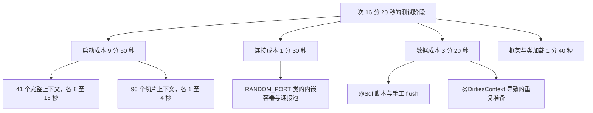
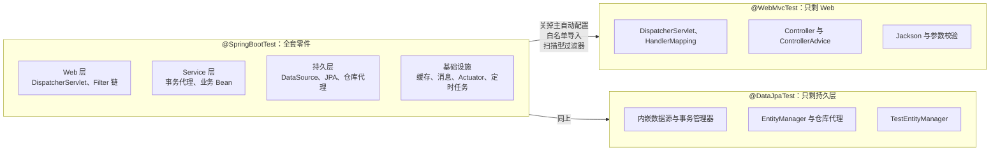
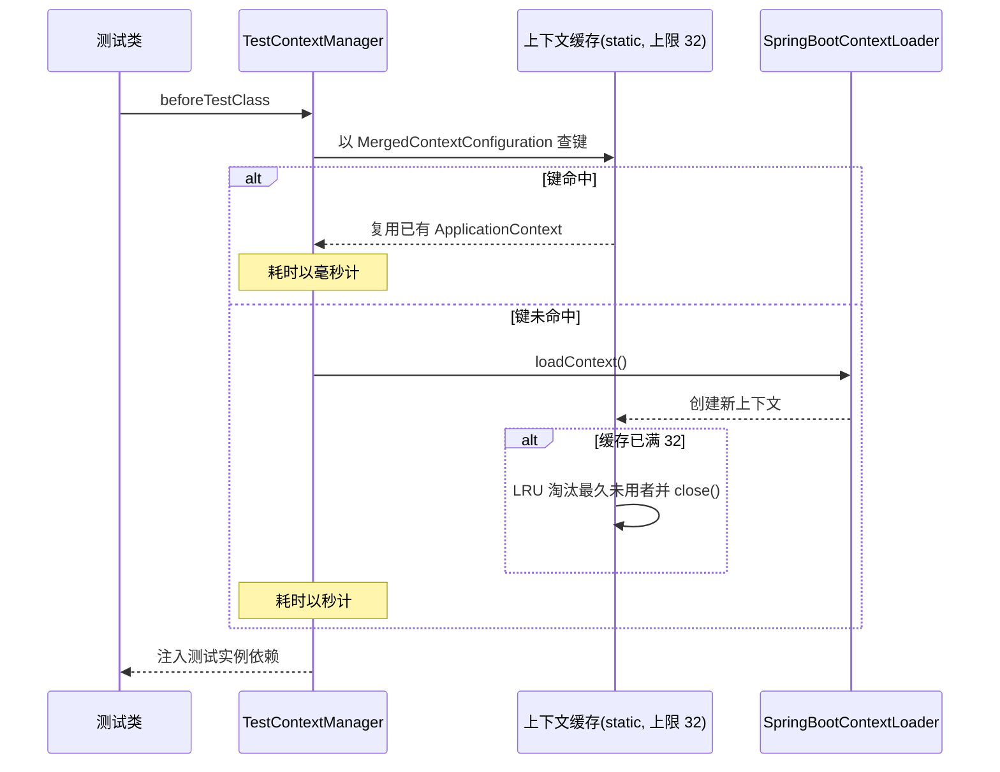
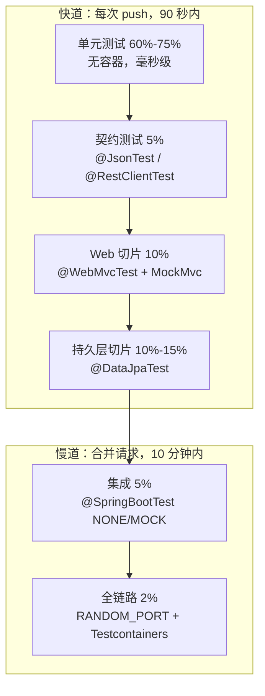
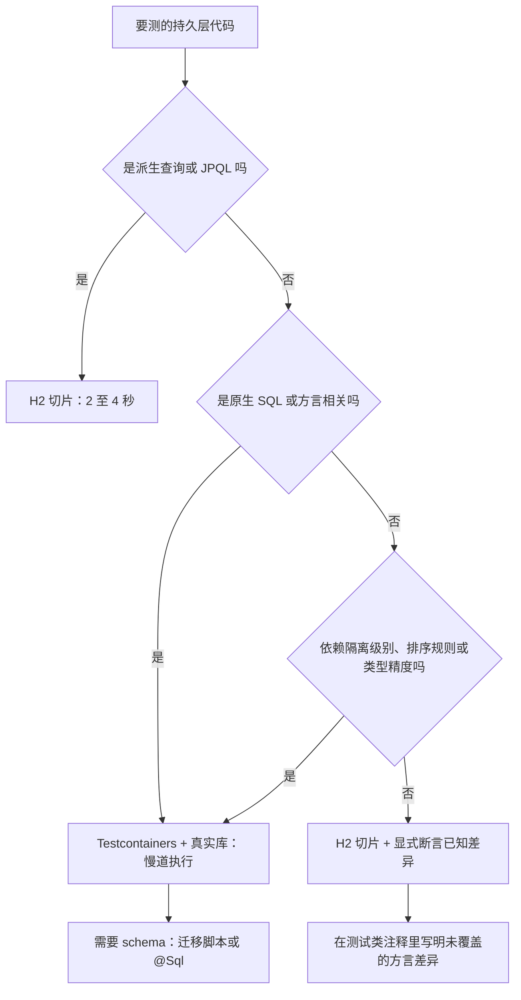

# 测试——@SpringBootTest与分层测试策略

**摘要：**

本章讨论的"慢"，特指测试套件从开始到给出结论的墙钟时间，而不是某个断言的执行时间。Spring Boot 的测试体系表面上一组注解的排列组合，实际是一道成本模型：每启动一个 `ApplicationContext` 就要付一次装配与初始化的价钱，而"测试切片"的全部价值在于把这次启动的容器缩小到只剩需要的零件。缩小容器换来速度，代价是切片的盲区——凡是依赖完整上下文才能发生的失败模式，切片一律测不到。缓存键是全文的重心：同一个 JVM 里键相等的上下文只启动一次，而一个不同的 `@MockBean`、一个不同的 `webEnvironment`、一份不同的测试属性，都会让键改变、让容器重建。本文以订单服务贯穿，先把一次十六分钟的构建拆成启动、连接、数据三段成本，再逐个拆解 `@WebMvcTest`、`@DataJpaTest`、`@JsonTest` 的加载边界与盲区，然后用 `MergedContextConfiguration` 的缓存键解释"测试越加越慢"的头号成因，交代 `@MockBean` 在 3.4 之后被 `@MockitoBean` 取代的语义变化，最后给出一张可执行的分层落地表、一张配置属性表与四则反例。读完应当能回答两个问题：这个测试该启动多大的容器，以及，为什么加了一个 `@MockBean` 就慢了一倍。

---

## 第 1 章 慢在哪：把启动与执行分开量

### 1.1 一次十六分钟的构建

周四下午的 CI 流水线没有报错，它超时了。订单服务 order-service 给测试阶段设了十五分钟的闸门，这一次跑到十六分二十秒被掐断，报告只走完了三分之二。工程师的第一反应是"测试写多了"，于是翻出最近两周新增的用例，删掉几个看着边缘的，重跑，十五分五十秒，仍然过不了线。

真正的答案藏在 surefire 的 XML 报告里。`target/surefire-reports/TEST-*.xml` 的根节点带着 `time` 属性，按时间排序之后，前 41 个类占掉了 9 分 50 秒，而这 41 个类的名字有一个共同特征：都标着 `@SpringBootTest`。再往里看，`OrderControllerTest` 整类耗时 15.8 秒，其中 6 个测试方法加起来不到 40 毫秒。也就是说，这个类的 99.7% 的时间花在第一个方法执行之前——`beforeTestClass` 里创建 `ApplicationContext` 的那次装配。

这条线索把问题从"测试写太多"改写成了"容器起太多"。前者靠删测试解决，后者只能靠改结构解决。本章的其余部分，就是把这 15.8 秒拆开，看它到底花在哪些环节上。

### 1.2 三段成本：启动、连接、数据

一个 Spring Boot 测试的耗时，可以近似地分成三段互不重叠的成本。

第一段是**启动成本**，也就是 `ApplicationContext` 从零到可用的时间：扫描类路径、解析 `@Configuration`、评估 `@Conditional`、注册 Bean 定义、实例化非懒加载单例、初始化内嵌容器、执行 `ApplicationRunner`。这一段与测试断言无关，同一个配置的上下文在同一个 JVM 里只应该被创建一次，这正是后文缓存要解决的问题。

第二段是**连接成本**，指把应用接到外部世界的那部分：内嵌 Tomcat 监听一个端口、HikariCP 建第一批连接、Redis 客户端握手、消息队列建会话、Testcontainers 启动 Docker 容器。这段成本的特点是它与容器数量成正比而与代码复杂度关系不大，所以它在纯内存切片里几乎为零（没有真实连接器），在 `RANDOM_PORT` 的集成测试或接了 Testcontainers 的切片里却实打实存在。

第三段是**数据成本**，指为断言准备输入并清理现场：插入十几行测试数据、执行一份 SQL 脚本、等待异步消息落库、把上一轮留下的行删掉。这一段最容易失控，因为它的规模随测试用例数量线性增长，而前两段只随"上下文配置种类"增长。

三段成本的量级差得很远。示例推算：一个中等规模服务（Web + JPA + Security + 若干 Starter），完整上下文启动约 8 至 15 秒，其中内嵌容器与连接池占 2 至 3 秒；一个 `@WebMvcTest` 切片约 1 至 2 秒；一个接 H2 的 `@DataJpaTest` 约 2 至 4 秒；一个纯 Mockito 单元测试不到 10 毫秒。这些数字只是量级示意，实际值取决于机器、依赖数量与类路径扫描范围，但比例关系在多数项目里稳定成立。



图里最值得盯住的是"启动成本"这个分支：它由 41 个完整上下文构成，而 41 这个数字并不是需求决定的，是历史堆积出来的。后面第三章会说明，这 41 个上下文里真正需要各不相同的配置，往往不到十分之一，多数差异是无人察觉地引入的。

### 1.3 三个可以立刻上手的度量

在动手改结构之前，笔者建议先确认慢在哪一段，否则优化很容易打在无关的地方。有三个几乎零成本的度量手段。

第一个是 surefire 或 Gradle 的测试报告，按类聚合时间。surefire 默认就会写 `TEST-*.xml`（`disableXmlReport` 默认为 `false`），Gradle 默认也会写 `build/test-results/test/*.xml`，两边的 XML 里都有每个类的耗时。判据很简单：如果某个类的整类耗时远大于其方法耗时之和，成本就在启动；如果两者接近，成本在执行或数据准备。

第二个是把 Spring 测试框架的缓存日志打开，即在测试资源里把 `org.springframework.test.context.cache` 的日志级别设成 `DEBUG`。每个测试类取完上下文之后，框架会打印一行 `Spring test ApplicationContext cache statistics`，里面同时给出当前缓存大小、命中次数与未命中次数。这一行是判断"缓存到底有没有生效"的唯一直接证据，比任何推断都可靠。

第三个实验是强制关掉缓存做对照：把 `spring.test.context.cache.maxSize` 设成 1 跑一遍，记录总时长，再与正常配置的时长相减。注意它是 JVM 系统属性，用 Maven 要经 surefire 的 `argLine` 或 `systemPropertyVariables` 传进去，直接在命令行写 `-D` 只会影响 Maven 自己的 JVM。差值就是现有缓存替你省下的时间。如果差值是零，说明你的上下文本来就一个都没被复用；如果差值接近总时长，说明缓存虽然在起作用但键太分散，每一次命中都靠运气。这两个结论指向的修复方向完全不同。

| 现象 | 数据来源 | 判读 |
| :--- | :--- | :--- |
| 单个类十几秒，方法只有几十毫秒 | surefire XML 的 `time` 与用例数 | 启动成本，容器起得太多 |
| 总时长随用例数近似线性增长 | 两周内构建时长曲线 | 数据成本，准备与清理太重 |
| 类之间耗时忽高忽低，后面反而更慢 | 缓存统计行的 hit/miss | 缓存键分散或超过容量被淘汰 |
| 加了几个类，总时长涨了一个数量级 | `maxSize=1` 对照实验 | 每个新类都新建了上下文 |
| 只有 `RANDOM_PORT` 的类特别慢 | 按 webEnvironment 分组统计 | 连接成本，真实容器与端口 |

有了这张表，接下来要问的就是"该起多大的容器"，也就是切片的本质。

---

## 第 2 章 切片的本质：启动更少的容器

### 2.1 切片不是模拟，是缩小

初学者常把 `@WebMvcTest` 理解成"用假的 Spring MVC 跑控制器"，这个理解是错的，而且错得会误导后续所有判断。`@WebMvcTest` 里跑的 `DispatcherServlet`、`RequestMappingHandlerMapping`、`HttpMessageConverter`、`Validator` 全是真实实现，`@DataJpaTest` 里跑的 `EntityManagerFactory`、事务管理器、Spring Data 的仓库代理也全是真实的。切片做过的唯一一件事，是把启动的容器缩小到只装被测的那一层。

这件事由三块元注解配合完成。第一块是 `@OverrideAutoConfiguration(enabled = false)`，它把 Spring Boot 的主自动配置关掉——如果不关，`@EnableAutoConfiguration` 会照常把数据源、JPA、缓存、消息、Actuator 全部拉进来，切片就失去了意义。第二块是 `@ImportAutoConfiguration` 加一份白名单，只把这一层真正需要的自动配置类导进来，`@WebMvcTest` 导入的是 MVC 相关的几项，`@DataJpaTest` 导入的是数据源、事务、JPA 相关的几项。第三块是 `@TypeExcludeFilters`，它挂上一个过滤器，让组件扫描只在白名单类型的类上命中，`@WebMvcTest` 只放 `@Controller`、`@ControllerAdvice`、`@JsonComponent`、`Converter`、`Filter`、`HandlerInterceptor`、`WebMvcConfigurer` 这些进来，`@Service` 与 `@Repository` 被直接挡在门外。

三块合起来的效果，是得到一个"零件少但都是真货"的容器。理解这一点，才能理解切片的速度从哪来、盲区又从哪来：速度来自零件少，盲区来自零件少。容器里没装的东西不会报错，只会以两种方式消失——要么压根不存在，于是注入失败；要么被自动配置的兜底实现顶上，于是行为悄悄变了。



### 2.2 @WebMvcTest：Controller 自动扫，依赖必须 mock

`@WebMvcTest` 的用法有一条硬规则：容器里出现的每一个 `@Controller` 都必须是你要测的那个，而它们依赖的所有 `@Service` 必须由你显式提供。默认情况下它扫描全部 `@Controller`，因此在有几十个控制器的项目里，标准做法是在注解上限定目标：`@WebMvcTest(OrderController.class)`。不限定会带来两个后果，一是把无关控制器的依赖也拖进来导致启动失败，二是把无关控制器的映射注册进来，让"404 断言"变得不可信。

```java
@WebMvcTest(OrderController.class)   // 只把 OrderController 及其 Web 协作者装进容器
class OrderControllerTest {

    @Autowired
    private MockMvc mockMvc;         // 由 @AutoConfigureMockMvc 提供，不启动真实容器

    @MockitoBean
    private OrderService orderService;   // 切片不含 @Service，必须替换或导入

    @Autowired
    private ObjectMapper objectMapper;   // 与生产同一套 Jackson 配置

    @Test
    void shouldReturnOrderWhenExists() throws Exception {
        given(orderService.findById(1L))
            .willReturn(Optional.of(new Order(1L, "CONFIRMED", new BigDecimal("99.00"))));

        mockMvc.perform(get("/orders/{id}", 1L).contentType(MediaType.APPLICATION_JSON))
            .andExpect(status().isOk())
            .andExpect(jsonPath("$.id").value(1))
            .andExpect(jsonPath("$.status").value("CONFIRMED"));
    }

    @Test
    void shouldReturn400WhenQuantityInvalid() throws Exception {
        // quantity 为 0 违反 @Min(1)，验证的是参数校验与异常映射，不是业务逻辑
        mockMvc.perform(post("/orders")
                .contentType(MediaType.APPLICATION_JSON)
                .content("{\"userId\":1001,\"sku\":\"P001\",\"quantity\":0}"))
            .andExpect(status().isBadRequest())
            .andExpect(jsonPath("$.errors[0].field").value("quantity"));
    }
}
```

这段代码能测到的东西很明确：路由映射、路径变量与请求体的绑定、`@Valid` 触发的校验、`@ControllerAdvice` 的异常映射、`ResponseEntity` 的状态码与响应头、Jackson 的序列化形态。它测不到的东西同样明确，而且值得逐条写下：

其一，任何经过 `@Service` 的业务规则。`orderService` 是 mock，它的返回值由测试指定，所以"下单时库存不足应该抛异常"这条规则在这里根本无法被验证——测试验证的是"如果服务层抛这个异常，控制器会不会映射成 409"。这类测试看似在测下单，其实在测异常映射表。

其二，真实的 Servlet 容器行为。`MockMvc` 走的是 `MockHttpServletRequest` 与 `MockHttpServletResponse`，没有连接器、没有真实 socket、没有 `server.tomcat.*` 的任何作用。字符编码、响应压缩、TLS、HTTP/2、`SameSite` cookie 的实际下发、容器级别的错误页转发，这些都在切片的视野之外。

其三，过滤器链与容器的交互顺序。切片会把 `Filter` 类型的 Bean 装进来，Spring Security 的过滤器链也会生效（类路径上有 Spring Security 时 `@WebMvcTest` 会自动配置它），但 `Filter` 的注册顺序来自 `FilterRegistrationBean` 与容器，这部分语义在 `MockMvc` 下是被简化的。

其四，装配层面的失败。切片的上下文小到几乎不可能出现循环依赖、条件装配冲突、`@ConfigurationProperties` 绑定失败这类问题；它们在切片里被结构性地排除了，所以切片全绿并不说明应用能启动。

> [!warning] 安全测试的默认姿态
> 类路径上存在 Spring Security 时，`@WebMvcTest` 的容器会带上安全过滤器链，所有端点默认要求认证。要么在测试方法上标 `@WithMockUser`，要么在类上标 `@AutoConfigureMockMvc(addFilters = false)` 关掉过滤器。后者会让测试快一点，但同时也把"未认证请求应当被拒绝"这条断言关掉了，取舍要看这个测试类到底想守哪条线。

### 2.3 @DataJpaTest：事务回滚与内嵌库替换

`@DataJpaTest` 装进容器的是数据源、事务管理器、`EntityManagerFactory`、Spring Data 仓库代理与 `TestEntityManager`，并且默认做两件很关键的事：一是把数据源替换成内嵌数据库，二是给每个测试方法包一层事务并在结束时回滚。

内嵌库替换由 `@AutoConfigureTestDatabase` 实现，默认值是 `Replace.ANY`，意思是"不管你有没有配数据源，都换成内嵌的"。这个默认值是 `@DataJpaTest` 最容易被误解的地方：项目里明明配了 MySQL，测试却跑在 H2 上，原因就是这条替换。想要接真实库，必须显式写成 `@AutoConfigureTestDatabase(replace = Replace.NONE)`，再自己提供数据源。

事务回滚由类上的 `@Transactional` 实现。它带来两个直接后果。好消息是测试之间天然隔离，不用写清理脚本；坏消息是**被测代码里的事务语义被测试事务吃掉了**——如果某个方法标了 `@Transactional(propagation = Propagation.REQUIRES_NEW)`，它会在测试事务之外另开一个，回滚测试事务并不会回滚它；如果被测代码依赖"提交之后"才发生的行为（事务同步回调、`@TransactionalEventListener(phase = AFTER_COMMIT)`、延迟约束检查），那么在测试事务里这些行为要么不触发，要么触发时机与生产不同。要验证提交后的行为，只能关掉测试事务：类上标 `@Transactional(propagation = Propagation.NOT_SUPPORTED)`，或者直接用 `@SpringBootTest` 走真实提交。

```java
@DataJpaTest
class OrderRepositoryTest {

    @Autowired
    private TestEntityManager entityManager;   // 专门用于造数据，绕过仓库层

    @Autowired
    private OrderRepository orderRepository;

    @Test
    void shouldFindOrdersByUserId() {
        User user = entityManager.persist(new User(null, "test@example.com"));
        entityManager.persist(new Order(null, user, "CONFIRMED"));
        entityManager.persist(new Order(null, user, "PENDING"));
        entityManager.flush();     // 让 JPQL 查询能看到尚未提交的数据

        List<Order> orders = orderRepository.findByUserId(user.getId());

        assertThat(orders).hasSize(2)
            .extracting(Order::getStatus)
            .containsExactlyInAnyOrder("CONFIRMED", "PENDING");
    }
}
```

`TestEntityManager` 值得多解释一句。它是 `EntityManager` 的包装，额外提供 `persistAndFlush`、`persistAndGetId`、`clear` 这类测试友好的方法，本质上是把"造数据 → flush → 清一级缓存"这套动作固定下来，避免测试里出现"明明存了却查不到"的困惑——那通常是 `EntityManager` 的一级缓存与 flush 时机在作怪，而不是仓库查询写错了。

### 2.4 @JsonTest：只验证序列化契约

`@JsonTest` 装进容器的是 Jackson 的自动配置与 `@JsonComponent`，通过 `@AutoConfigureJsonTesters` 提供 `JacksonTester` 之类的包装，允许把 JSON 文本与对象互相转换并做断言。它适合守一类非常具体的东西：对外契约的线上形态。

字段名与命名策略、日期与时区格式、`null` 与空集合的区分、枚举的序列化方式、多态类型的类型标识、循环引用与懒加载代理的处理，这些都是 DTO 层面的契约。它们一旦改动，前端与下游就会坏，而这类破坏在 Controller 测试里往往被 mock 的返回值掩盖：Controller 测试里你给的是自己构造的对象，序列化走的是同一套 Jackson，看起来测到了，实际没有覆盖到"生产环境里那个对象真实长什么样"。

`@JsonTest` 的盲区也很清楚：它用的是自动配置的 `ObjectMapper`，如果某个 Controller 或 `WebMvcConfigurer` 局部替换了消息转换器（譬如给某个端点单独注册了带上自定义 `Module` 的转换器），`@JsonTest` 看不到这层差异。要覆盖这层，只能回到 `@WebMvcTest` 断言真实响应体。

### 2.5 切片的加载范围与盲区

把四种切片放在一张表里对照，能看清它们各自的边界。表中的启动代价是量级示意，不构成性能承诺。

| 切片 | 装进容器的组件 | 不装的东西 | 启动代价量级 | 典型用途 |
| :--- | :--- | :--- | :--- | :--- |
| `@WebMvcTest` | `DispatcherServlet`、`HandlerMapping`、Controller、`@ControllerAdvice`、Jackson、校验器、Filter、Security 链 | `@Service`、`@Repository`、数据源、缓存、消息 | 1 至 2 秒 | 路由、绑定、校验、异常映射、响应形态 |
| `@DataJpaTest` | 数据源（默认换内嵌库）、事务管理器、`EntityManagerFactory`、仓库代理、`TestEntityManager` | Web 层、`@Service`、其他基础设施 | 2 至 4 秒（H2）；接容器再加 5 秒以上 | 映射、派生查询、JPQL、约束 |
| `@JsonTest` | Jackson 自动配置、`@JsonComponent`、Tester 工具 | 除 JSON 之外的一切 | 1 秒以内 | DTO 契约、时间格式、多态标识 |
| `@SpringBootTest` | 全部，按 `webEnvironment` 决定是否起容器 | 无（这正是问题所在） | 8 至 15 秒 | 跨层装配、真实链路、启动期行为 |

除了这四个主力，Boot 还提供了一组面向具体技术的切片，它们的加载逻辑与上面完全同构：关掉主自动配置、按白名单导入相关自动配置、用扫描过滤器只留相关类型，区别只在装进来的零件。

| 切片 | 装进容器的核心组件 | 适合守什么 |
| :--- | :--- | :--- |
| `@WebFluxTest` | `WebTestClient`、WebFlux 配置、`@Controller`、`WebFluxConfigurer` | 响应式端点的路由与编解码 |
| `@DataMongoTest` | 内嵌 Mongo 或 Testcontainers、`MongoTemplate`、仓库代理 | 文档映射与查询 |
| `@DataRedisTest` | `RedisTemplate`、仓库代理、连接工厂 | 序列化器与键设计 |
| `@DataJdbcTest` | 数据源、`JdbcTemplate`、Spring Data JDBC 仓库 | 聚合映射与 SQL |
| `@RestClientTest` | `RestTemplateBuilder` 或 `RestClient.Builder`、`MockRestServiceServer` | 客户端请求构造与错误处理 |
| `@JdbcTest` | 数据源与 `JdbcTemplate`，默认换内嵌库并回滚 | 手写 SQL 中与方言无关的部分 |

这张表的作用是提醒：切片不是四个注解，而是一套模式；换到新技术栈时，先找它对应的切片，找不到再考虑自建一个只装几个 Bean 的轻容器。

盲区同样值得单独列一张表。它的用法不是"知道就好"，而是在写测试时先声明"这个测试守的是哪条线，这条线在切片里还在不在"。

| 切片 | 确实能测到 | 结构性测不到 |
| :--- | :--- | :--- |
| `@WebMvcTest` | 路由、参数绑定、校验、异常映射、JSON 形态、安全过滤 | 业务规则、真实容器行为、装配失败、事务边界 |
| `@DataJpaTest` | 映射、查询语义、约束、事务传播的局部行为 | 服务层编排、Web 层、提交后回调、真实库方言 |
| `@JsonTest` | DTO 序列化契约 | 局部替换的转换器、控制器层组合效果 |
| `@SpringBootTest(NONE)` | 跨层装配、条件装配、事件、事务、缓存注解 | 真实 HTTP 容器行为、协议层细节 |
| `@SpringBootTest(RANDOM_PORT)` | 上述全部加真实容器与序列化往返 | 外部系统的真实行为（除非接真实依赖） |

这张表是本章的落点：**切片换速度的方式是缩小上下文，所以切片的盲区必须显式知道**。一个团队的测试结构是否健康，看它能不能说清每个切片"故意不测什么"，这比看覆盖率数字有用得多。

---

## 第 3 章 上下文缓存：测试速度的真正杠杆

### 3.1 一个 static Map 与三十二个槽位

Spring 的 `TestContext` 框架在 JVM 里维护一个静态的上下文缓存，键是 `MergedContextConfiguration`，值是已经创建好的 `ApplicationContext`。同一个测试套件里，两个测试类只要算出的键相等，第二个类就直接拿到第一个类创建的上下文，省掉整段启动开销。这个机制没有开关，默认就在工作。

缓存有容量上限，默认 32。达到上限之后按 LRU 淘汰，被淘汰的上下文会被关闭（`close()`），其对应的单例 Bean 全部销毁。这条规则解释了一个很容易被误读的现象：测试数量没变、配置没变，只是新增了几个类，构建时间却跳涨——新增的类把键的总数推过了 32，从此每次加载都可能挤掉一个后面还要用的上下文，形成"反复重建"的抖动。

还有一条更隐蔽的限制：这个缓存是 JVM 内的静态变量，**跨进程不复存在**。Maven Surefire 默认给每个测试类复用同一个 fork（`reuseForks=true`），所以缓存有效；一旦配置成 `reuseForks=false` 或按类 fork（老版本写作 `forkMode=pertest`），每个类一个新 JVM，缓存等于被关掉，构建时间会成倍上升。Gradle 的 `maxParallelForks` 开大也是同一个道理：并行度换来的是墙钟时间的下降，代价是每个 fork 都要从头启动自己的上下文，CPU 总消耗反而上升。

### 3.2 缓存键由什么构成

官方文档给出的键构成是一份清单，笔者把它整理成"谁在改这个键"的视角，因为排查时要回答的问题是：究竟是哪一处改动让键变了。

| 键的组成部分 | 来源 | 改变它的常见写法 | 踩坑概率 |
| :--- | :--- | :--- | :--- |
| `locations`、`classes` | `@ContextConfiguration`、`@SpringBootTest(classes=...)` | 引入一个测试配置类、指定 `classes` | 中 |
| `contextInitializerClasses` | `@ContextConfiguration` | 自定义 `ApplicationContextInitializer` | 低 |
| `contextCustomizers` | `ContextCustomizerFactory` 产生 | `@MockBean`、`@MockitoBean`、`@SpyBean`、`@DynamicPropertySource`、`@AutoConfigureMockMvc` 等 | 极高 |
| `contextLoader` | `@ContextConfiguration` | 从 `SpringBootContextLoader` 换成别的 | 低 |
| `parent` | `@ContextHierarchy` | 分层上下文 | 低 |
| `activeProfiles` | `@ActiveProfiles` | 类上标不同 profile | 中 |
| `propertySourceDescriptors`、`propertySourceProperties` | `@TestPropertySource`、`@SpringBootTest(properties=...)` | 每个类写一份自己的属性 | 高 |
| `resourceBasePath` | `@WebAppConfiguration` | 传统 WAR 测试 | 低 |

Spring Boot 在 `contextCustomizers` 这一格里塞进了最多东西，这既是它灵活的原因，也是缓存失效的主因。`@SpringBootTest` 的 `properties`、`args`、`webEnvironment`、`useMainMethod` 都会变成一个 customizer 参与比较；`@AutoConfigureMockMvc` 会注册一个把 `MockMvc` 塞进上下文的 customizer；`@DynamicPropertySource` 方法会被包装成 customizer 参与比较；`@MockBean` 或 `@MockitoBean` 声明的每一个替换目标，也会作为定义进入 customizer 的 `equals`。

这里有一个容易被忽略的推论：**加了 `@AutoConfigureMockMvc` 的类和没加的类不在同一个上下文里**。如果一个项目里一半的 `@SpringBootTest` 类手写了 `MockMvc`、另一半用 `@AutoConfigureMockMvc`，那么这两半天然分成两组上下文，各自启动一次。同理，`webEnvironment = MOCK` 与 `RANDOM_PORT` 是两组，`NONE` 又是第三组。分组不是坏事，坏的是分组数量没人统计过。

### 3.3 一个 @MockBean 就是一个新容器

把上面的规则落到最常见的写法上，代价立刻能算出来。下面这两个测试类，业务上毫无关系，但各自声明了一个不同的 mock：

```java
@SpringBootTest
class OrderServiceTest {
    @MockitoBean private PaymentGateway paymentGateway;   // 键 A
    @Autowired private OrderService orderService;
}

@SpringBootTest
class ShipmentServiceTest {
    @MockitoBean private NotificationClient notificationClient;   // 键 B
    @Autowired private ShipmentService shipmentService;
}
```

两个类的 `classes`、profile、属性完全相同，唯一的差别是 mock 的目标类型不同，于是它们落在两个不同的键上，各自启动一次完整上下文。如果项目里有 50 个这样的类，就有 50 个键，而缓存只能装 32 个——LRU 一开始工作，前面建的上下文被关掉，后面的类再去建新的，整个测试套件在最坏情况下启动接近 50 次上下文。示例推算：每次 12 秒，50 次就是 10 分钟；第一章那个项目有 41 个完整上下文类，量级与此相当，那 9 分 50 秒就是这么来的。

把 mock 集合上收，是收益最高的一次改动。做法是把所有切片测试需要的 mock 声明在一个抽象基类里，子类只注入自己要测的真实 Bean，不再新增 mock：

```java
@SpringBootTest
@AutoConfigureMockMvc
abstract class AbstractWebIntegrationTest {

    @MockitoBean protected PaymentGateway paymentGateway;
    @MockitoBean protected NotificationClient notificationClient;
    @MockitoBean protected InventoryClient inventoryClient;
    // 三个 mock 覆盖全部集成测试的需求，键只有一个
}

class OrderServiceTest extends AbstractWebIntegrationTest {
    @Autowired private OrderService orderService;
}

class ShipmentServiceTest extends AbstractWebIntegrationTest {
    @Autowired private ShipmentService shipmentService;
}
```

代价是这个基类会装配三个 mock，即使某个子类只用到其中一个。这个代价几乎可以忽略，因为 mock 的创建是毫秒级的；真正贵的是上下文启动，而它从 50 次降到了 1 次。

需要补一句精确性：键里放的是"替换目标的声明"，所以即使类型相同，声明位置不同也可能算出不同的键，具体以所用版本 `MockitoContextCustomizer`（3.4 之后是 bean override 对应的 customizer）的 `equals` 实现为准。实践上的启发是一样的：把声明集中到一处，比记住实现细节更可靠。

### 3.4 合并配置类的三条规则

把上面的观察整理成可执行的规则，大致三条。

第一条，**mock 集合只有一个来源**。要么用一个抽象基类，要么用一个 `@TestConfiguration` 加 `@Import` 的测试配置类，全项目只此一份。这条规则的意义不在代码整洁，而在键的数量：mock 组合的种类数就是键的数量，必须让它是一个与测试类数量无关的常数。

第二条，**测试属性只有一个来源**。不要在类上写 `@SpringBootTest(properties = "feature.flag=true")`，把测试属性收进 `application-test.yml`，用 `@ActiveProfiles("test")` 激活。这样键的数量与"profile 的种类数"绑定，而不是与"写过 properties 的类数"绑定。同样地，`@DynamicPropertySource` 应该尽量集中到基类，让所有用到它的子类共享同一个键。

第三条，**能力注解按组使用**。`@AutoConfigureMockMvc`、`webEnvironment`、`@Import` 的测试配置类，这些都属于"会分组的开关"。设计上应当把测试分成几组（纯服务组、Web 切片组、全链路组、真实端口组），每组一个基类，组内键一致，组间键不同。分组的数量应当能用一只手数完，超过这个量级就说明结构失控了。



### 3.5 容量与参数：治标与治本

遇到抖动，最直觉的处置是把 `spring.test.context.cache.maxSize` 调大，譬如调到 64 或者 100。这确实能缓解 LRU 淘汰带来的重建，但它治的是症状：每个上下文都持有完整的单例集合，几十 MB 到上百 MB 的堆占用是常态，把容量翻倍只是把内存压力变成了另一种形式的构建不稳定——在 CI 的 4 GB 容器里，这种压力往往表现为 GC 频繁甚至 OOM，而不是变快。

治本的做法始终是减少键的数量。判断标准很直白：用 `maxSize=1` 跑一遍，再正常跑一遍，如果两者差得不多，说明缓存根本没被用上，问题在键的分散；如果差得很多，说明缓存已经在起作用但容量不够，此时先减键，实在减不下去再考虑调容量。

---

## 第 4 章 从 @MockBean 到 @MockitoBean：3.4 之后的语义

### 4.1 一次被预谋的迁移

`@MockBean` 与 `@SpyBean` 在 Spring Boot 3.4.0 被标记为弃用，官方给出的是"for removal in 4.0.0"，替代品是 Spring Framework 6.2 引入的 `@MockitoBean` 与 `@MockitoSpyBean`，包名也从 `org.springframework.boot.test.mock.mockito` 换到了 `org.springframework.test.context.bean.override.mockito`。Spring Boot 4.0 已经移除这两个注解，同时把切片注解按技术拆到了各自的包（譬如 `org.springframework.boot.webmvc.test.autoconfigure.WebMvcTest`），并对每个技术单独提供测试 starter。以 3.5 为基线的新项目，应当直接用 `@MockitoBean`；以 3.x 存量的项目，迁移可以在 3.5 上先完成，不必等到升 4.0。

这次迁移不是简单的换名字，背后是职责的搬迁：Boot 自己实现的 mock 替换，被并入 Spring Framework 的 bean override 机制，也就是 `@TestBean`、`@MockitoBean`、`@MockitoSpyBean` 共用的一整套 SPI。理解这层，才能解释下面几处行为差异。

### 4.2 语义差异要逐条对照

| 维度 | `@MockBean`（3.x，已弃用） | `@MockitoBean`（3.4 起推荐） |
| :--- | :--- | :--- |
| 所属 | `org.springframework.boot.test.mock.mockito` | `org.springframework.test.context.bean.override.mockito` |
| 实现基础 | Boot 的 `MockitoPostProcessor` | Spring Framework 的 bean override SPI |
| 声明位置 | 字段、`@Configuration` 类上 | 测试类字段为主；在 `@Configuration` 上的支持随版本演进，需按版本文档核对 |
| 按名字替换 | 支持 `@MockBean(name = "xxx")` | 支持，语义一致，匹配不到时的行为更严格 |
| 找不到目标 Bean | 静默新增一个 | 默认同样新增；`enforceOverride = true` 时改为报错 |
| 重置时机 | 每个测试方法后重置 | 默认同样是每个测试方法后重置（`reset` 属性可调） |
| 与缓存键的关系 | 参与 customizer 比较 | 同样参与，键分散的问题不会因为换注解而消失 |
| 在 `@SpringBootTest` 中的 `@Mock`/`@InjectMocks` | 由 Boot 的 Mockito 监听器初始化 | 该监听器已弃用并在 4.0 移除，需显式 `@ExtendWith(MockitoExtension.class)` |

迁移时最容易出问题的是最后一行。很多老测试类在 `@SpringBootTest` 里混用 `@Mock` 与 `@InjectMocks`，靠 Boot 的监听器在测试实例创建后填充字段；一旦这个监听器不再生效，这些字段在测试方法里就是 `null`，而失败信息会指向业务代码，排查方向被误导。改法很直接：要么把这些类改成纯单元测试加 `@ExtendWith(MockitoExtension.class)`，要么把字段换成 `@MockitoBean`（因为它是由 Spring 容器替换，不依赖监听器）。

还有一点容易误判：两个注解在找不到目标 Bean 时都会静默新增一个 mock，差别在于 `@MockitoBean` 提供了 `enforceOverride = true`，可以把"没找到目标"从沉默改成启动失败。这个沉默在测试里会放大成两类事故：该被替换的真实 Bean 仍然存在并被其他 Bean 注入，于是你以为被 mock 的调用其实走了真实实现；或者你以为少了会报错，结果容器悄悄多了一个没人用的 mock。对存量迁移项目来说，把 `enforceOverride` 打开是一道很有价值的闸。

### 4.3 迁移的落地顺序

存量项目迁移，建议的顺序是：先统一到 `@MockitoBean`（3.5 上即可完成，纯替换，风险低）；再把分散的 mock 按第三章的规则上收成基类或测试配置；最后才处理 `@Mock`/`@InjectMocks` 混用与切片注解迁移。把顺序倒过来会很难受，因为你在移动代码的同时还要改语义，一旦测试红了无法判断是哪一步引入的。

---

## 第 5 章 分层策略：把金字塔落成能执行的表

### 5.1 三个判据代替一个信念

"单元测试要多、集成测试要少"这句话人人都同意，但它无法指导具体决策。更有用的做法是把每个待写测试过一遍三个判据：

第一个判据，**这个测试要防的失败模式，是否需要真实的容器**。如果失败模式来自业务分支、计算、状态机，那就不需要；如果来自装配（Bean 找不到、条件装配选错、循环依赖）、事务传播、AOP 代理、序列化配置、容器行为，那就需要，而且需要的是完整上下文而非切片，因为切片恰恰把这些排除了。

第二个判据，**是否需要真实的外部协议**。H2 与 MySQL 的差异、`MockMvc` 与真实 HTTP 的差异、mock 的 HTTP 客户端与真实 `RestTemplate` 的差异，都属于协议层面的东西。凡是断言依赖协议细节的，切片给不出结论。

第三个判据，**失败之后能不能从测试名直接定位到代码**。单元测试的失败名通常直接指向一个方法；端到端测试的失败名往往只告诉你"下单链路坏了"，定位还要再花时间。这条判据决定的是同一行为要写几个层次的测试：越靠近底层的测试越容易定位，所以越该多写。

### 5.2 五层落地表

把判据整理成一张结构图，能看清各层之间的从属关系：越靠上的层数量越多、单次越快，越靠下的层越少、越慢，而两条 CI 通道正是在这个结构上切了一刀。



图里的比例落成表，就得到了可以直接照着安排工作的分层策略。表中的比例与耗时预算都是示例推算，用于给团队一个讨论的起点，不是规范。

| 层 | 工具与注解 | 容器 | 占比目标 | 单类耗时预算 | 守什么线 |
| :--- | :--- | :--- | :--- | :--- | :--- |
| 单元 | JUnit 5 + Mockito，`@ExtendWith(MockitoExtension.class)` | 无 | 60% 至 75% | 1 秒以内 | 业务分支、计算、状态机、校验规则 |
| 契约 | `@JsonTest`、`@RestClientTest` | 极小 | 5% | 1 秒以内 | DTO 序列化形态、客户端请求构造 |
| Web 切片 | `@WebMvcTest` + `MockMvc` | Web 层 | 10% | 2 秒以内 | 路由、绑定、校验、异常映射、安全 |
| 持久层切片 | `@DataJpaTest`（H2 或真实库容器） | 持久层 | 10% 至 15% | 5 秒以内 | 映射、派生查询、JPQL、约束、方言 |
| 集成 | `@SpringBootTest`，NONE 或 MOCK | 完整 | 5% | 20 秒以内 | 跨层装配、事务、事件、缓存、启动期行为 |
| 全链路 | `@SpringBootTest(RANDOM_PORT)` + Testcontainers | 完整 + 真实依赖 | 2% 以内 | 40 秒以内 | 真实 HTTP 往返、连接器、序列化、停机 |

这张表有两个用法。一是用来做存量体检：统计现有测试类按注解分类的数量，与占比目标对照，超出最多的那一层就是下一阶段要拆的对象。二是用来做新增评审：写一个新测试之前先问"它属于哪一层"，如果答不上来，多半是它同时想干两件事，应该拆。

服务层是最容易卡住的一层：它有业务逻辑（倾向单元测试），又要验证事务与代理（倾向集成测试）。折中做法是给服务层单独一个"轻容器"——不用 `@SpringBootTest`，而是用 `@ContextConfiguration` 只装被测服务与它的协作者，容器里有三五个 Bean，启动在百毫秒级，事务代理与 AOP 仍然真实存在：

```java
@ExtendWith(SpringExtension.class)
@ContextConfiguration(classes = {
        OrderService.class,
        FakePaymentGateway.class,      // 手写 fake，比 mock 更能验证交互协议
        InMemoryOrderRepository.class
})
class OrderServiceTxTest {

    @Autowired private OrderService orderService;

    @Test
    void shouldRollbackWhenInventoryFails() {
        assertThatThrownBy(() -> orderService.place(new OrderRequest(1001L, "P001", 2)))
            .isInstanceOf(InventoryShortageException.class);
        // 真相是：容器里真的有事务代理，回滚是真的，而不是 mock 出来的
    }
}
```

这类测试成本低而置信度高，是被严重低估的中间层。它测得到事务代理是否生效、`@Transactional` 的传播是否符合预期、`@Cacheable` 的键生成是否正确，却不需要完整上下文。判断它是否够用的方法还是三问：它防的失败模式是否需要装配？不需要的话，这个轻容器就是最优解。

### 5.3 CI 分成两条道

分层之后，CI 也应该分成两条道。快道在每次推送时跑，只跑单元、契约、Web 切片与 H2 持久层切片，目标九十秒内出结论；慢道在合并请求上跑，加上集成、全链路与真实库容器，目标十分钟内出结论。

| 通道 | 触发时机 | 包含的层 | 耗时目标 | 失败后的动作 |
| :--- | :--- | :--- | :--- | :--- |
| 快道 | 每次 push | 单元、契约、Web 切片、H2 切片 | 90 秒以内 | 阻塞推送，开发者自行修复 |
| 慢道 | 合并请求、每日定时 | 快道全部 + 集成 + 全链路 + 真实库 | 10 分钟以内 | 阻塞合并，责任到模块 |
| 夜间 | 定时 | 全链路 + 兼容性矩阵 + 覆盖率报告 | 30 分钟以内 | 生成报告，次日处理 |

分道的好处不只是等待时间，更在于它把"慢"从日常路径上挪开了：开发者在本地跑快道，几秒到几十秒就能得到反馈，慢的东西只在合并前跑一次。反过来，如果不分道，所有人每天都要为全链路测试付十几次等待，测试就从工具变成了阻力，而阻力会催生更多的 `@Disabled`。

---

## 第 6 章 环境差异：那些"测试全绿"的坑

### 6.1 内嵌库与真实库的方言落差

H2 跑得快，代价是它和 MySQL、PostgreSQL 说的不是同一种方言。差异并不局限于少数冷门函数，而是分布在类型、排序、隔离级别、DDL 语义这些层面。

| 维度 | H2 的典型行为 | MySQL / PostgreSQL 的典型行为 | 后果 |
| :--- | :--- | :--- | :--- |
| 字符串比较 | 默认区分大小写 | MySQL 常用排序规则不区分大小写 | 唯一约束的重复判定不同，测试通过、线上冲突 |
| 保留字 | 保留字集合与 MySQL 不同 | `value`、`key` 等在 MySQL 中是保留字 | 建表脚本一边能跑一边不能 |
| 日期时间精度 | `TIMESTAMP` 保留纳秒 | MySQL `DATETIME(0)` 截断到秒 | 断言 `equals` 的测试在真实库上随机失败 |
| 自增与序列 | 自增不回滚，值连续 | 自增同样不回滚，但有步长与缓存 | 断言 `id == 1` 的测试依赖执行顺序 |
| 隔离级别 | 默认读已提交 | MySQL InnoDB 默认可重复读 | 幻读与间隙锁的行为不同，并发测试结论不成立 |
| 原生 SQL 语法 | 不支持 `ON DUPLICATE KEY UPDATE`、`IFNULL`、`DATE_FORMAT` 等 | 支持 | 原生 SQL 在 H2 上直接抛语法错误 |
| JSON 类型 | 支持但与 MySQL 的 JSON 操作符不同 | JSON 函数族差异大 | `@Query(nativeQuery = true)` 无法在 H2 上验证 |

这些差异落到选型上，可以归纳成一条判断路径：先看被测对象是不是 SQL 本身，再看这条 SQL 换库之后语义会不会变，最后才决定要不要付容器的代价。



有一个细节值得单独说明：`@DataJpaTest` 接内嵌库时，`spring.sql.init.mode` 的默认值是 `embedded`，意思是"只在嵌入数据库上执行 `schema.sql` 与 `data.sql`"。把数据源换成真实库容器之后，这个默认值不再匹配，初始化脚本不会执行；同时 Boot 只为嵌入数据库默认 `spring.jpa.hibernate.ddl-auto=create-drop`，对非嵌入数据源默认是 `none`。两件事叠加，结果是"切到真实库之后表不存在"。这不是框架的陷阱，是默认值的设计意图——它假设真实库的 schema 由迁移工具管理。

### 6.2 @TestConfiguration 的泄漏路径

`@TestConfiguration` 是 `@TestComponent` 的一种，Boot 的 `TestTypeExcludeFilter` 会把它排除在主上下文的组件扫描之外，所以顶层类与静态内部类都不会被生产上下文拾取。真正的泄漏来自另外两条路径。

第一条，测试源码里写了 `@Configuration` 或 `@Component` 而不是 `@TestConfiguration`。测试类路径（`target/test-classes`）与主类路径在同一个 ClassLoader 下，生产代码上的 `@ComponentScan("com.example")` 在跑测试时**确实能看到** `src/test/java` 里同包的类。于是那个本该只在测试里存在的 fake 客户端，会出现在一个本该是生产形态的上下文里。

第二条，测试配置类被 `@Import` 进了非测试的配置类。这通常发生在"为了让某个自动配置在测试里工作"的临时改动上，改完忘了撤回，于是生产链路上多了一个依赖测试类的 `@Import`，打包时因为类缺失而在启动阶段炸掉。

```java
// 危险：测试源码里放在被测包下，用的是 @Configuration
package com.example.order;

@Configuration
class FakePaymentConfig {
    @Bean PaymentGateway paymentGateway() { return new FakePaymentGateway(); }
}

// 安全：静态内部类 + @TestConfiguration，且只通过 @Import 进入测试上下文
@SpringBootTest
class OrderFlowTest {

    @TestConfiguration(proxyBeanMethods = false)
    static class Fakes {
        @Bean PaymentGateway paymentGateway() { return new FakePaymentGateway(); }
    }
}
```

判据很直接：在测试源码里搜 `@Configuration` 与 `@Component`，凡是不在该包的测试类内部、又不是 `@TestConfiguration` 的，都要逐个确认它会不会被扫描到。这类问题在 code review 里几乎看不出来，但它的后果是测试环境与生产环境的行为分叉。

### 6.3 随机端口与并行执行

`RANDOM_PORT` 让内嵌容器监听 0 号端口，由操作系统分配，避免与固定端口冲突。它的成本是真实的：容器要起来、连接器要初始化、`TestRestTemplate` 要建立真实连接，一次往返比 `MockMvc` 慢两三个数量级。所以它应该只用于验证"真实 HTTP 往返"这件事本身，而不是用来当 `MockMvc` 的替代品。

并行执行要谨慎得多。JUnit 5 的并行开关（`junit.jupiter.execution.parallel.enabled=true`）让测试方法跨线程跑，而 Spring 的上下文是共享的，mock 也是共享的。Boot 在每个测试方法结束后重置 mock，但在并发场景下，"重置"与"另一个线程正在打桩"之间的先后关系没有保证，于是会出现一类典型的随机失败：某个测试偶尔拿到上一个测试的桩返回值。

真正能安全并行的，是那些不共享可变状态、不依赖 mock 打桩顺序、不写数据库的测试——也就是纯单元测试。以此类推，最合理的并行策略是：单元测试并行，切片与集成测试串行。如果非要并行切片，至少要把 `@MockitoBean` 密集的类单独分组串行执行。

还有一处容易忽略的耦合：`@DataJpaTest` 的事务回滚靠 ThreadLocal 传播，测试事务绑定在执行线程上，所以并行执行本身不会破坏回滚；但如果被测代码里开了异步线程（`@Async`、`CompletableFuture`），那个线程根本不在测试事务里，写入的数据不会回滚，测试之间就会互相污染。

### 6.4 事务回滚的三种漏网

事务回滚给人一种"数据一定干净"的错觉，实际有三种情况会漏出去。

第一种是自增与序列不随回滚重置。测了两条数据回滚了，第三条插入拿到的 id 仍然是 3，而不是 1。凡是断言 `id == 1` 的测试，都隐式依赖了"这个上下文里之前没有别的插入"，在类内方法顺序调整或并行之后就会随机失败。正确做法是断言 `isNotNull()`，或者用业务键做断言。

第二种是异步与外发不随回滚撤回。事务里发出的消息、写进 Redis 的缓存、调出去的 HTTP 请求，回滚不会把它们撤回来。测试里如果 mock 了消息客户端，验证的是"消息被发出过"；如果不 mock，真实的消息就留在 broker 里，污染后续测试。

第三种是提交后回调不触发。`@TransactionalEventListener(phase = AFTER_COMMIT)`、`TransactionSynchronization` 里的逻辑，在测试事务里永远不会执行，因此那部分代码在切片测试里是零覆盖，而覆盖率工具不会告诉你这一点——它只看行有没有被执行，不看这行在测试里是否可达。要覆盖这类逻辑，只能用 `@Commit` 或者干脆关掉测试事务。

---

## 第 7 章 量化：把"慢"变成可优化的数字

### 7.1 从报告里读出上下文创建次数

优化之前先量化，这是笔者最坚持的一条次序。测试报告能直接给出每个类的耗时，但"创建了几次上下文"需要另一个数据源：缓存统计行。把 `org.springframework.test.context.cache` 的级别开到 `DEBUG`，跑完整套件，把日志里所有 `Spring test ApplicationContext cache statistics` 抓出来，数 `missCount` 的增长次数，就是上下文创建次数。

另一个更省事的估算法是对比实验：正常跑一遍得到 T1，把 `spring.test.context.cache.maxSize` 设成 1 再跑一遍得到 T2。由于 T2 下每个类的上下文都会被淘汰，`T2 - T1` 就是缓存带来的全部收益。如果希望进一步拆分，还可以把 `maxSize` 设成 2、4、8 做一条曲线，曲线的拐点就是"键的数量"的近似值。

### 7.2 一次示例推算

以第一章的订单服务为例，做一个示例推算，说明优化的量级从哪里来。

| 阶段 | 完整上下文创建次数 | 平均单次启动 | 启动总耗时 | 执行、连接与数据 | 合计 |
| :--- | :--- | :--- | :--- | :--- | :--- |
| 优化前 | 41 | 14 秒 | 574 秒 | 400 秒 | 约 16 分 20 秒 |
| 合并 mock 与属性后 | 12 | 14 秒 | 168 秒 | 400 秒 | 约 9 分 30 秒 |
| 把计算与 Web 层拆成切片后 | 6（含 3 个切片上下文） | 6 秒 | 36 秒 | 420 秒 | 约 7 分 40 秒 |
| 单元测试并行、数据准备压缩后 | 6 | 6 秒 | 36 秒 | 210 秒 | 约 4 分 10 秒 |

这张表里第二行与第三行的差别最值得看：合并 mock 与属性只是把重复启动消掉，测试内容一点没变；拆切片则换了容器的型号，单次启动从 14 秒降到 6 秒，但执行与其他耗时反而上升，因为写得细的切片测试数量更多、需要造的数据也更多。两者叠加才降到七分钟出头。第四行只在"执行与其他"这一栏有效，启动总耗时一节不动——这也说明了为什么优化的顺序必须是先减键、再换容器、最后并行。

数字都是示例推算，真实的收益取决于项目结构与机器规格，但这个顺序是稳定的：键的数量决定启动总耗时，容器的种类决定单次启动耗时，用例数量决定执行耗时，三者对总时长的贡献依次递减。

### 7.3 优化顺序与不该做的事

按收益排序，可做的动作大致是这样：先统计键的数量并合并 mock 与属性（收益最大，风险最低）；再把不该用完整上下文的测试改成切片或轻容器；然后压缩数据准备，用 `@Sql` 或 builder 替代逐行 `save`；最后才考虑并行与容量调整。

反过来，有几件事看着能提速，实际是拿置信度换时间，要慎用。

全局开启 `spring.main.lazy-initialization=true` 是典型的一例。它让 Bean 在第一次被使用时才创建，上下文启动确实快了，但 `@SpringBootTest` 最有价值的那个断言——"这个应用的 Bean 图能装配起来"——同时失效了。配置错误、循环依赖、缺 Bean 这些问题会推迟到某个测试方法真正用到那个 Bean 时才暴露，甚至根本不暴露。要用也只能用在个别类上，并且明确知道自己在放弃什么。

把 `@DirtiesContext` 当常规手段是另一例。它让上下文在类或方法之后被标记为脏、下次重建，看起来能解决状态污染，实际是把每次启动代价乘上了使用次数。绝大多数需要它的场景都可以用更好的设计替代：数据库状态用事务回滚或容器隔离，单例内部状态用 `@BeforeEach` 重置，静态状态改成实例状态。

把集成测试改成 mock 以换取速度，是第三种。改完之后测试确实快了，但它防的失败模式（装配、事务、序列化、容器）同时消失了，而这个消失不会出现在任何报告里。测试结构的退化通常不是一次决定造成的，而是几十次"先让它快起来"的累积。

---

## 第 8 章 配置属性与排错速查

### 8.1 测试相关的属性

测试相关的可调项不多，但每一项的影响面都不小。下表只列与本文主题直接相关的部分，默认值以 Spring Boot 3.5 与 Spring Framework 6.2 的文档为准。

| 属性 | 默认值 | 作用 | 测试中的用法 |
| :--- | :--- | :--- | :--- |
| `spring.test.context.cache.maxSize` | 32 | 上下文缓存容量，超出按 LRU 淘汰 | 通过 JVM 系统属性或 `SpringProperties` 设置；先减键，再考虑调大 |
| `spring.profiles.active` | 无 | 激活的 profile 集合 | 测试统一用 `@ActiveProfiles("test")`，避免逐类写属性 |
| `spring.datasource.url` 等 | 自动配置 | 数据源连接 | 切片默认被内嵌库替换；接真实库需 `Replace.NONE` |
| `spring.jpa.hibernate.ddl-auto` | 嵌入库 `create-drop`，非嵌入 `none` | schema 生成策略 | 切真实库后表不存在，先查这一项 |
| `spring.sql.init.mode` | `embedded` | 是否执行 `schema.sql` / `data.sql` | 换真实库后初始化脚本默认不跑 |
| `spring.main.lazy-initialization` | `false` | 是否延迟初始化 Bean | 不建议为提速全局开启，会掩盖装配错误 |
| `spring.autoconfigure.exclude` | 无 | 排除自动配置类 | 切片之外想进一步减重时使用，需确认排除项不影响断言 |
| `junit.jupiter.execution.parallel.enabled` | `false` | JUnit 并行执行 | 只对无共享状态的测试开启 |

### 8.2 排错速查：症状、判据、处置

| 症状 | 第一判据 | 处置 |
| :--- | :--- | :--- |
| 单个类十几秒，方法毫秒级 | surefire XML 中类耗时远大于方法之和 | 换切片或轻容器，不要删测试 |
| 测试越加越慢，近似线性 | 缓存统计行的 miss 数随类数增长 | 合并 mock 与属性，把键数压到常数 |
| 新增几个类后时长跳涨 | 键数越过 32 后出现反复重建 | 统计键的种类，必要时临时调大容量验证 |
| 切片启动报 `NoSuchBeanDefinitionException` | 缺的是 `@Service` 还是基础设施 | 补 `@MockitoBean` 或 `@Import` 测试配置，不要加回 `@SpringBootTest` |
| 切片里 SQL 语法错误 | 报错关键字是 MySQL 专有语法 | 换成真实库容器，或改用 JPQL |
| 换真实库后表不存在 | 查 `ddl-auto` 与 `sql.init.mode` 的实际值 | 用迁移脚本或 `@Sql` 建表，不要改回内嵌库 |
| 生产上下文出现测试 Bean | 搜测试源码里的 `@Configuration` / `@Component` | 改成 `@TestConfiguration` 静态内部类并显式 `@Import` |
| 断言 `id == 1` 随机失败 | 自增不随回滚重置，或并行执行 | 断言非空或用业务键，切片测试改串行 |
| 并行后 mock 串味 | 同一 mock 被多线程交替打桩 | 单元测试并行、切片串行；mock 密集类单独分组 |
| 加了 `@DirtiesContext` 后更慢 | 上下文创建次数与使用次数同阶 | 用事务回滚、容器隔离、`@BeforeEach` 重置替代 |

覆盖率的工具位置也在这里交代一句。JaCoCo 能回答"哪些行被执行过"，不能回答"哪些行为被验证过"；它对切片测试与集成测试一视同仁，所以一个只用 `@SpringBootTest` 覆盖到 85% 的项目，与一个分层合理同样 85% 的项目，在报告上完全一样，在维护成本上差一个数量级。把覆盖率当阈值门禁可以，把它当质量目标不行。

把阈值配成门禁不需要太多代码，但要配准。下面这份配置只做两件事：采集执行数据，以及在行覆盖率与分支覆盖率低于阈值时让构建失败。

```xml
<plugin>
    <groupId>org.jacoco</groupId>
    <artifactId>jacoco-maven-plugin</artifactId>
    <executions>
        <execution>
            <id>prepare-agent</id>
            <goals><goal>prepare-agent</goal></goals>
        </execution>
        <execution>
            <id>report</id>
            <phase>test</phase>
            <goals><goal>report</goal></goals>
        </execution>
        <execution>
            <id>check</id>
            <goals><goal>check</goal></goals>
            <configuration>
                <rules>
                    <rule>
                        <element>BUNDLE</element>
                        <limits>
                            <limit>
                                <counter>LINE</counter>
                                <value>COVEREDRATIO</value>
                                <minimum>0.80</minimum>
                            </limit>
                            <limit>
                                <counter>BRANCH</counter>
                                <value>COVEREDRATIO</value>
                                <minimum>0.70</minimum>
                            </limit>
                        </limits>
                    </rule>
                </rules>
            </configuration>
        </execution>
    </executions>
</plugin>
```

阈值一旦成为门禁，团队的第一反应通常是"补测试直到过线"，而补哪一层的测试不受约束。可搭配的规则是给分层定配额：行覆盖率主要由单元测试撑起来，剩下的部分由切片与集成测试补齐，同时把 DTO、配置类、自动生成的代码从统计里排除——把不该计入统计的代码排除掉，比把不该写的测试写出来要诚实得多。

---

## 第 9 章 四则反例

### 9.1 反例一：所有测试都用 @SpringBootTest

症状是这样的项目里几乎所有测试类都标着 `@SpringBootTest`，连"满减金额计算"这种纯函数也在里面测；构建从三分半涨到十四分钟；某个测试改了全局状态，另一个测试随机失败，于是有人加了 `@DirtiesContext`，更慢。

代价有三层。第一层是纯浪费：为了一段不依赖容器的计算付十二秒启动费。第二层是掩盖：所有测试都在完整上下文里跑，于是没人知道哪条断言真正需要容器，重构时不敢动。第三层是污染：共享上下文意味着共享单例，测试之间通过 Bean 的内部状态互相影响，随机失败变成常态，而随机失败会训练团队忽略红色。

改法是逐类判断。把标着 `@SpringBootTest` 的类按"它注入的 Bean 有几个、其中几个是容器能力而非业务对象"排序，注入零个或只有一个业务对象的改成纯单元测试；只测 HTTP 层的改成 `@WebMvcTest`；只测仓库的改成 `@DataJpaTest`；剩下的少数保留，并统一到两三个基类上。

### 9.2 反例二：每个测试类都加不同的 @MockBean

症状是每个集成测试类开头都有两三行 `@MockBean`，彼此不重复；构建时长与测试类数量成正比；偶尔删掉一个测试类，构建时间不成比例地下降。

代价是缓存完全失效。前面已经算过：50 个类就是 50 次启动，而 32 个槽位的缓存不但帮不上忙，还会在 32 之后开始淘汰与重建，形成抖动。这个反例的危险之处在于它是"自然生长"出来的——每加一个测试类，加一两个 mock 是最省事的选择，没有人会觉得自己在做架构决策。

改法就是第三章的三条规则：mock 集合上收、属性上收、能力注解分组。改完之后，测试内容一行不用动，键数从几十降到个位数。

### 9.3 反例三：用 H2 测所有 SQL

症状是仓库层测试全绿，上线后某些查询在生产库上报语法错误或返回错误结果；或者所有原生 SQL 都被删掉改成 JPQL，因为"测不了"。

代价是把测试的置信度兑换成了速度，而兑换比例没有写下来。H2 能可靠验证的是映射与派生查询的语义，验证不了的是方言、函数、隔离级别、类型精度、排序规则。用 H2 去测一条 MySQL 专有的 `INSERT ... ON DUPLICATE KEY UPDATE`，得到的最多是"这条语句在 H2 上不成立"这个无用结论。

改法是按 SQL 类型分流：派生查询与 JPQL 留在 H2 切片里，够快；原生 SQL、方言相关、约束与排序规则相关的测试，用 Testcontainers 起真实库，在慢道里跑。判断标准是"这条 SQL 在换库之后语义会不会变"，会变的就必须在真实库上测。

### 9.4 反例四：@DirtiesContext 与覆盖率阈值

第四个反例是两个习惯的组合：遇到状态污染就加 `@DirtiesContext`，遇到覆盖率不达标就加测试。

`@DirtiesContext` 会关闭上下文并在下次重建，代价直接体现在启动次数上。它在少数场景下确实必要——测试修改了静态状态、注册了无法撤销的全局钩子、或者用 `@Commit` 往真实库里写了数据之后必须换一个干净的库——但它不该成为默认手段。覆盖率阈值同理：把 80% 当目标，最省力的做法是给 getter 和 DTO 补测试，覆盖率上去了，缺陷密度没变。

改法是把这两个习惯换成两个更具体的问法：状态污染是"哪一块共享状态被写了"（答出来就能针对性重置，不需要重建上下文）；覆盖不足是"哪个失败模式没有被任何测试防住"（答出来才知道该在哪个层次补测试）。这两个问法都比"加注解"和"加测试"难，但它们是唯一有效的。

---

## 第 10 章 边界、代价与取舍

测试切片这套机制的边界，可以概括成一句话：**它换速度的方式是缩小上下文，所以它换来的是"这一层在真实容器里的行为"的置信度，而不是"整个应用能跑起来"的置信度**。这个区分听起来像是文字游戏，实际决定了测试结构该怎么搭。一个所有测试都是切片的项目，可以在每个切片的范围内非常自信，同时对"应用能否启动"毫无把握；一个所有测试都是 `@SpringBootTest` 的项目，恰好相反——它能启动，但它对任何单层行为的验证都慢到无法频繁执行，最终被跳过。

真正需要守住的判断是：这条测试防的失败模式，在缩小后的上下文里还会不会发生。如果失败模式的成因就在被切掉的那部分（自动配置的交互、条件装配的选择、容器与过滤器的顺序、真实协议的细节），切片把它排除掉的同时也把这条失败模式排除掉了，测试全绿是一种假象。如果成因在被保留的那部分（映射、路由、绑定、序列化、业务分支），切片给出的结论与完整上下文等价，而速度快了一个数量级。

`@SpringBootTest` 的正确位置因此很清楚：它守的是"装配"这条线，不是"行为"这条线。跨层装配、条件装配的结果、事件与事务的传播、启动期执行的逻辑、真实 HTTP 往返，这些东西只有完整上下文能验证，所以它该出现在少数几条路径上，每条都对应一个真实的失败场景，而不是"为了保险起见都写一写"。

代价的另一面是维护。切片的代码量通常大于它替代的集成测试，因为每个切片都要显式声明自己依赖什么；这份显式性既是它的价值（依赖关系写在测试里，改代码时会被提醒），也是它的成本（测试文件变多，写起来更慢）。团队规模小、迭代快的时候，多写几个 `@SpringBootTest` 换开发速度是合理的；团队规模大、构建频繁的时候，键的数量会变成每日痛感，那时再回头拆。这两种选择没有高下，只有阶段是否匹配。

还有一条边界需要划清。本文讨论的是"测试该启动多少容器"，至于容器本身怎么工作——`ApplicationContext` 的层次结构、`BeanFactory` 与 `ApplicationContext` 的分工、Bean 定义如何注册、单例如何缓存——属于 IoC 容器的机制，见 [[Java/SpringCore/02 IoC容器——BeanFactory与ApplicationContext的层次设计]]；条件注解在装配期如何求值，见 [[03 条件装配——@Conditional家族的实现机制]]；测试属性与生产属性的优先级如何合并，见 [[05 配置体系——application.yml、Profile与配置优先级]]；为自定义 Starter 验证自动配置，`ApplicationContextRunner` 比任何切片都合适，用法见 [[06 Starter开发——自定义starter的最佳实践]]。测试里的 `ApplicationContext` 与生产的是同一个东西，理解了它，才能判断哪一部分值得为测试启动。

行文至此，可以回到第一章那个十六分钟的构建。它的修复并不依赖某个高级技巧，只依赖三件事：把键的数量统计出来、把不该起容器的测试换成不起容器的写法、把确实需要完整上下文的少数测试固定在同一组配置上。三件事都不难，难的是先承认"慢"不是测试数量的问题，而是容器数量的问题。

---

## 参考资料

1. Spring Boot Reference Documentation — [Testing Spring Boot Applications](https://docs.spring.io/spring-boot/reference/testing/spring-boot-applications.html)（测试切片与自动配置测试的官方清单）
2. Spring Boot Reference Documentation — [Testcontainers](https://docs.spring.io/spring-boot/reference/testing/testcontainers.html)（`@ServiceConnection` 与 `ConnectionDetails` 的用法）
3. Spring Framework Reference — [Context Caching](https://docs.spring.io/spring-framework/reference/testing/testcontext-framework/ctx-management/caching.html)（缓存键构成、默认容量 32、LRU 淘汰、系统属性 `spring.test.context.cache.maxSize`）
4. Spring Framework Reference — [Bean Overriding in Tests](https://docs.spring.io/spring-framework/reference/testing/testcontext-framework/bean-overriding.html)（`@MockitoBean`、`@MockitoSpyBean`、`@TestBean` 的语义与 `enforceOverride`）
5. Spring Boot 3.4 Release Notes — [spring-projects/spring-boot wiki](https://github.com/spring-projects/spring-boot/wiki/Spring-Boot-3.4-Release-Notes)（`@MockBean` 与 `@SpyBean` 的弃用说明）
6. Testcontainers for Java — [官方文档](https://java.testcontainers.org/)（容器生命周期与复用）
7. JUnit 5 User Guide — [Parallel Execution](https://junit.org/junit5/docs/current/user-guide/#writing-tests-parallel-execution)（并行执行配置与共享状态风险）
8. Apache Maven Surefire — [Fork Options and Parallel Test Execution](https://maven.apache.org/surefire/maven-surefire-plugin/examples/fork-options-and-parallel-execution.html)（`forkCount` 与 `reuseForks` 决定了上下文缓存能否跨测试类复用）

---

> [!note] 思考题
> 1. 如果一个团队把 `spring.test.context.cache.maxSize` 从 32 调到 128，构建时间确实降了，但 CI 开始偶发 OOM。此时应该调回容量，还是继续减键？判断依据是什么？
> 2. `@DataJpaTest` 的默认事务回滚会让"提交后回调"永远不执行。要验证 `@TransactionalEventListener(phase = AFTER_COMMIT)` 的逻辑，你会选 `@Commit`、关掉测试事务，还是另写一个全链路测试？三种做法各自丢了什么？
> 3. 假设一个项目的集成测试全部继承自同一个基类，键数降到了 3，但其中一个子类需要额外 mock 一个 Bean。除了"给基类也加上这个 mock"，还有哪些不增加键数的做法？
> 4. 用 `@SpringBootTest(NONE)` 测服务层时，事务代理是真实的，但 Web 层被切掉了。有没有一类缺陷恰好因为切掉 Web 层而无法暴露？请举一个具体例子。
> 5. 把 `@MockBean` 迁移到 `@MockitoBean` 时，`enforceOverride = true` 会在找不到目标 Bean 时让测试启动失败。对存量项目来说，这个开关是应该默认打开还是默认关闭？考虑迁移期与稳定期的差别。