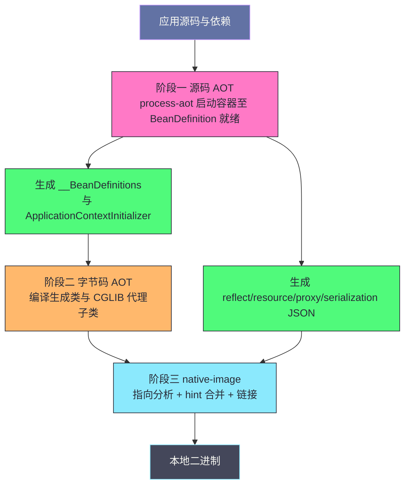
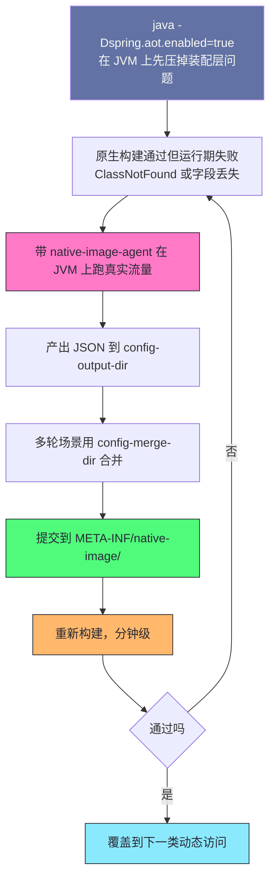
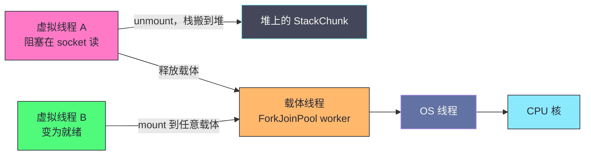
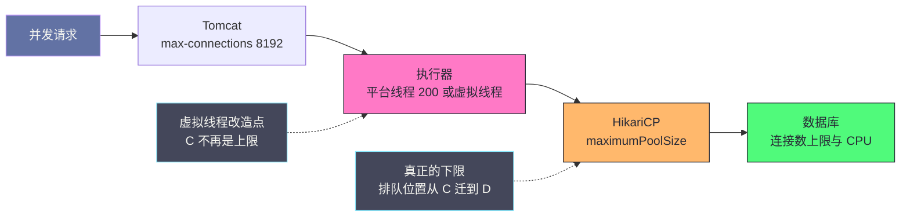
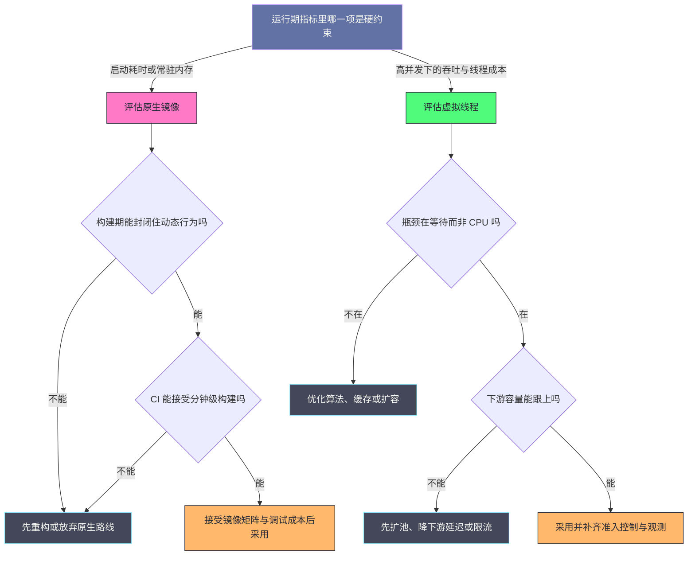

# 3.x新特性——GraalVM Native Image与虚拟线程

**摘要：**

Spring Boot 3.x 的两项新特性常被并列介绍，却很少被并列质疑：GraalVM Native Image 把应用编译成不依赖 JVM 的本地二进制，虚拟线程（Virtual Thread）把线程从操作系统资源变成堆上的廉价对象。它们真正的共同点，是都改写了运行时的某条契约——前者要求代码可达性在构建期封闭，后者要求阻塞行为可被调度器感知——并把维持这条契约的成本推给开发期与构建流水线。本文不打算罗列特性清单，而是逐项拆解这两条契约的边界：AOT 处理的三段结构为什么必须按那个顺序发生、反射与动态代理的声明为什么总会漏、profile 与条件装配在原生镜像里如何被静态化、缺少 JIT 的峰值吞吐代价有多大；虚拟线程一侧则拆解载体的并行度上限、pinning 的真实触发条件、ThreadLocal 在十万级并发下的内存放大、以及最容易被忽略的一件事——开了虚拟线程之后，过载时的排队位置会从 Tomcat 线程池迁移到连接池的超时等待上。读完本文，你应当能回答两个问题：这两项特性各自在什么条件下值得上，以及上了之后会失去什么。

---

## 第 1 章 两项特性在架构中的真实位置

### 1.1 一个订单服务的三种形态

为了让讨论有落点，笔者在全文使用同一个案例。一个电商订单服务（order-service）对外提供三个接口：`GET /orders/{id}` 查订单详情，内部要读订单主表、读明细表、再调支付网关查支付状态；`POST /orders` 创建订单，要扣库存、写订单、发一条领域事件；`GET /orders/{id}/timeline` 返回订单的流转时间线。业务代码是三年前写的，Spring Boot 2.7 起步，今年迁到了 3.x。

这份代码在三种部署形态下服役。第一种是常驻容器：Kubernetes 里跑六个副本，日均峰值 1200 QPS，P99 目标 200 毫秒，副本随流量在 4 到 12 之间伸缩。第二种是 Serverless：每天凌晨触发一次对账函数，把前一天的订单与支付流水比对，单次运行四五十秒，跑完即退。第三种是内部命令行工具 `orderctl`，运维和客服手工查单、补单，一天调用几十次。

三种形态对运行时指标的要求完全不同。常驻容器关心稳态吞吐、P99 与单副本内存，启动耗时只在滚动发布时出现一次；对账函数关心冷启动与按秒计费的执行时长；命令行工具关心"敲下回车到出结果"之间的等待。同一份代码落在三种形态上值得动用的手段完全不同，这正是本文把两项特性并列讨论的原因——它们都不是升级即得的收益，而需要先回答"运行期指标里究竟哪一项是瓶颈"。

### 1.2 两条被改写的契约

GraalVM Native Image 改写的契约是**代码可达性**。在 JVM 上，一个类只要在类路径里，运行期就能被 `Class.forName` 找到、被反射调用、被 CGLIB 生成子类；类路径是运行期的事实。原生镜像把这条事实换成构建期的事实：编译器从 `main` 出发做可达性分析，分析不到的方法被删除，运行期不能加载构建期不存在的类。Spring 官方文档称这条前提为封闭世界假设（Closed World Assumption），并列出两条额外限制：`@Profile` 有条件限制，"属性变化会决定 Bean 是否创建"的写法（譬如 `@ConditionalOnProperty` 与各种 `.enabled` 开关）不被支持。

虚拟线程改写的契约是**线程的成本结构**。平台线程是操作系统线程的一对一封装，创建、调度、栈内存都由内核参与，于是"每个请求一个线程"在并发上万时撞到资源上限。虚拟线程由 JVM 调度，阻塞时把栈搬到堆上、释放载体线程（Carrier Thread），"每个请求一个线程"的写法重新可用。这条契约的边界同样清晰：只有能被 JVM 感知的阻塞才能触发挂起。

| 对照维度 | GraalVM Native Image | 虚拟线程 |
| --- | --- | --- |
| 被改写的契约 | 代码可达性在构建期封闭，类路径不可变 | 线程与 OS 线程解耦，阻塞不再独占载体 |
| 复杂度落在谁身上 | 构建流水线、框架与三方库的 hint 提供者 | 应用开发者对阻塞语义与共享资源的审查 |
| 收益兑现的指标 | 启动耗时、常驻内存、镜像体积 | 高并发下的吞吐、线程内存、请求隔离性 |
| 典型失效条件 | 运行期才确定的动态行为、需要 Java Agent | 瓶颈在 CPU 或下游容量、存在大量 pinning |
| 回退成本 | 高（构建链路、镜像矩阵、调试手段都要改） | 低（一个配置项，且可灰度） |

最后一行值得停一下。虚拟线程的开关是一行配置，出问题立刻能关掉；原生镜像一旦进了交付链路，构建、测试、镜像、排障都要跟着改，回退时往往要重建一条 JVM 流水线。代价不对称决定了两者的决策方式不该相同：虚拟线程可以小范围试，原生镜像必须以项目为单位立项。

不妨打个比方。原生镜像是把家具在工厂里按图纸做死再运到现场，装好就能用，但户型一改就得返厂；虚拟线程是给现场施工队多配几个能同时盯多张工单的工长，图纸不用动，工长忙不过来就再加人。前者把适配性换成了交付速度，后者把调度能力换成了并发上限。

### 1.3 判据先行：先测瓶颈，再选特性

两项特性都在做同一笔交易：**用开发期的复杂度，换运行期的指标**。这笔交易是否划算，取决于两个前置事实。

其一，那个运行期指标是不是真的构成约束。启动耗时在滚动发布中只出现一次，如果发布窗口两端都是人工确认，省下两秒不会改变任何决策；但如果服务按毫秒计费、按冷启动次数收费，两秒就是账单上的数字。同理，单副本内存从 400MB 降到 120MB，只在节点内存紧、副本数多、或按内存规格计费时才有意义。

其二，约束的下游在哪。虚拟线程能把线程数从上限变成非上限，但如果请求的耗时八成花在一条没有被优化的 SQL 上，线程不再是瓶颈之后，瓶颈会原地不动地留在数据库。笔者见过几个团队在开完虚拟线程后发现吞吐只涨了一成，回头一查，`hikaricp.connections.pending` 从 0 变成长期几十，说明等待从线程池搬到了连接池。

判断顺序应当是：先量出当前上限由什么决定，再判断特性是否能改变那个决定因素，最后才是动手改配置或构建链路。跳过前两步的改造，结果通常是"指标没变、复杂度上升"。

### 1.4 版本口径

本文以 Spring Boot 3.x 为准，属性与类名对照 3.5 与当前主版本的官方文档，遇到随版本漂移的细节会标注"以所用版本源码为准"。几处硬口径先交代清楚。

Java 基线是 17，这是 3.x 与 2.x 最硬的差别之一，低于 17 无法启动。命名空间从 `javax.*` 迁到 `jakarta.*`（Jakarta EE 9 起，Boot 3.1 之后随 Tomcat 10.1 到 Servlet 6.0），这一变化与本文主题无直接关系，但它是所有 2.x 迁移方案的第一步。自动配置的注册方式从 `META-INF/spring.factories` 改为 `META-INF/spring/org.springframework.boot.autoconfigure.AutoConfiguration.imports`，细节见 [[02 自动装配原理——@EnableAutoConfiguration与spring.factories]]。

原生镜像支持从 3.0 起成为一等公民，2.x 时代依赖实验性的 spring-native 项目，两者不可同日而语。虚拟线程的开关 `spring.threads.virtual.enabled` 从 3.2 起提供，要求运行在支持虚拟线程的 JDK 上，也就是 21 及以上。虚拟线程本身在 JDK 21 由 JEP 444 转正；JDK 24 的 JEP 491 让 `synchronized` 里阻塞的虚拟线程也能卸载，这一条会直接改变第 6 章的结论；JDK 25 的 JEP 506 让 Scoped Values 转正。

GraalVM 一侧需要与 JDK 版本匹配的发行版，并安装 `native-image` 工具；构建通常通过 Buildpacks 在容器里完成，以免每位开发者本地装一套 GraalVM。

---

## 第 2 章 封闭世界假设：Native Image 到底改了什么

### 2.1 从运行期发现到构建期枚举

在 JVM 上，Spring 的装配是彻底的运行期行为。`ConfigurationClassParser` 解析配置类，`ConditionEvaluator` 求值条件注解，`ClassPathScanningCandidateComponentProvider` 扫描类路径下的候选组件，CGLIB 在第一次需要代理时才生成子类字节码。这一整套动作依赖同一个事实：运行期能看到完整的类路径，并且可以按需加载其中的任何类。

原生镜像拿掉的正是这个事实。GraalVM 的编译器从入口点出发做指向分析（points-to analysis），只有被判定可达的类型、方法、字段才进镜像。`Class.forName("com.example.order.Order")` 里的字符串在分析器眼里只是常量，没有类型可达性含义；`Method.invoke` 的目标方法若没有其他直接调用点，会被当作死代码删除。官方文档把推论写得很直白：构建期不可达的代码会被移除，应用类路径在构建期固定、运行期不可变。

Spring 的应对是把装配从运行期搬到构建期：在构建时启动一次容器到 BeanDefinition 就绪为止，把装配结果写成 Java 源码，交给 GraalVM 编译。代价随即落到应用代码上——**Bean 集合在构建期定型**。这不是一条实现细节，而是一条会改变运维方式的约束，第 4 章会专门展开它的后果。

### 2.2 四类需要提前声明的动态能力

封闭世界假设与 Java 的动态特性存在结构性冲突。把冲突按机制归类，需要声明的入口只有四类，加上一类特殊的字节码生成。

| 动态能力 | 依赖的机制 | 需要声明的 hint | 缺失时的典型症状 |
| --- | --- | --- | --- |
| 反射调用 | `Class.forName`、`Method.invoke`、`Field.set` | reflection hints，按 `MemberCategory` 精确到构造器、方法、字段 | `ClassNotFoundException`、`NoSuchMethodException`，或字段读到 null |
| JDK 动态代理 | `Proxy.newProxyInstance` | proxy hints，声明接口组合 | 代理创建失败，接口方法调用落到 `Object` 实现 |
| 资源读取 | `ClassLoader.getResource`、`getResourceAsStream` | resource hints，按路径或通配模式声明 | 模板、证书、i18n 文件、Mapper XML 返回 null |
| 序列化与绑定 | Jackson、`Serializable`、`@ConfigurationProperties` 绑定 | serialization hints 与 reflection hints | 反序列化字段静默丢失，或 `InvalidDefinitionException` |
| CGLIB 代理 | 运行期生成子类字节码 | 由 AOT 阶段提前生成代理类字节码 | `@Configuration` 的方法拦截失效，`@Bean` 被重复调用 |

第三行与第四行是最容易被低估的。资源类的失败形态不是抛异常而是返回 null，于是错误会推迟到"某个模板渲染出空白页"或"某个证书加载失败导致 TLS 握手报错"才暴露；序列化类的失败形态常常是字段有值但落库为 null，比抛异常更难查。CGLIB 那一行则解释了为什么 Spring 必须在 AOT 阶段生成代理子类：Boot 自己的自动配置类普遍写了 `@Configuration(proxyBeanMethods = false)` 以省掉拦截逻辑，但用户代码里的 `@Configuration` 默认仍需要方法拦截，这类子类只能在构建期生成并链接进镜像。

### 2.3 AOT 处理的三段结构

Spring Boot 的原生镜像构建不是"把 jar 丢给 native-image"这么一步。它分成三段，且顺序不可交换。



阶段一是源码 AOT。`process-aot` 目标会真正启动一次应用，但只启动到"BeanDefinition 都已注册"这个时点，官方文档的原话是这一阶段不创建 Bean 实例。容器跑起来之后，Spring 把每个配置类的 `@Bean` 方法翻译成代码：`MyConfiguration__BeanDefinitions` 里用 `RootBeanDefinition` 加上 `BeanInstanceSupplier` 表达"这个 Bean 应该由哪个方法产出"，同时生成一个 `ApplicationContextInitializer` 在真正启动时把这些定义灌进容器。产物落在 `target/spring-aot/main/sources`，hint 的 JSON 落在 `target/spring-aot/main/resources` 下的 `META-INF/native-image/{groupId}/{artifactId}/`。

阶段二是字节码 AOT。生成的源码要编译成 class，CGLIB 代理子类也要在这一阶段生成好，产物落在 `target/spring-aot/main/classes`。这一步的产物不便阅读，但可以用 `javap` 检查，排查"代理类没有生成"这类问题时有用地。

阶段三是 native-image。GraalVM 对整包字节码做指向分析，读取阶段一产出的 hint 文件，把可达代码链接成平台相关的可执行文件。

顺序之所以不可交换，原因在阶段一的语义：它需要一次真实的容器启动，因此需要一个可用的 `Environment`，包括激活的 profile、可解析的配置项、能被求值的条件注解。构建期已经把"应用在什么环境下装配"定下来了，这正是静态化问题的源头。

### 2.4 RuntimeHints：把动态需求写成代码

GraalVM 原生的声明方式是 JSON 文件，放在 `META-INF/native-image/` 下：

```json
[
  {
    "name": "com.example.order.Order",
    "allDeclaredConstructors": true,
    "allDeclaredMethods": true,
    "allDeclaredFields": true
  },
  {
    "name": "com.example.order.OrderRequest",
    "allDeclaredConstructors": true,
    "allPublicMethods": true
  }
]
```

JSON 的问题是它脱离类型系统：类改名、包调整、方法签名变化都不会在编译期报错，只会在一轮分钟级的构建之后以运行期异常的形式回来。Spring Framework 6 提供了 Java API，把这类声明变成可编译、可断言的代码：

```java
// RuntimeHints 的注册入口，Spring Framework 6 起提供
public class OrderRuntimeHints implements RuntimeHintsRegistrar {

    @Override
    public void registerHints(RuntimeHints hints, ClassLoader classLoader) {
        // 反射：按 MemberCategory 精确声明，比 allDeclaredMethods 更利于裁剪
        hints.reflection()
            .registerType(Order.class,
                MemberCategory.INVOKE_DECLARED_CONSTRUCTORS,
                MemberCategory.INVOKE_DECLARED_METHODS,
                MemberCategory.DECLARED_FIELDS)
            .registerType(OrderCreatedEvent.class,
                MemberCategory.INVOKE_PUBLIC_CONSTRUCTORS);

        // 资源：按通配模式声明，避免逐个文件列举
        hints.resources()
            .registerPattern("templates/order-*.html")
            .registerPattern("i18n/messages*.properties");

        // 动态代理：声明接口组合，而不是"允许生成代理"这种模糊授权
        hints.proxies().registerJdkProxy(OrderQueryFacade.class, Auditable.class);

        // 序列化：Java 原生序列化的类必须显式声明
        hints.serialization().registerType(OrderCreatedEvent.class);
    }
}

@Configuration
@ImportRuntimeHints(OrderRuntimeHints.class)
public class OrderNativeConfiguration {
}
```

绑定类还有一条更短的路径。`@RegisterReflectionForBinding` 直接标在配置类、任意 Bean 的类、构造器、字段或方法上，注册的是"用于数据绑定与反射式序列化"所需的那一组提示——构造器、字段、属性、record 组件，以及属性类型上递归用到的类型：

```java
@Configuration
@RegisterReflectionForBinding({Order.class, OrderRequest.class, OrderCreatedEvent.class})
public class OrderBindingConfiguration {
}
```

两处的取舍很清楚：`@RegisterReflectionForBinding` 适合数据绑定这条主路径；`RuntimeHintsRegistrar` 适合需要精确控制 `MemberCategory`、资源模式与代理接口组合的场合，它还能被单元测试断言，把问题压到毫秒级测试里。

### 2.5 AOT 到底生成了哪些资产

理解产物清单，比记住注解更有用。排查原生镜像问题时，第一件事往往不是读代码，而是确认某类产物有没有生成。

| 产物 | 典型位置（Maven） | 作用 | 缺失或错误时的表现 |
| --- | --- | --- | --- |
| `Xxx__BeanDefinitions` 等生成类 | `target/spring-aot/main/sources` | 以代码形式表达 BeanDefinition 与依赖注入点，绕开注解解析 | 启动时 `NoSuchBeanDefinitionException`，或注入为 null |
| `ApplicationContextInitializer` | 同上 | 启动时装载上述定义，替代运行期的解析与扫描 | 容器启动但 Bean 集合与预期不符 |
| CGLIB 代理子类字节码 | `target/spring-aot/main/classes` | 替代运行期的动态子类生成 | `@Configuration` 方法拦截失效，Bean 被重复创建 |
| `reflect-config.json`、`proxy-config.json`、`resource-config.json`、`serialization-config.json`、`jni-config.json` | `target/spring-aot/main/resources/META-INF/native-image/...` | 交给 GraalVM 的声明 | 对应动态能力在运行期失效 |
| `native-image.properties` | 同上 | 向 native-image 传参，包括类初始化策略 | 静态初始化时机不对，构建期或运行期行为偏移 |

最后一行是很多诡异问题的来源。原生镜像允许把某些类的静态初始化提前到构建期执行，框架层大量使用了这个机制来缩短启动时间；一旦某个应用类也被卷进构建期初始化，它的 `<clinit>` 就会在构建机上跑一遍，第 4.3 节展开。

### 2.6 用 JVM 跑 AOT：把分钟级循环压成秒级

`native-image` 编译动辄几分钟，如果每次验证 hint 都要走一遍完整构建，迭代效率会低到无法接受。Spring Boot 提供了一条中间路径：给普通 jar 加上 `-Dspring.aot.enabled=true`，应用就改走 AOT 生成的初始化代码，而不进入原生编译。

```bash
# 先用 native profile 打包，让 jar 里带上 AOT 产物
mvn -Pnative -DskipTests package

# 再以 AOT 模式在 JVM 上启动，几秒内就能验证装配路径
java -Dspring.aot.enabled=true -jar target/order-service.jar
```

这条路径能抓出装配层面的错误：条件求值不符预期、生成的初始化器缺失、`@Profile` 分支走错。它抓不出 GraalVM 指向分析阶段的错误，比如某个反射调用虽已声明但类型仍被判为不可达。两层验证都需要，先用 JVM 层压掉大部分问题，再用原生构建验证剩下的部分。

官方对测试的建议同取向：绝大多数测试留在 JVM，原生测试只覆盖"最可能与 JVM 不同"的部分；需要深度验证时，`process-test-aot` 配合 `native-maven-plugin` 的 `test` goal 能把测试编进镜像执行，更适合每日一次的流水线。

### 2.7 两条构建路径

落到工程上，原生构建有两条路：本地装 GraalVM 直接编译，或者把工具链交给 Buildpacks 在容器里跑。

```xml
<plugin>
    <groupId>org.springframework.boot</groupId>
    <artifactId>spring-boot-maven-plugin</artifactId>
    <configuration>
        <image>
            <!-- 用 Buildpacks 在容器里构建，避免每位开发者本地装一套 GraalVM -->
            <builder>paketobuildpacks/builder-jammy-tiny</builder>
            <env>
                <BP_NATIVE_IMAGE>true</BP_NATIVE_IMAGE>
            </env>
        </image>
    </configuration>
</plugin>

<plugin>
    <groupId>org.graalvm.buildtools</groupId>
    <artifactId>native-maven-plugin</artifactId>
    <executions>
        <!-- 绑到 package，保证产物与 native 构建用的是同一份 AOT 结果 -->
        <execution>
            <id>build-native</id>
            <goals><goal>compile-no-fork</goal></goals>
            <phase>package</phase>
        </execution>
        <!-- 把测试编进镜像执行，适合放到每日流水线 -->
        <execution>
            <id>test-native</id>
            <goals><goal>test</goal></goals>
            <phase>test</phase>
        </execution>
    </executions>
</plugin>
```

```bash
# 路径一：本地装了与 JDK 匹配的 GraalVM，直接编译
./mvnw -Pnative native:compile

# 路径二：交给 Buildpacks 在容器里构建，CI 上更常见
./mvnw -Pnative spring-boot:build-image
```

两条路的差别在工具链放在哪：本地编译要求 JDK 与 GraalVM 版本严格匹配，失败信息更直接；Buildpacks 一致性更好，但日志埋在 Buildpack 的层里，排错要多跳一层。`-Pnative` 由 `spring-boot-starter-parent` 定义，不用父 POM 就得自己补 `process-aot` 与插件的绑定。

---

## 第 3 章 Native Image 的收益：量级与前提

### 3.1 启动时间省掉的是哪几段

JVM 上的一次启动可以切成三段。类加载与校验，几千个类按需加载、解析、验证，占去数百毫秒到数秒；容器刷新，扫描、条件求值、定义注册、单例创建，Boot 应用通常在数百毫秒到数秒；JIT 预热，从解释执行到 C1 再到 C2，热点代码被逐层优化，这段不计入"启动完成"，却影响启动后头几十秒的吞吐。

原生镜像对这三段的处理各不相同。类加载几乎没有成本，但原因反直觉：官方文档写的是原生镜像没有懒加载，可执行文件里的内容在启动时全部加载进内存——加载动作在构建期做完了，运行期只是把镜像映射进来。容器刷新仍在，但解析与条件求值被移走，剩下的只是按生成代码创建单例。JIT 预热整段消失，代码在构建期就已经是机器码。

| 启动阶段 | JVM 上发生什么 | 原生镜像上发生什么 | 量级判断 |
| --- | --- | --- | --- |
| 类加载与校验 | 数千类按需加载、解析、验证 | 构建期已解析，运行期映射 | 从数百毫秒级降到十毫秒级 |
| 容器刷新 | 扫描、条件求值、定义注册、单例创建 | 生成代码直接注册，仅创建单例 | 从秒级降到数百毫秒级 |
| JIT 预热 | 解释执行、C1、C2 逐层优化 | 不存在 | 预热曲线消失，峰值也一并消失 |

上表是量级判断，取自官方文档与公开案例的普遍区间，不是笔者实测。倍数强依赖应用规模、依赖数量与启动时初始化的资源，只做 CRUD 的小服务与加载十几套中间件客户端的服务可以差一个数量级。

### 3.2 内存：RSS 下降，堆不一定

常被引用的"内存占用降低"通常指常驻集（RSS），下降来自三块：HotSpot 的运行时结构、线程栈与代码缓存；JIT 编译器及其产出的代码；类元数据（Metaspace），原生镜像把它以更紧凑的形式编进可执行文件。

堆本身不一定下降，一个持有十万条缓存的 Map 在两种形态下占的堆差不多。原生镜像同样要显式指定堆上限，其默认值按可用内存比例推算且比例与 HotSpot 不同；容器里不给上限，内存紧的节点容易被内核 OOM kill，而 HotSpot 下同样负载可能只是 GC 压力大。

真正的收益要放在横向扩展的尺度上看：单副本 RSS 从数百 MB 降到几十 MB 量级时，同一批节点能塞下的副本数会成倍增加。这个收益只在副本数足够多、节点足够紧时显著——六个副本省下的内存不够买一台机器，六百个副本省下的就是一笔预算。

### 3.3 镜像体积：一个被高估的收益

原生镜像常被宣传为"体积更小"，实际结果高度依赖依赖树。

| 镜像构成 | JVM 镜像 | 原生镜像 |
| --- | --- | --- |
| 基础层 | 含 JRE 的基础镜像，几十到上百 MB | 可退回最小基础镜像甚至 scratch，几 MB |
| 应用层 | 应用 jar 与全部依赖 jar，几十 MB 起 | 已链接的机器码、内嵌资源与元数据，几十到上百 MB |
| 总体量级 | 通常在数百 MB 量级 | 可能更小，也可能相当甚至更大 |

原因不难理解：JVM 镜像里放的是字节码与依赖 jar，压缩率高；原生镜像里放的是展开后的机器码与元数据，压缩率低得多。依赖少的服务通常能看到体积收益，依赖沉重的服务经常出现"原生镜像并不比 JVM 镜像小"的情况，拿真实依赖树构建一次再决策。

### 3.4 收益兑现的四个场景

**Serverless 与 FaaS**。冷启动直接进入计费与超时判定，启动从秒级降到百毫秒级会改变可行性——很多框架的启动时间本身就超过了函数的超时设置，使得 Java 在 FaaS 上长期不可用。这个场景的收益最确定。

**命令行工具**。用户对命令行的等待容忍度以百毫秒计，而 JVM 启动本身就要几百毫秒。把 `orderctl` 编成原生二进制后，`orderctl get 12345` 的响应从"能看到 JVM 启动日志"变成"立刻出结果"，这是体验层面的质变，而不是指标层面的百分点。

**短生命周期批处理**。对账函数跑四五十秒就退出，JIT 在这个时长里刚把热点方法编译好，收益还没兑现就要退出了。启动快、没有预热期，对这类任务是净收益；同时因为没有长时间运行，缺少 JIT 带来的峰值吞吐损失也就不重要了。

**弹性扩缩容中的就绪时间**。HPA 依据指标扩容，新 Pod 从创建到通过就绪探针的时间决定扩容的有效性。启动从五秒降到半秒，在流量尖峰上就多出一段可用容量；收益不体现在单机指标，而体现在"尖峰期间是否有请求被拒绝"。

四个场景有一个共同点：**运行时间短、启动占比高、或者启动次数频繁**。反过来，运行时间长、启动只出现一次的服务，从原生镜像里拿不到这几项收益，却要承担第 4 章的全部代价。

---

## 第 4 章 Native Image 的代价

### 4.1 构建时间与 CI 拓扑

原生构建的耗时分布很不均匀，需要按阶段理解。

| 阶段 | 量级判断 | 说明 |
| --- | --- | --- |
| `process-aot` | 数秒到十几秒 | 本质上是一次容器启动，与 JVM 启动同阶 |
| 生成源码编译 | 数秒 | 生成的类数量与 Bean 数量正相关 |
| `native-image` 分析 | 数十秒到数分钟 | 指向分析与可达性计算，与类数量正相关 |
| `native-image` 编译与链接 | 数分钟到十几分钟 | 与依赖数量、优化级别正相关，冷缓存更久 |
| 镜像打包与推送 | 十几秒到分钟级 | 层体积大时明显 |

单模块应用在 CI 上通常是分钟级，依赖多的应用十几分钟并不罕见。这个量级对提交频率高的团队意味着三件事。

其一，流水线要拆。PR 流水线继续跑 JVM 侧的测试，原生构建拆成独立流水线，由 tag 或每日定时触发。把原生构建塞进每次提交，等于把团队的反馈周期拉长一个数量级。

其二，Runner 规格要上调。`native-image` 自身需要数 GB 堆，并会吃满多个核，内存不足时的失败形态是构建进程被 OOM kill，日志里只有一行被截断的退出码，很容易被误判为代码问题。

其三，缓存策略要重做。原生构建对依赖层的缓存敏感，容器化构建时把 Maven 本地仓库与 GraalVM 工具链分层缓存，能把耗时压掉一部分；但没有哪一层缓存能消掉指向分析本身的计算量。

### 4.2 profile 的静态化

这是原生镜像代价里最容易被低估的一条。profile 在 Spring 里是通过条件实现的，而条件在构建期就被求值，于是"运行期改 profile 就能改装配"这件事在原生镜像里不再成立；profile 与配置源加载顺序本身另有一套规则，见 [[05 配置体系——application.yml、Profile与配置优先级]]。

Spring Boot 的 how-to 文档给了官方口径：条件在构建期按环境求值，profile 也因此受影响；如果希望基于条件的 Bean 出现在 AOT 优化后的应用里，必须在构建时把环境准备好——Maven 下通过 `spring-boot-maven-plugin` 的 `process-aot` 执行配置 `<profiles>`，Gradle 下通过 `ProcessAot` 任务追加 `--spring.profiles.active`。文档同时指出，只影响属性值、不影响条件求值的 profile 不受这条限制。

把这条约束展开成行为矩阵，比读文档更直观。

| 运行期行为 | JVM 模式 | 原生镜像模式 |
| --- | --- | --- |
| 切换只改变属性值的 profile | 生效 | 生效，属性照常被读取 |
| 用 profile 决定某组 Bean 是否创建 | 生效 | 不生效，Bean 集合已在构建期定型 |
| 用 `@ConditionalOnProperty` 开关某项功能 | 生效 | 不生效，条件已在构建期求值 |
| 运行期关闭某个 `.enabled` 开关 | 生效，Bean 不再创建 | 装配不变，仅属性值变化 |

第四行是最危险的形态。属性还在被读，注解看起来还在，但装配结果不再跟随它——开关"看起来生效了"，因为读到该属性的业务代码确实走了另一个分支，可相关 Bean 依然存在，于是出现"功能关掉了但资源还在初始化"这类半生效状态，排查成本极高，因为两边都有日志。

处置方式只有两条路。第一条是环境与二进制一一对应：每个环境构建自己的镜像，构建参数里写死 profile 组合，镜像不可跨环境复用，代价是镜像矩阵随环境数线性膨胀。第二条是把环境差异降级为"只影响属性值"的配置：不依赖 profile 决定 Bean 是否存在，把开关逻辑收进 Bean 内部判断。第二条要求重构，但没有镜像矩阵的代价，多数团队最终选它。

### 4.3 静态初始化把构建机的值焊进二进制

上一节讲的是装配的静态化，这一节讲的是初始化的静态化，两者常被混在一起，失效形态却完全不同。

原生镜像允许把类初始化提前到构建期执行，框架层大量使用了这个能力来缩短启动时间，`native-image.properties` 里会声明一批需要在构建期初始化的包。一旦某个应用类被卷入构建期初始化，它的静态初始化块就会在构建机上跑一遍，跑出来的结果被写进镜像。

于是下面这些写法会出问题：在 `<clinit>` 里读环境变量或系统属性来决定行为，在 `<clinit>` 里读文件、建连接池、注册 JVM 关闭钩子，在 `<clinit>` 里取当前时间或随机数做种子，在 `<clinit>` 里根据 DNS 结果决定下游地址。构建机上的值与生产环境的值不同，而镜像只有一个。

失效形态通常很隐蔽：连接池在构建期就建好连接（构建机连不到生产库，失败被吞掉或地址被固化），随机数种子被固定（所有副本的随机序列相同），时间戳被冻结（版本号显示成构建日）。抓手是 `-H:+PrintClassInitialization` 一类选项（具体名称以所用 GraalVM 版本为准），它会把每个类的初始化时机打出来。

处置手段是把这类逻辑从静态初始化挪到 Bean 的初始化方法里，或者显式声明某个类必须在运行期初始化。这是一个一次性的排查成本，但新建的类会不断引入同类问题，因此需要一个团队级约定：**静态初始化块里只做常量赋值，不做任何 I/O 与随机**。

### 4.4 调试：堆栈信息与 hint 的采集循环

原生镜像的排障体验与 JVM 差距明显，主要体现在两处。

第一处是堆栈。行号信息依赖调试符号，默认构建可能不包含，需要 `-g` 或对应的源码级调试选项；内联之后的部分帧会整体消失，异常栈形态与 JVM 上不同；某些异常信息被裁剪，譬如空指针异常在 JVM 上有 helpful NPE 的详细信息，原生镜像里可能只有类型与位置。工具链的接入同样受限：JFR、堆转储、CPU 采样的可用性取决于 GraalVM 版本与构建参数，Java Agent 这类基于字节码注入的手段基本不可用。

hint 的采集是一个循环。正确的用法不是在构建失败后一处一处加声明，而是在 JVM 上跑一遍真实流量，让 `native-image-agent` 记录所有动态访问，再合并、提交、重建。



循环的成本在于每轮分钟级，且"跑真实流量"要求一套能产生完整调用路径的环境——只在管理端触发的导出功能若没被覆盖，hint 就采不到。可维护的做法是把 agent 采集放进集成测试，让 hint 成为 CI 的常规产物。

### 4.5 峰值吞吐：没有 JIT 的运行期

JVM 的性能模型是"预热换峰值"：前几十秒到几分钟解释执行并收集剖面，之后由 C2 依据真实的分支概率、调用频率、类型分布做激进内联与去虚拟化。原生镜像是"无预热也无峰值"：代码在构建期确定，优化依据是静态分析的结果。

静态分析有它的优势：指向分析能在编译期确定某个虚调用只有一个实现，因而可以完全去虚拟化，这类信息 JIT 只能靠运行期剖面猜。但对整体服务而言，缺少运行期剖面通常意味着稳态吞吐更低，尤其在多态调用多、反射多的代码里。

GraalVM 提供了 PGO（profile-guided optimization）来补这一块：先用插桩构建跑一轮代表性流量，采出剖面，再据此构建正式镜像。它能把差距收窄相当一部分，代价是构建链路多出一轮"训练构建"，且剖面的代表性直接决定效果——用测试流量训练出来的镜像，在生产流量下可能不如预期。

把这一点落到决策上：如果服务的运行时间以天计、CPU 是主要成本项、吞吐是核心 SLA，原生镜像就是拿最值钱的指标换最不值钱的指标。跑了三十天的服务，前三十秒的启动成本被摊薄到可以忽略，此后每天都为缺少 JIT 付账；反过来，每天执行几百次、每次几十秒的定时任务，JIT 的账几乎没机会产生收益。

### 4.6 生态边界：这些库上不了车

| 类别 | 在原生镜像中的状态 | 影响面 |
| --- | --- | --- |
| Java Agent（字节码注入） | 与静态编译模型不兼容 | APM 探针、部分分布式追踪、mock 框架、热部署 |
| 运行期 CGLIB / ByteBuddy 生成 | 不可用，需改由 AOT 或构建期生成 | 大量 AOP 框架、ORM 的延迟代理、Mock 工具 |
| 动态类加载与热插件 | 不可用，类路径构建期固定 | 插件化架构、脚本引擎动态加载的类 |
| JNI 与本地库 | 需 `jni-config.json`，本地库要一并链接 | 加密卡、老式数据库驱动、图像处理库 |
| JMX | 原生镜像不提供 JMX 支持 | Actuator 的 JMX 暴露方式要改为 HTTP |
| GC 与诊断参数 | SubstrateVM 只提供 HotSpot 的子集 | 依赖特定 GC 参数调优的服务、依赖诊断工具链的排障流程 |

第二行的覆盖面比想象中大。很多团队引入 APM 的方式是挂 Java Agent，而 Agent 的工作原理是在类加载时改写字节码——原生镜像没有类加载这回事。少数厂商提供了在构建期织入的替代方案，但监控能力与 JVM 形态不完全对等。这类"非功能性能力的降级"很少写进选型评估，却往往在事故现场才被发现。

第五行值得单独提一句：如果现有运维流程依赖 JMX 抓取（不少传统企业的监控体系确实如此），原生镜像会直接把这条路切断，需要先把 Actuator 的暴露方式迁到 HTTP，见 [[07 Actuator——健康检查、指标暴露与自定义端点]]。

### 4.7 判据：什么场景值得

| 场景 | 判断 | 理由 |
| --- | --- | --- |
| FaaS、Serverless 函数 | 值得 | 冷启动进入计费与超时判定，是可行性的前提 |
| 命令行工具、一次性作业 | 值得 | 启动占比接近百分之百，无稳态可言 |
| 每日/每小时触发的批处理 | 值得 | 运行时长有限，JIT 收益兑现不了 |
| 弹性扩缩容频繁的在线服务 | 视情况 | 就绪时间影响扩容有效性，需同时接受构建与调试代价 |
| 长跑、高吞吐的在线服务 | 通常不值得 | 稳态吞吐是核心指标，JIT 的价值最高 |
| 依赖大量运行期动态行为的服务 | 不值得 | hint 维护成本会持续侵蚀收益 |
| 依赖 Java Agent 做可观测的服务 | 需先解决替代方案 | 监控降级的代价常被低估 |
| 多环境差异化装配的服务 | 需先重构 | profile 静态化会逼迫镜像矩阵或配置重构 |

这张表最后两行是笔者最想让读者停下来看的两行。前六行是技术判断，后两行是组织成本：一个团队能否维护 hint、能否接受每个环境一个二进制、能否在缺少常用调试手段的条件下排障，这些问题的答案比"启动快了多少"更能决定项目成败。

---

## 第 5 章 虚拟线程：线程的成本结构被改写

### 5.1 平台线程的成本账

先把账算清楚，才知道虚拟线程省了什么、没省什么。

订单查询接口的一次处理大致这样分布：接收与解析 HTTP 请求约 5 毫秒，等待两次数据库查询合计约 60 毫秒，等待支付网关约 30 毫秒，序列化与写响应约 5 毫秒。100 毫秒里有 90 毫秒在等，真正占 CPU 的只有 10 毫秒。

平台线程的浪费就发生在这 90 毫秒里。线程在整个等待期间占着一个操作系统线程：栈内存（`-Xss` 在 Linux x64 上默认 1MB 上下，按需提交但地址空间要预留）、内核调度器的数据结构、微秒级的上下文切换，以及最关键的有限性——8GB 内存的机器能撑住的线程数是千级到万级，具体受 `ulimit`、`threads-max`、cgroup 限制。

于是有了线程池这个折中：池大了浪费内存与切换开销，池小了排队。响应式是另一条路——少量线程加回调，把等待变成事件，代价是编程模型被颠倒，`Mono`/`Flux` 的组合、错误传播、与阻塞 API 的边界、栈追踪的可读性都要重建，细节见 [[13 CompletableFuture 与异步编程模型——从 Future 到响应式]]。

虚拟线程的意义在于它不要求改编程模型。同样那段阻塞代码，在虚拟线程上运行时，等待期间载体线程被释放去做别的事情。

### 5.2 调度模型：载体、挂载与栈的搬迁



机制要点有四条。载体线程来自一个专用的 `ForkJoinPool`，并行度默认等于 CPU 核数。虚拟线程遇到可被感知的阻塞时，JVM 把它的栈从载体上搬走，以 chunk 的形式挂在堆上，载体随即被调度去跑下一个虚拟线程。恢复时它被挂载到任意空闲载体上，不保证是原来那个。因此**阻塞的成本从"占一个 OS 线程"变成"占一段堆内存"**，线程数不再受内核结构限制。

"可被感知"这四个字是全部边界的来源。`Socket`、`ServerSocket`、`Selector`、`HttpClient`、`ReentrantLock`、`Semaphore`、`CountDownLatch`、`park` 这些 JDK 自己的阻塞点都被改造过；`Object.wait` 与 `synchronized` 在 JDK 24 之前不被改造，因此会阻碍卸载；JNI 调用里的阻塞天然不可感知，因为 JVM 无法插手本地代码。

### 5.3 Boot 3.2 的一行配置替换了谁

```yaml
spring:
  threads:
    virtual:
      enabled: true
```

这一行配置在 3.2 起生效，它的作用是让 Boot 的自动配置按 `Threading.VIRTUAL` 分支装配一批执行器。理解它"替换了谁"比理解这一行本身更重要，因为没被替换的部分才是事故来源。

容器侧，Boot 3.2 引入 `TomcatVirtualThreadsWebServerFactoryCustomizer`，把 Tomcat 协议处理器的执行器换成虚拟线程实现；Jetty 有对应定制器。任务执行侧，`TaskExecutionAutoConfiguration` 在 `@ConditionalOnThreading(Threading.VIRTUAL)` 条件下给出启用虚拟线程的 `SimpleAsyncTaskExecutor`，调度侧由 `TaskSchedulingConfigurations` 给出对应变体。类名与归属包在小版本间有过调整，以所用版本源码为准。

| 执行器 | 开关后是否走虚拟线程 | 说明 |
| --- | --- | --- |
| Tomcat 请求处理 | 是 | 每个请求一个虚拟线程，`server.tomcat.threads.max` 失效 |
| Jetty 请求处理 | 是 | 由对应的定制器完成替换 |
| Undertow 请求处理 | 否 | 没有对应定制器，换容器会丢掉这项收益 |
| `@Async` 默认执行器 | 是 | 前提是没有自定义 `TaskExecutor` 或 `AsyncConfigurer` |
| `@Scheduled` | 是 | 前提是没有自定义 `TaskScheduler` |
| `ForkJoinPool.commonPool` | 否 | 并行流、`CompletableFuture` 的默认执行器仍是平台线程 |
| 自建的 `newFixedThreadPool` | 否 | 需显式改用 `newVirtualThreadPerTaskExecutor` |
| 数据库、HTTP 客户端连接池 | 不适用 | 池的对象是连接，不是线程 |
| WebFlux 的 Netty 事件循环 | 否 | 反应式模型不需要，也没有意义 |

第一行有一个容易被忽略的连带效果：`server.tomcat.threads.max` 不再起作用（连接器各参数的相互影响见 [[04 嵌入式Web容器——Tomcat、Jetty、Undertow的启动与配置]]），它的默认值 200 曾经是一道天然的准入控制，现在这道闸门消失了。闸门并没有消失，只是换了位置——`server.tomcat.max-connections`（默认 8192）仍在，连接池的容量仍在，下游数据库的容量仍在。第 6.3 节会展开这场迁移。

第六行是另一个高频误解。团队开了虚拟线程，发现并行流里的任务仍然跑在平台线程上，于是怀疑配置没生效。实际上 `commonPool` 与 Boot 的开关无关，它由 JDK 自己管理；需要用虚拟线程时，把任务提交给 `newVirtualThreadPerTaskExecutor()` 返回的执行器，而不是依赖 `parallelStream`。

### 5.4 JDK 侧的三条入口

Boot 的配置只是把执行器换掉，直接用 JDK API 时有三条入口。

```java
// 入口一：单个虚拟线程，适合演示与一次性任务
Thread vt = Thread.ofVirtual().name("order-vt-", 0).start(() -> handle(order));

// 入口二：每个任务一个虚拟线程的执行器，适合把现有线程池替换掉
try (ExecutorService executor = Executors.newVirtualThreadPerTaskExecutor()) {
    Future<Order> f = executor.submit(() -> loadOrder(orderId));
}

// 入口三：线程工厂，交给需要 ThreadFactory 的既有组件
ThreadFactory factory = Thread.ofVirtual().name("order-worker-", 0).factory();
```

三条入口的语义都是"每个任务一个新线程"，没有池化语义。这是刻意的设计：虚拟线程足够便宜，池化只会引入复用带来的状态残留问题。需要限制并发的场合（保护下游、控制内存），应当用信号量而不是线程池——这个区别是第 6 章和第 7 章的支点。

`Thread.ofVirtual()` 的调度器由 JVM 内建，没有公开的替换接口；结构化并发（`StructuredTaskScope`）在 JDK 21 以预览引入（JEP 453），到 JDK 25 仍是预览（JEP 505）。Continuation 与调度器实现见 [[16 JDK 21 虚拟线程——Project Loom 的协程实现与平台线程的边界]]。

---

## 第 6 章 虚拟线程的代价与陷阱

### 6.1 pinning：什么时候虚拟线程会被钉住

机制并不复杂：虚拟线程要卸载，必须能安全地把执行状态从载体上搬走。持有监视器（monitor）时，栈上带着锁的归属信息，JVM 在 JDK 21 到 23 的实现里不允许在这种状态下搬栈，于是虚拟线程虽然进入阻塞，载体却不能释放——载体被"钉住"（pinning）。

触发条件有四类。在 `synchronized` 块或方法内阻塞；在进入 `synchronized` 的等待队列上阻塞；调用 `Object.wait()`（JDK 24 之前同样会钉住）；执行 JNI 本地方法并在其中阻塞。第五类是按需的类初始化，某个类正在执行 `<clinit>` 时，其他线程阻塞在它上面同样会钉住。

```java
// 会钉住：持锁期间的每一次阻塞都让载体陪着一起等
public synchronized void settle(Order order) {
    orderRepository.save(order);          // 阻塞，载体被钉住
    paymentClient.confirm(order);         // 同上
}

// 不会钉住：ReentrantLock 的等待是可感知的
private final ReentrantLock lock = new ReentrantLock();

public void settle(Order order) {
    lock.lock();
    try {
        orderRepository.save(order);
        paymentClient.confirm(order);
    } finally {
        lock.unlock();
    }
}
```

需要纠正一个常见的过度反应：并不是"代码里有 `synchronized` 就有问题"。锁内不阻塞、临界区够短、竞争不激烈的场合，pinning 的影响可以忽略。真正的成本来自"持锁 + 阻塞"的组合与高并发下的锁竞争——后者会让大量虚拟线程阻塞在 monitor 入口，每个都钉住一个载体，而载体并行度只有 CPU 核数量级，几个热点锁就能把并发能力打回平台线程时代。

检测手段有两个。JVM 参数 `-Djdk.tracePinnedThreads=full` 在发生 pinning 时打印栈，栈里带 `monitors:1` 之类的标记，能直接指出是哪个监视器；JFR 的 `jdk.VirtualThreadPinned` 事件适合在生产采样，把 pinning 的频次与时长量化。JDK 24 之后这两条手段仍在，但报告量会大幅下降。

处置顺序建议先升级 JDK。JEP 491 在 JDK 24 让虚拟线程在持有监视器时也能卸载，覆盖了绝大多数场景，剩下的是 JNI 与类初始化这两类结构性限制。升级不可行再改代码：把热点路径的 `synchronized` 换成 `ReentrantLock`，缩小临界区，把阻塞调用移出锁外。

### 6.2 ThreadLocal 的内存放大

虚拟线程让"线程复用"这个问题消失了：每个任务一个新线程，请求之间不会共享 `ThreadLocal` 的内容，因此不会出现"上一个请求的用户身份残留到下一个请求"这类经典事故。但换来了一个新问题。

每一个虚拟线程都有自己的 `ThreadLocalMap`，生命周期与该线程相同。如果每个请求在 `ThreadLocal` 里挂一个 1KB 量级的上下文对象，十万并发就是 100MB 量级（示例推算）。这条线上挂着的都是框架级的东西：MDC 的日志上下文、SecurityContext、`RequestContextHolder`、`TransactionSynchronizationManager`。

平台线程时代这些对象只有"线程池大小"份，现在变成"并发数"份。并发数上去了，内存也跟着上去，而很多人正是因为并发上不去才开虚拟线程，两件事叠加会撞在一起。

替代方案是 Scoped Values（JDK 25 由 JEP 506 转正，JDK 21 只是预览）。它把"每个线程一份可变副本"换成"在作用域内绑定的不可变值"，空间与时间成本都更低，值随作用域进出而生效、不会残留。但 MDC、SecurityContext 这些框架级上下文还没全部切过去，现实处置是先量化：用堆直方图确认 `ThreadLocalMap` 与上下文对象的占比，再决定是否迁移。

还有一处要留意：`ThreadLocal` 的清理时机从"线程复用前"变成"线程结束时"，把对象存活期绑到了请求的完整生命周期上。请求先往 `ThreadLocal` 里放 10MB 临时对象，再走一段长耗时的下游调用，这 10MB 就一直活着，表现为"内存像泄漏，其实是存活期被拉长"。

### 6.3 连接池配比：过载时的排队位置迁移

这是实践中最容易踩、也最容易验证的一条。



平台线程下，队列在 C 这一层：线程池满了，请求在 Tomcat 队列里排队，超过队列长度后被拒绝或超时。虚拟线程下 C 不再是上限，请求全被接住然后一起涌向 D，在 HikariCP 上等连接；默认 `connectionTimeout` 是 30 秒，过载的表现就从"快速失败"变成"每个请求等 30 秒后抛连接超时异常"，服务看起来还活着，实际已在雪崩。

配比怎么定，用利特尔法则（Little's Law）推一遍就清楚。假设目标吞吐 1000 req/s，单请求占用连接 40 毫秒，则同时在飞的连接数是 1000 × 0.04 = 40 个。池配到 100 不会让吞吐变高，只会让数据库承受更多并发查询与更差的 P99；配到 20，数据库这一段的上限就是 500 req/s，虚拟线程再多也没用。

| 参数 | 平台线程下 | 虚拟线程下 | 说明 |
| --- | --- | --- | --- |
| 并发上限的主要来源 | 线程池大小，默认 200 | 连接数、下游容量、内存 | 线程不再是限制 |
| 过载时的排队位置 | Tomcat 队列与拒绝策略 | HikariCP 的 `connectionTimeout` 等待 | 后者更隐蔽 |
| 过载的表现 | 快速 503、连接被拒 | 大量请求等满超时后抛异常 | 排障时容易误判为数据库慢 |
| 需要的准入控制 | 线程池大小天然限流 | 显式信号量、Bulkhead、限制 `max-connections` | 闸门要自己造 |
| 关键观测指标 | `tomcat.threads.busy` 与 `config.max` | `hikaricp.connections.pending` | 判断瓶颈位置的最短路径 |

最后一行是本文最实用的一条判据。改造之前先看 `tomcat.threads.busy` 是否长期贴着 `config.max`，是则线程确实是瓶颈；改造之后盯 `hikaricp.connections.pending`，它从 0 变成持续数十，说明瓶颈只是搬了家。两个指标都能从 Actuator 的 Micrometer 端点取到，不需要额外埋点。

配比建议：连接池大小按"目标吞吐 × 单次占用时长"推算，再加上一点余量，然后以数据库自身的连接上限与 CPU 为硬顶。切忌因为"虚拟线程能开百万个"就把池子放大——那等于把并发压力原样转嫁给数据库。

### 6.4 CPU 密集场景没有收益

载体线程的并行度由 CPU 核数决定，这是硬件事实，虚拟线程不改变它。CPU 密集的任务在虚拟线程上跑，收益为零，还多出两笔开销：调度上的 mount/unmount 成本，以及 `ThreadLocal` 等方式带来的额外内存分配。

判断方式很直接：看 CPU 利用率。如果服务在压测中 CPU 长期在 70% 以上，且请求耗时里等待占比很低，那么虚拟线程帮不上忙，应该做的是算法优化、批量合并、缓存，或者横向扩容。反过来，如果 CPU 利用率上不去而线程池已经顶满，那才是虚拟线程的战场。

### 6.5 可观测性的退化

虚拟线程对监控体系的冲击常被忽略，但它会直接影响事故处置速度。

日志里的线程名失去意义。平台线程时代，`%thread` 里的 `http-nio-8080-exec-12` 能告诉你请求落在哪个工作线程上，配合线程池指标能推断排队情况。虚拟线程的名字通常是业务自定义的前缀加序号，序号与请求顺序无关，也看不出池化语义。更麻烦的是载体线程名（`ForkJoinPool-1-worker-N`）会出现在某些栈与采样数据里，它与业务请求没有稳定对应关系。

线程转储要看载体与虚拟线程两个层面。传统 `jstack` 只列平台线程，虚拟线程需要 `jcmd <pid> Thread.dump_to_file -format=json` 这类手段导出（具体子命令与 JDK 版本相关，早期版本不支持时用 JFR 事件替代）。运维脚本、自动化诊断工具、值班手册里的命令，都需要更新。

指标体系里的"线程池"概念失效：`executor.active`、`executor.queued` 不再反映真实排队；APM 若采样到虚拟线程，span 数会随并发暴涨，采样率要重新校准。这些属于"改造的隐藏账单"，做收益评估时应一并计入。

---

## 第 7 章 仍然需要 WebFlux 的场合

虚拟线程让"同步写法 + 高并发"成为可能，但它没有解决反应式编程解决的另外三件事。把这三件事说清楚，"什么时候仍要 WebFlux"就不用争论了。

**背压（Backpressure）**。虚拟线程没有背压原语，它的模型是"来一个请求开一个线程，阻塞就挂起"，生产者与消费者之间没有速率协商。要限制速率只能用信号量、`max-connections`、队列长度做粗粒度控制；反应式的 `request(n)` 则是从协议层到操作符层贯通的需求传递。在"快生产者推慢消费者"的场景里，这个差别是系统能否稳住的分界线。

**流式处理**。SSE、大文件分块下载、逐条推送需要的是"一条连接上持续产出多条数据"的模型。虚拟线程下每个流占一个虚拟线程，成本低但是线性成本：十万条长连接就是十万个虚拟线程加十万份栈 chunk，堆占用会到数百 MB 量级。反应式用少量事件循环线程处理任意数量的连接，数量级到十万连接时，两者不是"差不多"，而是"一个能跑、一个跑不动"。

**组合与取消**。多个下游调用的组合、超时、部分失败降级，在反应式里是声明式的操作符链，在阻塞代码里是手写的编排。虚拟线程配合结构化并发能改善一部分，但结构化并发到 JDK 25 仍是预览。取消语义的差别更大：反应式的取消向下游传播，阻塞代码的取消依赖中断协商，而很多数据库驱动与 HTTP 客户端并不保证响应中断。

| 场景 | 更合适的选择 | 理由 |
| --- | --- | --- |
| 短请求、高并发、以 JDBC 为主 | 虚拟线程 | 阻塞模型天然匹配，改动最小 |
| 请求内需要组合多个下游并设超时 | 虚拟线程 + 结构化并发，或 WebFlux | 前者需接受预览 API，后者成熟但写法重 |
| SSE、长轮询、十万级长连接 | WebFlux | 连接数与线程数解耦，内存可控 |
| 需要端到端背压的管道 | WebFlux | 虚拟线程没有背压原语 |
| 纯 CPU 密集 | 都不是 | 应当优化算法或扩容 |
| 已有成熟反应式栈的团队 | WebFlux | 回退到阻塞的迁移成本往往高于收益 |

第二行值得说明。结构化并发在 JDK 21 到 25 都是预览，意味着用它的代码要开 `--enable-preview`，且 API 可能变。对稳定性的要求高的团队，短期内用 WebFlux 或者干脆用 `CompletableFuture` 加超时更实际。虚拟线程解决的是"线程太贵"，不解决"任务之间怎么协调"，把这两件事分开看会少走很多弯路。

---

## 第 8 章 压测：怎么验证虚拟线程真的有用

改造之前，先证明"原来的瓶颈是线程"；改造之后，再证明"现在的瓶颈不是线程，而是别的东西"。这两步缺任一步，结论都不可信。

### 8.1 先定位原来的瓶颈

看三个指标就够了。`tomcat.threads.busy` 是否长期贴着 `tomcat.threads.config.max`（默认 200）：贴满说明请求确实在等线程。CPU 利用率是否已经饱和：饱和说明瓶颈在计算，不在等待。`hikaricp.connections.pending` 是否长期大于零：大于零说明请求在等连接，此时线程池再大也没用。

三种情况的组合给出不同结论。线程顶满、CPU 低、连接池无堆积——这是虚拟线程最典型的适用场景；线程顶满、CPU 也高——瓶颈是混合负载或计算密集，虚拟线程至多解决一半；线程没顶满、CPU 低、连接池有堆积——瓶颈在下游，先优化 SQL 或扩池。

### 8.2 开环与闭环：压测模型决定结论

用固定并发数的工具（`ab`、`wrk` 默认模式、JMeter 线程组）测虚拟线程，容易得出"没提升"的错误结论。闭环模型里客户端并发数就是系统并发的上限：用 200 个客户端连接打一个能开百万虚拟线程的服务，吞吐上限仍由 200 决定。

应当改用开环模型：固定到达率（譬如每秒 5000 个请求），让工具按速率发，不管服务端是否处理完。此时超出的请求会排队，延迟上升、超时增加，容量上限表现为"延迟曲线拐点"。`k6` 的 constant-arrival-rate 场景、`wrk2` 的 `-R` 参数都属于这一类。

还有一个容易忽略的变量：压测流量要覆盖真实调用路径。只在管理端触发的导出功能不会被压到，它在虚拟线程下的表现（是否 pinning、是否吃内存）就不会暴露，上线后才出现。

### 8.3 需要采集的观测项

| 观测项 | 采集方式 | 判断价值 |
| --- | --- | --- |
| 载体线程数与忙碌度 | JFR 的虚拟线程事件、线程转储 | 载体是否被打满，是否存在饥饿 |
| pinning 频次与时长 | `-Djdk.tracePinnedThreads=full`、JFR `jdk.VirtualThreadPinned` | 决定是否需要改锁 |
| 堆与 `ThreadLocal` 占用 | 堆直方图、GC 日志 | 十万级并发下的内存放大是否可接受 |
| 连接池等待 | `hikaricp.connections.pending`、`acquire` 耗时 | 瓶颈是否已迁移 |
| 请求延迟分位 | 应用侧与网关侧对照 | 排队发生在哪一段 |
| 线程与连接数量 | `max-connections`、活跃连接数 | 准入控制是否需要补 |

第二行是虚拟线程特有的，也是唯一必须新增的观测项。其余几项在原有体系里都能取到，只是解读方式变了。

### 8.4 一次可复现的验证流程

1. 在 JVM 模式下用开环负载压到目标吞吐，记录 `threads.busy`、CPU、连接池等待、P99，确认瓶颈位置。
2. 保持同一份压测脚本与同一份数据，只打开 `spring.threads.virtual.enabled`。
3. 复测同一组指标，同时打开 pinning 追踪，记录 pinning 次数与热点栈。
4. 若吞吐未提升，先看 `hikaricp.connections.pending` 与下游延迟，判断瓶颈迁移到了哪里，再决定是调池、优化 SQL 还是放弃改造。
5. 若出现 pinning 热点，按 6.1 的顺序处置：升级 JDK、换锁、缩小临界区。
6. 把结论写进容量文档：哪个指标决定了当前上限，改造后上限变成了什么，下一层瓶颈是什么。

第六步经常被跳过，结果是半年后有人看到"我们开了虚拟线程"就以为并发问题已经解决，又在新一轮容量评估里重复踩坑。虚拟线程改变的是上限的位置，不是上限的消失。

---

## 第 9 章 配置速查与四个反例

### 9.1 配置与动作速查

| 目标 | 配置或动作 | 注意点 |
| --- | --- | --- |
| 开启虚拟线程 | `spring.threads.virtual.enabled=true` | 需 JDK 21 及以上，Boot 3.2 及以上 |
| 请求处理走虚拟线程 | 同上，Tomcat 与 Jetty 自动生效 | Undertow 无对应支持 |
| 自建线程池改用虚拟线程 | `Executors.newVirtualThreadPerTaskExecutor()` | 不要池化，需要限流用信号量 |
| 限制并发 | 信号量、`server.tomcat.max-connections`、连接池容量 | `threads.max` 已失效 |
| 追踪 pinned 线程 | `-Djdk.tracePinnedThreads=full` | JDK 24 后报告量显著下降 |
| 构建原生镜像 | `mvn -Pnative native:compile` 或 `spring-boot:build-image -Pnative` | 需要 GraalVM 与匹配的 JDK |
| 只在 JVM 验证 AOT | `java -Dspring.aot.enabled=true -jar app.jar` | 抓不出 GraalVM 分析阶段的问题 |
| 声明反射 hint | `@RegisterReflectionForBinding`、`RuntimeHintsRegistrar` | 优先精确到 `MemberCategory` |
| 构建期确定 profile | `process-aot` 执行配置 `<profiles>` | 否则条件按默认环境求值 |
| 采集 hint | `native-image-agent` 的 `config-output-dir` 与 `config-merge-dir` | 需要覆盖真实调用路径 |

### 9.2 四个反例

**反例一：为省启动时间上原生镜像，却保留大量反射**

症状：构建通过，启动很快，运行到某个功能时抛 `ClassNotFoundException`，或者接口返回的对象字段全是 null。开发在本地用 hint 补齐后又过，下一次发版换了另一个功能再报。

判据：代码里有 `Class.forName`、`Method.invoke`、`Proxy.newProxyInstance`、`getResource` 的调用点，且调用参数来自配置、数据库或注解值——这类"目标由数据决定"的反射，静态分析永远看不到。

根因：把原生镜像当成"换个打包方式"，没有把动态访问当作需要维护的资产。每个新引入的库都可能带来一批未声明的 hint。

处置：把 hint 收集纳入 CI（集成测试里挂 agent，产出物随代码提交），把反射调用集中到少数几个入口并统一在该入口注册 hint，在评审清单里加一条"新增反射需附 hint"。

**反例二：开了虚拟线程，连接池没调**

症状：QPS 没涨多少，P99 反而变差，日志里出现大量 `SQLTransientConnectionException` 或连接超时，数据库监控显示连接数与活跃查询暴涨。

判据：`hikaricp.connections.pending` 长期大于零，`tomcat.threads.busy` 不再贴满，数据库侧等待事件增多。

根因：闸门从线程池挪到了连接池，但池子大小仍按平台线程时代的经验配置（或为了"配合百万并发"被放大），过载形态从快速失败变成 30 秒等待。

处置：按"目标吞吐 × 单次占用时长"重算池大小，把 `connectionTimeout` 调短（让超时快速暴露），补一层准入控制（信号量或网关限流），并把 `pending` 加入告警。

**反例三：把原生镜像用于长跑高吞吐服务**

症状：上线后启动确实快了，单副本内存也降了，但同样的机器承载不了原来的流量，CPU 利用率偏高，P99 变差，扩容后成本反超。

判据：压测对比同一份代码在 JVM 与原生镜像下的稳态吞吐，原生侧低一截，且随运行时间延长差距不缩小（说明不是预热问题，是缺 JIT）。

根因：用最不值钱的指标（启动耗时，在长跑服务里只发生一次）换最值钱的指标（稳态吞吐，每天二十四小时都在计费）。

处置：回退到 JVM 部署；如果确实需要缩短启动，先看能否把启动期的工作（缓存预热、连接预建）异步化，或者改用 JVM 侧的类数据共享与 AOT 缓存能力（具体支持以所用 JDK 与 Boot 版本为准），而不进入原生编译。启动优化的手段不止一条路。

**反例四：虚拟线程配 `synchronized` 重负载**

症状：开了虚拟线程后吞吐不升反降，载体线程 CPU 打满但业务处理量很低，线程转储里大量虚拟线程处于阻塞态，却没有对应的下游慢调用。

判据：`-Djdk.tracePinnedThreads=full` 输出大量带 `monitors:N` 的栈，热点集中在少数几个 `synchronized` 方法上。

根因：热点锁把载体并行度（CPU 核数量级）消耗殆尽，虚拟线程的并发能力被锁串行化，与平台线程模型相比还多出调度开销。

处置：升级到 JDK 24 及以上（JEP 491 覆盖绝大多数情形）；无法升级时把热点路径的 `synchronized` 换成 `ReentrantLock`，缩小临界区，把阻塞调用移出锁外；对确实无法避免的粗粒度锁，用信号量在进入前限流，避免大量虚拟线程堆积在 monitor 入口。

---

## 第 10 章 决策顺序与两者的叠加

### 10.1 一张决策树



这张树的顺序是有意安排的：先确认约束，再确认前提，最后才确认收益。多数失败的改造都跳过了第一层——团队因为"这是 3.x 的新特性"而动手，而不是因为"这项指标是瓶颈"。

### 10.2 两者叠加

原生镜像加虚拟线程在技术上是可行的：GraalVM 对 JDK 21 的虚拟线程提供支持，Boot 的自动配置在原生模式下同样按 `Threading.VIRTUAL` 分支装配。组合起来的收益是冷启动加高并发，对 Serverless 场景确实是完整解——函数冷启动几十毫秒，函数内的几十个下游调用并行展开而不占线程。

叠加也有额外的陷阱。诊断手段在原生镜像里受限：JFR 的可用性取决于构建参数，`jcmd` 的多数子命令不可用，pinning 追踪的输出不一定完整。虚拟线程最需要观测能力的场合，恰好是可观测能力最弱的形态。要采用这个组合，得先在 JVM 上把虚拟线程调稳，再把稳定的配置搬进原生镜像。

反过来，两者的适用场景几乎不重叠：原生镜像对应短生命周期、启动敏感的服务，虚拟线程对应长跑、等待密集的服务。两边条件同时满足，通常意味着流量形态特殊（譬如每次运行几秒却要并行几十个下游的函数），这时才值得同时投入两份复杂度。

### 10.3 落点

回到开头那笔交易。原生镜像把复杂度搬到了构建流水线：hint 要维护、profile 要静态化、调试手段要重建、每个环境可能要一个二进制；虚拟线程把复杂度搬到了代码审查：哪些锁会 pin、哪些 `ThreadLocal` 会放大、连接池与线程如何配比、准入控制放在哪里。两者都在用开发期的确定性换运行期的一项指标。

这笔交易是否成立，取决于三个问题的答案：那项指标是否真的是瓶颈；瓶颈改变之后系统的下一层瓶颈是否还有余量；团队能否长期维护这份复杂度（hint 会随依赖增长，锁的问题会随代码增长）。三个问题里任何一个答"否"，改造的价值都会大打折扣。

Spring Boot 3.x 把这两项能力做成了一等公民，降低了使用门槛，但没有降低判断门槛。启动快的服务不一定更好，线程多的服务不一定更快；把指标测出来、把边界划清楚，再决定动不动手，仍然是唯一可靠的做法。

---

## 参考资料

1. [GraalVM Native Image 参考手册](https://www.graalvm.org/latest/reference-manual/native-image/)
2. [Spring Boot: Introducing GraalVM Native Images](https://docs.spring.io/spring-boot/reference/packaging/native-image/introducing-graalvm-native-images.html)
3. [Spring Boot: Ahead-of-Time Processing（条件与 profile 的构建期求值）](https://docs.spring.io/spring-boot/how-to/aot.html)
4. [Spring Boot: Testing GraalVM Native Images（`spring.aot.enabled` 与原生测试）](https://docs.spring.io/spring-boot/how-to/native-image/testing-native-applications.html)
5. [Spring Boot: Task Execution and Scheduling](https://docs.spring.io/spring-boot/reference/features/task-execution-and-scheduling.html)
6. [JEP 444: Virtual Threads](https://openjdk.org/jeps/444)
7. [JEP 491: Synchronize Virtual Threads without Pinning](https://openjdk.org/jeps/491)
8. [JEP 506: Scoped Values](https://openjdk.org/jeps/506)
9. [Spring Framework API: `@RegisterReflectionForBinding`](https://docs.spring.io/spring-framework/docs/current/javadoc-api/org/springframework/aot/hint/annotation/RegisterReflectionForBinding.html)

---

> [!note] 思考题
> 1. 你的服务在压测中 `tomcat.threads.busy` 长期贴着上限，但 CPU 只有三成，这时上虚拟线程能否提升吞吐？改造后如果 `hikaricp.connections.pending` 开始堆积，下一步该改哪里？
> 2. 原生镜像里 `@ConditionalOnProperty` 在构建期被求值，而属性值在运行期仍可被环境变量覆盖。这种"半生效"状态会以什么形式暴露到业务行为上？如何在发布前识别它？
> 3. 一个类在静态初始化块里读取了环境变量来决定下游地址，构建原生镜像后会出现什么问题？为什么在 JVM 上跑同样的代码不会暴露这个缺陷？
> 4. `synchronized` 与 `ReentrantLock` 在虚拟线程下的差别来自哪一层机制？为什么 JDK 24 的改动能让大部分差别消失，而 JNI 调用造成的 pinning 依然存在？
> 5. 同一个接口在闭环压测下虚拟线程"没有提升"，在开环压测下提升明显。请解释这两种压测模型分别限制了哪一侧的并发，以及为什么容量评估必须用开环模型。