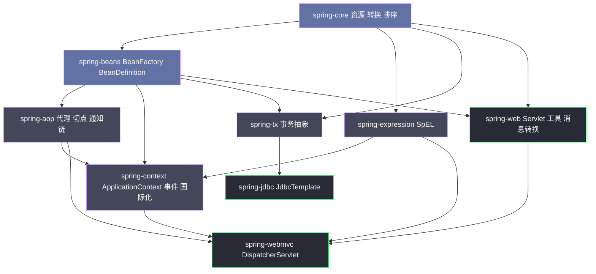
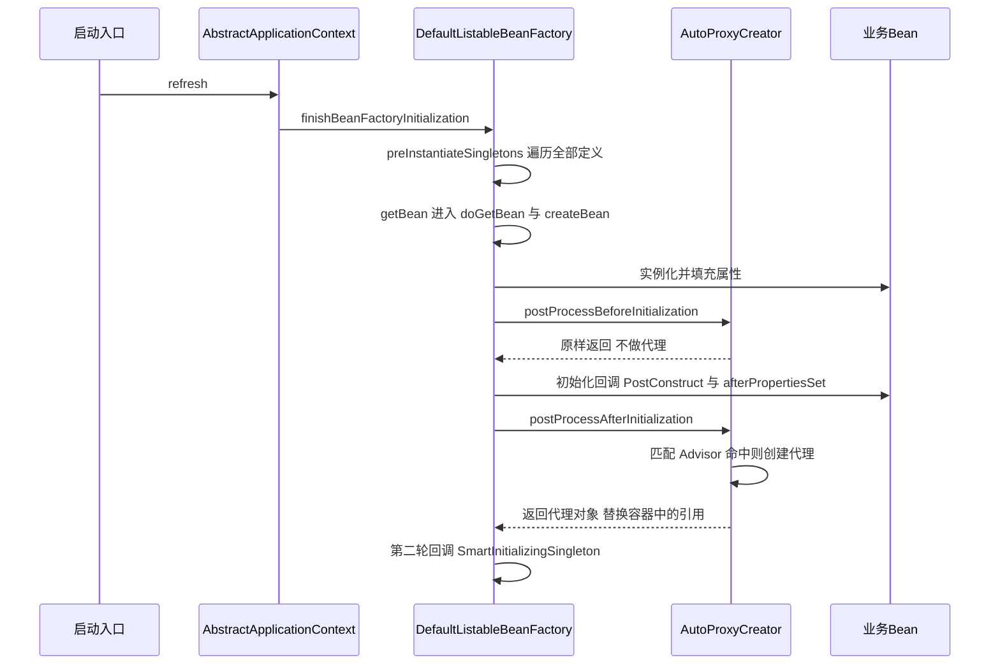
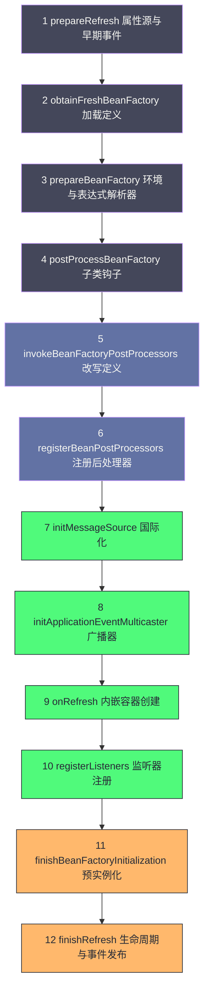
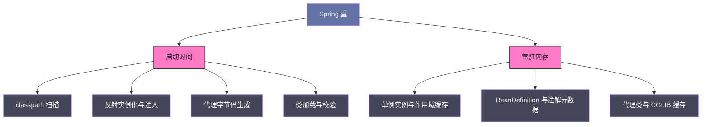

# Spring全局架构——模块划分与核心设计理念

**摘要：**

Spring Framework 的模块图几乎每一个 Java 工程师都见过，但多数人记住的是"有哪些模块"，而不是"这些模块为什么正好被切在这几刀上"。本文按机制视角重画这张图：先给出模块切分的三条判据，再顺着 `spring-core` → `spring-beans` → `spring-context` 这条单向链，解释 `Resource`、`Converter`、`OrderComparator` 这三件"不认识 Bean"的东西为什么必须沉在最底层，以及为什么 Web 层可以依赖容器而容器不能反过来依赖 Web 层。随后进入两条主干：其一，IoC 与 AOP 的交汇点是 `BeanPostProcessor`，`AbstractAutoProxyCreator` 在 `postProcessAfterInitialization` 里把需要增强的 Bean 换成代理，这条缝同时解释了 `@Transactional` 为什么靠 AOP 生效；其二，`refresh()` 的十二步是容器启动协议，每一步的顺序背后都压着一条隐含约束，也是扩展点的实际挂载位置。结尾拆解"Spring 重"的技术来源，并给出能减什么、不能减什么的判据。

> [!info] 本篇的边界
> 本篇写机制视角：模块依赖方向、容器层次、Bean 的创建与后处理、代理织入时机、启动协议。应用层怎么用 Spring Boot——启动引导、自动装配、内嵌容器、配置体系——属于 [[Java/SpringBoot/00 专栏导览]] 那一列；代理模式、模板方法、观察者模式这些模式视角的取舍，已经在 [[Java/OOP设计模式/09 设计模式在Spring中的应用全景]] 里写过，本篇只在交汇处给一句结论。

---

## 第 1 章 九个模块的切法

### 1.1 从单一 jar 说起

2002 年，Rod Johnson 在《Expert One-on-One J2EE Design and Development》里贴出了一份自己写的框架代码，用来证明一件事：绝大多数企业应用根本用不上 EJB 那套分布式对象与容器托管的重型机制，用普通 Java 对象（Plain Old Java Object，POJO）配合一层轻量的组装逻辑就够了。这份代码在 2003 年长成了 Spring Framework 的雏形，并且很快被拆成了好几个 jar——但最初的切分相当粗糙，接口与实现、配置解析与代理生成常常混在同一棵包树里。真正意义上的模块边界，是随着使用场景分化而被一次次逼出来的。

理解这段历史有一个现实好处：模块不是按"功能分类"切出来的，而是按"依赖方向"切出来的。官方文档把模块分成 Core Container、Data Access、Web、AOP 与 Test 几组，那是给人看的阅读分组；Maven 坐标里那些 `spring-core`、`spring-beans` 之间的依赖箭头，才是真正硬的约束。一个人如果把模块图当成功能清单背下来，遇到"为什么这个类在这儿而不在那儿"时依然无从判断；只有把切分判据拿在手里，才能在没有源码的情况下推出答案。

> [!warning] EJB 的教训：功能不是免费的
> EJB 2.x 的问题不在于能力不足，而在于它用侵入性换能力：业务类必须继承 `SessionBean`、实现一批在业务上永远空着的生命周期方法、依赖容器提供的 JNDI 环境才能运行。这样做的代价是业务对象离开容器就活不了，单元测试要启动整个应用服务器。Spring 的反叛正是从这里开始——容器可以管组装，但业务类必须保持为一个能被 `new` 出来的普通对象。这条主张后来直接决定了容器的分层方式：管组装的机制与业务无关，所以它可以独立成模块；业务对象不认识容器，所以容器也不能强迫业务对象依赖它的类型。

### 1.2 切分的三条判据

判断一个类该落在哪个模块，笔者用三条判据，按顺序适用。

第一条是认知边界：如果一个模块的公开契约里出现了另一个模块的概念，依赖就必须指向那个模块。`BeanFactory` 的方法签名里出现 `BeanDefinition`、`BeanPostProcessor`，所以 `spring-beans` 不可能不知道它们；而 `Resource` 的方法签名里只有 `InputStream`、`URL`、`File` 这些 JDK 类型，所以 `spring-core` 可以完全不知道 Bean 是什么。这条判据管的是"能不能"，它给出的是**依赖的下界**。

第二条是可裁剪性：删掉依赖方，被依赖方应当仍然完整可用。删掉 `spring-web`，`spring-context` 依然能启动、能注入、能发事件；反过来删掉 `spring-context`，`spring-web` 里的 `HttpMessageConverter` 抽象和 `RestTemplate` 也依然能编译。这条判据管的是"该不该"，它给出的是**依赖的上界**——凡是删掉之后被依赖方没有损失的依赖，都是不必要的依赖。

第三条是发布节奏：模块的边界往往也是修复与升级的边界。`spring-jcl` 这种只为把日志门面桥接到不同实现上的模块，单独成 jar 的唯一理由就是它可以被替换而不牵动其他模块。

三条判据合起来，得到的是一张严格单向的图。九个模块的职责与依赖方向如下表，其中"编译期依赖"一列只列直接依赖，传递依赖省略。

| 模块 | 一句话职责 | 直接依赖 | 为什么必须停在这一层 |
| :--- | :--- | :--- | :--- |
| `spring-core` | 资源抽象、类型转换、排序与反射工具 | `jcl`（只有日志桥接） | 它的契约只与"值、字节、类型、顺序"有关，与 Bean 无关，因此可以沉到最底 |
| `spring-beans` | `BeanFactory`、`BeanDefinition`、DI 引擎 | `core` | 它需要读资源、转类型、排处理器顺序，但不需要"容器启动"这个概念 |
| `spring-context` | `ApplicationContext`、事件、国际化、BFPP 自动注册 | `core`、`beans`、`aop`、`expression` | 它负责编排启动协议与工程能力，因此必须知道 Bean、代理、表达式三件事 |
| `spring-aop` | 代理创建、切点匹配、通知链 | `core`、`beans` | 代理是 Bean 的一种包装，它需要类型查询，但不需要容器生命周期 |
| `spring-expression` | SpEL 的解析与求值 | `core` | 它是纯语言实现，除了 core 的工具外不依赖任何框架概念 |
| `spring-tx` | `PlatformTransactionManager` 抽象与资源同步 | `core`、`beans` | 事务语义（传播行为、同步器）与具体数据源无关，可以被任何资源适配 |
| `spring-jdbc` | `JdbcTemplate`、`DataSourceUtils`、异常翻译 | `core`、`beans`、`tx` | 模板是事务抽象的消费者，方向只能是 jdbc → tx |
| `spring-web` | Servlet 环境工具、消息转换抽象、HTTP 客户端 | `core`、`beans`（外加观测 API） | 它刻意不依赖容器：能在没有 IoC 的世界里当工具库用 |
| `spring-webmvc` | `DispatcherServlet`、控制器映射、视图解析 | `core`、`beans`、`context`、`aop`、`expression`、`web` | 它需要完整的 `WebApplicationContext`、拦截器链与代理共存 |

外围还有若干模块——`spring-orm`、`spring-webflux`、`spring-messaging`、`spring-context-support`、`spring-aspects`、`spring-instrument`、`spring-jcl`、`spring-test`。它们的存在意义基本都能用上面三条判据解释：`spring-orm` 之所以独立，是因为 Hibernate 与 JPA 的集成不该让不用 ORM 的人付出依赖代价；`spring-jcl` 之所以独立，是因为 Commons Logging 桥接是纯兼容层，可替换。

### 1.3 依赖方向图

把九个模块的方向画出来，得到的不是一棵树，而是一个"漏斗加两翼"的形状：左边一翼是 AOP 与 SpEL，右边一翼是数据访问与 Web，两翼都从容器这一支分出去，任何一侧都没有回流。下图只画单向依赖，箭头方向即编译期依赖方向。



图里有一条容易被忽略的边：`spring-context` 指向 `spring-aop`。这不是可选的扩展，而是硬依赖——容器的启动协议里有一个专门步骤（`registerBeanPostProcessors`）用来装配后处理器，而代理创建器正是通过这个入口挂进容器的。换句话说，容器在设计上就预留了"让某个东西来包装我的 Bean"的位置，AOP 占据了这个位置。本篇第 7 章会把这条边展开成一整条时序。

### 1.4 为什么 Web 能依赖容器，反过来不行

这是模块图里最常被问的一个问题，答案不止"分层"两个字。笔者把它拆成四层判据。

第一层是**生命周期方向**。依赖只能从更短命、更具体的东西指向更长命、更一般的东西。一次 HTTP 请求的寿命是毫秒级，一个 `ApplicationContext` 的寿命是整个进程。请求处理过程中需要问容器要 Bean，所以 Web 层依赖容器是自然的；反过来，容器在启动时需要 HTTP 请求吗？不需要。容器甚至在启动时不知道有没有网络这回事。这条判据可以推广到几乎所有框架分层：短命的东西找长命的东西要资源，是运行时依赖的唯一合理方向。

第二层是可使用性。`spring-context` 的契约里只有"Bean 的创建、装配、后处理、销毁"，没有任何与传输协议相关的东西。批处理程序、消息消费者、命令行工具、定时任务都可以用 `ApplicationContext`，它们没有 Servlet，也不需要。如果容器反过来依赖 Web 层，那么所有非 Web 场景都被迫携带 Servlet API——一个只处理 Kafka 消息的进程要在类路径上装一个 Servlet 容器，这显然荒谬。反过来，`spring-web` 依赖 `spring-beans` 就没有这个问题，因为它只会被"想处理 HTTP 的地方"使用。

第三层是测试与裁剪的代价。依赖方向决定了"删掉一个模块之后哪些还能用"。删 `spring-webmvc`，容器完好；删 `spring-context`，`spring-web` 的 `RestTemplate`、`HttpMessageConverter` 抽象仍然可以单独使用，因为它们只碰 `core` 与 `beans`。这种"删谁都只影响下游"的性质，正是单向依赖的全部价值——它不是美学要求，而是打包与部署的实际约束。

第四层是事实核查，也是这里最容易讲错的地方：`spring-web` 本身根本不依赖 `spring-context`。它只依赖 `core` 与 `beans`（外加一个观测 API），因为它提供的是 Servlet 环境下的工具与 HTTP 客户端，不需要一个完整的容器；真正依赖 `spring-context` 的是 `spring-webmvc`，也就是带 `DispatcherServlet`、需要 `WebApplicationContext` 的那一层。这个细节恰好印证了判据——"能不依赖就不依赖"是同一套判据的另一面：只要一个模块能在没有容器的世界里独立成立，它就不该声明对容器的依赖。顺便说，Spring Framework 5 引入 WebFlux 时官方文档特意说明"WebFlux 应用甚至不直接使用 Servlet API"，同一套判据在响应式栈上又用了一遍。

### 1.5 版本演进留下的印记

模块的边界也记录着框架的演进史。下表保留自原稿，并补一列"对模块边界的意义"，因为版本史如果不与结构变化挂钩，读起来就只是一份年表。

| 版本里程碑 | 发布年份 | 核心变化 | 对模块边界的意义 |
| :--- | :--- | :--- | :--- |
| Spring 1.0 | 2004 | IoC 容器 + AOP 基础框架，XML 配置驱动 | 首批 jar 已按核心容器、数据访问、Web 分开，`core`、`beans`、`context`、`aop` 是当时的核心四件 |
| Spring 2.0 | 2006 | 简化 XML，引入 `<context:component-scan>` | 扫描能力落在 context，而不是 beans，这个位置选择避免了容器核心被迫认识包扫描 |
| Spring 2.5 | 2007 | `@Component`/`@Service`/`@Repository`/`@Controller` | 注解成为定义来源，注解本身在 core 的元数据工具里被解析 |
| Spring 3.0 | 2009 | `@Configuration`/`@Bean`，注解驱动配置 | `ConfigurationClassPostProcessor` 以 BFPP 身份进入 context，用扩展点而非硬编码承载 Java Config |
| Spring 3.1 | 2011 | `@Profile`、`@Enable*`、`Environment` 抽象 | 环境抽象在 core，`Environment` 的容器侧装配在 context |
| Spring 4.0 | 2013 | Java 8、`@Conditional` | 条件求值挂在定义注册阶段，为后来的 Boot 自动装配留出位置 |
| Spring 5.0 | 2017 | WebFlux 响应式栈 | `spring-webflux` 与 `spring-web` 平行，不依赖 `spring-webmvc` |
| Spring 5.3 | 2020 | 支持 JDK 8 到 JDK 17 的过渡版本 | 6.0 之前的最后一个 5.x 分支 |
| Spring 6.0 | 2022 | 迁移到 Jakarta EE 9（`javax.*` → `jakarta.*`），要求 JDK 17+，AOT 支持 | 命名空间迁移会穿透 `web`、`orm`、`tx` 三层；AOT 的运行时提示 API 落在 core |
| Spring 6.1 | 2023 | 虚拟线程支持，JDK 21 适配 | 线程模型变化发生在 Web 层与 `@Async` 的执行器，不触及容器核心 |

本文的分析基线取 Spring Framework 6.x，对应 Spring Boot 3.x；更高版本的行为差异以对应版本的官方文档为准。

---

## 第 2 章 spring-core：三件不认识 Bean 的东西

`spring-core` 常被当成"工具类集合"一笔带过，因为它提供的确实不是业务功能。但对于理解模块切分，这一层恰恰是最有信息量的地方：一个东西要沉到最底层，必须满足一个苛刻条件——它的契约里不能出现任何上层概念。`spring-core` 里有三件最典型的抽象，它们共同构成了"最小可用的地基"。

### 2.1 Resource：把"字节从哪来"挤出所有上层代码

`Resource` 解决的问题朴素到容易被忽略：同一个配置文件，可能在 classpath 里、在文件系统上、在一个 jar 包里、在一个 URL 后面，甚至在一个 `InputStream` 里。JDK 对此给出的答案极为分散——classpath 用 `ClassLoader.getResourceAsStream()`，文件系统用 `File`，网络用 `URL.openStream()`，业务代码为了通用，往往被迫写三段 `if`。`Resource` 用一个接口把"拿到字节"这件事收窄为 `getInputStream()`，再由 `AbstractResource` 提供默认实现，`ClassPathResource`、`FileSystemResource`、`UrlResource`、`InputStreamResource` 分别覆盖四类来源。

它必须停在 core 的理由，用第一条判据就能推出来：`Resource` 的契约里只有 JDK 类型。上层有太多调用点需要它——`spring-beans` 要从 XML 或 class 文件读定义，`spring-context` 要加载 properties 与国际化消息，`spring-web` 要读 `ServletContext` 里的资源。这些调用点分属不同模块，唯一的共同祖先就是 core。如果 `Resource` 上浮到 beans，context 与 web 依然能用，但 core 内部的 `PathMatchingResourcePatternResolver`、`ResourceLoader` 就无处安放，而这些恰恰是 core 自己需要的东西。

这里藏着一个容易被错过的细节：`ResourcePatternResolver` 及其实现 `PathMatchingResourcePatternResolver` 也在 core 里，`classpath*:` 这种带通配符的批量资源匹配能力是它提供的，而 `@ComponentScan` 的候选类扫描最终就落在它上面。也就是说，容器做包扫描时最底层的那一步"把一个包路径变成一组 class 资源"，发生在 core，而不是 context。这解释了为什么 `spring-context-indexer` 这类优化能在不碰容器逻辑的前提下生效——它把"从 classpath 里逐个找候选类"换成了"读一个编译期生成的索引文件"。

> [!note] 为什么接口要这么多方法
> `Resource` 除 `getInputStream()` 之外，还有 `exists()`、`isFile()`、`getURL()`、`contentLength()`、`lastModified()`。这些方法严格说都能从输入流推出来，但它们让调用方在"不真正打开流"的前提下做判断。`AbstractResource` 给它们保守的默认实现——`exists()` 真开一次流再关掉，`isFile()` 返回 `false`；风险是性能，收益是新增一种资源类型只实现一个方法就能工作。

### 2.2 Converter：值与类型的关系，与 Bean 无关

`Converter<S, T>` 是一个只有一个方法的接口：`T convert(S source)`。围绕它，`ConversionService` 提供运行时门面，`GenericConversionService` 用一张"来源类型 → 目标类型"的注册表维护转换器，`DefaultConversionService` 预注册了字符串到数字、日期、枚举、字符集、时区等基础转换。

为什么转换体系必须在 core，而不是在 beans？因为有三类调用点同时需要它，而它们分属三个模块：`spring-beans` 在为 Bean 属性赋值时要把字符串转成目标类型（`BeanWrapper` 的赋值路径）；`spring-context` 在解析 `@Value` 的占位符结果时要转类型；`spring-web` 在绑定请求参数时要转类型。三者需要一个共同的语义——"字符串 `"true"` 与 `Boolean.TRUE` 是同一个值"。这套语义描述的是值与类型的关系，跟 Bean 毫无关系，所以它属于 core。

真正的机制接缝在 beans 这一侧：`BeanWrapperImpl` 背后的 `TypeConverterDelegate` 会把转换请求委托给容器里注册的 `ConversionService`，如果没有，就退化到 JDK 的 `PropertyEditor`。这条委托链说明了一件事——beans 自己并不实现转换，它只负责"找到转换器并调用"。当容器里存在名为 `conversionService` 的 Bean 时，启动流程的最后一步会调用 `setConversionService` 把它装进工厂，整条赋值链的语义随之被替换。这也是为什么自定义一个 `Converter<String, Money>` 并把它注册为 Bean，全局的配置注入都会认识 `Money` 类型：你改的不是某个 Bean 的行为，而是这条委托链背后的转换表。

### 2.3 OrderComparator：排序是一种基础设施

第三件东西最不起眼，却是整个扩展点体系的秩序来源。`Ordered` 接口只定义 `getOrder()`，`PriorityOrdered` 是它的子接口，用来表达"比普通有序更优先"，`OrderComparator` 负责按这两个接口比较，`AnnotationAwareOrderComparator` 还会读 `@Order` 注解与 `Ordered` 接口实现。

它必须在 core，因为需要排序的名单长得惊人：`BeanPostProcessor`、`BeanFactoryPostProcessor`、`ApplicationListener`、`HandlerInterceptor`、`Filter`、`Advisor`、`SmartLifecycle`、`Validator`，还有应用自己注册的各种策略组件。这些名单分属所有模块，如果排序语义定义在 beans，那么 `spring-aop` 与 `spring-webmvc` 都得重复实现一遍"怎么比较两个组件"，而重复实现必然导致语义漂移——某个模块按降序排，某个模块按升序排，这种 bug 极难定位。把它放在 core，等于宣布"顺序"是与框架无关的通用概念，任何模块都可以引用同一份语义。

`PriorityOrdered` 之所以要单独存在，是因为存在一类组件必须在所有其他组件之前生效，而普通的 `getOrder()` 排序无法表达"我必须整批优先于另一整批"。容器里的例子是 `ConfigurationClassPostProcessor`：它必须先于所有普通 BFPP 执行，否则 `@Configuration` 里声明的 BFPP 还没被解析出来。为此，`invokeBeanFactoryPostProcessors` 按 `PriorityOrdered`、`Ordered`、无序三段分别收集、分别排序、分别执行——这个三段结构在第 8 章会再出现一次，因为 `registerBeanPostProcessors` 用的是同一套写法。

### 2.4 三件东西的共同点

把三件抽象放在一起看，共同点非常清楚：它们都不认识 Bean，也不知道容器存在。这正是**最小可用地基**的定义。

| 抽象 | 一句话职责 | 主要使用方 | 若上移到 beans 会怎样 |
| :--- | :--- | :--- | :--- |
| `Resource` | 把资源来源统一为可读的字节流 | beans 读定义、context 读消息、web 读上下文资源 | core 自己的 `ResourcePatternResolver` 无处安放，扫描能力被绑进容器 |
| `Converter` | 值与类型之间的可注册映射 | beans 属性赋值、context 注解解析、web 参数绑定 | 三个模块各自维护一套转换语义，`@Value` 与参数绑定行为不一致 |
| `OrderComparator` | 组件执行顺序的统一语义 | 所有扩展点名单 | `PriorityOrdered` 的"整批优先"语义无法跨模块表达 |

顺带说，`spring-core` 里还有两样不在"三件东西"之列、但同样关键的内容：一是被重新打包（repackaged）的 ASM 与 CGLIB，也就是 `org.springframework.asm` 与 `org.springframework.cglib` 这两棵包树；二是 AOT 相关的运行时提示 API，`org.springframework.aot.hint.RuntimeHints` 这一族类型。前者解释了为什么 `spring-aop` 生成代理不需要任何外部字节码库，后者解释了为什么 AOT 的元数据描述能放在最底层——它描述的是"运行时需要哪些反射与资源"，这同样与 Bean 无关。

---

## 第 3 章 spring-beans：定义与实例的两级分离

### 3.1 BeanDefinition 是一份配方

`spring-beans` 的设计核心可以用一句话概括：把"Bean 是什么"和"Bean 怎么来"分开。前者由 `BeanDefinition` 承载，后者由 `BeanFactory` 执行。

`BeanDefinition` 是一份元数据描述，它记下的不是对象本身，而是造对象所需的全部配方：类名、作用域（singleton 还是 prototype）、是否懒加载、依赖哪些 Bean（`dependsOn`）、是否作为自动装配候选、构造器参数、属性值、初始化与销毁方法名、是否抽象、父定义名。这份配方在容器启动的早期就被构造出来并注册进 `BeanDefinitionRegistry`，而实例要等到 `getBean` 被调用时才创建。

一级分离带来三个直接后果，这三个后果就是容器大多数特性的来源。第一，懒加载成为可能：创建实例的时机与读取定义的时机解耦之后，容器可以自由决定什么时候执行配方。第二，同一份配方可以造出多个实例：prototype 作用域本质上是"每次 `getBean` 重新执行一次配方"，无需额外机制。第三，配方可以被改写：`BeanFactoryPostProcessor` 拿到的是定义而非实例，因此它能在任何实例存在之前调整作用域、替换类名、注入属性值——这是 Spring 扩展性最强的一个口子，比"后处理实例"的侵入性低得多。

定义的具体类型有若干变体，区别在元数据来源：`GenericBeanDefinition` 是通用载体，`RootBeanDefinition` 与 `ChildBeanDefinition` 用于父子定义继承，`ScannedGenericBeanDefinition` 的元数据来自 ASM 读取的 class 文件（而不是反射加载类），`ConfigurationClassBeanDefinition` 则由 `@Bean` 方法生成。这个差异在启动成本上有实际后果：扫描阶段只读字节码、不加载类，所以"扫描了 3000 个类"并不等于"加载了 3000 个类"，真正的类加载发生在实例化与条件求值时。

### 3.2 BeanFactory 的最小契约

`BeanFactory` 的接口表面上看很小：`getBean` 的几个重载、`containsBean`、`isSingleton`、`isPrototype`、`getType`、`getAliases`、`getBeanProvider`。但这几组方法的语义差异，恰好画出了容器的能力边界。

`getBean(String)` 与 `getBean(Class<T>)` 是"我要一个，现在就要"，找不到就抛异常。`getBeanProvider(Class<T>)` 则是"我先拿一个可延迟求值的句柄"，返回的 `ObjectProvider` 在真正调用 `getObject()` 或 `getIfAvailable()` 时才去解析。这个差别不是语法糖：它让"可选依赖"与"按需依赖"成为可能，`@Autowired(required = false)`、构造器里的 `ObjectProvider<T>`、`@Lazy` 注入都建立在它之上。一个 Bean 依赖另一个可能不存在的 Bean 时，用 `ObjectProvider` 是唯一不引发启动失败的写法。

`isSingleton`/`isPrototype`/`getType` 这几个查询方法看起来只是便利，实际是给上层模块用的：`AbstractAdvisorAutoProxyCreator` 需要按类型找出所有 Advisor Bean，`registerListeners` 需要按类型找出所有 `ApplicationListener`，`initMessageSource` 需要按名字取出 `messageSource`。也就是说，`BeanFactory` 不只是"取 Bean 的地方"，还是"按条件枚举 Bean 的地方"，容器的很多编排逻辑都建立在类型查询之上。

### 3.3 DI 引擎为什么停在 beans 这一层

一个自然的疑问是：既然 `DefaultListableBeanFactory` 已经能完成定义注册、依赖解析、实例化、后处理、销毁的完整流程，为什么还需要 `spring-context`？答案在"编排"二字上。

`DefaultListableBeanFactory` 能做上面所有事，但它不主动做。它不会自动发现并注册 `BeanPostProcessor`，不会自动调用 `BeanFactoryPostProcessor`，不会预实例化单例——这些动作全在 `refresh()` 里，而 `refresh()` 属于 context。反过来说，DI 引擎也不需要 `refresh()`：给它一份注册好的定义，它就能独立地把 Bean 造出来，甚至可以在一个没有 `ApplicationContext` 的测试里单独跑起来。

> [!info] IoC 是思想，DI 是手段，容器是编排者
> 这三个概念经常被混为一谈。IoC（Inversion of Control）是原则：把依赖的创建权从使用者手里拿走；DI（Dependency Injection）是 Spring 实现这条原则的具体手法，Martin Fowler 在 2004 年的文章里专门澄清过，说"IoC"这个词太宽泛，而"依赖注入"更准确地描述了框架所做的事。容器是第三层：它把定义管理、依赖解析、生命周期回调、扩展点调度编排成一条启动协议。依赖倒置原则（Dependency Inversion Principle，DIP）解释了为什么要这么分层——高层模块与低层模块都依赖抽象。容器层次结构上的更多细节在 [[Java/SpringCore/02 IoC容器——BeanFactory与ApplicationContext的层次设计]] 里展开。

模块边界的证据也在这一层：`spring-beans` 里没有任何与"容器启动"有关的类型，`ApplicationEvent`、`MessageSource`、`Environment` 全部在 context 或 core；而 `spring-context` 里到处都是对 `ConfigurableListableBeanFactory` 的调用。依赖的箭头是由"谁编排谁"决定的，不是由抽象层次高低决定的。

---

## 第 4 章 spring-context：容器之上的六个能力

### 4.1 六个能力及其装配位置

`ApplicationContext` 相对 `BeanFactory` 多出来的能力，经常被笼统地列成一张功能清单。清单本身没错，但列完仍然不知道这些能力在什么时刻被装进容器。下表把能力、承载接口、以及它在 `refresh()` 中的装配位置对齐起来。

| 能力 | 承载接口或类 | 装配位置 | 与 BeanFactory 的关系 |
| :--- | :--- | :--- | :--- |
| 事件发布 | `ApplicationEventPublisher`、`ApplicationEventMulticaster` | `initApplicationEventMulticaster` 与 `registerListeners` | 广播器本身是一个 Bean，监听器也通过类型查询取出 |
| 国际化 | `MessageSource`、`DelegatingMessageSource` | `initMessageSource` | 名为 `messageSource` 的 Bean，缺省则委托父容器 |
| 资源加载 | `ResourcePatternResolver`（`AbstractApplicationContext` 继承 `DefaultResourceLoader`） | 类型层面直接继承，无独立步骤 | 资源抽象的实现在 core，context 只是让它变成 Bean 与组件的可用依赖 |
| 环境抽象 | `EnvironmentCapable`、`ConfigurableEnvironment` | `prepareBeanFactory` 注册 `environment` 单例 | 环境对象被注册成名为 `environment` 的单例，可被注入 |
| BFPP 自动注册 | `PostProcessorRegistrationDelegate.invokeBeanFactoryPostProcessors` | `refresh()` 第 5 步 | 这是 `BeanFactory` 完全不具备的能力：自动发现并执行定义层面的后处理 |
| AOP 自动装配 | `BeanPostProcessor` 注册机制 + 代理创建器 | `registerBeanPostProcessors` 第 6 步 | 容器提供挂载点，代理创建器由注解配置登记 |

第六项需要一句精确的说明，否则很容易理解偏：`ApplicationContext` 本身并不会自动让 AOP 生效。它做的是提供一个挂载点——`registerBeanPostProcessors` 会把容器里所有 `BeanPostProcessor` 实例化并排序，包括代理创建器；而代理创建器是否存在于容器中，取决于有没有人登记它，例如 `@EnableAspectJAutoProxy` 通过 `ImportBeanDefinitionRegistrar` 调用 `AopConfigUtils` 完成登记，Spring Boot 场景下则由 `AopAutoConfiguration` 默认完成同一件事（`spring.aop.auto` 默认为真）。换个说法：AOP 的开关不在容器里，容器**只负责让开关插得进去**。

### 4.2 事件与国际化为什么需要"独立的装配步骤"

`initMessageSource` 与 `initApplicationEventMulticaster` 这两步看起来只是"取一个 Bean、没有就建一个默认的"，但它们的位置相当讲究：都在 `registerBeanPostProcessors` 之后。原因很直接——这两步会调用 `getBean`，而 `getBean` 会走完整的后处理器链。如果把这两步提前到第 5 步之前，取出来的 `messageSource` 就是一个没有经过注入、没有经过代理的裸对象；一旦用户在 `MessageSource` 实现里注入了别的 Bean，或者给它加了缓存切面，行为就会与预期不符。

同理，`registerListeners` 排在 `onRefresh` 之后、`finishBeanFactoryInitialization` 之前，这个位置意味着监听器注册时 Web 容器已经创建、而单例尚未批量实例化：监听器因此可以引用 Web 环境里的对象，又能在单例创建期间收到事件——容器在这一阶段可能发布内部事件，如果监听器还没注册，这些事件就丢了。至于"更早发布的事件"，容器用 `earlyApplicationEvents` 这个列表先存起来，等广播器就绪后统一补发，这个细节在第 8 章会展开。

### 4.3 什么时候直接用 BeanFactory

既然 `ApplicationContext` 多出这么多能力，为什么 Spring 还保留 `BeanFactory` 这个"裸容器"？因为在三类场合里，编排本身就是负担。

第一类是"只装配，不要生命周期"的工具。典型场景是配置对象的构建、测试夹具的组装、代码生成器里的小型依赖图。这类代码不需要事件、不需要国际化、不需要自动代理，`DefaultListableBeanFactory` + 手工注册定义就够，用 `AnnotationConfigApplicationContext` 反而会引入一次完整启动。

第二类是"需要完全延迟初始化"。`BeanFactory` 不做 `preInstantiateSingletons`，所有 Bean 都在首次 `getBean` 时创建。对启动时间极度敏感、又不想用 `@Lazy` 污染业务代码的场景，直接持有工厂是更直接的手段——代价是首个请求的延迟，这一点在第 9 章会量化。

第三类是"自己当编排者"。框架开发者、嵌入式脚本环境、需要精细控制启动顺序的基础设施，会直接操作 `DefaultListableBeanFactory`，自己决定什么时候 `invokeBeanFactoryPostProcessors`、什么时候 `registerBeanPostProcessors`。

判据可以压缩成一句话：**要不要别人替你编排启动**。要，就用 `ApplicationContext`，接受它规定的十二步；不要，或者要自己编排，就用 `BeanFactory`，同时接受两个后果——没有 BFPP/BPP 的自动发现（`DefaultListableBeanFactory` 不会自己去找 `BeanPostProcessor`，你必须手动注册），也没有 `ContextRefreshedEvent` 这类生命周期通知。很多人以为"用 `BeanFactory` 更轻"，却忽略了轻的代价是那些能力本来就不存在，而不是被关掉了。

---

## 第 5 章 spring-aop 与 spring-expression：两条正交的增强线

### 5.1 spring-aop 依赖 beans 的确切含义

`spring-aop` 的核心类型是 `ProxyFactory`、`Advisor`、`Pointcut`、`Advice`，它依赖 `spring-beans` 与 `spring-core`，但不依赖 `spring-context`。这个依赖关系值得细看，因为它说明了"代理机制"与"容器编排"的边界在哪里。

`ProxyFactory` 需要 `BeanFactory` 的能力吗？不需要。它需要的是类型信息、拦截器链、以及生成代理的字节码能力。真正用到 `BeanFactory` 的是上层自动代理器：`AbstractAdvisorAutoProxyCreator` 需要按类型找出容器里所有 `Advisor` Bean，于是它调 `getBeanNamesForType`；`AbstractAutoProxyCreator` 需要知道 Bean 的类名以便生成缓存键，于是它调 `getType`。也就是说，AOP 的"机制内核"（怎么造一个代理）与容器无关，"自动装配层"（哪些 Bean 需要代理）才需要容器。

一个具体的证据是 CGLIB 的位置。生成代理要用字节码库，但 `spring-aop` 并不声明对第三方 CGLIB 的依赖——因为 `org.springframework.cglib` 这棵包树被 repackaged 进了 `spring-core`。同样的处理还有 `org.springframework.objenesis`（用于绕过构造器创建实例）。这种"把第三方字节码库吞进 core"的做法，让 `spring-aop` 的依赖面保持极小，也让用户不必处理 CGLIB 版本冲突——代价是框架体积增加，以及无法通过升级 CGLIB 获得新特性。

### 5.2 SpEL 为什么独立成模块

`spring-expression` 只依赖 `spring-core`，它提供 SpEL 的解析器（`SpelExpressionParser`）、求值上下文（`StandardEvaluationContext`）以及一系列 AST 节点。它独立成模块的理由不是"代码量大"，而是"用户群的交叉度低而广"：需要表达式的模块远远不止 context。

`@Value` 里的 `#{...}` 由 beans 侧触发求值，`spring-security` 的 `@PreAuthorize`、`spring-cache` 的 key 表达式、`spring-integration` 的路由表达式、Boot 的 `@ConditionalOnExpression` 都要用 SpEL。这些库大多不依赖 `spring-context`——`spring-security-core` 就不需要容器。如果 SpEL 实现放在 context，这些库要么被迫拖着 context，要么各自引入第三方表达式引擎，两种结果都很糟。

这里有一个漂亮的依赖倒置例子，值得单独说。`spring-beans` 定义了一个只有两个方法的接口 `BeanExpressionResolver`，并在 `AbstractBeanFactory` 里留了 `setBeanExpressionResolver` 的入口；而它的标准实现 `StandardBeanExpressionResolver` 位于 **`spring-context`** 的 `org.springframework.context.expression` 包。谁把实现塞进去的？`prepareBeanFactory`——`refresh()` 的第 3 步。于是形成一条完整的链：beans 定义"怎么把字符串求值成对象"的抽象，context 提供 SpEL 实现，启动协议在第 3 步把两者接起来。这是**依赖倒置**的教科书式布局：抽象在底层、实现在上层、装配落在启动协议里，也是理解模块依赖方向的最佳样本。

---

## 第 6 章 spring-jdbc、spring-tx 与 Web 层：依赖收窄的两个样板

### 6.1 事务抽象与模板的分工

`spring-tx` 里没有一行数据库代码。它定义的是 `PlatformTransactionManager`（提交、回滚、获取当前事务）、`TransactionDefinition`（传播行为、隔离级别、超时、只读）、`TransactionStatus`，以及 `TransactionSynchronizationManager`（把资源绑定到线程）。这些概念与具体数据源无关，JTA、JDBC、JMS、JPA 都可以各自实现 `PlatformTransactionManager`。

有意思的是 `DataSourceTransactionManager` 不在 `spring-tx`，而在 `spring-jdbc`；`JpaTransactionManager` 在 `spring-orm`。这个安排遵循了第一条判据：事务的"语义"（传播、回滚规则、同步回调）在 tx，事务的"具体资源"在各自的适配模块。tx 需要知道的只有一件事——怎么把一个资源绑定到当前线程、怎么在事务结束时释放。具体绑的是什么（`Connection`、`EntityManager`、`JmsSession`），它不知道也不需要知道。

依赖方向 jdbc → tx 的理由也在这里：`JdbcTemplate` 之所以能在事务里复用同一个连接，靠的是 `DataSourceUtils.getConnection()` 先问 `TransactionSynchronizationManager`"当前线程有没有绑定这个数据源的连接"。这一步查询是 tx 的职责，模板只是消费者。如果把 tx 的抽象下沉到 jdbc，那么 JPA、JMS 的事务适配就得反过来依赖 jdbc——依赖方向立刻反转，模块化失效。

### 6.2 Web 层的一分为二

`spring-web` 与 `spring-webmvc` 的切分，是**依赖收窄**最干净的样板。`spring-web` 提供 Servlet 环境下的基础设施：`ServletContext` 工具、`HttpMessageConverter` 抽象、`RestTemplate`、CORS 与媒体类型处理、`WebApplicationInitializer`。它只依赖 `core`、`beans` 与一个观测量库，因此可以被当作纯工具库使用——不需要容器也能编，也不需要 Servlet 容器之外的东西。

`spring-webmvc` 才是"Web 框架"：`DispatcherServlet`、`HandlerMapping`、`HandlerAdapter`、`ViewResolver`、拦截器链。它需要 `context`（`WebApplicationContext` 本身就是 `ApplicationContext` 的子接口）、需要 `aop`（拦截器与代理共存）、需要 `expression`（`@Value` 与方法参数上的 SpEL）、需要 `web`。换句话说，只有在"要给 HTTP 请求做一整套调度"时，容器依赖才是不可避免的。

判据在这里又用了一次：一个模块若能在没有容器的世界里独立成立，它就不该依赖容器；`spring-web` 的用户是 `RestTemplate` 的调用者与 `HttpMessageConverter` 的实现者，他们都不需要一个 `ApplicationContext`。

---

## 第 7 章 IoC 与 AOP 的交汇点

### 7.1 BeanPostProcessor 缝合两条主线

容器与 AOP 的接口只有一个：`BeanPostProcessor`。理解了这个接口的位置，就理解了为什么 Spring 的 AOP 不需要"编译器参与"或"类加载器参与"，也能在运行时把横切逻辑加进去。

```java
public interface BeanPostProcessor {

    // 返回值会替换容器中保存的实例；返回 null 表示终止后续回调，沿用当前实例
    default Object postProcessBeforeInitialization(Object bean, String beanName) {
        return bean;
    }

    default Object postProcessAfterInitialization(Object bean, String beanName) {
        return bean;
    }
}
```

两个回调的语义差别是整个机制的支点。`postProcessBeforeInitialization` 在初始化回调（`@PostConstruct`、`InitializingBean.afterPropertiesSet`、`init-method`）之前执行，它拿到的是"属性已填好、但尚未初始化"的对象；`postProcessAfterInitialization` 在初始化之后执行，它拿到的是"完全就绪、但尚未交付给任何调用方"的对象。AOP 要的正是后者：代理必须包一个已经完整构造的 target，且代理必须在 Bean 被任何人拿到之前替换掉容器里的引用。这个窗口恰好存在，而且只有一个，所以 AOP 只能落在这里。

先把这个领域里的术语摆正，后文的时序描述才有共同语言。

| 术语 | 英文 | 在机制上的位置 |
| :--- | :--- | :--- |
| 切面 | Aspect | 切点与通知的组合，最终体现为一个或多个 `Advisor` |
| 连接点 | JoinPoint | Spring AOP 中只有方法调用一种 |
| 切点 | Pointcut | 决定"哪些方法需要增强"的匹配器 |
| 通知 | Advice | 真正执行的横切逻辑，被包装成 `MethodInterceptor` |
| 目标对象 | Target | 被代理的原始对象，即 `postProcessAfterInitialization` 收到的 `bean` |
| 代理对象 | Proxy | 返回值，实现同一接口或继承同一类，持有一条 `MethodInterceptor` 链 |
| 织入 | Weaving | 在运行期创建代理并替换容器引用的过程，区别于 AspectJ 的编译期织入 |

### 7.2 代理创建器的身份

Spring 里真正做这件事的类叫 `AnnotationAwareAspectJAutoProxyCreator`，它的继承链值得记住，因为每一层对应一种能力：

```text
AnnotationAwareAspectJAutoProxyCreator  解析 @Aspect 注解，生成 Advisor
  └─ AspectJAwareAdvisorAutoProxyCreator  处理 AspectJ 的切面排序规则
      └─ AbstractAdvisorAutoProxyCreator  从容器里找出所有 Advisor Bean
          └─ AbstractAutoProxyCreator     决定哪些 Bean 需要代理，并创建代理
```

`AbstractAutoProxyCreator` 同时实现了 `SmartInstantiationAwareBeanPostProcessor`、`BeanFactoryAware`，并继承 `ProxyProcessorSupport`（因此带 `Ordered` 语义）。这份签名本身就是答案：它是一个后处理器，这解释了它为什么能介入 Bean 的创建；它需要 `BeanFactory`，这解释了它为什么能按类型找出 Advisor；它有排序，这解释了为什么它能和其他后处理器共存于同一条链上。

它被注册的名字是 `org.springframework.aop.config.internalAutoProxyCreator`，一个约定俗成的常量，框架内部按这个名字判断"是否已经装过自动代理器"，以避免重复登记。登记动作由 `AopConfigUtils.registerAspectJAnnotationAutoProxyCreatorIfNecessary` 完成，触发者通常是 `@EnableAspectJAutoProxy`——它通过 `ImportBeanDefinitionRegistrar` 在解析配置类的阶段插入这条定义；Spring Boot 的 `AopAutoConfiguration` 在没有显式关闭时也会导入同一个注解。

### 7.3 从 refresh 到代理：完整时序

把上面的碎片连起来，就是一条从启动入口直到代理替换的完整时序。下图只画主干：容器在最后一步预实例化单例时，逐个 Bean 走创建流程，代理创建器在每个 Bean 初始化完成之后介入。



沿这条时序逐段说明，每一步都有可验证的落点。

第一步，`refresh()` 走到最后第二步 `finishBeanFactoryInitialization`，它先注册 `conversionService`（如果容器里有这个 Bean）、把 `embeddedValueResolver` 指向 `Environment.resolvePlaceholders`、处理 `LoadTimeWeaver`，然后调用 `freezeConfiguration()` 冻结配置，最后调 `preInstantiateSingletons()`。注意顺序：冻结在实例化之前，意味着实例化阶段不会再有新的定义注册进来，按类型查找的缓存也不会失效。

第二步，`preInstantiateSingletons` 会先复制一份 `beanDefinitionNames` 的快照再遍历——因为创建过程中可能注册新 Bean，直接遍历原集合会抛 `ConcurrentModificationException`。遍历时跳过抽象定义、跳过 `prototype`、跳过 `lazy-init`，剩下的逐个 `getBean`。

第三步，`getBean` 进入 `doGetBean`：先检查单例缓存，未命中则标记 `beanName` 正在创建（用于循环依赖检测），然后 `createBean`。`createBean` 先给后处理器一个"短路"机会（`resolveBeforeInstantiation`，若某个后处理器返回非 null 实例，整个创建流程被跳过），接着实例化、填充属性、执行初始化。

第四步，初始化阶段的三段结构是：`invokeAwareMethods`（处理 `BeanNameAware`、`BeanClassLoaderAware`、`BeanFactoryAware`），然后 `applyBeanPostProcessorsBeforeInitialization` 按注册顺序正序执行所有后处理器的 `before` 回调，然后 `invokeInitMethods`（`afterPropertiesSet` 与 `init-method`），最后 `applyBeanPostProcessorsAfterInitialization` 逆序执行 `after` 回调。这段三段式结构与各回调点的精确顺序在 [[Java/SpringCore/04 Bean的生命周期——从定义到销毁的完整流程]] 里有逐步拆解，此处只需记住"before 正序、after 逆序"这条对称规律。

第五步，代理创建器在 `after` 阶段被调用，它做三件事：算出缓存键（类名 + Bean 名）、检查 `earlyProxyReferences`（循环依赖时提前生成的代理引用）、调 `wrapIfNecessary`。`wrapIfNecessary` 里先看这个 Bean 是否已经在 `targetSourcedBeans` 或 `advisedBeans` 缓存里，再问 `getAdvicesAndAdvisorsForBean` 要一组匹配的 Advisor；没有匹配就返回原对象，有匹配就用 `ProxyFactory` 生成代理。

```java
public abstract class AbstractAutoProxyCreator extends ProxyProcessorSupport
        implements SmartInstantiationAwareBeanPostProcessor, BeanFactoryAware {

    // 循环依赖场景下，容器需要提前暴露一个引用，这里缓存"已经提前代理过"的标识
    private final Map<Object, Object> earlyProxyReferences = new ConcurrentHashMap<>(16);

    @Override
    public Object getEarlyBeanReference(Object bean, String beanName) {
        Object cacheKey = getCacheKey(bean.getClass(), beanName);
        this.earlyProxyReferences.put(cacheKey, bean);
        return wrapIfNecessary(bean, beanName, cacheKey);
    }

    @Override
    public Object postProcessAfterInitialization(Object bean, String beanName) {
        if (bean != null) {
            Object cacheKey = getCacheKey(bean.getClass(), beanName);
            // 若该 Bean 在循环依赖处理时已经被提前代理，这里就不再包装第二次
            if (this.earlyProxyReferences.remove(cacheKey) != bean) {
                return wrapIfNecessary(bean, beanName, cacheKey);
            }
        }
        return bean;
    }
}
```

这段代码解释了为什么"三级缓存"的第三级必须存在，也解释了为什么 AOP 与循环依赖会互相纠缠：代理本该在初始化之后才生成，但循环依赖要求容器在初始化之前就把一个引用交出去。折中方案是"提前生成代理并记下标记，正常流程走到 `after` 阶段时发现已被代理过就跳过"。这个折中的代价是代理的生成时机被提前，某些依赖"初始化完成后状态"的切面可能看到不完整的对象——这是机制本身的取舍，不是 bug。

### 7.4 三个介入位置

代理创建器在容器里其实有三个可介入的位置，用途各不相同，混用会导致很难排查的行为差异。

| 介入位置 | 触发时机 | 代理创建器的用法 | 后果 |
| :--- | :--- | :--- | :--- |
| `getEarlyBeanReference` | 循环依赖暴露早期引用时 | 提前包装并记录标记 | 循环依赖下的 Bean 也能被增强，但增强生效早于初始化完成 |
| `postProcessAfterInitialization` | 初始化完成、交付之前 | 常规包装，替换容器引用 | 绝大多数代理在这里生成 |
| `postProcessBeforeInitialization` | 初始化之前 | 原样返回，不参与 | 保证代理不会包住一个未初始化的对象 |

第三个位置留空是有意的。`postProcessBeforeInitialization` 在代理创建器里直接返回原对象，因为它拿到的对象还没执行 `@PostConstruct`，此时包装出的代理会在调用时看到半成品状态。有人为了"让 `@Transactional` 在 `@PostConstruct` 里也生效"而试图改写这个回调，方向是错的——需要事务的初始化逻辑应当移到一个独立 Bean 的方法里、由调用方触发，而不是靠提前生成代理。

另一个容易误解的点是 `resolveBeforeInstantiation`。`AbstractAutowireCapableBeanFactory` 确实留了这个口子：若某个 `InstantiationAwareBeanPostProcessor` 在 `postProcessBeforeInstantiation` 里返回非 null，容器会直接把它当作最终实例，连构造器都不调用。但 AOP 的自动代理器没有用这个口子，因为它必须拿到已经实例化、已经注入完毕的对象才能生成有意义的代理。真正用这个口子的是需要"完全替换实例"的场景，例如某些远程调用代理或特殊的工厂式后处理器。

### 7.5 为什么 @Transactional 靠 AOP 生效

把上面所有环节拼到一条链上，"`@Transactional` 靠 AOP 生效"就不再是一句口号，而是一条可以逐步验证的调用链。

第一环，`@EnableTransactionManagement` 通过 `TransactionManagementConfigurationSelector` 导入两个配置类，其中一个 `ProxyTransactionManagementConfiguration` 注册了两个 Bean：`TransactionInterceptor`（通知，实现 `MethodInterceptor`）与 `BeanFactoryTransactionAttributeSourceAdvisor`（切面，持有一个 `TransactionAttributeSource`，其实现 `AnnotationTransactionAttributeSource` 负责把方法上的 `@Transactional` 解析成 `TransactionAttribute`）。

第二环，`AbstractAdvisorAutoProxyCreator` 在为某个 Bean 决定是否代理时，会调 `BeanFactoryAdvisorRetrievalHelper` 从容器里找出所有 `Advisor` 类型的 Bean——这一步会**提前初始化** Advisor Bean，即使它们原本不在预实例化范围内。这是为什么事务配置必须能被提前解析：如果 Advisor 依赖的 Bean 还没准备好，事务增强就装不上。

第三环，`getAdvicesAndAdvisorsForBean` 用切点对目标类做匹配。`BeanFactoryTransactionAttributeSourceAdvisor` 的切点 `TransactionAttributeSourcePointcut` 只做一件事——判断这个类或方法上有没有事务属性。命中则进入代理创建，`ProxyFactory` 按 `proxyTargetClass` 决定用 JDK 动态代理还是 CGLIB。

第四环，运行时调用进入代理，代理把调用交给 `TransactionInterceptor.invoke`。它根据方法的事务属性拿到 `TransactionAttribute`，调 `PlatformTransactionManager.getTransaction`。以 `DataSourceTransactionManager` 为例，`doBegin` 会关闭连接的自动提交、把 `ConnectionHolder` 绑定到 `TransactionSynchronizationManager` 的线程本地变量上。

第五环，业务方法里若用 `JdbcTemplate`，它的 `DataSourceUtils.getConnection` 会先查线程本地变量，发现有绑定的连接就直接复用——这就是"同一个事务里所有数据库操作共用一个连接"的机制来源。

这条链的落点值得强调：事务的"传播行为"看起来像数据库特性，实际上只是代理链上的一次线程本地状态查询。`REQUIRED` 判断"当前线程有没有活动事务"，`REQUIRES_NEW` 判断"要不要把外层事务挂起"，`NESTED` 判断"要不要设置保存点"——三者都发生在 `AbstractPlatformTransactionManager` 的 Java 代码里，与数据库无关。正因为这一层是纯 Java 的，`@Transactional` 的失效场景才全部集中在"代理有没有被调用到"这件事上：同类内部调用、`private` 方法、`final` 类、异常被吞，本质上都是**调用没有经过代理**，或者代理没有把异常抛出来。各类失效场景的完整清单与大事务拆分的实践在 [[Java/SpringCore/07 Spring事务管理——声明式事务的传播行为与失效场景]] 里，这里只保留机制层面的结论。

---

## 第 8 章 refresh() 的十二步

### 8.1 为什么是一个模板方法

`refresh()` 是 `AbstractApplicationContext` 里最"厚"的一个方法：它是容器启动的唯一入口，也是整个框架里唯一一处把十二个动作按固定顺序编排的地方。把它写成模板方法（template method）而不是一堆构造函数调用，是一个有意的设计选择——子类只能覆写钩子，不能改变顺序。

```java
public void refresh() throws BeansException, IllegalStateException {
    synchronized (this.startupShutdownMonitor) {
        prepareRefresh();
        ConfigurableListableBeanFactory beanFactory = obtainFreshBeanFactory();
        prepareBeanFactory(beanFactory);
        try {
            postProcessBeanFactory(beanFactory);
            invokeBeanFactoryPostProcessors(beanFactory);
            registerBeanPostProcessors(beanFactory);
            initMessageSource();
            initApplicationEventMulticaster();
            onRefresh();
            registerListeners();
            finishBeanFactoryInitialization(beanFactory);
            finishRefresh();
        }
        catch (BeansException ex) {
            // 启动失败要把已经造出来的半成品清掉，否则单例缓存里留下无法使用的对象
            destroyBeans();
            cancelRefresh(ex);
            throw ex;
        }
    }
}
```

**顺序即契约**。把任意两步对调，容器通常仍能启动，但会以极隐蔽的方式失效：某个后处理器没生效，某个 Bean 没被注入，某类事件丢了。这类问题的特征是"不报错但行为不对"，排查成本远高于启动失败。也正因如此，理解这十二步比理解任何一个模块的源码都更有杠杆——任何一个 Spring 的"为什么我的扩展没生效"，答案几乎都能回溯到某一步的时机。

十二步可以按"准备与定义、处理器注册、实例化与收尾"三段来记。第一段（1 到 5 步）解决"容器里有什么"，第二段（6 到 10 步）解决"谁来处理这些 Bean"，第三段（11 到 12 步）解决"什么时候把 Bean 造出来、什么时候对外宣告就绪"。下图中的箭头既表示执行顺序，也表示"上一步的产物是下一步的输入"。



### 8.2 十二步逐项拆解

下表按执行顺序给出每一步的动作、失效后果与扩展点。"挂了会怎样"一列按"该步被跳过或抛异常"理解。

| 步骤 | 做什么 | 挂了会怎样 | 扩展点在哪 |
| :--- | :--- | :--- | :--- |
| 1 `prepareRefresh` | 记录启动时间、调用 `initPropertySources()`、`validateRequiredProperties()`、初始化早期监听器与早期事件列表、置 `active=true` | 必需属性缺失要等到注入时才暴露，错误信息离根因很远；早期事件全部丢失 | 覆写 `initPropertySources()` 注入自定义属性源，Web 环境就是这么把 `ServletConfig` 参数变成属性源的 |
| 2 `obtainFreshBeanFactory` | 刷新或创建 `BeanFactory` 并加载定义。`AbstractRefreshableApplicationContext` 会新建 `DefaultListableBeanFactory`，`GenericApplicationContext` 只做标记不新建 | 定义没进来，后面十一步全是空转；表现为容器启动成功但没有任何 Bean | 覆写 `refreshBeanFactory()`、`loadBeanDefinitions()`、`customizeBeanFactory()` |
| 3 `prepareBeanFactory` | 装 `ApplicationContextAwareProcessor` 与 `ApplicationListenerDetector`；注册 `environment` 单例、`systemProperties`/`systemEnvironment`；注册可解析依赖（BeanFactory、ResourceLoader、ApplicationEventPublisher、ApplicationContext）；装上 SpEL 的表达式解析器 | `@Autowired ApplicationContext` 注入失败；`@Value` 的 `#{}` 无法求值；`EnvironmentAware` 等回调不触发 | 不可覆写，但可通过第 4 步追加；`addBeanPostProcessor` 的入口在这里第一次打开 |
| 4 `postProcessBeanFactory` | 子类钩子，用来补"与运行环境相关"的东西：Web 容器在这里注册 request/session scope 与 `ServletContextAwareProcessor` | Web 作用域不存在，`@RequestScope`/`@SessionScope` Bean 一创建就失败 | 所有 Web 版 `ApplicationContext` 的覆写点，Spring Boot 的 `ServletWebServerApplicationContext` 也在此扩展 |
| 5 `invokeBeanFactoryPostProcessors` | 先执行 `BeanDefinitionRegistryPostProcessor`（按 `PriorityOrdered`、`Ordered`、其余三段），`ConfigurationClassPostProcessor` 在此解析 `@Configuration`/`@ComponentScan`/`@Import` 并生成大量新定义；再按同样三段执行普通 BFPP | 扫描、条件装配、占位符解析全部不发生；容器里只剩手工注册的定义 | 自定义 `BeanFactoryPostProcessor` 与 `BeanDefinitionRegistryPostProcessor`；相对顺序只能靠 `Ordered` 表达 |
| 6 `registerBeanPostProcessors` | 实例化容器里所有 `BeanPostProcessor` 并按三段排序注册，最后把内部处理器（如 `ApplicationListenerDetector`）重新排到链尾 | 之后创建的 Bean 没有注入、没有代理、`@PostConstruct` 不执行；这类故障最难查，因为容器"看起来正常" | 自定义 `BeanPostProcessor`；排序用 `PriorityOrdered`/`Ordered`；这是 AOP 的挂载点 |
| 7 `initMessageSource` | 取名为 `messageSource` 的 Bean；没有则创建 `DelegatingMessageSource` 委托父容器 | 国际化失效，`MessageSourceAware` 拿到一个空壳对象 | 声明名为 `messageSource` 的 Bean，或覆写 `initMessageSource()` |
| 8 `initApplicationEventMulticaster` | 取名为 `applicationEventMulticaster` 的 Bean；没有则新建 `SimpleApplicationEventMulticaster`（同步直发） | 事件退化为同步调用；自定义线程池的异步事件静默失效 | 声明名为 `applicationEventMulticaster` 的 Bean，并给它配 `TaskExecutor` |
| 9 `onRefresh` | 子类钩子，在单例创建前做环境准备；Spring Boot 的内嵌 Web 容器在这里被创建 | Web 容器不存在，所有依赖 `ServletContext` 的 Bean 初始化失败 | `ServletWebServerApplicationContext#onRefresh` 创建 Tomcat/Jetty/Undertow 实例 |
| 10 `registerListeners` | 把容器里所有 `ApplicationListener` 注册到广播器，并补发第 1 步攒下的早期事件 | 早期事件丢失；监听器收不到随后的 `ContextRefreshedEvent` | 监听器排序由 `Ordered` 决定；`@EventListener` 由 `EventListenerMethodProcessor` 在 BPP 阶段适配 |
| 11 `finishBeanFactoryInitialization` | 注册 `conversionService`、把内嵌值解析器指向 `Environment`、处理 `LoadTimeWeaver`、冻结配置、`preInstantiateSingletons` 实例化全部非懒加载单例、第二轮回调 `SmartInitializingSingleton` | 应用启动成功但单例未创建，首个请求集中创建，出现延迟尖刺；`SmartInitializingSingleton` 的回调是"全部就绪"语义的唯一保证 | 所有 `BeanPostProcessor` 在这条链上第一次真正批量生效；`@Lazy` 是唯一合法的逃逸方式 |
| 12 `finishRefresh` | 清资源缓存、初始化 `lifecycleProcessor`、触发 `Lifecycle` 的 `onRefresh`（Boot 的 Web 服务器在这里真正 `start`）、发布 `ContextRefreshedEvent`、注册到 `LiveBeansView` | `@PostConstruct` 之后的生命周期编排不执行；Web 服务器不监听端口；`ContextRefreshedEvent` 不广播 | `SmartLifecycle`/`Phased` 控制启停顺序；`ApplicationListener<ContextRefreshedEvent>` 做启动后动作 |

十二步里出现的处理器有三类：定义层面的 `BeanFactoryPostProcessor`、实例层面的 `BeanPostProcessor`、以及只关心某个回调的 `Aware` 接口。它们各自的触发位置、先后约束与自定义方式，在 [[Java/SpringCore/10 Spring扩展点全景——BeanPostProcessor、BeanFactoryPostProcessor与Aware接口]] 里有全景式的时序对照；这里只强调一点——三者的差别不是"用途不同"，而是"作用对象不同"：一个改配方，一个改成品，一个只交出环境句柄。

### 8.3 顺序里的四条隐含约束

十二步的顺序不是随手排的，下面四条约束解释了绝大部分"为什么偏偏是这样"。

第一条：`prepareBeanFactory` 必须在 `invokeBeanFactoryPostProcessors` 之前。原因在依赖上——BFPP 的典型工作是解析占位符、替换属性值，而它需要 `Environment` 与表达式解析器已经就位。`prepareBeanFactory` 恰好是注册 `environment` 单例、装上 `StandardBeanExpressionResolver` 的地方。如果反过来，`PropertySourcesPlaceholderConfigurer` 会在一个还没有 `Environment` 的容器里工作。

第二条：`invokeBeanFactoryPostProcessors` 必须在 `registerBeanPostProcessors` 之前。前者改的是定义，后者实例化的是处理器。`ConfigurationClassPostProcessor` 在第一步里通过扫描和解析 `@Configuration` 造出大量新定义，其中就包括用户声明的 `BeanPostProcessor`；如果先实例化处理器，这些刚被造出来的定义就赶不上这一轮注册。这就是**先有定义，再有处理器**的顺序来源。

第三条：`registerBeanPostProcessors` 必须早于所有会 `getBean` 的步骤。第 7 到第 11 步都要取 Bean（`messageSource`、`applicationEventMulticaster`、Web 容器组件、全部单例），而 `getBean` 会走完整后处理器链。若处理器尚未注册，取出来的对象既没有注入也没有代理——最典型的症状是 `messageSource` 里 `@Autowired` 的字段全为 null，而容器启动不报任何错。

第四条：`freezeConfiguration` 必须在预实例化之前。冻结之后，按类型查找的缓存不再重建，之后新注册的定义不会被类型查询看见。这个约束把"实例化阶段"变成了一个只读阶段：定义集合固定，单例逐个构造。它也让第 12 步之后的所有动态注册（例如某些运行时才决定的 Bean）必须走显式 API，而不能指望自动发现。

### 8.4 onRefresh 与内嵌容器

`onRefresh` 是十二步里最"空"的一步——在 `AbstractApplicationContext` 里它是个空方法，只在 Web 版实现里有内容。但正是这个空钩子，承载了 Spring Boot 最重要的行为之一：内嵌 Web 容器的创建发生在这里，而它的启动发生在第 12 步的 `Lifecycle` 回调里。这个"创建与启动分离"的安排有实际意义：容器对象必须先存在，才能把 `ServletContext` 注入给需要它的 Bean；而端口监听要等到全部单例就绪后才有意义。内嵌容器的参数与选型细节在 [[Java/SpringBoot/04 嵌入式Web容器——Tomcat、Jetty、Undertow的启动与配置]] 里，这里只标注它在协议中的位置。

### 8.5 各步耗时占比的示例推算

下面的占比是"按结构分解"的示例推算，不是基准测试数据。它的用途是给出一个判断顺序——哪些步骤值得优化，哪些不值得——而不是给出可引用的性能结论。真实占比随 Bean 数量、扫描路径、代理数量、Web 服务器启动开销大幅变化，若要实测，应当用 Spring 6 的 `ApplicationStartup`/`StartupStep` 机制（例如 `BufferingApplicationStartup`）采集每一步的真实耗时。

| 步骤组 | 示例占比 | 成本主要来自 | 备注 |
| :--- | :--- | :--- | :--- |
| 环境与属性准备（1） | 低于 2% | 属性源数量 | 远程配置源（配置中心客户端）可能反超，它是一次网络往返 |
| 定义加载与解析（2、5） | 15% 到 25% | 候选类数量、注解元数据规模 | 扫描包越宽越贵；`spring-context-indexer` 能削减这一段 |
| 处理器注册（6） | 5% 到 12% | BPP 数量、条件装配分支数 | 条件求值会触发类加载，是隐藏成本 |
| 单例创建（11） | 55% 到 75% | 单例数量、构造与注入复杂度 | 每个 Bean 都走完整 BPP 链，代理还要额外生成字节码 |
| 收尾与事件（12） | 2% 到 8% | 监听器数量、Web 服务器启动 | 端口绑定在固定开销里占一块，与 Bean 数无关 |

配一个粗略的推算模型：若应用有 400 个非懒加载单例，每个单例的创建、注入与后处理合计按 1 到 3 毫秒估算，第 11 步就是 0.4 到 1.2 秒；若扫描路径覆盖 2000 个候选类，按每个类 0.1 到 0.3 毫秒的字节码读取与注解解析估算，第 2、5 步合计 0.2 到 0.6 秒。两者相加已经接近 1 到 2 秒，这与"Spring Boot 应用启动要一两秒"的量级是吻合的。这类推算的用处在于排序：单例数量与扫描范围是两个可以动的旋钮，而属性源准备、事件收尾基本动不了。

---

## 第 9 章 "Spring 重"的技术拆解

### 9.1 启动慢的三个原因

"Spring 重"这个评价混合了三件不同的事：启动慢、内存占用高、心智负担大。前两件可以技术拆解，第三件其实是设计取舍的结果。先拆启动慢。

扫描是第一笔开销。注解驱动容器启动时要扫描 classpath 下的候选类，扫描过程用 ASM 读取 class 文件的字节码，解析注解元数据，判断是否符合候选条件（是否标注了 `@Component` 及其派生注解、是否是独立类、是否被 `@Conditional` 排除）。这笔开销与"候选类数量"成正比，而候选类数量往往与控制粒度无关——一个不小心把 `@ComponentScan` 的包写成了公司根包，扫描范围就会扩到几千个类，其中绝大多数永远不会成为 Bean。

反射是第二笔。定义注册完成后，每个单例都要实例化、注入、执行回调，这些动作全部通过反射完成：`Constructor.newInstance`、`Field.set`、`Method.invoke`。反射本身不慢，慢在"调用点无法内联"以及"每次访问都要做可见性与类型检查"，再叠加 `setAccessible` 的一次性成本与 `Method` 对象的缓存查找。单例数量越多，这笔开销线性增长，而且它发生在第 11 步的串行循环里，无法并行摊薄。

代理生成是第三笔。凡是被 AOP 增强的 Bean，都要在运行期生成一个新的类：CGLIB 用 `Enhancer` 生成子类字节码，JDK 动态代理用 `ProxyGenerator` 生成实现类字节码，然后 `defineClass` 加载进 Metaspace。生成的成本与"被代理的 Bean 数量"成正比，与"切点匹配的复杂度"也成正比——切点表达式越宽，匹配时要检查的类与方法就越多。很多应用启动慢的真实原因是切点写得太宽，`execution(* com.example..*.*(..))` 这种写法会把几乎所有 Bean 都纳入匹配计算。两种代理各自的生成过程与选择逻辑见 [[Java/SpringCore/06 AOP实现原理——JDK动态代理与CGLIB]]。

把启动与内存两笔账画在一起，可以看到"重"这个印象其实来自两组完全不同的旋钮：上半支影响启动耗时，下半支影响常驻内存，两组的优化手段几乎不重叠。



> [!note] 为什么这三个原因经常被归错账
> 启动耗时里还有一笔开销常被忽略：类加载本身。扫描阶段只读字节码不加载类，但实例化、条件求值、注解反射都会触发真正的类加载与校验。一个 400 个 Bean 的应用，实际加载的类可能是数千个（含依赖库），这部分成本记在"扫描"或"反射"名下都不准确。用 JFR 或 `StartupStep` 按阶段切开看，才能知道时间究竟落在"读字节码""加载与校验""反射调用"还是"字节码生成"上。

### 9.2 内存占用的两个来源

内存这一侧容易被高估，也容易被低估。高估的是"容器本身占多少"，低估的是"元数据的固定税"。

第一来源是 Bean 实例。容器持有的每个单例都是一份真实的对象图，`singletonObjects`、`earlySingletonObjects`、`singletonFactories` 三个缓存以及各类作用域代理都会持有引用。这部分内存与应用自身的对象模型成正比，容器本身几乎不放大它——一个 100MB 的服务，不会因为用了 Spring 就变成 300MB。

第二来源是元数据，这部分才是 Spring 特有的固定税：每个定义对应一份 `BeanDefinition` 与一份合并后的 `MergedBeanDefinition`，每个类对应一份注解元数据（`MergedAnnotations` 及其内部的注解缓存），每个被扫描的类都有对应的 `Class` 对象以及被缓存下来的 `Method`/`Field` 反射对象，每个被代理的类还对应一个生成的代理类与 CGLIB 的缓存条目。按数量级推算：若容器管理 400 个 Bean、扫描 2000 个候选类，元数据按每个类 1KB 量级估算，就是数 MB 级别的常驻占用；这个数字随类数量线性增长，与类的业务重量无关。

这里有一个反直觉的结论：**Bean 多比 Bean 大更伤内存**。Bean 大，放大的是第一来源，而第一来源本来是应用自己的对象图；Bean 多，放大的是第二来源，每个 Bean 都要交一份元数据税，还要在后处理器链上被遍历若干次。

### 9.3 能减什么，不能减什么

| 手段 | 省掉什么 | 代价 | 适用判据 |
| :--- | :--- | :--- | :--- |
| `@Lazy` / 全局懒初始化 | 第 11 步的预创建时间 | 首个请求的延迟尖刺；启动期的配置错误被推迟到运行期暴露 | 启动时间是硬指标，且流量有预热期 |
| `@Conditional` 与 Profile 裁定义 | 定义数量，间接省扫描与实例化 | 配置分支变多，测试矩阵扩大 | 同一制品要部署到差异明显的环境 |
| `spring-context-indexer` | classpath 扫描的开销 | 需要重新编译；只对扫描注册的 Bean 有效，手工注册与 `@Bean` 不受益 | 模块多、候选类多且相对稳定 |
| AOT 与 Native Image | 解析、反射、代理生成的运行期成本 | 构建期变长；动态能力受限（运行期才确定的 Bean 与代理需要额外提示） | 冷启动敏感，且能接受构建期成本 |
| 收窄切点表达式 | 代理生成的匹配计算与被代理类数量 | 少一层增强，需要确认业务不需要 | 大量 Bean 实际上不需要增强 |
| 去掉用不到的 Starter 与自动配置 | 定义与后处理器数量 | 手工装配成本上升，升级时容易漏 | 依赖图里存在明显用不到的模块 |

反过来，"不能减"的部分也要说清楚。容器的元数据与后处理器链不是可以拿掉的装饰，它们就是**机制本身**：没有 `BeanDefinition` 就没有"定义与实例分离"，没有后处理器链就没有 AOP 与注解注入。判据是——减掉之后，依赖注入与横切增强这两项能力是否还在。还在，就是优化；不在了，就是换了一个框架。

---

## 第 10 章 与 Spring Boot 的分界

一句话可以说完这条分界：Spring Boot 加的是**自动装配与内嵌容器**两件事，核心容器仍然是本文讲的这一套东西。

自动装配的本质是把"定义从哪来"这件事自动化：`@EnableAutoConfiguration` 通过 `ImportSelector` 把候选配置类导入，再由 `@Conditional` 家族筛选，最终交给 `ConfigurationClassPostProcessor` 解析成定义——用的还是第 8 章第 5 步那套机制。内嵌容器的本质是把"容器启动与 Web 服务器启动"合并成一条协议：`onRefresh` 创建、`finishRefresh` 启动，用的还是第 8 章第 9 步与第 12 步那两个钩子。Boot 没有替换容器，它只是替你把该注册的东西注册好、该选的默认值选好。

理解了这一点，读 Boot 的源码会轻松很多：`SpringApplication.run` 最终会走到 `refresh()`，自动配置类会被当成普通配置类解析，条件装配发生在定义注册阶段，内嵌服务器挂在生命周期回调上。Boot 那一列的入口与分工见 [[Java/SpringBoot/00 专栏导览]]；它的启动流程、自动装配与内嵌容器各自展开在对应篇目，本文不再重复。

---

## 第 11 章 四个反例

### 11.1 把 Spring 当注解集合

最常见的误解是把框架等同于注解表：`@Component` 声明 Bean、`@Autowired` 注入、`@Transactional` 开事务、`@Async` 异步。背下这张表能写出能跑的代码，但一旦行为不符合预期，就没有任何解释力。

注解在机制上的真实身份只有两个：一是元数据的入口，`@Component` 及其派生注解被扫描器读到时，唯一的作用是让注册表里多一条 `BeanDefinition`；二是后处理器的触发条件，`@Autowired` 被 `AutowiredAnnotationBeanPostProcessor` 读到才有意义，`@Transactional` 被 `AnnotationTransactionAttributeSource` 解析成 `TransactionAttribute` 才有意义。**注解本身不执行任何逻辑**，它是"给某个阶段的某个处理器看的标记"。理解了这一点，"为什么这个注解没生效"就变成了一个可推理的问题——去看对应的处理器有没有注册、有没有在那个阶段被调用。

### 11.2 以为 @Component 扫描是容器的必需能力

第二种误解更深一层：以为容器天生会扫包。事实是 `DefaultListableBeanFactory` 完全不知道扫描这回事，它只认识 `BeanDefinitionRegistry` 与 `BeanDefinition`。扫描能力来自定义来源这一侧——XML 时代的 `XmlBeanDefinitionReader`、注解驱动时代的 `ClassPathBeanDefinitionScanner`，以及 `ConfigurationClassPostProcessor` 里对 `@ComponentScan` 的处理。

这条边界解释了很多现象：为什么 `new AnnotationConfigApplicationContext(MyConfig.class)` 与手工 `registerBeanDefinition` 的效果可以等价；为什么在只持有 `BeanFactory` 的场景里，扫描不会自动发生；为什么 `spring-context-indexer` 能通过替换"候选类从哪来"来优化启动——它替换的是定义来源，而不是容器。把扫描当成容器的内在能力，会导致一个错误的判断：以为"用了 Spring 就一定会有包扫描开销"，从而在只需要几个手工注册 Bean 的场景里也背上扫描成本。

### 11.3 跳过 refresh() 直接读各模块源码

第三种误解出现在读源码的方法上。很多人从 `spring-beans` 的 `doGetBean` 开始读，读通了创建流程，再读 `spring-aop` 的 `ProxyFactory`，再读 `spring-context` 的事件广播，三块都懂了，却拼不起来。

原因在于 Spring 的行为不是由模块定义的，而是由启动协议的顺序定义的。同一个 `BeanPostProcessor`，在 `invokeBeanFactoryPostProcessors` 之前注册与之后注册，效果完全不同；同一个 `ApplicationListener`，在 `registerListeners` 之前被创建与之后被创建，收到的事件完全不同。脱离 `refresh()` 读源码，等于读了一堆"在某个时刻被调用的函数"，却不知道那个时刻在哪里。

可行的读法是反过来：先把 `refresh()` 的十二步记住，再任选一个机制（代理、事件、事务、国际化），把它的入口挂回某一步，然后只读那一步及其下游的调用栈。这样读到的每一行代码都有明确的**时间坐标**，也能反过来解释为什么某一步必须排在那里。

### 11.4 把模块数量当成框架重量

第四种误解是把"模块多"等同于"运行时重"。模块之间是可选依赖：不用 Web 就不会引入 `spring-webmvc`，不用 ORM 就不会引入 `spring-orm`；反过来模块少也不代表轻，一个只依赖 `spring-context` 的应用同样要走完整的十二步、持有全部元数据。判断重量该看容器里有多少 Bean、多少后处理器、多少代理，而不是看依赖图上有几个方块。

---

## 结语

把这篇的论证收束成三句话。

模块的切法是一条依赖方向的纪律，不是一张功能清单。判断某个类该放在哪里，靠的是三条判据——契约里出现了谁的概念、删掉依赖方之后谁还可用、谁的修复节奏该独立；`core` → `beans` → `context` 的单向链，以及"Web 依赖容器、容器不知道 Web"的方向，都是这三条判据的推论，而非先验的美学。

IoC 与 AOP 的交汇点只有一个，就是 `BeanPostProcessor` 的 `postProcessAfterInitialization`。容器在"实例已就绪、尚未交付"这个唯一的窗口上留了钩子，代理创建器占据了它，于是 `@Transactional`、`@Async`、`@Cacheable` 这些声明式能力都不需要修改业务代码。理解了这条缝，就理解了 Spring 为什么能在不侵入业务类的前提下叠加横切逻辑。

`refresh()` 的十二步是容器启动的协议，顺序本身就是契约。任何"扩展点没生效"的疑问，最终都会落到某一步的时机上；任何"Spring 重"的抱怨，也应该拆成扫描、反射、代理生成与元数据四笔具体开销来讨论，而不是停留在一句印象。架构上没有免费的抽象，容器替应用承担了"装配"这层复杂性，代价就是启动时的这一笔固定支出——问题只在于这笔支出换来的东西是否值得，以及能不能用正确的旋钮把它压到可接受的范围。

---

## 参考资料

1. Spring Framework Reference Documentation, "Spring Framework Overview": https://docs.spring.io/spring-framework/reference/overview.html
2. Spring Framework Reference Documentation, "Container Overview": https://docs.spring.io/spring-framework/reference/core/beans/basics.html
3. Spring Framework Reference Documentation, "Additional Capabilities of the ApplicationContext": https://docs.spring.io/spring-framework/reference/core/beans/context-introduction.html
4. Spring Framework API, `AbstractApplicationContext`（6.2.x Javadoc）: https://docs.spring.io/spring-framework/docs/6.2.x/javadoc-api/org/springframework/context/support/AbstractApplicationContext.html
5. Spring Framework API, `BeanPostProcessor`（6.2.x Javadoc）: https://docs.spring.io/spring-framework/docs/6.2.x/javadoc-api/org/springframework/beans/factory/config/BeanPostProcessor.html
6. Spring Framework Reference Documentation, "Ahead of Time Optimizations": https://docs.spring.io/spring-framework/reference/core/aot.html
7. Spring Boot Reference Documentation, "Servlet Web Applications": https://docs.spring.io/spring-boot/reference/web/servlet.html
8. Rod Johnson, *Expert One-on-One J2EE Design and Development*, Wrox, 2002.
9. Martin Fowler, "Inversion of Control Containers and the Dependency Injection pattern", 2004: https://martinfowler.com/articles/injection.html

---

> [!note] 思考题
> 1. 如果一个团队要把 `spring-tx` 的事务抽象与 `spring-jdbc` 的模板拆成两个独立发布的产品，依赖方向应当怎么定？把 `DataSourceTransactionManager` 留在 `spring-tx` 会破坏哪一条判据？
> 2. `registerBeanPostProcessors` 里为什么要把 `PriorityOrdered`、`Ordered`、无序分三段执行，而不是一次性按 `getOrder()` 排序后顺序注册？如果只做一次排序，哪一类后处理器会失效？
> 3. 请只用 `BeanFactory` 的 API（不借助 `ApplicationContext`）让一个自定义 `BeanPostProcessor` 生效，需要手工补齐哪些动作？补齐之后，你会失去哪些能力？
> 4. 代理创建器在 `getEarlyBeanReference` 与 `postProcessAfterInitialization` 两处都会包装 Bean，这样设计解决了什么问题，又引入了什么风险？
> 5. 若一个应用的启动时间是 3 秒，你会先测量哪一段？在拿到实测数据之前，为什么不宜直接给启动流程加 `@Lazy`？