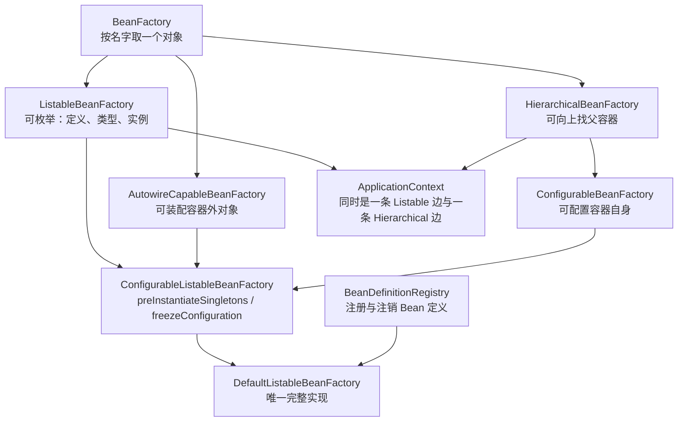
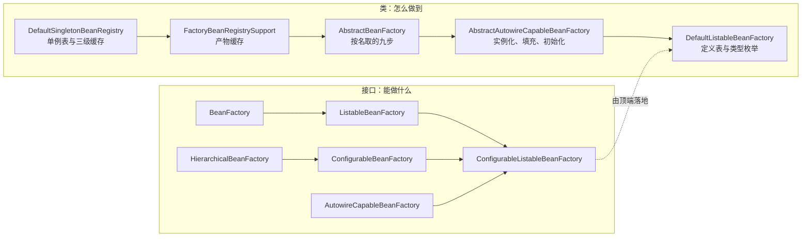
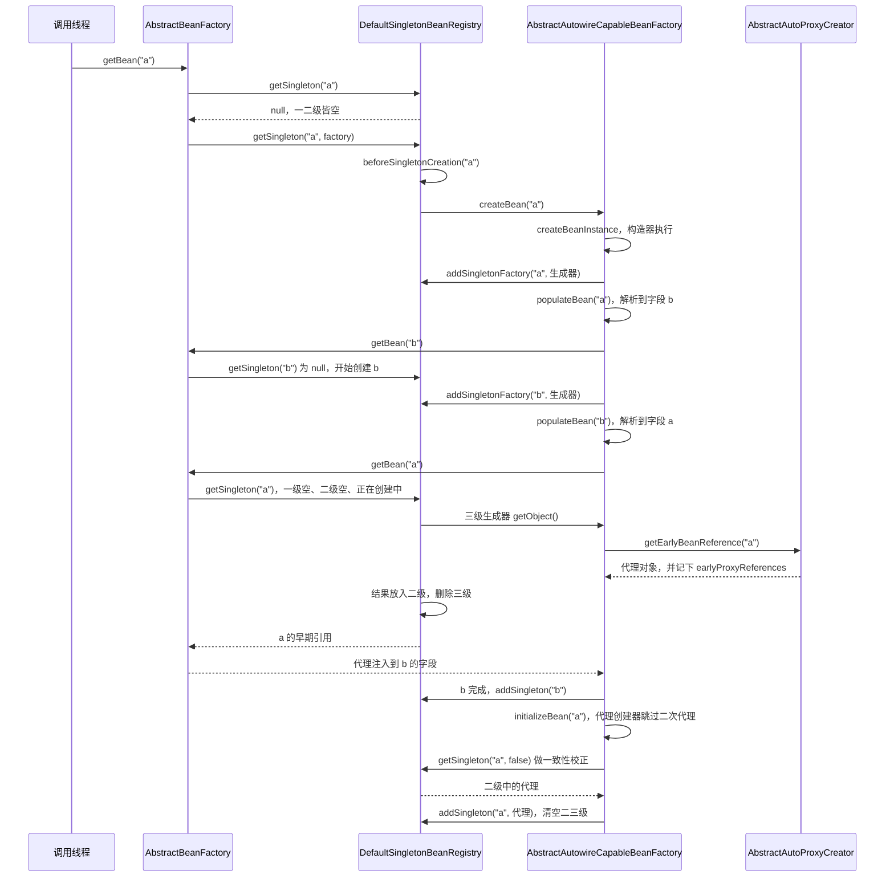
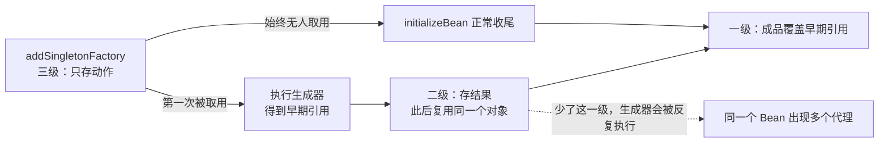
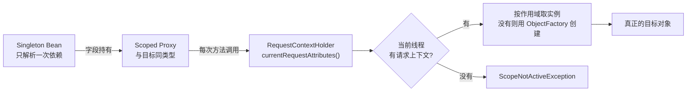
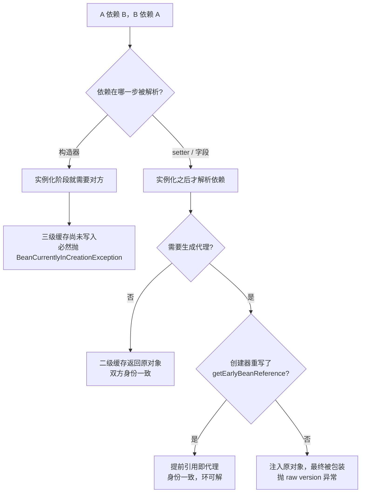

# IoC容器——BeanFactory与ApplicationContext的层次设计

**摘要：**

容器是一个名词，`getBean` 是一个动作，两者的关系才是理解 Spring 的入口。容器不是一层壳，而是一条有次序的流水线：先声明能力，再确定顺序，最后处理顺序里的例外；理解了这三段，常见报错文本与配置开关都能找到对应位置。本文沿一次 `getBean` 调用往下走：先看 `BeanFactory` 那组接口为什么被拆成五层，每层各自加了哪个能力、拆与不拆的代价落在哪里；再进 `AbstractBeanFactory#doGetBean` 的九个步骤，逐段看清 `&` 前缀怎样被剥掉、`FactoryBean` 的工厂与产物怎样分流、`dependsOn` 凭什么保证依赖先初始化、`scope` 的三条分支把对象交给了谁；最后停在 `DefaultSingletonBeanRegistry` 的三个 Map 前，回答三级缓存为什么必须是三级，以及构造器注入的循环依赖为什么在机制上无解——`ObjectFactory` 把"要不要生成代理"推到第一次被取用的那一刻，既换来延迟决策的余地，也守住了单例的身份唯一。机制讲透之后，代理与循环引用的冲突、`prototype` 的泄漏判据、Web 作用域的代理模式，都只是这条主线上的推论；落点也很清楚：容器能解的是时序，解不掉的是设计。

---

## 第 1 章 从一个断点说起

### 1.1 栈里的十一个类

把断点打在 `context.getBean("orderService")` 这一行，Step Into 之后，调用栈自上而下依次出现 `AbstractApplicationContext#getBean`、`AbstractBeanFactory#doGetBean`、`DefaultSingletonBeanRegistry#getSingleton`、`AbstractAutowireCapableBeanFactory#createBean`、`AbstractAutowireCapableBeanFactory#doCreateBean`、`DefaultListableBeanFactory#createBeanInstance`，再往下就是反射与构造器。十一个类、五个包，换成一行 `new OrderService()` 只需要一个字节码指令。

第一次看到这个栈的人，通常会得出一个判断：Spring 把一件简单的事写复杂了。但栈的每一层都不是装饰。委托那一层，是因为容器的对外身份（`ApplicationContext`）与真正干活的发动机（`DefaultListableBeanFactory`）必须能分开替换；九步那一层，是因为"按名字取一个对象"这条契约要同时容纳单例、原型、自定义作用域、`FactoryBean`、父子容器与循环依赖五种情况；三级缓存那一层，是因为依赖图里出现了环，而对象的创建只能单向推进。

换句话说，Spring 容器的复杂度不是设计者偏好，而是**被约束逼出来的形状**。这有点像去政务大厅办一件事：窗口只负责收件，真正决定怎么办的是后面几个科室，科室怎么划分取决于事项本身有多复杂，而不取决于柜台人员的偏好。把这些约束一条条找出来，比记住"容器有五大接口、refresh 有十二步"要管用得多。

### 1.2 本篇的位置

这篇只走机制线：一次 `getBean` 调用在容器内部经过哪些对象，这些对象为什么按这个顺序排列。应用层怎么把 Spring Boot 跑起来、自动装配与条件装配怎么工作，属于 [[01 启动流程——从main方法到ApplicationContext就绪]] 那一列的范围；`FactoryBean`、AOP 代理选择、`@Transactional` 失效这些点的模式视角，见 [[09 设计模式在Spring中的应用全景]]，此处只在需要时给一句结论。依赖注入的三种方式、字段注入与构造器注入的细节差异，以及三级缓存更细的源码，归 [[05 依赖注入的三种方式与循环依赖的三级缓存解决方案]]；本篇关心的是三级缓存在这条主线里什么时候被写、什么时候被读，两个问题的答案并不重合。

### 1.3 三个问题

后文的推进顺序由三个问题决定。

其一，`BeanFactory`、`ListableBeanFactory`、`HierarchicalBeanFactory`、`AutowireCapableBeanFactory`、`ConfigurableBeanFactory` 这五层接口，为什么不能合成一个类。接口拆分的教科书答案是接口隔离原则，但那句话解释不了"为什么偏偏拆成这五个"，也解释不了为什么 `ApplicationContext` 要同时继承 `ListableBeanFactory` 与 `HierarchicalBeanFactory`。

其二，`doGetBean` 里的九个步骤，每一步在防什么。只看代码会觉得其中几步（`markBeanAsCreated`、`getMergedLocalBeanDefinition`）像是可有可无的记账动作，把每一步删掉推演一遍，才知道它们各自挡着一种具体的失败。

其三，三级缓存为什么是三级。几乎所有面经都能背出三个 Map 的名字，但"两级为什么不行"这个问题，答案不在名字里，在 `ObjectFactory` 这个延迟结构上。

三个问题共用一条主线：容器如何在编译期完全未知的类集合上，安排出一个确定的创建顺序。理解了这条主线，后面那些看似零散的机制——`@DependsOn`、`&` 前缀、`ScopedProxyMode`、`allowCircularReferences`——都会自动归位。

---

## 第 2 章 接口的层次：每层只加一个能力

### 2.1 根接口：只承诺"能取"

`BeanFactory` 是整棵树的根，它给出的契约窄得近乎吝啬：按名字拿一个对象，附带几个判断（是否单例、是否原型、类型是什么、别名有哪些）。

```java
// org.springframework.beans.factory.BeanFactory（Spring 6.x，节选）
public interface BeanFactory {

    // 这个常量定义在根接口上，因为“取工厂”与“取产物”是同一套寻址规则
    String FACTORY_BEAN_PREFIX = "&";

    Object getBean(String name) throws BeansException;
    <T> T getBean(String name, Class<T> requiredType) throws BeansException;
    <T> T getBean(Class<T> requiredType) throws BeansException;
    ObjectProvider<T> getBeanProvider(Class<T> requiredType);

    boolean containsBean(String name);
    boolean isSingleton(String name) throws NoSuchBeanDefinitionException;
    boolean isPrototype(String name) throws NoSuchBeanDefinitionException;
    @Nullable Class<?> getType(String name) throws NoSuchBeanDefinitionException;
    String[] getAliases(String name);
}
```

`getBean(String)` 返回 `Object` 而不是泛型化的具体类型，常被当作早期设计粗糙的证据。但把创建决定推迟到运行期之后，容器手里只有一个名字和一张 `BeanDefinition` 表，编译期没有任何类型信息可用于返回值推导，`Object` 是这种分工下唯一诚实的返回类型。类型校验因此只能发生在运行期，落在 `doGetBean` 出口的 `adaptBeanInstance` 里，不匹配时抛 `BeanNotOfRequiredTypeException`。

根接口之所以窄，是因为它要能被最贫瘠的实现满足。`AbstractBeanFactory` 的注释里有一句关键的话：这个类不假设自己是 listable 的，因此也可以作为"从某个后端资源获取 Bean 定义（枚举代价很高）"的工厂的基类。换言之，`BeanFactory` 是"哪怕每个名字都要去远程目录查一次"也能实现的最小契约。

### 2.2 Listable：把"能列"单独钉成一层

`ListableBeanFactory` 加的是枚举：有多少个定义、定义都叫什么、某类型下有哪些名字、某注解下有哪些实例。这一层为什么必须单独存在，`AbstractBeanFactory#containsBeanDefinition` 的注释给了直接答案：这个操作在具体实现里可能很贵（譬如对远程注册表做目录查找），但对 listable 的工厂来说只是一次本地哈希查找，所以它才在那一层被提升为公开接口方法。

这句注释点破了一件常被忽略的事：接口分层不是在切方法，而是在切**代价承诺**。`containsBeanDefinition` 在 `AbstractBeanFactory` 里是 `protected abstract` 的模板方法，只有 listable 的工厂敢把它变成 `public`；因为一旦公开，调用方就有权假设它可以被高频调用。同理，`getBeanNamesForType` 背后要做类型推断（可能触发 `FactoryBean` 的实例化），这个代价只有持有完整注册表的实现才付得起。

枚举能力支撑了容器内部大量的批量逻辑：`@Autowired` 按类型解析需要一个类型到名字的索引，`BeanPostProcessor` 与 `ApplicationListener` 的自动发现需要遍历，`HandlerMapping` 的注册需要收集所有同类型 Bean。没有这一层，这些逻辑只能退化成"让用户显式注册"。

### 2.3 Hierarchical：两个方法，一条委托规则

`HierarchicalBeanFactory` 只加了两个方法：

```java
public interface HierarchicalBeanFactory extends BeanFactory {
    @Nullable BeanFactory getParentBeanFactory();   // 父容器，可能为空
    boolean containsLocalBean(String name);         // 只看本地，不看父容器
}
```

第二个方法是第一个方法的必要补丁。`BeanFactory#containsBean` 的语义是"整棵树里有没有"（实现里确实会向父容器回落），而判断"本地有没有"是委托逻辑的前提——`doGetBean` 只在本地没有定义时才去问父容器，它需要的正是这个不看父容器的版本。少了它，父子容器之间就无法表达"遮蔽"：本地定义了同名 Bean，父容器的定义必须被盖住，否则子容器的局部覆盖永远不生效。

父子容器的经典形态出现在外置 Tomcat 时代：`ContextLoaderListener` 建根容器装 Service 与 Repository，`DispatcherServlet` 建 Web 容器装 Controller 与 `HandlerMapping`，Web 容器以根容器为父。子能找父，父不能找子，这条单向规则把 MVC 层对业务层的依赖固定成一个方向。Spring Boot 默认只建一个容器，父子结构主要残留在遗留的 XML 配置与部分显式配置的场景里，它不再是应用开发的默认姿势。

### 2.4 AutowireCapable：给容器外的对象做装配

`AutowireCapableBeanFactory` 是给框架集成商准备的，它有两个别人没有的能力：`createBean(Class)` 按完整流程造一个对象但**不注册进容器**；`autowireBean(Object)` 对一个已经存在的对象做依赖注入，而这个对象不是容器创建的。

典型场景是 Quartz 的 `Job`：对象由 Quartz 反射 `new` 出来，生命周期归调度器管，但类里的 `@Autowired` 需要生效。这时只能借容器之手，对"外来对象"执行一遍属性填充与初始化回调。JPA 的 `EntityListener`、Servlet 的 `Filter`、以及各类需要回调用户代码的框架适配层，用的都是这条路。

这个能力不并进 `BeanFactory`，理由不是"用得少"，而是它**绕开了容器的记账**：造出来的对象不进单例表，也就没有销毁回调、没有循环依赖检测、没有按类型枚举。把这些方法放在主干接口上，等于让每个调用方都有机会绕过容器的一致性保证。

### 2.5 Configurable：配置容器自身

`ConfigurableBeanFactory` 面向的是"配置容器行为"而不是"使用容器"：设置类加载器、注册类型转换服务、追加 `BeanPostProcessor`、注册自定义 `Scope`、注册别名、设置嵌入式值解析器。

这一层的方法有一个共同特征——它们几乎都只应该在启动期被调用。运行期往一个已经预实例化完毕的容器里塞 `BeanPostProcessor`，不会追溯作用于已创建的 Bean；随手 `registerScope` 也可能让已经解析过的短生命周期 Bean 停在旧语义上。把这类方法单独放一层，等于在类型系统上标注了"这是给 `refresh()` 用的，不是给业务代码用的"。九个扩展点在容器里各自的调用时点，见 [[10 Spring扩展点全景——BeanPostProcessor、BeanFactoryPostProcessor与Aware接口]]。

### 2.6 汇聚点：接口说能做什么，类说怎么做到

五层接口最终汇到 `ConfigurableListableBeanFactory`，再由 `DefaultListableBeanFactory` 落地。下面这张表把每层加的能力与拆分的代价并排放，方便对照着看：

| 接口 | 新增的能力 | 必须单独拆的理由 | 合进根接口的代价 |
| :--- | :--- | :--- | :--- |
| `BeanFactory` | 按名字取对象，判断单例/原型/别名 | 最贫瘠的实现（远程注册表）也必须能满足 | —— |
| `ListableBeanFactory` | 枚举定义、按类型取名字、批量取实例 | 枚举是"便宜"的承诺，只有本地注册表付得起 | 远程实现被迫实现做不到的语义，或抛不支持异常 |
| `HierarchicalBeanFactory` | 父容器引用、本地包含判断 | 父子关系是可选能力，单一容器不需要 | 单一容器实现被迫暴露恒为空的父引用 |
| `AutowireCapableBeanFactory` | 造不注册的对象、装配外来对象 | 这些方法绕过容器的记账 | 主干接口上多出一条绕过一致性保证的通道 |
| `ConfigurableBeanFactory` | 类加载器、转换服务、后处理器、Scope | 只在启动期调用，使用方不该看见 | 运行期误用会破坏容器假设，且难以诊断 |

接口树的样子如下。注意 `ApplicationContext` 同时从 `ListableBeanFactory` 与 `HierarchicalBeanFactory` 两条边继承，这个双重身份是第 2.7 节的主题。



接口只说明"能做什么"，真正落地的是一条类继承链：`DefaultListableBeanFactory` → `AbstractAutowireCapableBeanFactory` → `AbstractBeanFactory` → `FactoryBeanRegistrySupport` → `DefaultSingletonBeanRegistry` → `SimpleAliasRegistry`。这条链的每一节负责一件事：最底下的注册表管单例与销毁，往上一层管 `FactoryBean` 产物的缓存，再上一层管"按名字取"的九步模板，再上一层管"创建"（实例化、填充、初始化、后处理器），最顶上的 `DefaultListableBeanFactory` 管定义注册表与类型枚举。三级缓存就在最底下那一节里。

两条链的分工可以用一张图看。左边是接口，声明"能做什么"；右边是类，说明"怎么做到"；接口最终由类链的顶端落地，而真正干活的能力分散在类链的每一节。



`BeanDefinition` 从 XML、注解、配置类解析出来并注册进这张表的过程，是另一个方向上的链条，见 [[03 Bean的定义与注册——从XML到注解驱动]]。这条类链还解释了一个容易看漏的细节：`getBean(Class<T>)` 的实现落在 `DefaultListableBeanFactory`，不在 `AbstractBeanFactory`。原因很直白——按类型取需要先枚举出候选名字，而枚举是 `ListableBeanFactory` 的能力，`AbstractBeanFactory` 刻意不假设自己具备。接口分层在这里不是命名游戏，它决定了方法必须写在哪一层。

### 2.7 ApplicationContext：两条边撑起一棵容器树

`ApplicationContext` 的继承列表里，`ListableBeanFactory` 与 `HierarchicalBeanFactory` 是并排出现的。这两条边合起来，才使"容器树"这个说法成立：`HierarchicalBeanFactory` 提供向上的引用，让 `getBean` 在本地查不到时可以回落；`ListableBeanFactory` 提供向内的枚举，让每一层都能独立完成批量处理（后处理器发现、监听器收集、按类型注入）。

但"树"这个比喻有一处会误导人：回落只发生在按名字查找失败时，枚举并不会自动跨层合并。`ListableBeanFactory` 的枚举方法只列本地定义，这是接口语义，不是实现遗漏。在父容器里有一个 `DataSource`、子容器里没有的情况下，子容器的 `getBeansOfType(DataSource.class)` 返回空数组，尽管 `getBean(DataSource.class)` 能成功——因为后者在解析不到候选时会继续向父容器 `resolveBean`。需要跨层枚举时，得换工具：`BeanFactoryUtils.beansOfTypeIncludingAncestors(context, DataSource.class)`。

把这条规则和"遮蔽"放在一起看，父子容器的行为就完整了：按名字查，本地定义优先，父容器的同名定义被盖住；本地没有，向上回落；按类型枚举，只看本地，除非显式用工具类合并。这三条规则合在一起能解释一批历史遗留问题，譬如迁移到 Spring Boot 时出现的"两个 `DataSource`、事务管理器认错了那个"——同名 Bean 在父子两层各有一份，注入点解析到的与业务以为的不是同一个。

`ApplicationContext` 与 `DefaultListableBeanFactory` 之间是组合，不是继承。`AbstractApplicationContext` 持有一个 `ConfigurableListableBeanFactory`，`getBean` 直接委托过去，`getBeanFactory()` 由子类提供实例：`GenericApplicationContext` 在构造时就创建好它，`AbstractRefreshableApplicationContext` 则在每次 `refresh()` 时销毁旧的、新建一个。前者对应注解驱动的现代用法，后者对应 XML 时代"改配置就重刷"的需求。门面与发动机分离，换来的是两件事各自可替换：容器的生命周期（事件、资源、环境）与 Bean 的创建逻辑（定义、单例、作用域）不再被绑死在一个类里。容器启动时如何按十二步把这两件事拼起来，见 [[01 Spring全局架构——模块划分与核心设计理念]]。

直接拿 `DefaultListableBeanFactory` 与拿一个 `ApplicationContext`，差别不只是接口多少：

| 维度 | 直接使用 `DefaultListableBeanFactory` | 使用 `ApplicationContext` |
| :--- | :--- | :--- |
| 单例实例化时机 | 首次 `getBean` 才创建（懒） | `refresh()` 末尾预实例化（`preInstantiateSingletons`） |
| `BeanPostProcessor` | 需手动 `addBeanPostProcessor` | 自动探测并注册（`@Autowired` 因此才生效） |
| `BeanFactoryPostProcessor` | 需手动调用 | 自动探测并执行 |
| 国际化 / 事件 / 资源通配符 | 不提供 | 由 `MessageSource`、`ApplicationEventPublisher`、`ResourcePatternResolver` 提供 |
| 父容器回落 | 需要自己 `setParentBeanFactory` | 由 Web 层或手动设置，语义一致 |
| 典型用途 | 框架内部、单测里造最小容器 | 几乎所有应用场景 |

> [!warning] 直接使用工厂的静默失效
> `DefaultListableBeanFactory` 不会自动注册 `AutowiredAnnotationBeanPostProcessor`。用它当容器，`@Autowired` 不会报错，只会保持 `null`——依赖注入的后处理器根本没进容器。这是"绕过门面"最典型的一种代价：能力还在，只是没人替你打开。

### 2.8 实现类的谱系与选型

接口树的末端是几个具体实现。它们的差别不在能力——都实现了 `ApplicationContext`——而在配置来源与刷新语义：

| 实现类 | 配置来源 | 刷新语义 | 典型用途与注意 |
| :--- | :--- | :--- | :--- |
| `AnnotationConfigApplicationContext` | `@Configuration`、`@ComponentScan` | 只允许刷新一次（继承 `GenericApplicationContext`） | 独立应用、集成测试；轻量，无 Web 能力 |
| `ClassPathXmlApplicationContext` | classpath 下的 XML | 每次 `refresh()` 销毁并重建 `BeanFactory` | 遗留 XML 项目；重复刷新会重建全部单例，代价高 |
| `GenericApplicationContext` | 编程式注册 `BeanDefinition` | 只允许刷新一次，重复调用抛 `IllegalStateException` | 框架开发、测试；`registerBean` 的入口 |
| `AnnotationConfigServletWebServerApplicationContext` | 注解 + 嵌入式 Servlet 容器 | 启动时创建 Web 服务器，与上下文同生命周期 | Spring Boot Web 默认；`onRefresh()` 里启动服务器 |
| `AnnotationConfigReactiveWebServerApplicationContext` | 注解 + 响应式服务器 | 同上 | WebFlux 应用 |

需要留意的只有一条：`refresh()` 能不能重复调用，由具体实现决定。`GenericApplicationContext` 系列（含 `AnnotationConfigApplicationContext`）内部用一个 `AtomicBoolean` 挡住第二次刷新；`AbstractRefreshableApplicationContext` 系列则每次都重建 `BeanFactory`，已注册的单例与后处理器全部重来。把上下文当成"可以随时重载配置的容器"用，通常要到第二次刷新时才碰壁。

---

## 第 3 章 getBean 的九步

### 3.1 两条入口，一个汇合点

`getBean` 有三个常用重载，按名字与按类型各走一段路，最后都汇到 `doGetBean`。

按名字的三条重载几乎是直通车：`getBean(name)` 就是 `doGetBean(name, null, null, false)`，`getBean(name, requiredType)` 把类型传下去做出口校验，`getBean(name, args...)` 把显式构造参数带上。

按类型的入口要绕一圈，因为容器得先把"类型"翻译成"名字"：`getBean(Class)` 调 `resolveBean`，后者调 `resolveNamedBean`，先 `getBeanNamesForType` 拿到候选，多个候选用 `@Primary`、`Ordered`/`@Priority` 消歧，消不掉就抛 `NoUniqueBeanDefinitionException`；一旦剩下唯一候选，再以那个名字回到 `getBean(beanName, null, args)`。也就是说，按类型取本质上是一次"名字解析 + 按名取"的两段式，第二段与第一条入口完全重合。

这条路径里藏着一个启动期风险：`getBeanNamesForType` 为了判断某个 `FactoryBean` 会产出什么类型，可能提前实例化这个工厂（`allowEagerInit` 为真时）。类型查询本该是只读动作，却可能触发创建，进而触发别的 Bean 的创建，把启动顺序搅乱。`doResolveBeanClass` 与 `getTypeForFactoryBean` 里那些 `allowInit` 参数，就是为这件事留的闸门。

### 3.2 doGetBean 的骨架

下面这段是整条调用链里最值得逐行读的一段。注解标出九个步骤的边界，代码按 6.x 的形态做了删减（日志、`StartupStep` 埋点、异常包装都略去），结构保持原样。

```java
// AbstractBeanFactory#doGetBean（Spring 6.x，删减版）
protected <T> T doGetBean(String name, @Nullable Class<T> requiredType,
                          @Nullable Object[] args, boolean typeCheckOnly) {

    // 第 1 步：名字归一。剥掉 & 前缀、展开别名、命中缓存
    String beanName = transformedBeanName(name);
    Object beanInstance;

    // 第 2 步：查一级缓存。命中且没有显式构造参数，直接返回
    Object sharedInstance = getSingleton(beanName);
    if (sharedInstance != null && args == null) {
        // 第 3 步：工厂与产物分流
        beanInstance = getObjectForBeanInstance(sharedInstance, name, beanName, null);
    }
    else {
        // 第 4 步：原型重入即失败，原型不缓存，无法提前暴露
        if (isPrototypeCurrentlyInCreation(beanName)) {
            throw new BeanCurrentlyInCreationException(beanName);
        }
        // 第 5 步：本地没有定义才问父容器
        BeanFactory parentBeanFactory = getParentBeanFactory();
        if (parentBeanFactory != null && !containsBeanDefinition(beanName)) {
            return (T) parentBeanFactory.getBean(originalBeanName(name), requiredType);
        }
        // 第 6 步：记账，并让合并定义重新合并一次
        if (!typeCheckOnly) {
            markBeanAsCreated(beanName);
        }
        try {
            // 第 7 步：合并父子定义，再做一次合法性校验
            RootBeanDefinition mbd = getMergedLocalBeanDefinition(beanName);
            checkMergedBeanDefinition(mbd, beanName, args);

            // 第 8 步：依赖先初始化，环检测在这里发生
            String[] dependsOn = mbd.getDependsOn();
            if (dependsOn != null) {
                for (String dep : dependsOn) {
                    if (isDependent(beanName, dep)) {
                        throw new BeanCreationException(beanName, "Circular depends-on relationship");
                    }
                    registerDependentBean(dep, beanName);   // 决定销毁顺序
                    getBean(dep);                           // 才真正去创建依赖
                }
            }

            // 第 9 步：按作用域分派，三条分支只差“谁负责缓存与销毁”
            if (mbd.isSingleton()) {
                sharedInstance = getSingleton(beanName, () -> {
                    try {
                        return createBean(beanName, mbd, args);
                    }
                    catch (BeansException ex) {
                        destroySingleton(beanName);         // 失败要清掉提前暴露的残留
                        throw ex;
                    }
                });
                beanInstance = getObjectForBeanInstance(sharedInstance, name, beanName, mbd);
            }
            else if (mbd.isPrototype()) {
                beforePrototypeCreation(beanName);
                try {
                    beanInstance = createBean(beanName, mbd, args);
                }
                finally {
                    afterPrototypeCreation(beanName);
                }
                beanInstance = getObjectForBeanInstance(beanInstance, name, beanName, mbd);
            }
            else {
                Scope scope = this.scopes.get(mbd.getScope());
                Object scoped = scope.get(beanName, () -> {
                    beforePrototypeCreation(beanName);
                    try {
                        return createBean(beanName, mbd, args);
                    }
                    finally {
                        afterPrototypeCreation(beanName);
                    }
                });
                beanInstance = getObjectForBeanInstance(scoped, name, beanName, mbd);
            }
        }
        catch (BeansException ex) {
            cleanupAfterBeanCreationFailure(beanName);
            throw ex;
        }
    }
    // 出口：类型适配，必要时走类型转换
    return adaptBeanInstance(name, beanInstance, requiredType);
}
```

### 3.3 九步逐段推演

第 1 步，名字归一。`transformedBeanName` 做两件事：剥掉所有开头的 `&`，再把别名解析成规范名，结果进 `transformedBeanNameCache`。剥 `&` 是因为 `&` 不是名字的一部分，而是寻址指令——`&foo` 要的是名为 `foo` 的 `FactoryBean` 工厂本体，`foo` 要的是它的产物。不剥的后果很具体：注册表里没有叫 `&foo` 的键，查不到；若注册表里恰好有个名字以 `&` 开头，那更是张冠李戴。别名归一是另一件事：XML 的 `<alias>`、`@Bean(name = {"a","b"})` 都会让同一个 Bean 有多个名字，注册表只认一个主键，不归一会造成同一个单例被造两次。

第 2 步，查一级缓存。`getSingleton(beanName)` 是 `getSingleton(beanName, true)` 的快捷形式：先看 `singletonObjects`，没有再看"是否正在创建"，正在创建才下钻二级、三级。命中且 `args == null` 就返回，注意这个 `args == null` 条件——调用方给了显式构造参数，语义是"按这些参数新建一个实例"，即使已有单例也不能拿来充数。

第 3 步，工厂与产物分流。`getObjectForBeanInstance` 是整个方法里最容易读错的一段。它先看**原始的** `name`（不是归一后的 `beanName`）是否带 `&`：带，就要求 `beanInstance` 必须是 `FactoryBean`，不是则抛 `BeanIsNotAFactoryException`，是则原样返回工厂；不带，且 `beanInstance` 确实是 `FactoryBean`，则调 `getObject()` 取产物，单例工厂的产物缓存在 `factoryBeanObjectCache` 里，并且产物会再走一遍 `postProcessAfterInitialization`——这就是"为什么注入点拿到的是产物而不是工厂"，以及"为什么 `FactoryBean` 的产物也能被 AOP 代理"。

第 4 步，原型重入检查。`prototypesCurrentlyInCreation` 是一个 `ThreadLocal`，记录当前线程正在创建的原型 Bean。原型不缓存、不提前暴露，所以同一个线程里第二次进入同一个原型就只能是环，直接抛 `BeanCurrentlyInCreationException`。这一句同时说明了原型的循环依赖为什么无解：三级缓存的整套机制都建立在"单例可以被提前暴露"上。

第 5 步，父容器回落。条件是"父容器非空且本地没有定义"，这个组合就是遮蔽语义的实现。委托时用 `originalBeanName(name)` 把 `&` 补回去，因为父容器也要按同样的寻址规则解释这个名字；父容器同样是 `AbstractBeanFactory` 时直接调它的 `doGetBean`，把 `typeCheckOnly` 一并传下去，避免类型检查被误当成真实创建。

第 6 步，记账。`markBeanAsCreated` 把名字加进 `alreadyCreated`，同时把旧的合并定义标记为过期，让第 7 步重新合并。注释写得很直白：既然真的要创建了，就再合并一次，以防这段时间里定义被改过。如果一个 `BeanFactoryPostProcessor` 在定义注册之后又改了属性，而第 7 步还在用旧缓存，创建出来的对象就会与最终定义不一致。`typeCheckOnly` 为真时跳过这一步，因为类型检查不该污染"有没有创建过"这个状态。

第 7 步，合并定义。`getMergedLocalBeanDefinition` 从 `mergedBeanDefinitions` 取缓存，必要时把父子定义合并（XML 的 `parent` 属性、`@Bean` 的继承语义都落在这里）。随后 `checkMergedBeanDefinition` 的校验力度比想象中小得多——源码里只拒绝抽象定义，真正的可行性要到 `createBean` 解析构造器时才暴露。这也解释了为什么"构造器参数没有匹配的 Bean"这类错误总是以 `BeanCreationException` 的形式、在很深的栈里报出来。

第 8 步，依赖先初始化。`mbd.getDependsOn()` 拿到的是 `@DependsOn` 或 XML `depends-on` 声明的名字数组。这里有两个动作：先 `registerDependentBean(dep, beanName)` 建立"谁依赖谁"的反向索引（销毁时依赖先走），再 `getBean(dep)` 真正触发创建。`isDependent` 检查用于发现 `@DependsOn` 自己成环的情况，抛"Circular depends-on relationship"。这一步是"依赖的 Bean 先初始化"的正解：它保证的是**初始化顺序**，不建立引用，也不解决注入，所以它和构造器注入完全是两回事——后者在实例化时就要求依赖已存在。

第 9 步，按作用域分派。三条分支的骨架几乎一样，差别只在"谁保管对象、谁负责销毁"：单例交给 `getSingleton(beanName, factory)`，这个方法内部完成"标记创建中 → 调工厂 → 登记单例 → 移出创建中"的闭环，失败时由 `doGetBean` 里的 catch 调 `destroySingleton` 清掉残留；原型用 `beforePrototypeCreation`/`afterPrototypeCreation` 包住一次 `createBean`，对象交给调用方，容器不记账；自定义作用域把 `createBean` 包成 `ObjectFactory` 交给 `scope.get`，由具体作用域决定存哪、存多久，`ScopeNotActiveException` 就是这一支在"当前没有活动作用域"时抛出来的。

出口的 `adaptBeanInstance` 做类型适配：`requiredType` 与实际类型不符时尝试 `TypeConverter` 转换，转不了才抛 `BeanNotOfRequiredTypeException`。这个设计让 `getBean("configDate", String.class)` 这类调用能返回字符串，也意味着"按类型取"在出口处还有一次隐式转换的机会。

把九步压缩成一张表，用来对照排错：

| 步 | 动作 | 略过这一步的后果 | 常见异常 |
| :--- | :--- | :--- | :--- |
| 1 | `transformedBeanName` 剥 `&`、展开别名 | `&foo` 查不到；别名指向同一单例却造出两份 | `NoSuchBeanDefinitionException` |
| 2 | 查一级缓存 | 单例退化成每次新建 | 无（语义错误） |
| 3 | `getObjectForBeanInstance` 分流 | 注入点拿到工厂而非产物，类型不匹配 | `BeanIsNotAFactoryException`、`BeanNotOfRequiredTypeException` |
| 4 | 原型重入检查 | 原型环无限递归，最终 `StackOverflowError` | `BeanCurrentlyInCreationException` |
| 5 | 父容器回落 | 子容器看不见父容器的 Bean | `NoSuchBeanDefinitionException` |
| 6 | `markBeanAsCreated` | 定义被后处理器改过时仍用旧合并结果 | 无（行为不一致） |
| 7 | `getMergedLocalBeanDefinition` | 父子定义未合并，属性缺失 | `BeanIsAbstractException` |
| 8 | `getDependsOn` 先初始化 | 依赖未就绪，初始化顺序错乱 | `Circular depends-on relationship` |
| 9 | 按 scope 分派 | 单例不走缓存、原型被当成单例 | `ScopeNotActiveException` |

### 3.4 两个"顺带解释"

到这一步，两个常见疑问已经有了源头答案。

其一，"依赖的 Bean 先初始化"不是靠字段注入的递归顺序，而是靠第 8 步的显式循环。注入发生在 `populateBean` 里，而 `populateBean` 要到第 9 步的 `createBean` 内部才执行；`@DependsOn` 的循环在它之前，因此"确保某个 Bean 已经就绪"这类要求应该用 `@DependsOn` 表达，而不是靠注入顺序碰运气。这也解释了 `@DependsOn` 为什么对原型同样有效——它根本不关心缓存。

其二，`FactoryBean` 返回的不是工厂本身，原因在第 3 步：分流依据是**调用方给的名字**，而不是被取对象的类型。容器内部需要工厂本体时（`preInstantiateSingletons` 里的 `getBean(FACTORY_BEAN_PREFIX + beanName)`、`isSingleton` 判断、`isTypeMatch` 推断产物类型），都会显式带上 `&`。同一个 bean name 在两条寻址路径下指向两个不同的对象，这是设计选择，不是歧义。

### 3.5 单例的"创建"发生在哪

第 9 步的 `getSingleton(beanName, factory)` 是理解后续一切的前提，它的骨架值得单独看一眼：

```java
// DefaultSingletonBeanRegistry#getSingleton(String, ObjectFactory)（删减版，保留语义）
public Object getSingleton(String beanName, ObjectFactory<?> singletonFactory) {
    Object singletonObject = this.singletonObjects.get(beanName);
    if (singletonObject == null) {
        beforeSingletonCreation(beanName);        // 标记“正在创建”，重入这里会抛异常
        boolean newSingleton = false;
        try {
            singletonObject = singletonFactory.getObject();   // 真正创建
            newSingleton = true;
        }
        finally {
            afterSingletonCreation(beanName);     // 移出“正在创建”集合
        }
        if (newSingleton) {
            addSingleton(beanName, singletonObject);  // 写入一级，同时清掉二三级
        }
    }
    return singletonObject;
}
```

这里出现了两个关键集合：`singletonsCurrentlyInCreation` 记录"正在创建"，`beforeSingletonCreation` 用 `add` 的返回值判断重入，重入即抛 `BeanCurrentlyInCreationException`；`addSingleton` 在写入一级的同时删除二级与三级条目。"正在创建"这个标记是三级缓存能被读取的前提——`getSingleton(beanName, true)` 只有在标记存在时才下钻，否则一次普通的一级未命中就会去碰三级缓存，语义就乱了。

`addSingleton` 里还有一个容易忽略的细节：用 `putIfAbsent` 而不是 `put`，若已有对象就抛 `IllegalStateException`。这条保护在并发场景下挡住"两个线程各自造了一个单例、后写的静默覆盖先写的"，代价是启动期偶发的 `Could not register object ... there is already object ... bound` 异常——它通常意味着某个 Bean 被用两种路径创建了两次。

---

## 第 4 章 三级缓存：为什么要三个 Map

### 4.1 三个 Map 与一个 Set

`DefaultSingletonBeanRegistry` 里有四个与单例相关的结构，各自的职责可以用一句话说清：

```java
// 单例成品。对外暴露的唯一真相
private final Map<String, Object> singletonObjects = new ConcurrentHashMap<>(256);
// 已经被提前引用过的对象。可能是代理，也可能就是原对象
private final Map<String, Object> earlySingletonObjects = new ConcurrentHashMap<>(16);
// 提前引用的“生成器”。只有在真的有人来取时才调用
private final Map<String, ObjectFactory<?>> singletonFactories = new ConcurrentHashMap<>(16);
// 按注册顺序排列的名字。销毁时倒序遍历，先销毁后注册的
private final Set<String> registeredSingletons = new LinkedHashSet<>(256);
```

对照成表：

| 缓存 | 存的是什么 | 写入时机 | 移除时机 | 内存量级（示例推算） |
| :--- | :--- | :--- | :--- | :--- |
| `singletonObjects` | 初始化完成的成品对象 | 创建流程末尾 `addSingleton` | 容器关闭或销毁单例 | 每个单例一条引用，约 40–64 B 的表项开销 |
| `earlySingletonObjects` | 已被取用过的早期引用（可能是代理） | 三级缓存被取用时 | 成品写入一级时 | 只在实际发生循环依赖时才有条目 |
| `singletonFactories` | `ObjectFactory` lambda | 实例化之后、填充之前 | 被取用时立即移除，或成品写入时 | 每个单例一个 lambda 与其捕获的引用，约 48–120 B |
| `registeredSingletons` | 名字集合 | 注册与提前暴露时 | 销毁时 | 名字引用，可忽略 |

三个 Map 都不是"存 Bean"，而是"存引用或生成引用的动作"。一个单例对象在容器里始终只有一份，被复制的是指向它的句柄。这条事实决定了后文所有关于内存的讨论都不该从"三级缓存占三份内存"出发。

### 4.2 写入时机：实例化之后，填充之前

三级缓存的写入点在 `AbstractAutowireCapableBeanFactory#doCreateBean` 里，位置极其讲究：

```java
// AbstractAutowireCapableBeanFactory#doCreateBean（删减版）
protected Object doCreateBean(String beanName, RootBeanDefinition mbd, Object[] args) {
    // 1. 实例化：构造器或工厂方法在这里执行
    BeanWrapper instanceWrapper = createBeanInstance(beanName, mbd, args);
    Object bean = instanceWrapper.getWrappedInstance();

    // 2. 合并定义的后处理（@Autowired 元数据、@PostConstruct 方法等在这里被收集）
    applyMergedBeanDefinitionPostProcessors(mbd, bean.getClass(), beanName);

    // 3. 提前暴露：注意条件，三个都必须成立
    boolean earlySingletonExposure = (mbd.isSingleton()
            && this.allowCircularReferences
            && isSingletonCurrentlyInCreation(beanName));
    if (earlySingletonExposure) {
        addSingletonFactory(beanName, () -> getEarlyBeanReference(beanName, mbd, bean));
    }

    // 4. 填充与初始化：注入发生在 populateBean 里
    Object exposedObject = bean;
    populateBean(beanName, mbd, instanceWrapper);
    exposedObject = initializeBean(beanName, exposedObject, mbd);
    // ……一致性校正与销毁登记（见 4.5）
}
```

读这段代码要抓住三点。

第一，写入位置在"实例化之后"。构造器已经执行完，对象已经在堆上，只是属性还没填、初始化回调还没跑。这个"半成品"就是提前暴露的东西，所以二级缓存里的对象不能直接拿去用——它的字段可能是 `null`，`@PostConstruct` 还没执行。

第二，条件是三个合取，其中 `isSingletonCurrentlyInCreation` 说明只有走 `getSingleton(beanName, factory)` 这条路创建的 Bean 才会登记提前引用。直接调 `AutowireCapableBeanFactory#createBean(Class)` 造对象时，这个标记不存在，因此不会写三级缓存，也就不会参与循环依赖解析。这条差异解释了为什么"用 `createBean` 手工造对象"的代码在遇到循环依赖时行为与容器内创建不同。

第三，`allowCircularReferences` 出现在条件里。把它设为 `false`，三级缓存根本不会写，循环依赖在第二次重入时抛异常——这就是那个开关的全部机制，它没有"更聪明的检测"，只是不登记。

### 4.3 读取路径：三级下钻

读取方的入口是 `getSingleton(beanName, true)`：

```java
// DefaultSingletonBeanRegistry#getSingleton(String, boolean)（删减版）
protected Object getSingleton(String beanName, boolean allowEarlyReference) {
    Object singletonObject = this.singletonObjects.get(beanName);       // 一级
    if (singletonObject == null && isSingletonCurrentlyInCreation(beanName)) {
        singletonObject = this.earlySingletonObjects.get(beanName);     // 二级
        if (singletonObject == null && allowEarlyReference) {
            // 6.2 起由 singletonLock 保护，更早版本是对 singletonObjects 加 synchronized
            ObjectFactory<?> singletonFactory = this.singletonFactories.get(beanName);  // 三级
            if (singletonFactory != null) {
                singletonObject = singletonFactory.getObject();         // 此刻才决定要不要代理
                this.singletonFactories.remove(beanName);               // 生成器用一次即弃
                this.earlySingletonObjects.put(beanName, singletonObject);  // 结果进二级
            }
        }
    }
    return singletonObject;
}
```

三段查找的顺序与语义分别是：一级是"已经完工的"，二级是"已经被提前引用过的"，三级是"可以生成提前引用的"。第二级存在的意义，是让第三级的生成器**只被调用一次**：第一次取用时调 `getObject()`、把结果放进二级、把生成器删掉；后续再有人来取，直接命中二级，不会再生成第二个代理。

`allowEarlyReference` 参数也是一道闸门。`doCreateBean` 结尾做一致性校正时调的是 `getSingleton(beanName, false)`，明确表示"不要现场生成提前引用"——此时如果二级里还没有东西，就不该为了一次检查而触发代理创建。这个细节说明三级缓存的"延迟"是分层的：只有真正需要注入的调用方，才有资格触发它。

### 4.4 A 与 B 的完整时序

下面这张时序图把一次 `A → B → A` 的字段注入循环依赖跑完，参与者只保留关键角色。假设 A 被 `@Transactional` 切中，需要生成代理。



几个容易读错的节点值得单独指出。

图里那条"代理注入到 b 的字段"，是循环依赖能成立的实质：b 拿到的不是 A 的半成品原对象，而是 `getEarlyBeanReference` 当场生成的代理。代理此时已经可以工作（拦截器链依赖的 advisor 已在容器里），但它内部 `target` 指向的原对象字段还没填完——所以 b 在构造期或 `@PostConstruct` 里调用 a 的方法，可能读到 `null` 字段。循环依赖解决的只是"引用能拿到"，不解决"拿到时是否可用"。

图里那条"代理创建器跳过二次代理"，对应 `AbstractAutoProxyCreator` 里那段记账逻辑：

```java
// AbstractAutoProxyCreator（6.x，节选）
@Override
public Object getEarlyBeanReference(Object bean, String beanName) {
    Object cacheKey = getCacheKey(bean.getClass(), beanName);
    this.earlyProxyReferences.put(cacheKey, bean);   // 记下“这个原对象已经提前代理过”
    return wrapIfNecessary(bean, beanName, cacheKey);
}

@Override
public Object postProcessAfterInitialization(@Nullable Object bean, String beanName) {
    if (bean != null) {
        Object cacheKey = getCacheKey(bean.getClass(), beanName);
        if (this.earlyProxyReferences.remove(cacheKey) != bean) {
            return wrapIfNecessary(bean, beanName, cacheKey);   // 没提前代理过，现在补
        }
    }
    return bean;   // 已经提前代理过，返回原对象，由 doCreateBean 换成早期引用
}
```

最后一行是关键：初始化阶段返回的不是代理，而是**原对象**。代理最终进一级缓存，靠的是 `doCreateBean` 结尾那段校正：

```java
// doCreateBean 结尾（删减版）
if (earlySingletonExposure) {
    Object earlySingletonReference = getSingleton(beanName, false);
    if (earlySingletonReference != null) {
        if (exposedObject == bean) {
            exposedObject = earlySingletonReference;   // 用早期引用替换，保证只有一个身份
        }
        // 否则说明“提前暴露的”与“最终包装的”不是同一个，后面会抛异常（见第 5 章）
    }
}
```

`exposedObject == bean` 成立，才替换。这个判断是三级缓存机制的安全阀：如果后处理阶段真的又包了一层，两个对象就不相等，替换会掩盖不一致，所以代码选择不替换、留给后面的检查报错。

### 4.5 为什么不能是两级

把三个 Map 减成两个，有两种减法，各自对应一种失败。

第一种减法是"去掉三级，暴露时就把对象放进二级"。这样在 `addSingletonFactory` 的位置，就必须立刻调用 `getEarlyBeanReference` 生成对象，而这个调用对**所有**单例都会发生，不只是循环依赖里的那些。

代价分两层。第一层是代理的生成时机：`AbstractAutoProxyCreator#getEarlyBeanReference` 里那句 `wrapIfNecessary` 要向容器查 advisor，而此刻这个 Bean 的依赖图还没走完，advisor 对应的 Bean 可能尚未就绪，代理链要么不完整，要么反过来把 advisor 的创建拖进同一个环。第二层是记账被稀释：每个 Bean 都会在 `earlyProxyReferences` 里留一条记录，`postProcessAfterInitialization` 于是一律跳过代理，最终进一级缓存的对象全部来自实例化阶段——"初始化完成之后再决定要不要代理"这条时序等于被拿掉。

两级方案里，身份一致性反而还维持得住（代理进一级，注入点也是代理），但这是以"所有 Bean 都在错误的时机被代理"换来的。**延迟决策**是三级缓存的第一个理由：`ObjectFactory` 把"要不要生成代理、生成什么代理"推到"真的有人来取"的那一刻。

第二种减法是"去掉二级，只留一级与三级"。这时每次取早期引用都要调用生成器，`getEarlyBeanReference` 会被重复执行：`wrapIfNecessary` 每调一次就 `new` 一个代理，同一个 Bean 的不同注入点于是拿到互不相等的代理实例，它们指向同一个原始对象；`earlyProxyReferences` 的记账也会被反复覆盖，后处理阶段跳不跳代理取决于最后一次调用落在何时。二级缓存的职责是结果缓存：生成器只跑一次，结果复用，身份于是被固定下来。这是第二个理由，也是三个 Map 里最容易被忽略的一个。

第三个理由关乎身份。`singletonObjects` 的契约是"同一个名字永远返回同一个对象"，这是单例语义的地基。任何让同一个名字在不同路径下解析出两个身份的设计，都会在下游引发难以定位的问题：按类型注入时两个实例都符合类型、`@Transactional` 在其中一个上生效而另一个不生效、`equals` 判断意外为假。三级缓存的结构（生成器存动作、二级存结果、一级存成品）恰好保证了这个身份唯一性：动作只执行一次，结果被替换进成品，成品进一级。

三个结构的职责差异，用一张图看得更清楚：动作只该执行一次，结果只该生成一次，成品只该有一个。



一句话概括：三级缓存不是"多一层缓存"，而是把"生成动作"与"生成结果"分开存。动作必须在有人来取时才执行（延迟），结果必须只生成一次（唯一），成品必须覆盖前两者（一致）。三个诉求对应三个结构，少一个都不成立。

### 4.6 开关、版本与那条报错

`allowCircularReferences` 是 `AbstractAutowireCapableBeanFactory` 的字段，默认 `true`；`setAllowCircularReferences(false)` 之后，4.2 节那段条件里的第二项为假，三级缓存不写，setter/字段注入的环在第二次重入时抛 `BeanCurrentlyInCreationException: Requested bean is currently in creation: Is there an unresolvable circular reference?`。

Spring Boot 从 2.6 起把这个开关的默认值翻了：`spring.main.allow-circular-references` 默认 `false`，启动时若检测到环，`SpringApplication` 会把容器设为不允许循环引用，最终由 Spring Boot 的失败分析器（`BeanCurrentlyInCreationFailureAnalyzer`）打印那段很有名的提示——"Relying upon circular references is discouraged and they are prohibited by default…"。这里有一处常被误传的归因：那段文字不是 Spring Framework 抛出的异常消息，异常本身只有 `Requested bean is currently in creation`，提示与 `Action` 段落来自 Boot 的失败分析器。分清这一点，排查时才知道该去搜异常类还是搜配置项。

把开关关掉是一种选择，不是一种修复。它把"容器替你解环"变成"你自己解环"，代价是几个常见场景会直接启动失败：第三方库内部用 setter 互相注入、老项目的 `@Configuration` 互相引用、以及某些以 `@Autowired` 字段实现的"回调注册"模式。这些东西在 Spring Boot 2.5 之前一直跑得好好的，升级到 2.6 之后集体暴露，原因不是代码变差，而是容器的容忍度变了。

### 4.7 构造器注入为什么无解

这是最重要的一条判据，值得从机制上说透。

三级缓存的写入点在 `createBeanInstance` **之后**。而构造器注入的依赖解析发生在 `createBeanInstance` **之中**：`autowireConstructor` 要挑一个构造器、解析每个参数的类型、逐个 `getBean` 拿到实参，然后才能反射 `newInstance`。也就是说，A 的构造器需要 B 时，A 连对象都还没有，`addSingletonFactory` 根本没有执行的机会。

推演一遍：`getBean("a")` → 一级未命中 → `getSingleton("a", factory)` → `beforeSingletonCreation("a")` 把 a 标记为正在创建 → `createBean("a")` → 构造器解析需要 b → `getBean("b")` → b 同样进入创建流程 → b 的构造器解析需要 a → `getBean("a")` → `getSingleton("a")` 一级空、二级空（a 还没实例化，哪来的早期引用）、三级也空（还没写）→ 进入 else 分支 → `getSingleton("a", factory)` → `singletonObjects` 空 → `beforeSingletonCreation("a")` → 集合里已有 a，`add` 返回 `false` → 抛 `BeanCurrentlyInCreationException`。

链条的断点非常明确：三级缓存登记的是"已经实例化的半成品"，而构造器注入要求"实例化之前就拿到依赖"。两件事在时间上互斥，所以任何"让 Spring 支持构造器循环依赖"的说法都不成立。可行的绕法是改变其中一侧的时机：给构造参数加 `@Lazy`，注入的是一个延迟解析的代理，A 的构造器不再需要 B 的真实实例；或者把参数换成 `ObjectProvider<T>`，容器只注入一个提供者，B 在第一次 `getObject()` 时才创建。两种做法都是"把依赖从构造期推到使用期"，不是"让容器解开了环"。

---

## 第 5 章 代理与循环依赖：同一名字下的两个对象

### 5.1 提前引用不等于最终对象

4.4 节的时序里有一条隐含前提：`getEarlyBeanReference` 返回的东西，必须与 `initializeBean` 之后最终进一级缓存的东西是同一个。这个前提由 `AbstractAutoProxyCreator` 的记账逻辑保证，但它只对"实现了 `getEarlyBeanReference` 的创建器"成立。

`SmartInstantiationAwareBeanPostProcessor` 的默认实现是原样返回：

```java
// SmartInstantiationAwareBeanPostProcessor 的默认方法（Spring 6.x）
default Object getEarlyBeanReference(Object bean, String beanName) throws BeansException {
    return bean;   // 默认什么都不做，提前引用就是原对象
}
```

于是问题变成：哪些后处理器重写了它，哪些没有。重写了的，能在提前暴露阶段给出代理，身份前后一致；没重写的，提前暴露的是原对象，最终包装的是代理，两个身份。`doCreateBean` 结尾的 `exposedObject == bean` 判断会把这种情形识别出来，`allowRawInjectionDespiteWrapping` 为 `false`（默认）时抛异常。

### 5.2 @Transactional 为什么能过

事务代理由 `AnnotationAwareAspectJAutoProxyCreator` 创建，它继承 `AbstractAutoProxyCreator`，因此重写了 `getEarlyBeanReference`：提前引用阶段就 `wrapIfNecessary` 生成代理，并记账。于是时序变成：b 注入到的是 A 的代理；A 初始化时后处理器看到账本，跳过二次代理返回原对象；`doCreateBean` 用早期引用（代理）替换；一级缓存里也是这个代理。两个注入点拿到同一个代理，单例语义完整。

这也解释了为什么"`@Transactional` + 字段注入的循环依赖"长期被当作"Spring 支持循环依赖"的证据——它确实能跑，但跑通的前提是被循环的 Bean 恰好由一个重写了提前引用的创建器负责代理。代理方式的取舍（JDK 动态代理与 CGLIB）与自调用失效的成因，见 [[06 AOP实现原理——JDK动态代理与CGLIB]]。

### 5.3 @Async 为什么过不去

异步代理由 `AsyncAnnotationBeanPostProcessor` 创建，它的继承链是 `AbstractBeanFactoryAwareAdvisingPostProcessor` → `AbstractAdvisingBeanPostProcessor`。这个基类确实实现了 `SmartInstantiationAwareBeanPostProcessor`，但**没有重写 `getEarlyBeanReference`**，只重写了 `postProcessAfterInitialization`：

```java
// AbstractAdvisingBeanPostProcessor（6.x，摘意）：实现了接口，却没重写提前引用
public abstract class AbstractAdvisingBeanPostProcessor extends ProxyProcessorSupport
        implements SmartInstantiationAwareBeanPostProcessor {

    // 接口里的 getEarlyBeanReference 用默认实现，原样返回 bean
    // 代理只在这一步创建：
    @Override
    public Object postProcessAfterInitialization(Object bean, String beanName) {
        // ……
        ProxyFactory proxyFactory = prepareProxyFactory(bean, beanName);
        return proxyFactory.getProxy(this.beanClassLoader);
    }
}
```

于是时序变成：b 注入到的是 A 的**原对象**（提前引用默认返回原对象）；A 初始化完成时 `postProcessAfterInitialization` 把它包装成异步代理；`doCreateBean` 结尾的 `exposedObject == bean` 为假（代理 != 原对象），`allowRawInjectionDespiteWrapping` 为 `false`，`hasDependentBean` 为真，于是抛：

> Bean with name 'a' has been injected into other beans [b] in its raw version as part of a circular reference, but has eventually been wrapped. This means that said other beans do not use the final version of the bean. This is often the result of over-eager type matching - consider using 'getBeanNamesForType' with the 'allowEagerInit' flag turned off, for example.

这段消息值得逐句读。它没有说"循环依赖不支持"，它说的是"注入的是原始版本，而最终被包装了"——问题不在环本身，在环与代理的时序冲突。它也给出了官方怀疑方向：过度积极的类型匹配（`getBeanNamesForType` 提前触发 `FactoryBean` 实例化）会让本不该提前暴露的 Bean 被提前解析，从而制造更多这类冲突。

### 5.4 两个对象带来的下游问题

第一个后果是注入原始对象。若循环链上的 Bean 同时带 `@Async` 与 `@Transactional`，b 拿到的是原对象，那么 b 内部调用 a 的事务方法时，事务切面根本不在链上——不是"事务失效"这种注解层面的问题，而是对象身份层面的问题。这类故障的排查特征是：同一个 Bean，从容器里 `getBean` 出来是代理，从注入字段看是原对象，`AopUtils.isAopProxy` 两种结果。

第二个后果是候选消歧。如果自定义的 `SmartInstantiationAwareBeanPostProcessor` 在提前引用与后处理两个阶段各生成一个代理，且没有按 5.1 节的约定记账，容器里就会出现"同一类型、两个实例"的局面。此时若注入点按接口类型注入，且容器中恰好还有该接口的另一个实现参与候选，`resolveNamedBean` 的消歧就会撞上 `NoUniqueBeanDefinitionException`。这个异常单独看像是"候选太多"，真正的病根在前面：提前引用与最终对象不是同一个。

第三个后果更隐蔽：`allowRawInjectionDespiteWrapping` 设为 `true` 可以压掉那段异常，让应用启动起来，但注入的仍然是原始对象。关掉报警器不等于修好电路，这个开关只适合"先用起来、再改设计"的过渡期。

| 场景 | 是否可解 | 实际行为 | 处理方式 |
| :--- | :--- | :--- | :--- |
| 字段/setter 注入，无代理 | 可解 | 二级缓存返回原对象，双方一致 | 保留，或在重构时拆环 |
| 字段/setter 注入，`@Transactional` | 可解 | 提前引用即代理，身份一致 | 保留；注意此时字段尚未填充 |
| 字段/setter 注入，`@Async` | 不可解 | 注入原对象，包装后抛 `raw version` 异常 | 拆环、`@Lazy`、`ObjectProvider`，或把异步方法挪到独立 Bean |
| 构造器注入 | 不可解 | 第二次进入时抛 `BeanCurrentlyInCreationException` | 拆环，或对其中一侧用 `@Lazy`/`ObjectProvider` |
| 原型之间互相依赖 | 不可解 | 同线程重入即抛异常 | 拆环；原型没有提前暴露 |
| 自定义作用域之间互相依赖 | 取决于作用域实现 | 若作用域自身缓存了对象，可能可解 | 让作用域的 `get` 具备幂等缓存 |

`@Lazy` 的边界也要说清：它只是把解析推迟，注入点拿到的是一个延迟代理或 `ObjectProvider`。如果两侧都加 `@Lazy`，环依然存在，只是所有解析都被推迟到首次调用，错误从启动期挪到了运行期；如果被代理的类是 `final` 的、或注入点按具体类注入而代理只能走接口，`@Lazy` 还会直接失败。

---

## 第 6 章 singleton 与 prototype：缓存与否决定了谁管生老病死

### 6.1 三条分支的实质差异

第 3 章第 9 步已经看过三条分支的骨架。把差异单独列出来，只有两条：单例分支把对象交给 `DefaultSingletonBeanRegistry` 保管，并在销毁时回调；原型分支把对象直接交还调用方，容器不保留任何引用；自定义作用域分支把保管责任外包给 `Scope` 实现。

`registerDisposableBeanIfNecessary` 里那句守卫是原型语义的关键：

```java
// AbstractBeanFactory#registerDisposableBeanIfNecessary（节选）
protected void registerDisposableBeanIfNecessary(String beanName, Object bean, RootBeanDefinition mbd) {
    if (!mbd.isPrototype() && requiresDestruction(bean, mbd)) {   // 原型直接跳过
        if (mbd.isSingleton()) {
            registerDisposableBean(beanName, new DisposableBeanAdapter(bean, beanName, mbd, ...));
        }
        else {
            // 自定义作用域：把销毁回调登记给作用域，由作用域在合适时机触发
            Scope scope = this.scopes.get(mbd.getScope());
            scope.registerDestructionCallback(beanName, new DisposableBeanAdapter(...));
        }
    }
}
```

原型不进销毁表，意味着 `@PreDestroy`、`DisposableBean#destroy`、`destroyMethod` 对一个原型 Bean 都不会被容器调用。这不是遗漏，是语义选择：容器没有保存这个对象，也就没有立场去销毁它。完整的初始化与销毁回调顺序，见 [[04 Bean的生命周期——从定义到销毁的完整流程]]。

### 6.2 原型的三个后果

第一，每次 `getBean` 都走完整创建流程：实例化、填充、初始化、后处理器全跑一遍。单例的重复 `getBean` 只是一次 `ConcurrentHashMap#get`，原型的每一次都是一次 `createBean`，成本差着一个数量级（见 8.3 的推算）。

第二，销毁责任转移给调用方。原型 Bean 若持有连接、文件句柄、线程池、`Closeable` 资源，容器不会替你关，只能由创建方在 finally 里显式释放，或改成单例、或改成作用域 Bean 由作用域负责。

第三，原型之间不能有环。第 4 步的 `isPrototypeCurrentlyInCreation` 检查保证同线程重入即抛，因为原型没有"提前暴露"这回事——没有缓存，就没有半成品可暴露。

### 6.3 singleton 注入 prototype 的钉住效应

这是原型最容易踩的坑，且症状与直觉相反。单例 A 注入原型 B，容器在创建 A 时解析一次 B，此后 A 永远持有那一个 B 实例。B 的 `scope` 声明是 `prototype`，但在这个注入点上它事实上变成了单例——笔者把这个现象叫**钉住**。

症状通常表现为"配置/状态不刷新"：B 里放了一个每次调用都该重置的计数器，结果从第二次调用开始就不对了；或者 B 依赖 `request` 作用域的数据，却在第一个请求之后一直返回旧值。反过来的组合（原型注入单例）没有问题，因为原型每次创建都会重新解析依赖，单例本来就只有一份。

三种解法，代价各不相同：

| 解法 | 做法 | 代价 |
| :--- | :--- | :--- |
| `ObjectProvider<T>` | 注入提供者，每次 `getObject()` 现取 | 调用点要显式取，代码多一层；拿到的仍是新实例，销毁仍要自己管 |
| `@Lookup` | 抽象方法由容器生成子类实现，每次调用返回新实例 | 需要 CGLIB 子类；抽象方法不能被 `final`；继承结构被绑定 |
| 作用域代理 | 给 B 加 `proxyMode`，注入点持有代理 | 多一层间接调用；`final` 类不可代理；调试栈变深 |

三者共同的本质，是把"注入一次"换成"每次使用时解析"。差别在解析发生在哪一层：`ObjectProvider` 在调用方代码里，`@Lookup` 在容器生成的子类里，作用域代理在代理对象的方法拦截里。

### 6.4 原型泄漏的判据

原型不必然泄漏，"容器不销毁"也不等于"一定泄漏"。判断一个原型是否危险，看四个条件是否同时成立：对象有状态且状态会累积；对象持有需要显式释放的资源；对象被长生命周期的对象长期持有；对象的创建频率与释放频率不匹配。四条里前两条成立时，就必须有人负责关闭；再叠加第三条，就成了确定的内存与连接泄漏。

安全的原型长什么样：无状态、纯计算、生命周期与方法调用一致、不持有外部资源。这类对象即使是原型，也只是多付一点创建成本，不会积累。

### 6.5 两种作用域的机制对照

| 维度 | `singleton` | `prototype` |
| :--- | :--- | :--- |
| 缓存位置 | `singletonObjects`（经三级缓存暴露） | 不缓存 |
| 创建次数 | 容器生命周期内一次 | 每次 `getBean` 一次 |
| 循环依赖 | setter/字段注入可解，构造器无解 | 不可解，重入即抛 |
| 销毁回调 | 注册进 `disposableBeans`，关闭时回调 | 不注册，容器不调用 |
| `@PreDestroy` | 生效 | 不生效 |
| 创建开销 | 一次 | 每次完整流程 |
| 典型误用 | 无状态对象被当成有状态用 | 有状态/持资源对象被注入单例（钉住或泄漏） |

---

## 第 7 章 作用域的扩展：短命 Bean 如何被长命 Bean 注入

### 7.1 Scope 的五个方法

自定义作用域要实现 `org.springframework.beans.factory.config.Scope`：

```java
public interface Scope {
    Object get(String name, ObjectFactory<?> objectFactory);          // 取，没有就创建
    @Nullable Object remove(String name);                             // 移除
    void registerDestructionCallback(String name, Runnable callback); // 销毁回调
    @Nullable Object resolveContextualObject(String key);             // 上下文对象（如 ServletContext）
    @Nullable String getConversationId();                             // 会话标识（如 sessionId）
}
```

`get` 的语义是"按名字在这个作用域内取，没有则用工厂创建并存入"。容器在 `doGetBean` 第 9 步把 `createBean` 包成 `ObjectFactory` 交给它，作用域自己决定存哪、存多久、什么时候清。

### 7.2 request、session、application、websocket

Web 作用域不是容器自带的，而是在 Web 环境启动时注册进去的。`WebApplicationContextUtils#registerWebApplicationScopes` 会注册 `request`、`session`、`application` 三个，并在同一个方法里把 `ServletRequest`、`ServletResponse`、`HttpSession`、`WebRequest` 注册为"可解析依赖"——这就是为什么 `@Autowired HttpServletRequest` 能用，而容器里其实并没有一个叫 `request` 的 Bean。

`request` 与 `session` 的实现走 `AbstractRequestAttributesScope#get`：从 `RequestContextHolder.currentRequestAttributes()` 取当前线程绑定的请求属性对象，再按作用域读写属性。没有请求线程绑定时，`currentRequestAttributes` 抛 `IllegalStateException`，`doGetBean` 把它包成 `ScopeNotActiveException`——这个异常名比"空指针"诚实得多，它明确说的是"当前没有活动的作用域"。

`application` 作用域落在 `ServletContext` 属性上；`websocket` 作用域由 WebSocket 支持在相应配置下注册，语义与 session 类似，以 socket 会话为生命周期边界。

### 7.3 作用域代理：为什么必须代理

单例 Bean 注入一个 `request` 作用域的 Bean，如果直接注入，容器在创建单例时就会解析它——此时可能没有请求（启动即失败），也可能有请求（把第一个请求的对象钉住）。两种结果都错。`ScopedProxyMode` 解决的就是这件事：注入点拿到的不是目标对象，而是一个代理，每次方法调用时才去当前作用域取真正的实例。这像公司前台的分机：名片上印的是前台号码，打过去总有人接，具体转到哪条线由当天的值班表决定，而不由名片决定。



三种模式的选择是一条纯代价曲线：

| 模式 | 代理方式 | 适用与代价 |
| :--- | :--- | :--- |
| `NO`（默认） | 不代理 | 只在注入方生命周期不长于被注入方时可用；否则钉住或启动失败 |
| `INTERFACES` | JDK 动态代理 | 目标实现了接口才可用；调用多一层反射；无法代理接口外的方法 |
| `TARGET_CLASS` | CGLIB 子类 | 不要求接口，`@RequestScope`/`@SessionScope` 的默认值；`final` 类或 `final` 方法会失败，且需要额外生成字节码 |

`@RequestScope`、`@SessionScope` 这些组合注解已经把 `proxyMode` 默认成 `TARGET_CLASS`，原因很实际：大多数 Controller/Service 不实现接口，`INTERFACES` 模式在它们身上直接不可用。

### 7.4 异步线程里的作用域

`RequestContextHolder` 的底层是一个 `ThreadLocal`（可选的 `InheritableThreadLocal`）。请求处理线程切到业务线程池之后，那个线程上没有绑定请求属性，`request` 作用域 Bean 的访问就会抛 `ScopeNotActiveException`。这不是"偶发空指针"，而是线程模型与作用域模型不匹配的必然结果。

常见处理方式有三种：在任务提交时显式把 `RequestAttributes` 传过去，并在执行线程里 `RequestContextHolder.setRequestAttributes(attrs)`，执行完清掉；在 Web 层用 `WebAsyncManager` 与 `WebAsyncManagerIntegrationFilter` 让 Spring MVC 替你做传递（`Callable`、`DeferredResult` 的异步返回值走这条路）；或者干脆不在异步线程里访问请求作用域 Bean，把需要的数据在提交任务前取出来作为参数传进去。第三种最土，也最不容易出错——作用域的本质是生命周期，跨线程共享一个请求的生命周期，等于手工延长了它。

---

## 第 8 章 判据、反例与代价

### 8.1 五条判据

把前文的机制压缩成五条可以现场用的判断。

第一，看依赖注入的位置判断环能不能解。构造器注入的环一定失败，字段/setter 注入的环才有讨论余地。原因是三级缓存的写入点在实例化之后，而构造器解析在实例化之中。

第二，看启动报错的文本判断失败类型。`Requested bean is currently in creation` 是环，`has been injected into other beans ... in its raw version` 是"提前引用与最终包装不一致"，`NoUniqueBeanDefinitionException` 是候选消歧，`ScopeNotActiveException` 是作用域不在当前线程。四种文本对应四条完全不同的修复路径，混着改只会越改越乱。

第三，看 `FactoryBean` 的寻址是否需要 `&`。要工厂本体就带 `&`，要产物就不带；容器内部推断类型时可能提前实例化工厂，这是启动期副作用的来源之一。

第四，看原型是否被长生命周期对象持有。持有即钉住，钉住即状态不刷新；若原型还持有资源，就是泄漏。

第五，看代理创建器有没有重写 `getEarlyBeanReference`。重写了的（`@Transactional` 走的 `AbstractAutoProxyCreator`）能在环里保持身份；没重写的（`@Async` 走的 `AbstractAdvisingBeanPostProcessor`）会在环里制造两个对象。

下面这张图把"环 + 代理"的分支一次画完，可以作为排错时的路线：



### 8.2 四个反例

第一个反例是"构造器注入的循环依赖 Spring 能解"。这个说法在 Spring Boot 2.6 之前的环境里偶尔"看起来成立"，是因为很多项目用的是字段注入加 Lombok 的 `@RequiredArgsConstructor`，而 Lombok 生成的是构造器——一旦真的走构造器，就必然失败。判别方法很简单：报错栈里 `autowireConstructor` 出现的位置越深，越说明依赖是在实例化阶段被要求的。

第二个反例是"`@Lazy` 是万能解"。它确实能让构造器注入的环启动成功，但代价是把错误从启动期推到运行期：首次调用时如果作用域不对、线程上下文缺失、代理类型不匹配，报错点会离根因很远。而且 `@Lazy` 加在字段上只影响该字段的注入，不影响其他路径上对同一个 Bean 的解析——环还在，只是被绕过一次。

第三个反例是"原型里注入单例拿到的是同一个，所以没问题；反过来也一样"。前半句对，后半句错。原型注入单例，单例本来就只有一份，没有新语义；单例注入原型，解析只发生一次，原型被钉成事实单例。这个不对称是作用域机制的直接后果，不是实现 bug。

第四个反例是"需要 Bean 就 `getBean`"。服务定位器写法把编译期依赖变成运行期字符串查找，代价是：依赖关系不可见、单测必须起容器、启动顺序问题被推迟到首次调用、循环依赖在运行期才暴露。容器提供了 `getBean`，不代表业务代码应该调用它；容器自己的扩展点（`BeanFactoryPostProcessor`、`ApplicationContextAware`）里用它是有理由的，业务类里用它通常只是省事。

### 8.3 量化：内存与耗时

三级缓存常被描述成"用空间换时间"，这个描述不准确。按 4.1 节的表估算，一个单例在三级缓存里的常驻成本是一个 map 表项加一个 lambda（捕获 beanName、`RootBeanDefinition` 引用、bean 引用），量级在 100 字节上下；一千个单例的容器，三级缓存相关结构合计约 100 KB（示例推算，取决于 JVM 对象头与对齐）。二级缓存只在实际发生循环依赖时才有条目，通常是个位数。相比之下，一个普通 Service 实例本身通常是几 KB 到几 MB，三级缓存的开销可以忽略。

时间的账更要看清层级：命中一级缓存的 `getBean` 是一次 `ConcurrentHashMap#get`，纳秒级；未命中时才进入 `createBean`，一次普通单例的完整创建（反射实例化、属性填充、初始化回调、后处理器）在微秒级到数十微秒级；带 AOP 代理与复杂依赖的 Bean 可以到数百微秒（均为示例推算，随 Bean 复杂度与 JVM 版本浮动）。容器启动时 `preInstantiateSingletons` 遍历所有非懒加载单例，耗时基本就是这些创建成本之和，因此大型应用的启动时间主要由 Bean 数量与单个创建成本决定，而不是由三级缓存决定。

这组数字的意义在于纠正一个直觉：三级缓存不是一个性能优化，它是**正确性机制**。它解决的问题是"环无法按单向顺序创建"，代价是每个单例多一个 lambda 与几次 map 操作。把它当成"缓存"去讨论命中率，方向就偏了。

### 8.4 收束

回到第 1 章那条主线：容器要在编译期未知的类集合上安排一个确定的创建顺序。接口分层解决的是"能力如何声明"，九步解决的是"顺序如何确定"，三级缓存解决的是"顺序出现环时如何让步"。三者的共同手法是一样的——把不可解的时序问题，换成一次可控的延迟：枚举延迟到真正需要时（`FactoryBean` 的 `getObject`）、依赖延迟到真的被解析时（`ObjectFactory`）、作用域延迟到每次调用时（作用域代理）。

延迟不是免费的。它把错误从启动期挪到运行期，把身份问题从"一个对象"变成"两个对象"，把内存问题从"一份引用"变成"三份引用"。所以每次看到 Spring 用延迟解决问题，都该顺手问一句：这份延迟的代价，落到谁身上了。落到框架自己身上的（三级缓存的 lambda、二级缓存的结果），是它该付的；落到业务代码身上的（`@Lazy` 之后的首次调用报错、作用域代理的 `final` 限制），是你要还的。

---

## 结语

`BeanFactory` 那组接口把"容器能做什么"拆成了一份可声明的能力清单，`doGetBean` 的九步把"取一个对象"展开成了一条有明确次序的流水线，三级缓存则在这条流水线出现环时提供了一个受控的让步点。三者串起来，回答的其实是同一个问题：当创建顺序无法提前确定时，系统靠什么保证最终一致。

答案是"延迟 + 记账"。延迟让环有机会被绕过，记账让绕过不至于变成两个身份。`earlyProxyReferences`、`singletonFactories`、`registerDependentBean`、`alreadyCreated`，这些看起来琐碎的字段，都是为了在延迟之后还能把账对上。框架的复杂度，大半花在这本账上。

由此也可以理解为什么 Spring Boot 2.6 要把循环引用默认关掉：能力还在，但账越来越难对。让设计去消灭环，比让容器去对账更可靠。至于那些确实无法拆掉的环，机制仍然留着——只是用之前，最好知道它在哪一步让步，以及让步之后谁来买单。

---

## 参考资料

1. Spring Framework Reference Documentation，《The IoC Container》，https://docs.spring.io/spring-framework/reference/core/beans.html
2. Spring Framework Reference Documentation，《Bean Scopes》，https://docs.spring.io/spring-framework/reference/core/beans/factory-scopes.html
3. Spring Framework 6.2.x Javadoc：`BeanFactory`、`ListableBeanFactory`、`HierarchicalBeanFactory`、`ConfigurableBeanFactory`、`Scope`，https://docs.spring.io/spring-framework/docs/6.2.x/javadoc-api/
4. Spring Framework 源码：`AbstractBeanFactory#doGetBean`、`DefaultSingletonBeanRegistry#getSingleton`、`AbstractAutowireCapableBeanFactory#doCreateBean`，https://github.com/spring-projects/spring-framework/blob/main/spring-beans/src/main/java/org/springframework/beans/factory/support/AbstractBeanFactory.java
5. Spring Framework 源码：`AbstractAutoProxyCreator#getEarlyBeanReference` 与 `postProcessAfterInitialization`，https://github.com/spring-projects/spring-framework/blob/main/spring-aop/src/main/java/org/springframework/aop/framework/autoproxy/AbstractAutoProxyCreator.java
6. Spring Framework 源码：`AbstractAdvisingBeanPostProcessor`（`@Async` 代理的实现基类），https://github.com/spring-projects/spring-framework/blob/main/spring-aop/src/main/java/org/springframework/aop/framework/AbstractAdvisingBeanPostProcessor.java
7. Spring Boot 2.6 Release Notes，《Circular References Prohibited by Default》，https://github.com/spring-projects/spring-boot/wiki/Spring-Boot-2.6-Release-Notes
8. Spring Boot Reference Documentation，《Application Properties》（`spring.main.allow-circular-references`），https://docs.spring.io/spring-boot/appendix/application-properties/index.html
9. Spring Framework 源码：`WebApplicationContextUtils#registerWebApplicationScopes`、`AbstractRequestAttributesScope`，https://github.com/spring-projects/spring-framework/blob/main/spring-web/src/main/java/org/springframework/web/context/support/WebApplicationContextUtils.java

---

> [!note] 思考题
> 1. 若把三级缓存改成两级，在 `addSingletonFactory` 的位置立即调用 `getEarlyBeanReference` 并把结果放进二级，哪些现有行为会先坏掉？请按"身份、时机、内存"三条线索各举一个可观测的失败。
> 2. `@DependsOn` 与构造器注入都发生在"当前 Bean 创建之前"，为什么前者能保证顺序，后者却会撞上环？这个差别对"用 `@DependsOn` 绕开循环依赖"的说法意味着什么？
> 3. 一个单例 Service 注入原型 `ReportBuilder`，上线后发现报表配置改了不生效。请写出从注入点到数据库读取的完整链路，并说明换成 `ObjectProvider` 之后哪一段链路被改变了。
> 4. `ScopeNotActiveException` 出现在一个 `@Async` 方法里，你会先查线程上下文传递，还是先查作用域注册？两条路径各自的验证成本是多少？
> 5. 若要为多租户场景新增一个 `tenant` 作用域，`Scope` 的五个方法分别要回答什么问题？如果租户上下文在请求线程上是 `ThreadLocal`，与第 7.4 节的异步问题会如何叠加？
> 6. `FactoryBean` 的产物不参与三级缓存，但产物本身可以被 AOP 代理。若一个循环依赖恰好经过某个 `FactoryBean` 的产物，会发生什么？请从 `getObjectForBeanInstance` 的调用位置推断。