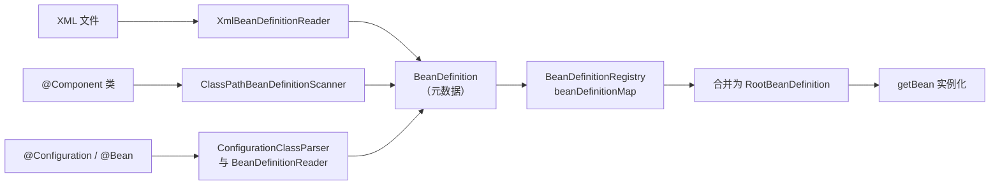
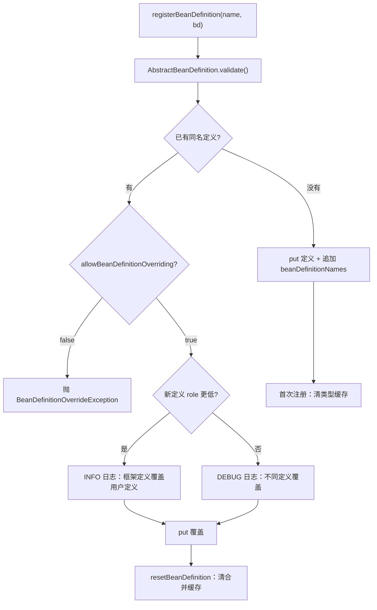
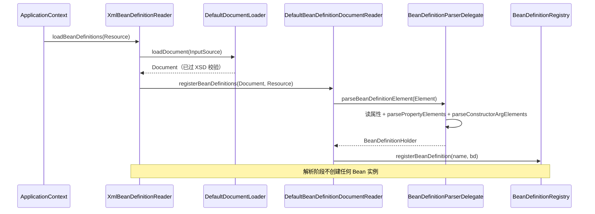
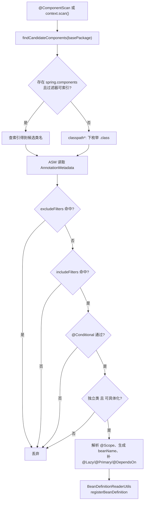
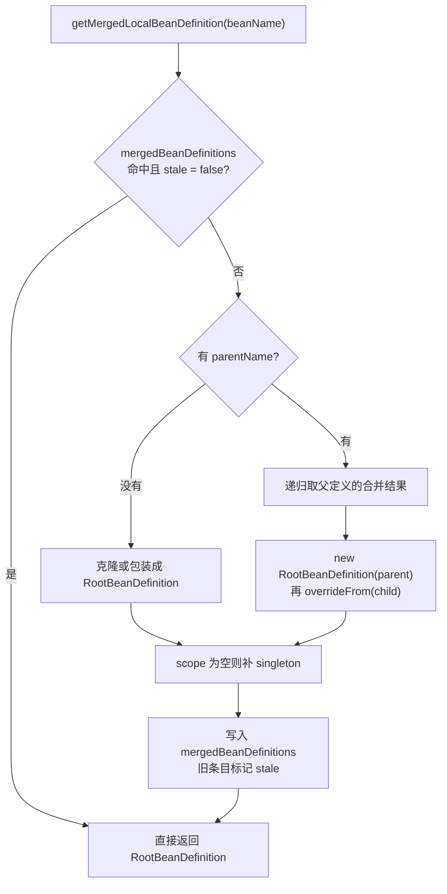
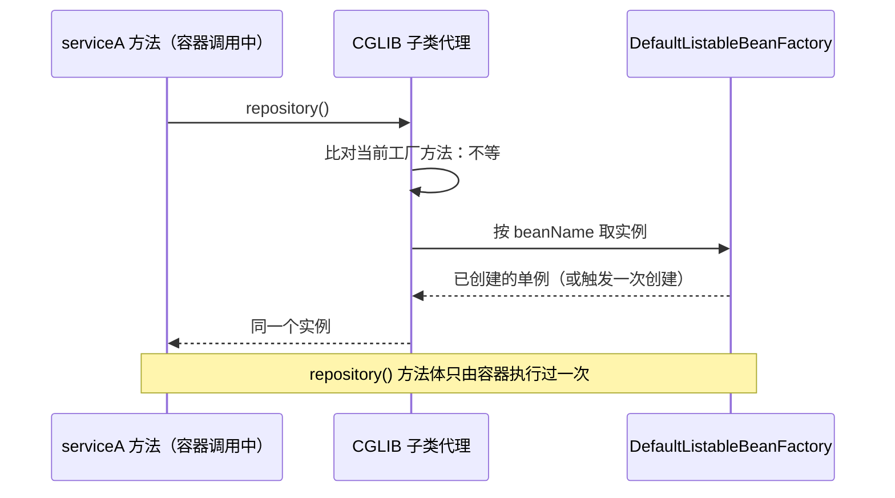

# Bean的定义与注册——从XML到注解驱动

**摘要：**

容器创建任何一个 Bean 之前，手里先得有一份关于它的完整交代——类名是什么、作用域多大、要不要懒加载、先于谁初始化、用哪个方法造出来、造出来之后调哪个方法收尾。这份交代在 Spring 里叫 `BeanDefinition`，它既是 XML、注解、Java 配置三条来源的共同出口，也是 `BeanFactoryPostProcessor` 唯一能改的东西。本篇从这份元数据的字段表讲起，把 `BeanDefinition` 的三类实现与 `BeanDefinitionHolder` 的分工摆清楚，再顺着两条转换链往下走：XML 侧从 `Resource` 到 `Document` 再到 `BeanDefinitionParserDelegate`，注解侧从 `ClassPathBeanDefinitionScanner` 的候选筛选到 `BeanDefinitionReaderUtils` 的注册；中间穿插 `@Indexed` 索引、`@ComponentScan` 的过滤器语义、`parent` 的配置继承与合并缓存，最后落到 `@Configuration(proxyBeanMethods)` 的 CGLIB 拦截上，讲清 full 与 lite 两种模式下 `@Bean` 方法互调为什么一个返回单例、一个制造出第二个实例。

本篇写机制视角，只回答"这些东西在容器内部是怎么被解析、注册、合并、增强的"。应用层怎么用 Spring Boot、怎么配 Starter，属于 [[Java/SpringBoot/01 启动流程——从main方法到ApplicationContext就绪|Spring Boot 专栏]]；`FactoryBean`、代理选择、`@Transactional` 失效之类的模式视角，已在 [[Java/OOP设计模式/09 设计模式在Spring中的应用全景|设计模式在 Spring 中的应用全景]] 写过，本篇遇到只给结论与双链。

---

## 第 1 章 注册表里的那一行

### 1.1 2004 年的 XML 与两阶段模型

2004 年 Spring 1.0 发布时只有一种配置方式，就是 XML 里的 `<bean>` 标签。那时候的容器实现相当直白：解析标签，得到一个描述对象，塞进注册表，等到有人要 Bean 再照着描述对象造。这套"先登记、后生产"的分工在今天看来理所当然，但它是被三个具体需求逼出来的，而不是设计者的洁癖。

第一个需求是懒加载。如果扫描到 `<bean>` 或 `@Component` 就立刻实例化，`@Lazy` 与 `lazy-init` 根本无从落地——延迟动作必须在"取用"这个时点才有意义，而取用之前容器手里唯一能拿的东西就是描述。

第二个需求是依赖分析。构造器注入、字段注入、`@Autowired` 的候选匹配，全都要求容器已经知道"一共有哪些 Bean、各自什么类型"。一边解析一边实例化，等于在只知道半张地图的情况下决定顺序，遇到循环依赖时更无解：判断循环依赖的前提是先看到全部端点。

第三个需求是条件化。Spring 4.0 引入 `@Conditional` 之后，"这个类到底要不要成为 Bean"取决于环境、类路径、已有定义，而这类判断必须在实例化之前完成，否则你会先造出一个本不该存在的对象再想办法丢掉它。条件求值的对象是元数据，不是实例。

于是有了**两阶段模型**：注册阶段把各种来源的配置翻译成 `BeanDefinition` 放进注册表，实例化阶段按注册表里的记录按需造对象。`BeanDefinition` 就是这两个阶段之间唯一的中间表示，所有来源的差异在这一层被抹平。这也是笔者把字段表放在最前面的理由：只要字段是同一套，来源是 XML 还是注解就只是语法差异。

### 1.2 三条来源，一个出口

Spring 的配置方式演进，本质是三次"把配置搬近代码"的搬迁，中间表示始终没变。

2004 年的 XML 时代，配置与代码分离，优点是集中可审计，缺点是冗长、类型不安全、重构后类名靠字符串维持。2007 年 Spring 2.5 引入 `@Component` 一族与类路径扫描，把声明搬到了类上，从此一个类是不是 Bean 由它自己说了算。同一时期独立的 JavaConfig 子项目给出了另一条路：用 `@Configuration` 与 `@Bean` 把"怎么造这个第三方对象"写成方法，2009 年随 Spring Framework 3.0 并入主线。2011 年 Spring 3.1 补上 `@ComponentScan`，扫描从 XML 命名空间标签 `<context:component-scan>` 升格为注解，注解驱动才算自洽。此后是三个加速点：2013 年 Spring 4.0 的 `@Conditional` 让"要不要注册"变成可编程判断，2017 年 Spring 5.0 的 `@Indexed` 把扫描的一部分工作挪到编译期，2019 年 Spring 5.2 的 `proxyBeanMethods` 给了 `@Configuration` 一族关掉 CGLIB 的开关。

三条来源在实现上共用三个部件：一个把外部形式读成元数据的 reader 或 scanner、一个装元数据的 `BeanDefinition`、一个存元数据的注册表。下图是这条干道，后文所有细节都挂在这条线上。



第三条线值得单独标一笔：`@Configuration` 类的处理发生在 `ConfigurationClassPostProcessor` 里，它的身份是 `BeanFactoryPostProcessor`，在 `refresh()` 的第 5 步执行，因此"注解驱动"并没有绕开两阶段模型，它只是把注册阶段搬到了一个扩展点里执行。这一步的时机与扩展点体系的关系见 [[10 Spring扩展点全景——BeanPostProcessor、BeanFactoryPostProcessor与Aware接口|扩展点全景]]。

### 1.3 不分离会怎样

把这条分工拿掉，最先崩的是诊断能力。`BeanDefinitionOverrideException`、`NoUniqueBeanDefinitionException`、循环依赖的报错链路，全部依赖"注册表里有一份可打印、可比对的元数据"。如果只有实例，报错只能告诉你"某个对象不存在"，而无法说明"它本来应该由哪个配置、哪个方法、以什么作用域生成"。

其次崩掉的是改写能力。`BeanFactoryPostProcessor` 的全部本事，都建立在"Bean 还没造出来、但元数据已经注册好了"这个窗口上：占位符替换改的是属性值列表，`@MapperScan` 加的是新的定义，`@Conditional` 家族删的是候选定义。没有这个窗口，框架只能靠反射去改已造好的对象，那是另一种难度的工程。

## 第 2 章 BeanDefinition 的字段全表

### 2.1 字段挂在两层上

`BeanDefinition` 是一个接口，它声明的是"任何 Bean 定义都必须能回答的问题"，字段的实际存储落在 `AbstractBeanDefinition` 这个抽象类里。分清这两层的意义在于：接口上的方法人人都要实现，抽象类上的方法只有 `AbstractBeanDefinition` 的子类才有，所以你在 `BeanDefinitionRegistry` 里拿到的对象如果是自定义实现，只能指望接口那一层。

接口层还带了两类常量：作用域 `SCOPE_SINGLETON` 与 `SCOPE_PROTOTYPE`，角色 `ROLE_APPLICATION`、`ROLE_SUPPORT`、`ROLE_INFRASTRUCTURE`。这两组常量不是装饰，后文讲角色比较与合并时都会用到。`BeanDefinition` 同时继承 `AttributeAccessor` 与 `BeanMetadataElement`，前者让任意框架都能往定义上挂自定义属性（`ConfigurationClassUtils` 就是靠这个给定义打上 full/lite 标记），后者提供 `getSource()` 追溯这份定义来自哪个资源。

下面这张表把常用字段一次列全，`声明位置` 一列区分接口与抽象类，`谁读它` 一列说明这份数据在运行期的消费者——写框架扩展时，判断"该改哪个字段"看的就是这一列。

| 字段 | 声明位置 | 配置来源 | 谁在运行时读它 |
| :--- | :--- | :--- | :--- |
| `beanClassName` / `beanClass` | 接口 / 抽象类 | `<bean class>`、`@Component` 的类名、`@Bean` 未指定时为空 | `resolveBeanClass` 时解析成 `Class`，实例化入口 |
| `scope` | 接口 | `scope` 属性、`@Scope`、`@RequestScope` 等 | `getMergedBeanDefinition` 归一为单例；`isSingleton`/`isPrototype` |
| `lazyInit` | 接口 | `lazy-init`、`@Lazy` | `preInstantiateSingletons` 跳过该 Bean |
| `dependsOn` | 接口 | `depends-on`、`@DependsOn` | `AbstractBeanFactory` 先实例化被依赖者 |
| `autowireMode` | 抽象类 | `autowire` 属性、`@Bean(autowire)` | `populateBean` 决定按名/按类型注入 |
| `autowireCandidate` | 接口 | `autowire-candidate`、`@Bean(autowireCandidate)` | `DefaultListableBeanFactory` 类型匹配时过滤候选 |
| `primary` | 接口 | `primary` 属性、`@Primary` | 候选多于一个时选出首选 |
| `propertyValues` | 接口 | `<property>`、`@Bean` 的属性赋值 | `populateBean` 逐条应用 |
| `constructorArgumentValues` | 接口 | `<constructor-arg>`、`@Bean` 方法参数 | `createBeanInstance` 匹配构造器 |
| `factoryBeanName` | 接口 | 非静态 `@Bean` 方法所属配置类的 beanName | `instantiateUsingFactoryMethod` 先取工厂 Bean |
| `factoryMethodName` | 接口 | `factory-method`、`@Bean` 方法名 | 同上，反射调用该方法 |
| `initMethodName` / `destroyMethodName` | 接口 | `init-method`、`@Bean(initMethod)`、`(inferred)` | `invokeInitMethods`、销毁阶段 |
| `role` | 接口 | `role` 属性、`@Role` | 覆盖时的日志级别判断；诊断时区分用户定义与基础设施定义 |
| `description` | 接口 | `description` 属性、`@Description` | 诊断输出与文档 |
| `abstract` | 接口 | `abstract="true"` | 只作模板，`preInstantiateSingletons` 跳过 |
| `parentName` | 接口 | `parent` 属性、`GenericBeanDefinition#setParentName` | 合并时定位父定义 |
| `synthetic` | 抽象类 | 框架内部标记 | 不参与候选与销毁判断 |
| `instanceSupplier` | 抽象类 | `Supplier` 编程式注册 | 绕过构造器直接取值 |
| `dependencyCheck` | 抽象类 | `dependency-check` 属性 | 早期用于检查依赖是否全部注入，实践中早已不用 |
| `methodOverrides` | 抽象类 | `<lookup-method>`、`<replaced-method>` | CGLIB 生成时替换方法体 |
| `qualifiers` | 抽象类 | `@Qualifier`、`@Bean` 上的自定义限定符 | 按名注入的候选消歧 |
| `attributes` | 接口（继承） | 任意框架 | full/lite 标记、`@Bean` 方法元数据 |

### 2.2 三对容易混的字段

字段名接近的地方，恰恰是判断容易出错的地方。

`dependsOn` 不是依赖注入。它表达的是"实例化顺序上的前置条件"，被依赖者不会注入到当前 Bean 里，两者之间甚至不需要有任何引用关系。典型的用法譬如数据库迁移脚本 Bean 与业务 DAO 之间：DAO 不持有迁移器的引用，但必须等迁移跑完才能连库。反过来，注入关系会由 `populateBean` 建立，且循环依赖的三级缓存只管注入关系，不管 `dependsOn`——`dependsOn` 形成环时容器只能直接报错，那一侧的机制见 [[05 依赖注入的三种方式与循环依赖的三级缓存解决方案|依赖注入与循环依赖]]。

`autowireCandidate` 与 `primary` 解决的是同一问题的两端。前者是"要不要进入候选池"，后者是"进入候选池后优先选我"。把某个实现设为 `autowireCandidate = false`，它仍然在容器里，按名字照样取得出来，只是不再参与类型匹配，这招常用于"同类实现里有几个是内部用的，不想被业务代码误注入"。`primary` 则相反，它要求这个 Bean 必须在候选池内，只是被优先选中。

`propertyValues` 与 `constructorArgumentValues` 的分界决定实例化的第一步。构造器参数参与构造器选择，属性值在对象造好之后才应用，因此前者无法表达"运行期才确定"的依赖，后者无法表达"构造器必填"的约束。这段差异的具体后果——为什么字段注入在构造器里读不到值——属于生命周期那一侧的话题，见 [[04 Bean的生命周期——从定义到销毁的完整流程|Bean 生命周期]]。

### 2.3 MutablePropertyValues 为什么可变

`getPropertyValues()` 返回的是 `MutablePropertyValues`，`getConstructorArgumentValues()` 返回的是 `ConstructorArgumentValues`，两个类都提供 `add`、`addPropertyValue`、`addArgumentValue` 这类追加方法。可变不是设计疏忽，而是两处硬需求：其一是合并，子定义要在父定义的属性列表上追加并覆盖同名项；其二是后处理，`PropertySourcesPlaceholderConfigurer` 这类 `BeanFactoryPostProcessor` 必须能原地把 `${...}` 占位符替换成真实值，不能要求重新创建整个定义对象。

`autowireMode` 只在抽象类上，取值来自 `AUTOWIRE_NO`、`AUTOWIRE_BY_NAME`、`AUTOWIRE_BY_TYPE`、`AUTOWIRE_CONSTRUCTOR` 四个常量，早期还有一个 `AUTOWIRE_AUTODETECT`，早已标记废弃。XML 时代的 `autowire="byName"` 就是往这个字段写值；注解驱动时代它几乎总是 `AUTOWIRE_NO`，因为 `@Autowired` 走的是 `AutowiredAnnotationBeanPostProcessor` 这条完全独立的路径，与 `autowireMode` 无关。把两者混为一谈，会得出"`@Autowired` 靠 `autowireMode` 生效"的错误结论。

## 第 3 章 三个实现类与 Holder

### 3.1 GenericBeanDefinition：解析器的默认产物

`GenericBeanDefinition` 自 Spring 2.5 起就是"最通用"的那个实现，特点是不预设任何角色假设：既可以有父定义（`setParentName`），也可以没有；既可以描述一个类，也可以描述一个工厂方法。XML 解析器、类路径扫描器、`ImportBeanDefinitionRegistrar` 里的手写注册，产出的几乎都是它。

选择它的理由很实际：解析阶段拿到的信息是不完整的。XML 里可能只写了 `parent`，注解里可能只写了接口类型而实现由工厂决定，此时用 `RootBeanDefinition` 会把"不完整"误当成"已完整"，用 `ChildBeanDefinition` 又会在没有父定义时直接失败。`GenericBeanDefinition` 允许这两种情况都存在，把补全留到合并阶段。

### 3.2 RootBeanDefinition：合并后的正式版本

`RootBeanDefinition` 有两种身份。第一种是"不需要合并的定义"——早期 XML 时代，顶级 `<bean>` 解析出来就是它；第二种也是今天更常见的身份，是**合并结果**的载体。`AbstractBeanFactory` 在真正创建 Bean 之前，会把拿到的任意 `BeanDefinition`（连同它的父链）合并成一个 `RootBeanDefinition`，之后的实例化流程只认这个类型。

为什么要有这个类型而不是继续用通用的那个？因为合并结果多了几样东西：解析后的 `Class`、`ResolvableType`、可缓存标记、以及 `stale` 这类内部状态。实例化路径上每一步都要读这些字段，若还要判断"父定义在哪、要不要递归查"，热路径上会多出大量分支。

### 3.3 ChildBeanDefinition：被取代的旧形态

`ChildBeanDefinition` 在构造时就必须给出父名，它的语义被 javadoc 写得很死：子定义继承父定义的构造器参数值、属性值与方法覆盖，并可以追加新值；`init-method`、`destroy-method`、静态工厂方法若在子定义中指定，则覆盖父定义的同名设置；而 `depends-on`、`autowire` 模式、依赖检查、单例标记、懒加载这几项**总是**取自子定义。

官方在同一个 javadoc 里补了一句注脚：自 Spring 2.5 起，编程式注册的推荐做法是 `GenericBeanDefinition` 加 `setParentName`，后者在多数场景下已经取代了 `ChildBeanDefinition`。这个类在 6.x 里没有被打上 `@Deprecated`，但"不推荐"的表述是明确的，新代码没有理由再用它。

### 3.4 BeanDefinitionHolder：名字与别名的载体

注册表的接口只接受二元组 `(beanName, beanDefinition)`，可解析器手里往往还捏着一串别名。`BeanDefinitionHolder` 就是为这个落差存在的：它把定义、主名称、别名数组打包成一个可以整体传递的单元。XML 解析器在 `parseBeanDefinitionElement` 之后返回它，扫描器的 `doScan` 返回 `Set<BeanDefinitionHolder>`，注册时再交给 `BeanDefinitionReaderUtils.registerBeanDefinition` 拆开。

拆开之后做两件事：先按主名称 `registry.registerBeanDefinition(beanName, bd)`，再对每个别名 `registry.registerAlias(beanName, alias)`。别名的实现是一张独立的 Map，由 `AliasRegistry` 维护，取 Bean 时 `transformedBeanName` 会先把别名折叠成规范名。这也解释了一个常见困惑：别名不是第二个 Bean，注册表里只有一条定义，`getBeanDefinitionNames()` 看不到别名，`getAliases(beanName)` 才看得到。

三个实现类的分工可以这样对照。

| 类 | 定位 | 何时出现 | 需要注意 |
| :--- | :--- | :--- | :--- |
| `GenericBeanDefinition` | 通用载体，可有可无父定义 | XML 解析、扫描、编程式注册 | 信息可能不完整，必须在合并阶段补全 |
| `RootBeanDefinition` | 合并后的正式定义 | 容器创建 Bean 前统一转换 | 实例化路径只认它，扩展点拿到的常是它 |
| `ChildBeanDefinition` | 固定依附父定义的子定义 | 早期 XML 的 `parent` 用法 | 已被 `GenericBeanDefinition` 取代 |
| `ConfigurationClassBeanDefinition` | `RootBeanDefinition` 的内部子类 | `@Bean` 方法注册时 | 额外持有 `@Bean` 方法元数据，供 CGLIB 增强判断 |

最后一行不是公开 API，而是 `ConfigurationClassBeanDefinitionReader` 里的静态内部类。它存在的理由只有一个：`ConfigurationClassPostProcessor` 在增强配置类时，需要通过 `AnnotatedBeanDefinition#getFactoryMethodMetadata()` 把"工厂方法型定义"与"普通类定义"区分开，普通 `RootBeanDefinition` 装不下这份元数据。

## 第 4 章 注册表与它唯一的实现

### 4.1 注册表接口只有七件事

`BeanDefinitionRegistry` 的方法寥寥可数：注册、移除、按名取、判断存在、取名字数组、取数量、判断名字是否被占用。它继承 `AliasRegistry`，所以别名那部分能力是并进来的。这个接口故意保持了极窄的语义——它只负责"存和取定义"，不负责实例化，也不负责合并；正因为窄，`ApplicationContext` 才能把它当成一个可替换的部件，`GenericApplicationContext` 直接实现它，把调用转发给内部的 `DefaultListableBeanFactory`。

### 4.2 所有道路都通向 DefaultListableBeanFactory

真正被生产环境使用的注册表实现只有一个：`DefaultListableBeanFactory`。它同时实现了 `BeanDefinitionRegistry`、`BeanFactory`、`ListableBeanFactory`、`ConfigurableListableBeanFactory`、`AutowireCapableBeanFactory`，把所有容器的账本都记在自己身上——`beanDefinitionMap` 存定义，`beanDefinitionNames` 保存注册顺序，`singletonObjects` 存单例，`manualSingletonNames` 存手工注册的单例。

理解这一点的收益是可以用一句话概括整个 IoC 容器的层次：`ApplicationContext` 本质是一个 `DefaultListableBeanFactory` 加上一堆后处理与事件能力。`refresh()` 的十二个步骤里，绝大部分在做"给这个工厂装配环境、装配后处理器、装配生命周期回调"的事情，真正的"定义 → 实例"始终由这一个类完成。容器层次的设计动机与 `refresh()` 的逐步拆解属于另一条主线，见 [[02 IoC容器——BeanFactory与ApplicationContext的层次设计|IoC 容器层次]]。

`SimpleBeanDefinitionRegistry` 是个例外，但它只服务于测试与工具：内部一个 `HashMap` 加一个别名表，不具备任何工厂能力。真实的容器不会用它。

### 4.3 registerBeanDefinition 遇到同名时的分支

注册这件事只有一处逻辑值得细读，就是同名处理。`DefaultListableBeanFactory#registerBeanDefinition` 的做法是：先校验定义合法（`AbstractBeanDefinition#validate`），再看 `beanDefinitionMap` 里是否已有同名条目，然后分三条路走。



第三条分支里有个不太显眼的设计：覆盖时先比较 `role`。`ROLE_APPLICATION` 是用户定义，`ROLE_INFRASTRUCTURE` 是框架内部定义，数值上用户更小。当新定义的 role 更低（也就是更像框架定义）时，容器打 INFO 日志；两个都是用户定义、内容又不同时，只打 DEBUG。这个设计背后的判断是：框架覆盖用户，属于"用户不小心撞了内部保留名"，值得提示；用户之间互相覆盖，多半是有意为之。

另一个细节是首次注册路径。若注册发生在实例化已经开始之后（`hasBeanCreationStarted()` 为真），`beanDefinitionNames` 会整体复制一份再追加，而不是原地 `add`。原因是为了保证正在迭代这个列表的线程不会遇到 `ConcurrentModificationException`——这也是"运行期还能注册 Bean"这件事在容器内部付出的具体代价。覆盖已有名字时走的则是 `resetBeanDefinition`，它清掉该 Bean 的合并缓存与相关后处理器缓存，因为旧的合并结果已经作废。

### 4.4 allowBeanDefinitionOverriding 从开到关

同名覆盖的开关是 `allowBeanDefinitionOverriding`，`DefaultListableBeanFactory` 的默认值是 `true`，也就是框架层面允许覆盖，后注册的赢。这个默认值在 Spring Boot 2.1 被改掉了：Boot 在创建容器时把它设为 `false`（对应配置项 `spring.main.allow-bean-definition-overriding`），理由写在 Boot 2.1 的发布说明里——防止 Bean 被意外覆盖。于是升级到 Boot 2.1 之后，"两个 `@Bean` 方法恰好同名"这类问题从一条 DEBUG 日志变成了启动即失败。

这个改变的账要这样算。开着的代价是隐蔽：一个组件扫描到一个类，某个 Starter 的自动配置又注册了同名定义，谁赢取决于注册顺序，最终注入的可能是一个功能不一样的实现，而报错要到运行期行为异常时才显现。关掉的代价是直接：任何非故意的撞名都会立刻抛出 `BeanDefinitionOverrideException`，错误信息里带着新旧两份定义的描述，排查成本从"猜测"降到"阅读"。两害相权，Boot 选择了失败得更早。

| 项 | 默认 | 调大（放宽）一侧的代价 | 调小（收紧）一侧的代价 |
| :--- | :--- | :--- | :--- |
| `allowBeanDefinitionOverriding` | Framework 为 `true`，Boot 2.1 起为 `false` | 调到允许覆盖：同名定义被静默替换，注入到的可能是另一份实现，问题推迟到运行期暴露 | 调到禁止覆盖：任何撞名都在启动期抛 `BeanDefinitionOverrideException`，升级期集中爆雷 |
| 扫描包范围（`basePackages` 的宽度） | 由声明决定 | 包范围调大：候选类近似线性增加，扫描耗时与撞名概率一起上升 | 包范围调小：扫描变快，但跨模块时容易漏扫，包声明也散到各处 |
| 索引覆盖范围（接入 `spring-context-indexer` 的模块数） | 不启用 | 调到全量接入：注册阶段改为查索引，耗时只与命中候选数相关 | 调到零：退回逐类 ASM 解析，耗时随类数线性增长；只覆盖部分模块是最差的一档，见第 7 章 |
| `useDefaultFilters` | `true` | 保持 `true`：`@Component` 一族自动发现，候选面偏宽但语义连贯 | 调到 `false`：必须手写 include 过滤器，漏写就是一次静默的空扫描 |

### 4.5 覆盖的正当场景

开关收紧不等于覆盖没有用途。测试里替换一个外部依赖是最常见的场景，譬如用 `@TestConfiguration` 注册一个同名的内存实现，把真实客户端顶掉。其二是框架与 Starter 的"默认 + 覆盖"套路：自动配置提供一个默认 Bean，用户定义同名 Bean 表达"我要自己来"，这条路在 Boot 2.1 之后必须显式打开开关，Boot 文档的写法是加 `spring.main.allow-bean-definition-overriding=true`，而更被推荐的做法是让自动配置自身带上条件判断，让默认实现在用户已定义时根本不注册——条件装配的机制见 [[Java/SpringBoot/03 条件装配——@Conditional家族的实现机制|条件装配]]。

其三是在 `BeanFactoryPostProcessor` 里改写定义，这也是最干净的一种"覆盖"：不新增同名定义，而是就地把某个字段改掉。占位符替换、包名替换、作用域调整都属于这一类，机制本身属于扩展点的主线，见 [[10 Spring扩展点全景——BeanPostProcessor、BeanFactoryPostProcessor与Aware接口|扩展点全景]]。

## 第 5 章 XML 路径：七道工序

### 5.1 Resource 到 Document

XML 解析链的入口是 `XmlBeanDefinitionReader#loadBeanDefinitions`。它继承自 `AbstractBeanDefinitionReader`，因此先有一层 `ResourceLoader` 把路径字符串变成 `Resource`：`classpath:` 对应类路径单个资源，`classpath*:` 对应全类路径的匹配集合，`file:` 与 URL 各走各的实现。这一步与注解扫描共用的正是同一个资源解析基础设施。

拿到 `Resource` 之后，`XmlBeanDefinitionReader` 用 `DocumentLoader`（默认 `DefaultDocumentLoader`）把输入流解析成 `org.w3c.dom.Document`，随后校验 XSD——校验用的 schema 由 `spring.schemas` 文件把命名空间 URI 映射到本地 XSD，这样解析不需要联网。这一步的产物是一个标准 DOM，与 Spring 再无关系，说明解析器的第一段是纯技术活。

### 5.2 DocumentReader 与 ParserDelegate 的分工

DOM 到手之后进入业务语义层。`XmlBeanDefinitionReader` 把 Document 交给 `BeanDefinitionDocumentReader` 接口的实现，默认是 `DefaultBeanDefinitionDocumentReader`。这个类负责"文档结构"这一层：遍历顶级元素，处理 `<beans>` 的嵌套与 `profile` 属性、处理 `<import>` 与 `<alias>`、遇到 `<bean>` 就交给 `BeanDefinitionParserDelegate`。

`BeanDefinitionParserDelegate` 才是真正认识 `<bean>` 全部属性的地方。`parseBeanDefinitionElement` 依次读取 `id`/`name`、`class`、`parent`、`scope`、`abstract`、`lazy-init`、`autowire`、`depends-on`、`primary`、`init-method`、`destroy-method`、`factory-method`、`factory-bean`，再委托 `parsePropertyElements` 与 `parseConstructorArgElements` 填充两个值对象，最后返回 `BeanDefinitionHolder`。产物默认是 `GenericBeanDefinition`——如果写了 `parent`，就是带父名的 `GenericBeanDefinition`。

下图把这条链的参与者与时序画清楚，注意 Document 阶段与语义阶段的分界。



### 5.3 NamespaceHandler：标签的翻译层

真实项目里的 XML 很少只有 `<bean>`。`<context:component-scan>`、`<tx:annotation-driven>`、`<aop:aspectj-autoproxy>` 都带命名空间前缀，`BeanDefinitionParserDelegate#parseCustomElement` 遇到它们时会去查 `NamespaceHandlerResolver`。默认实现 `DefaultNamespaceHandlerResolver` 读的是每个 jar 里的 `META-INF/spring.handlers` 文件，把命名空间 URI 映射到具体的 `NamespaceHandler` 类，再由它挑一个 `BeanDefinitionParser` 干活。

这层翻译的意义在于：带前缀的标签不是新的元数据形态，它们最终都变成若干条普通 `BeanDefinition`。`<context:component-scan>` 的解析器是 `ComponentScanBeanDefinitionParser`，它内部会新建一个 `ClassPathBeanDefinitionScanner` 并调用 `doScan`——也就是说，XML 路径与注解路径在这里合流。这一点在迁移期特别有用：注解扫描的开关可以留在 XML 里，扫描出来的定义与纯注解场景完全一致。

## 第 6 章 注解路径：扫描器如何把类变成定义

### 6.1 候选从哪来

`ClassPathBeanDefinitionScanner#doScan` 接收包名数组，对每个包调用 `findCandidateComponents`。后者的实现取决于一件事：类路径上是否存在 `META-INF/spring.components` 索引。没有索引时走 `scanCandidateComponents`，用 `PathMatchingResourcePatternResolver` 按 `classpath*:basePackage/**/*.class` 枚举所有类文件，包括 jar 内部的条目；有索引时改走索引查询（第 7 章展开）。

枚举到的每个类文件都**不会被加载**。扫描器用 ASM 直接读 `.class` 字节码，产出一个 `AnnotationMetadata`——类名、父类、接口、注解及其属性值都在里面，但静态初始化块没跑、类也没进 Metaspace。这个取舍在大型工程里是决定性的：几千个类全量加载会触发大量静态初始化，而静态初始化是不受控的副作用，扫描阶段绝不该有副作用。

### 6.2 三道门槛筛出候选

`ClassPathScanningCandidateComponentProvider#isCandidateComponent` 这道门槛有三层，顺序不能颠倒。

先看排除：`excludeFilters` 里任一过滤器命中，直接丢。再看包含：`includeFilters` 里任一命中才算进入下一关；默认的包含过滤器是 `AnnotationTypeFilter(Component.class)`（`@Component` 上带 `@Indexed`，这层元注解关系决定了它可被索引），另有两个针对 Jakarta 规范的兼容过滤器，分别匹配 `jakarta.annotation.ManagedBean` 与 `jakarta.inject.Named`。最后看条件：命中包含过滤器之后还要过 `@Conditional` 求值，此时求值阶段是 `REGISTER_BEAN`，`@Profile` 也在这一层被解释成条件。

这里要顺手澄清一个常见误解：`@Lazy` 并不参与候选判定。`isCandidateComponent` 的三层门槛里没有任何一层读 `@Lazy`，它的作用发生在候选确定之后——`processCommonDefinitionAnnotations` 把 `@Lazy` 的值写进 `lazyInit` 字段，影响的只是实例化时机，不影响"要不要注册"。`@Primary`、`@DependsOn`、`@Role`、`@Description` 同理，它们全是**字段填充**，不是**候选筛选**。把这个边界记住，就不会再问"为什么 `@Lazy` 的 Bean 也出现在 `getBeanDefinitionNames()` 里"。

三层之外还有一层与注解无关的结构性判断：候选类必须是独立类（`isIndependent`，即非非静态内部类）、且必须可具体化（`isConcrete`，非接口非抽象）；唯一的例外是抽象类上带 `@Lookup` 方法的情况，因为那种类要被 CGLIB 子类化后使用。这条规则解释了两个常见现象：非静态内部类即使标了 `@Component` 也不会被注册，抽象基类即使标了也不会，除非它声明了 `@Lookup`。

### 6.3 doScan 的四步补全

候选确定之后，`doScan` 对每个候选做四件事，缺一不可。

第一步解析作用域：`ScopeMetadataResolver` 读 `@Scope`，拿到作用域名与代理模式，写进定义的 `scope`。第二步生成 beanName：`AnnotationBeanNameGenerator` 优先取注解的 `value`，没有则用类名做 `Introspector.decapitalize`（前两个字母都大写时保持原样，所以 `URLParser` 不会变成 `uRLParser`），再通过 `checkCandidate` 与注册表比对，重名时按生成策略追加后缀或报错。第三步补公共注解：`AnnotationConfigUtils.processCommonDefinitionAnnotations` 把 `@Lazy`、`@Primary`、`@DependsOn`、`@Role`、`@Description` 逐个映射到对应字段，这一步是"注解 → 字段"最集中的地方。第四步交给注册：`BeanDefinitionReaderUtils.registerBeanDefinition(holder, registry)` 拆成按主名注册与逐个注册别名两段。

需要留意的是第三、四步之间没有"校验语义完整性"的环节。扫描器产出的定义是"能注册"的，不是"能实例化"的：如果某个类标了 `@Component` 却缺少必要的构造依赖，问题要到实例化阶段才暴露。注册阶段只保证名字不冲突、条件已通过。

下图把注解路径的完整判断串起来，其中索引分支是第 7 章的主题。



### 6.4 两个 ApplicationContext 的差别

`AnnotationConfigApplicationContext` 与 `AnnotationConfigWebApplicationContext` 经常被当成同一件东西的两种外壳，实际上差别集中在容器的启动契约上。

前者是自包含的：构造时创建 `AnnotatedBeanDefinitionReader` 与 `ClassPathBeanDefinitionScanner`，两者共用同一个 `DefaultListableBeanFactory`；`register(Class...)` 把配置类注册成定义，`scan(String...)` 触发扫描，`refresh()` 走标准流程；环境是 `StandardEnvironment`，没有 `ServletContext` 的概念。用 `new AnnotationConfigApplicationContext(AppConfig.class)` 这一行就完成注册与刷新，所以它常出现在测试与示例里。

后者实现的是 `ConfigurableWebApplicationContext`：必须在 `refresh()` 之前拿到 `ServletContext`，环境换成 `StandardServletEnvironment`（属性源里多了 servletConfig 与 servletContext 两级），配置类来自 `web.xml` 里的 `contextClass` 与 `contextConfigLocation`——注意后者的值是类名列表，不是文件路径，这是它与 `XmlWebApplicationContext` 最容易搞混的一点。reader 与 scanner 也是懒创建的：构造时 `ServletContext` 还没注入，类加载路径也要等容器启动时才确定。

再往外一层还有第三种形态：Spring Boot 的 `AnnotationConfigServletWebServerApplicationContext`，它继承的是 `GenericWebApplicationContext` 而不是前两者中的任何一个，把注解注册能力与内嵌 Web 容器合并进同一个上下文。Boot 侧的这条线属于启动流程的话题，见 [[Java/SpringBoot/01 启动流程——从main方法到ApplicationContext就绪|Boot 启动流程]]。

## 第 7 章 扫描的账单与 @Indexed 索引

### 7.1 扫描的成本构成

扫描的耗时不是一个数，而是四段成本的叠加，其中只有第一段是"不可避免"的。

| 阶段 | 做什么 | 成本随什么增长 | 可否消除 |
| :--- | :--- | :--- | :--- |
| 资源枚举 | 遍历目录与 jar 条目，匹配 `**/*.class` | 类路径上的文件与 jar 数量 | 索引可从 1 万级降到按需 |
| 字节读取 | 打开资源、读入字节数组 | 类文件大小、I/O 与页缓存命中率 | 索引可跳过绝大多数类 |
| ASM 解析 | 提取类元数据与注解属性 | 类数量与类结构复杂度 | 索引只解析候选类 |
| 过滤器与条件求值 | 注解匹配、`@Conditional` 求值 | 过滤器数量、条件里的类加载与属性查找 | 索引阶段已按注解预筛，但条件仍要跑 |

四段里最容易被低估的是资源枚举。`classpath*:` 需要遍历每一个 jar 的中央目录，在容器镜像里类路径常有数百个 jar，仅建立条目索引就可能占掉可观时间。最容易被高估的是 ASM 解析——单个类的解析在微秒量级，真正拖时间的是"文件多"与"jar 多"，而不是"类复杂"。

### 7.2 索引的机制

`@Indexed` 与 `spring-context-indexer` 的思路是把第一、二、三段的一部分搬到编译期。给 `spring-context-indexer` 加进注解处理器路径之后，编译时它会扫描所有被模式注解（`@Component` 及其派生）标注的类，把结果写进 jar 内的 `META-INF/spring.components`。这个文件是 properties 格式，键是全限定类名，值是它命中的模式注解名（多个用逗号分隔）。

运行期，`CandidateComponentsIndexLoader` 在 `loadIndex` 时把类路径上所有 `META-INF/spring.components` 合并成一个 `CandidateComponentsIndex`，`ClassPathScanningCandidateComponentProvider#findCandidateComponents` 检测到索引存在，就改为"按包名查索引取候选类名"，再对这些类做 ASM 解析与过滤器求值。索引只回答**哪些类可能命中**，不回答是否真的命中，注解属性的细节与 `@Conditional` 仍要在运行期算。

这套机制的定位很像图书馆的索引卡：卡片告诉你某类书在哪几排，省掉的是逐架翻找，但书还得抽出来看。索引带来的是启动期扫描时间的下降，代价是构建期多一个注解处理器、以及多一份需要随 jar 一起发布的元数据。

`spring-context-indexer` 模块自 Spring 5.0 起提供，`CandidateComponentsIndexLoader` 的 `IGNORE_INDEX` 系统属性（`spring.index.ignore`）可以在需要时强制退回扫描路径，这是排查"索引与代码不一致"问题时的第一个开关。

### 7.3 索引只认两类过滤器

索引不是万能的，它的可用性由过滤器的类型决定。`findCandidateComponents` 在选择走索引之前，会检查所有 include 过滤器是否"可索引"：只有 `AnnotationTypeFilter` 与 `AssignableTypeFilter` 两类被支持，而且注解类型本身要带 `@Indexed`（或在 `javax.`/`jakarta.` 命名空间下）。

这条限制的后果很具体：只要你在 `@ComponentScan` 里加了一个 `FilterType.REGEX`、`FilterType.ASPECTJ` 或自定义的 `FilterType.CUSTOM`，索引就整体失效，扫描器退回逐类枚举。这不是实现疏漏，而是索引文件的表达能力所限——它只记录"类上有什么注解"，无法表达"类名匹配某个正则"或"某个自定义过滤器认为它算候选"。

顺带的推论是：用 `@Indexed` 加速的项目，过滤器要尽量用注解或可赋值类型来表达。用正则排除测试类的写法，在索引面前等于主动放弃索引带来的收益。

### 7.4 部分索引的陷阱

索引一旦被加载，扫描路径就不再是"枚举所有类文件"，而是"查索引"。这带来一个不显眼但破坏力很强的边界：如果类路径上只有一部分 jar 提供了 `spring.components`，那么缺失索引的那部分 jar 里的组件将不会被发现——它们既不在索引里，也不会被逐类扫描捡回来。表现是"本地单模块能启动，打成多模块后某些 Bean 消失"。

这个坑的触发条件通常是渐进式接入：某天给主模块加了 `spring-context-indexer`，依赖的其它模块还没加，于是从那天起主模块扫描那些模块的包时开始漏类。要么全量接入，要么用 `spring.index.ignore=true` 明确关闭索引，不要停在中间态。

对 Spring Boot 应用来说还有一层：Boot 自己的自动配置不依赖类路径扫描（3.x 用 `AutoConfiguration.imports` 注册），所以接入索引与否影响的是用户自己的 `@ComponentScan`，不会影响自动装配。Boot 侧的注册机制见 [[Java/SpringBoot/02 自动装配原理——@EnableAutoConfiguration与spring.factories|自动装配原理]]。

> [!info] 索引这件事的三个开关位置
> 能否用索引取决于构建配置里有没有接入注解处理器；索引会不会失效取决于过滤器类型（`REGEX`、`ASPECTJ`、`CUSTOM` 一旦出现就退回扫描）；索引的兜底在系统属性 `spring.index.ignore`。排查"类扫不到"时按这个顺序查，比从框架源码读起快。

### 7.5 量与账的示例推算

下面这组数字是笔者为说明数量级关系而构造的示例推算，不是基准测试结果：实际值随机器、类大小、jar 数量与页缓存状态变化，只能用来判断"该不该优化"，不能用来验收性能。

| 假设项 | 取值 | 说明 |
| :--- | :--- | :--- |
| 待扫类数 | 12,000 | 一个中型多模块工程，basePackages 覆盖范围 |
| 单个类 ASM 解析 | 20 微秒 | 中位估计，含字节读取与元数据构建 |
| 资源枚举 | 0.3 秒 | 数百个 jar 的条目遍历，冷缓存下更慢 |
| 过滤器与条件求值 | 0.2 秒 | 按每个候选多一次注解匹配估计 |
| 预计总耗时 | 约 0.7 秒 | 12,000 × 20 微秒 ≈ 0.24 秒，加枚举与求值 |
| 索引命中候选 | 600 个 | 真正需要实例化并解析注解的类 |
| 索引场景耗时 | 约 0.05 秒 | 索引查询在内存中完成，只对命中类做解析 |

表里最关键的对比不是 0.7 秒与 0.05 秒的倍数，而是两者随类数量增长的方式：无索引时耗时与类数量近似线性，有索引时只与"命中的候选数"相关。一个类的数量在两年里翻倍的工程，前者的启动时间会同步恶化，后者几乎不动。这也是为什么"大项目启动加速"这件事上，索引比各种 JVM 参数更值得先做。

不过收益有上限：索引只优化注册阶段，实例化阶段一个 Bean 也不会少。如果一个应用启动慢的主因是 Bean 太多、依赖链太长、初始化里有远程调用，那么索引只能省掉几十分之一的时间，真正的账在生命周期与初始化那一侧。

## 第 8 章 @ComponentScan 的过滤器

### 8.1 两组合计五种匹配方式

`@ComponentScan` 的 `includeFilters` 与 `excludeFilters` 都是 `Filter` 数组，每个 `Filter` 用一个 `FilterType` 指定匹配方式。

| `FilterType` | 匹配依据 | 索引可用 | 典型用途 |
| :--- | :--- | :--- | :--- |
| `ANNOTATION` | 类上（含元注解）是否有指定注解 | 可用，且需注解带 `@Indexed` | 扫描自定义模式注解 |
| `ASSIGNABLE_TYPE` | 类是否可赋值给指定类型 | 可用，且需目标类型带 `@Indexed` | 按接口批量收编实现 |
| `REGEX` | 类名是否匹配正则 | 不可用 | 排除 `.*Test`、排除某包 |
| `ASPECTJ` | AspectJ 类型模式表达式 | 不可用 | 复杂包路径与类型组合 |
| `CUSTOM` | 自定义 `TypeFilter` 实现 | 不可用 | 需要读注解属性或环境判断的复杂规则 |

**排除优先于包含**，这个顺序在 `isCandidateComponent` 里是写死的：先跑 exclude，再跑 include。所以"想收编某个注解、但要排除其中一个特例"的写法是给 exclude 加一个更具体的过滤器，而不是在 include 里绕。

### 8.2 useDefaultFilters=false 的陷阱

`@ComponentScan` 有一个 `useDefaultFilters` 属性，默认 `true`。它控制的是"是否注册默认的包含过滤器"，也就是 `@Component` 一族的自动发现。把它设为 `false` 却不添加任何 include 过滤器，结果是扫描器照着包名把类全找出来了，然后在 `includeFilters` 那一关把每一个都丢掉——注册表里一个定义也没多出来，容器照常启动，业务代码在第一次 `@Autowired` 的时候才报 `NoSuchBeanDefinitionException`。

之所以这个坑常见，是因为它看起来像"只扫我指定的注解"的合理写法：`@ComponentScan(basePackages = "com.example", useDefaultFilters = false, includeFilters = @Filter(MyComponent.class))` 是正确用法，把 `includeFilters` 删掉、只留 `useDefaultFilters = false` 就成了**静默的空扫描**。容器不会为此警告，因为"一个类都没扫到"在框架看来完全合法——空的包、只有测试类的包，都可能扫出零个候选。

判断方法很直接：`useDefaultFilters = false` 时，`includeFilters` 必须非空。写自定义扫描时把这条当成编译期约束来检查，能省掉一次排查。

### 8.3 过滤器与条件注解的分工

过滤器和 `@Conditional` 经常被混着用，两者的求值阶段不同。过滤器在 ASM 元数据层面匹配，只看类名、注解、类型这些静态信息，成本低；`@Conditional` 在 `REGISTER_BEAN` 阶段求值，可以读 `Environment`、可以尝试加载类、可以查 `BeanFactory` 里已有定义，能力强但成本高。所以判据是：能用过滤器表达的静态条件用过滤器，需要环境和运行期状态的用条件。

也有两者都必须用的场景。`@Profile` 在扫描阶段被当作条件处理，所以"某个环境不注册这个类"用 `@Profile` 比用 `excludeFilters` 更好；而"整个包在某个模块里不存在"这种结构性问题只能用过滤器或干脆拆模块。`@Conditional` 家族的完整求值机制见 [[Java/SpringBoot/03 条件装配——@Conditional家族的实现机制|条件装配]]。

## 第 9 章 合并与继承：parent 不是 Java 继承

### 9.1 配置继承的语义

`parent` 属性描述的是**定义层面的继承**，与 Java 的类继承没有任何关系。两个类可以毫无关系，只要子定义的 `parent` 指向父定义的名字，就建立了一条"取父之默认、以子之声明为补充"的关系。父定义通常被声明为 `abstract="true"`，表示它只作模板，不生成实例——这一点必须在合并之外单独处理，因为 `abstract` 是定义自己的标记，不会被合并掉。

继承的规则在 `ChildBeanDefinition` 的 javadoc 里写得最清楚，也最接近实际行为：构造器参数、属性值、方法覆盖从父定义继承，子定义可以追加（同名属性以子定义为准）；`init-method`、`destroy-method`、静态工厂方法若在子定义中出现，则覆盖父设置；`depends-on`、`autowire`、依赖检查、`lazy-init` 这几项永远取自子定义。第三条规则容易被忽略：即使父定义写了 `lazy-init="true"`，子定义没有写也不会继承，而是回到子定义的默认值。

这种继承在今天的代码里已经很少见，但它的语义渗透进了别处。`@Configuration` 类之间的继承（子配置类 `extends` 父配置类）处理的是 `@Bean` 方法的可见性，子类重写父类的 `@Bean` 方法会让同一个 beanName 出现两条定义，最终谁赢取决于注册顺序，Boot 2.1 之后这被直接当作撞名处理；Spring Boot 的 `@ConfigurationProperties` 也有类似的默认值继承。真正需要"配置继承"语义时，正确的做法仍是 `GenericBeanDefinition#setParentName` 加编程式注册，而不是指望 XML 时代的写法。

### 9.2 合并发生在取用之前

合并的入口是 `AbstractBeanFactory#getMergedLocalBeanDefinition`，它在每次创建 Bean 之前被调用，做法是两级缓存加一次递归。



第一层是 `mergedBeanDefinitions` 这个并发 Map，键是 beanName，值是合并后的 `RootBeanDefinition`。合并结果的成本不低（递归取父、逐字段覆盖、类型解析），而每个 Bean 创建前都要问一次，缓存是必须的。第二层是 `stale` 标记，它让**读路径无锁**：定义被覆盖时不去 Map 里删条目，而是把旧条目标记为过期，下次取用时自然重建。正在使用旧合并结果的线程可以安全跑完，不会读到半更新的对象，代价是 Map 里会短暂留着废弃条目。

无父定义的情形也要走这一步，因为合并结果里要补一个默认值：`scope` 为空时补 `spring` 的单例语义。`AbstractBeanDefinition` 的 `scope` 字段默认是 `null`，XML 解析器与扫描器可能写入空串 `SCOPE_DEFAULT`，两者在合并阶段被统一成 `singleton`。若不统一，`isSingleton` 的实现就要在每个调用点判断三种情况。

### 9.3 overrideFrom 的字段归属

合并的核心动作是 `AbstractBeanDefinition#overrideFrom(child)`，它的语义是"把子定义的显式设置覆盖到父定义副本上"。字段归属不是一刀切的，下面按三类归纳。

| 字段组 | 合并行为 | 说明 |
| :--- | :--- | :--- |
| `beanClassName`、`scope`、`factoryBeanName`、`factoryMethodName` | 子定义有值则覆盖 | 空值不覆盖，父值保留 |
| `propertyValues`、`constructorArgumentValues` | 追加，同名项以子为准 | 父的列表先入，子的后入并顶掉同名 |
| `dependsOn`、`autowireMode`、`lazyInit`、`autowireCandidate`、`primary`、`abstract`、`role` | 总是取子定义 | 与 javadoc 的"剩余设置取子定义"一致 |
| `initMethodName`、`destroyMethodName` | 子定义有值则覆盖 | 与工厂方法同一处理方式 |
| `methodOverrides` | 追加 | `<lookup-method>` 可以在子定义继续加 |

两类"追加"字段是合并最容易出错的地方。属性列表的追加意味着父定义里写了一份通用配置，子定义只需要写差异项；而如果子定义想删掉父定义里的某个属性，合并机制做不到——只能在子定义里把它设为 `null` 或改用编程式注册重建定义。这条边界在实际项目里出现过不少次：想用 `parent` 去掉一个默认配置项，结果发现删不掉。

### 9.4 @Bean 的两条注册路径

`@Configuration` 类里的 `@Bean` 方法，其定义的注册者是 `ConfigurationClassBeanDefinitionReader`。它分两种情况处理，差异不在注解本身，而在方法是静态还是实例方法。

静态 `@Bean` 方法：定义里写 `beanClassName` 为声明类的类名，`factoryMethodName` 为方法名，不需要工厂 Bean 参与。这样设计的原因是静态方法不依赖配置类实例，容器可以在配置类实例化之前就调用它——`BeanFactoryPostProcessor` 类型的 `@Bean` 方法必须声明为 `static`，否则容器为了拿到它得先实例化配置类，而配置类实例化又会触发依赖注入，把"后处理器必须在早期就绪"这个时序打乱。

实例 `@Bean` 方法：定义里写 `factoryBeanName` 为配置类的 beanName，`factoryMethodName` 为方法名。也就是说，这个 Bean 的创建过程是"先取配置类这个 Bean，再反射调用它的方法"。这条规则对 full 与 lite 一视同仁——两种模式都通过配置类实例调方法，区别只在于那个实例是不是 CGLIB 子类，以及方法体里的互调会不会被拦截。这正是下一章的起点。

## 第 10 章 proxyBeanMethods：CGLIB 与 lite 的实例泄漏

### 10.1 增强发生的方式

`@Configuration` 的 CGLIB 增强不是换个工厂，而是**改定义里的类**。`ConfigurationClassPostProcessor#enhanceConfigurationClasses` 遍历注册表，挑出被标记为 full 模式的定义，调 `ConfigurationClassEnhancer#enhance` 生成一个子类，然后 `beanDef.setBeanClass(enhancedClass)`。之后的实例化流程照旧，只是 `resolveBeanClass` 拿到的类型已经是 CGLIB 子类。

这个实现方式带来两个后果。其一，增强对容器是透明的，`getBean` 的逻辑不需要知道有没有代理，凡是按类型取 Bean 的地方都是子类实例——用 `instanceof` 判断配置类依然成立，但 `getClass()` 已经不是原类。其二，增强必须发生在实例化之前，所以它被放在 `BeanFactoryPostProcessor` 阶段；而 full/lite 的判定更早，在 `ConfigurationClassUtils#checkConfigurationClassCandidate` 里就写进了定义的属性：类上有 `@Configuration` 且 `proxyBeanMethods` 不为 `false`，标记 full；否则只要够得上配置类候选，标记 lite。这个标记是**一次性**的，增强阶段只读它，不再重新判断。

`proxyBeanMethods` 取值为 `true` 时才是 full。这里要澄清一个流传很广的说法：Spring Framework 6.x 里该属性的默认值仍是 `true`，6.2 的 javadoc 原文写明 "The default is `true`"。把默认值改成 `false` 的是 Spring Boot 的 `@AutoConfiguration` 注解——它自带 `@Configuration(proxyBeanMethods = false)`，因为自动配置类的 `@Bean` 方法被设计成互相独立、不通过方法调用传递依赖。"Boot 的自动配置是 lite 模式"与"Spring 6 默认 lite"是两件事，混起来会导致一个错误判断：以为自己在 `@SpringBootApplication` 主类里写的 `@Bean` 方法互调也是 lite 行为。实际不是——主类上的 `@Configuration` 没有显式设置 `proxyBeanMethods`，仍是 full。

### 10.2 两个拦截器的分工

增强后的子类挂了两个 `MethodInterceptor`，各管一段。

`BeanFactoryAwareMethodInterceptor` 负责把 `BeanFactory` 塞进代理实例，让拦截器能查到容器。它拦截的是 `setBeanFactory` 这个方法，通过它给代理的子类持有一个指向容器的引用，绕开"配置类自己实现 `BeanFactoryAware` 才能拿到容器"的限制。

`BeanMethodInterceptor` 拦截所有 `@Bean` 方法。它的判断顺序决定了整个语义：如果被调用的方法正好是容器当前正在执行的工厂方法，就放行到父类实现，让方法体真正执行；否则说明这次调用来自用户代码（典型场景是另一个 `@Bean` 方法里直接调用），此时不去执行方法体，而是向容器按 beanName 取实例并返回。

"当前是否正在执行这个工厂方法"的判断依赖一个**线程局部栈**：`SimpleInstantiationStrategy` 在通过工厂方法创建实例时会记录正在调用的方法，`BeanMethodInterceptor` 拿它和自己拦截到的方法比对。没有这个比对，容器自己对 `@Bean` 方法的调用会被当成用户调用，转而去 `getBean` 同一个 beanName，撞进"正在创建中"的状态，最轻是提前引用，最重是直接失败。

下图是 full 模式下互调的时序，注意方法体根本没有执行第二次。



拦截器还处理了两个边角：`@Bean` 方法返回 `FactoryBean` 时，需要再包一层以拦截 `getObject()`，保证互调拿到的是工厂产物而不是工厂本身（`FactoryBean` 本身的价值与适用面见 [[Java/OOP设计模式/09 设计模式在Spring中的应用全景|设计模式视角]]）；带 `@Scope(proxyMode=...)` 的 Bean 在互调时要用作用域代理的目标名去查，否则会拿到错误层级的实例。这两处都是"单例语义要在所有路径上成立"的补丁。

### 10.3 lite 模式下发生了什么

lite 模式的判定条件比 full 宽：只要一个类被识别为配置类候选（带 `@Configuration(proxyBeanMethods = false)`，或带 `@Component` 且含 `@Bean` 方法），但没被标记成 full，就是 lite。lite 模式下没有 CGLIB 子类，`@Bean` 方法就是**普通方法**。

于是互调变成了普通的 Java 方法调用。

```java
@Component
public class LiteConfig {

    @Bean
    public ServiceA serviceA() {
        // 直接调用本类方法：没有拦截器，就是一次 new
        return new ServiceA(repository());
    }

    @Bean
    public Repository repository() {
        return new JdbcRepository();
    }
}
```

容器会为 `serviceA` 和 `repository` 各创建一次实例，这是对的；问题在 `serviceA()` 的方法体里那行 `repository()`——它走的是 `this.repository()`，直接构造了第二个 `JdbcRepository`，这个对象既没经过容器、也没进单例池。最终容器里有一个 `repository` Bean，`ServiceA` 手里握着另一个，两个实例各自持有连接池、各自有缓存，关闭时只有容器里那个会被销毁。如果 `repository` 的构造里注册了监听器或启动了线程，泄漏就不只是内存问题。

更隐蔽的变体是依赖注入与互调混用：`serviceA()` 里既注入了 `Repository` 字段，又调用了 `repository()` 方法，两个来源可能指向不同实例，测试环境看不出来，生产环境表现为"缓存不生效"或"连接数翻倍"。

对 full 模式也要知道它管不到的地方：通过 `new` 自己造一个配置类实例再调它的 `@Bean` 方法，拿到的也是新对象，因为拦截器只存在于容器创建的那个代理实例上。同理，在非配置类里把配置类当普通对象注入一个新实例，也会绕过拦截。

> [!warning] 关代理前先数一遍互调
> `proxyBeanMethods = false` 只在"每个 `@Bean` 方法自成一体"时安全。配置类里出现一处 `repository()` 这样的方法调用，就等于埋下一个不受容器管理的实例；改这个开关之前，先把配置类里的方法调用逐个数一遍，比事后查内存快照省事得多。

### 10.4 两种模式的取舍

| 场景 | 建议 | 理由 |
| :--- | :--- | :--- |
| 配置类内 `@Bean` 方法互相调用 | full（保持默认 `true`） | 只有代理能保证互调拿到单例 |
| 每个 `@Bean` 方法自包含、不互调 | lite（`proxyBeanMethods = false`） | 省掉 CGLIB 生成与子类加载，启动略快 |
| 自动配置类（`@AutoConfiguration`） | lite（Boot 已默认关闭） | 方法间不互调，且需要被大量条件化装配 |
| 需要被 final 修饰或含 final 方法的配置类 | 只能 lite | CGLIB 无法覆写 final 方法 |
| 配置类本身是 `final` 类或局部类 | 只能 lite | full 要求可子类化、非局部 |
| 含 `@Bean` 方法的非 `@Configuration` 组件 | lite（无法选择） | 没被打上 full 标记 |

代价这一栏要说得更具体。full 模式的开销有三项：启动时生成 CGLIB 子类（每个 full 配置类一次）、运行期每次 `@Bean` 方法被调用都要过一次拦截器、以及若干类型判断需要额外注意（`getClass()`、`instanceof` 的语义变化）。lite 模式省掉这三项，代价是把"互调返回单例"这个保证交还给开发者自己维护——只要有一个方法写了互调，就有一个潜在的重复实例。

Spring 6.0 还给 `@Configuration` 加了一个 `enforceUniqueMethods` 属性（默认 `true`），用来防止 `@Bean` 方法被意外重载。原因是重载会被解释成同一个 bean 定义的重载工厂方法，条件与属性归属都变得难以预料，默认报错比默认放行更安全。

## 第 11 章 四个反例与判据

### 11.1 反例一：关掉默认过滤器却没给 include

症状是容器正常启动、`getBeanDefinitionCount` 比预期少一截、首次注入即失败。根因在第 8.2 节：`useDefaultFilters = false` 清空了默认的 `@Component` 过滤器，若 `includeFilters` 为空，`isCandidateComponent` 对每个类都返回 `false`。判据只有一条：用 `useDefaultFilters = false` 就必须配 include 过滤器，两者是一个整体。

### 11.2 反例二：lite 模式下互调拿到新对象

症状是同一个类在容器里只有一个定义、却存在多个实例，注入点拿到的对象与容器里那个单例不是同一个。根因在第 10.3 节：lite 模式的互调是普通方法调用。判据是——只要配置类里有 `@Bean` 方法调用了另一个 `@Bean` 方法，就不要关 `proxyBeanMethods`；反过来，只要关了它，就要逐个确认 `@Bean` 方法体里没有互调。

### 11.3 反例三：同名 Bean 在 Boot 2.1 之后启动即失败

症状是 `BeanDefinitionOverrideException`，报错信息里带着两份定义。根因是 `allowBeanDefinitionOverriding` 被 Boot 设成了 `false`。要先分清同名是怎么来的：扫描器按类名生成的名字、`@Bean` 方法名生成的名字、Starter 里的显式命名，三条路都可能撞。修法有三档，优先级从高到低依次是——改掉自己的命名避免撞名、给自动配置加条件让它不注册默认实现、最后才是打开 `spring.main.allow-bean-definition-overriding` 这个开关。

### 11.4 反例四：部分索引导致漏扫

症状是本地单模块正常、多模块打包后部分 Bean 消失，且没有任何报错。根因在第 7.4 节：类路径上存在 `spring.components` 后扫描改走索引，缺索引的 jar 里的组件不会被发现。判据是——要么所有会提供组件扫描目标的模块都接入 `spring-context-indexer`，要么在所有模块都不接入；中间状态是唯一危险的配置，排查时先用 `spring.index.ignore=true` 验证一遍。

四个反例的共同点是"注册阶段沉默、实例化阶段或运行期才响"。这也是笔者以为把注册链读透有实用价值的地方：症状总是出现在别处，而原因几乎都能在注册表里找到。

## 第 12 章 结语

从 2004 年的 XML 到今天的注解驱动，Spring 换了三套语法，`BeanDefinition` 的字段几乎没变。原因并不复杂：容器的本质职责是"照着描述造对象并管理它们的生死"，描述需要哪些信息，取决于造对象时的动作，而不取决于这些信息从哪来。语法可以随开发者偏好迁移，机制不行。

本篇拆开的那条链上，每一段都有它不可让渡的取舍。索引把扫描成本挪到编译期，代价是过滤器只能用注解与类型表达、且不允许部分接入。配置继承让通用配置可以复用，代价是属性只能追加不能删除。`proxyBeanMethods` 保住互调的单例语义，代价是 CGLIB 子类与拦截开销。Boot 关掉同名覆盖，代价是升级期的一次集中清理。

真正容易被忽略的一点是：这几个取舍互相牵动。关掉 `proxyBeanMethods` 是为了省 CGLIB，但省下的启动时间可能被 lite 模式下重复构造的实例在运行期吃掉；接入索引是为了省扫描，但一旦过滤器用了正则就整体失效、收益归零。判断该不该做某个优化，得先量清楚自己的启动时间到底花在注册阶段还是实例化阶段，**先量再改**，而不是照着别人的配置清单抄一遍。

## 参考资料

1. [Configuration（Spring Framework 6.2.x API）](https://docs.spring.io/spring-framework/docs/6.2.x/javadoc-api/org/springframework/context/annotation/Configuration.html) —— `proxyBeanMethods` 默认值为 `true` 的出处，以及配置类的 constraints（非 final、非局部、嵌套必须 static）。
2. [Component（Spring Framework 6.2.x API）](https://docs.spring.io/spring-framework/docs/6.2.x/javadoc-api/org/springframework/stereotype/Component.html) —— `@Component` 上的 `@Indexed` 元注解，索引可用的前提。
3. [ChildBeanDefinition（Spring Framework 6.2.x API）](https://docs.spring.io/spring-framework/docs/6.2.x/javadoc-api/org/springframework/beans/factory/support/ChildBeanDefinition.html) —— 父子定义合并时继承与覆盖的逐项规则。
4. [CandidateComponentsIndexLoader（Spring Framework 6.2.x API）](https://docs.spring.io/spring-framework/docs/6.2.x/javadoc-api/org/springframework/context/index/CandidateComponentsIndexLoader.html) —— `META-INF/spring.components` 的加载位置与 `IGNORE_INDEX` 开关。
5. [Spring Boot 2.1 Release Notes：Bean Overriding](https://github.com/spring-projects/spring-boot/wiki/Spring-Boot-2.1-Release-Notes) —— 同名覆盖默认关闭的官方说明。
6. [Spring Framework Reference：Annotation-based Container Configuration](https://docs.spring.io/spring-framework/reference/core/beans/annotation-config.html) —— 注解驱动配置的官方语义，含 `@Component` 与 `@ComponentScan` 的完整规则。

---

> [!note] 思考题
> 1. `BeanDefinition` 里 `dependsOn` 与普通的注入依赖都会影响实例化顺序，但如果两者刚好指向同一个 Bean，容器会走同一条创建路径吗？如果形成环，报错点会出现在哪个阶段？
> 2. `parent` 的配置继承只支持追加属性、不支持删除父定义的属性。如果你确实需要"继承父模板但去掉其中一项"，能用什么机制实现，代价是什么？
> 3. 某个模块用 `@ComponentScan(useDefaultFilters = false, includeFilters = @Filter(type = FilterType.REGEX, pattern = ".*Handler"))`，启动时间比同类工程更长。结合第 7 章的索引机制，解释原因，并给出两种改法。
> 4. 一个 `@Configuration(proxyBeanMethods = false)` 的类里，`serviceA()` 通过方法参数拿到 `Repository`，这与通过 `repository()` 方法调用拿到，单例语义上有区别吗？如果 `Repository` 是 prototype 作用域，两者的行为差异会怎么放大？
> 5. 假设你要给一个已有大型工程评估"接入 `spring-context-indexer` 能省多少启动时间"，在不改动业务代码的前提下，你会先测哪两个数，为什么？