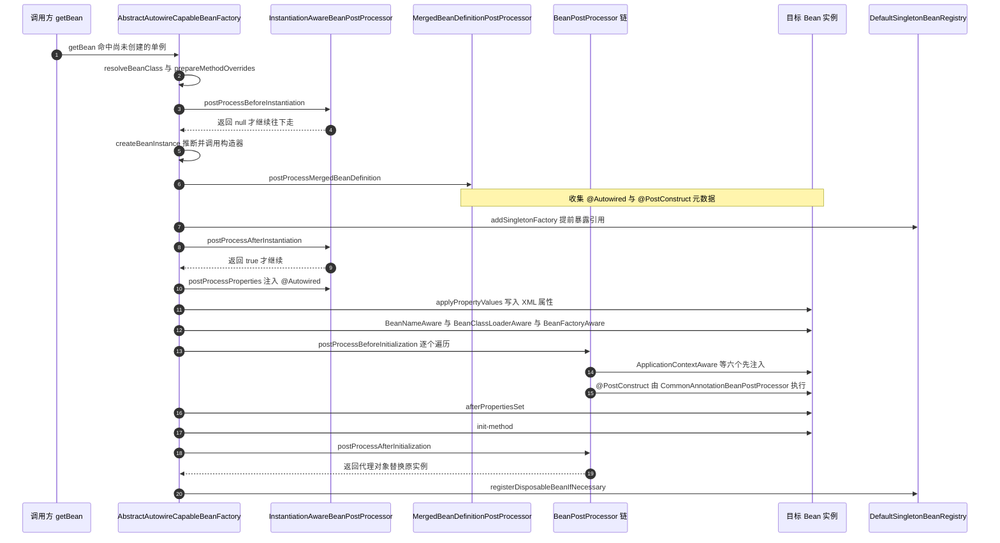
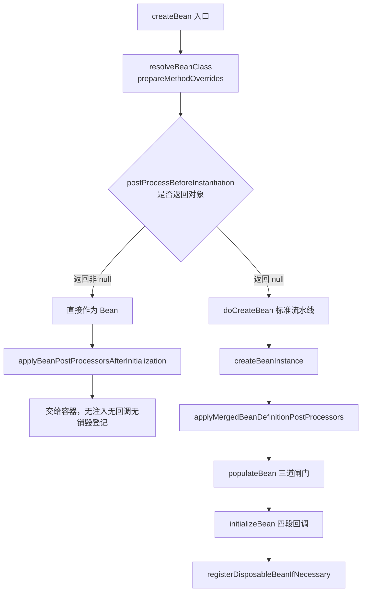
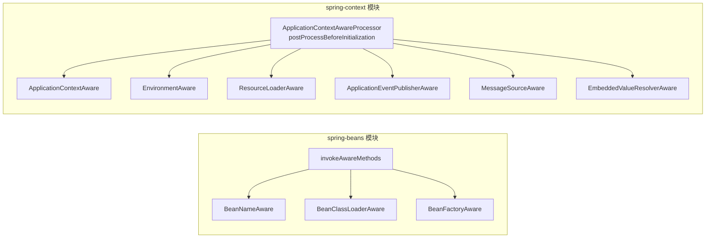
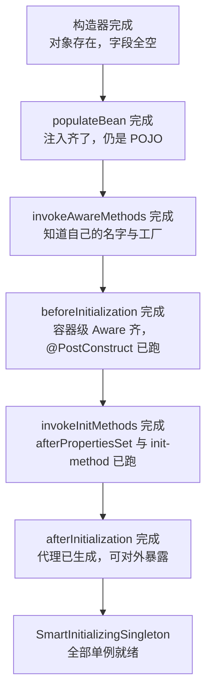
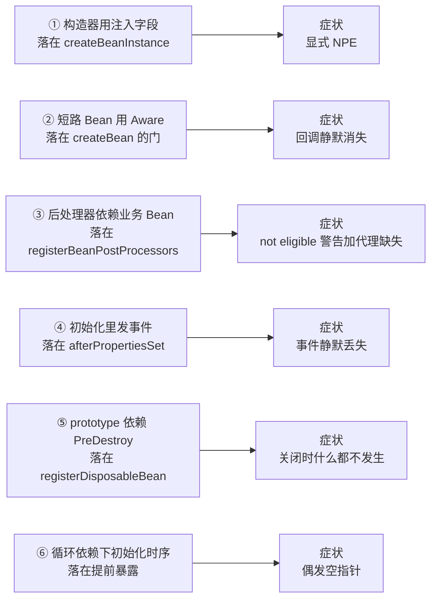
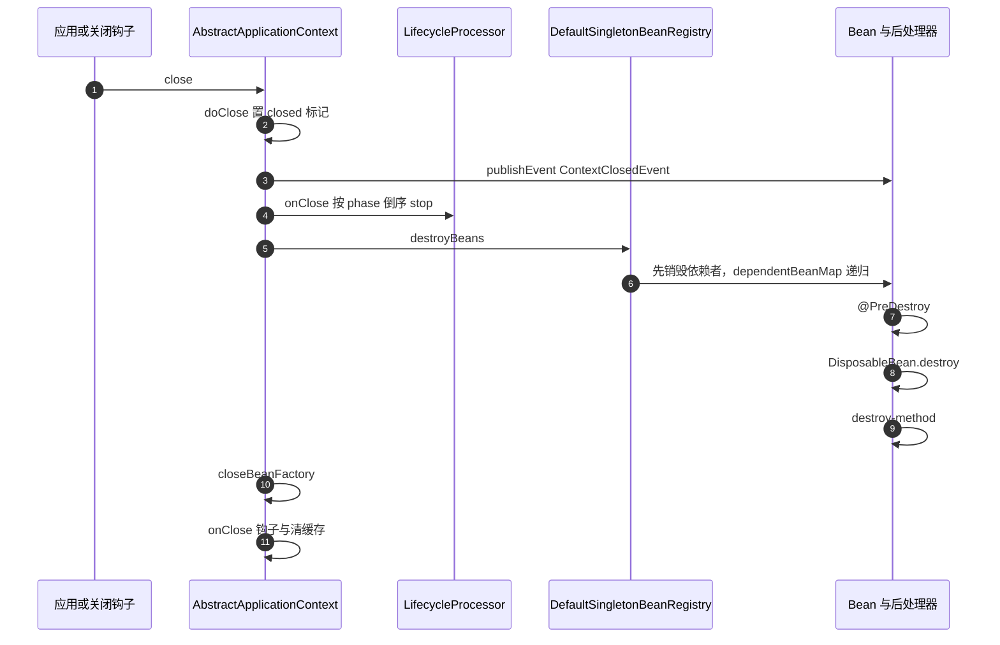

# Bean的生命周期——从定义到销毁的完整流程

**摘要：**

`BeanDefinition` 只是图纸，真正决定一个 Bean 能不能用的，是它被造出来之后那一串回调的执行次序。本篇把 `AbstractAutowireCapableBeanFactory#createBean` 作为骨架，按源码顺序拆开五个动作：`resolveBeforeInstantiation` 的短路门、`createBeanInstance` 的构造器推断、`applyMergedBeanDefinitionPostProcessors` 的元数据收集、`populateBean` 的三道闸门、`initializeBean` 的四段回调，最后落到 `registerDisposableBeanIfNecessary` 与容器的销毁链。三件事必须讲透：十几个回调点的精确顺序；九个 `Aware` 接口分两批注入所造成的"构造器里全拿不到、`@PostConstruct` 里有的拿得到有的拿不到"；以及"哪一步能拿到什么"这张对应表——构造器里只能拿到构造器参数，`@PostConstruct` 里字段已就绪但代理还没生成，`afterPropertiesSet` 里协作者可能是半成品。六个把顺序搞错的现场各给症状、机制与判据，`prototype` 不销毁的机制根因与三条替代路径单列一章。

本篇写机制视角，只回答"回调按什么次序发生、次序错了会坏在哪"。应用层怎么配 Spring Boot、怎么用 Actuator 看 Bean，属 [[Java/SpringBoot/01 启动流程——从main方法到ApplicationContext就绪|Spring Boot 专栏]]；`FactoryBean`、代理方式选择、`@Transactional` 失效的模式视角，已在 [[Java/OOP设计模式/09 设计模式在Spring中的应用全景|设计模式在 Spring 中的应用全景]] 落过结论，本篇遇到只给一句判断加双链。

---

## 第 1 章 一条流水线上的十几个位置

### 1.1 从两个方法到十几个回调

2004 年 Spring 1.0 发布时，一个 Bean 的"出生与死亡"只有两个可插手的位置：XML 里 `<bean>` 标签的 `init-method` 和 `destroy-method`，外加 `InitializingBean`、`DisposableBean` 这两个接口。那时的次序简单到不需要解释——属性注入完，调 `afterPropertiesSet`，再调你写的 `init-method`，容器关闭时反过来走一遍。

二十年间这套次序被不断插入新环节。2006 年 JSR-250 定下 `@PostConstruct` 与 `@PreDestroy`，Spring 2.5 用 `CommonAnnotationBeanPostProcessor` 把它们接进流水线；同一时期 `@Autowired` 的注入也从"容器核心的活儿"变成了"后处理器的活儿"，落点是 `AutowiredAnnotationBeanPostProcessor#postProcessProperties`；AOP 自动代理选在 `postProcessAfterInitialization` 收尾，`@Async`、`@Transactional`、`@Cacheable` 全都搭这趟车；`SmartInitializingSingleton`、`Lifecycle`、`SmartLifecycle` 又在单例池填满之后补了两段。今天数下来，一个 Bean 从 `getBean` 到可用，会经过十余个可插拔的调用点，其中至少八个与业务代码直接相关。

不过，插入这么多环节的动机也不难理解：Spring 想让第三方能力挂到 Bean 的生死上，又不愿意改 Bean 的代码，那就只能在生命周期的固定时刻开洞，让后处理器从洞里伸手进来。洞开得越多，次序的语义就越重——同一个 `@PostConstruct` 方法，放在"属性注入之后、代理生成之前"能跑通，若挪到"构造器里"就是空指针。

### 1.2 顺序本身就是语义

把回调看成一堆互不相干的钩子，是排查启动问题最常见的误判。它们其实是一条**单向流水线**，相邻两步之间的关系是"后者能假设前者已经完成"：

- `createBeanInstance` 之后，对象存在，但所有字段是默认值；
- `populateBean` 之后，`@Autowired`、`@Value`、`@Resource`、XML 属性全部就位，但对象还只是个普通 POJO；
- `invokeAwareMethods` 之后，Bean 知道了自己的名字、类加载器和 `BeanFactory`；
- `postProcessBeforeInitialization` 走完，容器级的 `Aware` 六件套注入完成，`@PostConstruct` 也已执行；
- `invokeInitMethods` 之后，`afterPropertiesSet` 与 `init-method` 都跑完；
- `postProcessAfterInitialization` 之后，拿到的才是最终暴露给外部的对象，可能是代理。

但这条链上每一步都在做同一件事——给下一步多加一点它可以依赖的前提；所以"在错误的步骤里用某个东西"从来不是配置问题，而是前提不成立——你不知道自己站在第几步，就会向容器索要它此刻还给不出的东西。

### 1.3 全景时序

下图把 `createBean` 的调用链按参与者画开，纵向是时间，横向是"谁在调谁"。这张图是本篇的骨架，后文每一章都是图上的一小段，遇到细节时不妨回到图上找位置。



图里有三处细节容易被看漏。其一是 `ApplicationContextAware` 六件套排在 `@PostConstruct` 之前——两者都在 `postProcessBeforeInitialization` 这一轮遍历里，但 `ApplicationContextAwareProcessor` 在 refresh 的 `prepareBeanFactory` 阶段就被加进列表，而注解处理器的实例要到 `registerBeanPostProcessors` 才追加到列表尾部，列表按加入顺序遍历，先来先执行。其二是短路分支：`postProcessBeforeInstantiation` 只要返回非 null，图上从实例化开始的一整段全部不执行，只剩最后一次初始化后处理。其三是最后一步注册销毁回调用的是原始 `bean` 变量而不是 `exposedObject`，代理对象不参与销毁登记的构造。

### 1.4 图上画不出的三个缓存

时序图能画调用顺序，画不出 Spring 在这条链上埋的三个缓存标记，而它们解释了不少"为什么第二次不一样"的疑问：

定义对象上的 `beforeInstantiationResolved` 标记记录某个定义是否已经被短路处理过。若首次调用所有后处理器都返回 null，这个标记会被置为 `false`，之后同一份定义再创建实例时直接跳过整段 `resolveBeforeInstantiation` 判断。对单例没有影响，对 `prototype` 就有意义了：定义是合并后缓存复用的，标记跟着定义走，后续每个原型实例都不再询问后处理器。

`postProcessed` 标记保证 `applyMergedBeanDefinitionPostProcessors` 对同一份定义只执行一次，且整段包在 `synchronized (mbd.postProcessingLock)` 里。原因是它做的事是"把注解元数据缓存起来"，缓存键是类而不是实例，重复执行纯属浪费，并发下还可能重复写。

`AbstractBeanFactory#getBeanPostProcessorCache` 把后处理器按用途分桶：`instantiationAware`、`destructionAware`、`smartInstantiationAware`。创建热路径上只遍历需要的桶，而不是把全部后处理器过一遍。这个方法在 5.3 引入，解决的正是本节开头那个乘法账：不缓存的话，每次属性填充都要把全部后处理器过一遍再 `instanceof` 分类。缓存的失效由列表自己负责——`BeanPostProcessorCacheAwareList` 在增删元素时会把缓存置空，所以运行期追加后处理器是安全的，代价是下一次创建热路径要重建整个缓存。后处理器最好在启动阶段一次配齐，别在运行期反复增删。

---

## 第 2 章 createBean：那扇可以被关上的门

从 `getBean` 走到 `createBean` 之前的那段分流——单例、原型与自定义作用域的不同入口，父容器委托，`dependsOn` 的先行创建——在 [[02 IoC容器——BeanFactory与ApplicationContext的层次设计|IoC 容器层次]] 里已经拆过；三级缓存的查询与命中则在 [[05 依赖注入的三种方式与循环依赖的三级缓存解决方案|三级缓存]] 里讲透。本篇从 `createBean` 这一行接上。

### 2.1 resolveBeforeInstantiation 只有两种结局

`createBean` 在真正造对象之前，先给 `InstantiationAwareBeanPostProcessor` 一次介入机会，落点是 `resolveBeforeInstantiation`。它遍历所有实现了 `postProcessBeforeInstantiation(Class, String)` 的后处理器，把目标类作为参数递进去，收集第一个非 null 的返回值。

```java
// AbstractAutowireCapableBeanFactory#createBean（略去日志与异常包装）
protected Object createBean(String beanName, RootBeanDefinition mbd, @Nullable Object[] args) {
    RootBeanDefinition mbdToUse = mbd;
    Class<?> resolvedClass = resolveBeanClass(mbd, beanName);
    if (resolvedClass != null && !mbd.hasBeanClass() && mbd.getBeanClassName() != null) {
        // 复制一份再改类，避免污染共享的合并定义
        mbdToUse = new RootBeanDefinition(mbd);
        mbdToUse.setBeanClass(resolvedClass);
        try {
            // lookup-method 与 replaced-method 的校验，只对需要覆写方法的定义做
            mbdToUse.prepareMethodOverrides();
        } catch (BeanDefinitionValidationException ex) {
            throw new BeanDefinitionStoreException(mbdToUse.getResourceDescription(), beanName, "Validation of method overrides failed", ex);
        }
    }
    try {
        // 门在这里：返回非 null 就直接交出去
        Object bean = resolveBeforeInstantiation(beanName, mbdToUse);
        if (bean != null) {
            return bean;
        }
    } catch (Throwable ex) {
        throw new BeanCreationException(mbdToUse.getResourceDescription(), beanName,
                "BeanPostProcessor before instantiation of bean failed", ex);
    }
    return doCreateBean(beanName, mbdToUse, args);
}
```

这个方法的语义比名字朴素：它不是"实例化之前的增强"，而是"**替换实例化的机会**"。返回 null 表示我不插手，容器按标准流程造；返回对象表示这个对象就是最终 Bean，容器连构造器都不调。

`resolveBeforeInstantiation` 内部还有一层记忆：处理完会把结果写回 `mbd.beforeInstantiationResolved`，后续同一定义不再询问。所以后处理器若只在某些条件下短路，条件必须在这一个时点就稳定，指望"第一次放过、第二次拦住"是不成立的。

### 2.2 短路之后少了什么

返回非 null 时，`createBean` 直接返回，`doCreateBean` 全程不执行。少掉的东西列出来相当刺眼：构造器不调用、`applyMergedBeanDefinitionPostProcessors` 不调用、`populateBean` 不调用、`initializeBean` 不调用、`registerDisposableBeanIfNecessary` 不调用。只有一件事被补上——`resolveBeforeInstantiation` 在返回前会主动调一次 `applyBeanPostProcessorsAfterInitialization`，让 AOP 一类的后处理器有机会再包一层。

合起来看，短路 Bean 的完整生命周期只剩下"后处理器返回对象"加"初始化后处理"两下。它没有 `@Autowired` 注入，没有 `@PostConstruct`，没有任何 `Aware` 回调，也不会被登记进销毁表。这些空缺不是遗漏，而是设计上认下的代价：走短路的对象由后处理器全权负责，容器只当它是个外来户。

> [!info] 一句话记住短路
> 被 `postProcessBeforeInstantiation` 接手的对象只保留"初始化后处理"一道工序，注入、回调、销毁登记这三件事全部转交给返回它的那个后处理器。

### 2.3 AOP 为什么把短路门留着却几乎不用

`AbstractAutoProxyCreator` 通过 `SmartInstantiationAwareBeanPostProcessor` 这条线继承了 `InstantiationAwareBeanPostProcessor`，也重写了 `postProcessBeforeInstantiation`，但常规场景下它返回 null。它的逻辑是：先看这个类是否基础设施类、是否该跳过，是就记下 `advisedBeans` 为 false 并返回 null；否则向容器里的 `TargetSourceCreator` 要一个自定义 `TargetSource`，要到才建代理并返回，要不到仍然是 null。

所以短路的真实使用者是"需要把目标对象交给外部管理的场景"——池化 `TargetSource`（`CommonsPool2TargetSource` 一类）是典型，对象从池里借、还回去，容器不该自己 new。日常的 `@Transactional`、`@Async` 代理全都走 `postProcessAfterInitialization` 那条常规路径，因为在那个时点目标对象已经完整初始化，代理包上去不会漏掉初始化逻辑。

下面这张图把两条路并排放，可以看出短路路径绕过了整整三段。



### 2.4 doCreateBean 的骨架

标准路径的骨架集中在 `doCreateBean`。读这段代码的关键不是记住语句，而是看它把哪些动作包进了 `synchronized`、把哪一段放进了 `try`、在哪一行插了提前暴露。

```java
// AbstractAutowireCapableBeanFactory#doCreateBean（略去日志与异常包装）
protected Object doCreateBean(String beanName, RootBeanDefinition mbd, @Nullable Object[] args) {
    BeanWrapper instanceWrapper = null;
    if (mbd.isSingleton()) {
        // FactoryBean 的特殊缓存：同一个 FactoryBean 的产品只造一次
        instanceWrapper = this.factoryBeanInstanceCache.remove(beanName);
    }
    if (instanceWrapper == null) {
        instanceWrapper = createBeanInstance(beanName, mbd, args);
    }
    Object bean = instanceWrapper.getWrappedInstance();
    Class<?> beanType = instanceWrapper.getWrappedClass();

    synchronized (mbd.postProcessingLock) {
        if (!mbd.postProcessed) {
            applyMergedBeanDefinitionPostProcessors(mbd, beanType, beanName);
            mbd.markAsPostProcessed();
        }
    }

    // 只有"单例 + 允许循环引用 + 确实正在创建中"三者同时成立才提前暴露
    boolean earlySingletonExposure = (mbd.isSingleton() && this.allowCircularReferences
            && isSingletonCurrentlyInCreation(beanName));
    if (earlySingletonExposure) {
        addSingletonFactory(beanName, () -> getEarlyBeanReference(beanName, mbd, bean));
    }

    Object exposedObject = bean;
    try {
        populateBean(beanName, mbd, instanceWrapper);
        exposedObject = initializeBean(beanName, exposedObject, mbd);
    } catch (Throwable ex) {
        throw new BeanCreationException(mbd.getResourceDescription(), beanName, "Initialization of bean failed", ex);
    }

    if (earlySingletonExposure) {
        Object earlySingletonReference = getSingleton(beanName, false);
        if (earlySingletonReference != null) {
            if (exposedObject == bean) {
                // 初始化后没有被换掉，就用早期暴露的那份，避免同一个 Bean 出现两个引用
                exposedObject = earlySingletonReference;
            } else if (!this.allowRawInjectionDespiteWrapping && hasDependentBean(beanName)) {
                // 早期暴露的是原始对象，成品却是代理，依赖者手里那份已经不对了
                String[] dependentBeans = getDependentBeans(beanName);
                throw new BeanCurrentlyInCreationException(beanName,
                        "Bean with name '" + beanName + "' has been injected into other beans ["
                        + StringUtils.collectionToCommaDelimitedString(dependentBeans)
                        + "] in its raw version as part of a circular reference, but has eventually been wrapped.");
            }
        }
    }

    try {
        registerDisposableBeanIfNecessary(beanName, bean, mbd);
    } catch (BeanDefinitionValidationException ex) {
        throw new BeanCreationException(mbd.getResourceDescription(), beanName, "Invalid destruction signature", ex);
    }
    return exposedObject;
}
```

三个位置值得停一下。`postProcessed` 那段用定义级锁保护，因为同一份定义可能被多个线程用来造原型实例。提前暴露放在 `populateBean` 之前，这是[[05 依赖注入的三种方式与循环依赖的三级缓存解决方案|三级缓存]]能让循环依赖走通的原因——此时对象内存已分配、字段全空，但引用已经可以被别人拿走。最后那段 `earlySingletonReference` 的比较是"**原始对象与代理对象之争**"的收尾：如果早期暴露出去的是裸对象，而初始化后又被 AOP 换成了代理，容器宁可抛 `BeanCurrentlyInCreationException` 也不让两套引用并存，这条约束就是 `allowRawInjectionDespiteWrapping` 默认关闭的全部意义。

### 2.5 createBeanInstance：构造器是被推断出来的

`createBeanInstance` 决定用哪个构造器、传什么参数。它的候选顺序是：工厂方法（`factory-method` 或 `@Bean` 方法）优先；其次是 `SmartInstantiationAwareBeanPostProcessor#determineCandidateConstructors` 给出的候选；再是带参构造器的自动装配；最后才落到无参构造器。`@Autowired` 能用在构造器上，靠的正是第二步——`AutowiredAnnotationBeanPostProcessor` 实现了 `determineCandidateConstructors`，在实例化阶段就把候选构造器挑好了。这一点常被误解成"`@Autowired` 只在属性填充阶段起作用"，实际上它对构造器的作用发生在更早的实例化阶段，这也是构造器注入能解决字段注入解决不了的"依赖必须非空"问题的原因。

推断规则本身不复杂：只有一个构造器就直接用；多个构造器里恰好一个标了 `@Autowired` 就用它；多个都标了则按 `required` 与参数可满足性排序；都不满足就回退无参构造器，没有无参构造器则抛 `BeanInstantiationException`。真正麻烦的是"参数可满足性"的判断会真的去容器里找依赖，这一步可能在实例化阶段触发别的 Bean 的创建，于是循环依赖的报错点就从属性填充提前到了构造器——`BeanCurrentlyInCreationException` 的提示语里那句"Requested bean is currently in creation"，多半就是从这里冒出来的。

### 2.6 工厂方法与 `@Bean` 的实例化路径

`createBeanInstance` 分叉的第一条是工厂方法。定义里 `factoryMethodName` 非空时走 `instantiateUsingFactoryMethod`：若同时有 `factoryBeanName`，说明这是个非静态 `@Bean` 方法，容器得先取到那个 `@Configuration` 类实例——这一步本身又是一次 `getBean`，可以递归下去；没有 `factoryBeanName` 则是静态工厂方法或 XML 的 `factory-method` 属性。

这条路径对生命周期的影响有两处。其一，`@Bean` 方法的参数在调用方法前由 `resolveDependency` 解析，相当于"构造器注入"的一个变体，只是注入点在工厂方法而非构造器，因此方法参数同样能保证依赖已就绪；而方法体里 `this.xxx()` 调出的其他 `@Bean`，要看 `proxyBeanMethods` 是 full 还是 lite。这部分机制在 [[03 Bean的定义与注册——从XML到注解驱动|Bean 的定义与注册]] 里拆过，此处只留结论：lite 模式下互调会造出新对象，那些对象不进单例池，也就没有销毁登记。

其二，工厂方法返回 `null` 时容器不报错，而是塞一个 `NullBean` 占位。`NullBean` 的 `equals` 只认自己，`getBean` 拿到的是它，`containsBean` 依然返回 true，但它的 `getClass()` 是 `NullBean.class`。后果不易察觉：按定义缓存的动作（`postProcessed` 标记、`beforeInstantiationResolved`）照常执行，`@PostConstruct` 与 `afterPropertiesSet` 都不会执行——占位对象背后没有真正的实例。判断方法是在 `@Bean` 方法上打日志，看返回值是否为 `null`，而不是盯着调用方为什么拿到一个奇怪的空对象。

---

## 第 3 章 元数据收集：实例化之后、注入之前

### 3.1 收集的是什么

`applyMergedBeanDefinitionPostProcessors` 遍历所有 `MergedBeanDefinitionPostProcessor`，调用 `postProcessMergedBeanDefinition(mbd, beanType, beanName)`。此刻手里有三样东西：合并后的定义、实例化出来的对象、对象的真实类型。三个后处理器在这里干活：

`AutowiredAnnotationBeanPostProcessor` 扫描类上的 `@Autowired`、`@Value`、`@Inject`，把需要注入的字段与方法整理成 `InjectionMetadata`，以类为键缓存起来。`CommonAnnotationBeanPostProcessor` 扫描 `@Resource`、`@PostConstruct`、`@PreDestroy`，整理成注入元数据与生命周期元数据，同样是**类级缓存**。`InitDestroyAnnotationBeanPostProcessor` 的另一些实现负责另一半生命周期元数据。

为什么不在注入时现扫？因为一个类可能有几十个字段、上千个类要处理，每次创建实例都反射扫一遍注解，代价会线性堆在启动时间上。缓存到类级别之后，同一类型的第二个实例只查一次 Map。这也解释了本节开头那句"元数据在这里被收集"的准确含义——收集的是类级别的注解索引，不是某个实例的具体值。

### 3.2 为什么必须卡在这个位置

收集动作夹在实例化和属性填充之间，往前一步不行、往后一步也不行。往前，构造器还没跑完，对象可能都还不存在；往后，`populateBean` 已经要用这份元数据了——`postProcessProperties` 拿到的 `InjectionMetadata` 就是这里缓存下来的。

更要紧的是循环依赖这条线。提前暴露的引用一旦被别的 Bean 拿走，对方就可能调用它的方法，而 `@PostConstruct` 恰恰要在对象被别人使用之前执行完。元数据必须在暴露之前准备好，否则被提前唤醒的实例会在 `@PostConstruct` 里找不到自己的生命周期定义。这条约束不是文档写的，是代码结构逼出来的：`applyMergedBeanDefinitionPostProcessors` 在 `addSingletonFactory` 之前。

一个实测得到的推论可以佐证这个位置：如果某个 `MergedBeanDefinitionPostProcessor` 抛异常，`doCreateBean` 会以 `BeanCreationException` 终止，而此时的报错里既没有"属性注入失败"，也没有"初始化失败"，只有"Post-processing of merged bean definition failed"。看到这句话就该知道故障落在第 3 步，而不是第 5 步。

> [!note] 三条报错各自指向哪一步
> `BeanPostProcessor before instantiation of bean failed` 落在第 2 步的短路门；`Post-processing of merged bean definition failed` 落在第 3 步的元数据收集；`Initialization of bean failed` 覆盖第 4 步与第 5 步，因为 `populateBean` 与 `initializeBean` 在同一个 `try` 块里，光看这一句分不出是注入失败还是回调失败。

### 3.3 收集与注入的唯一区别

同一份 `InjectionMetadata` 被用了两次：第一步，`postProcessMergedBeanDefinition` 扫描并缓存；第二步，`postProcessProperties` 逐条执行注入。两者的分工是"解析"与"执行"，这条分工让注入逻辑可以做得相当薄——遍历 `InjectionMetadata.InjectedElement`，按字段或方法反射赋值，遇到 `required` 为 false 且找不到依赖就跳过。

`@PostConstruct` 的元数据则走另一条线：`InitDestroyAnnotationBeanPostProcessor#findLifecycleMetadata` 在 `postProcessBeforeInitialization` 时才取用，取不到就现场构建并缓存。这两条线在时序上是一致的，都依赖"类级缓存已就绪"这个前提。

---

## 第 4 章 populateBean：三道闸门与一次写入

### 4.1 第一道门：postProcessAfterInstantiation 的否决权

属性填充的第一步不是注入，而是询问**能否注入**。`InstantiationAwareBeanPostProcessor#postProcessAfterInstantiation` 对每个 Bean 调用一次，任何一个返回 false，`populateBean` 立刻 `return`，后面的自动装配、`@Autowired` 注入、XML 属性写入全部不做。

```java
// AbstractAutowireCapableBeanFactory#populateBean（Spring 6.x 骨架）
protected void populateBean(String beanName, RootBeanDefinition mbd, @Nullable BeanWrapper bw) {
    if (bw == null) {
        if (mbd.hasPropertyValues()) {
            throw new BeanCreationException(mbd.getResourceDescription(), beanName, "Cannot apply property values to null instance");
        }
        return;
    }
    if (bw.getWrappedClass().isRecord()) {
        // record 不可变，属性填充整段跳过（Spring 6 新增的分支）
        if (mbd.hasPropertyValues()) {
            throw new BeanCreationException(mbd.getResourceDescription(), beanName, "Cannot apply property values to a record");
        }
        return;
    }
    if (!mbd.isSynthetic() && hasInstantiationAwareBeanPostProcessors()) {
        for (InstantiationAwareBeanPostProcessor bp : getBeanPostProcessorCache().instantiationAware) {
            // 返回 false 表示"这个 Bean 我自己管注入，容器别动"
            if (!bp.postProcessAfterInstantiation(bw.getWrappedInstance(), beanName)) {
                return;
            }
        }
    }
    PropertyValues pvs = (mbd.hasPropertyValues() ? mbd.getPropertyValues() : null);
    int resolvedAutowireMode = mbd.getResolvedAutowireMode();
    if (resolvedAutowireMode == AUTOWIRE_BY_NAME || resolvedAutowireMode == AUTOWIRE_BY_TYPE) {
        MutablePropertyValues newPvs = new MutablePropertyValues(pvs);
        if (resolvedAutowireMode == AUTOWIRE_BY_NAME) {
            autowireByName(beanName, mbd, bw, newPvs);
        } else {
            autowireByType(beanName, mbd, bw, newPvs);
        }
        pvs = newPvs;
    }
    if (hasInstantiationAwareBeanPostProcessors()) {
        if (pvs == null) {
            pvs = mbd.getPropertyValues();
        }
        for (InstantiationAwareBeanPostProcessor bp : getBeanPostProcessorCache().instantiationAware) {
            // @Autowired 与 @Resource 就在这一行里被真正写进字段
            PropertyValues pvsToUse = bp.postProcessProperties(pvs, bw.getWrappedInstance(), beanName);
            if (pvsToUse == null) {
                return;
            }
            pvs = pvsToUse;
        }
    }
    if (mbd.getDependencyCheck() != AbstractBeanDefinition.DEPENDENCY_CHECK_NONE) {
        // 已废弃的 dependency-check 属性，默认 NONE，留在这里只为对齐源码结构
        checkDependencies(beanName, mbd, filterPropertyDescriptorsForDependencyCheck(bw, mbd.allowCaching), pvs);
    }
    if (pvs != null) {
        applyPropertyValues(beanName, mbd, bw, pvs);
    }
}
```

这个方法里嵌了三个"提前返回"，每个语义都不同，混起来记就会在排查时走错方向。第一节的 `return` 是"跳过整个属性填充"，第二节的 `return` 是"跳过后续所有后处理器并把当前属性值丢掉"，第三节的 `return` 是"跳过 XML 属性写入"。三者都是静默的，没有日志，这也是一些"字段莫名其妙是空"的问题极难定位的原因。

### 4.2 第二道门：postProcessProperties

`@Autowired` 的注入发生在这里，处理者是 `AutowiredAnnotationBeanPostProcessor`。它取出第 3 章缓存好的 `InjectionMetadata`，对每个 `InjectedElement` 做依赖查找：先按类型找候选，候选多于一个时用 `@Primary` 缩小，再用 `@Qualifier` 与字段名兜底，仍不唯一就抛 `NoUniqueBeanDefinitionException`；候选为零且 `required` 为 true 则抛 `NoSuchBeanDefinitionException`。

`CommonAnnotationBeanPostProcessor` 也在这里出现，处理 `@Resource`，但它的匹配规则与 `@Autowired` 不同：默认按名字找，名字取字段名或 setter 名，找不到再退回按类型。这两套规则共存于同一条后处理器链上，谁先执行取决于后处理器在列表中的位置——`AnnotationConfigUtils` 注册时 `AutowiredAnnotationBeanPostProcessor` 在 `CommonAnnotationBeanPostProcessor` 之前，所以同一个字段上两个注解同时存在时，`@Autowired` 先落笔，`@Resource` 再覆盖。

`@Value` 的解析也挂在这条链上，走的是 `AutowireCandidateResolver` 的 `getSuggestedValue` 分支，最终由 `beanFactory.resolveEmbeddedValue` 求值。所以 `@Value` 里的占位符能否解析，取决于 `EmbeddedValueResolver` 是否就位——它由 `PropertySourcesPlaceholderConfigurer` 这类 `BeanFactoryPostProcessor` 装上，时机在实例化之前，这一点比 `@Value` 本身重要。

### 4.3 第三道门：applyPropertyValues

最后是 `applyPropertyValues`，处理 XML `<property>` 与 `@Bean` 上的属性赋值，经 `BeanWrapper` 与 `TypeConverter` 做类型转换后写入。在注解驱动的工程里它经常是空转——`pvs` 为空直接跳过。但它有一个副作用值得留意：类型转换失败抛的是 `BeanCreationException` 里的 `TypeMismatchException`，报错信息会指出具体属性名与目标类型，这是排查配置错误时信息量最大的一条。

三道门的语义可以并排看：

| 闸门 | 方法与参数 | 返回什么会改变行为 | 改变后跳过什么 |
| :--- | :--- | :--- | :--- |
| 第一道 | `postProcessAfterInstantiation(bean, beanName)` | 返回 `false` | 整个属性填充，含 `@Autowired` |
| 第二道 | `postProcessProperties(pvs, bean, beanName)` | 返回 `null` | 后续后处理器与 XML 属性写入 |
| 第三道 | `applyPropertyValues(beanName, mbd, bw, pvs)` | 无返回值 | 仅执行，异常即中断 |

用一句话概括这张表：第一道问"要不要注入"，第二道问"注入什么"，第三道做"把值写进去"。

### 4.4 dependsOn 与就绪顺序

`@DependsOn` 与 XML 的 `depends-on` 影响的是创建顺序，不是可见性。`doGetBean` 在创建当前 Bean 之前，先对依赖列表里的每个名字调一次 `getBean`，确保它们已创建完成。这条强制顺序有三个用处：让 `@PostConstruct` 里使用的容器外部资源先就绪；让实现了 `ApplicationListener` 的监听器先于发布者创建，从而避开第 7.4 节那个现场里的一部分；给"初始化有隐式依赖"的场景一个显式声明。

代价是它只保证"创建完成"，不保证"注入完成"。如果两个 Bean 之间本来就有字段注入关系，`dependsOn` 替代不了注入，两者是两件事；笔者见过更常见的用法——用 `dependsOn` 强行给监听器排序，能跑，但不如把发布点挪到 `ContextRefreshedEvent` 之后干净。另一处代价是它把对象图上的边变成显式的启动顺序约束，一旦成环会抛 `BeanCreationException` 并指名环上的 Bean，报错比循环依赖直白得多——这也让 `dependsOn` 成了一种廉价的顺序调试工具：把怀疑的依赖临时写进 `dependsOn`，看启动是否恢复正常，就能确认顺序假设是否成立。

---

## 第 5 章 initializeBean：九个 Aware 与四段回调

### 5.1 invokeAwareMethods 的三个

`initializeBean` 的第一句是 `invokeAwareMethods`，硬编码处理三个接口：`BeanNameAware`、`BeanClassLoaderAware`、`BeanFactoryAware`。它不遍历后处理器，直接 `instanceof` 判断后赋值：

```java
// AbstractAutowireCapableBeanFactory#invokeAwareMethods
private void invokeAwareMethods(String beanName, Object bean) {
    if (bean instanceof Aware) {
        if (bean instanceof BeanNameAware beanNameAware) {
            beanNameAware.setBeanName(beanName);
        }
        if (bean instanceof BeanClassLoaderAware beanClassLoaderAware) {
            ClassLoader bcl = getBeanClassLoader();
            if (bcl != null) {
                beanClassLoaderAware.setBeanClassLoader(bcl);
            }
        }
        if (bean instanceof BeanFactoryAware beanFactoryAware) {
            beanFactoryAware.setBeanFactory(AbstractAutowireCapableBeanFactory.this);
        }
    }
}
```

这段代码在 `applyBeanPostProcessorsBeforeInitialization` 之前执行，所以它是所有 Aware 里最早的一批，也是唯一一批不依赖任何后处理器注册的。注意注入的 `BeanFactory` 是 `AbstractAutowireCapableBeanFactory.this`——一个裸的 BeanFactory，不是 `ApplicationContext`。若在 `setBeanFactory` 里强转成 `ApplicationContext`，会得到 `ClassCastException`，因为 `ApplicationContext` 的实现类确实实现了 `BeanFactory`，但反向不成立，这个 `this` 指向的就是工厂本身。

### 5.2 后六个与它们的分界线

`ApplicationContextAware`、`EnvironmentAware`、`ResourceLoaderAware`、`ApplicationEventPublisherAware`、`MessageSourceAware`、`EmbeddedValueResolverAware` 由 `ApplicationContextAwareProcessor` 处理，位置是 `postProcessBeforeInitialization`（这个类是包级私有的，javadoc 里查不到，只存在于源码中）。它在 `prepareBeanFactory` 里被第一个加进后处理器列表，因此它的 `postProcessBeforeInitialization` 也是整条链上最先执行的一个。

下图把两批 Aware 的注入路径并排放开，左边不经过后处理器，右边必须经过。



这条分界线的成因是**模块依赖方向**。`spring-beans` 是底层模块，不能反向依赖 `spring-context`，所以 `BeanNameAware` 这类只涉及"名字、类加载器、工厂"的接口定义在 `spring-beans` 里，由 `AbstractAutowireCapableBeanFactory` 直接处理；而 `ApplicationContext`、`Environment`、`MessageSource` 都是 `spring-context` 的概念，只能由 `spring-context` 提供的后处理器注入。分层的代价就是时序不再统一。

这个代价有实际后果。三个"早批"Aware 在 `postProcessBeforeInitialization` 之前就完成了注入，所以它们的方法体里可以放心用 `BeanFactory`；六个"晚批"Aware 与 `@PostConstruct` 同在一轮遍历里，谁先谁后取决于后处理器顺序，而顺序是 `ApplicationContextAwareProcessor` 在前，所以 `@PostConstruct` 里 `ApplicationContext` 通常已经可用。反过来，`@PostConstruct` 里想用 `BeanFactoryAware` 注入的工厂也没问题，因为那批更早。真正拿不到的是构造器阶段——`invokeAwareMethods` 与后处理器链都在构造器之后，构造器里任何 Aware 注入的字段都是 `null`。

### 5.3 九个 Aware 的对照

把九个（若把 `ApplicationStartupAware` 算上是第十个）排成一张表，比背名字有用：

| Aware 接口 | 注入者 | 注入时机 | 构造器里可用 | `@PostConstruct` 里可用 | 注入的东西 |
| :--- | :--- | :--- | :--- | :--- | :--- |
| `BeanNameAware` | `invokeAwareMethods` | 所有后处理器之前 | 否 | 是 | 当前 Bean 名 |
| `BeanClassLoaderAware` | `invokeAwareMethods` | 所有后处理器之前 | 否 | 是 | 装载该类的 ClassLoader |
| `BeanFactoryAware` | `invokeAwareMethods` | 所有后处理器之前 | 否 | 是 | `BeanFactory` 本身 |
| `ApplicationContextAware` | `ApplicationContextAwareProcessor` | `beforeInitialization` 首位 | 否 | 是 | 完整 `ApplicationContext` |
| `EnvironmentAware` | 同上 | 同上 | 否 | 是 | `Environment` |
| `ResourceLoaderAware` | 同上 | 同上 | 否 | 是 | `ResourceLoader` |
| `ApplicationEventPublisherAware` | 同上 | 同上 | 否 | 是 | 事件发布器 |
| `MessageSourceAware` | 同上 | 同上 | 否 | 是 | `MessageSource` |
| `EmbeddedValueResolverAware` | 同上 | 同上 | 否 | 是 | 占位符解析器 |
| `ApplicationStartupAware` | 同上 | 同上 | 否 | 是 | `ApplicationStartup` |

这张表最右两列看着平淡，却是第 6 章对照表与第 7 章前三个现场的判据来源：所有 Aware 在构造器里一律不可用，在 `@PostConstruct` 里一律可用。差异只发生在"被谁注入"，而这个差异在正常代码里几乎不可见，只有当你绕过 `ApplicationContext`、直接用 `DefaultListableBeanFactory` 手工搭容器时才会暴露——那时没有 `ApplicationContextAwareProcessor`，六个晚批 Aware 永远不被调用，字段一直是 `null`。

### 5.4 @PostConstruct 在这一轮遍历里

`@PostConstruct` **不是独立步骤**，它的执行者是 `CommonAnnotationBeanPostProcessor#postProcessBeforeInitialization`。这个方法取出生命周期元数据，按 `@PostConstruct` 声明的方法逐个反射调用，异常包装成 `BeanCreationException`。

约束不多但要紧：方法不能有参数、不能 `static`、返回值被忽略；可以有多个，但同类多方法的执行顺序取决于元数据收集顺序，官方没有承诺，别依赖；受检异常必须在签名上声明，否则反射调用会失败，譬如 `@PostConstruct` 方法里调了会抛 `SQLException` 的逻辑却没声明 `throws Exception`，启动时就以 `BeanCreationException` 收场，原始异常被包在 cause 里，日志上只看得到最外层的"Invocation of init method failed"。还有一条容易忽略——如果一个类继承了父类且父子都标了 `@PostConstruct`，父类的方法先执行，因为元数据从父类开始扫描。

这里有一处与直觉相左的细节：`applyBeanPostProcessorsBeforeInitialization` 的返回值处理。若某个后处理器返回 `null`，方法不是"跳过这个处理器继续"，而是直接返回**上一个**结果，后续后处理器全部不执行。`ApplicationContextAwareProcessor` 返回的是原 `bean`，所以安全；自己写后处理器时若习惯性返回 `null` 表示"没改"，就会莫名截断后面的处理器；若你恰好排在注解处理器之前，被截断的就包括 `@PostConstruct`，症状是初始化逻辑整段消失。

### 5.5 afterPropertiesSet 与 init-method 的去重

`invokeInitMethods` 先判断 `InitializingBean`，再处理 `init-method`：

```java
// AbstractAutowireCapableBeanFactory#invokeInitMethods（骨架）
protected void invokeInitMethods(String beanName, Object bean, @Nullable RootBeanDefinition mbd) throws Throwable {
    boolean isInitializingBean = (bean instanceof InitializingBean);
    if (isInitializingBean && (mbd == null || !mbd.hasAnyExternallyManagedInitMethod("afterPropertiesSet"))) {
        ((InitializingBean) bean).afterPropertiesSet();
    }
    if (mbd != null && bean.getClass() != NullBean.class) {
        String[] initMethodNames = mbd.getInitMethodNames();
        if (initMethodNames != null) {
            for (String initMethodName : initMethodNames) {
                if (StringUtils.hasLength(initMethodName)
                        && !(isInitializingBean && "afterPropertiesSet".equals(initMethodName))
                        && !mbd.hasAnyExternallyManagedInitMethod(initMethodName)) {
                    invokeCustomInitMethod(beanName, bean, mbd, initMethodName);
                }
            }
        }
    }
}
```

两个 `hasAnyExternallyManagedInitMethod` 判断是去重的关键。它们查的是定义上的一份"外部托管方法名"集合，注解处理器把 `@PostConstruct` 方法名登记进去，于是 `init-method` 若恰好写了同一个方法，不会被调第二次。另一个判断是 `"afterPropertiesSet".equals(initMethodName)`：`init-method` 名写成了 `afterPropertiesSet` 时，接口调用已经做过，跳过。

`init-method` 本身有两个来源：XML 的 `init-method` 属性，与 `@Bean(initMethod = "…")`。留意 6.2 的签名用的是复数形式 `getInitMethodNames()`，一个定义可以声明多个初始化方法并逐个执行——这与 XML 时代只允许一个 `init-method` 的印象不同，为同一个类配多条初始化方法在 6.x 里是合法的。`@Bean` 还支持 `destroyMethod` 的推断——不写时默认值是 `AbstractBeanDefinition.INFER_METHOD`，容器会去找 `close()` 或 `shutdown()`，这是 `DataSource` 之类不必显式声明销毁方法的原因，也是"我明明没写 destroyMethod 怎么也被关了"的来源。想关掉推断就写 `@Bean(destroyMethod = "")`。

### 5.6 代理生成：postProcessAfterInitialization

四段回调的最后一段是 `applyBeanPostProcessorsAfterInitialization`。AOP 自动代理、`@Async` 的代理、`@Validated` 的方法校验代理、`ApplicationListenerDetector` 的监听器登记，都在这一段。返回值会替换原对象，因此 `initializeBean` 的返回可能是代理。

**代理在这一步生成**而非更早，理由很实在：它需要目标对象已经走完 `@PostConstruct` 与 `afterPropertiesSet`，否则拦截器链包住的会是一个初始化未完成的对象；反过来，代理也不能太晚，因为循环依赖里别的 Bean 可能已经通过三级缓存拿走了裸引用，太晚就会出现"同一 Bean 两个引用"，也就是 `doCreateBean` 末尾那段检查要拦的情况。

`this` 调用的陷阱与这里直接相关：`@PostConstruct` 里 `this` 是原始对象，若在其中调用本类的 `@Transactional` 方法，调用不经过代理，事务不生效。这一点在 [[Java/OOP设计模式/09 设计模式在Spring中的应用全景|设计模式在 Spring 中的应用全景]] 里作为模式视角的结论谈过，此处只留机制层面的判据：只要调用栈里没有代理对象，拦截器链就不会启动。

### 5.7 后处理器自己也走这条流水线

`BeanPostProcessor` 不是特权对象。它在 `registerBeanPostProcessors` 里通过 `getBean` 创建，走的是同一条 `createBean` 流水线——于是有了一个自指的时序：某个后处理器的 `@PostConstruct` 在它能处理任何别的 Bean 之前就执行完了，而它的 `postProcessBeforeInitialization` 要等自己被创建并加入列表之后才对别人生效。这个"自己是自己的前置条件"的结构，正是第 7 章那个"后处理器依赖业务 Bean"现场的根本原因：它在初始化期间向容器索要业务 Bean，等于在列表尚未装配完整时把那个 Bean 拽出来提前创建。

排序也在这条流水线上完成，但排序与创建不是一回事。`PriorityOrdered` 先于 `Ordered`，`Ordered` 先于无序，同组按声明顺序加入列表；创建次序则由依赖关系自然决定——后处理器 A 若注入了后处理器 B，B 一定先被建好，`@Order` 管不到这一层。排查后处理器顺序问题时，两个维度都要看：列表位置决定"谁先处理别人"，依赖关系决定"谁先建好自己"。

---

## 第 6 章 哪一步能拿到什么

### 6.1 六个时点的可见性

不妨按"时点 × 资源"排一张表，比记方法名有用得多。行是回调点，列是此时能否拿到的东西：

| 时点 | 构造器参数 | `@Autowired` 字段 | 三个早批 Aware | 六个晚批 Aware | AOP 代理 | 协作 Bean 是否已初始化 |
| :--- | :--- | :--- | :--- | :--- | :--- | :--- |
| 构造器内 | 有 | 无，`null` | 无 | 无 | 无 | 仅构造器参数链上的，且已完成 |
| `@PostConstruct` | 有 | 有 | 有 | 有 | 无，`this` 是裸对象 | 不一定，循环依赖下可能是半成品 |
| `afterPropertiesSet` | 有 | 有 | 有 | 有 | 无 | 同上 |
| `init-method` | 有 | 有 | 有 | 有 | 无 | 同上 |
| `postProcessAfterInitialization` | 有 | 有 | 有 | 有 | 正在生成 | 同上 |
| 使用期（`getBean` 拿到） | 有 | 有 | 有 | 有 | 有 | 按需，可能仍未初始化 |

这张表里最容易被低估的是最后一列。中间五列回答"我这个 Bean **自己是否完备**"，最后一列回答"我依赖的那些 Bean **是否已初始化**"，两者不是一回事。`@PostConstruct` 能保证前者，保证不了后者——除非依赖是构造器参数或 `@DependsOn` 显式指定的，否则容器没有义务按你的设想排序。

### 6.2 一句话判据

三类初始化回调的顺序，一句话可以记：`@PostConstruct` 先，`afterPropertiesSet` 次之，`init-method` 最后。这个次序不可能反过来，因为它是三个不同层级的执行机制叠出来的：`@PostConstruct` 挂在后处理器的 `beforeInitialization` 上，`afterPropertiesSet` 在 `invokeInitMethods` 的第一段，`init-method` 在第二段。想改变它，得换掉 `initializeBean` 的实现。

下图把这条阶梯与"协作者就绪度"叠在一起，横轴是回调顺序，纵轴是自己的状态完备度。



图里最后一级 `SmartInitializingSingleton#afterSingletonsInstantiated` 严格说不在 `createBean` 的链上，它在 `preInstantiateSingletons` 末尾对所有单例统一回调，那时所有协作者都已创建完成，是"想确认所有协作者都**就绪**"的唯一安全点。它的完整用法归 [[10 Spring扩展点全景——BeanPostProcessor、BeanFactoryPostProcessor与Aware接口|扩展点全景]] 讲，此处只记一句：需要"全体就绪"语义时，`@PostConstruct` 不够用。

### 6.3 两个反直觉

第一个反直觉：`postProcessAfterInitialization` 的入参是裸对象还是代理，取决于你排在 AOP 后处理器的前面还是后面。链是串行包裹的，你拿到的 `bean` 是前一个处理器的返回值；注册顺序分四批——`PriorityOrdered` 一组、`Ordered` 一组、无序一组，最后再把所有 `MergedBeanDefinitionPostProcessor` 挪到队尾。`AbstractAutoProxyCreator` 继承了 `ProxyProcessorSupport`，后者实现 `Ordered` 且把 order 默认成 `Ordered.LOWEST_PRECEDENCE`——源码注释写得很直白，"应当排在所有其他处理器之后"。于是它落在第二批里，不声明任何顺序的自定义后处理器排在它后面，拿到的是代理；想拿裸对象，得进 `PriorityOrdered` 组。这个位置差异正是"我在后处理器里改了字段，运行期却没生效"的根源：CGLIB 代理的字段长在代理对象自己身上，方法调用却委托给被代理的目标实例，改代理的字段传不过去。要改状态就改目标，要改行为才改代理。

第二个反直觉：`@PostConstruct` 里 `this` 是裸对象。任何依赖"调用要经过代理"的注解（`@Transactional`、`@Async`、`@Cacheable`、方法级 `@Validated`）在 `@PostConstruct` 中调用本类方法一律不生效。这不是缺陷，是时序的必然——代理还没生成。想在这个阶段用增强逻辑，只能显式从容器里取代理再调，或者把逻辑挪到 `ApplicationRunner` 之类的后置钩子里。

---

## 第 7 章 六个把顺序搞错的现场

### 7.1 构造器里用 `@Autowired` 字段

症状是启动时 `NullPointerException`，栈顶在构造器内部，字段声明的类型明明是个 Bean，容器里也有。机制很直白：`createBeanInstance` 调构造器时，`populateBean` 还没开始，`postProcessProperties` 更没执行，字段就是 `null`。

判据是看异常栈与字段：如果字段在构造器里被解引用，且该类同时用了字段注入，基本可以断定。改法只有一条——把依赖挪到构造器参数上。构造器参数由 `createBeanInstance` 在调用构造器之前解析，`@Autowired` 对构造器的支持来自 `determineCandidateConstructors`，与字段注入走的是两条完全不同的路径。

顺带一个副作用：改成构造器注入之后，循环依赖会从"能启动"变成"启动失败"。字段注入靠提前暴露的空壳对象可以蒙混过关，构造器注入必须在拿到参数后才能调构造器，参数没备齐就是死锁。Spring 的报错是 `BeanCurrentlyInCreationException` 并附带环上的 Bean 名，这时不要急着加 `@Lazy`，先想清楚这个环是不是设计问题。

### 7.2 `@PostConstruct` 里用 `ApplicationContext` 会不会 NPE

先破除一个流传很广的说法：在常规 Bean 的 `@PostConstruct` 里用 `ApplicationContext` 是可以的。`ApplicationContextAwareProcessor` 在 refresh 的 `prepareBeanFactory` 阶段就进了后处理器列表的头一个位置，注解处理器是 `registerBeanPostProcessors` 阶段追加在尾部的，遍历按加入顺序，所以 `setApplicationContext` 早于 `@PostConstruct`。写这段代码不会 NPE。

真正会 NPE 的是另一条路：`ctx` 声明成字段却没有任何注入来源，或者这个 Bean 是被 `postProcessBeforeInstantiation` 短路造出来的。后者的机制在第 2 章：短路返回之后 `populateBean` 与 `initializeBean` 全不执行，`ApplicationContextAware` 永远不被调用，`@PostConstruct` 也永远不执行，字段停在 `null`。症状很隐蔽——对象能用，只是所有初始化逻辑静默消失，销毁也不会被登记。

判据是查后处理器：如果你自己写了 `InstantiationAwareBeanPostProcessor` 并在 `postProcessBeforeInstantiation` 里返回对象，就把"这个对象不享受容器生命周期"当成契约的一部分，注入、回调、销毁全部自己负责。把注入放进后处理器内部完成，是唯一稳妥的写法。

`@PostConstruct` 里用 `ApplicationContext` 还有另一个真实的坑，与 NPE 无关：在里面调 `getBean` 去要一个尚未创建的 Bean，会强制提前创建，可能踩到 `BeanCurrentlyInCreationException`，也可能拿到一个尚未走完 `postProcessAfterInitialization` 的对象（因为它此刻也在创建中）。判据是看有没有从 `@PostConstruct` 里向外索取容器资源的调用；有就改成 `ApplicationContextAware` 加延后执行，或改用 `SmartInitializingSingleton`。

### 7.3 后处理器里注入业务 Bean

`BeanPostProcessor` 自己也是 Bean，由 `registerBeanPostProcessors` 在 refresh 的第 6 步创建，而普通单例在 `finishBeanFactoryInitialization`（第 11 步）才批量创建。后处理器若用 `@Autowired` 依赖一个业务 Bean，那个业务 Bean 会被迫在第 6 步提前创建，而此刻后处理器链尚未装配完整——它自己就是链的一部分，另外一些后处理器还没进来。

后果有两层。第一层是那个业务 Bean 只经过了"它被创建时已经进队列"的那些后处理器，排在后面的——AOP 自动代理常常在其中——一律错过，于是注入进后处理器的对象是裸对象，方法上的 `@Transactional` 不生效。第二层是日志里那句警告：`is not eligible for getting processed by all BeanPostProcessors (for example: not eligible for auto-proxying)`。这句话几乎是这个现场的唯一证据，因为它不抛异常，功能照跑，只是**悄悄少了增强**。

判据很好用：启动日志里搜 `not eligible for getting processed`，命中即是。改法是把依赖从"业务 Bean"换成"能延后取用的句柄"——注入 `ObjectProvider`、`BeanFactory` 或 `ApplicationContext`，在真正需要时再 `getBean`。`BeanFactoryAware` 之所以被设计成最早注入的那批，就是为了让这类"先登记、后取用"的写法有落脚点。

顺带一句：`BeanFactoryPostProcessor` 的限制更严，它连 `@Autowired` 都不该用。原因是它在 `invokeBeanFactoryPostProcessors` 阶段执行，那时 `AutowiredAnnotationBeanPostProcessor` 还没被注册成后处理器，注解根本不会被处理，字段一定是 `null`。这两个阶段的差别，在 [[10 Spring扩展点全景——BeanPostProcessor、BeanFactoryPostProcessor与Aware接口|扩展点全景]] 里有完整时序。

### 7.4 afterPropertiesSet 里发事件

症状是事件发出去了，监听器没收到，日志里没有任何异常。这个现场要按监听器的写法分两类看，丢法与不丢法完全不同。

第一类是实现了 `ApplicationListener` 的 Bean。它们在 refresh 的第 10 步 `registerListeners` 里被按类型扫出来，广播器登记的是 beanName 而不是实例，真正广播时才按名字 `getBean` 惰性取用。所以第 11 步里 `afterPropertiesSet` 发的事件通常仍能送达，代价是那个监听器被迫提前创建，可能在它自己的初始化完成之前就被调用。

第二类是 `@EventListener` 标注的方法。它们的注册发生在 `EventListenerMethodProcessor#afterSingletonsInstantiated`，而这个回调要等所有单例创建完（第 11 步末尾）才触发。也就是说，在任何 Bean 的 `afterPropertiesSet` 里发事件时，`@EventListener` 这一族监听器一个都还没注册，事件发出即丢，连日志都不会留。今天多数工程用的是这种写法，所以这个现场比第一类常见得多。

再往前一步还有第三层：第 8 步之前发布的早发事件会进 `earlyApplicationEvents` 缓存，等第 10 步广播器与监听器都就绪后再补发。这条通道只覆盖 refresh 的前半段，`afterPropertiesSet` 发生在第 11 步，广播器早已就绪，事件当场发出、不进缓存，丢了就没有第二次机会。

判据是看监听器怎么写：`@EventListener` 这一族几乎必丢；`implements ApplicationListener` 通常不丢，但被调用的时机可能早于监听器自己的 `@PostConstruct`。改法有三条：把发布挪到 `ContextRefreshedEvent` 的监听里，那时两种监听器都已注册；改成 `ApplicationListener` 实现并给发布方加 `@DependsOn`，强制顺序；或者干脆不用事件，在 `SmartInitializingSingleton` 里显式调用。三条各有代价，第一条最稳，第三条最可控。

### 7.5 prototype 上的 `@PreDestroy` 不执行

`@PreDestroy`、`DisposableBean#destroy()`、`destroy-method` 三者对 `prototype` 全部失效。机制在 `registerDisposableBeanIfNecessary` 的第一行条件里：

```java
// AbstractBeanFactory#registerDisposableBeanIfNecessary（骨架，6.2.x）
protected void registerDisposableBeanIfNecessary(String beanName, Object bean, RootBeanDefinition mbd) {
    if (!mbd.isPrototype() && requiresDestruction(bean, mbd)) {
        if (mbd.isSingleton()) {
            registerDisposableBean(beanName, new DisposableBeanAdapter(bean, beanName, mbd,
                    getBeanPostProcessorCache().destructionAware));
        } else {
            // request、session 这类自定义作用域，交给 Scope 自己登记销毁回调
            Scope scope = this.scopes.get(mbd.getScope());
            if (scope == null) {
                throw new IllegalStateException("No Scope registered for scope name '" + mbd.getScope() + "'");
            }
            scope.registerDestructionCallback(beanName, new DisposableBeanAdapter(bean, beanName, mbd,
                    getBeanPostProcessorCache().destructionAware));
        }
    }
}
```

`!mbd.isPrototype()` 这一句把原型**整个挡在销毁登记之外**，连包装 `DisposableBeanAdapter` 的机会都没有。设计动机是不让容器持有无限增长的原型引用——真要为每个原型实例登记销毁回调，等于把已经用完的对象钉在内存里，GC 永远收不走，泄漏比不清理更严重。

判据很简单：`@PreDestroy` 方法里打日志，观察 `prototype` Bean 在容器关闭时是否打印。不打印就是这条规则，不是配置问题。

替代路径有三条，按侵入性从低到高排：一是让原型 Bean 实现 `AutoCloseable`，调用方用 try-with-resources 收尾，这是纯 Java 方案，不依赖容器；二是把原型依赖换成 `ObjectProvider<T>`，在作用域边界处 `getObject()`、用完后在同一处关闭，等于把生命周期交还给调用方；三是给原型定义一个自定义 `Scope`，用 `registerDestructionCallback` 自己登记，`SimpleThreadScope` 就是这么做的——它的销毁时机是线程结束，而不是容器关闭。三条路都要求"谁来创建、谁负责关闭"成对出现，这是原型作用域唯一能守住的规矩。

### 7.6 循环依赖下的 `@PostConstruct` 时点

先澄清一个常见的说法：同一个实例上 `@PostConstruct` 不会执行两次。`singletonObjects` 保证单例只创建一次，`AbstractAutoProxyCreator` 的 `earlyBeanReferences` 去重表又保证了提前生成的代理不会被 `postProcessAfterInitialization` 再包一层。两条去重机制都在，所以"跑两遍"通常是把"提前暴露"与"完整创建"看成了两个实例。

真实的症状是**时序错位**，比"跑两遍"更难查。A 与 B 循环依赖，A 先创建，`populateBean` 时向容器要 B，B 的创建又要 A，于是从三级缓存拿到 A 的裸引用；B 继续走完自己的流程，然后 A 才拿到 B 继续走。结果是 B 的 `@PostConstruct` 在 A 的 `@PostConstruct` 之前执行，而 A 手里的 B 在它自己的 `@PostConstruct` 执行完之后才"看起来可用"——字段非空，内部状态却可能还是空的。

典型表现是"字段注入成功了，但用起来报空指针"，报错点不在注入，而在被调用方的内部字段。判据是看依赖方向上是否存在环，以及在初始化方法里是否调用了协作者的方法；两者同时成立，就要怀疑时序。改法是让初始化逻辑依赖构造器参数（构造器注入会把环提前暴露成启动失败），或者用 `@Lazy` 打断一环，把"取用"推迟到首次调用。

第六个现场与前五个的区别在于它不产生清晰的报错。前五个要么 NPE、要么日志警告、要么启动失败，最后这个只给你一个"偶发空指针"，且只在特定初始化顺序下复现。下面这张图把六个现场按"落在流水线哪一步"定位，排查时**先定步骤，再找判据**。



---

## 第 8 章 销毁：容器关闭的前后次序

### 8.1 close 到 destroySingletons 的六步

`ConfigurableApplicationContext#close` 调 `doClose`，顺序是固定的六步：先置关闭标记，然后发布 `ContextClosedEvent`，接着 `lifecycleProcessor.onClose()` 停止所有 `Lifecycle` Bean，再 `destroyBeans()`，之后关闭 BeanFactory，最后触发 `onClose()` 钩子并清空缓存。

```java
// AbstractApplicationContext#doClose（骨架）
protected void doClose() {
    if (this.active.get() && this.closed.compareAndSet(false, true)) {
        try {
            // 第一步：先让监听器知道容器要关了，此时所有 Bean 还都能用
            publishEvent(new ContextClosedEvent(this));
        } catch (Throwable ex) {
            logger.warn("Exception thrown from ApplicationListener handling ContextClosedEvent", ex);
        }
        if (this.lifecycleProcessor != null) {
            try {
                // 第二步：先停 Lifecycle，再销毁 Bean，避免销毁过程中还在被调度
                this.lifecycleProcessor.onClose();
            } catch (Throwable ex) {
                logger.warn("Exception thrown from LifecycleProcessor on context close", ex);
            }
        }
        // 第三步：销毁所有登记在册的单例
        destroyBeans();
        // 第四步：关掉 BeanFactory 本身
        closeBeanFactory();
        // 第五步：子类钩子
        onClose();
        this.active.set(false);
    }
}
```

第一步选在销毁之前，语义是"通知"而不是"告别"：监听器处理 `ContextClosedEvent` 时仍可以正常使用任何 Bean，这是把"排空队列、提交偏移量"之类收尾动作放在事件里的原因。第二步先于第三步，是因为 `Lifecycle` 的 `stop()` 语义是"停止接收新工作"，与"释放资源"是两件事——先停调度线程，再关连接池，顺序反了就会出现"线程还在向已关闭的池借连接"。这个次序在消息消费场景里几乎是必需的。

下图把六步与三处回调叠在一起，可以看清 `Lifecycle`、事件、销毁回调三者的先后：



### 8.2 逆序销毁的真正来源

"注册顺序逆序销毁"是个流行但不精确的说法。`DefaultSingletonBeanRegistry#destroySingletons` 确实按 `disposableBeanNames` 的反向遍历，但这个反向遍历只保证"后注册的先注销"，并不保证**依赖者先销毁**。真正保证后者的是 `dependentBeanMap`：每次注入发生时容器会在被依赖者名下记一条"谁依赖我"，销毁某个 Bean 时先递归销毁它的所有依赖者。

```java
// DefaultSingletonBeanRegistry#destroyBean（骨架）
protected void destroyBean(String beanName, @Nullable DisposableBean bean) {
    Set<String> dependencies = this.dependentBeanMap.remove(beanName);
    if (dependencies != null) {
        for (String dependentBeanName : dependencies) {
            // 先销毁依赖者，再销毁被依赖者
            destroySingleton(dependentBeanName);
        }
    }
    if (bean != null) {
        try {
            bean.destroy();
        } catch (Throwable ex) {
            logger.warn("Destruction of bean with name '" + beanName + "' threw an exception", ex);
        }
    }
    // 清理三级缓存与本地的 containedBeanMap、singletonFactories 等登记
}
```

这条递归解释了一个常见疑惑：为什么连接池总是最后被关。不是因为它在最后注册，而是因为依赖图上所有持有它的 Bean 都排在它前面被递归清掉。不过，如果某个 Bean 是懒加载且从未被创建，它压根不在销毁名单里，也就不会触发 `@PreDestroy`——容器只销毁它造过的对象。

销毁回调本身也分三层，顺序与初始化对称：`@PreDestroy`（由 `DestructionAwareBeanPostProcessor#postProcessBeforeDestruction` 处理）、`DisposableBean#destroy()`、`destroy-method`。去重规则比初始化侧更细：`@Bean(destroyMethod = "destroy")` 与 `DisposableBean#destroy()` 撞名时，自定义方法被跳过，同一个 `destroy` 只走一次；而 `@PreDestroy` 标注的方法与 `destroy-method` 是两个不同方法时，各走各的，都会执行。`DisposableBeanAdapter` 还单独记了一条 `invokeAutoCloseable` 路径，当推断出的销毁方法名是 `close` 且 Bean 实现了 `AutoCloseable` 时，它不去反射调方法，直接强转调用。三条路径都在 `DisposableBeanAdapter#destroy` 里串起来，异常被逐条吞掉并记日志——这是销毁阶段与初始化阶段最大的差异：初始化抛异常会中断启动，销毁抛异常只留一行 `logger.warn`，后面的 Bean 继续销毁。

### 8.3 prototype 为何不在销毁名单里

这一节在第 7 章说过一次，此处补机制根因：销毁名单 `disposableBeans` 挂在 `DefaultSingletonBeanRegistry` 上，键是 `beanName`，值是一个 `DisposableBean`。单例的 `beanName` 唯一，一份登记对应一个实例，内存可控。原型的 `beanName` 会被反复创建，若每次创建都往这张表里插一条，同一 `beanName` 要么互相覆盖（只销毁最后一个，前几个泄漏），要么用实例身份做键（表无限增长）。两条路都不通，所以实现选择不登记。

第 7 章列的三条替代路径之外，还有一条工程上更常见但机制上更粗糙的做法：把原型的创建集中到一个工厂 Bean 里，由工厂持有已创建实例的弱引用集合，在工厂自己的 `@PreDestroy` 里遍历清理。它能跑，代价是弱引用随时可能被回收，清理时机的确定性不如 `AutoCloseable`。选哪条取决于资源的重要程度——数据库连接这种必须确定释放的，别用弱引用方案。

### 8.4 关不掉的场景

销毁链有两个前提：容器真的执行了 `close`，以及 JVM 允许关闭钩子跑完。`registerShutdownHook` 注册的是 `Runtime` 的关闭钩子，只在 JVM 正常终止（`System.exit`、收到 `SIGTERM`、Ctrl+C）时执行；`kill -9` 走的是 `SIGKILL`，内核直接杀进程，钩子没有机会跑。OOM 崩溃同理，`OutOfMemoryError` 之后进程可能连钩子线程都调度不到。

Spring Boot 默认注册了关闭钩子，所以"正常停服"这条链路是通的。但要留意两处耗时叠加：`ContextClosedEvent` 的监听器若同步执行了长时间排空，会拖长关闭时间；`Lifecycle#stop` 若阻塞等待线程结束，也会计入同一个预算。容器编排平台给的 `terminationGracePeriodSeconds` 默认是 30 秒，超时补一刀 `SIGKILL`，前面所有收尾都白做。判断自己的关闭预算够不够，办法是量一次真实停机时长，而不是照抄别人配置的数字。

`server.shutdown=graceful` 这类的优雅停机配置解决的是"先停止接收新请求、再等在途请求结束"这一段，它管不到 `@PreDestroy`。两者是**接力关系**而非替代关系：Web 层停止接流量的那一刻，业务 Bean 还在工作；等在途请求归零，容器才开始 `doClose`。把这两段混为一谈，就会出现"配置了优雅停机，但连接池还是被提前关了"或反过来的情况。

### 8.5 自定义作用域的销毁回调

`registerDisposableBeanIfNecessary` 对既非单例也非原型的 Bean 走第三条分支：把 `DisposableBeanAdapter` 交给对应 `Scope` 的 `registerDestructionCallback`。`request` 与 `session` 作用域的实现正是靠这条钩子拿到销毁时机——`RequestScope` 把回调挂成请求属性，请求结束时由 `requestCompleted` 统一执行；`SessionScope` 把回调挂成会话属性，得等会话失效才有动作，而这一步通常依赖 `HttpSessionEventPublisher` 把容器的会话销毁事件转成 Spring 事件，没注册它，回调就不会执行。所以 Web 作用域上的 `@PreDestroy` 是能跑的，前提是请求真的走完、会话真的失效，且相应的监听器已经就位。

这也解释了为什么自定义 `Scope` 必须实现 `registerDestructionCallback`，哪怕方法体看起来是空的。`Scope` 接口把它列为必须实现的方法，所以编译期不会替你检查语义：实现体写成空方法能过编译，代价是走这个作用域的 Bean 全都拿不到销毁回调；写成 `throw new UnsupportedOperationException()`，创建阶段的销毁登记就会当场失败。实现了却在合适时机忘了移除回调，回调会一直挂在该作用域对象上，等于泄漏。创建与销毁的登记必须成对出现，这是 `Scope` 接口没有写进 Javadoc 的隐含契约。

---

## 第 9 章 量化的账

以下两节是示例推算，用来说明量级与影响方向，不是基准测试数据；不同工程、不同后处理器数量下的绝对值会差出数倍，能迁移的只有比例关系与变化趋势。

### 9.1 创建耗时花在哪

假设一个中等规模工程有 500 个单例 Bean、启动到 `ContextRefreshedEvent` 约 9 秒，按阶段拆开的示例推算如下：

| 阶段 | 单 Bean 量级 | 占启动的比例 | 随什么线性增长 |
| :--- | :--- | :--- | :--- |
| 类解析与反射构造 | 数十微秒 | 约 5% | Bean 数量 |
| 依赖查找与属性注入 | 0.5 至 3 毫秒 | 约 35% | 字段数、候选数、条件分支 |
| 后处理器链遍历 | 0.3 至 1 毫秒 | 约 20% | 后处理器个数 |
| 代理生成（命中切点时） | 1 至 5 毫秒 | 约 15% | 切点表达式复杂度、切面数 |
| 初始化方与销毁登记 | 数十微秒 | 约 5% | 回调个数 |
| 其余（类加载、日志、条件求值） | — | 约 20% | 类路径规模 |

这张表最有用的一行是"后处理器链遍历"。它的成本是"**Bean 数 × 后处理器数**"，两边都是乘法因子：多引一个带后处理器的组件库，等于给每个 Bean 都加一次遍历。这也解释了为什么 `getBeanPostProcessorCache` 要按用途分桶——属性填充阶段只需要 `instantiationAware` 桶，把其余桶排除在外能把这一项的常数压下来。若启动时间吃紧，笔者建议先数后处理器个数，再考虑懒加载，比盲目调 JVM 参数有效。

第二有用的是"代理生成"。它只在命中切点时发生，但命中率高的时候（一个 `@Transactional` 铺满的 service 层）这一项会从 15% 涨到 30% 以上，而且每个代理都多一个类元数据，Metaspace 占用随之上涨。判据是看启动日志里 CGLIB 生成的类数量，或直接用 `-Dcglib.debugLocation` 导出看一眼规模。

### 9.2 销毁顺序的代价

销毁顺序错了不会报错，只会让关闭变慢或留下半关闭状态。示例推算：20 个消费者 Bean 依赖 1 个连接池，若先关连接池再关消费者，每个消费者的 `destroy` 都会在借连接时拿到 `IllegalStateException`，异常被 `DisposableBeanAdapter` 吞掉并记日志，20 条错误日志、总耗时反而更短（因为失败得快）；但如果消费者在 `destroy` 里做重试，每次重试等超时，20 个消费者乘上 3 次重试乘 2 秒超时，就是 120 秒的关闭时间，直接把 `terminationGracePeriodSeconds` 耗光，最后被 `SIGKILL`，消息未提交。

反过来，依赖者先销毁、连接池最后关闭，关闭总耗时基本等于"最长单个 `destroy` 的时间"加上少量串行开销，因为 20 个消费者是顺序销毁的——`destroySingletons` 不并行。这一点常被忽略：容器关闭是单线程的，`destroy` 里做远程调用会成倍放大关闭时间。量级判断的办法是给每个 `destroy` 加耗时日志，找最慢的那个，把它改成异步提交或缩短超时。

---

## 第 10 章 反例与判据

### 10.1 反例：构造器里用注入字段

```java
@Service
public class ReportService {
    @Autowired
    private DataSource dataSource;   // 构造器执行时还是 null

    private final JdbcTemplate jdbcTemplate;

    public ReportService() {
        // 这里用 dataSource 必炸：populateBean 还没开始
        this.jdbcTemplate = new JdbcTemplate(dataSource);
    }
}
```

改成构造器注入即可，且顺带把字段声明成 `final`，让"忘记注入"从运行期 NPE 变成编译期错误。这类反例的判别方法很机械：看构造器与字段初始化块里是否解引用了非 final 字段；有就是时序问题。

### 10.2 反例：后处理器里注入业务 Bean

```java
@Component
public class AuditBeanPostProcessor implements BeanPostProcessor {
    @Autowired
    private AuditRepository repository;   // 触发业务 Bean 提前创建

    @Override
    public Object postProcessAfterInitialization(Object bean, String beanName) {
        // 此时 repository 可能未经完整后处理，代理缺失
        return bean;
    }
}
```

改法是注入 `ObjectProvider<AuditRepository>`，在真正需要时 `getObject()`；或实现 `BeanFactoryAware`，用工厂按需取。判别方法是启动日志里搜 `not eligible for getting processed`，命中即证实。

### 10.3 反例：依赖 `@PreDestroy` 清理 prototype

```java
@Component
@Scope("prototype")
public class TempFileWriter implements AutoCloseable {
    private final OutputStream out = new FileOutputStream(...);

    @PreDestroy
    public void cleanup() {
        // prototype 不登记销毁，这里的代码永远不会跑
        out.close();
    }

    @Override
    public void close() throws Exception {
        out.close();
    }
}
```

改法是让调用方持有 `TempFileWriter` 并用 try-with-resources，或用 `ObjectProvider` 在边界处取用并显式关闭。判别方法是给 `cleanup` 加日志，观察容器关闭时是否输出。

### 10.4 判据清单

把本篇的判断压成一张可执行的清单，遇到"回调没生效"时按序过：

| 现象 | 先看哪个机制 | 判据 |
| :--- | :--- | :--- |
| 字段是 `null`，容器里明明有 | 构造器 vs 注入时机 | 解引用点是否在 `populateBean` 之前 |
| 回调完全没执行 | 是否走了短路 | 有没有自定义 `postProcessBeforeInstantiation` |
| 后处理器里拿到的对象没增强 | 后处理器创建时机 | 启动日志有无 `not eligible` |
| 事件没人收 | 监听器注册时机 | 监听器写的是 `@EventListener` 还是 `ApplicationListener` |
| 关闭时什么都没发生 | 作用域 | `prototype` 一律不销毁 |
| 偶发空指针、字段非空 | 循环依赖时序 | 依赖图是否有环、初始化里是否调协作者 |

---

## 第 11 章 结语

把这条流水线拆完，会发现它并不复杂，复杂的是每一步都在给下一步加前提，而前提是隐式的。Spring 没有在任何文档里承诺"`@PostConstruct` 执行时所有协作者都已初始化"，它只承诺"你自己的字段已经就位"。这条边界一旦被误读，写出来的代码就会在本地单机跑得好好的，在多模块、多次启动、特定顺序下偶发失败。

次序的价值不在于记住十几个方法名，而在于知道每个位置能假设什么。构造器里只能假设参数；`@PostConstruct` 里可以假设自己完备、不能假设别人完备；`afterPropertiesSet` 与 `init-method` 在能力上没有新增，只是给"框架组件"和"配置声明"各留一个入口；`postProcessAfterInitialization` 之后，对象就交给外部，代理与裸对象的分歧也从这里开始。销毁侧同理，逆序与递归只保证依赖者先走，不保证你的收尾逻辑一定能跑完。

真正需要权衡的地方在取舍一侧：短路门给了替换实例化的能力，代价是这个对象彻底脱离容器管辖；`Aware` 分两批注入保住了模块依赖方向，代价是时序不统一；`prototype` 不登记销毁避免了内存泄漏，代价是资源清理的责任转移到调用方；初始化回调抛异常会中断启动，销毁回调抛异常只记日志，两者不对称。这些设计都不是最优解，而是在"容器能管多少"与"框架能扩展多少"之间反复挪动边界的结果，挪到今天的形态，恰好是多数工程能接受的那个位置。

---

## 参考资料

1. [AbstractAutowireCapableBeanFactory（Spring Framework 6.2.x API）](https://docs.spring.io/spring-framework/docs/6.2.x/javadoc-api/org/springframework/beans/factory/support/AbstractAutowireCapableBeanFactory.html) —— `createBean`、`doCreateBean`、`populateBean`、`initializeBean`、`invokeInitMethods`、`registerDisposableBeanIfNecessary` 的方法签名与 Javadoc 说明。
2. [MergedBeanDefinitionPostProcessor（Spring Framework 6.2.x API）](https://docs.spring.io/spring-framework/docs/6.2.x/javadoc-api/org/springframework/beans/factory/support/MergedBeanDefinitionPostProcessor.html) —— 元数据收集时点的官方描述，以及它与 `postProcessProperties` 的配合关系。
3. [InstantiationAwareBeanPostProcessor（Spring Framework 6.2.x API）](https://docs.spring.io/spring-framework/docs/6.2.x/javadoc-api/org/springframework/beans/factory/config/InstantiationAwareBeanPostProcessor.html) —— `postProcessBeforeInstantiation` 短路、`postProcessAfterInstantiation` 否决权、`postProcessProperties` 三个回调的返回值语义。
4. [ApplicationContextAware（Spring Framework 6.2.x API）](https://docs.spring.io/spring-framework/docs/6.2.x/javadoc-api/org/springframework/context/ApplicationContextAware.html) —— 容器级 `Aware` 接口的契约；负责注入它的是包级私有的 `ApplicationContextAwareProcessor`，公开文档里没有它的条目，只能读源码。
5. [CommonAnnotationBeanPostProcessor（Spring Framework 6.2.x API）](https://docs.spring.io/spring-framework/docs/6.2.x/javadoc-api/org/springframework/context/annotation/CommonAnnotationBeanPostProcessor.html) —— `@PostConstruct`、`@PreDestroy`、`@Resource` 的处理者，以及它与 JSR-250 的关系。
6. [DisposableBean（Spring Framework 6.2.x API）](https://docs.spring.io/spring-framework/docs/6.2.x/javadoc-api/org/springframework/beans/factory/DisposableBean.html) —— 销毁回调的接口约定；把 `@PreDestroy`、`destroy()`、`destroy-method` 串成一串并吞掉异常的是包级私有的 `DisposableBeanAdapter`。
7. [Spring Framework Reference：Customizing the Nature of a Bean](https://docs.spring.io/spring-framework/reference/core/beans/factory-nature.html) —— 生命周期回调、`Aware` 接口、`ApplicationContextAware` 的官方说明。
8. [Spring Framework Reference：Container Extension Points](https://docs.spring.io/spring-framework/reference/core/beans/factory-extension.html) —— `BeanPostProcessor` 与 `BeanFactoryPostProcessor` 的定位差异。
9. [JSR 250: Common Annotations for the Java Platform](https://jcp.org/en/jsr/detail?id=250) —— `@PostConstruct` 与 `@PreDestroy` 的规范来源，Spring 6 之后对应 `jakarta.annotation` 包。
10. [Spring Boot Reference：Graceful Shutdown](https://docs.spring.io/spring-boot/reference/web/graceful-shutdown.html) —— 优雅停机与容器关闭钩子的关系，`terminationGracePeriodSeconds` 的配合。

---

> [!note] 思考题
> 1. 若把一个 Bean 的初始化逻辑从 `@PostConstruct` 挪到 `afterPropertiesSet`，它能做的事会变多还是变少？在什么情况下这两者可以互换，什么情况下不能？
> 2. 短路门返回的对象不享受注入、回调与销毁登记。如果业务上确实需要一个"由后处理器生成、但要参与销毁"的对象，你会把它登记到哪里，代价是什么？
> 3. 六个现场里只有一个不产生明确报错。如果要在 CI 阶段提前发现它，你会检查哪个信号——依赖图、启动日志，还是初始化方法里的调用链？
> 4. 销毁是单线程顺序执行的，`destroy` 里的远程调用会成倍放大关闭时间。在"关闭要快"和"数据要排空"之间，你的取舍依据是什么？
> 5. `SmartInitializingSingleton` 与 `@PostConstruct` 都能做初始化，前者能假设所有单例就绪、后者不能。为什么 Spring 不把 `@PostConstruct` 直接排在单例全部创建之后？