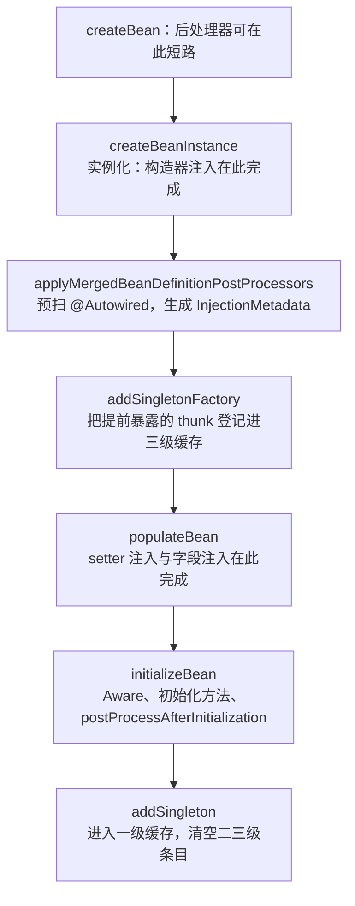
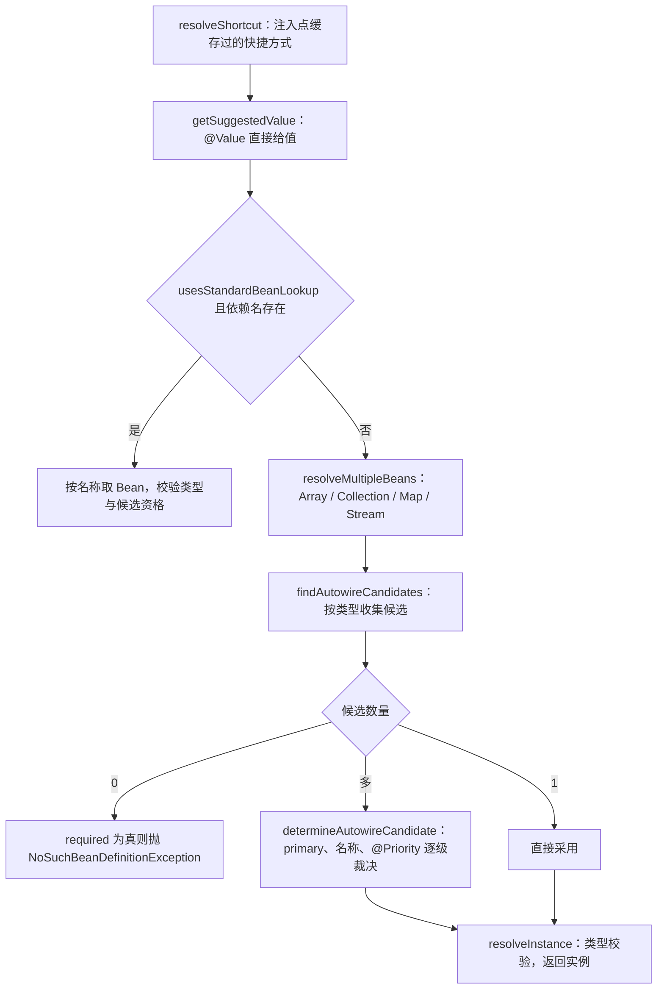
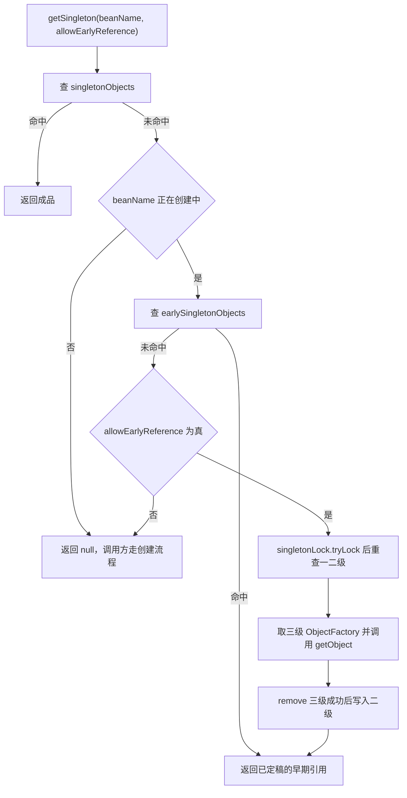
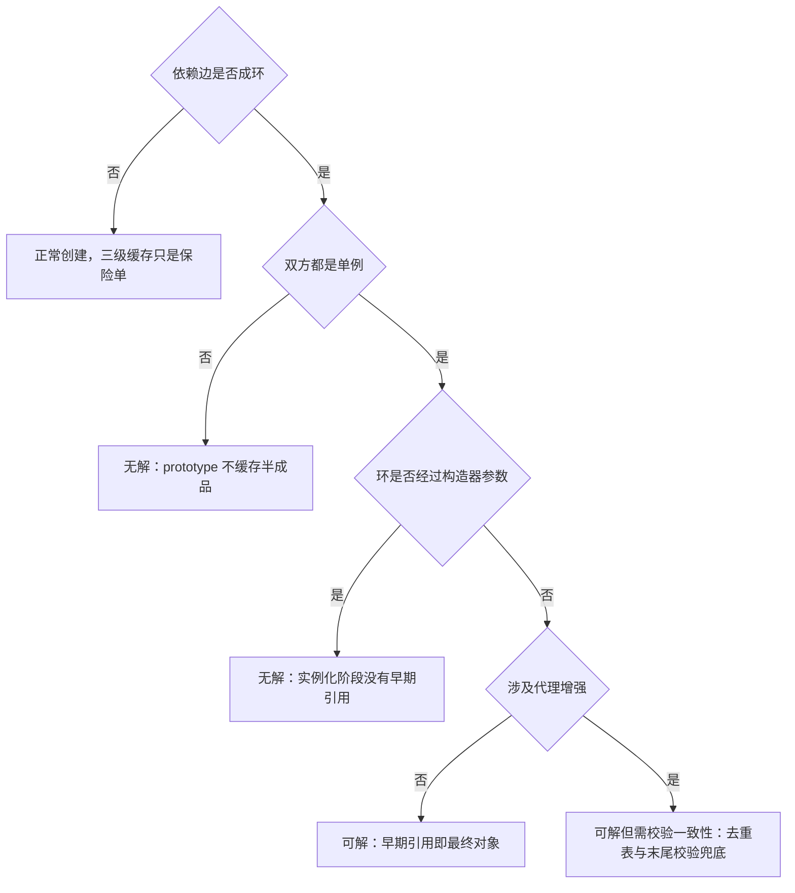

# 依赖注入的三种方式与循环依赖的三级缓存解决方案

**摘要：**

依赖注入常被当成"选个注解"的编码习惯，但它在源码里决定的是容器在 Bean 生命周期的哪一刻解析依赖，以及那一刻对象处在什么状态。本篇沿用机制视角，与 [[Java/SpringCore/02 IoC容器——BeanFactory与ApplicationContext的层次设计]] 的 `getBean` 主线分工：那一篇管"Bean 怎么被取出来"，本篇管"依赖怎么被填进去、成环时容器拿什么兜住"。前四章拆解构造器注入、setter 注入与字段注入的源码路径与各自代价，给出"该用哪个"的判据；第五章走完 `@Autowired` 从 `resolveDependency` 到 `determineAutowireCandidate` 的候选裁决链，把 `@Resource`、`ObjectProvider`、`@Lazy` 放进同一张对照表，并标出 Spring 6.2 与 6.1 在裁决顺序上的差异。后三章是核心交付：`getSingleton` 的三级查找、`addSingletonFactory` 在 `doCreateBean` 中的确切位置、`getEarlyBeanReference` 与 `earlyBeanReferences` 的去重约定，最终回答"第三级为什么不能省"。末尾给出四类循环依赖场景的可解性、Spring Boot 2.6 之后开关默认关闭的机械原因，以及一份标注了口径的代价量化。全文的落点是两条判据：依赖必须在哪一刻可用，以及容器为"把决定推迟"付了什么代价；这两条判据既解释注入方式的选型，也解释 `spring.main.allow-circular-references` 该不该打开。文中标注"实测"的数字都给了版本与执行方式，可以按同样条件复现；没有测量的量级一律标为示例推算。

> [!info] 本篇的边界
> [[Java/SpringCore/02 IoC容器——BeanFactory与ApplicationContext的层次设计]] 讲容器的层次与 `getBean` 主线，本篇只承接它的末尾：容器拿到 `BeanDefinition` 之后，如何把一个对象的依赖填进去，以及当依赖成环时容器用什么结构兜底。Bean 生命周期的逐个回调点属于 [[Java/SpringCore/04 Bean的生命周期——从定义到销毁的完整流程]]；`SmartInstantiationAwareBeanPostProcessor` 在扩展点全景中的位置属于 [[Java/SpringCore/10 Spring扩展点全景——BeanPostProcessor、BeanFactoryPostProcessor与Aware接口]]；代理选型与模式视角的取舍已在 [[Java/OOP设计模式/09 设计模式在Spring中的应用全景]] 里写过，本篇只在代理解环处给结论。

---

## 第 1 章 注入发生在容器的哪一步

### 1.1 从 `<property>` 到 `@Autowired`

2004 年 Spring 1.0 发布时，依赖注入的写法是这样的：

```xml
<bean id="orderService" class="com.example.OrderService">
    <property name="paymentService" ref="paymentService"/>
</bean>
```

容器读到 `<property>` 才知道 `OrderService` 需要一个 `PaymentService`，依赖关系写在配置里，类型只是字符串。2007 年 Spring 2.5 引入 `@Autowired`，依赖关系从配置搬回了 Java 类型系统：容器不再读 XML 的 `ref`，而是从字段、方法参数、构造器参数的类型上反推候选 Bean。这次迁移常被讲成"注解比 XML 简洁"，但它真正的后果在别处——依赖的解析时机被改写了。

XML 时代，`<property>` 的注入时机是固定的，容器在 `populateBean` 阶段按 `PropertyValues` 逐个赋值，类型不匹配就抛异常。注解时代，注入点分散在构造器、字段、setter 上，每一种都对应 `doCreateBean` 中不同的回调位置，而位置决定了对象当时的状态：构造器注入执行时，对象还不存在；字段注入执行时，对象已经存在于堆上，但依赖可能还没齐；初始化回调执行时，依赖已经齐了，但代理还没生成。所谓"三种注入方式的代价"，根子都在这条时间线上。

Spring Framework 4.3 又补了一条规则：类只有一个构造器时不必写 `@Autowired`。这条便利规则后来被大量代码依赖，也让"构造器注入"从一种显式选择变成了默认行为，很多团队在没有意识到的情况下已经在用构造器注入，然后在升级 Boot 2.6 时被循环依赖的启动失败打了个措手不及。

### 1.2 `doCreateBean` 的骨架

把注入放回源码里，`AbstractAutowireCapableBeanFactory#doCreateBean` 的顺序是理解全篇的地基，下面这段是删掉异常处理后的主干：

```java
protected Object doCreateBean(String beanName, RootBeanDefinition mbd, Object[] args) {
    // 第一步：实例化。构造器注入在这里发生
    BeanWrapper instanceWrapper = createBeanInstance(beanName, mbd, args);
    Object bean = instanceWrapper.getWrappedInstance();

    // 第二步：让后处理器预扫元数据（@Autowired 的注入点在此被解析成 InjectionMetadata）
    applyMergedBeanDefinitionPostProcessors(mbd, bean.getClass(), beanName);

    // 第三步：把"如何提前暴露这个 Bean"登记进三级缓存，
    // 注意此刻 bean 已经 new 出来，但 populateBean 还没跑
    boolean earlySingletonExposure = (mbd.isSingleton() && this.allowCircularReferences &&
            isSingletonCurrentlyInCreation(beanName));
    if (earlySingletonExposure) {
        addSingletonFactory(beanName, () -> getEarlyBeanReference(beanName, mbd, bean));
    }

    // 第四步：属性填充。setter 注入与字段注入在这里发生
    Object exposedObject = bean;
    populateBean(beanName, mbd, instanceWrapper);
    // 第五步：初始化。Aware 回调、初始化方法、postProcessAfterInitialization 依序执行
    exposedObject = initializeBean(beanName, exposedObject, mbd);

    if (earlySingletonExposure) {
        Object earlySingletonReference = getSingleton(beanName, false);
        // ……一致性校验，第 7 章展开
    }

    registerDisposableBeanIfNecessary(beanName, bean, mbd);
    return exposedObject;
}
```

这段代码里有一条被反复误读的边界：`addSingletonFactory` 位于 `createBeanInstance` 之后、`populateBean` 之前。它既不是"实例化之前"，也不是"初始化之后"。这个位置精确地回答了一个问题——什么状态下可以把对象交给别人？答案是"已经 `new` 出来，但属性一个都没填"的半成品。也正因为构造器注入发生在第一步、而登记发生在第二步之后，构造器注入的循环依赖在结构上就没有可解的余地，这一点留到第 2 章与第 8 章。

下图把三种注入方式钉在 `doCreateBean` 的时间轴上，可以直观看到它们的落点互不重叠。



### 1.3 分界线不是写法，是时机

把三种方式并列成"写法清单"是常见的简化，但它们在源码里的差异远不止语法糖。构造器注入的实现主体是 `ConstructorResolver#autowireConstructor`，它在 `createBeanInstance` 内部被调用，必须在对象诞生之前就把所有参数解析完；setter 与字段注入的实现主体是 `AutowiredAnnotationBeanPostProcessor#postProcessProperties`，它在 `populateBean` 内部被调用，此时对象已经在堆上，只有属性等着被写；而 setter 与字段之间几乎没有机制差异，两者的区别只在于容器是调用一个方法还是直接写一个字段。

这条时间轴解释了三种注入方式的能力边界，也解释了三个看似无关的现象：为什么构造器注入能保证依赖不为 `null`、为什么字段注入的类在代理之后直接读字段会读到 `null`、为什么只有后两种能解循环依赖。它们都是同一位置差异的不同侧面。

---

## 第 2 章 构造器注入：依赖必须在实例化那一刻齐备

### 2.1 构造器是怎么被选中的

构造器注入的第一道关卡不在 `ConstructorResolver`，而在后处理器：`AutowiredAnnotationBeanPostProcessor#determineCandidateConstructors` 决定"这个类有哪些构造器可以作为候选"。源码里的判定顺序可以概括为四条规则。

第一条，只要有一个构造器标了 `@Autowired` 且 `required = true`，它就是唯一候选，并且不允许第二个同类标注，否则直接抛 `BeanCreationException`，消息里点明"Found constructor with 'required' Autowired annotation already"。第二条，若多个构造器都标了 `@Autowired` 但都是 `required = false`，它们全部进入候选，由后续匹配决定用哪个。第三条，一个 `@Autowired` 都没有、且类只声明了一个带参数的构造器时，这个构造器无条件成为候选——这就是 4.3 之后"单构造器免注解"的落地处。第四条，存在主构造器（典型场景是 `record`，由 `BeanUtils.findPrimaryConstructor` 识别）时，主构造器与无参构造器一起作为候选。

这里有一处容易踩的坑，值得单独说明：`required = false` 标在单一构造器上，并不会让依赖变成"可选"。`determineCandidateConstructors` 在发现"唯一的 `@Autowired` 构造器被标为 optional，而类里又没有无参构造器可以兜底"时，只打一条 `INFO` 日志，随后照常把它送去参数解析：

```text
INFO: Inconsistent constructor declaration on bean with name '...': single autowire-marked
constructor flagged as optional - this constructor is effectively required since there is no
default constructor to fall back to: ...
```

笔者在 Spring 6.2.18 上按这个写法实测，上下文启动时抛出的仍然是 `UnsatisfiedDependencyException`，原因链是 `NoSuchBeanDefinitionException`。`@Autowired(required = false)` 的"可选"语义只对字段和方法成立，对构造器它退化为一句警告。真正想做可选依赖，要么保留一个无参构造器让容器回退，要么改用 `ObjectProvider` 或 `Optional` 参数。

### 2.2 `autowireConstructor` 的贪心匹配

候选构造器确定之后，`ConstructorResolver#autowireConstructor` 负责把它们逐个试一遍。它先看 `BeanDefinition` 上是否缓存过 `resolvedConstructorOrFactoryMethod`，命中则直接用上次的结论与参数——同一个类被实例化多次时（`prototype`、或同一定义生成多个 Bean），这一步省掉了重复匹配。未命中时进入真正的算法：

```java
AutowireUtils.sortConstructors(candidates);          // public 优先，参数多者优先
int minTypeDiffWeight = Integer.MAX_VALUE;
for (Constructor<?> candidate : candidates) {
    int parameterCount = candidate.getParameterCount();
    if (constructorToUse != null && argsToUse != null && argsToUse.length > parameterCount) {
        break;                                        // 已经找到可满足的更"贪心"的构造器，后面的不必再看
    }
    if (parameterCount < minNrOfArgs) {
        continue;                                     // 连 XML 或显式参数的下限都达不到，跳过
    }
    ArgumentsHolder argsHolder = createArgumentArray(...);
    int typeDiffWeight = mbd.isLenientConstructorResolution()
            ? argsHolder.getTypeDifferenceWeight(paramTypes)
            : argsHolder.getAssignabilityWeight(paramTypes);
    if (typeDiffWeight < minTypeDiffWeight) { /* 记为最优 */ }
    else if (typeDiffWeight == minTypeDiffWeight) { /* 记为歧义 */ }
}
```

三个细节决定了实际行为。其一是贪心：构造器按参数个数从多到少排序，一旦某个构造器能完整解析参数，后面参数更少的就跳过，所以"参数最多的可满足构造器"胜出，而不是"最先声明的构造器"。其二是类型差权重：当参数是接口、父类，而候选 Bean 的实际类型更具体时，`lenient` 模式下按层级距离打分，差得越少越优先，多个构造器打平时抛 `BeanCreationException`，消息提示"Ambiguous constructor matches found"。其三是失败收集：每个构造器解析失败抛出的 `UnsatisfiedDependencyException` 不会立刻上抛，而是压进一个 `Deque`，全部构造器都失败后才把最后一个抛出，同时把其余几个作为 suppressed exception 挂上——这就是为什么启动失败时能看到一串"这个构造器为什么不行"的提示。

还有一个不对称的行为藏在 `resolveAutowiredArgument` 里。当候选构造器只有一个时，`createArgumentArray` 会把 `fallback` 参数置为 `true`；此时若某个参数类型是数组、`Collection`、`Map`，而容器里一个匹配 Bean 都没有，解析不会失败，而是返回一个空的数组或集合。同样是"注入一个空的 `List`"，写在构造器参数上能启动成功，写在字段上却会直接抛出 `NoSuchBeanDefinitionException`——这个差异在第 5 章讲多元素注入时会再遇到，它源于两条完全不同的代码路径，而不是设计者的刻意安排。

### 2.3 代价：环在实例化阶段就已注定无解

构造器注入的代价可以用一句源码事实概括：`createBeanInstance` 执行时，`addSingletonFactory` 还没有被调用。也就是说，当 A 的构造器需要 B、B 的构造器又需要 A 时，容器正在创建 A 的上下文里，还没有任何"提前暴露 A"的登记；B 请求 A 时，`getSingleton` 找不到任何早期引用，只能再次进入 A 的创建流程，而 `beforeSingletonCreation` 会发现 A 已在 `singletonsCurrentlyInCreation` 中，抛出 `BeanCurrentlyInCreationException`。

实测的异常链是这样的（Spring 6.2.18，JDK 17）：

```text
UnsatisfiedDependencyException: Error creating bean with name 'ca': Unsatisfied dependency
  expressed through constructor parameter 0: Error creating bean with name 'cb': ...
  → BeanCurrentlyInCreationException: Error creating bean with name 'ca':
    Requested bean is currently in creation: Is there an unresolvable circular reference
    or an asynchronous initialization dependency?
```

不少资料把这种现象写成"直接抛出 `BeanCurrentlyInCreationException`"，方向上没错，但少了外层的 `UnsatisfiedDependencyException`。这个差别在排障时很关键：真正表示"成环"的异常藏在 `getMostSpecificCause()` 里，只看最外层会误判成"某个参数找不到 Bean"。

### 2.4 构造器注入换来了什么

依赖不可变是最直接的一条。构造器参数可以赋给 `final` 字段，`final` 字段在构造器返回前必须完成赋值，这个约束由编译器执行，不依赖框架；JMM 对 `final` 字段还有初始化安全保证，对象被安全发布后，其他线程读到的 `final` 字段一定是构造器里写入的值，不需要额外同步。字段注入做不到这一点，因为 `final` 字段在构造器里必须被赋值，而容器写字段发生在对象构造之后，两者在源码层面就冲突。

测试友好是第二条。构造器注入的类天然是一个依赖显式声明的普通对象，单元测试里 `new OrderService(mockPayment, mockInventory)` 即可，不需要容器；字段注入的类在测试时必须借助反射、`@InjectMocks` 或者启动一个测试上下文，前两者是为了绕过框架而写的补丁，后者把单元测试的成本抬高到集成测试。

第三条常被忽略：构造器注入把依赖数量变成了可见的构造器签名。参数从 3 个涨到 8 个时，签名会变得刺眼，`@Autowired` 字段则只是多一行，读者很难感受到类在膨胀。这是"写法影响设计"的一个真实例子，不是审美问题。

"启动即失败"要区分**两种失败**：依赖缺失导致的 `UnsatisfiedDependencyException`，与成环导致的 `BeanCurrentlyInCreationException`。前者是构造器注入想要的快速失败，后者是构造器注入无法绕开的边界。两者的排障方向完全不同，把后者也当成"构造器注入的优点"是一种常见的混淆。

---

## 第 3 章 setter 与字段注入：注入点为什么要晚一步

### 3.1 解析与执行的两段式

`@Autowired` 的注入逻辑被刻意拆成了两段，这个拆分在第 1 章的骨架里体现为两个不同的回调。第一段是 `postProcessMergedBeanDefinition`，它在 `applyMergedBeanDefinitionPostProcessors` 中被调用，把类上所有 `@Autowired` 字段与方法扫描成 `InjectionMetadata`，缓存在 `injectionMetadataCache` 里，key 是类（`FactoryBean` 场景下带 `&` 前缀的 beanName）；第二段是 `postProcessProperties`，它在 `populateBean` 中被调用，遍历 `InjectionMetadata` 的 `InjectedElement` 逐个执行：

```java
@Override
public PropertyValues postProcessProperties(PropertyValues pvs, Object bean, String beanName) {
    InjectionMetadata metadata = findAutowiringMetadata(beanName, bean.getClass(), pvs);
    try {
        metadata.inject(bean, beanName, pvs);
    } catch (Throwable ex) {
        throw new BeanCreationException(beanName, "Injection of autowired dependencies failed", ex);
    }
    return pvs;
}
```

拆成两段的好处是"扫描一次、复用多次"：同一个类被创建多个实例时，反射扫描只做一遍；坏处是元数据会随类结构变化失效，所以缓存里带了类引用，`needsRefresh` 会检查类是否被重新加载（热部署场景）。解析与执行的分工本身在 [[Java/SpringCore/04 Bean的生命周期——从定义到销毁的完整流程]] 里有完整叙述，这里只取一个结论：注入逻辑之所以能写得这么薄，靠的是元数据提前算好。

### 3.2 字段与方法的两条执行路径

字段注入的落点在 `AutowiredFieldElement#inject`：

```java
protected void inject(Object bean, String beanName, PropertyValues pvs) throws Throwable {
    Field field = (Field) this.member;
    Object value = this.cached ? resolveCachedArgument(beanName, this.cachedFieldValue)
                               : resolveFieldValue(field, bean, beanName);
    if (value != null) {
        ReflectionUtils.makeAccessible(field);
        field.set(bean, value);
    }
}
```

这段代码里有两个值得记住的细节。第一个是 `if (value != null)`：解析结果为 `null` 时字段根本不会被写，默认值原样保留。`@Autowired(required = false)` 的"不注入"语义就落在这个判断上，它不会把字段设成 `null`，也不会抛异常，字段保持你在声明处写的初始值。第二个是缓存：`resolveFieldValue` 解析成功后，如果候选唯一、名字在容器里已注册且类型匹配，会把描述符换成 `ShortcutDependencyDescriptor` 存进 `cachedFieldValue`，下次同类型实例注入时直接按名字取 Bean，省掉一轮类型匹配。

方法注入的落点在 `AutowiredMethodElement#inject`，它与字段注入有一个重要差异：方法参数是"全有或全无"的。解析每个参数时，如果某个参数返回 `null`、方法整体是 `required = false`、且该参数不是 `Optional`，代码会把整个参数数组置为 `null`，方法一次都不会被调用：

```java
Object arg = beanFactory.resolveDependency(currDesc, beanName, autowiredBeanNames, typeConverter);
if (arg == null && !this.required && !methodParam.isOptional()) {
    arguments = null;
    break;                       // 整个方法放弃调用
}
```

笔者用一个双参数 setter 实测确认了这一点：一个参数可解析、另一个不存在，方法体里的计数器在整个启动过程中始终为 0。这与很多人的直觉相反——直觉上会认为"能注入几个就注入几个"。

### 3.3 晚一步，就多了一条解环的路

字段与 setter 注入能解循环依赖，原因不在它们用了反射，而在它们的执行时机：`populateBean` 排在 `addSingletonFactory` 之后。当 A 填充属性需要 B、B 填充属性又需要 A 时，A 的 `ObjectFactory` 已经在三级缓存里了，B 通过 `getSingleton(beanName, true)` 能拿到 A 的早期引用，环在这里被剪断。第 6 章会把这条路径逐步展开。

这里先澄清一个流传很广的说法：字段注入比 setter 注入"更容易解循环依赖"。机制上两者**完全等价**，都走 `populateBean` → `postProcessProperties` 这条路径；差别只在写法成本，字段注入不需要为每个依赖写一个 setter，仅此而已。把它说成"能力差异"会让读者误以为 setter 有什么结构性缺陷。

### 3.4 字段注入的代价，以及代理带来的那一层

字段注入的批评通常集中在三点：破坏封装（`private` 字段被 `setAccessible` 强行写入）、测试困难、以及让依赖膨胀失去视觉阻力。这三点都成立，但都是"工程习惯"层面的判断，真正会造成运行期故障的是第四个代价，它只在 Bean 被代理时出现。

Spring 的类代理是 CGLIB 子类代理，代理对象是目标类的子类实例，字段并不共享——目标对象的字段在目标对象里，代理对象自己的字段是另一份，且从未被容器写入。于是"通过代理引用直接读字段"读到的是 `null`。笔者在一个 A↔B 循环依赖的场景里加了切面，让 A 被 CGLIB 代理，实测结果如下：

```text
bean(a).class = A$$SpringCGLIB$$0
b.a == bean(a)      → true        // B 注入的早期引用就是最终代理，单例语义一致
a.getB() == bean(b) → true        // 通过方法访问，拦截器转发到目标对象
a.b == bean(b)      → false       // a.b 实际是 null：读的是代理子类自己的字段
```

同一份代码，通过 getter 访问正常，直接访问字段为 `null`。这类故障在开发环境里往往不出现（没开代理），一上生产加了事务或缓存切面就冒出来，排查成本很高。字段注入把这种风险放大到了整片代码，构造器注入配 `final` 字段则从根上避免了"字段在代理上不存在"的问题——因为读写都发生在构建期，之后只通过方法访问。

---

## 第 4 章 该用哪个：官方立场与判据

### 4.1 官方文档的三句话

Spring Framework 参考文档在依赖注入一节给出的原话是："it is a good rule of thumb to use constructors for mandatory dependencies and setter methods or configuration methods for optional dependencies"，紧接着一句"The Spring team generally advocates constructor injection, as it lets you implement application components as immutable objects and ensures that required dependencies are not null"。同一节还提醒，在 setter 上加 `@Autowired` 会让该属性变成必需依赖——这与很多团队"setter 就是可选"的默认认知相反。

`@Autowired` 的 Javadoc 则补上构造器的规则：只有一个构造器时注解可以省略；有多个构造器且没有主构造器或无参构造器时，必须至少给一个标 `@Autowired` 才能指示容器用哪个。两条文档合起来，官方的立场可以压成一句：必填走构造器、可选走 setter 或配置方法，字段注入不在推荐列表里。

### 4.2 三种方式的机制对照

| 维度 | 构造器注入 | setter 注入 | 字段注入 |
| :--- | :--- | :--- | :--- |
| 注入落点 | `createBeanInstance` → `autowireConstructor` | `populateBean` → `postProcessProperties` → `AutowiredMethodElement` | `populateBean` → `postProcessProperties` → `AutowiredFieldElement` |
| `final` 支持 | 支持，编译期强制 | 不支持 | 不支持（`final` 字段必须在构造器内赋值，与注入时机冲突） |
| 依赖缺失时 | 启动期抛 `UnsatisfiedDependencyException` | `required = false` 时方法整体不调用 | `required = false` 时字段保持默认值 |
| 循环依赖 | 不可解 | 可解 | 可解（机制与 setter 完全相同） |
| 代理之后的字段访问 | 无字段可读，只能走方法 | 走方法，正常 | 直接读字段得到 `null` |
| 单元测试 | 直接 `new`，无需容器 | 需要手动调 setter | 需要反射或测试上下文 |
| 依赖膨胀的可见性 | 构造器签名变长，很刺眼 | 多一个 setter，中等 | 多一行注解，几乎无感 |
| 官方倾向 | 首选 | 可选依赖 | 不推荐 |

### 4.3 场景到方式的判据

| 场景 | 推荐方式 | 判据 |
| :--- | :--- | :--- |
| 业务必填依赖 | 构造器 + `final` | 依赖缺失应当在启动期暴露，而不是等到第一次调用 |
| 可降级的可选能力 | setter 或 `ObjectProvider` | 缺失时要有明确兜底分支，且兜底逻辑应写在调用方 |
| 需要多实例、按名取用 | 构造器注入容器对象，运行时再取 | 把 `BeanFactory` 或 `ObjectProvider` 作为依赖，避免在字段上堆注解 |
| 第三方类无法改源码 | `@Bean` 方法内手动 new 后 set | 容器只能用 setter 或工厂方法拼装外部类型 |
| 框架集成代码（切面、过滤器、`BeanPostProcessor`） | 字段注入可接受 | 这些类与容器强绑定，且通常不被再次代理 |
| 遗留代码里的环 | 先重构，其次 `@Lazy` 或 `ObjectProvider` | 打开开关或依赖 setter 解环都是把问题后移 |

表格最后一行是真实决策里最常见的一行。它不是在推荐 `@Lazy`，而是在说：当环确实无法在一次改动里拆掉时，`@Lazy` 与 `ObjectProvider` 是两种"把依赖变成延迟解析"的手段，它们改变的是依赖边存在的时刻，而不是把环藏起来。第 5 章会看到两者的机制差别。

---

## 第 5 章 `@Autowired` 的解析链

### 5.1 `resolveDependency` 的五个分叉

`DefaultListableBeanFactory#resolveDependency` 是所有注入点的统一入口，它在进入真正的按类型查找之前，先按依赖类型分流：

```java
public Object resolveDependency(DependencyDescriptor descriptor, String requestingBeanName,
        Set<String> autowiredBeanNames, TypeConverter typeConverter) {
    descriptor.initParameterNameDiscovery(getParameterNameDiscoverer());
    if (Optional.class == descriptor.getDependencyType()) {
        return createOptionalDependency(descriptor, requestingBeanName);
    } else if (ObjectFactory.class == descriptor.getDependencyType() ||
               ObjectProvider.class == descriptor.getDependencyType()) {
        return new DependencyObjectProvider(descriptor, requestingBeanName);
    } else if (jakartaInjectProviderClass == descriptor.getDependencyType()) {
        return new Jsr330Factory().createDependencyProvider(descriptor, requestingBeanName);
    } else if (descriptor.supportsLazyResolution()) {
        Object result = getAutowireCandidateResolver().getLazyResolutionProxyIfNecessary(
                descriptor, requestingBeanName);
        if (result != null) {
            return result;
        }
    }
    return doResolveDependency(descriptor, requestingBeanName, autowiredBeanNames, typeConverter);
}
```

五个分叉对应五种"延迟或兜底"的手段：`Optional` 把缺失变成空值、`ObjectProvider` 把解析推迟到调用、JSR-330 的 `Provider` 同理、`@Lazy` 生成一个惰性代理、剩下的才走正常的候选查找。注意 `@Lazy` 的判断条件是 `supportsLazyResolution()`，它由 `DependencyDescriptor` 结合注入点上的注解决定，所以 `@Lazy` 能标在字段、方法参数、构造器参数上，效果一致：注入点拿到的不是 Bean，而是一个代理。

### 5.2 `doResolveDependency` 的六步

进入 `doResolveDependency` 之后，Spring 6.2 的实现被重构成了一段带编号的流程，比 5.x 更容易读：



第一步与第二步是两条捷径：`resolveShortcut` 命中注入点上一次解析出的候选名（`ShortcutDependencyDescriptor` 的功劳），`getSuggestedValue` 处理 `@Value` 这类"给值而非给 Bean"的注入。第三步是 6.2 新增的按名短路：当依赖描述符允许标准 Bean 查找、且字段名或参数名恰好命中容器里的 beanName 时，直接按名字取，不再走类型收集。这一步在 6.1 及更早版本里并不存在，它改变了"字段名参与裁决"的语义，第 5.4 节会给出实测对比。

### 5.3 按类型收集：`findAutowireCandidates`

`findAutowireCandidates` 的骨架只有三件事：拿所有类型兼容的 beanName、把可解析依赖（`resolvableDependencies`，即 `ApplicationContext`、`BeanFactory` 这类容器自身注册的对象）塞进候选、逐个过 `isAutowireCandidate` 过滤。

```java
String[] candidateNames = BeanFactoryUtils.beanNamesForTypeIncludingAncestors(
        this, requiredType, true, descriptor.isEager());
Map<String, Object> result = CollectionUtils.newLinkedHashMap(candidateNames.length);
for (Map.Entry<Class<?>, Object> entry : this.resolvableDependencies.entrySet()) {
    if (entry.getKey().isAssignableFrom(requiredType)) {
        result.put(ObjectUtils.identityToString(entry.getValue()), entry.getValue());
        break;
    }
}
for (String candidate : candidateNames) {
    if (!isSelfReference(beanName, candidate) && isAutowireCandidate(candidate, descriptor)) {
        addCandidateEntry(result, candidate, descriptor, requiredType);
    }
}
```

`isAutowireCandidate` 除了看 `BeanDefinition` 的 `autowireCandidate` 标志，还会做限定符匹配：注入点上有 `@Qualifier` 时，只有带上匹配限定符的 Bean 才算候选；泛型也会参与匹配，`Repository<User>` 不会和 `Repository<Order>` 互相串台，这条能力从 Spring 4.0 起就有。

源码里还有两轮 fallback，多数资料会略过，但它们解释了两种"明明有 Bean 却注入不进去"的现象：第一轮在主循环找不到候选时放宽限定符再找一遍，第二轮把"自引用"也纳入候选。自引用从 Spring 4.3 起被允许——一个 Bean 注入自己，拿到的是早期引用或成品，这让"把自身作为回调注册给某个组件"的写法能成立；但在集合注入的场景里会特意排除自身，否则 `List<Foo>` 里会出现一个正在创建的 `Foo`。

### 5.4 多候选的裁决顺序

候选多于一个时，`determineAutowireCandidate` 按优先级逐级裁决。Spring 6.2 的顺序是：`@Primary` → 依赖名匹配（字段名或参数名）→ `@Qualifier` 建议名 → `@Priority` → 直接注册的可解析依赖。Spring 6.1 及更早的顺序是：`@Primary` → `@Priority` → 名称兜底。

| 裁决级 | Spring 6.1 及更早 | Spring 6.2 |
| :--- | :--- | :--- |
| 1 | `@Primary` | `@Primary` |
| 2 | `@Priority` / `Ordered` | 依赖名（字段名、参数名）匹配 beanName |
| 3 | 名称兜底 | `@Qualifier` 建议名 |
| 4 | 可解析依赖 | `@Priority` / `Ordered` |
| 5 | — | 可解析依赖 |
| 无结果 | `NoUniqueBeanDefinitionException` | `NoUniqueBeanDefinitionException` |

这个顺序变化可以用一个小实验观察到：容器里有两个 `Svc` 实现，`svcA` 与 `svcB`，其中 `svcB` 带 `@Priority(1)`，注入点字段名恰为 `svcA`。6.1 选 `svcB`（优先级更高），6.2 选 `svcA`（字段名优先）。如果升级后发现"某个注入点换了实现"，先查这里，而不是先怀疑 `@Primary`。

`@Primary` 自身也有边界：`determinePrimaryCandidate` 只允许唯一的 primary，遇到两个 primary Bean 会抛 `NoUniqueBeanDefinitionException`，消息说明"more than one 'primary' bean found among candidates"。所以给多个同类型 Bean 都标 `@Primary`，等价于没有 primary，同时把错误从"运行时随机选一个"变成了"启动期歧义"。

### 5.5 多元素注入的四类语义

`resolveMultipleBeans` 负责 `Array`、`Collection`/`Set`/`List`、`Map`、`Stream` 四种声明形式，`Optional` 在 `resolveDependency` 的第一步就被分流走，不在这里处理。行为差异集中在"没有候选时"：

| 声明形式 | 类型约束 | 无候选时的行为 |
| :--- | :--- | :--- |
| `T[]` | 组件类型必须是可解析的类 | 字段注入抛异常；单构造器参数得到空数组 |
| `List<T>` / `Set<T>` / `Collection<T>` | 元素类型由 `ResolvableType` 解析 | 字段注入抛异常；单构造器参数得到空集合 |
| `Map<String, T>` | key 必须是 `String`，否则返回 `null` 并转入单值查找 | 同上；有候选时 key 为 beanName |
| `Stream<T>` | 由 `StreamDependencyDescriptor` 标记 | 返回空流，不抛异常 |
| `Optional<T>` | 在 `resolveDependency` 首步处理 | 返回 `Optional.empty()` |

笔者把同一组声明分别放在字段与单构造器参数上实测，结果与源码路径一致：字段注入、`required = true`、容器里没有任何 `Foo` 实现时，启动失败；把同样的 `List<Foo>` 放到单构造器参数上，得到空列表；字段上标 `required = false` 时，字段是 `null` 而不是空列表。最后一条最容易误判——很多资料写"集合注入天然安全，缺失就是空集合"，这只对**构造器参数**成立。

### 5.6 `@Autowired`、`@Resource` 与 `@Inject`

| 注解 | 处理者 | 默认匹配 | 显式指定 | 缺失时 |
| :--- | :--- | :--- | :--- | :--- |
| `@Autowired` | `AutowiredAnnotationBeanPostProcessor` | 按类型，多候选走裁决链 | `@Qualifier` | `required = true` 抛异常 |
| `@Resource` | `CommonAnnotationBeanPostProcessor` | 按名称（字段名或属性名派生） | `@Resource(name = ...)` | 抛 `NoSuchBeanDefinitionException` |
| `@Inject` | `AutowiredAnnotationBeanPostProcessor`（同时兼容 `jakarta.inject` 与旧 `javax.inject`） | 按类型 | `@Named` | 抛异常（无 `required` 属性） |

`@Resource` 的名称派生规则值得记住：没有显式写 `name` 时，字段取字段名，setter 取去掉 `set` 后的属性名（首字母小写），然后直接按这个名称去容器里找。找不到时才是关键——如果这个名字是"默认名"（用户没显式指定），容器会回退到按类型解析，走的就是 `@Autowired` 那条 `resolveDependency` 路径，`@Primary` 依然生效；如果名字是显式指定的，就没有回退，找不到直接失败。官方文档对这条回退有一句明确表述："@Resource finds a primary type match instead of a specific named bean"。"`@Resource` 默认按名称"这个流传很广的说法只讲了前半句，容易让人以为显式指定与默认派生是同一个语义。

`@Resource` 还有一个与 `@Autowired` 的实质差异：它没有 `required` 属性，缺失即失败，没有"跳过注入"的中间状态。这让它适合"必须存在的资源"，不适合可选依赖。

### 5.7 `ObjectProvider` 与 `@Lazy`

两者都能把依赖解析推迟，但推迟的**层次**不同：

| 维度 | `ObjectProvider<T>` | `@Lazy` |
| :--- | :--- | :--- |
| 注入进字段的对象 | 一个 `DependencyObjectProvider` 实例 | 一个代理对象（接口用 JDK，类用 CGLIB） |
| 解析时机 | 调用 `getObject()` / `getIfAvailable()` 时 | 首次方法调用时 |
| 缺失依赖的表现 | `getIfAvailable()` 返回 `null`，`getObject()` 抛异常 | 启动成功，首次调用抛 `NoSuchBeanDefinitionException` |
| 常见用途 | 可选依赖、按需取多实例、流式收集 | 打破环、延迟初始化大对象 |
| 主要代价 | 调用方代码多一层取值逻辑 | 代理开销与类型判断失效（`getClass()`、`equals` 行为变化） |

`ObjectProvider` 的实现是 `DependencyObjectProvider`，它持有一个 `NestedDependencyDescriptor`，每次取值都重新走 `doResolveDependency`；`getIfAvailable()` 通过覆写描述符的 `isRequired()` 返回 `false` 来避开"缺失即抛"的行为。这让它在构造器注入里也能用——构造器参数是 `ObjectProvider`，容器注入的是一个对象，不需要真实的依赖 Bean 存在，环自然解开。笔者实测：`CtorProvider` 与 `Req` 互相依赖，前者参数用 `ObjectProvider<Req>`，启动成功，`getObject()` 返回真实的 `Req`。

`@Lazy` 的实现落在 `ContextAnnotationAutowireCandidateResolver#buildLazyResolutionProxy`：它构造一个 `LazyDependencyTargetSource`，再用 `ProxyFactory` 生成代理，接口类型加接口，类类型走 CGLIB。代理被调用时，`TargetSource#getTarget()` 才真正执行 `doResolveDependency`，第一次解析后如果所有相关 Bean 都是单例，会把目标缓存进 `cachedTarget`，后续调用不再重复解析；若涉及 `prototype`，则每次调用重新解析——这一点在 6.2 的实现里写得很清楚，也解释了为什么"`@Lazy` 注入 prototype 拿到的是新实例"。

实测两个数据点。其一，缺失依赖时：构造器参数标 `@Lazy Missing`，容器启动成功，注入的是一个 JDK 代理；首次调用代理方法时抛 `NoSuchBeanDefinitionException`，消息里带着 `@Lazy(true)` 的注解信息，说明失败点从启动期挪到了使用期。其二，调用开销：本机（JDK 17，单线程，预热 3 轮后取 8 轮最优）对同一接口调用 500 万次，直接持有实例约 0.24 ns/次，经 `@Lazy` 代理约 8.5 ns/次。这个量级对业务方法可以忽略，对被高频调用的基础设施接口（比如每次都走缓存切面内部的依赖）就值得注意。

---

## 第 6 章 三级缓存：三个 Map 的分工

### 6.1 数据结构与版本差异

三级缓存位于 `DefaultSingletonBeanRegistry`，Spring 6.2 的字段声明如下：

```java
private final Map<String, Object> singletonObjects = new ConcurrentHashMap<>(256);
private final Map<String, Object> earlySingletonObjects = new ConcurrentHashMap<>(16);
private final Map<String, ObjectFactory<?>> singletonFactories = new ConcurrentHashMap<>(16);
private final Set<String> singletonsCurrentlyInCreation = ConcurrentHashMap.newKeySet(16);
final Lock singletonLock = new ReentrantLock();
```

5.x 的结构是：`singletonFactories` 用 `HashMap`，并发保护靠 `synchronized (this.singletonObjects)`。这个描述在 6.0 与 6.1 上仍然准确，笔者逐一核对过两版的字段声明；到 6.2 才换成三个 `ConcurrentHashMap` 加一把 `ReentrantLock`，`getSingleton` 里的加锁也从 `synchronized` 块变成 `tryLock`，拿不到锁时直接返回 `null`，并注释说明"避免在原始创建线程之外推断早期引用"。这个改动的意义在并发场景下才显现：一个线程正在为某个 Bean 生成提前引用时，另一个线程来查同一个 Bean，旧实现会阻塞，新实现直接放弃提前引用、让调用方走正常创建流程。把版本差异说清楚有现实价值——网上大量讲三级缓存的文章抄的是 5.x 的结构，照着它去读 6.2 的源码会找不到对应的锁对象。

三个 Map 的职责可以用一句话区分，下面的表是后文所有推演的地基。

| 结构 | 存什么 | 何时写入 | 何时清除 |
| :--- | :--- | :--- | :--- |
| `singletonObjects` | 完整成品（可能是代理） | `addSingleton`，创建流程末尾 | 容器销毁时 |
| `earlySingletonObjects` | 已定稿的早期引用（可能是代理） | `getSingleton` 里由三级升级而来 | `addSingleton` 时清除 |
| `singletonFactories` | `ObjectFactory`，一段"要不要提前代理"的延迟逻辑 | `addSingletonFactory`，实例化之后 | 被取用一次即移除；`addSingleton` 时兜底清除 |
| `singletonsCurrentlyInCreation` | 正在创建中的 beanName 集合 | `beforeSingletonCreation` | `afterSingletonCreation` |

### 6.2 `getSingleton` 的完整查找

```java
protected Object getSingleton(String beanName, boolean allowEarlyReference) {
    Object singletonObject = this.singletonObjects.get(beanName);          // 一级：无锁快路径
    if (singletonObject == null && isSingletonCurrentlyInCreation(beanName)) {
        singletonObject = this.earlySingletonObjects.get(beanName);        // 二级
        if (singletonObject == null && allowEarlyReference) {
            if (!this.singletonLock.tryLock()) {
                return null;                                               // 拿不到锁就不推断早期引用
            }
            try {
                singletonObject = this.singletonObjects.get(beanName);     // 加锁后重查，DCL
                if (singletonObject == null) {
                    singletonObject = this.earlySingletonObjects.get(beanName);
                    if (singletonObject == null) {
                        ObjectFactory<?> singletonFactory = this.singletonFactories.get(beanName);
                        if (singletonFactory != null) {
                            singletonObject = singletonFactory.getObject(); // 调的是 getEarlyBeanReference
                            if (this.singletonFactories.remove(beanName) != null) {
                                this.earlySingletonObjects.put(beanName, singletonObject);   // 升二级
                            } else {
                                singletonObject = this.singletonObjects.get(beanName);       // 竞态兜底
                            }
                        }
                    }
                }
            } finally {
                this.singletonLock.unlock();
            }
        }
    }
    return singletonObject;
}
```

这段代码里有四处需要读懂。

第一处是 `isSingletonCurrentlyInCreation` 这个前置条件。只有"正在创建中"的 Bean 才允许被提前暴露，一个已经创建完成的 Bean 若不在 `singletonObjects` 里，说明它压根不是单例或者已被销毁，此时查二三级没有意义。这个判断把"提前暴露"限定在创建窗口内。

第二处是 `allowEarlyReference`。单参重载 `getSingleton(beanName)` 的实现是 `return getSingleton(beanName, true)`——它允许提前引用，这是 `doGetBean` 主路径的行为。"单参版本等价于 `allowEarlyReference = false`"是一种常见的误读，事实恰好相反。真正传 `false` 的是 `doCreateBean` 末尾那一句 `getSingleton(beanName, false)`：初始化已经完成，此时只想知道"创建期间有没有人拿走过早期引用"，不应该再触发一次 `ObjectFactory` 去生成代理。

第三处是"三级升级二级"的原子性。`singletonFactory.remove(beanName) != null` 成功才写二级缓存，失败说明在拿到锁之前有别的线程已经把条目取走或清掉，这时改读一级缓存兜底。旧实现是"先 put 二级再 remove 三级"，两个动作之间有窗口；6.2 用 remove 的返回值做条件，把窗口收掉了。

第四处是 `tryLock` 失败直接返回 `null`。这个分支会让调用方以为"没有早期引用"而走创建流程，进而可能撞上 `BeanCurrentlyInCreationException`。它是 6.2 为了"不在非创建线程里推断早期引用"做的取舍：宁可让另一个线程报错，也不让它在锁外拿到一个可能被包装过的半成品。

下图把三级查找画成决策路径，可以看到二三级只在"正在创建中且允许提前引用"的窄窗口里才会被访问。



### 6.3 `addSingletonFactory` 的位置与条件

第 1 章的骨架已经给出位置，这里补上条件。`earlySingletonExposure` 是三个条件的与：`mbd.isSingleton()`、`this.allowCircularReferences`、`isSingletonCurrentlyInCreation(beanName)`。第三条看着奇怪——刚进入创建流程的 Bean 当然在创建中——它的作用是确保登记发生在 `beforeSingletonCreation` 之后，否则这个登记就没有对应的清理时机。

三个条件里最关键的是 `allowCircularReferences`。它是 `AbstractAutowireCapableBeanFactory` 上的一个开关，默认 `true`；Spring Boot 2.6 起被 `SpringApplication` 在准备上下文时按 `spring.main.allow-circular-references` 的值设置，默认 `false`。一旦为 `false`，`earlySingletonExposure` 恒为假，三级缓存根本不会被填充，循环依赖在解析注入点时直接抛 `BeanCurrentlyInCreationException`。第 9 章会完整展开这条链路，这里只需记住：三级缓存不是无条件启用的，它有一个容器级开关。

### 6.4 "创建完就清空"的实测

`addSingleton` 的实现只有几行，但它的清理动作决定了三级缓存的内存性质：

```java
protected void addSingleton(String beanName, Object singletonObject) {
    Object oldObject = this.singletonObjects.putIfAbsent(beanName, singletonObject);
    if (oldObject != null) {
        throw new IllegalStateException("Could not register object ... there is already object ...");
    }
    this.singletonFactories.remove(beanName);
    this.earlySingletonObjects.remove(beanName);
    this.registeredSingletons.add(beanName);
}
```

三级与二级的条目在 Bean 创建完成时被无条件清除。笔者用反射读取容器就绪后的状态，一个包含 17 个单例的上下文里，`singletonObjects` 有 17 个条目，`earlySingletonObjects` 与 `singletonFactories` 都是 0 条。也就是说，二三级缓存不是"每个 Bean 常驻三份"，而是创建窗口内的**临时结构**；稳态下只有一级缓存持有实例。

这个事实推翻了一类常见的性能担忧："三级缓存会不会把内存翻三倍"。答案是不会，因为二三级只在创建过程中存在，而且同一时刻的条目数量等于"正在创建的 Bean 数"，与容器里 Bean 总数无关。真正的常驻开销在别处：`InjectionMetadata` 缓存、`candidateConstructorsCache`、`advisedBeans`、`targetSourcedBeans` 这些后处理器的元数据表，它们按类而不是按实例存储，量级远小于 Bean 实例本身。

### 6.5 异常是在哪里产生的

`BeanCurrentlyInCreationException` 最常被撞上的产生点有两个：`DefaultSingletonBeanRegistry#beforeSingletonCreation`，以及 `AbstractBeanFactory#doGetBean` 的 prototype 分支。异常类自身的默认消息就写着"Requested bean is currently in creation: Is there an unresolvable circular reference or an asynchronous initialization dependency?"，两个来源共用同一段文案，所以看消息区分不出是哪一处：

```java
protected void beforeSingletonCreation(String beanName) {
    if (!this.inCreationCheckExclusions.contains(beanName) &&
            !this.singletonsCurrentlyInCreation.add(beanName)) {
        throw new BeanCurrentlyInCreationException(beanName);
    }
}
```

注意 `add` 的返回值被当作"是否首次登记"来用：集合里已有该名字时 `add` 返回 `false`，说明同一个 Bean 在同一线程（或并发线程）里被重复创建，这就是环的信号。`getSingleton(beanName, singletonFactory)` 在执行 `ObjectFactory` 之前先调用它，所以任何一次"重复进入创建流程"都会在这里被拦下。构造器注入的环与 `allowCircularReferences = false` 下的字段环撞的是这个判断，prototype 的环撞的是 `doGetBean` 里的 `isPrototypeCurrentlyInCreation`，此外还有第三处来源——`doCreateBean` 末尾的一致性校验会用同一个异常类型报告"早期引用与最终对象不一致"。三处用的是同一个异常类，排障时不能只看类型，要看消息与异常链位置。

---

## 第 7 章 为什么必须是三级

### 7.1 如果只留两级

设想一个只有 `singletonObjects` 与 `earlySingletonObjects` 的方案：实例化完成后，直接把原始对象放进二级缓存，依赖方从二级缓存拿半成品。在没有代理的世界里，这个方案完全够用，也是很多教科书对"Spring 怎么解循环依赖"的简化描述。

问题出在代理上。如果 A 需要被 `@Transactional` 增强，最终放进一级缓存的是代理，而 B 从二级缓存拿到的是原始对象，两个引用指向不同实例：B 调用 A 的方法时没有事务拦截，容器里其他地方拿到的是代理。单例语义被破坏，而且破坏得很隐蔽——只有通过 B 引用进来的调用路径才失效。

要修这个问题，两级方案只剩下一条路：在实例化完成后立刻决定"要不要代理"，也就是在登记早期引用之前就把代理生成好。这条路的代价是全局性的：所有 Bean 的代理生成时机从"初始化完成后"提前到"实例化完成后"，`postProcessAfterInitialization` 的契约被架空。`@Transactional` 的 advisor 匹配依赖已完成初始化的对象状态，`@Async` 的后处理器依赖 Bean 类型与注解，一旦提前到初始化之前，这些判断都要重写；更现实的问题是，非循环依赖的 Bean 占了绝大多数，它们本来不需要任何提前动作，却要为这个方案付一次切点匹配与代理创建。

### 7.2 三级缓存存的不是对象，是决定权

第三个 Map 里放的是 `ObjectFactory`，它不是 Bean，也不是代理，而是一段"要不要生成代理、生成哪个代理"的**延迟逻辑**。这个设计把"是否代理"的决定权从创建阶段移到了取用阶段：只有当某个依赖方真的来要早期引用时，`ObjectFactory` 才会被调用一次，`getEarlyBeanReference` 才会遍历 `SmartInstantiationAwareBeanPostProcessor`，代理才会被创建。

用一句更直白的话说：一级缓存是成品仓库，二级缓存是提前装好的样板间，三级缓存是一张"要不要按精装标准交付"的委托书。委托书只有在客户真的来要房时才被执行，执行一次后作废，成果搬进样板间；如果一直没人来要，委托书就跟着这次创建一起被丢掉。这个类比有一个技术限定必须补上：样板间里的东西未必是最终交付物——如果 Bean 在后续初始化中又被别的后处理器包装，样板间与最终成品可能不一致，第 7.4 节讨论的就是这种情形。

### 7.3 `getEarlyBeanReference` 与 `earlyBeanReferences`

`AbstractAutowireCapableBeanFactory#getEarlyBeanReference` 本身很短，它把决定权交给所有 `SmartInstantiationAwareBeanPostProcessor`：

```java
protected Object getEarlyBeanReference(String beanName, RootBeanDefinition mbd, Object bean) {
    Object exposedObject = bean;
    if (!mbd.isSynthetic() && hasInstantiationAwareBeanPostProcessors()) {
        for (SmartInstantiationAwareBeanPostProcessor bp : getBeanPostProcessorCache().smartInstantiationAware) {
            exposedObject = bp.getEarlyBeanReference(exposedObject, beanName);
        }
    }
    return exposedObject;
}
```

真正干活的是 `AbstractAutoProxyCreator#getEarlyBeanReference`，它做两件事：把 beanName 与原始对象的对应关系记进 `earlyBeanReferences`，再调用 `wrapIfNecessary` 生成代理；如果这个 Bean 不需要代理，`wrapIfNecessary` 返回原对象，记录同样会写入。

```java
public Object getEarlyBeanReference(Object bean, String beanName) {
    Object cacheKey = getCacheKey(bean.getClass(), beanName);
    this.earlyBeanReferences.put(cacheKey, bean);
    return wrapIfNecessary(bean, beanName, cacheKey);
}

public Object postProcessAfterInitialization(Object bean, String beanName) {
    if (bean != null) {
        Object cacheKey = getCacheKey(bean.getClass(), beanName);
        if (this.earlyBeanReferences.remove(cacheKey) != bean) {
            return wrapIfNecessary(bean, beanName, cacheKey);
        }
    }
    return bean;
}
```

去重的**判定条件**值得逐字读：`earlyBeanReferences.remove(cacheKey) != bean`。记录里存的是**原始对象**，`postProcessAfterInitialization` 收到的是**原始对象**，两者相等说明"这个 Bean 在早期已经被代理过"，于是跳过再次包装，直接返回原对象；若记录为空，`remove` 返回 `null`，条件成立，正常生成代理。这里每个对象都用 `identity` 比较，所以即使 `equals` 被重写也不会误判。这张表在 5.3 及更早的版本里叫 `earlyProxyReferences`，6.x 改名为 `earlyBeanReferences`；名字有变，语义没变——它一直存的是"缓存键到原始对象"的映射，而不是布尔标记或 beanName 集合，比较时才用得上对象身份。

如果这张表不存在，循环依赖场景下 A 会被代理两次：一次在 `getEarlyBeanReference`，一次在 `postProcessAfterInitialization`，前一个代理给了 B，后一个代理进了一级缓存，单例语义照样破裂。这张表是三级缓存方案能成立的必要配件，而不是可选优化。

### 7.4 早期引用与最终对象不一致时

`doCreateBean` 末尾那段校验就是为了处理"早期引用不等于最终对象"的情形：

```java
if (earlySingletonExposure) {
    Object earlySingletonReference = getSingleton(beanName, false);
    if (earlySingletonReference != null) {
        if (exposedObject == bean) {
            exposedObject = earlySingletonReference;          // 正常情形：用早期引用作为最终交付
        } else if (!this.allowRawInjectionDespiteWrapping && hasDependentBean(beanName)) {
            // 初始化阶段又换了对象，而别的 Bean 已经拿到了原始版本
            throw new BeanCurrentlyInCreationException(beanName,
                "Bean with name '" + beanName + "' has been injected into other beans [...] " +
                "in its raw version as part of a circular reference, but has eventually been wrapped.");
        }
    }
}
```

三种情形对应三种结局。`exposedObject == bean` 说明初始化没有换对象（代理要么在早期就生成了，要么根本没代理），此时把早期引用（可能是代理）作为最终交付，一切一致。`exposedObject != bean` 且存在依赖方、且 `allowRawInjectionDespiteWrapping` 为 `false`，抛异常，异常消息就是著名的"in its raw version"——它说的不是"注入了一个原始对象所以报错"，而是"依赖方手里是原始对象，最终交付的是另一个对象，两者不一致"。第三种是把 `allowRawInjectionDespiteWrapping` 设为 `true`，容器不再检查，静默接受这种不一致。

版本差异在这一点上非常明显。笔者用一个自定义 `BeanPostProcessor` 在 `postProcessAfterInitialization` 里把 A 换成 JDK 代理（该后处理器不参与早期引用协议），触发一个 A↔B 循环依赖：Spring 6.1.6 抛 `BeanCurrentlyInCreationException`，消息正是上面那段；Spring 6.2.18 同场景能启动成功，最终注入方拿到的与容器交付的是同一个代理。6.2 在容器的创建重试与"隐式出现"处理上做了调整，具体行为以对应版本源码为准，但结论可以记住：这类不一致在 6.1 是硬失败，在 6.2 可能被自愈，而在显式打开 `allowRawInjectionDespiteWrapping` 时两个版本都会静默注入原始对象。笔者实测打开该开关后，`bean(a)` 是代理、`b.a` 是原始对象，`a == b.a` 为 `false`。

这也回答了"为什么必须是三级"的最后一环：三级缓存把代理创建推迟到需要时，但推迟本身带来"早期引用与最终对象可能不同"的风险，于是需要二级缓存定稿、需要 `earlyBeanReferences` 去重、需要末尾这段一致性校验。三者合起来才构成一个完整的机制，缺一个都会漏掉一类场景。

### 7.5 非循环依赖的 Bean 付出了什么

代价可以精确计量。三级缓存对每个单例 Bean 都会做三件事：创建一个捕获了 `beanName`、`mbd`、`bean` 三个引用的 `ObjectFactory`（一个 lambda，编译成一个合成方法加一个对象）、把它放进 `singletonFactories`、在 `addSingleton` 时移除。也就是说，非循环依赖的 Bean 只付了"两次 Map 写 + 一次对象分配"的代价，`getEarlyBeanReference` 一次都不会被调用。

笔者用一个 500 个同类 Bean 的上下文验证了这一点：注册一个计数的 `SmartInstantiationAwareBeanPostProcessor`，`getEarlyBeanReference` 调用次数为 0，`postProcessAfterInitialization` 调用 504 次（含 4 个基础设施 Bean）。三级缓存对它们而言就是一张从未被兑现的保险单。这也解释了为什么"三级缓存拖慢启动"的说法站不住：它的固定成本只有每个 Bean 两次 Map 写与一次对象分配，真正的启动成本在反射扫描、类加载、元数据构建上。

### 7.6 为什么不是四级

到这里可以回答一个常被追问的问题：既然三级缓存是"决定权 + 定稿 + 成品"，为什么不再加一级？因为三级已经把"何时决定"和"决定一次"两个语义分开了，再加一级不会有新的语义位。四级方案要么把三级拆成"代理决定"与"代理产物"两个 Map（语义重复，产物放二级即可），要么为"多次包装"留缓存（包装次数在正常设计下不超过一次，`earlyBeanReferences` 已覆盖）。缓存层级的数量由语义决定，不由场景数量决定，这也是读这段源码最值得带走的一条判断方法。

---

## 第 8 章 四种场景与能否被解

把前面几章的机制合起来，循环依赖的四种组合可以被一张表覆盖。

| 场景 | 能否被解 | 机制原因 | 失败形态 |
| :--- | :--- | :--- | :--- |
| 单例 + setter/字段 | 能 | 注入发生在 `addSingletonFactory` 之后，可取早期引用 | — |
| 单例 + 构造器 | 不能 | 实例化尚未完成，无早期引用可暴露 | `UnsatisfiedDependencyException` → `BeanCurrentlyInCreationException` |
| prototype + 任意 | 不能 | prototype 不缓存、不登记早期引用，只做线程内创建标记 | `BeanCurrentlyInCreationException` |
| 单例 + 需要 AOP | 能，但有一致性代价 | 早期引用由 `getEarlyBeanReference` 生成代理，后续靠 `earlyBeanReferences` 去重 | 版本相关：6.1 可能抛 raw version 异常，6.2 多可自愈 |

下图是判定路径，可以在设计评审时直接拿来对照。



### 8.1 单例加 setter 或字段：标准解法

这是唯一"零额外代价"的场景。A、B 都是单例，依赖通过字段或 setter 建立：A 实例化、登记 `ObjectFactory`、填充属性时发现需要 B，于是创建 B；B 实例化、登记 `ObjectFactory`、填充属性时发现需要 A，`getSingleton(A, true)` 命中三级缓存并调用 `ObjectFactory`，得到 A 的早期引用；该引用写入二级缓存、三级条目移除；B 完成初始化进入一级缓存；A 完成初始化后从 `getSingleton(A, false)` 取回同一条早期引用作为交付对象。链路走完，两个 Bean 的引用互相指向同一个实例，单例语义成立。

### 8.2 单例加构造器：结构上无解

第 2 章已经推过一遍，这条路在**结构上无解**：`createBeanInstance` 执行时 `addSingletonFactory` 还没被调用，A 的构造器需要 B，B 的构造器需要 A，B 请求 A 时三级缓存是空的，只能再次进入创建流程，`beforeSingletonCreation` 拦下并抛异常。这里没有"某个开关没打开"的问题，即便 `allowCircularReferences = true` 也一样失败——三级缓存的机制对构造器注入根本不适用，因为要暴露的对象还不存在。

可行的处理只有三条：把其中一条边改成 setter 或字段；引入第三个类承接共享逻辑；或者用 `@Lazy` / `ObjectProvider` 把那条边变成延迟解析，让构造器参数先拿到代理或提供者，真实的依赖在首次使用时才解析。三条路的取舍在 [[Java/SpringCore/04 Bean的生命周期——从定义到销毁的完整流程]] 讨论创建与初始化时序时也出现过，结论一致：能改结构就别改注解。

### 8.3 prototype 加任意：容器不缓存半成品

prototype 的创建路径与单例完全不同：`doGetBean` 在 prototype 分支里先 `isPrototypeCurrentlyInCreation(beanName)` 检查线程内的创建标记，再 `beforePrototypeCreation` 登记，然后直接 `createBean`，全程不碰三级缓存。所以 prototype 之间的环没有任何早期引用可用，检测到重复创建就抛异常。

需要澄清一个常见误解：prototype 的循环依赖并非"检测不到"，而是"能检测到但无法解开"。检测靠 `ThreadLocal` 里的 `prototypesCurrentlyInCreation`，解开需要把半成品暴露给另一个正在创建的 prototype，而容器从不保存 prototype 的任何中间状态。这也意味着，prototype 之间的环即使被 `@Lazy` 打断，也不代表环消失了，只是解析时机被推迟到了调用方首次使用方法时，届时如果仍在创建过程中，同样会失败。

### 8.4 单例加 AOP：能解，但有三处代价

第一处代价是身份。早期引用是 `getEarlyBeanReference` 生成的代理，依赖方拿到的是代理，最终交付的也是同一个代理，这一点在笔者的实测里成立（`b.a == bean(a)` 为 `true`）。但如果依赖方在注解之外还期望"拿到的是原始对象"，例如用 `instanceof` 判断具体子类、或者通过反射读字段，就会踩到第二处代价——代理之后直接读字段得到 `null`，第 3.4 节已经用实测说过。代理选型与拦截链顺序在 [[Java/SpringCore/06 AOP实现原理——JDK动态代理与CGLIB]] 里展开，这里只需记住一句：子类代理的字段与目标对象的字段是两份。

第三处代价是版本相关的不一致风险。初始化阶段若有后处理器再换一次对象，早期引用与最终对象就会分叉；6.1 抛异常、6.2 多能自愈、打开 `allowRawInjectionDespiteWrapping` 则静默注入原始对象。实务上的结论是：不要依赖"容器会替你统一代理身份"，而是让可能被代理的 Bean 只通过方法被访问，并避免在 `postProcessAfterInitialization` 里把 Bean 换成与早期引用无关的新对象。

### 8.5 三种容易忽略的边界

`@DependsOn` 造成的环与依赖注入的环在机制上相同，都会撞上 `beforeSingletonCreation`，区别只是触发点是 `dependsOn` 检查而不是注入点，报错时容易误判成"依赖注入出了问题"。

自注入从 Spring 4.3 起被允许，一个单例注入自己时拿到的是早期引用或成品，这让"把自己注册给容器内某个收集器"的写法可行；但构造器自注入仍然不可行，原因与 8.2 完全一样。

父子容器之间的环要分开看。父容器与子容器各自维护独立的缓存与创建集合，一个 Bean 在子容器创建、依赖父容器的 Bean、而父容器的 Bean 又依赖子容器的 Bean 时，两边都找不到对方的早期引用，最终以"找不到 Bean"而非"循环依赖"的形式失败。跨容器的环不是缓存能解决的问题，只能靠结构调整。

---

## 第 9 章 Spring Boot 2.6 的开关与升级判据

### 9.1 开关是怎么落到容器上的

Spring Boot 2.6 的发布说明里有一段直白的表述："Circular references between beans are now prohibited by default. If your application fails to start due to a BeanCurrentlyInCreationException you are strongly encouraged to update your configuration to break the dependency cycle." 对应的属性是 `spring.main.allow-circular-references`，官方属性附录给出的默认值是 `false`。

这条属性最终落到 `AbstractAutowireCapableBeanFactory#setAllowCircularReferences`，调用点在 `SpringApplication#prepareContext`：

```java
if (beanFactory instanceof AbstractAutowireCapableBeanFactory autowireCapableBeanFactory) {
    autowireCapableBeanFactory.setAllowCircularReferences(this.properties.isAllowCircularReferences());
    if (beanFactory instanceof DefaultListableBeanFactory listableBeanFactory) {
        listableBeanFactory.setAllowBeanDefinitionOverriding(this.properties.isAllowBeanDefinitionOverriding());
    }
}
```

链路接上第 6.3 节的 `earlySingletonExposure`：`allowCircularReferences` 为 `false`，三条件与运算恒为假，`addSingletonFactory` 不被调用，三级缓存在整个启动过程中没有任何条目。于是字段环在解析注入点时进入"再次创建"路径，`beforeSingletonCreation` 抛出 `BeanCurrentlyInCreationException`。笔者手工把容器上的这个开关设为 `false` 复现 Boot 2.6 后的默认行为，异常链与真实升级后的报错一致，说明这条路径就是升级失败的直接原因。

### 9.2 该不该打开

| 判据 | 打开开关 | 不打开 |
| :--- | :--- | :--- |
| 项目阶段 | 存量单体、升级窗口紧、环数量大 | 新项目、可支配重构时间 |
| 环的数量 | 少量且集中在边缘模块 | 遍布核心链路 |
| 团队约束 | 有明确的拆除计划与截止时间 | 没有计划，只是不想改 |
| 风险 | 掩盖设计问题，环会继续增长 | 升级当下会阻塞发布 |
| 长期成本 | 依赖图随时间劣化，代理不一致风险留在系统里 | 一次性的改造成本，换回可推理的依赖图 |

表格想要表达的判断是：打开开关本身不是技术错误，**开关不是终点**才是关键。官方文档的措辞也很克制——"strongly encouraged to update your configuration"，而不是"禁止使用"；`SpringApplication` 与 `SpringApplicationBuilder` 还专门加了 setter，说明团队预期到会有过渡期。真正需要警惕的是"开关一开了事"：环还在，只是容器不再报错，下一次有人想在环上加代理或加 `@Async`，就会撞上第 8.4 节那三处代价。

### 9.3 升级后启动失败的定位手法

第一步是读异常链的最内层，而不是最外层。`BeanCurrentlyInCreationException` 的消息里会带 beanName，外层 `UnsatisfiedDependencyException` 的每一层都带着"通过哪个字段或构造器参数"的信息，把这条链从外到内读一遍，环的路径就出来了。

第二步是区分环与缺失。若最内层是 `NoSuchBeanDefinitionException`，问题是不存在候选 Bean，不要往循环依赖方向查；若最内层是 `BeanCurrentlyInCreationException`，再看消息里是否有 "in its raw version"，有则是第 7.4 节的不一致场景，没有则是普通环。

第三步是临时打开开关确认环的范围，然后在关闭开关的状态下逐个拆边。顺序建议从"最不像业务依赖"的边开始：工具类、审计、通知、缓存刷新这类横切能力最容易形成环，也最容易用事件或提取第三个类拆掉。

---

## 第 10 章 代价的量化

### 10.1 三级缓存的内存

按 6.4 节的实测，稳态下二级与三级缓存为空，所以常驻内存**不是三倍**。真正的瞬时开销出现在创建窗口内，可以用一段推算给出量级（64 位 JVM、压缩指针开启、示例推算而非测量）：

| 组成 | 估算 | 说明 |
| :--- | :--- | :--- |
| `singletonFactories` 的 Node | 约 32 字节 | 数组槽位加链表节点，与 key 引用 |
| `ObjectFactory` lambda 实例 | 约 32 到 40 字节 | 对象头加三个捕获引用，编译为合成类 |
| `earlySingletonObjects` 的 Node | 约 32 字节 | 仅环上的 Bean 才会出现 |
| 每 Bean 瞬时合计 | 约 64 到 100 字节 | 创建完成即释放 |

按这个口径，即便同时有一千个 Bean 处于创建中（实际并发远小于此），瞬时占用也在百 KB 量级，与一个中等大小的业务对象相当。相对地，`InjectionMetadata` 缓存与 `advisedBeans` 这类按类存储的元数据才是常驻部分，量级取决于类数量而非 Bean 数量，单个类通常几 KB。

### 10.2 `@Lazy` 的代理开销

第 5.7 节的实测给出的量级是每次调用多 8 ns 左右，本机 JDK 17、单线程、预热后取最优。这个数字要配合三个限定看：一是 `LazyDependencyTargetSource` 在单例场景下会缓存目标，只多一层代理转发；二是 `prototype` 场景下每次调用都要重新解析，开销远大于 8 ns；三是 JDK 代理与 CGLIB 代理的单次开销不同，接口类型走 JDK 代理，类类型走 CGLIB，后者通常更贵一些。

| 使用场景 | 额外开销量级 | 是否值得 |
| :--- | :--- | :--- |
| 每请求多次调用的核心服务接口 | 微秒级累计可感知 | 不建议，应改成一次性解析 |
| 低频的管理、批处理入口 | 可忽略 | 可用，用于延迟初始化 |
| 单纯为了解环 | 一次性代理创建，调用期多一层转发 | 可用，但要记录为待偿还的技术债 |
| 注入 `prototype` | 每次调用重新解析 | 谨慎，`ObjectProvider` 语义更清楚 |

### 10.3 启动期的代价

三级缓存对启动的影响集中在两处。第一处是每个单例两次 Map 操作与一次 lambda 分配，这部分成本小到难以单独测量，也不值得单独测量；可测的是整体量级——500 个 Bean 的上下文在本机实测启动在 50 毫秒量级（空白上下文，含类加载与反射，只能作量级参考，不能外推到业务应用）。第二处是失败路径：构造器环与 `allowCircularReferences = false` 下的字段环，失败点都在容器实例化阶段，比"等到运行期第一次调用才 `NullPointerException`"要早得多，这部分是收益而不是代价。

真正拖慢启动的是反射扫描、`ConfigurationClassPostProcessor` 的解析、以及后处理器的顺序执行，三级缓存不在其中。把启动慢归因到三级缓存，是把"机制"和"元数据"两笔账混在了一起。

---

## 第 11 章 反模式

### 11.1 用 `@Lazy` 掩盖环

现象是启动失败后在报错的字段或构造器参数上加一个 `@Lazy`，重启通过，任务结束。问题在于 `@Lazy` 没有消除依赖边，它只是把解析推迟到首次调用，环依然存在于运行时。一旦那个延迟解析的调用发生在另一个 Bean 的初始化过程中，失败会以更难排查的形式出现；更隐蔽的是，被 `@Lazy` 注入的引用是一个代理，`getClass()`、`equals`、以及"直接读字段"都会与预期不符。

判断标准很简单：`@Lazy` 解掉环之后，如果没有人跟进把它改成事件或提取第三个类，那它就是在掩盖问题。合理的用法是把 `@Lazy` 用在"确实需要延迟初始化的大对象"或"可选的插件式依赖"上，并且注释里写清为什么可以延迟。

### 11.2 构造器注入加期望容器能解环

现象是团队成员认为"Spring 能解循环依赖"，于是在两个互相依赖的类上都用构造器注入，然后困惑为什么启动失败。第 8.2 节的机制已经说明这条路结构上不通：容器的提前曝光依赖"对象已存在于堆上"，而构造器注入要求在对象诞生之前就把依赖准备好。

修复方向不是给容器加开关，而是承认这条边必须改成延迟解析：字段、setter、`ObjectProvider`、`@Lazy` 四选一。选了之后要接受相应的代价——字段与 setter 引入可变性与代理读字段风险，`ObjectProvider` 让调用方多一层取值逻辑，`@Lazy` 留下代理开销。

### 11.3 升级之后打开开关了事

现象是升级到 Boot 2.6+ 后启动失败，在配置里加一行 `spring.main.allow-circular-references=true`，重启通过，然后这一行永久留在配置里。这条配置的实际作用是关掉三级缓存的启用条件，让容器回到 2.5 的行为；它不消除任何环，也不改变依赖图。

合理的做法是把它当成诊断手段：先在测试环境打开，拿到完整的环清单，然后关闭开关，按清单逐个拆。拆不完的环要落成明确的待办，而不是让开关替代码背锅。

### 11.4 用字段注入顺手解环

现象是两个类互相依赖，改造时把构造器改成字段注入，启动通过，代码看起来也更短。代价在第 3.4 节已经量化过：字段注入让依赖关系不可变性与可测试性同时下降，并且在 Bean 被代理后直接读字段会读到 `null`。用注入方式去解环，本质上是用"更晚的注入时机"换"更弱的约束"，这笔交易在业务代码里通常不划算。

替代方案按**代价排序**，从低到高看：提取第三个类或改用事件（改结构，代价一次性）、`ObjectProvider`（改调用方，语义明确）、`@Lazy`（改注入点，留代理）、字段或 setter 注入（改风格，留长期约束弱化）。排序的依据不是"哪个最快通过编译"，而是"哪个让依赖图更容易被推理"。

---

## 结语

依赖注入的三种方式，说到底是三个不同的注入时机，而时机决定了能力边界：构造器注入把依赖钉死在实例化那一刻，换来不可变与快速失败，也换来了环的无解；setter 与字段注入把依赖推到属性填充阶段，换来了解环的可能，也换来了可变性与代理之后的字段可见性问题。

三级缓存的三个 Map 则回答了一个更细的问题——如何在"不牺牲代理时机"的前提下提前暴露半成品。一级缓存是成品，二级缓存是把早期引用定稿，三级缓存是"要不要提前生成代理"的决定权；决定权只在真的有人来要早期引用时才被执行，所以绝大多数 Bean 完全没有为它付出代理成本。理解这套机制的价值不在于背下三个 Map 的名字，而在于拿到一条判据：当有人提议用缓存或开关去兜住某个依赖问题时，先问它把哪个决定推迟到了什么时候，代价又被谁承担了。

---

## 参考资料

1. Spring Framework Reference，Dependencies：构造器与 setter 注入的官方取舍建议，<https://docs.spring.io/spring-framework/reference/core/beans/dependencies/factory-collaborators.html>
2. Spring Framework Reference，Using `@Autowired`：`required` 语义与构造器规则，<https://docs.spring.io/spring-framework/reference/core/beans/annotation-config/autowired.html>
3. Spring Framework Reference，Injection with `@Resource`：按名称解析与类型回退，<https://docs.spring.io/spring-framework/reference/core/beans/annotation-config/resource.html>
4. Spring Boot Application Properties 附录：`spring.main.allow-circular-references` 默认值，<https://docs.spring.io/spring-boot/appendix/application-properties/index.html>
5. Spring Boot 2.6 Release Notes：循环依赖默认禁止的说明，<https://github.com/spring-projects/spring-boot/wiki/Spring-Boot-2.6-Release-Notes>
6. 源码（Spring Framework 6.2.1 标签下核对）：`DefaultSingletonBeanRegistry`、`AbstractAutowireCapableBeanFactory`、`AbstractBeanFactory`、`DefaultListableBeanFactory`、`ConstructorResolver`、`AutowiredAnnotationBeanPostProcessor`、`ContextAnnotationAutowireCandidateResolver`、`CommonAnnotationBeanPostProcessor`、`AbstractAutoProxyCreator`，<https://github.com/spring-projects/spring-framework/tree/v6.2.1>
7. `ObjectProvider` Javadoc：延迟解析与可选语义，<https://docs.spring.io/spring-framework/docs/current/javadoc-api/org/springframework/beans/factory/ObjectProvider.html>
8. 本篇实测环境：JDK 17.0.17，Spring Framework 6.2.18 与 6.1.6，本机单线程；文中标注"实测""本机粗测"的数字均出自该环境，仅作量级参考。

---

> [!note] 思考题
> 1. 三级缓存里的 `ObjectFactory` 只在有人取早期引用时被调用一次，这份"未被兑现的保险"对启动时间的影响如何验证？如果用一个只统计 `getEarlyBeanReference` 次数的后处理器跑一个不含循环依赖的上下文，你会预期得到什么数字？
> 2. Spring 6.2 把 `determineAutowireCandidate` 的裁决顺序改成"依赖名先于 `@Priority`"，这个改动会让哪一类既有代码在升级后改变注入结果？如果团队里有人依赖 `@Priority` 覆盖字段名匹配，你会怎么设计迁移方案？
> 3. 相同声明写在字段上与写在单构造器参数上，缺失依赖时的行为不同。这种不对称是设计选择还是历史包袱？如果要让两者一致，代价是什么？
> 4. 6.2 在"早期引用与最终对象不一致"的场景里能自愈，6.1 会直接抛异常。自愈是否意味着更安全？对排查线上代理问题而言，哪一种行为更有利于定位？
> 5. 若一个系统必须在短期内保留循环依赖，你会选 `@Lazy`、`ObjectProvider` 还是打开 `allow-circular-references`？请从"依赖图可推理程度"与"代理一致性风险"两个维度给出判断，并说明签收标准。