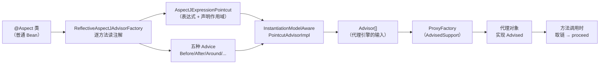
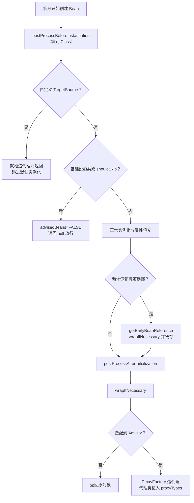
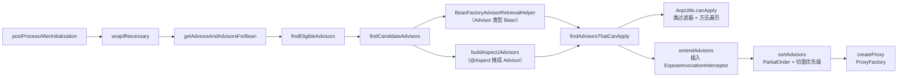
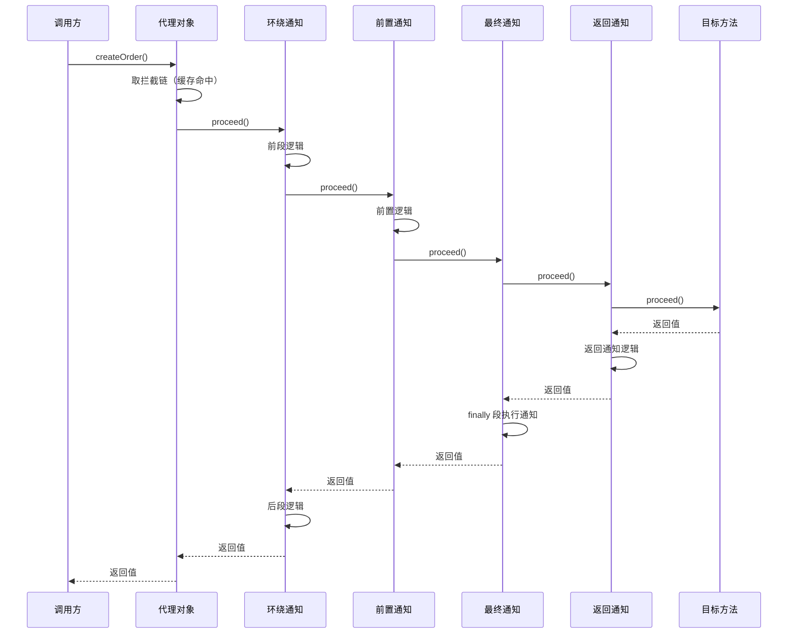
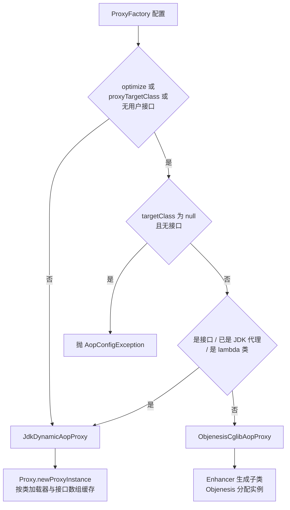

# AOP实现原理——JDK动态代理与CGLIB

**摘要：**

会用 `@Aspect` 与理解 Spring AOP 之间，隔着一整条从注册表到字节码的链路。`@Aspect` 本身只是一个被扫描到的 Bean，真正决定"哪些方法被拦住、按什么顺序执行、代理对象由谁造、造好的类存在哪里"的，是 spring-aop 里十几个互相咬合的类。本篇按机制视角把这条链走完：`@EnableAspectJAutoProxy` 如何通过一个 `ImportBeanDefinitionRegistrar` 把 `AnnotationAwareAspectJAutoProxyCreator` 写进注册表，并且用的是"升级"而不是"新增"；这个后处理器在 `postProcessBeforeInstantiation` 与 `postProcessAfterInitialization` 两个时点各做什么判断，`advisedBeans` 的三态缓存与 `getEarlyBeanReference` 如何与循环依赖的提前暴露拼接；`findCandidateAdvisors`、`findAdvisorsThatCanApply`、`sortAdvisors` 三步如何把一批候选切成某个 Bean 专属的通知链；`@Aspect` 里的每个方法如何被 `ReflectiveAspectJAdvisorFactory` 读注解、造切点、包成 `InstantiationModelAwarePointcutAdvisorImpl`，`@Pointcut` 方法又如何以切面类为声明作用域被解析与引用。后半程是执行侧与生成侧：五条通知在链上的登记位置与实际观测顺序为何不一致、`ReflectiveMethodInvocation.proceed()` 的索引递归、`@Order` 划出的洋葱层、`@Around` 不调 `proceed()` 的完整后果、代理类的四层缓存与 Objenesis 绕过构造器的做法、`exposeProxy` 的两笔额外成本，以及 JDK 动态代理与 CGLIB 在每次调用上的开销差。读完之后应当能回答三个问题：这次调用经过的是引用还是类型，链上的顺序由谁决定，这个代理类是什么时候生成的。

> [!info] 本篇的边界
> 本篇只写机制：切面如何被解析、Advisor 如何被组装、拦截链如何被执行、代理类如何被生成与缓存。应用层怎么用 Spring Boot 配 AOP、怎么选 Starter，属于 [[Java/SpringBoot/00 专栏导览]] 那一列；代理选择的模式视角、`@Transactional` 失效的五个原因、`final` 与自调用的边界，已经在 [[Java/OOP设计模式/09 设计模式在Spring中的应用全景|设计模式在 Spring 中的应用全景]] 与 [[Java/OOP设计模式/04 结构型模式（上）——代理、适配器与装饰器|结构型模式（上）]] 里写过，本篇遇到只给一句结论加双链。

---

## 第 1 章 五个概念各自的落点

### 1.1 术语比框架早十年

1997 年的 ECOOP 会议上，Gregor Kiczales 与 Xerox PARC 的同事提交了一篇题为《Aspect-Oriented Programming》的论文，提出编程语言除了按功能分解，还应当有一种描述"横切"的手段——某些行为天然地散落在大量模块里，按功能切分越彻底，这类行为就越难维护。论文给这套设想配了名词：连接点（Join Point）、切点（Pointcut）、通知（Advice）、切面（Aspect）。四年后 AspectJ 1.0 发布，把这些名词变成了一门带编译器与织入器的语言扩展。

Spring 走的是另一条路。2004 年 Spring 1.0 引入 AOP 支持时并没有实现织入器，而是用运行期代理把"方法调用"这个唯一被支持的连接点接管下来；2006 年的 Spring 2.0 又引入了 `@AspectJ` 注解语法与 AspectJ 切点表达式语言，让写切面的手感与 AspectJ 一致，底层仍然是代理。这条**借语法、不借织入**的路线，决定了 Spring AOP 的所有约束——它借来的是描述能力，换掉的是生效机制。

名词与落点因此出现了三套并存的说法：论文里的概念、AspectJ 的语法、Spring 的类。读源码时最容易卡住的地方，恰恰是这三套说法对不上号。

### 1.2 概念到类的映射

下面这张表把五个概念各自的实现类摆出来，最后一列是"谁在用它"——判断某个类属于哪一侧时，这一列比类名可靠。注意 `Advice` 是一个空接口，它只起标记作用，五种语义分别由子接口定义：前置通知实现 `MethodBeforeAdvice`，返回通知实现 `AfterReturningAdvice`，异常通知实现 `ThrowsAdvice`，而环绕通知直接实现 AOP Alliance 的 `MethodInterceptor`。

| 概念 | 注解写法 | Spring 侧的接口与类 | 谁在用 |
| :--- | :--- | :--- | :--- |
| Join Point | 无（方法执行即连接点） | `org.aopalliance.intercept.MethodInvocation`、`ReflectiveMethodInvocation` | 拦截链在运行期的上下文对象 |
| Pointcut | `@Pointcut` | `org.springframework.aop.Pointcut`；表达式实现为 `AspectJExpressionPointcut` | 候选筛选（`canApply`）与链构建（`matches`） |
| Advice | `@Before` / `@After` / `@AfterReturning` / `@AfterThrowing` / `@Around` | `org.aopalliance.aop.Advice` 及其子接口；实现类见第 5 章 | 被适配器包成 `MethodInterceptor` 挂到链上 |
| Aspect | `@Aspect` | 一个普通 Bean；由 `ReflectiveAspectJAdvisorFactory` 解析 | 一次解析产出一组 `Advisor` |
| Advisor | 无直接注解 | `Advisor`、`PointcutAdvisor`；实际产物是 `InstantiationModelAwarePointcutAdvisorImpl` | 代理创建器唯一的输入单位 |
| Advised | 无 | `org.springframework.aop.framework.Advised`，实现为 `AdvisedSupport` | 代理对象对外自述配置的接口 |
| Target Object | 无 | `SingletonTargetSource` 包着的原始 Bean | 链末端的 `invokeJoinpoint` |

关于 `@Aspect` 的落点，有一处常见的错位值得点出来：不少资料把它对应到 `AspectJExpressionPointcutAdvisor`。那个类确实是 `PointcutAdvisor` 的一个现成实现，但它的用途是把一个表达式与一段现成的 Advice 手工绑在一起，是 `<aop:advisor>` 那种声明方式在代码里的等价物，和注解解析没有关系。`@Aspect` 走的是反射工厂这条路，产物是 `InstantiationModelAwarePointcutAdvisorImpl`——名字里那个 `InstantiationModel` 说的是切面实例化模型（单例、perthis、pertarget），因为不同的实例化模型会改变切点与 Advice 的创建时机。

### 1.3 Advisor 是代理引擎唯一认识的东西

把 `Advisor` 理解成"一个切点加一段通知的绑定"，就够解释它为什么存在：代理引擎不读注解、不认识 `@Aspect`、不理解切点表达式语言，它只接受一个数组，数组里每一项都能回答两个问题——"你能应用到哪些方法"与"你被应用时执行什么"。这两个问题正好对应 `PointcutAdvisor` 的两个方法：`getPointcut()` 与 `getAdvice()`。

```java
public interface Advisor {
    Advice getAdvice();
    boolean isPerInstance();   // 切面是否随目标实例分别实例化
}

public interface PointcutAdvisor extends Advisor {
    Pointcut getPointcut();
}
```

这层抽象换来的是可组合性。一个 `@Aspect` 类里有三个通知方法，产出的就是三个互不相关的 `Advisor`；三个切面共用一个表达式，产出的仍然是三个 `Advisor`，表达式只是被各自持有；`@DeclareParents` 引介则产出 `DeclareParentsAdvisor`，它实现的是 `IntroductionAdvisor` 而不是 `PointcutAdvisor`，因为引介新增的是接口与方法，不是对既有方法的增强。到了链构建阶段，这三种来源被统一处理，差异全部消化在适配器里。

### 1.4 Advised：代理对象身上那条可改的合同

前四个概念都在描述"要拦什么、拦了做什么"，`Advised` 描述的是"代理对象自己知道些什么"。`Advised` 是一个接口，`JdkDynamicAopProxy` 生成的代理对象与 CGLIB 生成的子类都会实现它，因此调用方拿到的代理可以被询问：你挂了哪些 Advisor、你的目标对象是谁、你的配置是否已冻结。

```java
public interface Advised extends TargetClassAware {
    Advisor[] getAdvisors();
    void addAdvisor(Advisor advisor) throws AopConfigException;
    void removeAdvisor(Advisor advisor) throws AopConfigException;
    boolean isFrozen();
    TargetSource getTargetSource();
    boolean isProxyTargetClass();
    // ...
}
```

`isFrozen()` 是这套合同里的刹车。冻结之后 `addAdvisor` 直接抛 `AopConfigException`，原因是代理类已经按当时的配置生成好了：CGLIB 的回调过滤器是类级别的，接口列表更是编译进字节码的东西，此时再改通知集合只能保证部分路径生效，不如直接拒绝。Spring 自动代理产出的 `ProxyFactory` 默认不冻结（`AbstractAutoProxyCreator` 里 `freezeProxy` 默认为 `false`），所以运行期给它加一个 `Advisor` 是合法的，`AdvisedSupport.adviceChanged()` 会顺手清掉方法级缓存，下一次调用就能用上新链。

这条可改的合同有实际用处：事务、缓存、重试这些框架能力，都是靠它在运行期把自己的 Advisor 插入代理配置的。判断一个对象是不是代理，用 `AopUtils.isAopProxy(bean)`；要穿透到原始类型，用 `AopUtils.getTargetClass(bean)`。

下面这张图把概念与类的对应关系排成一条主语流：左边是开发者写下的东西，右边是代理引擎真正吃到的东西。



图里有一个容易被忽略的箭头：`Advisor[]` 到 `ProxyFactory` 之间不是单向的。代理对象持有的是 `AdvisedSupport` 这份可变配置，链是在每次调用时从那里面取出来的（取到之后有缓存），所以第 1.4 节说的"运行期可改"并不是一句宣传语，而是结构上留出来的口子。

---

## 第 2 章 一个注解如何变成注册表里的一行

### 2.1 `@EnableAspectJAutoProxy` 只做三件事

这个注解的定义短得可以背下来：`@Import(AspectJAutoProxyRegistrar.class)`，加上两个布尔属性 `proxyTargetClass` 与 `exposeProxy`，默认值都是 `false`。真正的动作在 `AspectJAutoProxyRegistrar` 里，它实现的是 `ImportBeanDefinitionRegistrar`——一个在配置类解析阶段被调用的扩展点，拿到 `BeanDefinitionRegistry` 之后直接往注册表里写定义。

它只做三件事。第一，调用 `AopConfigUtils.registerAspectJAnnotationAutoProxyCreatorIfNecessary(registry)`，确保容器里有一个自动代理创建器；第二，如果 `proxyTargetClass` 为真，往那个定义的 `PropertyValues` 里塞一个 `proxyTargetClass=true`；第三，如果 `exposeProxy` 为真，塞一个 `exposeProxy=true`。后两件事值得多看一眼：它们的实现方式是给 `BeanDefinition` 加属性值，而不是调 setter。属性值会在 Bean 实例化时通过 `ProxyConfig` 的 setter 注入，所以配置改的是"定义"，生效在"实例"。这也是 `@EnableAspectJAutoProxy` 的属性可以被别的注册动作覆盖或补充的原因。

### 2.2 升级而不是新增

`registerOrEscalateApcAsRequired` 这个名字已经说明了设计意图。容器里自动代理创建器的 Bean 名是固定的常量 `org.springframework.aop.config.internalAutoProxyCreator`，类名则按一张优先级列表取值：`InfrastructureAdvisorAutoProxyCreator` 最低，`AspectJAwareAdvisorAutoProxyCreator` 居中，`AnnotationAwareAspectJAutoProxyCreator` 最高。

当定义已经存在时，它比较现有类与请求类的优先级：如果请求的更高，就把定义的 `beanClassName` 改掉，返回 `null`；否则什么都不做。这套"升级"语义解决了一个很实际的问题——`@EnableTransactionManagement` 会注册一个基础设施级的创建器（`InfrastructureAdvisorAutoProxyCreator`），而 `@EnableAspectJAutoProxy` 需要注解级的那一个。两个注解的书写顺序不该影响结果，于是先到的先占位，后到的按优先级拔高，最终容器里始终只有一个自动代理创建器，且它是最强的那个。

这像同一张票从经济舱升到商务舱：座位号（Bean 名）不变，待遇（能力）变了。

新建定义时另有两个细节：角色是 `BeanDefinition.ROLE_INFRASTRUCTURE`，`order` 属性被设成 `Ordered.HIGHEST_PRECEDENCE`。前者让它在诊断、覆盖、销毁判断里被当作框架设施而不是业务 Bean；后者决定它在一串 `BeanPostProcessor` 里的位置——排在前面，意味着它在别的后处理器的 `postProcessAfterInitialization` 之前就把真实对象换成了代理，后续后处理器拿到的是代理对象。对注解解析类的工作（例如读业务类上的注解）来说，这是一个必须绕开的坑，绕法是用 `AopUtils.getTargetClass` 而不是直接拿 `bean.getClass()`。

### 2.3 它的身份：三合一的后处理器

`AnnotationAwareAspectJAutoProxyCreator` 的继承链是这样的：

```
BeanPostProcessor
  └─ InstantiationAwareBeanPostProcessor
       └─ SmartInstantiationAwareBeanPostProcessor
            └─ AbstractAutoProxyCreator
                 └─ AbstractAdvisorAutoProxyCreator
                      └─ AspectJAwareAdvisorAutoProxyCreator
                           └─ AnnotationAwareAspectJAutoProxyCreator
```

`SmartInstantiationAwareBeanPostProcessor` 这个身份是三件事的授权：`determineCandidateConstructors` 让它可以参与构造器选择（这里返回 `null`，即不参与），`predictBeanType` 让它可以提前告知"这个 Bean 最终会是什么类型"，`getEarlyBeanReference` 让它在循环依赖的提前暴露阶段就能把代理交出去。前两个在本类里基本空转，第三个才真正派上用场，本章稍后再谈。

`SmartInstantiationAwareBeanPostProcessor` 还带着 `Ordered`、`BeanFactoryAware`、`BeanClassLoaderAware`、`SmartInitializingSingleton`、`DisposableBean` 几个身份。`SmartInitializingSingleton` 的 `afterSingletonsInstantiated` 只有一行有效代码——清空 AspectJ 的 `ShadowMatch` 缓存，因为单例都建完之后再没有新的代理要生成，这份缓存继续留着只是占内存。

| 方法 | 时机 | 这类里实际做了什么 |
| :--- | :--- | :--- |
| `postProcessBeforeInstantiation(Class, String)` | 实例化之前，拿到的是类 | 判定是否为基础设施类或该跳过，若是则标记 `advisedBeans=FALSE`；若配置了自定义 `TargetSource`，在此直接创建代理并返回 |
| `postProcessAfterInitialization(Object, String)` | 初始化之后，拿到的是成品对象 | 调用 `wrapIfNecessary`，有匹配的 Advisor 就返回代理，否则原样返回 |
| `getEarlyBeanReference(Object, String)` | 循环依赖提前暴露引用时 | 记入 `earlyBeanReferences`，随后调用 `wrapIfNecessary` |
| `predictBeanType(Class, String)` | 类型预测 | 返回 `proxyTypes` 里已记录的代理类型；没有记录则返回 `null`，容器按普通类型处理 |

---

## 第 3 章 两个时点的代理判断

### 3.1 为什么需要"实例化之前"这个时点

`postProcessBeforeInstantiation` 的返回值能直接替代原对象，Spring 会跳过后续的实例化与初始化，把这个返回值直接当成品 Bean 交出去。这个口子本来是为自定义 `TargetSource` 准备的，后文把这条路径连同 3.4 节的 `getEarlyBeanReference` 一起称为**提前代理**。

设想一个目标对象来自连接池或者远程代理（`CommonsPool2TargetSource`、`JndiObjectTargetSource` 这类），每一次调用都要先向 `TargetSource` 要一个实例、用完再归还。如果等 Bean 初始化完再包代理，容器就不得不先正儿八经地构造一个目标实例，可这个实例根本不该被构造——真正的实例由 `TargetSource` 提供。于是 `AbstractAutoProxyCreator` 在实例化之前先问一句：有没有自定义的 `TargetSourceCreator` 能为这个类提供 `TargetSource`？有的话，就地生成代理、记入 `targetSourcedBeans`、返回，目标 Bean 不再走默认的构造流程。

除了这条路径，`postProcessBeforeInstantiation` 的另一个作用就是打标记。`advisedBeans` 是一个 `Map<Object, Boolean>`，键由 `getCacheKey` 生成（有 Bean 名就用名字，`FactoryBean` 加 `&` 前缀，没名字就用类），值有三种状态：`TRUE` 表示"已经为它建过代理"，`FALSE` 表示"确认不用建"，键不存在表示"还没判断过"。一次实例化之前先查一次，命中就直接返回 `null` 放行，省掉后面的重复判断。

### 3.2 三个跳过判据

跳过判据比想象中多，因为有些类是绝不能代理的。

`isInfrastructureClass` 在父类里判四件事：是不是 `Advice`、`Pointcut`、`Advisor`、`AopInfrastructureBean` 的实现类。注解版又加了一条：`isAspect(beanClass)` 为真也跳过。切面本身不能被代理，源码注释解释得很直白——切面一旦被代理，如果它还实现了 `Ordered` 之类的接口，代理就会按接口生成（变成 JDK 代理），而通知方法根本不在那个接口上，运行期调用会直接失败。

`shouldSkip` 在 `AspectJAwareAdvisorAutoProxyCreator` 里再补一层：遍历当前候选的 Advisor，凡是 `getAspectName()` 等于当前 Bean 名的，说明这个 Bean 就是那条 Advisor 的宿主切面，跳过。这一层比 `isAspect` 更精确，因为它比对的是名字而不是类型。

第三层是缓存本身。被判定跳过或判定已代理的类会写进 `advisedBeans`，`wrapIfNecessary` 一进来就先看 `Boolean.FALSE`，是就直接返回原对象。这意味着一个 Bean 在一次容器生命周期里只会被完整判定一次。

### 3.3 正常代理：`wrapIfNecessary` 的五步

绝大多数代理都产生在 `postProcessAfterInitialization` 里。它先处理循环依赖留下的痕迹：

```java
public Object postProcessAfterInitialization(@Nullable Object bean, String beanName) {
    if (bean != null) {
        Object cacheKey = getCacheKey(bean.getClass(), beanName);
        if (this.earlyBeanReferences.remove(cacheKey) != bean) {
            return wrapIfNecessary(bean, beanName, cacheKey);
        }
    }
    return bean;
}
```

这句判断问的是"这个 Bean 在提前暴露阶段是不是已经走过一遍 `wrapIfNecessary`"。`getEarlyBeanReference` 的顺序是先 `put(cacheKey, bean)` 再调用 `wrapIfNecessary`，所以这里 `remove` 拿到的就是当初那个原始对象；它与当前 `bean` 相同，说明包装已经做过，此处直接返回原始对象即可——`doCreateBean` 随后会用提前暴露的那个引用（可能是代理）替换掉返回值，代理不会丢。若 `remove` 返回的不是当前对象（`null`，或者上一次创建尝试留下的旧值），说明本轮没有走提前暴露，那就老老实实再包一次。

`wrapIfNecessary` 本身是五步：一，`targetSourcedBeans` 里有的直接返回原对象（已经在第 3.1 节造好了）；二，`advisedBeans` 为 `FALSE` 的直接返回；三，重新判一次基础设施类与 `shouldSkip`，命中则记 `FALSE`；四，`getAdvicesAndAdvisorsForBean` 取匹配的 Advisor 数组，返回 `DO_NOT_PROXY` 说明一个都没匹配上，记 `FALSE` 后返回原对象；五，有匹配就记 `TRUE`，用 `SingletonTargetSource` 包住原 Bean，`createProxy` 造代理，把代理类的类型记进 `proxyTypes`，返回代理。

第四步是整条链的分水岭：`getAdvicesAndAdvisorsForBean` 在 `AbstractAdvisorAutoProxyCreator` 里实现为"找合格 Advisor，空则 `DO_NOT_PROXY`"。这一步的内部就是第 4 章的全部内容。

### 3.4 提前代理：循环依赖里的织入

`getEarlyBeanReference` 是三级缓存机制的搭档。当 A 依赖 B、B 又依赖 A 时，容器在 A 构造完、属性还没填满的时候，就要把 A 的"提前引用"交给 B。如果 A 需要被代理，交给 B 的必须是代理对象而不是原始对象，否则 B 手里握着的引用永远绕不过拦截器——这正是"循环依赖场景下事务失效"的一种隐秘变体。

`AbstractAutoProxyCreator` 的做法是：把当前 Bean 记进 `earlyBeanReferences`，然后调用 `wrapIfNecessary` 返回结果——可能是代理，也可能是原对象。这两种结果都会在 `advisedBeans`（以及被代理时的 `proxyTypes`）里留下记录，于是后续 `postProcessAfterInitialization` 命中 3.3 节那条短路，不会重复生成代理。循环依赖的三级缓存本身如何组织，见 [[05 依赖注入的三种方式与循环依赖的三级缓存解决方案|依赖注入与循环依赖]]。

把两个时点画在一起，可以看出代理创建器其实只在三个位置被调用，其余都是缓存命中。



---

## 第 4 章 候选 Advisor 从哪来

### 4.1 容器里那些 Advisor Bean

`AbstractAdvisorAutoProxyCreator.findCandidateAdvisors` 的第一段来自 `BeanFactoryAdvisorRetrievalHelper.findAdvisorBeans()`。它做的事情像一次按类型的 Bean 查询：`beanNamesForTypeIncludingAncestors(beanFactory, Advisor.class, true, false)`，把父容器也带上，然后逐个 `getBean(name, Advisor.class)`。

两个参数值得说。第三个参数是"是否包含非单例"，这里传 `true`；第四个是 `allowEagerInit`，这里必须传 `false`——查找候选时不能为了判断类型而提前初始化 `FactoryBean`，否则被代理的对象可能在代理创建器就绪之前就已经以原始形态被创建并缓存下来了。注释里把这句写得很清楚：leave all regular beans uninitialized to let the auto-proxy creator apply to them。

循环里还有两处保护。`isCurrentlyInCreation(name)` 为真的候选被跳过——正在创建的 Advisor 如果被拿来"增强自己"，会陷入无限递归；`getBean` 抛出的 `BeanCreationException` 若根因是 `BeanCurrentlyInCreationException` 且指向正在创建的 Bean，也只跳过不抛出。

名字列表本身会被缓存进 `cachedAdvisorBeanNames`。这意味着第一个 Bean 触发候选查找之后，新注册的 `Advisor` 定义不会再进入候选池。运行期要给某个代理加通知，正确的入口是 `Advised.addAdvisor`，往容器里塞一个新的 Advisor Bean 是行不通的。

### 4.2 AspectJ 侧：把切面摊成 Advisor

`AnnotationAwareAspectJAutoProxyCreator` 覆写 `findCandidateAdvisors`，在父类结果之后追加 `aspectJAdvisorsBuilder.buildAspectJAdvisors()`。后者的工作是**全量扫描一遍**、判定哪些是切面、把每个切面摊成一组 Advisor。

扫描用的是 `beanNamesForTypeIncludingAncestors(beanFactory, Object.class, true, false)`——注意类型是 `Object`，因为切面可以是任何类，不能按某个接口过滤。逐个取 `beanFactory.getType(beanName, false)`（同样不允许触发初始化），用 `advisorFactory.isAspect(beanType)` 判断有没有 `@Aspect`。

判定为切面之后，`AspectMetadata` 会读出 AspectJ 的 per-clause，也就是切面的实例化模型：

- `SINGLETON`（默认）：为它建一个 `BeanFactoryAspectInstanceFactory`，解析出的 Advisor 列表在 Bean 是单例时放进 `advisorsCache`，按切面名缓存；不是单例则把工厂放进 `aspectFactoryCache`，每次重新解析。
- `perthis` / `pertarget`：要求切面 Bean 本身必须是非单例，否则直接抛 `IllegalArgumentException`；用 `PrototypeAspectInstanceFactory`，同样进 `aspectFactoryCache`。

这一趟的结果有两级缓存：`aspectBeanNames` 缓存"哪些名字是切面"，`advisorsCache` 缓存"某个切面摊出来的 Advisor 列表"。`buildAspectJAdvisors` 外面套了双重检查锁，因为首次触发它的线程可能是任意一个正在创建 Bean 的线程。`aspectBeanNames` 一旦确定，之后再注册的切面不会被发现——这与 4.1 节的限制同源。

### 4.3 能不能应用到某个类

候选拿到手，下一步是筛出"对这个 Bean 有效的 Advisor"。`findAdvisorsThatCanApply` 的实现只有几行，关键动作是把当前 Bean 名塞进 `ProxyCreationContext`（一个 `NamedThreadLocal`），再调 `AopUtils.findAdvisorsThatCanApply(candidateAdvisors, beanClass)`。

那个 `ThreadLocal` 不是装饰。`AspectJExpressionPointcut` 支持 `bean()` 这个 Spring 专有的切点指示符，表达式求值时需要知道"现在正在为哪个 Bean 做判定"，这个信息就只能从线程上下文里取。

`AopUtils.findAdvisorsThatCanApply` 分两轮：先处理 `IntroductionAdvisor`（引介要影响"类是否具备某个接口"的判断，必须先算出来），再处理普通的 `PointcutAdvisor`，并把"有没有引介"这个布尔量带进 `canApply`。`canApply` 的判定顺序是：

1. 先看类过滤器 `pc.getClassFilter().matches(targetClass)`，不匹配直接返回 `false`。这一层能挡掉大部分无关的切点，代价极低。
2. 若方法匹配器就是 `MethodMatcher.TRUE`（切点匹配任意方法），直接返回 `true`，连方法都不用遍历。
3. 否则收集"目标类的用户类 + 它的全部接口"，逐个用 `ReflectionUtils.getAllDeclaredMethods` 取声明方法，用方法匹配器试；命中一个就返回 `true`。

这一步的判据像门卫查楼：他不逐个核对陌生人，只判断这栋楼里有没有名单上的人，有就放行整栋楼。技术上的限定是"放行"只意味着后面还要为每个方法做一次真正的匹配，`canApply` 只是把明显无关的切点提前剔掉。

第三步的"命中一个就停"是这个方法被设计成 `canApply`（能不能应用）而不是 `matches`（逐方法匹配）的原因：它只回答"这个切点与这个类有没有交集"，真正的逐方法匹配留到链构建时做，而且结果会被缓存。这里也埋着一个后面要用的细节——`getAllDeclaredMethods` 会把 `private`、`static` 方法一并取出来。

### 4.4 排序：部分序与切面内优先级

筛出来的 Advisor 还要排序，这一步由 `PartialOrder.sort` 配 `AspectJPrecedenceComparator` 完成。之所以用部分序而不是全序，是因为两个 Advisor 之间可能根本不可比：不同切面的优先级由 `@Order` 给出，同一 `@Order` 值下、来自不同切面的两条 Advisor 谁先谁后并没有语义规定，部分序排序允许它们保持原来的相对位置。

`AspectJAwareAdvisorAutoProxyCreator.sortAdvisors` 的注释把规则写全了：排序结果是从高优先级到低优先级；进入连接点时高优先级先执行，退出连接点时高优先级后执行；同一 `@Order` 值下（通常就是同一个切面），如果两者中有一个是 after 类通知，则"声明靠后"的那条优先，否则"声明靠前"的那条优先。排序失败（比如 `PartialOrder.sort` 返回 `null`，说明比较关系成环）时退回 `AnnotationAwareOrderComparator.sort`，并可能抛 `AopConfigException`，提示"考虑用 `@Order` 而不是 `Ordered` 接口"。

排序之后还有一个 `extendAdvisors` 钩子。`AspectJAwareAdvisorAutoProxyCreator` 在这里调用 `AspectJProxyUtils.makeAdvisorChainAspectJCapableIfNecessary`，如果链里有 AspectJ 侧的通知，就在链首插入 `ExposeInvocationInterceptor`——它负责把当前 `MethodInvocation` 放进 `ThreadLocal`，供 `JoinPoint` 的各个实现类读取。这与第 8 章的 `AopContext` 是两套东西，前者总是加，后者要显式开启。

| 缓存（第 4 章涉及） | 键 | 值 | 失效时机 |
| :--- | :--- | :--- | :--- |
| `BeanFactoryAdvisorRetrievalHelper.cachedAdvisorBeanNames` | 无 | 容器里 Advisor 类型 Bean 的名字数组 | 不失效 |
| `BeanFactoryAspectJAdvisorsBuilder.aspectBeanNames` | 无 | 切面 Bean 名列表 | 不失效 |
| `advisorsCache` | 切面 Bean 名 | 该切面摊出的 `List<Advisor>` | 不失效 |
| `AbstractAutoProxyCreator.advisedBeans` | 缓存键（名或类） | `TRUE` / `FALSE` | 不失效 |
| `AbstractAutoProxyCreator.proxyTypes` | 缓存键 | 代理类 `Class` | 不失效 |

候选到链的整条路径，下面这张图按"谁调用谁"画一遍，便于对照源码时的调用栈。



---

## 第 5 章 `@Aspect` 里的方法怎么变成 Advisor

### 5.1 逐个方法过筛

`ReflectiveAspectJAdvisorFactory.getAdvisors` 拿到一个切面类之后，先构造一份"候选方法"列表。过滤器只有两条：必须是用户声明的方法（排除编译器合成的方法与桥接方法），且不带 `@Pointcut`。`@Pointcut` 方法被排除在外，因为它是切点的定义，不是通知。

列表超过一个就排序，比较器是两级的：先按通知类型，顺序是 `@Around`、`@Before`、`@After`、`@AfterReturning`、`@AfterThrowing`；同类型再按方法名字典序。这个顺序不是执行顺序，而是它们在 `Advisor` 数组里的登记顺序，第 6 章会看到它如何影响运行期。

排序之后还有一个过滤：只保留"最具体的方法"。切面继承体系里如果父类声明了通知方法、子类覆写了它，反射会把两个都取出来，此时用 `ClassUtils.getMostSpecificMethod` 取子类那个，只有方法等于最具体版本才处理。

还有一处容易读漏的历史包袱。`getAdvisor` 的第四个参数 `declarationOrderInAspect` 现在被硬编码为 `0`。Spring 5.2.7 之前这里传的是它在方法列表里的下标，注释解释了为什么改：Java 7 之后 JDK 不再保证 `getDeclaredMethods` 按源码声明顺序返回，用下标表示"声明次序"会随 JVM 版本漂移，于是干脆全部归零，让 `AspectJPrecedenceComparator` 走默认值。这一改动的直接后果是：同一切面内两个同类型通知的**相对次序**不能指望源码顺序决定，能确定下来的只有 5.1 节那个两级比较器的顺序。

### 5.2 `getAdvisor`：造切点、套外壳

每个候选方法要过 `getAdvisor`，它的动作是三步：

1. `getPointcut`：读方法上的 AspectJ 注解，取出表达式字符串；构造 `new AspectJExpressionPointcut(candidateAspectClass, new String[0], new Class<?>[0])`，把切面类作为声明作用域传进去；`setExpression(表达式)`；如果有 `BeanFactory` 一并设置（用于 `bean()` 切点与类加载器解析）。
2. 构造 `InstantiationModelAwarePointcutAdvisorImpl`，把切点、方法、工厂、`declarationOrder`、切面名一起交给它。构造过程中如果发现注解参数不合法（比如 `@Around` 方法的返回类型与签名不对），会抛 `IllegalArgumentException` 或 `IllegalStateException`，`getAdvisor` 捕获后返回 `null`，这个方法就被静默跳过——这也是"某个通知写了但没生效"的一种来源。
3. 在外壳内部真正造 Advice：单例模型下构造期立即调用 `instantiateAdvice`，`perthis`/`pertarget` 下延迟到第一次使用时再实例化，切点也被换成 `PerTargetInstantiationModelPointcut`，把 per-clause 切点与声明切点取并集。

外壳还统一回答了排序需要的两个问题。`getOrder()` 直接委托给 `aspectInstanceFactory.getOrder()`：`BeanFactoryAspectInstanceFactory` 会先看切面类是否实现 `Ordered` 且是单例（是则取实例的 `getOrder()`），否则用 `OrderUtils.getOrder(type, Ordered.LOWEST_PRECEDENCE)` 读类上的 `@Order`。`isBeforeAdvice()`/`isAfterAdvice()` 在第一次被问到时通过 `determineAdviceType` 判定，供 `AspectJPrecedenceComparator` 处理同一切面内的先后。

### 5.3 `@Pointcut` 方法的解析与引用

切面里那个空方法不是装饰，它是切点的命名定义：

```java
@Aspect
@Component
public class ServiceAspect {

    @Pointcut("execution(* com.example.service..*.*(..))")
    public void serviceMethods() {}

    @Pointcut("serviceMethods() && @annotation(Logged)")
    public void loggedServiceMethods() {}

    @Before("loggedServiceMethods()")
    public void before(JoinPoint jp) { /* ... */ }
}
```

解析发生在三步上。第一步是过滤：`@Pointcut` 方法在 5.1 节就被排除了，它不会产生 `Advisor`，`getAdvice` 里对 `AtPointcut` 分支也是直接返回 `null`。第二步是引用解析：`@Before("loggedServiceMethods()")` 里那段字符串被原样塞进 `AspectJExpressionPointcut`，真正解析要等到第一次 `matches` 或 `couldMatchJoinPointsInType` 触发时，`buildPointcutExpression` 用 AspectJ 的 `PointcutParser` 调 `parsePointcutExpression(表达式, pointcutDeclarationScope, pointcutParameters)`。第三个参数就是**声明作用域**，也就是构造时传进去的切面类——正是它让裸名字 `loggedServiceMethods()` 能被解析成对同类中同名 `@Pointcut` 方法的引用。

这套机制有几条实践边界。跨切面引用必须写全限定名，`com.example.OtherAspect.serviceMethods()`，裸名字只在本切面及其继承体系内解析；表达式被 AspectJ 解析器拒绝时，`AspectJExpressionPointcut` 在类级匹配的 `catch` 里把 `pointcutParsingFailed` 置为 `true`，只留一条 debug 日志，此后该类一律按"不匹配"处理——于是表现为切面静默失效，而不是启动报错；带参数的切点（`@Pointcut("execution(* *(..)) && args(id)") void find(Long id) {}`）需要通知方法上有同名参数，参数名的来源是 `parameterNameDiscoverer`，编译时没加 `-parameters` 也没有调试信息的话，Spring 拿不到参数名，绑定就会失败并抛出提示补 `argNames` 的异常。

### 5.4 五种通知的类与它们的调用形态

`getAdvice` 里那个 `switch` 是五种通知的出生地。每个实现类都继承 `AbstractAspectJAdvice`，差别在 `invoke` 的骨架，而骨架决定了第 6 章的执行顺序。

| 注解 | 实现类 | 适配成的拦截器 | 对外接口 | `invoke` 的骨架 |
| :--- | :--- | :--- | :--- | :--- |
| `@Around` | `AspectJAroundAdvice` | 自身即是 `MethodInterceptor` | AOP Alliance `MethodInterceptor` | 把 `MethodInvocation` 包成 `ProceedingJoinPoint`，交给通知方法决定是否 `proceed()` |
| `@Before` | `AspectJMethodBeforeAdvice` | `MethodBeforeAdviceInterceptor` | `MethodBeforeAdvice` | 先执行通知，再无条件 `proceed()` |
| `@After` | `AspectJAfterAdvice` | 自身即是 `MethodInterceptor` | `MethodInterceptor` | `try { return proceed(); } finally { 执行通知 }` |
| `@AfterReturning` | `AspectJAfterReturningAdvice` | `AfterReturningAdviceInterceptor` | `AfterReturningAdvice` | 先 `proceed()` 拿返回值，正常返回后才执行通知 |
| `@AfterThrowing` | `AspectJAfterThrowingAdvice` | 自身即是 `MethodInterceptor` | `MethodInterceptor` | `try { return proceed(); } catch (Throwable ex) { 匹配异常则执行通知；重新抛出 }` |

`@After` 与 `@AfterReturning` 的骨架差别是本章最有解释力的一处：一个把通知放在 `finally` 里，一个放在 `proceed()` 之后的顺序代码里。`finally` 一定晚于"顺序代码"，除非 `proceed()` 抛了异常——那时顺序代码根本不会执行，`finally` 却照样执行。这条差别在第 6 章会推出一个与直觉相反的观测顺序。

---

## 第 6 章 通知链的执行顺序

### 6.1 链是怎么搭出来的

方法调用进入代理之后，第一件事是取链：`AdvisedSupport.getInterceptorsAndDynamicInterceptionAdvice(method, targetClass)`。链由 `DefaultAdvisorChainFactory` 按当前 `Advisor` 数组逐条构建，每条 `Advisor` 先经 `GlobalAdvisorAdapterRegistry.getInterceptors(advisor)` 换成拦截器数组。

适配器这一步做了"接口归一"：`MethodBeforeAdvice` 被 `MethodBeforeAdviceAdapter` 包成 `MethodBeforeAdviceInterceptor`，`AfterReturningAdvice` 被 `AfterReturningAdviceAdapter` 包成 `AfterReturningAdviceInterceptor`，`ThrowsAdvice` 被 `ThrowsAdviceAdapter` 包成 `ThrowsAdviceInterceptor`，而本身就是 `MethodInterceptor` 的（`@Around`、`@After`、`@AfterThrowing` 三个）原样返回。适配器注册表是可扩展的，`GlobalAdvisorAdapterRegistry` 只是默认那份。

构建时还要判断匹配是不是"静态"的。若 `MethodMatcher.isRuntime()` 为真（切点依赖运行时信息，典型如 `args(id)` 要求参数值满足某个条件、`@args()` 之类），这一条拦截器会被包进 `InterceptorAndDynamicMethodMatcher`，把匹配器一起带进链里，运行期再判一次；否则拦截器直接进链。

链的构建结果有两级缓存。`AdvisedSupport` 里若有任何 `PointcutAdvisor`，就为每个 `Method` 维护一份 `methodCache`；如果一个都没有，则整份链在 `cachedInterceptors` 里共享。`adviceChanged()` 会在通知集合变化时把两者清空。这个细节解释了一个常被误解的现象：切点匹配的复杂度影响启动，不影响稳态吞吐，因为它只算一次。

### 6.2 `proceed()` 的索引递归

链拿到之后，`JdkDynamicAopProxy.invoke` 会造一个 `ReflectiveMethodInvocation` 并调用 `proceed()`。这个类是整个执行模型的中心，核心只有一个字段与一段递归：

```java
private int currentInterceptorIndex = -1;

public Object proceed() throws Throwable {
    // 索引走到链尾，说明所有拦截器都让行了，执行目标方法
    if (this.currentInterceptorIndex == this.interceptorsAndDynamicMethodMatchers.size() - 1) {
        return invokeJoinpoint();
    }

    Object interceptorOrInterceptionAdvice =
            this.interceptorsAndDynamicMethodMatchers.get(++this.currentInterceptorIndex);

    if (interceptorOrInterceptionAdvice instanceof InterceptorAndDynamicMethodMatcher dm) {
        Class<?> targetClass = (this.targetClass != null ? this.targetClass : this.method.getDeclaringClass());
        if (dm.matcher().matches(this.method, targetClass, this.arguments)) {
            return dm.interceptor().invoke(this);
        }
        else {
            // 运行期匹配失败，跳过这一条，继续往后找
            return proceed();
        }
    }
    else {
        return ((MethodInterceptor) interceptorOrInterceptionAdvice).invoke(this);
    }
}
```

三个要点。第一，索引从 `-1` 开始，进来先自增再取，所以第一次取到的是第 0 号拦截器；拦截器内部再调 `mi.proceed()` 时，索引已经推进，取到的是下一条。第二，递归不是靠每个拦截器自己保存位置，而是靠**共享同一个** `invocation` 实例（或者它的克隆）上的索引——这就是为什么 `proceed()` 天然是"一次调用只能往前走一次"。第三，链尾的 `invokeJoinpoint()` 走的是 `AopUtils.invokeJoinpointUsingReflection(target, method, arguments)`，一次标准的反射调用，异常在 `InvocationTargetException` 里被剥壳后原样抛出，调用方看到的仍是业务异常本身。

那个索引像一本书中间夹着的一枚书签，谁翻页都由它记录位置；几个拦截器共享同一枚书签，所以"往前走一步"这件事天然只有一份进度。技术上的限定是：克隆出来的 `MethodInvocation` 有自己的书签，共享的只是书以外的部分。

`invocableClone()` 是给"想重复走链"的场景准备的口子：克隆出来的 `invocation` 共享拦截器列表与参数，但有一份独立的索引值，于是可以从头再走一遍。不克隆而直接第二次调 `proceed()`，索引已经停在链尾，第二次等于直接再执行一次目标方法，中间那些拦截器不会重跑。

### 6.3 五条通知的实际顺序

把 5.1 节的登记顺序、5.4 节的 `invoke` 骨架、6.2 节的递归放在一起，链的嵌套结构就确定了。登记顺序是 `@Around`、`@Before`、`@After`、`@AfterReturning`、`@AfterThrowing`，数组靠前的在递归中先被取到，也就是在更外层。

于是实际观测到的顺序是：

| 观测序 | 通知 | 为什么在这个位置 |
| :--- | :--- | :--- |
| 1 | `@Around` 前段 | 链上第 0 条，`proceed()` 之前的逻辑先跑 |
| 2 | `@Before` | 链上第 1 条，执行通知后无条件 `proceed()` |
| 3 | 目标方法 | 递归到链尾的 `invokeJoinpoint()` |
| 4 | `@AfterReturning` | `proceed()` 正常返回后，在同一段顺序代码里执行通知 |
| 5 | `@After` | `AspectJAfterAdvice` 的 `finally` 段，晚于外层帧里的顺序代码 |
| 6 | `@Around` 后段 | 最外层展开，`proceed()` 之后与 `catch` 里的逻辑 |

第 4 与第 5 的位置和很多资料的写法相反——那些资料按登记顺序写成"`@After` 先于 `@AfterReturning`"。Spring 源码里有一段注释专门澄清这件事：登记顺序上 `@After` 确实排在 `@AfterReturning` 与 `@AfterThrowing` 之前，但 `AspectJAfterAdvice.invoke` 把 `proceed()` 放在 `try` 块里、把通知调用放在对应的 `finally` 块里，所以 `@After` 的通知方法实际执行在两者之后。这是**注册顺序**与**执行顺序**分离的教科书案例：编织框架按结构排布，`try/finally` 决定时序。

异常路径要单独说。目标方法抛异常时，递归在链尾炸开，向上逐层回卷：`@AfterThrowing` 是链上最内层，它的 `catch` 先执行通知（异常类型匹配 `throwing` 指定的参数时才执行，否则静默放过），然后把原异常重新抛出；`@AfterReturning` 的 `proceed()` 抛出，所以它的通知方法不执行；`@After` 的 `finally` 照样执行；最后 `@Around` 的 `catch` 有机会看到异常。所以异常时的顺序是：`@Around` 前段 → `@Before` → 目标方法（抛出）→ `@AfterThrowing` → `@After` → `@Around` 的异常分支。

`@Around` 的前置逻辑之所以在 `@Before` 之前，是因为它是外层；后置逻辑之所以在 `@After` 之后，是因为它是外层。这个"外层"身份不是靠名字决定的，而是靠 6.4 节要讲的排序决定的。

### 6.4 多切面：`@Order` 划出的洋葱层

一个方法被多个切面命中时，候选 `Advisor` 列表被排序，`@Order` 值小的排在前面、也就是更外层。于是两个切面 A（`@Order(1)`）与 B（`@Order(2)`）构成的结构是：A 的前置 → B 的前置 → 目标 → B 的后置 → A 的后置。数值小的先进入、后退出，这是典型的环绕结构，也是 AOP 术语里"优先级"的准确含义。

| 层序 | 切面 | `@Order` 值 | 进入时的位置 | 退出时的位置 |
| :--- | :--- | :--- | :--- | :--- |
| 外层 | A | 1 | 最先 | 最后 |
| 中层 | B | 2 | 其次 | 其次 |
| 内层 | 目标方法 | — | 最后 | 最先 |

不写 `@Order` 时，隐式取值是 `Ordered.LOWEST_PRECEDENCE`，若干个切面的优先级完全相同。此时 `PartialOrder.sort` 对不可比的两项保持输入顺序，而输入顺序取决于候选列表的构建顺序——全量扫描的 `BeanDefinition` 顺序，再往上取决于类路径扫描的先后、包结构、甚至不同文件系统下的返回次序。结果就是"开发机上顺序一直对，预发环境偶尔反过来"。它不是随机的，但对业务代码来说等价于**未定义**，不能依赖。

同一个切面内部的两条通知之间，能确定的只有 5.1 节那个两级比较器的顺序；`declarationOrder` 归零之后，源码里谁先写谁后写不再有约束力。这也是为什么"把两个有依赖关系的通知写进一个切面、靠书写顺序保证先后"这种做法不成立。

还有一条约束常被忽略：排序是"部分序"。`@Order` 相同的两个不同切面之间没有确定的先后；`@Order` 相同但一条是 before 类、另一条是 after 类时，`AspectJPrecedenceComparator` 会按"after 类中声明靠后者优先"的规则处理，可那条规则只在同一个切面内部才有明确含义，跨切面仍然需要 `@Order` 才比得出来。

### 6.5 `@Around` 不调 `proceed()` 的完整后果

`@Around` 是唯一能决定"目标方法到底跑不跑"的通知，因为它是唯一一个把 `proceed()` 交给用户代码调用的通知。其余四种的 `proceed()` 都写死在实现类里。

不调 `proceed()` 时，后果按层展开：

1. 目标方法不执行。链尾的 `invokeJoinpoint()` 是 `proceed()` 递归到末端才触发的，没有人推进索引，就不会到达末端。
2. 排在 `@Around` 后面的所有拦截器都不执行，包括同一或更内层的 `@Before`、`@After`、`@AfterReturning`、`@AfterThrowing`。`@Before` 之所以也在其中，是因为它虽在登记顺序上紧随 `@Around`，仍需由 `@Around` 的 `proceed()` 把控制权递过去。
3. 排在 `@Around` 前面的通知正常执行，它们的 `proceed()` 已经调用过了，只是被 `@Around` 截断在后面。
4. 返回值得自己给。`@Around` 的返回值就是代理方法对调用方的返回值，不 `return` 就是 `null`。若目标方法声明的是 `int`、`long` 等基本类型，`JdkDynamicAopProxy` 与 CGLIB 的 `processReturnType` 都会检查"返回 `null` 但返回类型是基本类型"，抛 `AopInvocationException`，提示 null 返回值与基本返回类型不匹配——这是这类 bug 唯一会报错的形态。
5. 异常语义也一样由用户代码决定。目标方法没跑，自然不会有它的异常；`@Around` 自己吞掉异常，就等于这次调用"成功"返回了它给出的值；它抛出新异常，调用方看到的是新异常。

另外两个与 `proceed()` 相关的边界值得记住。`proceed(Object[] args)` 这个重载会先 `setArguments` 再往下走，后面的拦截器与目标方法拿到的是新参数，这是"在环绕通知里改参数"的正规做法；直接改 `getArgs()` 返回的数组则要小心，链里其他拦截器可能持有旧引用。而调用两次 `proceed()` 的结果是目标方法执行两次，且第二次不经过已经被走过的拦截器（索引停在链尾），需要完整重走链就用 `invocableClone()`。



---

## 第 7 章 代理对象怎么造出来

### 7.1 三个部件的接力

自动代理最终落到 `AbstractAutoProxyCreator.createProxy`：拷贝配置、决定要不要用类代理、把 Advisor 装进 `ProxyFactory`、设 `TargetSource`、设 `frozen` 与 `preFiltered`，然后 `proxyFactory.getProxy(classLoader)`。

`ProxyFactory` 自身不做代理判定，它继承 `ProxyCreatorSupport`，由后者调 `AopProxyFactory`（默认 `DefaultAopProxyFactory.INSTANCE`）产出 `JdkDynamicAopProxy` 或 `ObjenesisCglibAopProxy`，再调这两个的 `getProxy()`。`ProxyFactoryBean`、`AspectJProxyFactory` 与 `ProxyFactory` 的区别只在外壳：前者从容器取目标与拦截器名，中者用 `addAspect` 把切面摊成 Advisor，后者是最直接的编程式入口。自动代理走的是 `ProxyFactory`，`AspectJProxyFactory` 是手写代码时的等价入口，两者最终都收归到同一层 `AdvisedSupport`。

`DefaultAopProxyFactory.createAopProxy` 的判定顺序是：

1. 若 `isOptimize()`、`isProxyTargetClass()` 或"没有用户提供的接口"三者之一成立，进入类代理分支；否则直接返回 JDK 代理。
2. 类代理分支里还要排除三种情况：目标类为 `null` 且没有接口（直接抛 `AopConfigException`）、目标类本身是接口、目标类是 JDK 代理类或 lambda 类。命中任意一种就退回 JDK 代理。
3. 其余情况返回 `ObjenesisCglibAopProxy`。

`isOptimize()` 在 Spring 里几乎不打开，它对应 CGLIB 早期的一个优化开关；真正起作用的通常是 `isProxyTargetClass()` 与"有没有接口"。

代理类型的选择读起来像一段 if-else，但它判定的是约束而不是性能，图里每个分支的条件都对应一条绕不开的限制。



### 7.2 什么算"合理的接口"

"有没有接口"这一步由 `ProxyProcessorSupport.evaluateProxyInterfaces` 判断，而它的判据比"`interfaces.length > 0`"严格得多。它列出目标类的全部接口，逐个排除三类：容器回调接口（`InitializingBean`、`DisposableBean`、`Closeable`、`AutoCloseable`、继承 `Aware` 的接口）、语言运行时接口（`groovy.lang.GroovyObject`）、代理框架自身的标记接口（CGLIB 的 `Factory`、ByteBuddy 的 `MockAccess`）。剩下还有一个条件：接口上必须有方法。

有这个"合理接口"才把接口加进 `ProxyFactory`；一个都没有就 `setProxyTargetClass(true)`，退回 CGLIB。这条规则解释了一个容易困惑的现象：一个只实现 `InitializingBean` 的类不会被 JDK 代理，不是因为它"没有接口"，而是因为它唯一的接口不被认为是有效的代理接口。

### 7.3 JDK 动态代理：一个 handler 与一份类缓存

JDK 这条路的产出是一次 `Proxy.newProxyInstance(classLoader, proxiedInterfaces, this)`，第三个参数是 `JdkDynamicAopProxy` 自身——它实现了 `InvocationHandler`。生成的代理类固定继承 `java.lang.reflect.Proxy`、实现全部接口，每个接口方法的实现体是把调用转给 `this.h.invoke(this, m, args)`；方法对应的 `Method` 对象在代理类的静态初始化里取好、存在静态字段里，因此每次调用都**不再有 `getMethod` 查找**，只有一次 `invoke` 分派。

代理类的生成由 `Proxy` 内部按"类加载器 + 接口数组"缓存，同一组合在整个 JVM 里只生成一次；`JdkDynamicAopProxy` 这一侧还有一份 `ProxiedInterfacesCache`（Spring 6.2 里挂在 `AdvisedSupport.proxyMetadataCache` 上），把"要代理哪些接口、这些接口有没有定义 `equals`/`hashCode`"这类元数据算一次复用。

`invoke` 的开头有一串特判，读源码时容易被略过，但它们都在保障语义正确：

- 接口没定义 `equals`/`hashCode` 时，由代理自己处理，避免把 `equals` 调用转给目标方法造成"自己跟自己不等"；
- 方法声明在 `DecoratingProxy` 上时，返回最终目标类，供 `AopUtils.getTargetClass` 穿透；
- 方法声明在 `Advised` 上（且代理不是 `opaque`）时，直接把调用派发到配置对象，让 `getAdvisors()` 这类调用读到代理配置而不是目标方法；
- 目标方法返回 `this` 且返回类型兼容时，把返回值换成代理对象，避免调用方拿回原始对象绕过拦截。

链为空时，`invoke` 会跳过 `MethodInvocation` 的创建，直接反射调用目标——这是一条常用的短路优化：一个类被代理了，但大部分方法其实没有通知匹配，这些方法的每次调用就少了一次对象分配。

### 7.4 CGLIB：`Enhancer`、回调数组与 Objenesis

CGLIB 这条路的产出是一个目标类的子类。`CglibAopProxy.buildProxy` 的配置项里，有几处直接决定了行为：

- `setSuperclass(proxySuperClass)`：目标类本身如果是 CGLIB 生成的类（多层代理），先剥到父类再生成，避免代理套代理越套越深；
- `setInterfaces(...)`：补充接口（引介会在这里追加），所以 CGLIB 代理也可以被当成某个接口使用；
- `setNamingPolicy(SpringNamingPolicy.INSTANCE)`：类名带 `$$SpringCGLIB$$` 前缀，排查时候一眼能看出是代理类；
- `setUseCache(false)`：只在类加载器是 `SmartClassLoader` 且目标类可重载时关闭（开发期的热重载场景），其余情况沿用 CGLIB 的类缓存；
- `setInterceptDuringConstruction(false)`：**构造期不拦截**。父类构造器里如果调用了可被覆写的方法，默认会进拦截器，而此时 `advised` 还没配置好，行为不可预期，所以关掉。

回调的选择由 `ProxyCallbackFilter` 完成，按方法分类：`finalize()` 不给覆写；`equals`、`hashCode` 有专门的拦截器；声明在 `Advised` 上的方法派发给配置对象；**有通知的方法**走 `DynamicAdvisedInterceptor`，**没有通知的方法**在目标为静态、且返回值类型可以排除"返回 `this`"的情况下走 `Dispatcher` 直接调目标。还有一种优化：若目标是静态的、配置已冻结、且该方法有固定通知链，可以用 `FixedChainStaticTargetInterceptor`，省掉链查找。自动代理产生的 `ProxyFactory` 默认不冻结（第 1.4 节），所以这条优化在实际应用里基本用不上——`DynamicAdvisedInterceptor` 是常态。

实例化则交给 Objenesis。`ObjenesisCglibAopProxy.createProxyClassAndInstance` 先用 `enhancer.createClass()` 拿到代理类，再用 `SpringObjenesis.newInstance(proxyClass, useCache)` 直接分配对象、不执行任何构造器，最后 `((Factory) proxyInstance).setCallbacks(callbacks)` 把回调数组塞进去。这就是"被代理类必须有无参构造器"那条约束在 Spring 里不成立的原因：它根本没走构造器。只有在 Objenesis 判定"不值得尝试"或抛出异常时，才退回反射调用无参构造器，两条路都失败才抛 `AopConfigException`。

### 7.5 四层缓存

把生成与调用两端的缓存摆在一起，可以看清"一次生成的代价"分摊到了哪里。

| 层 | 缓存位置 | 键 | 值 | 何时清 |
| :--- | :--- | :--- | :--- | :--- |
| 代理类 | `Proxy` 内部缓存 / CGLIB `AbstractClassGenerator` 类缓存 | 类加载器 + 接口数组 / 生成器键 | 代理 `Class` | 弱引用回收；热重载时关用 |
| 接口元数据 | `AdvisedSupport.proxyMetadataCache`（`ProxiedInterfacesCache`） | 配置对象 | 接口数组、是否定义 equals/hashCode | 通知变化时 |
| 方法级拦截链 | `AdvisedSupport.methodCache` 或 `cachedInterceptors` | `Method`（有方法级切点时）/ 无 | `List<Object>` 链 | `adviceChanged()` |
| 切点匹配 | AspectJ `ShadowMatchUtils` | 切点 + 目标方法 | `ShadowMatch` | 单例全部创建完成后 |
| 切面摊平 | `BeanFactoryAspectJAdvisorsBuilder.advisorsCache` | 切面 Bean 名 | `List<Advisor>` | 不失效 |

---

## 第 8 章 `exposeProxy` 与 `AopContext` 的代价

### 8.1 ThreadLocal 里的那个引用

`AopContext` 只有一个静态字段：一个名为 `Current AOP proxy` 的 `NamedThreadLocal<Object>`。`currentProxy()` 在取不到值时抛出 `IllegalStateException`，异常消息把两条前提写全了：把 `Advised` 的 `exposeProxy` 设为 `true`，并且确保 `currentProxy()` 与 AOP 调用在同一个线程里。

写入发生在代理的 `invoke` 里。JDK 侧是 `oldProxy = AopContext.setCurrentProxy(proxy)`，CGLIB 侧在 `DynamicAdvisedInterceptor.intercept` 里做同样的事；`finally` 里用 `AopContext.setCurrentProxy(oldProxy)` 恢复。`setCurrentProxy` 返回旧值、参数为 `null` 时调 `remove()` 而不是 `set(null)`，这两笔处理都是为了嵌套调用：内层代理退出后，外层代理的引用必须原样恢复，否则外层方法的后半段拿到的是内层代理。

这里要与另一个 `ThreadLocal` 区分开。`ExposeInvocationInterceptor` 也是往 `ThreadLocal` 里放东西，但它放的是 `MethodInvocation`，并且由第 4 章说的 `extendAdvisors` 在链首自动插入，只要链里有 AspectJ 侧的通知就会出现；它服务于 `JoinPoint` 的实现类。`AopContext` 放的是代理对象，且必须显式开启。两者都在 `ThreadLocal` 里，出问题时的症状却完全不同：前者缺失会让 `JoinPoint` 相关代码抛异常，后者缺失只在调用 `AopContext.currentProxy()` 时才暴露。

### 8.2 两笔额外成本

第一笔是显式的：每次代理方法调用多两次 `ThreadLocal` 访问（一次读旧值加写新值，一次写回旧值），以及为 `finally` 准备的一个局部变量。单看是个位数到几十纳秒量级的开销，对一次数据库往返可以忽略，对纯内存的热点方法就未必。

第二笔是隐式的，而且在 CGLIB 上更硬：`ProxyCallbackFilter` 的判定分支里，只要 `exposeProxy` 为真，被增强的方法一律返回 `AOP_PROXY`（`DynamicAdvisedInterceptor`），非增强方法也不再用 `Dispatcher` 直调，而退回 `INVOKE_TARGET`。源码注释给的理由很直白——暴露代理意味着方法调用前后都要有代码执行，其它拦截器都无法避免这个 `try/catch` 结构。翻译成结果：打开 `exposeProxy` 之后，第 7.4 节那套"按方法挑回调"的优化基本作废，代理类里每个方法都带一层 `try/finally`。

还有一个代价在结构上：`exposeProxy` 是 `ProxyConfig` 的属性，`@EnableAspectJAutoProxy(exposeProxy = true)` 会把它写进那个唯一的自动代理创建器的定义里，于是这个容器里所有代理都开启了暴露。它不是一个按需开关，更像一个**全局开关**。

### 8.3 什么时候才值得打开

判据只有一条：确实需要在目标对象内部拿到自己的代理引用，并且拿不到。这个需求出现的典型场合就是自调用，而自调用的首选解法是拆类或者注入自身，两者都不依赖任何框架开关。`AopContext` 排在第三位，理由不是它不好用，而是它把"调用必须经过代理"这件事藏进了运行时的一个隐式约定里：读代码的人看不到 `currentProxy()` 依赖 `exposeProxy`，测试里也不会因为忘了开而失败——它只会抛 `IllegalStateException`，而这个异常很容易被当成"配置问题"随手绕过。

跨线程是它的硬边界。`ThreadLocal` 绑线程，`@Async`、线程池、响应式链路里传下去的调用上下文是新的线程，`currentProxy()` 必然为空。这条边界在模式视角那一侧已有展开，见 [[Java/OOP设计模式/09 设计模式在Spring中的应用全景|设计模式在 Spring 中的应用全景]] 第 3 章。

---

## 第 9 章 三层限制：一句结论

这三条限制的机制已经在前面的章节里出现过，这里只收口，展开留给模式视角那两篇。

自调用不经过代理。拦截器挂在代理对象的方法上，`this` 指向目标对象本身，调用直接进方法体。代理引用与目标引用是两个对象，这是第 3 章"代理换掉容器里的引用"这一动作的直接后果。机制之外的设计判断——为什么这条限制反而倒逼了更好的分层——见 [[Java/OOP设计模式/04 结构型模式（上）——代理、适配器与装饰器|结构型模式（上）]] 与 [[Java/OOP设计模式/09 设计模式在Spring中的应用全景|设计模式在 Spring 中的应用全景]]。

`final` 类与 `final` 方法不能被 CGLIB 增强。类不可继承，`Enhancer` 直接失败，Spring 包成 `AopConfigException`，消息里点名"final class 或不可见的类"；方法不可覆写，拦截器不会被调用，增强静默失效。JDK 代理不受 `final` 影响，因为它不碰目标类的继承结构——这也是"有接口就用接口代理"在遗留代码里的一个现实理由。

`private` 方法与 `static` 方法拦不住。JDK 代理只暴露接口方法；CGLIB 生成子类，`private` 方法不参与覆写，`static` 方法压根不属于实例。这里有一个由第 4.3 节推出来的细节值得记住：`AopUtils.canApply` 遍历的是 `getAllDeclaredMethods`，包含 `private` 与 `static` 方法，所以"切点只命中私有方法"的类照样会被判定为可应用、照样会生成代理，结果是**有代理、没拦截**。排查时看到一个莫名其妙的代理对象，先看它的切点是不是只匹配到了不该拦的方法。

---

## 第 10 章 性能的机制账

### 10.1 一次代理调用的固定成本

把第 6、7 章的路径首尾相接，一次被增强的调用的成本可以拆成几段：进入代理方法（一次接口或虚方法调用）、取链（缓存命中，一次 `Method` 查表）、构造 `ReflectiveMethodInvocation`（一次对象分配，构造器里还要做桥接方法解析与参数适配）、每个拦截器一次 `invoke` 分派加一次 `proceed()` 递归、末端一次 `Method.invoke`、以及贯穿全程的 `Object[]` 参数装箱与返回值拆箱。

其中 `Method.invoke` 是最大的一块。它要做访问检查、把 `Object[]` 展开成实参、把基本类型参数装箱、把返回值装箱，异常还要包一层 `InvocationTargetException` 再由 `AopUtils.invokeJoinpointUsingReflection` 剥壳抛回原异常。CGLIB 的 `MethodProxy` 用生成的 `CGLIB$xxx$0` 方法直接调 `super`，省掉反射入口与访问检查，但参数仍然以 `Object[]` 传递，装箱这一笔省不掉。

### 10.2 生成一次，匹配一次

有两个数决定了"该优化哪里"。

代理类只生成一次。JDK 侧按类加载器与接口数组缓存，CGLIB 侧按生成器键缓存，同一个类不会被重复生成；生成成本集中在启动期，与"被代理的 Bean 数量"成正比，与"每个方法的调用次数"无关。

方法级拦截链只构建一次。`methodCache` 按 `Method` 缓存，切点的静态匹配、拦截器适配、动态匹配器的包装都在第一次构建时完成；之后的调用直接取数组。`ShadowMatch` 也有自己的缓存，单例全部创建完成后还会被主动清空。

这两条推出一个反直觉但重要的结论：切点表达式的复杂度是**启动期成本**，不是运行期成本。一个写得很宽的 `execution(* com.example..*.*(..))` 会让启动变慢，因为每个 Bean 都要被 `canApply` 遍历一遍方法，但一旦代理建好、链缓存住，稳态吞吐与切点复杂度基本无关。例外是运行期切点（`args()`、`@args()`、`if()` 之类），它们会在每次调用时重新求值，那才是真正的热路径成本。

### 10.3 JDK 18 之后，`Method.invoke` 换了一套实现

JDK 那个"反射慢"的印象有相当一部分来自 JDK 8 与 11 时代的实现：`Method.invoke` 先走 native 入口，再走一层动态生成的字节码适配器，参数装箱与访问检查都在这一路上。2022 年 3 月发布的 JDK 18 通过 JEP 416 把核心反射改成基于 `MethodHandle` 实现，`Method.invoke` 走的不再是那条老路径，每调用的开销随之下降。

对 AOP 的直接影响是：JDK 动态代理与 CGLIB 在"末端调用目标方法"这一段的差距被压缩了。CGLIB 剩下的优势主要在省掉反射入口与访问检查，而它自己的成本——生成子类、Metaspace 占用、`final` 约束、构造期不拦截这类语义代价——并没有随 JDK 演进消失。这也是 Spring 6 仍然保留两套实现、而不是统一到一套的原因：选择依据是约束，不是绝对速度。

### 10.4 量化：一份示例推算

下面的数字是"按结构分解"的示例推算，用于给量级排序，不能当作基准数据；真实值随 JDK 版本、JIT 状态、方法体大小、切面数量剧烈变化，要实测应当用 JMH 而不是 `System.currentTimeMillis`。

| 场景 | 示例量级 | 成本构成 | 备注 |
| :--- | :--- | :--- | :--- |
| 直接调用一个空方法 | 数纳秒 | 一次虚方法分派，可能被内联 | 基准线 |
| JDK 代理，链为空 | 数十纳秒 | handler 分派 + 一次 `Method.invoke` | 走 7.3 节的短路分支 |
| JDK 代理，三条通知 | 百纳秒量级 | 三到四次 `proceed()` + 一次反射 + 对象分配 | 与通知内的业务逻辑相比通常可忽略 |
| CGLIB 代理，三条通知 | 略低于 JDK 代理 | 省掉反射入口，仍需装箱 | 差距已被 JDK 18 压缩 |
| 生成一个代理类 | 零点几到几毫秒 | 字节码生成 + 类加载与校验 | 只发生一次 |
| 一个类做一次 `canApply` | 数十微秒 | 遍历声明方法 + 切点匹配 | 与 Bean 数量、方法数量成正比 |

推算模型：若应用有 800 个 Bean 需要被代理，生成与加载按每个 0.3 到 1 毫秒估算，启动期多出 0.24 到 0.8 秒；若这些 Bean 平均每天被调用一千万次，每次多出 100 纳秒，单线程视角下一天合计约 1 秒——这个量级通常可以忽略，但把调用次数放大到十亿级，账面就会变成 100 秒，值不值得优化取决于这个数。这类数字的用途是排序：**生成记启动，调用记吞吐**，两者该用的优化手段完全不同，混着谈就会得出"加一个切面会让应用变慢一倍"这种结论。

---

## 第 11 章 四个反例

### 11.1 `@Order` 缺省，顺序"看起来随机"

症状是两条切面的日志顺序在本地与线上不一致，或者同一个方法在两个版本的日志里嵌套方向相反。根因在第 6.4 节：`@Order` 缺失时所有切面都是 `LOWEST_PRECEDENCE`，部分序排序保持输入顺序，而输入顺序来自扫描与定义注册的次序。判据只有一条：只要两条切面之间存在依赖（先鉴权后限流、先开事务后加锁），就**必须显式 `@Order`**。不要用"注入顺序""声明顺序""谁先写谁在外层"来推。

### 11.2 `@Around` 忘了 `return proceed()`

症状分两种：返回类型是对象时，调用方拿到 `null`，后续 NPE 出现在离切面很远的地方；返回类型是 `int`、`boolean` 这类基本类型时，直接抛 `AopInvocationException`，消息说 null 返回值与基本类型不匹配。这两种都是同一个错误——`@Around` 方法体里调了 `proceed()` 却没把结果返回。还有一种变体更隐蔽：`proceed()` 写在 `try` 里、返回值忘了 `return`，但 `finally` 里有日志，于是日志显示"方法执行成功"，调用方拿到 `null`。判据是：`@Around` 的方法必须有且只有一条出口携带 `proceed()` 的返回值。

### 11.3 全局打开 `exposeProxy`

症状是启动或调用有轻微开销，且 CGLIB 的回调优化失效；更常见的是把 `AopContext.currentProxy()` 当成通用能力用在异步方法里，然后拿到 `IllegalStateException` 或者拿到外层调用留下的代理引用。根因在第 8.2 节与 8.3 节：它是容器级开关，且 `ThreadLocal` 不跨线程。判据是：只有当"必须自调用"且"不能拆类也不能注入自身"同时成立时才打开，并且打开之后要检查该容器里所有代理的 `ProxyCallbackFilter` 分支都退化成了动态拦截。

### 11.4 切点写得太宽

症状是启动变慢、Metaspace 占用上升、一堆本不该被代理的框架 Bean 都变成了代理类。根因在第 10.2 节：切点复杂度是启动期成本，`execution(* com.example..*.*(..))` 会让每个 Bean 都进入 `canApply` 的方法遍历，匹配成功的还要生成代理类。判据是：切点尽量按注解（`@annotation`、`@within`）或具体包收窄，并且知道"匹配上的 Bean 数量"是一个可以直接观测的量——打开 `logging.level.org.springframework.aop=DEBUG` 或看 `proxyTypes` 的规模，比读完整个 `canApply` 更快。

| 反例 | 表象 | 机制位置 | 判据 |
| :--- | :--- | :--- | :--- |
| 缺 `@Order` | 日志顺序环境相关 | 第 6.4 节，部分序 + `LOWEST_PRECEDENCE` | 切面之间有依赖就必须显式排序 |
| `@Around` 漏返回 | 调用方拿 `null` 或 `AopInvocationException` | 第 6.5 节，返回值即代理返回值 | 唯一出口携带 `proceed()` 结果 |
| 全局 `exposeProxy` | 优化失效、跨线程异常 | 第 8.2 节，回调退化 + `ThreadLocal` | 只在必须自调用时按容器打开 |
| 切点过宽 | 启动慢、代理类多 | 第 10.2 节，启动期匹配成本 | 按注解或包收窄，并观测代理数量 |

---

## 结语

这条链上几乎每个设计都可以读成一次交换。用运行期代理换"不改调用点"，代价是拦截点只能挂在引用上；用启动期生成代理类换"运行期零匹配"，代价是启动多一笔固定支出与一份 Metaspace；用 `@Order` 上的一个整数换跨切面的可预测顺序，代价是"不写就未定义"这条必须靠纪律兜住的约定；用 `AopContext` 的一个 `ThreadLocal` 换自调用的第二条出路，代价是全局开关与线程绑定。

这些交换之间还会互相牵动。`exposeProxy` 一开，CGLIB 的方法级优化就废了；切点写得越宽，启动期要匹配的类与方法就越多；`@Around` 用得越随意，链的语义就越依赖某一个人的书写习惯。判断一个 AOP 用法是否成熟，看的不是注解写得漂不漂亮，而是能不能回答"这次调用经过的是引用还是类型""这条链上的顺序由谁决定""这个代理类是什么时候生成的"。把这三问答清楚，`@Transactional` 为什么不生效、缓存为什么没清、异步为什么没异步，就不会再是需要靠猜的问题。事务侧如何把这条链落到连接与同步器上，见 [[07 Spring事务管理——声明式事务的传播行为与失效场景|声明式事务]]；代理的创建时机与 `BeanPostProcessor` 在生命周期里的位置，见 [[04 Bean的生命周期——从定义到销毁的完整流程|Bean 生命周期]]。

---

## 参考资料

1. [Aspect Oriented Programming with Spring（Spring Framework Reference，6.2.x）](https://docs.spring.io/spring-framework/reference/core/aop.html) —— `@AspectJ` 支持、Advisor 与 Advice 的官方语义、代理机制的选择说明。
2. [AnnotationAwareAspectJAutoProxyCreator（Spring Framework 6.2.x API）](https://docs.spring.io/spring-framework/docs/6.2.x/javadoc-api/org/springframework/aop/aspectj/annotation/AnnotationAwareAspectJAutoProxyCreator.html) —— 自动代理创建器的继承层次与职责边界。
3. [ReflectiveMethodInvocation（Spring Framework 6.2.x API）](https://docs.spring.io/spring-framework/docs/6.2.x/javadoc-api/org/springframework/aop/framework/ReflectiveMethodInvocation.html) —— `proceed()` 与 `invocableClone()` 的官方说明。
4. [ProxyConfig（Spring Framework 6.2.x API）](https://docs.spring.io/spring-framework/docs/6.2.x/javadoc-api/org/springframework/aop/framework/ProxyConfig.html) —— `proxyTargetClass`、`exposeProxy`、`optimize` 三个属性的默认值与含义。
5. [JEP 416: Reimplement Core Reflection with Method Handles（OpenJDK）](https://openjdk.org/jeps/416) —— JDK 18 反射实现变更的官方说明。
6. Gregor Kiczales 等，*Aspect-Oriented Programming*，ECOOP 1997 会议论文集（LNCS 1241，第 220 至 242 页，DOI 10.1007/BFb0053381）—— Join Point / Pointcut / Advice / Aspect 四个术语的原始出处。
7. [The AspectJ Programming Guide（Eclipse AspectJ）](https://eclipse.dev/aspectj/doc/released/progguide/index.html) —— AspectJ 切点语法、通知优先级与切点参数绑定的权威描述，Spring AOP 借用的是这一套表达式与语义。

---

> [!note] 思考题
> 1. `postProcessBeforeInstantiation` 已经可能返回代理，`postProcessAfterInitialization` 里为什么还要用 `earlyBeanReferences.remove(cacheKey) != bean` 这个引用比较，而不是判断"有没有提前代理过"？
> 2. `declarationOrderInAspect` 被硬编码为 `0` 之后，同一切面内两个 `@Before` 通知的先后由什么决定？如果业务确实要求确定的先后，有哪两条可行路径？
> 3. `ReflectiveMethodInvocation.proceed()` 第二次被调用时，为什么不会重新经过已经执行过的拦截器？`invocableClone()` 改变了哪一个字段？
> 4. 一个类只有 `private` 方法能匹配某个切点，它会被做成代理吗？如果会，怎么用最少的代码验证"有代理、没拦截"？
> 5. `@Around` 通知比目标方法的 `@Order` 更靠内层时，它不调 `proceed()` 会影响哪些通知？请按第 6.3 节的链结构逐条列出。