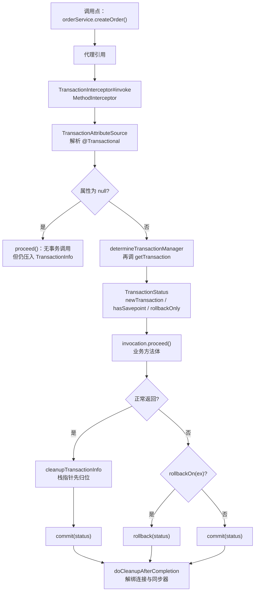
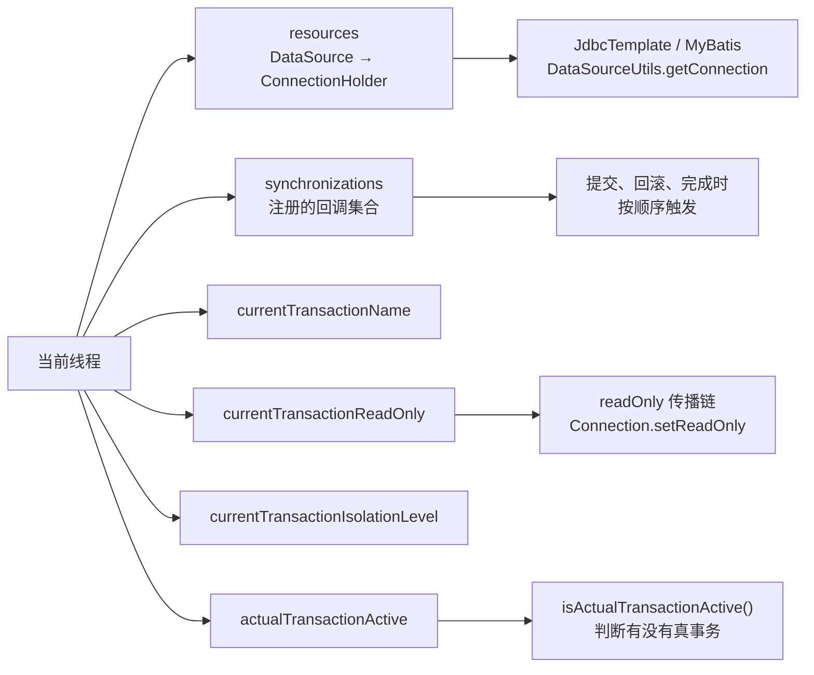
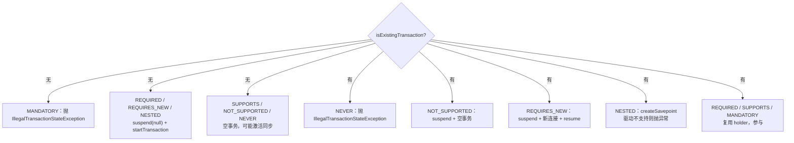
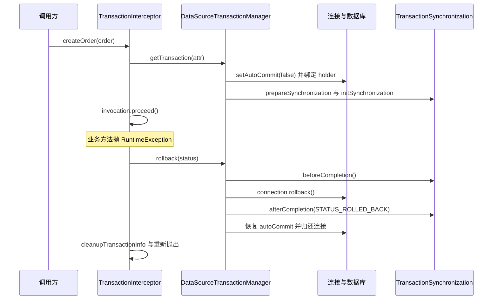
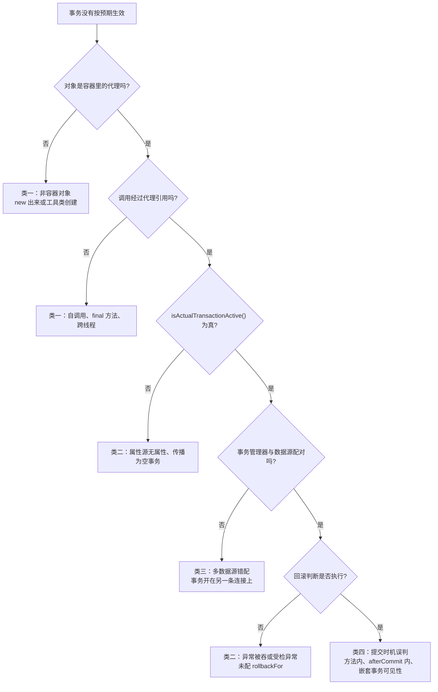

# Spring事务管理——声明式事务的传播行为与失效场景

**摘要：**

`@Transactional` 的失效之所以难查，是因为它几乎没有信号：应用照常启动，方法照常执行，数据库偶尔少一行，或者本该独立的事务并没有独立。本篇不列失效清单，而是追问"事务边界在代码里到底落在哪一行"：先沿一次方法调用走完三层结构，看注解如何被属性源翻译成 `TransactionAttribute`，拦截器如何在 `invokeWithinTransaction` 里开事务、调业务、决定提交还是回滚，`TransactionAspectSupport` 里那个 `TransactionInfo` 栈又在记什么账；再进 `AbstractPlatformTransactionManager`，逐一推演七种传播行为的分支实现，把 `REQUIRES_NEW` 的挂起恢复与 `NESTED` 的保存点摊到源码行上，并解释二者在连接占用与可见性上的真实差别；随后追连接的去向，说明 `DataSourceUtils.getConnection` 为什么能取到同一条连接、`actualTransactionActive` 这个标志从哪里来、为什么换一个线程就什么都拿不到；最后看九个同步回调各挂在什么时点，以及 `@TransactionalEventListener` 如何借它把处理推迟到提交之后。机制讲清之后，失效场景被归成四类机制，`rollbackFor` 的默认值与只读事务的真实作用也各归其位。

---

## 第 1 章 从一次没有发生的回滚说起

### 1.1 两个相隔一个月的 @since

Spring 的事务抽象里有两个日期只差一个月的类：`DataSourceTransactionManager` 的源码注着 `@since 02.05.2003`，`TransactionSynchronizationManager` 的源码注着 `@since 02.06.2003`。前者负责把连接从池里借出来、关掉自动提交、绑到当前线程，后者负责保管那张"这条线程现在握着哪些资源"的地图。二十多年过去，声明式事务对外承诺的语义几乎没变，变的是边角：`javax.transaction` 换成了 `jakarta.transaction`，Spring 6.2 给同步器补了两个与保存点相关的回调，`JtaTransactionManager` 仍在 `useSavepointForNestedTransaction()` 里返回 `false`。

把这两个日期放在一起看，能看出这套设计的重心：事务的"状态"和事务的"上下文"从一开始就是分开的两件事。状态归事务管理器与 `TransactionStatus`，上下文归 `ThreadLocal`。绝大多数关于事务的困惑，都来自把这两件事混为一谈。

### 1.2 现场：三张表与三行日志

不妨从一个具体的下单方法看起。它写三处数据：`orders` 插一条，`inventory` 扣一次，`audit_log` 记一条，另外给用户推一条站内通知。

```java
@Service
public class OrderService {

    @Transactional
    public void createOrder(Order order) {
        orderRepository.save(order);
        try {
            inventoryService.deduct(order);      // REQUIRED，加入当前事务
        } catch (InsufficientStockException e) {
            log.warn("库存不足，订单继续创建");     // 异常被吃掉，外层不会回滚
        }
        auditService.record(order);              // REQUIRES_NEW，挂起外层
        notifyService.push(order);               // 事务内调用外部推送
    }
}
```

上线后收到三条互不相关的反馈：反馈一——库存不足时订单还是建成功了；反馈二——审计日志里记录的库存余额比实际扣减后的值大；反馈三——推送失败的那几笔订单没有回滚，日志里却写着"创建成功"。

三条反馈背后是同一件事的三个侧面。第一条是异常没穿过拦截器，回滚判断根本没触发；第二条是 `REQUIRES_NEW` 开了第二个事务、拿了第二条连接，它在自己的连接上看不到外层未提交的扣减，于是读到了旧余额；第三条是"事务边界"的位置被误判——推送虽然在 `@Transactional` 方法体内，但它是否与业务同属一个事务，取决于它有没有被同一个拦截器圈住、有没有用同一条连接，而不取决于它写在第几行。

### 1.3 本篇的位置

Spring Boot 那一列讲的是应用层怎么把事务跑起来：自动配置注册哪个管理器、`spring.datasource` 怎么配、Actuator 怎么观测，见 [[Java/SpringBoot/00 专栏导览|Spring Boot]]。`@Transactional` 失效的模式视角——为什么框架必然把拦截点挂在引用上、五种失效原因的模式归类——见 [[09 设计模式在Spring中的应用全景]]，本篇只在需要时给一句结论。本篇走机制线：一次带事务的方法调用在框架内部经过哪些对象、这些对象各自记什么账、账记错时会在哪一步露馅。

需要先立一个判断：事务边界不在注解所在的那一行，也不在数据库连接被取出的那一行，而在拦截器环绕的那一次调用上。注解只是属性，属性被属性源解析成 `TransactionAttribute`，再由管理器翻译成"开/加入/挂起"三类动作。理解这条链，七种传播行为的差别才有地方安放。

### 1.4 三个问题

后文的推进由三个问题决定。

其一，`@Transactional` 与 `PlatformTransactionManager` 之间隔着几层，每层各丢掉一点什么信息。注解上的 `rollbackFor` 是一组类名，走到管理器时变成了 `rollbackOn(Throwable)` 的一次判断；注解上的 `propagation` 是一个枚举值，走到管理器时变成了"要不要 `suspend`"。这中间的翻译发生在属性源里，而很多"注解不生效"的问题，恰恰死在翻译这一步。

其二，七种传播行为的差异，落到对象上究竟是几个动作的区别。`REQUIRED` 与 `REQUIRES_NEW` 的差别不是"新建"与"不新建"，而是"要不要把已有连接从线程上解绑"；`NESTED` 与它们的差别则是"要不要向数据库发一条 `SAVEPOINT`"。把这三个动作找准，就不必背表。

其三，事务提交之后的那段代码，为什么有时还在事务里。`afterCommit` 回调触发时，连接已经提交但还绑在线程上，`JdbcTemplate` 在这个窗口里写的任何东西都不会再被提交。这是同步器的时序问题，不是缓存问题，也不是数据库问题。

三个问题共用一条线索：`ThreadLocal` 这张地图什么时候被写、被谁读、什么时候被擦掉。

---

## 第 2 章 三层结构：注解、拦截器、管理器

### 2.1 注解只是属性

`@Transactional` 的源码里有这样一句注释：`SpringTransactionAnnotationParser` 会把注解属性逐项转成 `RuleBasedTransactionAttribute` 的属性，"so that Spring's transaction support code does not have to know about annotations"。这句话说明了分层的位置：事务基础设施不认识注解，只认识 `TransactionAttribute`，注解到属性的转换被隔离在属性源里。这个隔离是好事，配置式事务（`TransactionInterceptor` 的 `transactionAttributes`）和注解式事务能共用同一条执行链；但它也带来了第一个失效点——**属性源不给你属性**，后面的一切都不会发生。

属性源解析属性时有两道门槛，都在 `AbstractFallbackTransactionAttributeSource#computeTransactionAttribute` 里。第一道是可见性：

```java
// 非 public 方法直接返回 null，连属性都没有，拦截器自然不开事务
if (allowPublicMethodsOnly() && !Modifier.isPublic(method.getModifiers())) {
    return null;
}
```

`AnnotationTransactionAttributeSource` 的 `publicMethodsOnly` 默认为 `true`，所以 `private`、`protected`、包级方法上的注解在这里就被丢掉了。第二道是查找顺序：先拿"目标类上的具体方法"（`AopUtils.getMostSpecificMethod`），再看方法声明类上的类级注解，只有当具体方法与原始方法不是同一个 `Method` 对象时，才回退去看原始方法及其声明类。这个顺序解释了为什么 JDK 代理能识别接口方法上的注解、CGLIB 代理不能：CGLIB 拦截到的是实现类的方法，`getMostSpecificMethod` 返回的也是实现类方法，接口上那份注解从来没有进入查找视野。

这里要区分两件常被混为一谈的事。`private` 方法失效是**属性源不给属性**，代理照常生成，只是这个方法的注解从未被解析；`final` 方法失效是**代理生成不了**，CGLIB 无法覆写 `final` 方法，拦截器连被调用的机会都没有。前者是策略（`publicMethodsOnly`），后者是字节码约束，修法完全不同。

### 2.2 TransactionInterceptor：一个 MethodInterceptor

属性解析出来之后，动手的是 `TransactionInterceptor`。它的类签名很朴素：继承 `TransactionAspectSupport`，实现 `MethodInterceptor`。也就是说，在 Spring AOP 的拦截链里，它和任何一个普通通知没有区别，靠 `BeanFactoryTransactionAttributeSourceAdvisor` 里那个 `TransactionAttributeSourcePointcut` 被匹配上、被织进代理；拦截链如何被构建、`ReflectiveMethodInvocation` 如何按序执行，见 [[06 AOP实现原理——JDK动态代理与CGLIB]]，这里只取它的位置。

```java
// TransactionInterceptor#invoke（Spring 6.x，节选）
@Override
public Object invoke(MethodInvocation invocation) throws Throwable {
    // getThis() 是目标对象，getTargetClass 顺着代理链找到最终实现类
    Class<?> targetClass = (invocation.getThis() != null ? AopUtils.getTargetClass(invocation.getThis()) : null);

    return invokeWithinTransaction(invocation.getMethod(), targetClass, new InvocationCallback() {
        @Override
        public Object proceedWithInvocation() throws Throwable {
            return invocation.proceed();
        }
        @Override
        public void onRollback(Throwable failure, TransactionExecution execution) {
            // Spring 6.2 起的观察点：回滚时发布 MethodRollbackEvent
        }
    });
}
```

`targetClass` 这一行的意义比看上去大：`invocation.getMethod()` 拿到的可能是接口方法，可能是实现类方法，取决于代理类型；而 `getTargetClass` 永远指向最终实现类。属性源把两者结合，才既能处理"注解在接口方法上"的 JDK 代理，也能处理"注解在实现类上"的 CGLIB 代理。`onRollback` 是 Spring 6.2 新增的回调，让回滚也可以被监听——它不是事务机制的一部分，只是把"刚刚发生了什么"暴露给外部。

拦截器在链中的顺序决定了它与其他横切逻辑的包裹关系。`@Transactional` 与 `@Async` 同时出现在一个方法上时，究竟是"事务里提交异步任务"还是"异步线程里开事务"，取决于两个通知的 `Order`；这一层在 [[02 IoC容器——BeanFactory与ApplicationContext的层次设计]] 里讲代理创建时已经铺过，此处只需记住结论：顺序不同，事务与线程的边界就不同。

### 2.3 invokeWithinTransaction 的五段

真正的事务骨架在父类里，`invokeWithinTransaction` 把一次方法调用切成五段。下面这段是去掉响应式分支与 `CallbackPreferringPlatformTransactionManager` 分支后的主干。

```java
// TransactionAspectSupport#invokeWithinTransaction（节选，保留主干）
TransactionAttributeSource tas = getTransactionAttributeSource();
TransactionAttribute txAttr = (tas != null ? tas.getTransactionAttribute(method, targetClass) : null);
TransactionManager tm = determineTransactionManager(txAttr, targetClass);

PlatformTransactionManager ptm = asPlatformTransactionManager(tm);
String joinpointIdentification = methodIdentification(method, targetClass, txAttr);

if (txAttr == null || !(ptm instanceof CallbackPreferringPlatformTransactionManager cpptm)) {
    TransactionInfo txInfo = createTransactionIfNecessary(ptm, txAttr, joinpointIdentification);

    Object retVal;
    try {
        retVal = invocation.proceedWithInvocation();   // 业务方法
    }
    catch (Throwable ex) {
        completeTransactionAfterThrowing(txInfo, invocation, ex);  // 判回滚或提交
        throw ex;
    }
    finally {
        cleanupTransactionInfo(txInfo);                // 只恢复 ThreadLocal 栈指针
    }

    // Future/Vavr 的补充判断，见下文
    commitTransactionAfterReturning(txInfo);           // 正常路径提交
    return retVal;
}
```

第一段是解析与选管理器。`determineTransactionManager` 的解析顺序是：先看注解上有没有写 qualifier（`transactionManager` 或 `value` 属性），再看目标类上有没有类型级 qualifier，再退回拦截器配置的 beanName，最后按类型在容器里找一个 `TransactionManager`——多候选时由 `@Primary` 决定，没有主候选就抛 `NoUniqueBeanDefinitionException`。这个顺序是第 7 章"管理器不匹配"那类问题的依据。

第二段是开事务。`createTransactionIfNecessary` 做两件事：属性非空且管理器存在时调用 `tm.getTransaction(txAttr)`，拿到 `TransactionStatus`；然后无论有没有拿到，都 `prepareTransactionInfo` 一次，把 `TransactionInfo` **绑到线程上**。属性为 `null`（方法没有事务注解）时它也绑定，源码给的注释是"为了保持本类中 `ThreadLocal` 栈的完整"——这一点是理解栈的关键，后文展开。

第三段是业务调用，第四段是异常处理，第五段是清理。注意 `finally` 的位置：`cleanupTransactionInfo` 在提交之前执行，回滚路径则在 `finally` 之前就已经完成。这个次序不是随手写的，它导致"事务信息栈"在提交期间已经指回上一层，而资源与同步器还挂在当前事务上——第 6 章讲同步回调时会用到这个细节。

`CallbackPreferringPlatformTransactionManager` 那个分支是给少数 JTA 实现准备的：这类管理器希望自己控制回调的调用方式，于是 `invokeWithinTransaction` 把业务方法包成 `TransactionCallback` 交给它，由它决定何时开启、何时回调。日常用 `DataSourceTransactionManager` 或 `JpaTransactionManager` 不会走到这条路上。

`Future` 与 Vavr 的补充判断放在提交之前：如果方法返回的 `Future` 在返回时已经完成，并且 `ExecutionException` 的 cause 命中 `rollbackOn`，就把状态标记为 rollback-only；Vavr 的 `Try` 失败同理。这段代码的存在容易让人误以为"异步任务失败会回滚事务"，实际上方法返回时 `@Async` 拿到的 `Future` 通常尚未完成，判断被跳过，事务提交与异步任务的成败之间没有任何同步关系。

### 2.4 TransactionInfo 与那个 ThreadLocal 栈

`TransactionInfo` 是 `TransactionAspectSupport` 里的静态内部类，字段只有五个：事务管理器、事务属性、连接点标识（用于日志与监控）、`TransactionStatus`、以及 `oldTransactionInfo`。栈的维护就靠最后这一个字段：

```java
// TransactionInfo 的入栈与出栈（节选）
private void bindToThread() {
    this.oldTransactionInfo = transactionInfoHolder.get();  // 记住上一层是谁
    transactionInfoHolder.set(this);
}

private void restoreThreadLocalStatus() {
    transactionInfoHolder.set(this.oldTransactionInfo);     // 出栈时把指针还回去
}
```

所以严格说，`transactionInfoHolder` 是一个**单链表串起来的栈**，每层方法调用把自己的 `TransactionInfo` 压进去，返回时把指针拨回上一层。它记录的是"当前这一层调用的事务属性与管理器是哪一个"，而不是"当前有没有事务"。

这个区别值得多说两句，因为很多讲法把它说成"嵌套传播的基础"。更准确的说法是：判断有没有事务、能不能加入，**靠的是资源侧**，不是这个栈。`AbstractPlatformTransactionManager#getTransaction` 先调 `doGetTransaction()` 再调 `isExistingTransaction(transaction)`；对 `DataSourceTransactionManager`，后者只做一件事——看当前线程上有没有绑着这个 `DataSource` 的 `ConnectionHolder`，且它的 `transactionActive` 为真。

```java
// DataSourceTransactionManager#isExistingTransaction
protected boolean isExistingTransaction(Object transaction) {
    DataSourceTransactionObject txObject = (DataSourceTransactionObject) transaction;
    return (txObject.hasConnectionHolder() && txObject.getConnectionHolder().isTransactionActive());
}
```

换句话说，"有没有事务"这个问题由连接地图回答，`TransactionInfo` 栈只回答"这一层调用的属性是什么、管理器是谁"。这两件事分开，才解释得通一个现象：同一个线程上给两个不同 `DataSource` 各开一个 `REQUIRED` 事务，第二个并不会加入第一个——因为 `isExistingTransaction` 找的是"这个 DataSource 的 holder"，找不到就是没有。

### 2.5 管理器与状态对象：谁记账，谁动手

第三层是管理器。`PlatformTransactionManager` 只有三个方法：`getTransaction`、`commit`、`rollback`。真正的骨架在 `AbstractPlatformTransactionManager` 里，子类通过八个模板方法参与：

| 模板方法 | 调用时机 | `DataSourceTransactionManager` 的实现动作 |
| :--- | :--- | :--- |
| `doGetTransaction` | 每次 `getTransaction` 开头 | 构造事务对象，带上当前线程已绑定的 holder |
| `isExistingTransaction` | 判断是否需要走"已有事务"分支 | 看 holder 是否 `transactionActive` |
| `doBegin` | 新建事务 | 取连接、`setReadOnly`/设隔离级别、`setAutoCommit(false)`、绑定 holder |
| `doSuspend` | 挂起 | `unbindResource(dataSource)` 并清空事务对象里的 holder |
| `doResume` | 恢复 | `bindResource(dataSource, 挂起的 holder)` |
| `doCommit` | 提交 | `connection.commit()` |
| `doRollback` | 回滚 | `connection.rollback()` |
| `doCleanupAfterCompletion` | 无论成败 | 解绑、恢复 `autoCommit`、恢复隔离级别与只读标志、归还连接 |

`TransactionStatus` 则是记账本，五个状态位决定了提交路径走哪个分支：`newTransaction`（是不是我开的）、`hasSavepoint`（是不是保存点事务）、`localRollbackOnly`（业务代码调过 `setRollbackOnly` 吗）、`globalRollbackOnly`（底层资源是否已被整体标记为只能回滚）、`completed`（是否已结束）。后文所有的"为什么这里会抛 `UnexpectedRollbackException`"，答案都落在这五个位里。

下面这张图把三层结构与一次正常调用的位置画在一起，节点上标注的是"谁在读谁的账"。



---

## 第 3 章 连接的归属：ThreadLocal 里的一张地图

### 3.1 getConnection 的三条路径

`@Transactional` 能生效，靠的不是"给方法加了标记"，而是让方法体里所有取连接的动作都拿到同一条连接。这件事由 `DataSourceUtils` 兜住。

```java
// DataSourceUtils#doGetConnection（节选）
ConnectionHolder conHolder = (ConnectionHolder) TransactionSynchronizationManager.getResource(dataSource);
if (conHolder != null && (conHolder.hasConnection() || conHolder.isSynchronizedWithTransaction())) {
    conHolder.requested();                 // 引用计数加一
    return conHolder.getConnection();       // 事务期间一直走这条
}

Connection con = fetchConnection(dataSource);   // 线程上没有，向池子借

if (TransactionSynchronizationManager.isSynchronizationActive()) {
    // 同步已激活但还没有 holder：懒绑定，并注册一个负责收尾的回调
    ConnectionHolder holderToUse = (conHolder != null ? conHolder : new ConnectionHolder(con));
    holderToUse.requested();
    TransactionSynchronizationManager.registerSynchronization(
            new ConnectionSynchronization(holderToUse, dataSource));
    holderToUse.setSynchronizedWithTransaction(true);
    TransactionSynchronizationManager.bindResource(dataSource, holderToUse);
}
return con;
```

三条路径对应三种处境。其一，线程上已经有 holder，直接复用，这是事务内跨 DAO 共享连接的路径。其二，线程上没有 holder，但**同步已激活**，此时借一条连接、把它懒绑定上去，并注册 `ConnectionSynchronization` 负责在事务结束时归还——`SUPPORTS` 在没有外层事务时就走这条路，所以它虽然没有真正的事务，却也会"在一段时间内复用同一条连接"。其三，同步未激活，借一条用完就还，每条语句各自提交。

有了这三条路径，就能解释一个常被归因于"事务"的现象：`@TransactionalEventListener` 的 `AFTER_COMMIT` 阶段写库为什么写不进去。此时同步仍然激活（管理器要等 `cleanupAfterCompletion` 才清），事务连接也还绑着，`JdbcTemplate` 借到的是同一条已提交的连接，写操作执行成功但再也没有提交动作，进程一结束就消失。

### 3.2 绑定点在 doBegin 的最后一行

绑定的动作发生在 `DataSourceTransactionManager#doBegin`，而且是最后一步：

```java
// doBegin 的关键几步（节选，省略异常处理）
Connection newCon = obtainDataSource().getConnection();
if (definition.isReadOnly()) {
    checkDefaultReadOnly(newCon);
}
txObject.setConnectionHolder(new ConnectionHolder(newCon), true);

Connection con = txObject.getConnectionHolder().getConnection();

// 只读标志与隔离级别：只有显式指定且与当前不同时，才真正下发一条设置语句
Integer previousIsolationLevel = DataSourceUtils.prepareConnectionForTransaction(con,
        definition.getIsolationLevel(), (definition.isReadOnly() && !isDefaultReadOnly()));
txObject.setPreviousIsolationLevel(previousIsolationLevel);
txObject.setReadOnly(definition.isReadOnly());

// 关自动提交：有些驱动上这一步很贵，所以先判断
if (con.getAutoCommit()) {
    txObject.setMustRestoreAutoCommit(true);
    con.setAutoCommit(false);
}

txObject.getConnectionHolder().setTransactionActive(true);

// 绑定以 DataSource 本身为 key
if (txObject.isNewConnectionHolder()) {
    TransactionSynchronizationManager.bindResource(obtainDataSource(), txObject.getConnectionHolder());
}
```

以 `DataSource` 为 key 是个关键设计。多数据源场景下，两个 `DataSource` 各自绑各自的 holder，互不干扰，`getConnection(dsA)` 拿不到 `dsB` 的连接——这也正是事务管理器必须与数据源匹配的原因，它俩得指向同一个 key。

归还的动作在 `doCleanupAfterCompletion`：解绑、按需恢复 `autoCommit`、恢复隔离级别与只读标志、把连接还给池子。这里的恢复不是可选项。连接池把物理连接借出去再收回来，任何一个会话级设置（隔离级别、只读、`autoCommit`）如果没复位，都会污染下一个借用它的线程。反过来看 `DataSourceUtils#doReleaseConnection` 里的判断也很有意思：如果业务代码手动 `close()` 的那条连接正好是线程上绑定的事务连接，它不会真关，只调 `conHolder.released()` 减引用计数——事务连接的生命周期不归业务代码管。

### 3.3 active 标志与"当前有没有事务"

`TransactionSynchronizationManager` 一共六个 `ThreadLocal`：

```java
private static final ThreadLocal<Map<Object, Object>> resources =
        new NamedThreadLocal<>("Transactional resources");
private static final ThreadLocal<Set<TransactionSynchronization>> synchronizations =
        new NamedThreadLocal<>("Transaction synchronizations");
private static final ThreadLocal<String> currentTransactionName =
        new NamedThreadLocal<>("Current transaction name");
private static final ThreadLocal<Boolean> currentTransactionReadOnly =
        new NamedThreadLocal<>("Current transaction read-only status");
private static final ThreadLocal<Integer> currentTransactionIsolationLevel =
        new NamedThreadLocal<>("Current transaction isolation level");
private static final ThreadLocal<Boolean> actualTransactionActive =
        new NamedThreadLocal<>("Actual transaction active");
```

`actualTransactionActive` 这个标志的写入点只有一个：

```java
// AbstractPlatformTransactionManager#prepareSynchronization（节选）
if (status.isNewSynchronization()) {
    TransactionSynchronizationManager.setActualTransactionActive(status.hasTransaction());
    TransactionSynchronizationManager.setCurrentTransactionIsolationLevel(...);
    TransactionSynchronizationManager.setCurrentTransactionReadOnly(definition.isReadOnly());
    TransactionSynchronizationManager.setCurrentTransactionName(definition.getName());
    TransactionSynchronizationManager.initSynchronization();
}
```

`status.hasTransaction()` 的判据是底层事务对象是否为 `null`。所以严格地说，这个标志回答的是"这条线程上有没有一个真正的事务对象"，而不是"刚才那个方法有没有 `@Transactional`"。二者的差别在空事务上体现得最清楚：`SUPPORTS` 在没有外层事务时，`getTransaction` 返回的是 `prepareTransactionStatus(definition, null, true, newSynchronization, ...)`——事务对象为 `null`，`newTransaction` 为真，同步器却照样初始化。于是这条线程上 `isActualTransactionActive()` 返回 `false`，`isSynchronizationActive()` 返回 `true`。

这两个 API 的分工就在这里：前者是"有没有真事务"，后者是"能不能注册回调"。`@TransactionalEventListener` 的注册逻辑要求两者同时为真（源码里就是一个 `&&`），缺一个就退化为"不处理"或"按 `fallbackExecution` 立即处理"。排错时先看这两个返回值，比翻注解快。

挂起与恢复也在这两个标志上。`suspend` 里记录 `wasActive` 然后把 `actualTransactionActive` 置 `false`、名字与只读标志清空、同步器整体取出保存；`resume` 里按保存值逐项写回。所以一次 `REQUIRES_NEW` 的完整呼吸是：`suspend` 把外层抹掉 → `startTransaction` 建内层并写上新值 → 内层 `cleanupAfterCompletion` 里 `resume` 把外层值写回。第 4 章会回到这条链。

下面这张图画的是这张地图的读写关系。



### 3.4 线程边界：为什么新线程拿不到那个连接

这六个 `ThreadLocal` 全是 `NamedThreadLocal`，不是 `InheritableThreadLocal`。这一行实现决定了 `@Transactional` 方法的**线程边界**，`@Transactional` 的 javadoc 也写得直白："Note: This does NOT propagate to newly started threads within the method."

于是下面这段代码的问题不在并发，在归属：

```java
@Transactional
public void batchProcess(List<Order> orders) {
    orders.parallelStream().forEach(order -> {
        // ForkJoinPool 的工作线程上没有 holder，每次保存都借一条新连接
        // 而那条连接是 autoCommit=true 的，每条语句自己提交
        orderRepository.save(order);
    });
}
```

`parallelStream` 的每个工作线程调 `DataSourceUtils.getConnection` 时，`getResource(dataSource)` 返回 `null`，`isSynchronizationActive()` 也是 `false`（那是主线程的 `ThreadLocal`），于是走第三条路径：借一条连接、执行、归还、每条语句独立提交。结果是并行流里那部分写入完全落在事务之外，外层回滚带不走它们。换成普通 `for` 循环或单线程 `stream().forEach` 就恢复正常。

同样的机制解释了 `@Async` 方法的处境：异步线程有自己的事务上下文，它与调用方的事务完全独立，调用方回滚不会带走异步线程的写入，异步线程失败也不会让调用方回滚。代理层面的差异——为什么 `@Async` 与 `@Transactional` 在循环依赖里表现不同——见 [[02 IoC容器——BeanFactory与ApplicationContext的层次设计]]；这里只留一句结论：线程换掉之后，事务的一切绑定都重新开始。

---

## 第 4 章 七种传播行为的实现

### 4.1 getTransaction 的分叉

七种传播行为的差异全部落在 `AbstractPlatformTransactionManager#getTransaction` 的一次分叉上。它先问"有没有已有事务"，两个答案各走一个分支。

```java
// AbstractPlatformTransactionManager#getTransaction（节选）
Object transaction = doGetTransaction();

if (isExistingTransaction(transaction)) {
    return handleExistingTransaction(def, transaction, debugEnabled);   // 有事务：七种语义在这里
}

// 无事务时，只有三种传播行为会新建事务
if (def.getPropagationBehavior() == PROPAGATION_MANDATORY) {
    throw new IllegalTransactionStateException(
            "No existing transaction found for transaction marked with propagation 'mandatory'");
}
else if (def.getPropagationBehavior() == PROPAGATION_REQUIRED ||
        def.getPropagationBehavior() == PROPAGATION_REQUIRES_NEW ||
        def.getPropagationBehavior() == PROPAGATION_NESTED) {
    // 注意这里也调了 suspend(null)，只是没有东西可挂
    SuspendedResourcesHolder suspendedResources = suspend(null);
    return startTransaction(def, transaction, false, debugEnabled, suspendedResources);
}
else {
    // SUPPORTS / NOT_SUPPORTED / NEVER：构造"空事务"，可能仍激活同步
    boolean newSynchronization = (getTransactionSynchronization() == SYNCHRONIZATION_ALWAYS);
    return prepareTransactionStatus(def, null, true, newSynchronization, debugEnabled, null);
}
```

两个细节需要停下来看。第一，新建事务前那次 `suspend(null)`：没有外层事务时它什么也不挂，但代码仍然调了一次，为的是让"挂起"的动作在两种路径上对称——这也提醒读者，挂起不等于一定有东西被挂起。第二，`MANDATORY` 的报错发生在无事务分支，`NEVER` 的报错发生在有事务分支，两个异常类都是 `IllegalTransactionStateException`，只是消息不同；线上看到这个异常，第一条要看的不是调用栈，是消息里写的是 `mandatory` 还是 `never`。

`handleExistingTransaction` 里的六个分支，按顺序是：`NEVER`（抛异常）、`NOT_SUPPORTED`（挂起后走空事务）、`REQUIRES_NEW`（挂起后新建）、`NESTED`（保存点或嵌套 begin）、以及最后的 `REQUIRED`/`SUPPORTS`/`MANDATORY` 共用的"参与"分支。下面几节逐个拆。

### 4.2 REQUIRED：加入的代价是 rollback-only 会传染

`REQUIRED` 是有外层事务时的默认归宿，代码只有三行有意义：

```java
boolean newSynchronization = (getTransactionSynchronization() != SYNCHRONIZATION_NEVER);
return prepareTransactionStatus(definition, transaction, false, newSynchronization, debugEnabled, null);
```

`newTransaction=false`、`transaction` 复用同一个事务对象、没有挂起资源。同步器虽然名义上开启，但 `newTransactionStatus` 里还有一层判断 `actualNewSynchronization = newSynchronization && !isSynchronizationActive()`——外层已经激活过，所以这里不会重复初始化。归到对象上，`REQUIRED` 的"加入"就是**复用同一个 `ConnectionHolder`**，不新建任何东西。

问题出在这个共享上。参与方失败时，回滚动作不能真的把连接回滚掉——那会把发起方也一起拖死——于是管理器退一步，只把连接标记为 rollback-only：

```java
// AbstractPlatformTransactionManager#processRollback（参与分支，节选）
else {
    // Participating in larger transaction
    if (status.hasTransaction()) {
        if (status.isLocalRollbackOnly() || isGlobalRollbackOnParticipationFailure()) {
            doSetRollbackOnly(status);   // 在连接上盖一个戳
        }
    }
}
```

`globalRollbackOnParticipationFailure` 默认为 `true`，所以只要参与方抛出的异常命中 `rollbackOn`，戳就盖上了。戳盖在 `ConnectionHolder` 上（`setRollbackOnly()`），不是盖在参与方的 `TransactionStatus` 上，因为它必须被发起方看到。发起方正常返回、准备提交时，`commit` 开头就会撞上这道闸门：

```java
// AbstractPlatformTransactionManager#commit（节选）
if (!shouldCommitOnGlobalRollbackOnly() && defStatus.isGlobalRollbackOnly()) {
    processRollback(defStatus, true);
    return;
}
```

`shouldCommitOnGlobalRollbackOnly()` 默认返回 `false`，于是提交被改写成一次"意外的回滚"，抛出的异常消息是源码里写死的那句：

```text
Transaction rolled back because it has been marked as rollback-only
```

这就是那类"明明 catch 住了异常、最后却收到 `UnexpectedRollbackException`"的事故。它的机制根源不是异常处理写错了，而是参与方替发起方做了回滚决定。要避免它，只有三条路：让异常继续往外抛、把内层拆成 `REQUIRES_NEW`、或者在业务上接受整体回滚——三条路的语义各不相同，选哪条取决于"内层失败到底该不该毁掉外层"。

### 4.3 REQUIRES_NEW：挂起与恢复

`REQUIRES_NEW` 比 `REQUIRED` 多了两个动作：挂起外层、内层结束后恢复。

```java
// handleExistingTransaction 中的 REQUIRES_NEW 分支
SuspendedResourcesHolder suspendedResources = suspend(transaction);
try {
    return startTransaction(definition, transaction, false, debugEnabled, suspendedResources);
}
catch (RuntimeException | Error beginEx) {
    resumeAfterBeginException(transaction, suspendedResources, beginEx);
    throw beginEx;
}
```

`startTransaction` 里 `newTransactionStatus(..., newTransaction=true, newSynchronization=true, ...)` 建了一个新状态，然后 `doBegin` 向池子再借一条连接、绑定到线程上。**挂起就是解绑**：

```java
// DataSourceTransactionManager#doSuspend / #doResume
protected Object doSuspend(Object transaction) {
    DataSourceTransactionObject txObject = (DataSourceTransactionObject) transaction;
    txObject.setConnectionHolder(null);
    return TransactionSynchronizationManager.unbindResource(obtainDataSource());
}

protected void doResume(Object transaction, Object suspendedResources) {
    TransactionSynchronizationManager.bindResource(obtainDataSource(), suspendedResources);
}
```

这一对方法解释了"为什么它能独立回滚"。挂起之后，线程上这个 `DataSource` 的 holder 被摘掉，内层的 `doBegin` 因此拿到一条全新连接，`isExistingTransaction` 也看不到外层——内层在外层眼里不存在。提交与回滚都只作用在自己的连接上，`rollback-only` 也盖在自己的 `ConnectionHolder` 上，外层的连接完全干净。代价是同一时刻这条线程握着**两条连接**：外层那条只是被摘掉绑定，并没有还给池子。

恢复动作不在 `handleExistingTransaction` 里，而在内层结束时的 `cleanupAfterCompletion`：

```java
// AbstractPlatformTransactionManager#cleanupAfterCompletion（节选）
status.setCompleted();
if (status.isNewSynchronization()) {
    TransactionSynchronizationManager.clear();     // 清掉内层的资源、同步器与标志
}
if (status.isNewTransaction()) {
    doCleanupAfterCompletion(status.getTransaction());   // 内层连接复位并归还
}
if (status.getSuspendedResources() != null) {
    Object transaction = (status.hasTransaction() ? status.getTransaction() : null);
    resume(transaction, (SuspendedResourcesHolder) status.getSuspendedResources());  // 外层回来
}
```

三步次序不能换：先清内层、再收内层连接、最后恢复外层。若内层 `doBegin` 就失败，走的是 `resumeAfterBeginException`，否则外层会被永久挂在半空。

### 4.4 NESTED：一个保存点，不是第二个事务

`NESTED` 走在另一条路上：它不新建事务，只向数据库要一个保存点。

```java
// handleExistingTransaction 中的 NESTED 分支（节选）
if (!isNestedTransactionAllowed()) {
    throw new NestedTransactionNotSupportedException(
            "Transaction manager does not allow nested transactions by default - " +
            "specify 'nestedTransactionAllowed' property with value 'true'");
}
if (useSavepointForNestedTransaction()) {
    DefaultTransactionStatus status = newTransactionStatus(
            definition, transaction, false, false, true, debugEnabled, null);  // 注意第二个 false
    status.createAndHoldSavepoint();
    return status;
}
else {
    return startTransaction(definition, transaction, true, debugEnabled, null);  // JTA 走这条
}
```

第四个参数 `newSynchronization=false` 是这段代码里最容易被忽略的一行，源码注释写着"Never activates Spring synchronization"。它意味着嵌套层不初始化同步器，于是在 `NESTED` 方法里注册的同步器会挂到**最外层事务的回调集合**上，在最外层提交或回滚时触发一次。很多人以为"内层有自己的 afterCommit"，在保存点语义下不成立。

保存点的创建落在 `JdbcTransactionObjectSupport`：

```java
// JdbcTransactionObjectSupport#createSavepoint（节选）
if (!conHolder.supportsSavepoints()) {
    throw new NestedTransactionNotSupportedException(
            "Cannot create a nested transaction because savepoints are not supported by your JDBC driver");
}
if (conHolder.isRollbackOnly()) {
    throw new CannotCreateTransactionException(
            "Cannot create savepoint for transaction which is already marked as rollback-only");
}
return conHolder.createSavepoint();   // connection.setSavepoint("SAVEPOINT_" + n)
```

两个预检各对应一类线上事故。驱动不支持保存点（`DatabaseMetaData.supportsSavepoints()` 返回 false）时抛 `NestedTransactionNotSupportedException`，而不是悄悄退化成 `REQUIRED`；外层已经被标记 rollback-only 时抛 `CannotCreateTransactionException`，因为在一个注定要回滚的事务里建保存点没有意义。`supportsSavepoints()` 的结果会被缓存在 `ConnectionHolder` 里，一条连接只查一次元数据。

回滚到保存点的实现是三条语句的组合：

```java
// AbstractTransactionStatus#rollbackToHeldSavepoint（节选）
TransactionSynchronizationUtils.triggerSavepointRollback(savepoint);
getSavepointManager().rollbackToSavepoint(savepoint);   // connection.rollback(savepoint)
getSavepointManager().releaseSavepoint(savepoint);      // 释放，部分数据库不支持则忽略
setSavepoint(null);
```

`rollbackToSavepoint` 的实现里还有一行关键代码：`conHolder.resetRollbackOnly()`。它把内层刚才盖的戳擦掉，外层因此还能继续提交。这就是"NESTED 的内层回滚不影响外层"的完整机制：回滚到保存点撤掉内层的 DML，同时清掉内层的 rollback-only 标记，外层的 `globalRollbackOnly` 从未被设置。

方向反过来则不成立。外层提交时，`processCommit` 走的是 `hasSavepoint` 分支——`releaseHeldSavepoint()`，只是释放保存点，真正的提交还没发生；等外层提交时，DML 一起落库。若外层回滚，`doRollback` 在连接上执行 `rollback()`，内层的改动与保存点一并消失。所以二者的关系不是"两个独立事务"，而是"一个大事务里的若干个可丢弃片段"。

JTA 在 `NESTED` 上的行为需要单独说，因为流传的"JTA 不支持 NESTED"只说对了结果。`JtaTransactionManager` 的构造器里 `setNestedTransactionAllowed(true)`，看起来是支持的；但它同时重写了 `useSavepointForNestedTransaction()` 返回 `false`，理由写在注释里："JTA implementations might support nested transactions via further `UserTransaction.begin()` invocations, but never support savepoints."于是 `NESTED` 会走到 `startTransaction(..., nested=true)`，再调一次 `userTransaction.begin()`。结果由 JTA 实现决定：多数实现抛 `NotSupportedException`，Spring 把它翻译成 `NestedTransactionNotSupportedException("JTA implementation does not support nested transactions")`；少数支持嵌套 begin 的实现会让它"成功"，但语义是容器定义的嵌套，与保存点无关。JPA 那边是另一种情形：`JpaTransactionManager` 的 `nestedTransactionAllowed` 默认是 `false`，理由是保存点只作用于 JDBC 连接，不会作用于 `EntityManager` 的持久化上下文，把它打开会有"一半在事务里、一半不在"的错觉。

### 4.5 其余四种：SUPPORTS、NOT_SUPPORTED、MANDATORY、NEVER

剩下四种的语义都能从两个分支的位置读出来。

`SUPPORTS` 有外层时落到最后的"参与"分支，与 `REQUIRED` 走同一段代码；没有外层时落到**空事务**分支，`transaction` 为 `null`、`newTransaction=true`、同步器可能激活。所以它的准确语义是"有就参与，没有就以非事务方式执行，但仍可能有一段时间的同连接复用"。

`NOT_SUPPORTED` 有外层时走挂起分支：

```java
// handleExistingTransaction 中的 NOT_SUPPORTED 分支
Object suspendedResources = suspend(transaction);
boolean newSynchronization = (getTransactionSynchronization() == SYNCHRONIZATION_ALWAYS);
return prepareTransactionStatus(definition, null, false, newSynchronization, debugEnabled, suspendedResources);
```

`transaction` 为 `null`、`newTransaction=false`、`hasTransaction()` 为假，外层资源挂起在 `suspendedResources` 里，等本层 `cleanupAfterCompletion` 再恢复。它和 `REQUIRES_NEW` 的差别只在"要不要新建事务"，对连接的影响却是相反的：`REQUIRES_NEW` 多占一条连接，`NOT_SUPPORTED` 把连接暂时让出去——不过让出的是绑定，外层连接仍然被线程持有，只是不再参与本层的 SQL。

`MANDATORY` 与 `NEVER` 是两道断言，分别守在两个分支的入口。`MANDATORY` 的用途是把"必须在事务里调用"这件事写进被调方，让漏开事务的调用在开发期就炸；`NEVER` 则用来保护"绝不能进事务"的操作，典型是那些会长时间占用连接的外部调用。这两个断言的报错都可能被上层 `catch` 吞掉，一旦吞掉，`MANDATORY` 退化成"没有事务也照跑"，`NEVER` 退化成"在事务里跑了外部调用"——第 7 章把这种情形归到"代理走了但事务没开"那一类。

### 4.6 取舍表与代价

把七种行为压成一张表，看的是"管理器动了什么"与"要不要第二条连接"。

| 传播行为 | 有外层事务时 | 无外层事务时 | 管理器动作 | 额外连接 |
| :--- | :--- | :--- | :--- | :--- |
| `REQUIRED` | 参与 | 新建 | 复用 holder，不新建 | 0 |
| `REQUIRES_NEW` | 挂起后新建 | 新建 | `suspend` + `doBegin` + `resume` | +1 |
| `NESTED` | 建保存点 | 新建（等同 `REQUIRED`） | `createSavepoint` / `release` / `rollback to` | 0 |
| `SUPPORTS` | 参与 | 空事务 | 无事务对象，可能激活同步 | 0（懒绑定） |
| `NOT_SUPPORTED` | 挂起 | 空事务 | 只 `suspend`，不新建 | 0（外层连接仍被持有） |
| `MANDATORY` | 参与 | 抛 `IllegalTransactionStateException` | 无动作 | 0 |
| `NEVER` | 抛 `IllegalTransactionStateException` | 空事务 | 无动作 | 0 |

`REQUIRES_NEW` 与 `NESTED` 常被当成"两个都能局部回滚"的等价选项，实际差异有六项：

| 维度 | `REQUIRES_NEW` | `NESTED` |
| :--- | :--- | :--- |
| 连接占用 | 需要第二条连接，外层那条被挂起但仍被线程持有 | 同一条连接，保存点不需要新连接 |
| 回滚独立性 | 内层回滚完全不影响外层，外层也不影响内层 | 内层回滚不影响外层；外层回滚会带走内层 |
| 可见性 | 内层看不到外层未提交的写入（不同连接） | 内层能看到外层的写入（同一条连接） |
| 提交语义 | 内层是一次真实提交，返回即持久 | 内层只是释放保存点，改动随外层一起提交 |
| 同步回调 | 内层有独立同步器，回调在内层完成时触发 | 挂在外层，最外层完成时触发一次 |
| 前置条件 | 连接池还有空位 | 驱动支持保存点（`supportsSavepoints`） |

连接占用这笔账值得算一次。以 HikariCP 默认参数（`maximumPoolSize=10`、`connectionTimeout=30000` 毫秒）为输入，假设 10 个工作线程各自处在一个 `REQUIRED` 事务里，随后每个线程都调一次 `REQUIRES_NEW` 方法：每个线程此刻需要两条连接，池子里只有 10 条，于是 10 个线程各拿到一条外层连接、又同时申请第二条，谁都不肯先释放已经持有的那条。等待 30 秒后，HikariCP 抛 `SQLTransientConnectionException`，消息里会写 `Connection is not available, request timed out`。这是示例推算，前提是池大小与线程数恰好相等；线程数小于池大小时会退化成"偶发变慢"，更难定位。

保存点的账是语句数。每次进入 `NESTED` 多发一条 `SAVEPOINT`，正常退出多一条 `RELEASE SAVEPOINT`，回滚则多两条（`ROLLBACK TO` 与 `RELEASE`）。以 1,000 条记录逐条 `NESTED` 处理为例，正常路径多出 2,000 次往返；若全部失败，则是 3,000 次（进入时的 `SAVEPOINT` 再各加回滚与释放两条）。按本机 0.3 毫秒一次往返粗算，约 0.6 秒（示例推算，随网络与驱动浮动）。这笔开销换来的是"单条失败不影响整批"，值不值取决于失败率与单条处理成本，而不是取决于保存点本身有多快。

下面这张图把七种分叉画在一起，节点上是管理器的动作。



---

## 第 5 章 提交、回滚与只读

### 5.1 commit 的三道闸门

`commit` 与 `rollback` 是管理器对外的两个入口，前者进门先过三道闸门：

```java
// AbstractPlatformTransactionManager#commit（节选）
if (status.isCompleted()) {
    throw new IllegalTransactionStateException(
            "Transaction is already completed - do not call commit or rollback more than once per transaction");
}
if (defStatus.isLocalRollbackOnly()) {          // 业务代码调过 setRollbackOnly
    processRollback(defStatus, false);
    return;
}
if (!shouldCommitOnGlobalRollbackOnly() && defStatus.isGlobalRollbackOnly()) {  // 资源被整体标记
    processRollback(defStatus, true);
    return;
}
processCommit(defStatus);
```

第一道闸门防重复提交，第二道承认"业务自己要求回滚"，第三道处理"参与方替自己做了决定"。第三道的 `unexpected=true` 就是 `UnexpectedRollbackException` 的来源——它和回滚路径抛出的消息只差一个词：回滚路径是 `Transaction rolled back because...`，提交路径是 `Transaction silently rolled back because...`。读到 `silently`，就知道问题出在某个被 `catch` 住的参与方。

### 5.2 processCommit 的次序

过了闸门之后，`processCommit` 的骨架是一条固定的回调链：

```java
// processCommit（节选，省略监听器）
prepareForCommit(status);
triggerBeforeCommit(status);                  // beforeCommit(readOnly)
triggerBeforeCompletion(status);              // beforeCompletion()

if (status.hasSavepoint()) {
    unexpectedRollback = status.isGlobalRollbackOnly();
    status.releaseHeldSavepoint();            // 保存点：只释放，不是提交
}
else if (status.isNewTransaction()) {
    unexpectedRollback = status.isGlobalRollbackOnly();
    doCommit(status);                         // 真正的事务提交
}
else if (isFailEarlyOnGlobalRollbackOnly()) {
    unexpectedRollback = status.isGlobalRollbackOnly();
}

if (unexpectedRollback) {
    // 抛出后由外层 catch 补一次 afterCompletion(STATUS_ROLLED_BACK)，afterCommit 不会再触发
    throw new UnexpectedRollbackException("Transaction silently rolled back because it has been marked as rollback-only");
}

triggerAfterCommit(status);
triggerAfterCompletion(status, STATUS_COMMITTED);
```

三个分支对应三种身份：保存点事务释放保存点，新建事务真正提交，参与事务什么都不做（因为发起方会提交）。这段代码还有一个容易被忽略的次序事实：`beforeCommit` 与 `beforeCompletion` 在任何实际提交动作之前，`afterCommit` 在提交之后、`afterCompletion` 最后。`beforeCommit` 抛异常会让整次提交转成回滚，`beforeCompletion` 抛异常只记日志，`afterCommit` 抛异常会传给调用方但事务已经提交——三种失败语义完全不同，第 6 章用一张表把它们并排看。

### 5.3 rollbackOn：默认规则与最近规则

回滚判断只有一行：

```java
// DefaultTransactionAttribute#rollbackOn
public boolean rollbackOn(Throwable ex) {
    return (ex instanceof RuntimeException || ex instanceof Error);
}
```

这就是"受检异常不回滚"的出处，也是"注解上没写 `rollbackFor`，`IOException` 就让事务提交"的机制原因。它不涉及数据库，也不涉及 Spring 的其他部分，就是一个 `instanceof`。反向的 `noRollbackFor` 和正向的 `rollbackFor` 由 `RuleBasedTransactionAttribute` 承担，规则胜出的判据是"最近的异常"：

```java
// RuleBasedTransactionAttribute#rollbackOn（节选）
RollbackRuleAttribute winner = null;
int deepest = Integer.MAX_VALUE;
for (RollbackRuleAttribute rule : this.rollbackRules) {
    int depth = rule.getDepth(ex);   // 异常在继承链上离规则类多远
    if (depth >= 0 && depth < deepest) {
        deepest = depth;
        winner = rule;
    }
}
return (winner instanceof NoRollbackRuleAttribute) ? false : (winner != null);
```

最近规则优先意味着"精确的类压过宽泛的父类"：同时写了 `rollbackFor = Exception.class` 和 `noRollbackFor = OptimisticLockException.class`，后者胜出。用类名模式（`rollbackForClassName`）时要当心另一件事：匹配的是"异常类名是否包含这个字符串"，所以 `rollbackForClassName = "Exception"` 会命中几乎所有异常，而 `"com.example.CustomException"` 会意外命中 `CustomExceptionV2` 与内部类 `CustomException$AnotherException`。注解的 javadoc 专门为此加了警告，写规则时要么给全限定名，要么给足够独特的名字。

### 5.4 一次异常的完整路径

把前面几节拼起来，一次异常穿过框架的路径如下：属性源给出 `RuleBasedTransactionAttribute`，拦截器 `catch` 到异常后调 `completeTransactionAfterThrowing`，`rollbackOn` 判定回滚，管理器 `rollback`，`processRollback` 依据 `hasSavepoint`、`isNewTransaction`、`hasTransaction` 三个状态位选择动作，随后触发 `beforeCompletion`、执行 `doRollback` 或 `rollbackToHeldSavepoint`、触发 `afterCompletion(STATUS_ROLLED_BACK)`，最后 `cleanupAfterCompletion` 解绑、复位、归还，并通过 `resume` 恢复被挂起的外层事务。异常本身由拦截器重新抛出，`finally` 里先把 `TransactionInfo` 栈指针归位。



### 5.5 只读事务做了什么，没做什么

`readOnly = true` 在框架里触发三条链，每条都需要看清它到底把话说到了哪一层。

第一条在同步上下文：`prepareSynchronization` 里 `setCurrentTransactionReadOnly(definition.isReadOnly())`，于是 `TransactionSynchronizationManager.isCurrentTransactionReadOnly()` 返回真，`TransactionSynchronization#beforeCommit` 也拿得到这个布尔值。这是给框架和回调看的。

第二条在连接上：

```java
// DataSourceUtils#prepareConnectionForTransaction（节选）
if (setReadOnly) {
    setReadOnlyIfPossible(con);          // con.setReadOnly(true)，失败只记 debug 日志
}
if (isolationLevel != ISOLATION_DEFAULT) {
    int currentIsolation = con.getTransactionIsolation();
    if (currentIsolation != isolationLevel) {
        previousIsolationLevel = currentIsolation;
        con.setTransactionIsolation(isolationLevel);
    }
}
```

`setReadOnlyIfPossible` 的实现需要细读：它把 `SQLException` 与 `RuntimeException` 一律吞掉，只有在异常类名里带 `Timeout` 时才重新抛出。理由是注释里那句"it's just a hint anyway"——只读标志在 JDBC 层是一个提示，不是一条保证。至于这个提示在服务端变成什么，取决于驱动：Connector/J 默认把只读标志传播到服务端（`readOnlyPropagatesToServer`），此时对非临时表的写入会被服务端拒绝；换一个驱动，或者把该参数关掉，服务端可能根本不知道这件事。

第三条在 ORM 层。Hibernate 的方言适配器在开启只读事务时把 `Session` 的刷新模式设为 `FlushMode.MANUAL`（`HibernateJpaDialect#prepareFlushMode`），事务结束时复位。这让脏检查与自动 flush 不再发生，是只读事务在 JPA 场景里真正的性能收益点——大量实体查询时省掉一次全量脏检查。但注意，它省的是"检查"，不是"权限"：一个显式 `save()` 的调用仍然会排队，等到 flush 时才落库，而 flush 模式为 `MANUAL` 只是不自动触发。

由此可以给出边界。`readOnly` 不做三件事：它不阻止写（框架不会在 `update` 语句上拦你）、不保证读写分离（把查询路由到从库要看中间件或驱动的实现）、不替代数据库权限（`read_only` 系统变量、只读副本、账号授权是另一层的事）。它做的三件事是：给同步回调一个可读的标志、向连接发一个尽力而为的提示、让 ORM 跳过脏检查。把它当成"性能提示加语义标记"来用是对的，当成"写保护"来用会出事。

### 5.6 超时挂在哪里

`@Transactional(timeout = 30)` 的实现在连接持有者上。`doBegin` 里：

```java
int timeout = determineTimeout(definition);
if (timeout != TIMEOUT_DEFAULT) {
    txObject.getConnectionHolder().setTimeoutInSeconds(timeout);
}
```

`setTimeoutInSeconds` 只是在 `ResourceHolderSupport` 里算出一个截止时间，真正把它用出去的是每条语句执行前的 `DataSourceUtils.applyTimeout`：

```java
// DataSourceUtils#applyTimeout（节选）
if (holder != null && holder.hasTimeout()) {
    stmt.setQueryTimeout(holder.getTimeToLiveInSeconds());   // 剩余秒数，不是原始超时
}
```

`getTimeToLiveInSeconds()` 返回的是"距离截止时间还剩几秒"，向上取整，已过期时抛 `TransactionTimedOutException`。所以超时的语义是"每条 SQL 语句的查询超时等于事务剩余时间"，而不是"整个方法 30 秒后被打断"。方法里在调用外部 HTTP 接口上耗掉的时间，事务管不了——那段时间没有任何语句在执行，`Statement.setQueryTimeout` 也无从生效。

---

## 第 6 章 事务同步器：九个回调

### 6.1 九个回调与两次版本变化

`TransactionSynchronization` 是事务生命周期的回调接口。Spring 6.2 的版本里有九个生命周期方法（`getOrder` 不算）：`suspend`、`resume`、`flush`、`savepoint`、`savepointRollback`、`beforeCommit`、`beforeCompletion`、`afterCommit`、`afterCompletion`。后两个与保存点相关的方法是 6.2 加的，之前是七个，这也是为什么读旧文章时会看到"七个回调"的说法。

九个回调分两组。`suspend`/`resume`/`flush` 是资源管理向的，由管理器在挂起、恢复与 flush 时调用，业务代码很少直接实现；`savepoint`/`savepointRollback` 是 6.2 为嵌套事务补的观察点；`beforeCommit`、`beforeCompletion`、`afterCommit`、`afterCompletion` 才是业务常用的四个。

### 6.2 注册、排序与"同步已激活"

注册只有一个入口，且要求**同步已激活**：

```java
// TransactionSynchronizationManager#registerSynchronization
Set<TransactionSynchronization> synchs = synchronizations.get();
if (synchs == null) {
    throw new IllegalStateException("Transaction synchronization is not active");
}
synchs.add(synchronization);
```

底层容器是 `LinkedHashSet`，保持插入顺序；`getSynchronizations()` 在取出时用 `OrderComparator` 排序，实现了 `Ordered` 接口的回调因此可以被调到前面（这里用的是 `OrderComparator` 而非注解读取版，类上的 `@Order` 不参与排序）。排序只影响同一批回调的相对次序，不影响"提交"这个动作本身的时机——把它当成编排多个回调的手段是可以的，指望它挪动提交时点就不行。

"同步已激活"与"有事务"不是一回事，前面已经说过：空事务也会激活同步。对回调注册的影响是，在 `SUPPORTS` 且无外层事务的方法里注册回调不会抛异常，回调会在方法返回时触发，`STATUS_COMMITTED` 也会如约传来——只是那个"提交"什么都没提交。这解释了另一类困惑："我的 afterCommit 明明执行了，为什么数据库里没数据"。

### 6.3 各回调的触发点与失败语义

| 回调 | 触发点 | 抛异常会怎样 | 典型用途 |
| :--- | :--- | :--- | :--- |
| `beforeCommit(readOnly)` | 提交动作之前 | 传播到调用方并导致回滚 | 提交前校验、补写审计字段 |
| `beforeCompletion()` | `beforeCommit` 之后，提交/回滚都会调 | 记日志，不传播 | 释放资源、登记收尾动作 |
| `afterCommit()` | 提交成功之后 | 传播到调用方，但事务已提交 | 发通知、投消息 |
| `afterCompletion(status)` | 提交或回滚之后 | 记日志，不传播 | 按 `STATUS_*` 分支清理 |
| `suspend()` / `resume()` | 挂起与恢复时 | 传播 | 绑定线程资源的组件自行处理 |
| `flush()` | 显式 flush 时 | 传播 | ORM 会话同步到数据库 |
| `savepoint(sp)` | 保存点创建之后（6.2） | 传播 | 记录嵌套边界 |
| `savepointRollback(sp)` | 回滚到保存点之前（6.2） | 传播 | 记录嵌套回滚 |

这张表最实用的一列是"抛异常会怎样"。`beforeCommit` 抛异常能救回事务，`afterCommit` 抛异常救不回——此时数据库已经提交，抛出去只是把一个"成功了一半"的事实变成一次调用方可见的失败。所以把发消息、调用外部接口这类动作放在 `afterCommit` 里，必须自己处理失败与重试，框架不会替你把事务撤回来。

还有一个与 2.3 节呼应的细节：提交路径上 `cleanupTransactionInfo` 在 `commit` 之前执行，回滚路径上 `completeTransactionAfterThrowing` 在 `finally` 之前执行。于是同样在回调里读 `TransactionAspectSupport.currentTransactionInfo()`，提交期间拿到的是外层（或空），回滚期间拿到的仍是当前层。这个不对称不建议依赖，但它解释了某些"回调里读到的事务名不对"的报障。

### 6.4 AFTER_COMMIT 里写库为什么会丢

`afterCommit` 触发时，事务已提交，但资源还没解绑。`TransactionSynchronization` 的 javadoc 专门为此加了警告：事务资源可能仍然活跃可访问，此时触发的数据访问仍会"参与"原事务，而"no commit following anymore"。

机制在 3.1 节已经铺过：`DataSourceUtils` 看到线程上绑着 holder，直接复用那条连接；写操作在没有活动事务的 `autoCommit=false` 连接上执行，随后没人调 `commit()`。等到 `cleanupAfterCompletion` 解绑、复位 `autoCommit`、归还连接，这条连接上的未提交改动被回滚或丢弃。它不会报错，也不会出现在日志里。

要在 `afterCommit` 里写库，只有一条正路：另起一个独立事务，`@Transactional(propagation = Propagation.REQUIRES_NEW)`。此时旧 holder 仍绑在线程上、`isExistingTransaction` 仍返回真，于是内层先把它挂起（解绑）、再借一条新连接，写完提交、恢复旧 holder；等回调全部结束，外层才做收尾。回调列表在触发前已被复制成快照并按序排好，所以中途这次挂起不会打乱正在进行的遍历。更稳妥的做法是不在回调里写库，把要落地的内容做成"本地消息表 + 后台任务"，把进程内回调的可靠性问题交给可重试的机制。

### 6.5 @TransactionalEventListener 的映射

`@TransactionalEventListener` 不是另一套机制，它是同步器的注解封装。注册的入口在 `TransactionalApplicationListenerSynchronization#register`：

```java
// 注册条件：同步已激活 且 真事务已激活
if (TransactionSynchronizationManager.isSynchronizationActive() &&
        TransactionSynchronizationManager.isActualTransactionActive()) {
    TransactionSynchronizationManager.registerSynchronization(
            new PlatformSynchronization<>(event, listener, callbacks));
    return true;
}
```

两个标志都要为真——这就是为什么在没有事务的方法里发布事件，监听器一次都不会执行：`fallbackExecution` 默认为 `false`，`onApplicationEvent` 走到 else 分支，只在 debug 日志里留一句 "No transaction is active - skipping"。

四个阶段的映射也不是"四个独立的回调"，而是两个：

```java
// PlatformSynchronization 的映射（节选）
public void beforeCommit(boolean readOnly) {
    if (getTransactionPhase() == TransactionPhase.BEFORE_COMMIT) {
        processEventWithCallbacks();
    }
}
public void afterCompletion(int status) {
    TransactionPhase phase = getTransactionPhase();
    if (phase == AFTER_COMMIT && status == STATUS_COMMITTED) {
        processEventWithCallbacks();
    }
    else if (phase == AFTER_ROLLBACK && status == STATUS_ROLLED_BACK) {
        processEventWithCallbacks();
    }
    else if (phase == AFTER_COMPLETION) {
        processEventWithCallbacks();
    }
}
```

`BEFORE_COMMIT` 落在 `beforeCommit` 上，其余三个阶段全部落在 `afterCompletion` 上，靠 `status` 区分。这个实现细节解释了两件事：`AFTER_COMPLETION` 一定会在提交或回滚后各触发一次；而 `AFTER_COMMIT` 与 `AFTER_ROLLBACK` 是互斥的两个分支，不会同时执行。

`@TransactionalEventListener` 与事件机制本身的关系（同步分发、`@Async` 叠加、提交前发布的三种"查不到数据"成因），见 [[08 Spring事件机制与观察者模式]]。这里的落点只有一句：事务感知的监听器之所以能"等事务结束再处理"，靠的就是把监听方法注册成一个同步回调，没有别的东西。

---

## 第 7 章 失效场景的四类机制归类

### 7.1 四类框架

把前面几章的机制按"失败发生在哪一层"归档，失效只有四类。`@Transactional` 的五个模式化原因（自调用、非 `public`、异常类型、多数据源、非容器对象）都可以塞进这四类里，区别只是看问题的角度：那一篇问"设计上为什么必然如此"，这一篇问"机制上在哪一行断掉"。

| 类别 | 判断依据 | 机制断点 | 典型表象 |
| :--- | :--- | :--- | :--- |
| 没走代理 | 目标方法没进拦截链 | `this` 调用、`final` 方法、非容器对象、跨线程 | 注解在，连日志都没有 |
| 代理走了但没开事务 | 拦截器执行了，`getTransaction` 没建事务 | 属性源返回 `null`、传播行为是空事务、异常被吞 | 事务"执行了"但没回滚 |
| 管理器不匹配 | 事务开了，但不在预期的连接上 | `determineTransactionManager` 选错，或 `DataSource` 不是同一个 key | 两个库的操作不在一个事务里 |
| 提交时机误判 | 事务正常，代码对"何时提交"理解错 | 方法体内、`afterCommit` 内、`REQUIRES_NEW` 内外 | 依赖"已提交"的逻辑偶发读不到 |

四类的排查顺序建议就是表的顺序：先确认代理（`AopUtils.isAopProxy(bean)`、调用点是不是 `this`），再看属性（方法可见性、注解位置），再看管理器（bean 名与数据源是否配对），最后检查代码里对提交时机的假设。目标方法开头打一个断点，看 `TransactionSynchronizationManager.isActualTransactionActive()`，能一次把"到底有没有事务"定性。

### 7.2 类一：没走代理

这一类里最容易混的是三种"没走代理"，它们的断点完全不同。

第一种是自调用。`this.validate(order)` 里 `this` 是目标对象，不是代理，拦截器没有进入调用链。机制层面，代理只替换了"外部持有的那个引用"，类内部对自己的引用永远是裸对象。修法有三条（拆类、注入自身、`AopContext.currentProxy()`），取舍见 [[09 设计模式在Spring中的应用全景]] 的 3.3 节。

第二种是 `final` 方法。CGLIB 通过生成子类来覆写方法，`final` 方法不能被覆写，代理生成阶段就会放弃拦截它。这和 `private` 完全是两件事：`private` 是属性源不给属性（2.1 节），代理生成、调用链都正常，只是没有事务属性；`final` 则是**代理根本拦不到**。Kotlin 项目里这一条尤其普遍，因为类与方法默认 `final`。

第三种是跨线程。第 3.4 节的机制已经说明：`ThreadLocal` 不跟任务走，新线程上的 `getResource` 返回 `null`，每次取连接都是裸连接、每条语句自动提交。`@Async` 方法上标 `@Transactional` 也不是"加入调用方事务"，而是异步线程自己开一个。判断方法很简单：在目标方法里打印 `Thread.currentThread().getName()` 与 `isActualTransactionActive()`，两个值一对就清楚。

还有一类常被漏掉：对象根本不是容器创建的。`new OrderService()` 没有代理，注解只是一段元数据。这个失败最隐蔽的地方在单元测试——测试里 `new` 出来的对象本来就不经过容器，测出来的行为与线上不一致，测试全绿而线上无事务。

### 7.3 类二：代理走了，事务没开

拦截器执行了，但 `getTransaction` 没有建立真正的事务，或者建立了却按预期之外的方式结束。这一类的共同点是"看起来都在跑"。

属性源返回 `null` 是最直接的一种，`private`/`protected` 方法、以及"注解在接口方法上但走 CGLIB 代理"都属于它。前者是 `publicMethodsOnly` 的门槛，后者是 `getMostSpecificMethod` 的查找顺序（2.1 节）。Spring 6.2 起属性源提供了 `setPublicMethodsOnly(false)`，但官方语境是给 AspectJ 织入用的；在代理模式下打开它，只会让"哪些方法有事务"更难判断——代理拦不到的方法依然拦不到。

传播行为选成空事务是第二种。`NOT_SUPPORTED` 会挂起外层再以非事务方式执行，`NEVER` 会直接抛异常，两者都可能被写成"这个方法不需要事务"，然后在方法体里写了数据库。`MANDATORY` 反过来：它要求外层必须有事务，一旦外层忘了开，它就抛 `IllegalTransactionStateException`；如果这个异常被上层 `catch` 吞掉，结果就是"没有事务也把数据写进去了"。

异常被吞是第三种，也是最常见的一种。回滚判断发生在拦截器的 `catch` 里，异常没传到那里，`rollbackOn` 就没有机会执行。`try-catch` 记日志后继续、用 `Optional` 把异常包起来返回、在 `finally` 里把异常吞掉，效果一样。修法要么重新抛出，要么显式 `TransactionAspectSupport.currentTransactionStatus().setRollbackOnly()`，后者会让外层提交时抛 `UnexpectedRollbackException`（5.1 节的第三道闸门），所以它不是"更安全的写法"，只是"让错误以另一种形式暴露"。

`rollbackFor` 的默认值属于同一类的第四种：默认只回滚 `RuntimeException` 与 `Error`，受检异常照常提交。机制只有一行 `instanceof`（5.3 节）。它之所以经常被忽略，是因为绝大多数业务异常都继承 `RuntimeException`，代码在测试环境跑得好好的，直到某天引入一个 `IOException`。

### 7.4 类三：管理器不匹配

这一类的表象是"事务开了，但不在我以为的那条连接上"。机制上有两个断点。

第一个断点在 `determineTransactionManager`（2.3 节的解析顺序）。多数据源场景里，注解没写 qualifier、容器里又有两个 `TransactionManager` 时，解析会按类型找唯一候选；有 `@Primary` 就选它，没有就抛 `NoUniqueBeanDefinitionException`。所以这一类的两种表现差异极大：一种是启动期就炸，报"期望单个匹配但找到两个"，很好定位；另一种是两个数据源各配了管理器、其中一个标了 `@Primary`，注解没指定，于是每次都用主管理器开事务，而 SQL 发到了从数据源的 `JdbcTemplate` 上——事务确实开了，只是开在另一条连接上，从库的那条写入不在事务里。

第二个断点在绑定的 key。`bindResource(obtainDataSource(), holder)` 用的是 `DataSource` 对象本身，所以"同一个事务"的前提是**同一个 `DataSource` 实例**。如果两个 `JdbcTemplate` 分别由包装过的 `DataSource`（譬如 `TransactionAwareDataSourceProxy`、`LazyConnectionDataSourceProxy`）创建，key 可能与管理器持有的那个不是同一个对象；Spring 用 `TransactionSynchronizationUtils.unwrapResourceIfNecessary` 处理常见包装，但自己 `new` 出来的包装类不在处理范围内。

这一类的修法不是"加一个 `@Transactional`"，而是让管理器、数据源、DAO 三者指向同一个对象：注解上写管理器 bean 名，DAO 用对应的数据源，跨库操作就别指望一个本地事务兜住——那是分布式事务的题目。

### 7.5 类四：提交时机误判

第四类不是"事务没生效"，而是"事务生效了，但代码对提交时机的假设错了"。它有三个常见形态。

其一，在 `@Transactional` 方法内部依赖"已提交"。同一次调用里，方法体内的写入还没提交，别的事务（别的连接）看不到；如果方法内部又开了 `REQUIRES_NEW`，内层在自己的连接上同样看不到外层未提交的写入。1.2 节里"审计日志记了旧余额"就是这个形态。

其二，在 `afterCommit` 里依赖"还能写"。6.4 节已经讲清：连接还绑着，写操作参与一个已提交的事务，最终被丢弃。

其三，把 `UnexpectedRollbackException` 当成"提交成功后的报警"。它是在 `commit` 被改写成回滚时抛出的（5.1 节），事务并没有提交，只是异常出现的位置在方法返回之后，让人误以为"业务已经跑完了"。

这一类的排查靠时序表而不是靠读代码：把方法内的每一次写、每一次跨事务调用、每一次回调，按连接与时点列出来，标上"此时是否已提交"，矛盾点会自己浮出来。

### 7.6 四个反例与两笔量化

第一个反例是"把 `@Transactional` 加在 `private` 方法上，然后疑惑为什么不生效"。属性源在 `computeTransactionAttribute` 第一行就返回 `null`，拦截器连属性都拿不到，所以现象不是"事务没提交"，而是"连事务都没开始"。它的诊断价值在于：如果日志里能看到方法执行、数据库里能看到写入，唯独没有回滚，那就不是这一类，别在这里找。

第二个反例是"`try-catch` 吞异常后期望回滚"。异常没穿过拦截器，回滚判断不执行，事务照常提交。更隐蔽的变体是"在 `catch` 里抛了一个受检异常"：异常确实穿过了拦截器，但 `rollbackOn` 对受检异常返回 `false`，管理器走 `commit`，事务还是提交。两个失败点不同，修法也不同——前者要重抛或标记 rollback-only，后者要配 `rollbackFor`。

第三个反例是"`REQUIRES_NEW` 在同库高并发下把连接池打满"。4.6 节的算例给出了机制：外层连接被挂起但不归还，内层再要一条，线程数一多就把池子锁死。它的典型现场是"平时好好的，压测或大促时大量超时"，日志里是 `SQLTransientConnectionException`，栈里能看到 `DataSourceUtils.getConnection`。修法有三条：把内层改成 `NESTED`（同一条连接）、把独立事务改成"事务后异步处理"（`afterCommit` + 队列）、或者按峰值线程数重新配池子。

第四个反例是"`NESTED` 用在 JTA 上"。4.4 节讲过：`JtaTransactionManager` 允许嵌套但不用保存点，`NESTED` 会走第二次 `userTransaction.begin()`，多数 JTA 实现直接抛 `NotSupportedException`，被翻译成 `NestedTransactionNotSupportedException`。如果换成 `JpaTransactionManager`，默认 `nestedTransactionAllowed=false`，同样在运行时抛 `NestedTransactionNotSupportedException`——两者的区别是前者由 JTA 实现决定，后者是 Spring 主动关掉的。

量化在前面各节已经给过两笔：连接占用（线程数 × 嵌套层数，`REQUIRES_NEW` 让系数变成 2）与保存点语句数（每次 `NESTED` 正常路径多两次往返）。两笔账的性质不同：前者是峰值约束，配错会直接不可用；后者是均值成本，只在批量循环里才值得优化。把它们混在一起讨论"性能"，方向就偏了。

下面这张图是失效排查的判定树，按四类的顺序走。



---

## 结语

把七种传播行为还原成管理器的动作之后，`@Transactional` 就从"一个开关"变成了"三段可查的账"：属性源决定这次调用有没有事务属性，拦截器决定属性能不能变成一次 `getTransaction`，管理器与 `TransactionStatus` 决定这次事务在什么时候、以什么身份结束。三段里任何一段断掉，表现出来都是同一句话——"事务没生效"。

这套设计的取舍也很清楚。它用 `ThreadLocal` 换来了零侵入的透明事务，代价是线程边界成了硬边界；它用属性源与注解解耦，代价是"注解写在哪里"变成一门需要记的规矩；它用挂起与保存点两种手法分别解决"独立"与"局部"两种需求，代价是前者吃连接、后者吃语句数。没有哪一条是设计失误，每一条都是把复杂度从业务代码搬到了框架内部。

换个角度看，这套框架其实只提供了三种"拆开时间耦合"的手法。挂起拆的是事务与事务，让两段执行各自持有资源、各自结束；保存点拆的是语句与语句，让一批操作可以单独撤销而整体仍然连续；同步回调拆的是提交与副作用，让"数据落库"和"后续动作"不在同一个瞬间发生。三种手法的共同前提是那条线程上确实绑着资源——所以一旦换线程、换数据源、或者对象根本没进容器，三种手法就全部失效，而且失效得毫无声息。

要判断某个写法会不会失效，笔者建议只问三个问题：这次调用有没有经过代理、这条线程上有没有绑定那个 `DataSource` 的 holder、异常有没有机会走到 `rollbackOn` 那一行。三个问题都能用一次断点和两个 API 回答，比背失效清单可靠得多。至于该用哪种传播行为，答案不取决于哪种"更高级"，取决于失败影响的边界画在哪里：内层失败该不该毁掉外层，内层的写入该不该被内层之外的人看见，这两个问题的答案定了，七种选择也就定了。

---

## 参考资料

1. Spring Framework Reference Documentation，《Transaction Management》，https://docs.spring.io/spring-framework/reference/data-access/transaction.html
2. Spring Framework Reference Documentation，《Declarative Transaction Management》，https://docs.spring.io/spring-framework/reference/data-access/transaction/declarative.html
3. Spring Framework 6.2.x Javadoc：`TransactionSynchronization`（九个回调及 `savepoint`、`savepointRollback` 的 `@since 6.2`），https://docs.spring.io/spring-framework/docs/6.2.x/javadoc-api/org/springframework/transaction/support/TransactionSynchronization.html
4. Spring Framework 源码：`AbstractPlatformTransactionManager`（`getTransaction`、`handleExistingTransaction`、`processCommit`、`processRollback`、`cleanupAfterCompletion`），https://github.com/spring-projects/spring-framework/blob/main/spring-tx/src/main/java/org/springframework/transaction/support/AbstractPlatformTransactionManager.java
5. Spring Framework 源码：`TransactionAspectSupport`（`invokeWithinTransaction`、`TransactionInfo` 的 `bindToThread` 与 `restoreThreadLocalStatus`），https://github.com/spring-projects/spring-framework/blob/main/spring-tx/src/main/java/org/springframework/transaction/interceptor/TransactionAspectSupport.java
6. Spring Framework 源码：`TransactionSynchronizationManager` 与 `TransactionSynchronizationUtils`，https://github.com/spring-projects/spring-framework/blob/main/spring-tx/src/main/java/org/springframework/transaction/support/TransactionSynchronizationManager.java
7. Spring Framework 源码：`DataSourceTransactionManager`、`DataSourceUtils`、`JdbcTransactionObjectSupport`，https://github.com/spring-projects/spring-framework/blob/main/spring-jdbc/src/main/java/org/springframework/jdbc/datasource/DataSourceTransactionManager.java
8. Spring Framework 源码：`JtaTransactionManager#useSavepointForNestedTransaction` 与 `JpaTransactionManager` 的 `nestedTransactionAllowed` 默认值说明，https://github.com/spring-projects/spring-framework/blob/main/spring-tx/src/main/java/org/springframework/transaction/jta/JtaTransactionManager.java
9. Spring Framework 源码：`TransactionalApplicationListenerSynchronization`（`@TransactionalEventListener` 的阶段映射），https://github.com/spring-projects/spring-framework/blob/main/spring-tx/src/main/java/org/springframework/transaction/event/TransactionalApplicationListenerSynchronization.java
10. HikariCP 配置项说明（`maximumPoolSize`、`connectionTimeout` 默认值），https://github.com/brettwooldridge/HikariCP
11. MySQL Reference Manual，《START TRANSACTION, COMMIT, and ROLLBACK Statements》（只读事务的服务端行为），https://dev.mysql.com/doc/refman/8.0/en/commit.html

---

> [!note] 思考题
> 1. 把一个 `REQUIRED` 内层方法改成 `REQUIRES_NEW` 之后，连接池的峰值占用会怎么变？请用"挂起不等于归还"解释为什么外层连接在挂起期间依然计入占用。
> 2. 在 `afterCommit` 回调里用 `JdbcTemplate` 更新一张表，为什么数据会消失？如果改成 `REQUIRES_NEW` 又为什么能生效？两种情况下同步器的注册位置有什么不同？
> 3. `NESTED` 方法里注册的 `TransactionSynchronization` 会在哪一层触发？如果外层最终回滚，内层"已提交"的数据去了哪里？
> 4. 如果把 `TransactionSynchronizationManager` 的 `resources` 换成 `InheritableThreadLocal`，`@Transactional` 里开新线程的问题能解决吗？还会带来哪些新问题（线程池复用、连接归还、父子事务语义）？
> 5. 一个多数据源服务里，`@Transactional` 未指定管理器而容器里有两个候选，为什么有时启动就报错、有时静默错配？请从 `determineTransactionManager` 的解析顺序与 `bindResource` 的 key 两侧解释。