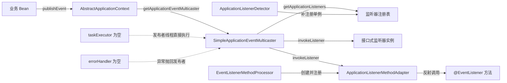
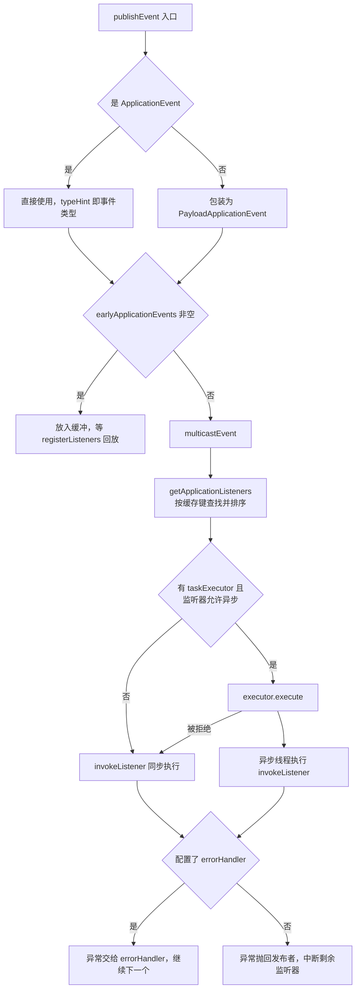
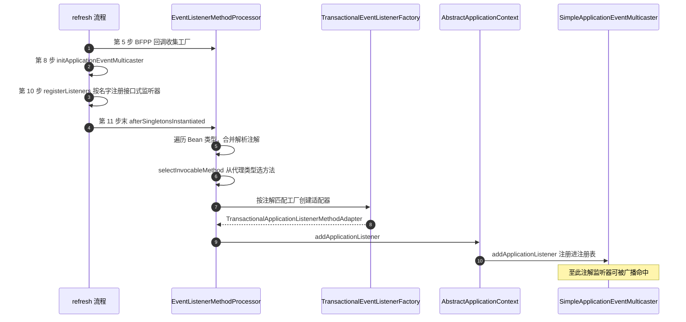
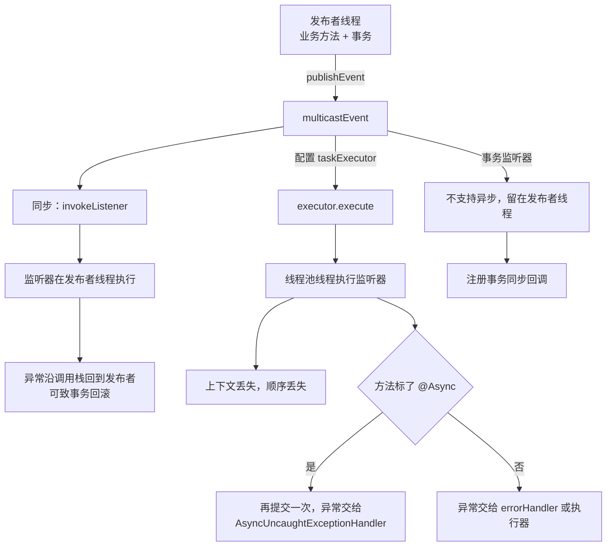
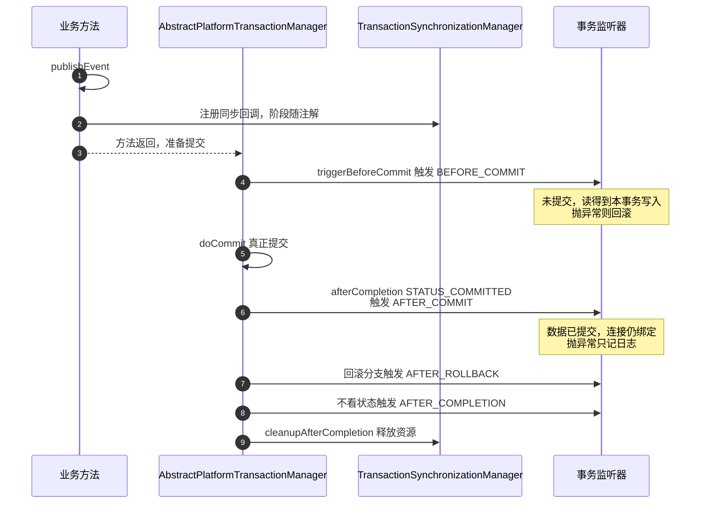
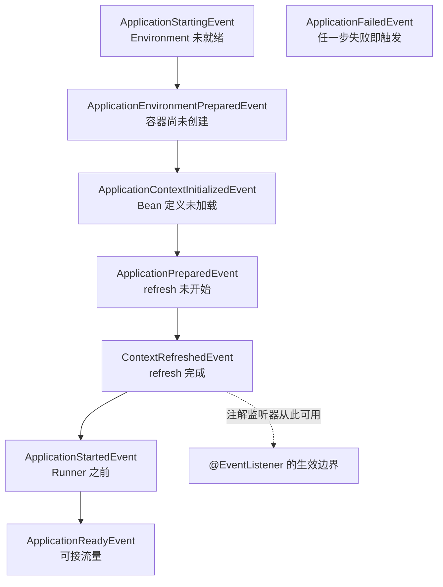

# Spring事件机制与观察者模式

**摘要：**

Spring 的事件机制，教科书通常讲到"观察者模式的一种实现"就收尾，可线上真正出事的地方很少在模式结构上，而在广播链上那几个没写进文档的约定：监听器在哪个线程里跑、抛出的异常往哪里去、事务提交到第几步才轮到它、缓存按什么键命中、同一个监听器会不会被通知两次。本篇把 `publishEvent` 的一次调用从 `AbstractApplicationContext` 一路走到监听器方法的参数上，拆成四段：封装与派发、监听器解析、线程模型、事务绑定。四个参与者的职责划分、广播循环里那三个分支、注解监听器的翻译过程、同步与异步的代价归属，都会按源码顺序交代。后半篇把两条最容易误判的边界写透：`AFTER_COMMIT` 里写库为什么会静默丢失，`fallbackExecution` 为什么会让监听器一次都不执行；最后给出内置事件的时机表与一张"该把事件放在提交前还是提交后"的判据表。读完之后，面对"发了没反应""重复执行""数据静默丢失"这三类现场，应当能直接定位到链上的一环。

本篇写机制视角。应用层怎么用 Spring Boot 的启动事件、怎么用 Actuator 观测，属 [[Java/SpringBoot/01 启动流程——从main方法到ApplicationContext就绪|Spring Boot 专栏]]；观察者的结构、四种进程内实现的横向对照，以及监听器内存泄漏的三条来源，已在 [[Java/OOP设计模式/06 行为型模式（上）——策略、模板方法与观察者|行为型模式（上）]] 落过结论；`@TransactionalEventListener` 四个阶段在模式视角下的语义，见 [[Java/OOP设计模式/09 设计模式在Spring中的应用全景|设计模式在 Spring 中的应用全景]]。本篇遇到这些点只给一句判断加双链，篇幅留给广播链、线程模型与事务绑定。

---

## 第 1 章 四个参与者与它们的职责边界

### 1.1 一个订单完成的现场

设想一条订单链路：支付回调确认订单完成后，要触发三个动作——给用户发一张复购券、给运营发一条企微通知、在审计表里补一行记录。最直接的写法是在 `OrderService#complete` 里注入三个下游服务，依次调用。这段代码在第一次评审时通常没人反对，因为它确实一目了然；问题出在第四次迭代：券的发放规则改成按品类分桶，通知渠道从企微换成飞书，审计要求接进另一个系统的 SDK，三次改动全部落在 `OrderService` 上，而这个类的单元测试因此需要 mock 越来越多的协作者。

事件机制把这三段调用挪走，只留下一个动作：`publisher.publishEvent(new OrderCompletedEvent(orderId))`。`OrderService` 从此只知道"我完成了一件事"，不知道谁关心这件事。依赖方向如何反转，属模式视角的题目；这里只关心工程上多出来的那一个角色——**广播器**。

把监听器注册表放在发布者手里，发布者就得知道所有监听者的存在，注册与注销接口也得由它提供，等于把耦合从调用点挪到了注册点，收益有限。Spring 的做法是插入一个第三方：发布者只管把事件交给广播器，监听器只管向广播器报到，两边都不需要认识对方。`ApplicationContext` 本身就是那个第三方，所以"发布"这件事在 Spring 里有一个容器级的落点。

### 1.2 事件：从必须继承到任意对象

Spring 1.0 的事件模型继承了 `java.util.EventObject`，`ApplicationEvent` 的源码短到可以整段记住：构造器要求一个非空的 `source`，并在构造时记下 `System.currentTimeMillis()`。`source` 的来源是 AWT/Swing 那套桌面事件规范，含义是"谁产生了这个事件"；`timestamp` 则是在构造时确定的，而不是在派发时，这一点在排查乱序问题时有用——事件对象上的时间戳反映的是发布时刻，不是被消费的时刻。

```java
public abstract class ApplicationEvent extends EventObject {

    private final long timestamp;

    public ApplicationEvent(Object source) {
        super(source);
        this.timestamp = System.currentTimeMillis();
    }

    public long getTimestamp() {
        return this.timestamp;
    }
}
```

Spring 4.2 之后，这条约束被放开：`publishEvent(Object)` 接受任意对象，容器内部把它包装成 `PayloadApplicationEvent<T>`，`payload` 是原对象，`source` 是发布它的那个容器。包装对监听器不是完全透明的，它带来两个可观察的后果。其一，监听器声明的参数类型可以是 payload 的类型，适配器会从包装里把 payload 取出来再传进去，这条拆包逻辑在 `ApplicationListenerMethodAdapter#resolveArguments` 里；其二，`PayloadApplicationEvent` 的泛型在运行时可能被擦除，于是匹配时会退化成"接受一切"的宽松模式，这个退化在 2.6 节还会遇到。

Spring 6.2 的 `publishEvent` 多了一个 `ResolvableType typeHint` 参数，把事件类型的计算收拢到发布侧只做一次，随后广播与向父容器转发共用同一个结果。对业务代码来说这个参数基本用不到，但它在父子容器场景里避免了一次重复推导，也避免了类型推断在两边给出不同答案。

事件对象本身有三条不写在接口里的约束。第一，事件应当是不可变的值对象，因为一个事件可能被多个监听器共享，也可能被投递到别的线程；第二，事件里只放标识和必要字段，不要塞整个实体——监听器延后执行时，实体可能已经被别的事务改过，读到的是过期快照；第三，事件类名要表达"已经发生的事实"，`OrderCompletedEvent` 是事件，`CompleteOrderCommand` 是命令，两者在语义上的差别决定了它该不该走事件通道。

```java
// 4.2 之后推荐写法：record 即可，不必继承 ApplicationEvent
public record OrderCompletedEvent(Long orderId, Long userId, BigDecimal amount) {
}
```

### 1.3 监听器：泛型声明带来的匹配能力

`ApplicationListener<E extends ApplicationEvent>` 只有一个方法，4.2 之后这个泛型参数不再只是文档，而是参与运行时匹配：容器会解析实现类上声明的实际类型，只把匹配的事件投给它。如果实现类同时需要控制"只关心哪类源对象"或"是否允许被异步派发"，就得换用扩展接口。

`GenericApplicationListener` 在 4.2 引入，把匹配逻辑暴露为 `supportsEventType(ResolvableType)` 与 `supportsSourceType(Class<?>)`，比早期的 `SmartApplicationListener` 多了一层泛型解析能力。`ApplicationListener#supportsAsyncExecution()` 则是 6.1 才加到接口上的默认方法，默认返回 `true`；它存在的唯一理由是让广播器知道"这个监听器能不能被扔进线程池"，事务感知的监听器把它覆盖成 `false`，原因放在第 5 章讲。

```java
// 接口式监听器：泛型即契约，容器按声明过滤
@Component
public class CouponListener implements ApplicationListener<OrderCompletedEvent> {

    @Override
    public void onApplicationEvent(OrderCompletedEvent event) {
        couponService.grant(event.userId(), event.orderId());
    }
}
```

### 1.4 发布者：容器自己就是一个发布接口

`ApplicationEventPublisher` 只声明了两件事：发布一个 `ApplicationEvent`，以及发布任意对象（4.2 起用默认方法把后者转成前者）。`ApplicationContext` 继承了这个接口，所以任何注入了容器的 Bean 都可以直接发布事件。取用方式有三种，取舍只在耦合程度上：注入 `ApplicationEventPublisher` 最轻，只依赖一个函数式接口；注入 `ApplicationContext` 拿到的是全套容器能力，也把业务类绑死在 Spring 上；实现 `ApplicationEventPublisherAware` 适合框架组件，不想在字段上挂注解时用。

三种方式拿到的是同一个容器实例，行为没有差别；差别只在于单元测试里要构造什么样的替身。笔者更倾向第一种，测试时给一个记录调用的 lambda 就够了。

### 1.5 广播器：真正的注册表

`ApplicationEventMulticaster` 是事件总线的实体。它的方法分两组：一组管注册（`addApplicationListener` 收实例、`addApplicationListenerBean` 收 Bean 名字、两个对应的 `remove`），一组管派发（`multicastEvent` 的两个重载）。

默认实现是 `SimpleApplicationEventMulticaster`，它有两个可配置项：`taskExecutor` 与 `errorHandler`。这两个字段几乎决定了本篇后半部分的全部行为——前者决定监听器在哪个线程跑，后者决定监听器抛异常后谁的调用栈被污染。官方注释里对默认值有一句很直白的描述：所有监听器都在调用线程里被唤醒，这带来"一个失控的监听器能阻塞整个应用"的风险，代价则是几乎没有额外开销。

容器只在一种情况下不使用默认实现：BeanFactory 里存在名为 `applicationEventMulticaster` 的 Bean。`initApplicationEventMulticaster` 的逻辑就是"有就用，没有就造一个并注册成单例"，所以自定义广播器的正确做法是给出一个同名 Bean，而不是去继承容器。

### 1.6 refresh 里的四条注册路径

监听器进入广播器不是一次性完成的，而是分四条路径，理解它们的差异，是排查"监听器没被调用"的第一把钥匙。

第一条是**实例注册**，发生在 `registerListeners`（第 10 步）：容器先把 `applicationListeners` 集合里静态注册的监听器逐个交给广播器，这些监听器来自 `ConfigurableApplicationContext#addApplicationListener`，也就是在 `refresh()` 之前手工加进去的那些。第二条是**名字注册**，紧接着同一方法完成：容器用 `getBeanNamesForType(ApplicationListener.class, true, false)` 取出所有监听器 Bean 的名字，交给 `addApplicationListenerBean`。注意这里传的是名字而不是实例，源码里那行注释解释了原因——不能在这里初始化 FactoryBean，否则后处理器就没机会作用到这些 Bean 上了；名字要到真正出现匹配事件时才 `getBean` 解析。

第三条路径最容易被忽略：`ApplicationListenerDetector` 是一个 `BeanPostProcessor`，它在每个 Bean 初始化完成后检查类型，若是单例的 `ApplicationListener`，就直接补注册进容器。这条路径解释了为什么没被 `getBeanNamesForType` 检出的监听器也能收到事件，比如内部 Bean 或通过工厂方法创建、泛型信息不足以推断类型的那些。它同时带来一条警告：非单例的内部监听器不会被注册，日志里会出现 `Inner bean ... is not reachable for event multicasting` 的告警——prototype 作用域的监听器收不到事件，根因就在这一行判断。

`@EventListener` 走的是第四条路径，而且它比前三条都晚：注解扫描发生在 `preInstantiateSingletons` 的末尾，由 `EventListenerMethodProcessor#afterSingletonsInstantiated` 触发，属于第 11 步。这个次序差异造成一个常被忽略的现象——在 `BeanFactoryPostProcessor` 里发布的事件会进入 `earlyApplicationEvents` 缓冲，缓冲在第 10 步回放，此时注解监听器尚未注册，所以它收不到；能收到早期事件的，只有通过名字通道注册的接口式监听器。

| 注册路径 | 来源 | 时机 | 能否收到早期事件 |
| :--- | :--- | :--- | :--- |
| `addApplicationListener` 实例 | 手工注册、`AnnotationConfigApplicationContext` 前置调用 | `refresh()` 之前或之中 | 能 |
| `addApplicationListenerBean` 名字 | 容器中所有 `ApplicationListener` 类型的 Bean | 第 10 步 `registerListeners` | 能，但会在回放时被迫提前创建 |
| `ApplicationListenerDetector` | 单例监听器 Bean 初始化完成 | 各 Bean 创建过程中 | 视创建时机而定 |
| `@EventListener` 扫描 | 方法级注解 | 第 11 步末尾 | 不能 |

下图把四个参与者与四条注册通道放在一张图上，箭头方向是"谁依赖谁"，不是调用顺序。后文每一章都可以回到这张图找位置。



---

## 第 2 章 一次 publishEvent 的完整广播链

### 2.1 封装：类型只推导一次

`AbstractApplicationContext#publishEvent(Object event, ResolvableType typeHint)` 的第一段是确定"事件对象"与"事件类型"这两件东西。事件对象一侧要区分是不是 `ApplicationEvent`：是就直接用，不是就包装成 `PayloadApplicationEvent`，并把 `typeHint` 当作 payload 的类型记下来。事件类型一侧要区分 `typeHint` 是给事件本身还是给 payload 的：从 6.2 的实现看，如果 `typeHint` 描述的类型可以赋给 `ApplicationEvent`，它描述的是事件；否则它描述的是 payload。类型确定之后，广播与转发父容器共用同一个 `eventType`，不再各算一遍。

这段逻辑里有一个容易误读的细节：POJO 事件被包装时，`source` 填的是当前容器，而不是发布事件的那个 Bean。所以监听器里 `event.getSource()` 拿到的是 `ApplicationContext`，不是 `OrderService`。如果业务真的需要知道"谁发的"，只能自己往 payload 里加字段，或者在发布时用 `ApplicationEventPublisher#publishEvent(ApplicationEvent)` 的重载自行指定 `source`。

### 2.2 缓冲与转发：两个分叉

第二段是决定"立刻广播"还是"先存着"。`earlyApplicationEvents` 不为空，说明还没走到第 10 步的 `registerListeners`，事件被放进这个 `LinkedHashSet` 等回放；为空则说明缓冲期已过，直接 `multicastEvent`。回放发生在第 10 步，而 `registerListeners` 在回放前先把 `earlyApplicationEvents` 置空，等于"只回放一次"，这个实现避免了重复投递，也意味着在回放过程中新发布的事件走的是正常路径。

第三段是向父容器转发：当前容器有 parent，就把**原始 event**（而不是包装后的 `PayloadApplicationEvent`）连同 `typeHint` 一起交给父容器的 `publishEvent`，没有 parent 则调用父容器的 `publishEvent(Object)` 让它自己重新推导。这里有意透传原始对象，是有代价的：同一份 POJO 事件会在子容器里被包一次、在父容器里再包一次，两个容器各建一个 `PayloadApplicationEvent`，`source` 分别指向各自的容器。如果同一个监听器 Bean 同时存在于父子两级容器（传统 Spring MVC 里很常见），它会收到两次通知，而两次事件的 `source` 不同。排查"事件重复触发"时，这条转发逻辑要排在缓存和代理之前先看。

### 2.3 广播：三个分支决定一切

`SimpleApplicationEventMulticaster#multicastEvent` 的循环体短得不像一个核心机制，但每个分支背后都是一条线上故障的入口。

```java
@Override
public void multicastEvent(ApplicationEvent event, @Nullable ResolvableType eventType) {
    ResolvableType type = (eventType != null ? eventType : ResolvableType.forInstance(event));
    Executor executor = getTaskExecutor();
    for (ApplicationListener<?> listener : getApplicationListeners(event, type)) {
        if (executor != null && listener.supportsAsyncExecution()) {
            try {
                executor.execute(() -> invokeListener(listener, event));
            }
            catch (RejectedExecutionException ex) {
                // Probably on shutdown -> invoke listener locally instead
                invokeListener(listener, event);
            }
        }
        else {
            invokeListener(listener, event);
        }
    }
}
```

第一个分支是"有线程池且监听器允许异步"。两个条件缺一不可，后一个条件不是装饰：事务感知的监听器会把它覆盖成 `false`，因为它的注册动作必须发生在持有事务的那个线程上，扔进别的线程就没有事务上下文可绑了。源码注释对这个设计的说明是"只有它的目标监听方法可能异步"，也就是说异步发生在事务回调之后的反射调用里，而不是发生在注册时。

第二个分支是拒绝策略的兜底。线程池在关闭过程中会抛 `RejectedExecutionException`，这里的处理是退回同步执行——监听器不会丢，但会在发布者线程上跑一遍。这个兜底在停机窗口里可能把关闭时间拉长，是一处容易忽略的意外延迟来源。

第三个分支是同步执行，也就是**默认路径**。`taskExecutor` 为 `null` 时每一个监听器都在发布者线程里跑，`publishEvent` 返回时它们全部执行完毕。这条默认值把"事件即异步"的直觉彻底推翻，也是第 4 章所有讨论的前提。

### 2.4 调用一个监听器：两处异常处理

`invokeListener` 只做一件事：看 `errorHandler` 是否配置。配了就 `try/catch Throwable` 交给它，没配就让异常沿调用栈往上走。官方注释把两种语境的后果写清楚了：没有 `errorHandler` 时，"一个监听器的异常会中断当前这次广播，并传播给事件的发布者"；配了线程池之后，"每个监听器的异常会传给执行器，但不一定会中断其他监听器"。这两句话合起来说明一件事——异常是否中断后续监听器，既不看同步还是异步，也**只看有没有 `errorHandler`**。

`doInvokeListener` 里还有一层 `ClassCastException` 的抑制。原因是 lambda 写法的监听器在运行时拿不到泛型参数，容器无法判断它到底想收哪种事件，于是会把所有事件都投给它，类型不匹配时抛出的 `ClassCastException` 在这里被识别并降级成一条 trace 日志。这段代码解释了一个常见困惑：用 lambda 注册的监听器偶尔"什么都没收到"，日志级别开到 trace 才能看见原因。

### 2.5 监听器解析：缓存键、两轮过滤与一次排序

`getApplicationListeners(event, type)` 是整个广播链里唯一有状态的部分，它的输入是事件与事件类型，输出是排好序的监听器集合。

缓存键是 `ListenerCacheKey`，由两个元素构成：`ResolvableType` 形式的事件类型，以及事件源对象的运行时类型。源类型入键的理由是匹配函数第三个参数就是它——某些监听器会声明只处理特定来源的事件，键里不带源类型就会在两种来源之间串味。缓存本身是 `ConcurrentHashMap`，但只对"类加载安全"的类型生效：`ClassUtils.isCacheSafe` 会比较类与 BeanFactory 的类加载器，遇到自定义类加载器（应用服务器、热部署场景）时直接放弃缓存，避免类加载器泄漏。这个判断解释了为什么在某些中间件里，同样的匹配会退化成每次回源。

缓存的载体是 `CachedListenerRetriever`，它持有的不是单个监听器，而是两个集合：一个装"按实例注册且已匹配"的监听器，一个装"按名字注册且已匹配"的 Bean 名。回源计算时先复制注册表的两个快照，再走两轮过滤。

第一轮遍历实例集合，用 `supportsEvent(listener, eventType, sourceType)` 判断。第二轮遍历名字集合，先用 `supportsEvent(beanFactory, listenerBeanName, eventType)` 从 BeanDefinition 元数据做一次粗筛，再 `getBean` 拿到实例做一次细筛。第二轮里有一处去重代码：容器会检查 `AopProxyUtils.getSingletonTarget(listener)`，如果拿到的是代理背后的裸对象，就用代理替换掉它。原因是某些路径会把"未包装的代理目标"塞进静态监听器集合，若两个都在集合里，监听器会被调两次。这是"事件重复触发"的第二个来源，与父子容器转发并列。

两轮都结束后执行 `AnnotationAwareOrderComparator.sort(allListeners)`。排序发生在解析阶段而不是广播阶段，意味着同一个缓存键下的顺序是固定的，不同事件类型之间的顺序互不影响。排序规则依赖于监听器对象的 `Ordered` 实现或类上的 `@Order` 注解，方法级监听器的顺序来自适配器自身，这一点在 6.1 节展开。

### 2.6 匹配语义：泛型、子类型与 payload

`supportsEvent` 对不实现 `GenericApplicationListener` 的监听器会先套一个 `GenericApplicationListenerAdapter`，从类签名里解析出声明的事件类型，再判断兼容性。判断本身不是精确的 `equals`，而是沿继承链向上兼容，因此 `ApplicationListener<ApplicationEvent>` 能收到所有事件，`ApplicationListener<OrderCompletedEvent>` 也能收到它的子类事件。

`@EventListener` 的匹配逻辑在 `ApplicationListenerMethodAdapter#supportsEventType` 里，比接口式多一条 payload 分支：事件类型是 `PayloadApplicationEvent` 时，取出它的泛型参数与声明类型比较；泛型被擦除（`payloadType.resolve()` 返回 `null`）时直接接受。这就是 1.2 节提到的宽松退化，它的实际后果是——用 lambda 或泛型不具体的写法声明 POJO 事件监听器，匹配会变成"全都接"，过滤只能靠方法体内的 `instanceof` 或 `condition` 表达式补上。

| 事件类型 | 监听器声明 | 是否匹配 | 说明 |
| :--- | :--- | :--- | :--- |
| `OrderCompletedEvent` | `ApplicationListener<OrderCompletedEvent>` | 是 | 精确匹配 |
| `OrderCompletedEvent` 子类 | `ApplicationListener<OrderCompletedEvent>` | 是 | 沿继承链向上兼容 |
| `PayloadApplicationEvent<OrderCompletedEvent>` | `@EventListener(OrderCompletedEvent)` | 是 | 从泛型参数拆出 payload 类型 |
| `PayloadApplicationEvent<?>`（擦除） | `@EventListener(OrderCompletedEvent)` | 是 | 泛型不可解析时退化为全部接受 |
| `OrderCompletedEvent` | `@EventListener(classes = AuditEvent.class)` | 否 | `classes` 覆盖方法参数类型 |

把这一章压成一张图：从 `publishEvent` 进去，到监听器方法被调用，中间所有分叉都在这张图上。



---

## 第 3 章 @EventListener：注解如何变成一个监听器

### 3.1 一个类，两重身份

`EventListenerMethodProcessor` 的签名是理解注解监听器的起点，因为它同时实现了两个看似无关的接口。

`BeanFactoryPostProcessor` 的身份用于在容器刷新的第 5 步做一件很轻的事：把容器里所有 `EventListenerFactory` 类型的 Bean 取出来，按 `@Order` 排序后存到字段里。这个阶段还没有任何业务 Bean 被实例化，能做的只有"收集工具"。

`SmartInitializingSingleton` 的身份则等到第 11 步末尾才被触发，`afterSingletonsInstantiated` 遍历 `getBeanNamesForType(Object.class)`，对每个 Bean 的**类型**（不是实例）做注解扫描。之所以必须等到这个时点，是因为要扫描所有 Bean，就必须保证所有 BeanDefinition 已经注册完毕；而选择"遍历类型"而不是"遍历实例"，是为了避免为了扫描而提前实例化懒加载的 Bean。

把这两段拆开是实现上的必然：收集工厂要在 Bean 定义阶段完成，因为它本身可能依赖容器里的其他 Bean；扫描注解要等定义齐全，否则会漏掉后注册的类。用扩展点补机制、而不是往容器核心里塞逻辑，是 Spring 一贯的做法，整套扩展点的层次与调用栈见 [[Java/SpringCore/10 Spring扩展点全景——BeanPostProcessor、BeanFactoryPostProcessor与Aware接口|扩展点全景]]。这个时序也解释了为什么注解监听器的注册总在 `finishBeanFactoryInitialization` 的尾巴上，以及为什么它接不到 2.2 节那些早期事件。

### 3.2 扫描：从类型到适配器

`processBean(beanName, targetType)` 里有四道关卡，每一道都在降低启动开销或避免误判。

第一道是 `nonAnnotatedClasses` 缓存，扫过一次没注解的类不再扫第二次；第二道是 `AnnotationUtils.isCandidateClass`，用 `@EventListener` 的元注解信息做快速排除，避免对第三方类做完整的方法遍历；第三道排除 Spring 自己的容器类；第四道 `MethodIntrospector.selectMethods` 会沿着接口、父类、桥接方法一路找，把注解合并解析出来——这说明 `@EventListener` 写在接口方法上、实现在实现类里是有效的。

真正创建监听器的只有这么几行：

```java
Method methodToUse = AopUtils.selectInvocableMethod(method, context.getType(beanName));
ApplicationListener<?> applicationListener =
        factory.createApplicationListener(beanName, targetType, methodToUse);
if (applicationListener instanceof ApplicationListenerMethodAdapter alma) {
    alma.init(context, this.evaluator);   // 注入 ApplicationContext 与 SpEL 求值器
}
context.addApplicationListener(applicationListener);
```

`AopUtils.selectInvocableMethod` 是关键的一行：`context.getType(beanName)` 拿到的是**代理类型**，方法要从代理类型上可调用的那一份里选（可能是接口方法，也可能是 CGLIB 子类方法）。由此得到的 `Method` 对象，后续是通过容器 `getBean(beanName)` 取到的代理实例来反射调用的——这正是"`@Async` 标注在 `@EventListener` 方法上能生效"的机制根源，因为调用走的是代理，不是裸对象。

`context.addApplicationListener` 是注册的落点。注意它同时做了两件事：把适配器交给广播器（若已初始化），并加入容器的 `applicationListeners` 集合。两处都记一份，是为了让 `registerListeners` 在广播器晚于注册存在时还能补投。

### 3.3 适配器的执行：四段逻辑

`ApplicationListenerMethodAdapter#processEvent` 只有四步，但每一步都可能成为现场问题的源头。

第一步 `resolveArguments` 决定传什么参数进去。方法参数个数被限制为最多一个（Kotlin 挂起函数会多一个续体参数，单独处理），这个约束在构造时就检查，配错了启动直接失败；参数类型的来源有两个，`@EventListener` 的 `classes` 属性优先，否则取方法参数的泛型类型。当声明类型不是 `ApplicationEvent` 的子类时（也就是监听 POJO 事件），代码会判断事件是不是 `PayloadApplicationEvent`，是就把 payload 取出来传递——1.2 节说的"拆包"就在这一行。

第二步 `shouldHandle` 求值 `condition`。表达式由 `EventExpressionEvaluator` 用 SpEL 计算，求值上下文里注入了 `BeanFactoryResolver`，所以 `@beanService.enabled()` 这种写法可以直接引用容器 Bean。求值发生在发布者线程、在方法调用之前，因此表达式里抛出的异常会沿广播链回到发布者——把有副作用的表达式写进 `condition`，等于给发布路径埋了一个隐式失败点。SpEL 的语法与求值细节另有专篇，见 [[Java/SpringCore/09 SpEL表达式与属性解析|SpEL 表达式]]。

第三步 `doInvoke` 反射调用目标方法。参数就绪、条件通过之后才走到这里，调用对象是代理，所以这一段可能触发的行为包括异步拦截、事务拦截、缓存拦截——注解监听器不是"绕开 AOP 的裸调用"，它和普通方法调用走同一条拦截链。

第四步 `handleResult` 处理返回值。返回 `null` 时什么都不做；返回事件对象、集合、数组时，容器会把它们逐个再发布出去；返回 `CompletionStage`、`ListenableFuture` 或反应式类型时，容器挂回调，等结果出来再发布。这条能力常被用来串联事件链：监听器处理完 A 事件，返回一个 B 事件，容器替它发出去。它的代价是控制流彻底隐式化——两个事件之间的因果关系只体现在返回值上，读代码时看不出来。

### 3.4 注解属性与它们的代价

`@EventListener` 在 6.2 里的属性比多数人以为的多，其中 `defaultExecution` 是 6.2 新加的通用开关，事务监听器的 `fallbackExecution` 正是它的别名。

| 属性 | 作用 | 代价 |
| :--- | :--- | :--- |
| `value` / `classes` | 显式声明监听的事件类型，优先于方法参数类型 | 声明错了不会报错，监听器静默不执行 |
| `condition` | SpEL 条件，为 false 时跳过 | 在发布者线程求值，异常会污染发布路径 |
| `id` | 监听器标识，便于定位与去重 | 需要自己保证唯一 |
| `defaultExecution` | 无匹配上下文时是否仍执行默认逻辑 | 默认 true；事务场景下语义变成"没有事务也执行" |

### 3.5 事务监听器是它的子类

`@TransactionalEventListener` 不是另一套并行实现，它靠自身的元注解 `@EventListener` 接入同一套扫描，由 `TransactionalEventListenerFactory` 造出 `TransactionalApplicationListenerMethodAdapter`——这个类继承 `ApplicationListenerMethodAdapter`，只重写了 `onApplicationEvent`，把"直接处理"换成"先注册事务同步回调"。

这个继承关系解释了三件事：`@TransactionalEventListener` 支持 `condition`、`classes`、返回值再发布，因为它们都来自父类；它的方法参数同样最多一个，因为它复用了父类的构造期检查；它的 `fallbackExecution` 属性在实现上就是父类的 `defaultExecution`，靠 `@AliasFor` 桥接。具体的事务阶段语义在第 5 章展开。

下图是注解监听器从扫描到就绪的时序，注意它与 `refresh()` 的步骤对应关系。



---

## 第 4 章 线程模型：同步、异步与它们的账单

### 4.1 默认同步：在发布者的线程里跑完

默认配置下 `taskExecutor` 是 `null`，2.3 节的第三个分支生效：监听器在发布者线程里被逐个调用，`publishEvent` 返回时全部执行完毕。这个默认值有三个直接后果，每一个都在线上以不同面貌出现过。

第一，监听器抛出的异常会传播回发布者。在 `@Transactional` 方法里发布事件，监听器抛异常意味着调用链继续上抛，事务拦截器捕获后回滚——业务数据被回滚，但监听器已经做过的外部副作用收不回来。发出去的邮件、投出去的消息、写进 Redis 的标记，都不会因为数据库回滚而撤销。

第二，监听器的耗时直接计入发布者的响应时间。一个同步监听器里有三次 HTTP 调用，主流程就多三次网络往返，接口的 P99 里会同时包含主业务和所有监听器的耗时，链路追踪上看起来是"订单接口很慢"，拆到 span 里才发现慢在下游通知。

第三，监听器与发布者在同一线程、同一事务里，能用同一份 `ThreadLocal` 上下文。这是同步唯一但很实在的好处：事务、安全上下文、MDC 日志上下文、请求作用域，全都跟着走。异步之后这些都要手工传递，第 4.4 节会讲代价。

`SimpleApplicationEventMulticaster` 的类注释把默认值与风险写得很坦率：默认在调用线程中唤醒所有监听器，这允许"一个行为失控的监听器阻塞整个应用"的危险。这句话是官方文档里少见的重话，也说明这个默认值不是随手定的——同步换来的是可预测与低开销，代价是故障隔离的缺失。

### 4.2 @Async：拦截器把调用提交给线程池

`@Async` 的生效不依赖事件机制，它是一段独立的 AOP 拦截：`AsyncExecutionInterceptor#invoke` 从被调方法解析出执行器，构造一个 `Callable` 包住 `invocation.proceed()`，再交给 `doSubmit` 提交，然后立即返回。

```java
Callable<Object> task = () -> {
    try {
        Object result = invocation.proceed();
        if (result instanceof Future<?> future) {
            return future.get();          // 方法本身返回 Future 时，等待内部结果
        }
    }
    catch (ExecutionException ex) {
        handleError(ex.getCause(), userMethod, invocation.getArguments());
    }
    catch (Throwable ex) {
        handleError(ex, userMethod, invocation.getArguments());
    }
    return null;
};
return doSubmit(task, executor, invocation.getMethod().getReturnType());
```

这段代码里有两条必须记住的规则。

规则一：返回类型只能是 `void`、`Future`、`CompletableFuture` 或 `ListenableFuture`，`doSubmit` 对其它返回类型直接抛 `IllegalArgumentException`。这条约束常被写成"`@Async` 方法必须返回 void"，其实更准确的说法是"不能返回一个普通值"，因为提交之后无处安放。

规则二：异常的去向取决于返回类型。`handleError` 的实现是——如果方法返回 `Future`，把异常重新抛出，让调用方在 `future.get()` 时收到 `ExecutionException`；否则交给 `AsyncUncaughtExceptionHandler`，默认实现只记一条 error 日志。也就是说，`void` 返回的 `@Async` 方法抛出的异常，**永远不会回到调用方**。要在异步链路上做告警、落库、重试，必须自己注册 `AsyncUncaughtExceptionHandler`，否则失败只留在日志里，而且日志级别与堆栈未必有人看。

### 4.3 代理的三条约束

`@Async` 是代理增强，于是它继承了 AOP 代理的全部限制，只是这些限制在事件场景下更容易被踩。

自调用失效是第一条。在同一个 Bean 内部，方法 A 调用方法 B，B 上标了 `@Async`，这个调用走的是 `this`，不经过代理，B 就在 A 的线程里同步执行。代理的创建与调用链细节见 [[Java/SpringCore/06 AOP实现原理——JDK动态代理与CGLIB|AOP 实现原理]]，这里只记结论：跨 Bean 调用才有效。

可见性是第二条。CGLIB 通过子类覆写实现拦截，`private` 方法无法被覆写，`final` 方法同样不行，标了 `@Async` 也只是普通方法。`protected` 方法在 CGLIB 下可用，但这属于实现细节，不该当成契约。

第三条是线程池的选择。`determineAsyncExecutor` 会依次看方法或类上的执行器限定符、`AsyncConfigurer#getAsyncExecutor`、默认执行器。Spring Boot 自动配置的默认执行器是 `applicationTaskExecutor`，其线程池参数默认值对事件场景并不友好——核心线程 8、队列容量 `Integer.MAX_VALUE`。队列无界意味着任务会一直堆积而不触发拒绝策略，代价是内存增长被延后到 OOM 才暴露；这类池适合短任务，不适合"每个监听器都调一次远端接口"的场景。如果容器里既没有唯一的 `TaskExecutor`、也没有名为 `taskExecutor` 的 Bean，`getDefaultExecutor` 会返回 `null`，拦截器随即抛 `IllegalStateException`——非 Boot 工程第一次调用 `@Async` 就失败，通常是因为漏了这一层。

### 4.4 全局异步：改一个字段，换四种后果

另一条路是给广播器配线程池，让所有监听器统一异步：

```java
@Bean(name = "applicationEventMulticaster")
public ApplicationEventMulticaster applicationEventMulticaster(ThreadPoolTaskExecutor eventExecutor) {
    SimpleApplicationEventMulticaster multicaster = new SimpleApplicationEventMulticaster();
    multicaster.setTaskExecutor(eventExecutor);
    // 不设 errorHandler 时，异步监听器的异常只会打在执行器线程的日志里
    multicaster.setErrorHandler(TaskUtils.LOG_AND_SUPPRESS_ERROR_HANDLER);
    return multicaster;
}
```

配置只有两行，后果却有四种。

其一，顺序丢失。`@Order` 与 `Ordered` 只决定"提交到线程池的顺序"，不决定执行顺序；同一个监听器集合在多线程下并发起跑，谁先完成取决于调度。第 6 章会回到这一点。

其二，异常被隔离到执行器线程。配了 `errorHandler` 是"记日志后继续"，不配是"异常抛给执行器"——对 `ThreadPoolTaskExecutor` 而言，未捕获异常最终落到 `UncaughtExceptionHandler`，发布者完全无感知。这与同步默认值形成对照：同步把故障交给调用方，异步把故障留给日志。

其三，线程上下文丢失。`setTaskExecutor` 的注释说得很清楚：异步执行不会参与调用方的线程上下文（类加载器、事务上下文），除非执行器显式支持。落在实践上，就是事务没了、`SecurityContext` 没了、MDC 里的 traceId 没了。要保住 traceId，得用 `TaskDecorator` 或者支持上下文传播的执行器。

其四，拒绝策略的兜底会让"异步"退化成"同步"。线程池满了抛 `RejectedExecutionException`，广播器捕获后退回发布者线程执行（2.3 节的第二个分支），于是发布者被突然拖慢——这一段延迟不会出现在任何异步监听器的耗时统计里，只体现为接口偶发抖动。

### 4.5 线程池参数与它们的代价

给事件监听器配独立线程池时，五组参数的取舍可以用一张表固定下来。下表的"代价"列是调大或调小的方向性判断，具体数值要按压测结果定。

| 参数 | 作用 | 调大的代价 | 调小的代价 |
| :--- | :--- | :--- | :--- |
| `corePoolSize` | 常驻线程数 | 空闲时也占内存与线程栈，容器里线程数不可控 | 并发事件排队，突发流量下延迟上升 |
| `maxPoolSize` | 峰值线程数 | 峰值瞬间内存与上下文切换开销上升 | 突发流量容易触顶，进而触发拒绝 |
| `queueCapacity` | 排队上限 | 无界队列把溢出风险换成内存增长，最终 OOM | 队列短则更容易拒绝，回退同步会拖慢发布者 |
| `keepAlive` | 空闲线程存活时间 | 线程回收慢，长期占用资源 | 频繁创建销毁，抖动明显 |
| `RejectedExecutionHandler` | 拒绝策略 | `CallerRunsPolicy` 让发布者替线程池干活，等于把异步变同步 | `AbortPolicy` 的拒绝异常会被广播器捕获，同样退回发布者线程 |

`@Async` 与全局异步选哪一个，判据是"是否需要混合同步与异步"。事件系统里通常有一两个监听器必须与主流程同生共死（比如审计落库），其余可以异步；此时单方法 `@Async` 是唯一能表达这种差异的手段，全局异步只能一刀切。

### 4.6 量化的账

把同步与异步的耗时差异算一遍，比记结论更有用。以下数字是示例推算，用来说明量级关系，不是基准测试结果。

设一次事件有 4 个监听器，耗时分别为 20ms、30ms、50ms、100ms，主业务本身的量级也是百毫秒。同步广播下，发布者看到的是四者之和 200ms 叠加在主业务之上；接口 P99 直接抬升 200ms 量级。若改成异步，发布者的可见耗时退化为"提交四个任务"的成本，按线程池空闲计，每次提交的排队与唤醒开销在微秒到毫秒级，四个任务合计量级远小于 1ms；代价是这 200ms 的工作转移到线程池，若线程池核心线程为 4、每个任务 50ms 均值，则单个线程每秒只能处理 20 个任务，四个监听器的组合意味着一秒二十余次事件就把池占满。

再算内存一侧。若事件峰值每秒 1000 次、每次触发 4 个监听器任务，每个任务对象连同事件引用按 200 字节计，队列无界时积压一分钟就是 24 万个任务、约 48MB 的保留对象；若监听器里有阻塞调用把消费速度压到每秒 500 个，积压会以每秒 3500 个任务的速度增长，从"偶发变慢"到 OOM 可能只有几分钟。这组推算说明的是同一件事：异步把"延迟"换成了"积压"，而积压的可见性远低于延迟。

三条路径的线程与异常流向对比如下。



---

## 第 5 章 与事务的绑定：四个阶段与一条隐藏陷阱

### 5.1 注册条件与三个分支

`@TransactionalEventListener` 的 `onApplicationEvent` 只有三个分支，读懂了这三个分支，这一章的大半问题就有了答案。

第一个分支：当前线程存在活动的同步与活动的事务，`TransactionalApplicationListenerSynchronization.register` 返回 true，方法不再立即执行，而是把"事件 + 监听器 + 阶段"打包成一个 `TransactionSynchronization` 注册到 `TransactionSynchronizationManager`。注意注册条件是两个而非一个：`isSynchronizationActive()` 说明事务管理器已经初始化了同步机制，`isActualTransactionActive()` 说明真的有一个事务在跑。只有两者同时成立，回调才会被登记。

第二个分支：注册失败但允许默认执行，也就是 `fallbackExecution = true`。此时监听器立即在发布者线程上处理事件，等价于一个普通同步监听器。源码里对 `AFTER_ROLLBACK` 这个特定组合会额外打一条 warn，因为"没有事务却要求回滚后执行"在语义上没有意义。

第三个分支：注册失败且不允许默认执行，监听器被静默跳过，只在 debug 级别留一行 "No transaction is active - skipping"。这是"事件发了但什么都没发生"最常见的一种成因，也是最难查的一种，因为它没有任何错误级别的痕迹。

### 5.2 四个阶段落在提交链的哪一步

事务监听器的执行位置不在 `publishEvent` 的调用栈里，而在事务管理器的提交流程里。`AbstractPlatformTransactionManager#processCommit` 的顺序是：`triggerBeforeCommit` → `triggerBeforeCompletion` → `doCommit` → `triggerAfterCommit` → `triggerAfterCompletion`，最后 `cleanupAfterCompletion`。四个阶段与这些回调的对应关系如下。

`BEFORE_COMMIT` 挂在 `beforeCommit` 上，位置在 `doCommit` 之前，此时未提交的写入对同一连接可见，方法抛异常会让提交失败并转入回滚。

`AFTER_COMMIT` 在 6.x 的实现里挂在 `afterCompletion` 上，条件是 `STATUS_COMMITTED`。位置在 `doCommit` 之后、`cleanupAfterCompletion` 之前，所以数据确实已经提交，但事务资源还绑在连接上没释放。

`AFTER_ROLLBACK` 同样在 `afterCompletion` 里，条件是 `STATUS_ROLLED_BACK`。

`AFTER_COMPLETION` 也在 `afterCompletion` 里，不看状态，提交与回滚都触发。

这套落点顺序很重要，因为两个回调的异常语义完全不同：`beforeCommit` 的异常会传播并触发回滚，`afterCompletion` 的异常被 `TransactionSynchronizationUtils` 捕获后只记一条 error 日志。也就是说，`@TransactionalEventListener(AFTER_COMMIT)` 里抛出的异常既不能回滚事务（已经提交），也不会传到发布者手里（被吞掉），它只是日志里的一行。



### 5.3 AFTER_COMMIT 的隐藏陷阱

`AFTER_COMMIT` 是最常被选的阶段，也是最容易写出**静默丢失**的阶段。它的机制根因在 5.2 节的落点里：回调执行时 `doCommit` 已经完成，但 `cleanupAfterCompletion` 还没跑到，于是 `TransactionSynchronizationManager` 依然认为"当前线程有活动事务"，连接依然绑在这个线程上。

在这种状态下，如果监听器调用了一个带 `@Transactional` 的方法（默认传播行为 `REQUIRED`），事务拦截器看到"已有事务"，就会以参与方式加入——它不会开启新事务，也不会在方法返回时提交。而原来那个事务已经提交过了，没有第二次提交。结果就是写操作执行了、没有报错、数据没落库。

这不是实现缺陷，而是官方明确警告过的边界。`TransactionSynchronization#afterCommit` 的 javadoc 原文意思大致是：事务已经提交，但事务资源可能仍然活跃可访问；因此此时触发的任何数据访问代码仍会"参与"原事务，可以做清理（但不会再有提交跟随），除非显式声明它需要在独立事务中运行；结论是——从这里调用的事务操作**必须使用 `PROPAGATION_REQUIRES_NEW`**。`@TransactionalEventListener` 的类注释里也重复了这条警告，并把范围扩大到 `AFTER_ROLLBACK` 与 `AFTER_COMPLETION`。

```java
// 反例：AFTER_COMMIT 里直接写库，REQUIRED 会加入已提交的事务，写入静默丢失
@TransactionalEventListener(phase = TransactionPhase.AFTER_COMMIT)
public void onCompleted(OrderCompletedEvent event) {
    auditRepository.save(new AuditRecord(event.orderId()));   // 不报错，也不落库
}

// 正例：显式要求新事务，拿到新连接，独立提交
@TransactionalEventListener(phase = TransactionPhase.AFTER_COMMIT)
@Transactional(propagation = Propagation.REQUIRES_NEW)
public void onCompleted(OrderCompletedEvent event) {
    auditRepository.save(new AuditRecord(event.orderId()));
}
```

`REQUIRES_NEW` 的代价是另一条连接与一次独立提交，在连接池紧张时它会多占一个连接；如果监听器里要写多张表，这些写入之间也不再与主事务原子。事务传播行为与连接获取的细节，见 [[Java/SpringCore/07 Spring事务管理——声明式事务的传播行为与失效场景|事务管理]]。

另一条常被混用的修正手段是"把监听器标 `@Async`"。异步之后线程变了，`TransactionSynchronizationManager` 在新线程上没有绑定，天然就没有"加入旧事务"的问题。但它换来的是另外两个问题：异常彻底丢失，以及异步线程上的事务、安全上下文、trace 都要重新装配。用异步绕开陷阱，本质上是换了一个坑。

### 5.4 fallbackExecution 与它的别名

`fallbackExecution` 默认 `false`，含义是"没有事务时，不执行"。它的实现方式在 3.4 节已经露过一角：`TransactionalEventListener#fallbackExecution` 通过 `@AliasFor` 指向 `EventListener#defaultExecution`，适配器构造时一次性读出这个布尔值。

这个默认值在四类场景里会造成静默失效：定时任务里发布事件（没有事务）；`@Async` 或自建线程池里发布事件（新线程没有事务）；`@Transactional` 因自调用失效的代码路径（事务根本没开）；只读查询路径里发布事件（有些数据源配置下不开实际事务）。四者的共同点是"发布者以为自己在事务里"，而事务监听器只认 `TransactionSynchronizationManager` 的答案。

修正方式是按语义选：如果"没有事务也要执行"是业务要求，显式写 `fallbackExecution = true`；如果"必须在事务里"，那就不要靠监听器兜底，而应当在发布侧校验并快速失败。前者是补一个开关，后者是补一个断言，两者都比依赖默认值安全。

### 5.5 判据表：事件放在提交前还是提交后

把前四节压成一张判据表。选阶段的依据只有两条：监听器的失败要不要影响主事务，监听器要不要读主事务写的数据。

| 场景 | 该选的阶段 | 理由 | 失败后果 |
| :--- | :--- | :--- | :--- |
| 发通知、投消息、调外部接口 | `AFTER_COMMIT` | 主数据已提交，通知才有效；失败不应回滚业务 | 通知丢失或重复，需幂等 |
| 提交前做最后校验、补写审计字段 | `BEFORE_COMMIT` | 与主事务同一原子边界，抛异常可回滚 | 回滚，业务失败 |
| 回滚后释放预占、发告警 | `AFTER_ROLLBACK` | 只能做清理，不能假设数据生效 | 清理失败只记日志 |
| 无论成败都要收尾 | `AFTER_COMPLETION` | 需要自己判断状态 | 同上 |
| 提交后写库、且必须落库 | `AFTER_COMMIT` + `REQUIRES_NEW` | 旧事务已提交，必须开新事务 | 新事务失败不影响主数据 |
| 没有事务也要触发 | 显式 `fallbackExecution = true` | 避免静默跳过 | 与事务语义解耦，需自行保证一致性 |

---

## 第 6 章 顺序、异常与重复触发

### 6.1 排序发生在解析阶段

2.5 节已经说明排序的位置：`retrieveApplicationListeners` 结尾的 `AnnotationAwareOrderComparator.sort`。由此可以推出三条实践结论。

第一，顺序只对同一次广播内的监听器集合有意义，跨事件类型之间不存在全局顺序。第二，排序结果被缓存，缓存键是"事件类型 + 源类型"，所以同一个事件类型在同一个源类型下顺序稳定。第三，排序依据是监听器对象的 `Ordered` 实现或类上的 `@Order`，对 `@EventListener` 方法而言，监听器对象是适配器，适配器的 `getOrder()` 只读**方法上**的 `@Order`，因此写在监听器所在 Bean 类上的 `@Order` 对方法级监听器无效。这是一个很典型的"看起来该生效却没生效"，验证方法也简单：给两个监听器打断点看进入顺序，或者把类级注解挪到方法上重跑。

### 6.2 同步下异常中断后续

默认配置下，一个监听器抛异常，`invokeListener` 没有 `errorHandler` 兜底，异常直接穿出循环。仍在队列里的监听器不会执行，`publishEvent` 把异常抛给调用方。对发布者来说，"一部分监听器执行了、一部分没执行"是最难处理的中间状态；对事务来说，异常会导致回滚，但已经产生的副作用不可逆。

`errorHandler` 提供了两种中间立场。`TaskUtils.LOG_AND_SUPPRESS_ERROR_HANDLER` 记日志后继续，故障被隔离但发布者不知情；`TaskUtils.LOG_AND_PROPAGATE_ERROR_HANDLER` 记日志后继续抛出，即"继续执行剩余监听器，最后把异常抛给发布者"。后者在语义上更接近 Java 的 `suppressed exception` 思路——不丢故障，也不中断，适合作为同步事件系统里的默认选择。

### 6.3 异步下的顺序与异常

配了线程池之后，顺序只剩"提交顺序"，执行顺序由线程调度决定；即使线程池核心线程为 1，也不能保证顺序，因为任务之间没有 happens-before 关系。异常则被隔离在执行器线程，与发布者彻底解耦。

这带来一个设计上的判断：如果业务真的依赖监听器之间的先后，那它们之间就存在隐式的数据依赖，正确做法是合并成一个监听器，或者让后一个监听器显式读取前一个的产出（比如查库而不是指望内存状态）。用 `@Order` 在异步系统里维持顺序，是在依赖一个不成立的契约。

### 6.4 监听器被通知两次的三个来源

"同一个事件，监听器跑了两次"有三种成因，分别对应三条不同的机制。

父子容器转发：2.2 节的机制——子容器把原始事件交给父容器，父容器再包装一次，同一个监听器 Bean 若在两级容器里都存在，就会各收一次。判据是看日志里两次事件的 `source` 是否指向不同容器。

代理与裸对象重复注册：2.5 节提到的 `AopProxyUtils.getSingletonTarget` 检查，就是为了消解这种重复。但它只处理"代理与目标同时在集合里"的情况；如果监听器被注册了两次（一次按实例、一次按名字，而 `getBean` 返回的是同一个单例），容器用 `allListeners.contains(listener)` 去重，正常情况下不会重复。

事件链的自我触发：监听器发布了一个新事件，而新事件的监听器集合里恰好包含自己（比如泛型声明成父类型），于是形成递归。这种重复在日志上表现为"同一个监听器连续出现两次，事件对象不同"。

### 6.5 prototype 监听器收不到事件

1.6 节提过 `ApplicationListenerDetector` 的行为：只有单例监听器会被补注册，非单例的内部监听器会打一条 warn。名字通道注册的监听器不受此限，因为它是按名字 `getBean` 的，每次匹配都能拿到新实例——但 prototype 监听器的语义仍然别扭：每次匹配都要新建一个实例，实例上的状态不会跨事件保留，这些实例也不参与销毁回调。

把这一章压成矩阵：顺序与异常的保证，取决于执行方式与是否配置 `errorHandler` 的组合。

| 执行方式 | 顺序保证 | 异常去向 | 后续监听器 |
| :--- | :--- | :--- | :--- |
| 同步，无 `errorHandler` | 按 `@Order` | 抛回发布者 | 中断 |
| 同步，`LOG_AND_SUPPRESS` | 按 `@Order` | 记日志后吞掉 | 继续 |
| 同步，`LOG_AND_PROPAGATE` | 按 `@Order` | 记日志后抛回发布者 | 继续 |
| 全局异步 | 无 | 交执行器，发布者无感知 | 继续 |
| `@Async` 单方法 | 无 | `Future` 才回传，否则 `AsyncUncaughtExceptionHandler` | 继续 |

---

## 第 7 章 内置事件：容器生命周期的观察窗口

### 7.1 容器级四个事件

`AbstractApplicationContext` 在生命周期的关键节点发布四个事件，它们由框架自己发出，不需要业务代码 publish。

| 事件 | 发布位置 | 时点特征 | 适用 |
| :--- | :--- | :--- | :--- |
| `ContextRefreshedEvent` | `finishRefresh()` | 单例全部就绪、生命周期处理器已启动 | 启动后初始化、预热缓存 |
| `ContextStartedEvent` | `start()` | 显式调用 `start()` 之后 | 需要可重复启停的组件 |
| `ContextStoppedEvent` | `stop()` | 显式调用 `stop()` 之后 | 暂停轮询、停止消费 |
| `ContextClosedEvent` | `doClose()` | 销毁 Bean 之前、关闭钩子触发时 | 注销注册中心、排空队列 |

四个事件里最常被误用的是 `ContextRefreshedEvent`。它在父子容器场景下会发布多次——每个容器刷新各一次，父容器、子容器都可能触发，于是"只该跑一次"的初始化逻辑会跑两遍。判据是 `event.getApplicationContext().getParent() == null` 是否成立；但这只能筛掉子容器，如果同一个 JVM 里存在多个根容器，还要再加上身份比较。

`ContextClosedEvent` 的时点也要注意：它在 `doClose` 里、销毁 Bean 之前发布，所以监听器里还能用容器里的 Bean；但此时关闭已经进入倒计时，任何耗时的远程调用都在拉长停机时间，配合 `spring.lifecycle.timeout-per-shutdown-phase` 才有约束。

### 7.2 Spring Boot 的事件序列与一条鸿沟

Boot 在容器事件之外补了一串更早的事件，它们的顺序在官方文档里是固定的。

| 事件 | 时点 | 能否用 `@EventListener` 收 |
| :--- | :--- | :--- |
| `ApplicationStartingEvent` | `SpringApplication.run` 最早期，Environment 未就绪 | 不能 |
| `ApplicationEnvironmentPreparedEvent` | Environment 就绪，容器未创建 | 不能 |
| `ApplicationContextInitializedEvent` | 容器已创建，初始化器已调用，Bean 定义未加载 | 不能 |
| `ApplicationPreparedEvent` | Bean 定义已加载，refresh 未开始 | 不能 |
| `ContextRefreshedEvent` | refresh 完成 | 能 |
| `ApplicationStartedEvent` | refresh 之后、Runner 之前 | 能 |
| `ApplicationReadyEvent` | Runner 执行完毕，可以接流量 | 能 |
| `ApplicationFailedEvent` | 启动失败 | 能（若容器已存在） |

前四个事件与注解监听器之间有一条**鸿沟**：它们发生在容器就绪之前，`@EventListener` 的扫描要到 `preInstantiateSingletons` 末尾才发生，所以注解监听器在这四个时点上根本不存在。要监听它们，只能用 `SpringApplication#addListeners` 或 `spring.factories` 注册的 `ApplicationListener`——这两种注册方式发生在容器之外，早于任何 Bean。

同样地，`ApplicationStartedEvent` 之后 Boot 会发布 `AvailabilityChangeEvent`（liveness 状态变为 CORRECT），`ApplicationReadyEvent` 之后发布 readiness 状态变为 ACCEPTING_TRAFFIC 的事件。这两个事件是健康检查与流量接入的接线点，业务代码通常不需要监听，但理解它们的位置有助于判断"服务注册进注册中心"该放在哪一步。

### 7.3 判据：该监听哪一个

把常见需求与事件的对应关系列出来，比记住事件清单更实用。

| 需求 | 该监听 | 理由 |
| :--- | :--- | :--- |
| 启动后预热缓存、建连接池 | `ApplicationReadyEvent` | 此时 Runner 已跑完，端口已监听，失败可观测 |
| 注册进注册中心 | `ApplicationReadyEvent` 或 `WebServerInitializedEvent` | 早于就绪会让流量打进来 |
| 初始化一个与容器无关的组件 | `ApplicationStartingEvent` | 只能用 `addListeners` 等方式注册 |
| 停机时排空队列、注销 | `ContextClosedEvent` | 销毁 Bean 之前还有机会用容器 |
| 只跑一次的初始化 | `ApplicationReadyEvent` + 去重标记 | 避免父子容器重复触发 |
| 启动失败告警 | `ApplicationFailedEvent` | 容器可能已关闭，尽量只做日志与上报 |

下图把启动阶段的事件排成一条时间轴，虚线标出注解监听器开始可用的那个时点。



---

## 第 8 章 反例与判据清单

### 8.1 以为事件是异步的

最常见的误判。发布者在事务方法里发完事件就继续往下走，以为下游处理在后台，实际上同步监听器已经把主流程拖慢了几百毫秒。判据很直接：广播器有没有 `taskExecutor`，监听方法有没有 `@Async`，`@EnableAsync` 是否真的开了；三者都没有，就是同步。修法是按监听器的失败容忍度决定异步化，而不是一律异步。

### 8.2 不加 fallbackExecution 却期望无事务也触发

定时任务、异步线程、自调用失效的路径里发布事件，事务监听器被静默跳过。判据是打开 debug 日志，看是否有 "No transaction is active - skipping"；修法是显式 `fallbackExecution = true`，或者在发布侧断言当前处于事务中。

### 8.3 在 AFTER_COMMIT 里写库

5.3 节的主线。判据是监听器里有没有数据访问且传播行为是默认值；修法是 `REQUIRES_NEW`，或者把写库挪回主事务（如果业务允许）。

### 8.4 监听器耗时长阻塞主流程

同步监听器里有远程调用、批量查询、文件写入，发布者线程被拖住。判据是链路追踪上监听器 span 的耗时占比；修法是异步化，或者在监听器内部做批处理与超时控制。

### 8.5 全局异步之后仍依赖顺序

把广播器改成异步，同时保留了对监听器顺序的假设。判据是监听器之间有数据依赖却没有显式读取；修法是合并监听器或改成提交后查询。

### 8.6 判据清单

| 症状 | 先查哪一环 | 判据 |
| :--- | :--- | :--- |
| 事件发了没反应 | 注册路径与匹配 | 监听器是否单例、泛型是否匹配、`classes` 是否写错 |
| 监听器跑了两次 | 转发与注册 | 父子容器、代理与裸对象、事件链自触发 |
| 主流程变慢 | 线程模型 | `taskExecutor` 是否为空、监听器有无远程调用 |
| 通知在事务回滚后仍发出 | 阶段选择 | 是否用了默认同步监听器而非 `AFTER_COMMIT` |
| 提交后写库没落库 | 阶段与传播行为 | 是否 `AFTER_COMMIT` 且传播行为为 `REQUIRED` |
| 无事务时监听器不执行 | `fallbackExecution` | 默认 false，是否显式开启 |

---

## 第 9 章 结语

把这条链拆完会发现，Spring 事件机制真正的复杂度不在观察者模式，而在"容器、线程、事务"三套上下文叠加之后产生的时序缝隙。广播器本身只有几十行，但它同时是容器的组件、线程池的调用方、事务同步器的寄生者；三重视角里任何一重落到空处，故障就以"没反应""重复执行""数据静默丢失"这些不带堆栈的形态出现。

三个默认值是这条链上最有信息量的设计。广播器默认同步，用可预测性换掉了故障隔离；事务监听器默认停在 `AFTER_COMMIT`，用"通知不会因回滚而失真"换掉了"通知与数据同生共死"；`fallbackExecution` 默认关闭，用静默跳过换掉了"无事务时也悄悄执行"的不可控。三个默认值都指向同一个取向：宁可少做，不可做错。它们的代价也很一致——出错时没有任何提示，全靠对机制的记忆去定位。

因此判断该不该用事件、该在哪个阶段用、要不要异步，落点始终是权衡而非最佳实践。需要与主流程同生共死的动作留在同步路径上，宁可让主流程慢一点；可以重来、可以幂等的动作放到 `AFTER_COMMIT` 之后，并准备接受"通知可能重复"；提交后还要写库的地方，多写一行 `REQUIRES_NEW` 比事后排查静默丢失便宜得多。机制本身没有倾向，倾向来自每一处对失败后果的估价。

---

## 参考资料

1. [SimpleApplicationEventMulticaster（Spring Framework 6.2.x API）](https://docs.spring.io/spring-framework/docs/6.2.x/javadoc-api/org/springframework/context/event/SimpleApplicationEventMulticaster.html) —— `multicastEvent`、`invokeListener`、`setTaskExecutor`、`setErrorHandler` 的行为说明与默认值。
2. [AbstractApplicationEventMulticaster（Spring Framework 6.2.x API）](https://docs.spring.io/spring-framework/docs/6.2.x/javadoc-api/org/springframework/context/event/AbstractApplicationEventMulticaster.html) —— 监听器注册通道与 `getApplicationListeners` 的缓存语义。
3. [ApplicationListener（Spring Framework 6.2.x API）](https://docs.spring.io/spring-framework/docs/6.2.x/javadoc-api/org/springframework/context/ApplicationListener.html) —— 泛型事件声明与 `supportsAsyncExecution` 的默认值。
4. [GenericApplicationListener（Spring Framework 6.2.x API）](https://docs.spring.io/spring-framework/docs/6.2.x/javadoc-api/org/springframework/context/event/GenericApplicationListener.html) —— 事件类型与源类型的匹配扩展。
5. [EventListener（Spring Framework 6.2.x API）](https://docs.spring.io/spring-framework/docs/6.2.x/javadoc-api/org/springframework/context/event/EventListener.html) —— `classes`、`condition`、`defaultExecution`、`id` 四个属性的定义。
6. [ApplicationListenerMethodAdapter（Spring Framework 6.2.x API）](https://docs.spring.io/spring-framework/docs/6.2.x/javadoc-api/org/springframework/context/event/ApplicationListenerMethodAdapter.html) —— 注解方法的适配、参数解析与返回值再发布。
7. [EventListenerMethodProcessor（Spring Framework 6.2.x API）](https://docs.spring.io/spring-framework/docs/6.2.x/javadoc-api/org/springframework/context/event/EventListenerMethodProcessor.html) —— 注解扫描与注册的执行时机。
8. [TransactionalEventListener（Spring Framework 6.2.x API）](https://docs.spring.io/spring-framework/docs/6.2.x/javadoc-api/org/springframework/transaction/event/TransactionalEventListener.html) —— 四个阶段、`fallbackExecution`，以及事务资源仍活跃的警告原文。
9. [TransactionSynchronization（Spring Framework 6.2.x API）](https://docs.spring.io/spring-framework/docs/6.2.x/javadoc-api/org/springframework/transaction/support/TransactionSynchronization.html) —— `beforeCommit`、`afterCommit`、`afterCompletion` 三个回调的异常语义与 `REQUIRES_NEW` 建议。
10. [AbstractPlatformTransactionManager（Spring Framework 6.2.x API）](https://docs.spring.io/spring-framework/docs/6.2.x/javadoc-api/org/springframework/transaction/support/AbstractPlatformTransactionManager.html) —— 提交流程中各个同步回调的触发顺序。
11. [AsyncExecutionInterceptor（Spring Framework 6.2.x API）](https://docs.spring.io/spring-framework/docs/6.2.x/javadoc-api/org/springframework/aop/interceptor/AsyncExecutionInterceptor.html) —— `@Async` 的返回值约束与异常处理入口。
12. [Spring Framework Reference：Application Events and Listeners](https://docs.spring.io/spring-framework/reference/core/beans/context-introduction.html#context-functionality-events) —— 内置事件清单与标准监听器、注解监听器的官方说明。
13. [Spring Boot Reference：Application Events and Listeners](https://docs.spring.io/spring-boot/reference/features/spring-application.html#features.spring-application.application-events-and-listeners) —— Boot 启动事件的顺序表与早期监听器的注册方式。
14. [Spring Boot Reference：Task Execution and Scheduling](https://docs.spring.io/spring-boot/reference/features/task-execution-and-scheduling.html) —— `applicationTaskExecutor` 的默认线程池参数含义。

---

> [!note] 思考题
> 1. 广播器默认同步，官方注释把"失控的监听器阻塞整个应用"写成已知风险。如果把默认值改成异步，会让哪一类线上问题消失、哪一类问题变得更难发现？
> 2. `AFTER_COMMIT` 里写库必须 `REQUIRES_NEW`，代价是多一条连接。在连接池吃紧的系统里，你会选择限制事件量、还是把这类写入改造成别的机制？
> 3. `@EventListener` 方法返回事件对象会被容器再次发布，事件链因此可以隐式延长。这种便利与"控制流不可见"之间的界限，你会画在哪里？
> 4. 早期事件与 `@EventListener` 之间存在一步之遥的鸿沟，框架选择不弥补。这个取舍保护了什么，又牺牲了什么？
> 5. 同一个事件在父子容器里被包装两次、同一个监听器被调用两次，框架的默认行为是"都投递"。如果由你来设计，会加去重吗？