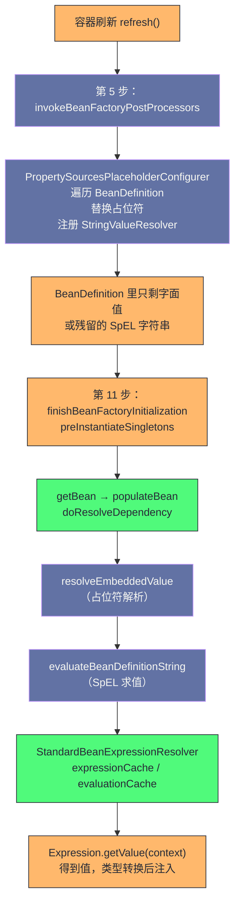
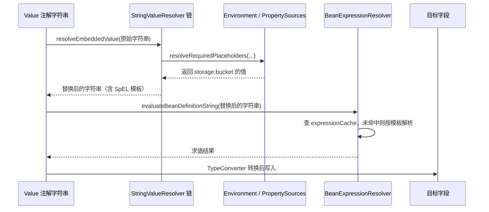
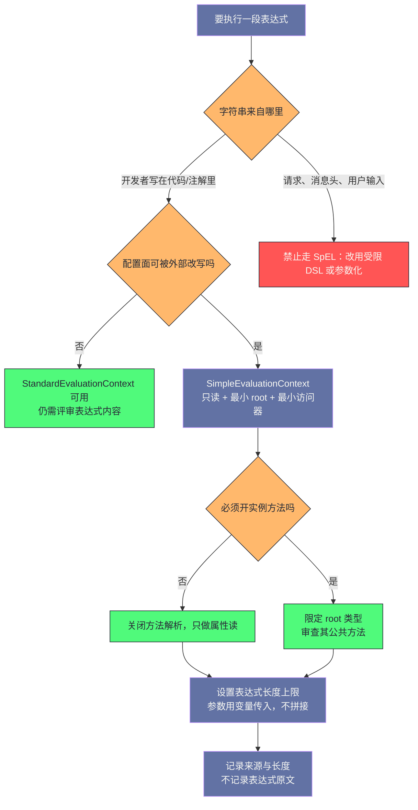
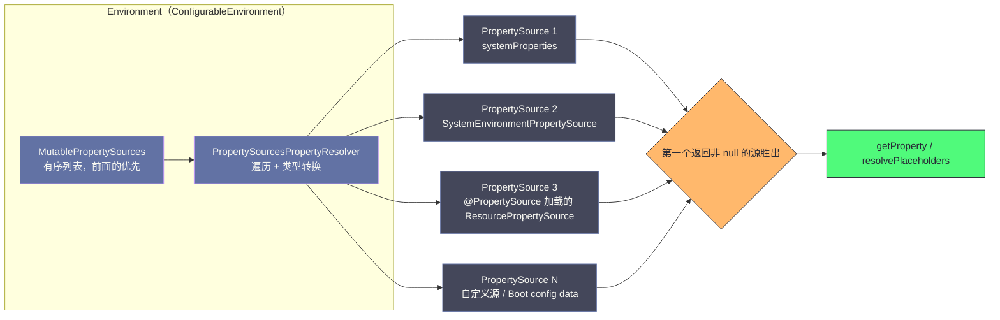

# SpEL表达式与属性解析

**摘要：**

`@Value` 的括号里可以写两种东西：`${db.url}` 与 `#{@config.url}`，它们看起来是同一套语法的两种写法，实际上分属容器生命周期的两个阶段——前者由 `PropertySourcesPlaceholderConfigurer` 在 `BeanDefinition` 阶段替换成字面值，后者由 `StandardBeanExpressionResolver` 在 `getBean` 阶段求值。本篇以这条分界线为骨架：先把两套括号的处理者、处理时机、能看见什么逐维对照，再把 `@Value("#{'${k}'.toUpperCase()}")` 这类混用的求值顺序拆到 `StringValueResolver` 与 `embeddedValueResolvers` 这一层；随后进入 SpEL 本体，讲解析、编译、求值三段，讲容器里那两级缓存与它们无淘汰的代价，讲 `Expression` 可以共享而 `EvaluationContext` 不能共享的线程安全边界；接着把语言能力面与三种上下文摆开，说明 `SimpleEvaluationContext` 到底挡住了什么、没挡住什么，以及为什么 `@Value` 里的表达式安全、把用户输入交给 `parseExpression` 不安全。属性解析只讲 core 的 `Environment`、`PropertySources` 与 `PropertySource` 机制，以及 `@PropertySource` 的加载时机；Boot 的十七级优先级与 `Binder` 宽松绑定属于 [[Java/SpringBoot/05 配置体系——application.yml、Profile与配置优先级|配置体系]]，本篇只划边界。中间的 `Environment`、`PropertySources`、`PropertySource` 三层抽象只讲机制与查找顺序，不抄 Boot 的属性源清单。最后用一组本机实测量收尾，把解析、求值、编译、缓存收益放进同一张表里对照；全篇真正要记住的只有三个词：时机、缓存、信任边界。

---

## 第 1 章 同一个注解里的两种括号

### 1.1 2009 年的第二次加法

2009 年，Spring 3.0 在 XML 配置已经很成熟的背景下引入 SpEL（Spring Expression Language，Spring 表达式语言），`SpelExpression` 的 `@since` 就是 3.0。而占位符的机制比它早得多：Spring 1.x 时代就有 `PropertyPlaceholderConfigurer`，3.1 起由与 `Environment` 打通的 `PropertySourcesPlaceholderConfigurer` 接替。两个东西各自演进了好几年，最终在同一个 `@Value` 注解上会合，于是出现了两种括号并存的局面。

这种并存看起来像语法演进，实质是两个不同问题的答案。占位符回答"这个值在不同环境里应该是什么"，SpEL 回答"这个值在运行时应该怎么算出来"。前者是**配置的搬运**，后者是**逻辑的延迟执行**。把它们当成同一个解析器的两种记号，是后面绝大多数误用的源头。

### 1.2 四行注解的四种命运

```java
@Component
public class StorageSettings {

    @Value("${storage.endpoint}")                     // ① 占位符
    private String endpoint;

    @Value("${storage.timeout:3000}")                 // ② 带默认值的占位符
    private int timeout;

    @Value("#{@featureFlags.isEnabled('new-io')}")    // ③ SpEL
    private boolean newIo;

    @Value("#{'${storage.bucket}'.toUpperCase()}")     // ④ 两者混用
    private String bucketKey;
}
```

四个字段最终都有值，但背后的动作发生在**三个不同的时间点**。

第一个在容器刷新到第 5 步（`invokeBeanFactoryPostProcessors`）之后，`BeanDefinition` 里存的值已经是 `https://...` 这样的字面量；等到 `getBean` 创建这个 Bean 时，容器只是把它转成字段类型。

第二个同理，只是多了一步缺键回退：属性源里没有 `storage.timeout` 时用 `3000`。

第三个在 `BeanDefinition` 阶段什么都没发生。注解里的字符串原样留在定义里，直到依赖解析时，容器才把它交给表达式解析器：解析 `@featureFlags.isEnabled('new-io')`，从容器里取出 `featureFlags` 这个 Bean，调用方法，得到 boolean。

第四个分两步：先由占位符解析器把 `${storage.bucket}` 换成 `my-bucket`，整串变成 `#{'my-bucket'.toUpperCase()}`；再由表达式解析器求值，得到 `MY-BUCKET`。

这四种写法的差别，在一切正常时看不出来；出问题时才会显形。你以为是配置没加载，其实是表达式求值时被引用的 Bean 还没创建；你以为语法写错了，其实是占位符阶段就把整串改掉了。

### 1.3 两套括号的问题域

占位符的需求很朴素：同一个构建产物要在开发、测试、生产三套环境里跑起来，把随环境变化的部分搬到外部，代码里只留一个键。这种需求从 `java.util.Properties` 时代就在，Spring 只是给它加了一层容器集成。

SpEL 的需求不同。注解的参数在编译期必须是常量，可有些逻辑只有运行期才知道：缓存键要拼参数，权限判断要看当前用户，事件监听要按事件属性过滤。这些场景没法把 Java 代码写进注解，只能把表达式写成字符串，让框架在运行时解释。

两者的关系有两条常见误解。其一，把 `${}` 当成 SpEL 的子集，以为 SpEL 什么都能干，于是试图在占位符里调用 Bean 方法。其二，把 `#{}` 当成 `${}` 的加强版，以为只是记号不同，于是在构造器里读取还没注入的字段。实际上它们连处理组件都不是同一个：一个是 `BeanFactoryPostProcessor`，一个是 `BeanExpressionResolver`；一个跑在容器刷新期，一个跑在 Bean 的依赖解析里。

### 1.4 本篇的边界与路线

本篇写机制视角，只回答"这两套括号在容器内部由谁、在什么时候、以什么规则处理"，不写怎么搭 Spring Boot 工程、也不写某个注解在业务里的模式用法。Boot 的应用层配置（配置优先级、`@ConfigurationProperties`、`Binder`）在 [[Java/SpringBoot/05 配置体系——application.yml、Profile与配置优先级|配置体系]]；`@Transactional` 失效、AOP 代理选择这类模式视角的问题，已在 [[Java/OOP设计模式/09 设计模式在Spring中的应用全景|设计模式在 Spring 中的应用全景]] 落过结论，本篇遇到只给一句判断加双链。

路线是这样铺的：先把占位符的图纸阶段讲透（第 2 章），再讲 SpEL 的求值阶段（第 3 章），然后把两者放在一张表里对照，并把混用的求值顺序拆到源码层（第 4 章）；接着处理性能与并发（第 5 章）、语言能力面（第 6 章）、求值上下文与安全（第 7、8 章），最后回到属性解析链（第 9 章）与 `@Value` 的写法与失效清单（第 10 章），用一笔实测量收尾（第 11 章）。



图里能看出一件关键的事：`${}` 与 `#{}` 的处理不在同一层。占位符拥有"改定义"的权力，所以它能改类名、改工厂方法名；SpEL 只有"生产值"的权力，所以它只能在依赖解析时给一个结果。两种权力对应两种时机，也对应两种失败方式。

---

## 第 2 章 占位符：在图纸阶段改字

### 2.1 一个后处理器做两件事

`PropertySourcesPlaceholderConfigurer` 的类注释把职责写得很清楚：解析 `${...}`，作用对象是 "bean definition property values and `@Value` annotations" 两处。这两处对应它做的两件事，多数人只记得第一件。

```java
// org.springframework.context.support.PropertySourcesPlaceholderConfigurer
@Override
public void postProcessBeanFactory(ConfigurableListableBeanFactory beanFactory) {
    // 1) 组装属性来源：Environment 的视图 + 本地 properties（localOverride 决定先后）
    // ...
    // 2) 父类遍历所有定义改写，并把同一个 resolver 挂到工厂上
    // createPropertyResolver 默认返回 new PropertySourcesPropertyResolver(propertySources)
    processProperties(beanFactory, createPropertyResolver(this.propertySources));
}

// org.springframework.beans.factory.config.PlaceholderConfigurerSupport
protected void doProcessProperties(ConfigurableListableBeanFactory beanFactoryToProcess,
                                   StringValueResolver valueResolver) {
    BeanDefinitionVisitor visitor = new BeanDefinitionVisitor(valueResolver);
    for (String name : beanFactoryToProcess.getBeanDefinitionNames()) {
        visitor.visitBeanDefinition(beanFactoryToProcess.getBeanDefinition(name));  // 改图纸
    }
    beanFactoryToProcess.resolveAliases(valueResolver);                             // 别名也改
    beanFactoryToProcess.addEmbeddedValueResolver(valueResolver);                    // 挂 resolver
}
```

第一件事是遍历容器里所有 `BeanDefinition`，把属性值、构造器参数、bean 类名、工厂方法名这些字段逐个过一遍 `BeanDefinitionVisitor`，把 `${}` 换成字面值。第二件事是把同一个 `StringValueResolver` 注册进 `ConfigurableBeanFactory` 的 resolver 列表，之后 `resolveEmbeddedValue` 会按注册顺序调用它——`@Value` 的解析走的正是这条路。

这里有个容易漏掉的推论：占位符不只是"替换属性值"，它连 bean 类名与工厂方法名都能替换。XML 时代"按环境切换实现类"的写法就建立在这上面：

```xml
<!-- 环境不同，实现类不同：类名本身就是一个占位符 -->
<bean id="mailSender" class="${mail.sender.class}"/>
```

换句话说，占位符阶段操作的是**元数据**，比"值"的层次更靠上。理解这一点，才能理解它为什么不能引用 Bean：此刻一个 Bean 都还没有。

### 2.2 为什么必须是图纸阶段

占位符在 `refresh()` 第 5 步执行，此时所有 `BeanDefinition` 已经注册完毕（注解配置类、扫描到的组件、XML 里的定义都在），但没有任何 Bean 实例被创建。三条结论都从这一个事实推出来。

其一，不能引用 Bean。替换发生在实例化之前，容器里没有对象可引用；`${userService.name}` 取到的是属性源里名为 `userService.name` 的字符串，而不是容器里 `userService` 这个 Bean 的属性。

其二，不能运算。替换是纯字符串操作，`${a} + ${b}` 得到的不是数值和，而是两个字符串拼起来的字面量；如果 `a` 是 `1`、`b` 是 `2`，结果是 `1 + 2` 这五个字符，而不是 `3`。要运算只能交给 SpEL。

其三，成败都在启动期。缺键、格式错、循环引用（`a=${b}`、`b=${a}`）都发生在容器刷新阶段，应用还没开始接流量就失败了。这是占位符最被低估的一个优点：错误暴露得足够早。

不过，占位符看不见运行期状态。想按"当前租户"、"请求头里的灰度标记"、"数据库里的开关"选值，占位符做不到；它读的是属性的静态快照，只能上 SpEL 或者在业务代码里主动查 `Environment`。

比喻一下：占位符像印刷前的改版，排字工在铸版之前把字模换掉，开机印刷时纸上已经是新字；SpEL 像印完之后按现场情况临时加盖的印章，同一版纸可以盖出不同的结果。前者改的是版，后者改的是这一张纸。

### 2.3 两个开关与几个参数

`PlaceholderConfigurerSupport` 暴露了一批可配置项，默认值都经过长期验证，改动之前要先想清楚代价。

| 配置项 | 默认值 | 作用 | 调大/调小（开关）的代价 |
| :--- | :--- | :--- | :--- |
| `localOverride` | `false` | 本地 properties 与 Environment 的先后 | 置为 `true` 后本地文件压过环境变量与系统属性，"改了环境变量不生效"的坑就来了 |
| `ignoreUnresolvablePlaceholders` | `false` | 缺键时是否保留原串继续 | 置为 `true` 把"启动失败"变成"运行期怪值"，排障成本转移到线上 |
| `valueSeparator` | `:` | 键与默认值的分隔符 | 改成别的字符后，`${key:default}` 的写法全部失效，且默认值里不能再自由出现冒号 |
| `trimValues` | `false` | 解析后是否去掉首尾空白 | 打开后值本身的空白被吃掉，密码、SQL 片段这类值会受影响 |
| `nullValue` | 无 | 指定解析成 `null` 的字符串 | 一旦定义，真正的空字符串就很难表达，配置与空值语义混在一起 |
| `escapeCharacter` | `\`（6.2 起显式暴露） | 转义 `${` 起始符 | 与路径里的反斜杠冲突，需要逐处核对 |

最常被改的是前两个。`localOverride` 在测试里偶有用处，生产上基本不该动；`ignoreUnresolvablePlaceholders` 只在"多个配置器分工解析不同前缀"时才需要打开，普通工程打开它，等于主动放弃启动期的校验。

### 2.4 嵌套、默认值与转义

`${outer.${inner}}` 这种嵌套占位符是被支持的：`PropertyPlaceholderHelper` 解析到外层后，会先递归解析内层的占位符内容，拿到键名，再回外层查值。所以"用配置项拼出另一个配置项的键"这种用法可行，代价是键名不再能被静态 grep 出来，排障时容易断线。

`${key:default}` 的分割规则是按 `valueSeparator`（默认 `:`）的第一次出现处切分，后面的部分整体算默认值。这条规则让 JDBC URL 这类自带冒号的值能直接当默认值用：

```properties
spring.datasource.url=${DB_URL:jdbc:mysql://127.0.0.1:3306/app?useSSL=false}
```

`${key:}` 与 `${key}` 的区别要分清：前者在缺键时得到空字符串，后者在严格模式下直接抛异常。很多"配置了空值却启动失败"的问题，根因就是漏了那个冒号。

转义用的是反斜杠：`\${not.a.placeholder}` 会保留字面的 `${not.a.placeholder}`。6.2 起 `escapeCharacter` 在配置器上有了显式的读写入口（默认值仍取自 `AbstractPropertyResolver`），需要与路径里的反斜杠共存时，这个参数要逐处核对。

### 2.5 与其他扩展点的分工

占位符替换只是 `BeanFactoryPostProcessor` 这一层能做的事之一。同一层里，`ConfigurationClassPostProcessor` 负责把 `@Configuration` 解析成定义，`@MapperScan` 一类的自定义注解往里补定义，条件装配往里删定义；占位符的独特之处在于它改的是已经存在的定义里的值，而不改变定义的数量与类型。这个分工决定了三件事的先后：定义要先被注册出来，占位符才有东西可改；占位符要在依赖解析之前跑完，`@Value` 才有字符串可用；而所有这一切都发生在 `refresh()` 第 5 步，早于任何 Bean 的实例化。定义注册这一侧的完整链路见 [[03 Bean的定义与注册——从XML到注解驱动|Bean 定义与注册]]，后处理器在刷新流程里的位置与排序规则见 [[10 Spring扩展点全景——BeanPostProcessor、BeanFactoryPostProcessor与Aware接口|扩展点全景]]。

错误类型也随阶段分开：定义里的 `${key}` 缺键时抛 `BeanDefinitionStoreException`（visitor 改定义时被包了一层），`@Value` 里的 `${key}` 缺键时抛 `IllegalArgumentException`（resolver 链解析失败）。排障时看异常类型，就能判断问题出在图纸阶段还是依赖解析阶段。

---

## 第 3 章 SpEL：在造对象的路上算值

### 3.1 `#{}` 不是 SpEL 的语法

一个实验就能确认这件事：直接用 `SpelExpressionParser` 解析带括号的字符串会失败。

```java
ExpressionParser parser = new SpelExpressionParser();

parser.parseExpression("#{1 + 1}");
// SpelParseException: EL1043E: Unexpected token.
// Expected 'identifier' but was 'lcurly({)'

parser.parseExpression("#{1 + 1}", new TemplateParserContext());   // 2
```

SpEL 本体的表达式里没有 `#{}` 这一层括号。`#{` 的语义来自模板上下文（`ParserContext#isTemplate`）：解析器先按前后缀把整串切成"字面段 + 表达式段"，再逐段解析。容器里这套前后缀由 `StandardBeanExpressionResolver` 固定下来：

```java
// org.springframework.context.expression.StandardBeanExpressionResolver
public static final String DEFAULT_EXPRESSION_PREFIX = "#{";
public static final String DEFAULT_EXPRESSION_SUFFIX = "}";

private final ParserContext beanExpressionParserContext = new ParserContext() {
    @Override public boolean isTemplate() { return true; }              // 关键
    @Override public String getExpressionPrefix() { return expressionPrefix; }
    @Override public String getExpressionSuffix() { return expressionSuffix; }
};
```

前后缀可以改（`setExpressionPrefix` / `setExpressionSuffix`），改了以后 `@Value` 里的写法就跟着变。这也是"别的表达式语言想挂进 Spring"的接口：换一个 parser，配上自己的前后缀，容器层不必改一行代码。

模板解析还有一个副作用值得记住：不含 `#{}` 的整串字符串不会报错，而是返回一个 `LiteralExpression`，求值结果就是原串。也就是说，`@Value("jdbc:mysql://...")` 这种纯字面量也会走一遍解析器、也进缓存。实测它比带表达式的模板便宜得多（约 33 纳秒），但不是零成本——这一条在第 5 章的缓存账里还会出现。

### 3.2 求值入口：依赖解析里的两步

`@Value` 的求值落在 `DefaultListableBeanFactory#doResolveDependency` 里，核心就是下面几行：

```java
// 先解析 ${...}，再解析 #{...}
Object value = getAutowireCandidateResolver().getSuggestedValue(descriptor);
if (value instanceof String) {
    String strVal = resolveEmbeddedValue((String) value);       // 第一步：占位符
    BeanDefinition bd = (beanName != null && containsBean(beanName)
            ? getMergedBeanDefinition(beanName) : null);
    value = evaluateBeanDefinitionString(strVal, bd);           // 第二步：SpEL
}
```

这两行注释就是本篇骨架的物理来源：**先占位符、后 SpEL** 的顺序写在代码里，不是约定俗成。`resolveEmbeddedValue` 按注册顺序遍历 `StringValueResolver` 列表，`evaluateBeanDefinitionString` 把结果交给 `BeanExpressionResolver`；如果容器里没有注册自定义的 `BeanExpressionResolver`，这一步直接返回原串。

`getSuggestedValue` 来自 `AutowireCandidateResolver` 的默认实现 `ContextAnnotationAutowireCandidateResolver`：它从依赖描述上的注解里取出 `@Value` 的原始字符串，顺带处理 `@Value` 与 `@Qualifier` 共存时的优先级。取出的字符串此时还带着 `${}`，进入上面两步之后才变成最终值。

这一步发生的时机由注入方式决定：字段与 setter 注入在 `populateBean` 阶段解析，构造器参数在 `createBeanInstance` 阶段解析，`@Bean` 方法的参数在工厂方法调用前解析。同一个注解放在不同位置，能看见的 Bean 与能用的环境状态都不一样——回调点与注入点的完整次序见 [[04 Bean的生命周期——从定义到销毁的完整流程|Bean 生命周期]]，第 10.3 节会用到这条差别。

### 3.3 求值上下文里的预置变量

`evaluateBeanDefinitionString` 组装出的求值对象是 `BeanExpressionContext`（持有 `BeanFactory` 与可选的 `Scope`）。`StandardBeanExpressionResolver` 把它作为根对象，并给 `StandardEvaluationContext` 装上四个属性访问器：`BeanExpressionContextAccessor`、`BeanFactoryAccessor`、`MapAccessor`、`EnvironmentAccessor`，外加 `BeanFactoryResolver`、`StandardTypeLocator`、`StandardTypeConverter`。

这套组合的结果，是 `#{}` 里能直接写的东西比多数人以为的多。

- `systemProperties['user.home']`、`systemEnvironment['HOME']`、`environment['db.url']` 这三个预置变量，是 `prepareBeanFactory` 注册进容器的标准单例（名字分别是 `environment`、`systemProperties`、`systemEnvironment`），再经由访问器解析成值。官方文档特意说明，这些预置变量不必加 `#` 前缀。
- `@userService` 走 `BeanFactoryResolver`，等价于 `beanFactory.getBean("userService")`，拿到的是完整生命周期处理之后的实例。
- `userService` 不给 `@` 也能拿到。因为根对象是 `BeanExpressionContext`，访问器把"属性"委托给 `getObject(name)`，能命中容器里的 Bean 就返回；官方文档的说法是，容器里所有 Bean 都以名字作为预定义变量可用。
- `environment['k']` 与 `${k}` 的区别在于时机与能力：前者在 SpEL 求值阶段直接调 `Environment.getProperty`，不经过占位符解析器，所以不受占位符前后缀、默认值语法影响，也不能写默认值——要兜底得用 Elvis。

### 3.4 定义里的 `#{}` 与 `@Value` 走同一个出口

`@Value` 只是入口之一。还有一条更宽的入口：`BeanDefinitionValueResolver` 在把定义里的值转换成对象时，对每个字符串都要过一次 `evaluateBeanDefinitionString`。

```java
// org.springframework.beans.factory.support.BeanDefinitionValueResolver
private Object doEvaluate(@Nullable String value) {
    return this.beanFactory.evaluateBeanDefinitionString(value, this.beanDefinition);
}
```

于是 XML 的 `<property name="x" value="#{...}"/>`、`RuntimeBeanNameReference` 里的表达式、`ManagedProperties` 的键与值，全都在 Bean 创建阶段被求值。`@Value` 不是特例，它只是最常用的入口；这也解释了为什么 XML 与注解混用的工程里，同一个表达式在两边行为一致。

顺带还能解释一个细节：这个方法对所有字符串都会调用，所以纯字面量的 XML 属性值也会进 `expressionCache`，以 `LiteralExpression` 的形式占一条。

### 3.5 能引用 Bean 的代价

`#{}` 能引用 Bean，代价是求值被绑在依赖解析上，而依赖解析又被绑在 Bean 创建顺序上。三条后果。

其一，引用会触发 `getBean`。被引用的 Bean 若还没创建，容器会当场创建它；两个 Bean 通过 `@Value` 的 SpEL 互相引用，就可能撞上 `BeanCurrentlyInCreationException`。占位符阶段不会有这个问题，因为它根本不看实例。

其二，拿到的是容器里的最终对象。单例池里存的可能是代理（AOP、`@Async`、`@Transactional` 都在这一层织入），所以 `#{@svc.doIt()}` 调用的是代理上的方法，拦截链会生效。这让"表达式里调方法"从语法问题变成了语义问题：你可能在一个未预期的事务或异步边界里执行了业务方法。

其三，prototype 与自定义 scope 的语义会被放大。`@` 引用一个 prototype Bean 时，每次求值都创建新实例；如果这个表达式挂在 `@Cacheable` 的 `key` 这种高频位置，实例创建次数会跟着调用量走。

判据可以压成一句话：能用 `${}` 表达的，不要用 `#{}`。占位符不能运算、不能引用 Bean，但它可审计（配置里能 grep 到键名）、没有代码执行面、失败发生在启动阶段。这三条在排障与安全上都值钱。

---

## 第 4 章 两套语法的分工与交叠

### 4.1 逐维对照

| 维度 | `${...}` 占位符 | `#{...}` SpEL |
| :--- | :--- | :--- |
| 处理者 | `PropertySourcesPlaceholderConfigurer`（`BeanFactoryPostProcessor`） | `StandardBeanExpressionResolver`（`BeanExpressionResolver`） |
| 发生时机 | `refresh()` 第 5 步，任何 Bean 实例化之前 | 依赖解析时，随 Bean 创建而触发 |
| 读取的数据 | `PropertySources` 里的键值 | 求值上下文：Bean、变量、系统属性、类型、方法 |
| 能否引用 Bean | 不能 | 能（`@bean`，或不带 `@` 的 Bean 名） |
| 能否运算 | 不能，纯字符串替换 | 能，算术、比较、逻辑、集合操作 |
| 类型转换 | 替换完成后由 `TypeConverter` 转换 | 表达式结果直接是目标类型，必要时再经同一转换 |
| 失败行为 | 严格模式抛异常，宽松模式保留原串 | 解析与求值异常包装成 `BeanExpressionException` |
| 空值处理 | `${k:}` 得空串，`${k}` 缺失按缺键处理 | `?.` 短路、`?:` 替换 |
| 缓存对象 | 无独立缓存，每次按 resolver 链查 `PropertySources` | `expressionCache` 里的 `Expression`，`evaluationCache` 里的 context |
| 能否改定义本身 | 能，连 bean 类名与工厂方法名都能改 | 不能，只产出值 |

表中"缓存对象"和"失败行为"两行，是理解成本结构与排障路径的关键。占位符没有可缓存的语法树，每次 `resolveEmbeddedValue` 都重新沿 `PropertySources` 链查找，成本随源的数量线性增长；SpEL 一旦解析就把 AST 缓存起来，从第二次起只剩求值。两条路径的瓶颈不在同一个位置。

### 4.2 混用的完整求值顺序

把 `@Value("#{'${storage.bucket}'.toUpperCase()}")` 拆到源码层，顺序是这样的。



按步骤读一遍：

1. `getSuggestedValue` 取出注解里的原始串 `#{'${storage.bucket}'.toUpperCase()}`，此时还带着未解析的占位符。
2. `resolveEmbeddedValue` 依次调用注册的 `StringValueResolver`；`PropertySourcesPlaceholderConfigurer` 注册的那个用 `PropertySourcesPropertyResolver` 把 `${storage.bucket}` 换成 `my-bucket`。整串变成 `#{'my-bucket'.toUpperCase()}`。
3. `evaluateBeanDefinitionString` 把结果交给 `StandardBeanExpressionResolver`；缓存未命中时按模板解析，得到表达式对象。
4. 求值 `'my-bucket'.toUpperCase()`，得到 `MY-BUCKET`。
5. 字段类型不是 `String` 时再经 `TypeConverter` 转换；失败抛 `TypeMismatchException`，外层是 `BeanCreationException`。

关键在第二步：SpEL 看到的是替换之后的字符串。属性值在这里不是"数据"，而是"代码的一部分"。第 8 章那个安全问题，根就在这条性质上。

### 4.3 混用的三个陷阱

陷阱一：配置值破坏表达式结构。`storage.bucket` 的值若含单引号，整串会变成 `#{'my-bucket's'.toUpperCase()}`，解析直接失败；若含 `#{` 或 `}`，模板解析会在错误的位置切段——它按前后缀找边界，不识别引号——结果同样是解析失败或语义改变。配置值本该只是数据，一旦被放进表达式的字符串字面量里，它就获得了改变语法的能力。

陷阱二：想表达字面的 `${` 却忘了转义。占位符解析发生在 SpEL 之前，`${` 一旦成对出现（哪怕键名是空串），严格模式下就会抛异常；不成对时通常原样保留，行为依情况而变。要确定性表达字面量，写 `\${`。

陷阱三：以为占位符只处理"整串就是占位符"的形态。实际是整串任意位置都能替换，`@Value("prefix-${k}")` 也是合法的；模板解析会把替换后的字符串切成长度不一的字面段与表达式段，结果类型也随之变成 `CompositeStringExpression`。基于"整串一定是一个表达式"的假设去推断行为，容易在拼接场景出错。

### 4.4 什么时候必须用哪一个

用 `${}` 的场合：值来自外部配置、随环境变化、希望启动期就失败、需要在 `BeanFactoryPostProcessor` 或条件评估里读取（后者有时机限制，见 9.5）。

用 `#{}` 的场合：要引用 Bean、要运算、要方法调用、要类型引用；或者要读系统属性与环境变量（`#{systemProperties[...]}`、`#{environment[...]}`）。

两者都要的场合：把配置值当参数传给表达式，例如 `#{@rules.match('${rule.name}')}`。这里 `${}` 先替换、`#{}` 再求值，安全前提是"配置值不会破坏表达式结构"，也就是陷阱一说的那条边界。

两者都不用的场合：在 `@Conditional` 里读属性。条件求值与 `@PropertySource` 的属性源注册在同一轮解析里交错发生，不能保证前者已经看到后者，能依赖的只有刷新之前就已存在的源。

---

## 第 5 章 解析、编译与两级缓存

### 5.1 解析是一次性成本

`ExpressionParser.parseExpression` 把字符串变成 AST（`SpelNodeImpl` 树），包进 `SpelExpression`。AST 建好之后，求值就是遍历树；解析器本身无状态（`SpelExpressionParser` 只持 `SpelParserConfiguration`），可以被多线程共享，容器里也就是一个 resolver 持有一个 parser 实例。

代价的不对称在这里：解析约 430 纳秒，求值约 270 纳秒（本机实测，表达式 `age > #threshold ? name.toUpperCase() : 'minor'`，含一次方法调用）。若每次调用都 `new SpelExpressionParser()`，总成本约 3.7 微秒——新建 parser 比解析本身贵得多。反模式长这样：

```java
public Object eval(String expr, Object root) {
    ExpressionParser parser = new SpelExpressionParser();   // 每次新建：约 3 微秒
    return parser.parseExpression(expr).getValue(root);     // 再解析：约 0.4 微秒
}
```

表达式越复杂，解析与求值的成本都跟着涨，但涨法不同：解析随 token 数线性增长，求值随 AST 深度与反射调用次数增长。集合投影这类操作在解析期只占一个节点，运行期却要遍历整个集合，所以"解析一次、求值很多次"的缓存策略对它收益最大；反过来，"求值次数很少、集合很大"的场景，瓶颈根本不在 SpEL。

正确做法是 parser 静态复用、`Expression` 按表达式字符串缓存。下一节看容器自己是怎么做的。

### 5.2 容器里的两级缓存

`StandardBeanExpressionResolver` 持有两个 `ConcurrentHashMap`：

```java
private final Map<String, Expression> expressionCache = new ConcurrentHashMap<>(256);
private final Map<BeanExpressionContext, StandardEvaluationContext> evaluationCache = new ConcurrentHashMap<>(8);
```

第一个按"原始字符串"缓存 `Expression`，第二个按 `BeanExpressionContext` 缓存求值上下文。第二个缓存能成立，靠的是 `BeanExpressionContext#equals/hashCode` 只比较 `BeanFactory` 与 `Scope` 的引用——同一个工厂、同一个作用域共用一个上下文；否则每次 `evaluate` 都新建 `BeanExpressionContext`，这个缓存会无限膨胀。

关于 `expressionCache`，有三个容易传错的点。

其一，**容量不是上限**。`new ConcurrentHashMap<>(256)` 里的 256 是初始容量，不是最大条目数。这个 map 没有淘汰、没有清理，5.3、6.1、6.2 的源码里都是同一个写法。网上流传的"容器只缓存 32 个表达式，超过就反复解析"并不成立——那是更早版本的初始容量被当成了上限。

其二，**键是整段字符串**，不是"表达式片段"。`@Value` 的值先经过模板解析，缓存的是整串；因此纯字面量、含一个 `#{}` 的串、含两个 `#{}` 的串，各占一条。同一个字符串在不同字段上出现，才可能命中同一个 `Expression`。

其三，因为无淘汰，条目数会随"不同字符串的数量"单调增长。`@Value` 与 XML 属性值是有限集合，问题不大；真正危险的是把运行期数据拼进表达式字符串——每个用户 id 一个表达式，缓存就成了内存泄漏。这一条在 11.4 节展开。反过来说，如果排查时怀疑"缓存太小导致反复解析"，方向多半是错的：容量不是约束，条目过多、永不释放才是。

### 5.3 编译：真实的触发条件

`SpelCompiler` 把 AST 编译成字节码，省掉解释执行的开销。但"开启编译"不等于"立刻编译"，`SpelExpression` 里的两个常量决定了节奏：

```java
private static final int INTERPRETED_COUNT_THRESHOLD = 100;   // MIXED 模式的解释次数阈值
private static final int FAILED_ATTEMPTS_THRESHOLD = 100;     // 编译失败多少次后放弃
```

| 模式 | 触发编译的条件 | 失败后的行为 |
| :--- | :--- | :--- |
| `OFF`（容器默认） | 永不编译 | — |
| `IMMEDIATE` | 第二次求值后触发编译（解释计数大于 1） | 抛 `SpelEvaluationException` |
| `MIXED` | 解释满 100 次之后 | 退回解释执行，计数清零 |

再补三个源码级细节。`compiledAst` 是 `volatile`，编译在 `synchronized (this)` 块里做，多线程同时触发只会编译一次；失败会累计 `failedAttempts`，超过 100 次后永久放弃；`revertToInterpreted()` 可以手动回退，`MIXED` 模式在运行期异常时也会自动回退。

容器层默认 `OFF`，而且 `StandardBeanExpressionResolver` 的构造器不暴露 compilerMode。想给 `#{}` 开编译，得自定义 resolver 并注入自己的 parser：

```java
public class CompiledBeanExpressionResolver extends StandardBeanExpressionResolver {
    public CompiledBeanExpressionResolver(ClassLoader loader) {
        super(loader);
        // 关键：把 parser 换成带编译模式的实例
        setExpressionParser(new SpelExpressionParser(
                new SpelParserConfiguration(SpelCompilerMode.MIXED, loader)));
    }
}

// 注册要在依赖解析开始之前完成，例如在上下文的自定义 postProcessBeanFactory 里
context.getBeanFactory().setBeanExpressionResolver(
        new CompiledBeanExpressionResolver(context.getClassLoader()));
```

Boot 侧没有对应的 `spring.expression.*` 配置项可用，要动这一层只能写代码。

编译的收益与成本都能量出来：同一条简单算术表达式，解释执行约 46 纳秒，编译后约 1.9 纳秒；一次性编译（生成类并加载）约 133 微秒（6.2.18 实测）。按这两个数算，拐点在几千次求值——一条表达式被求值上万次，编译才明显划算；只在启动时求值几次的 `@Value`，编译是纯亏。

### 5.4 线程安全的边界

`Expression` 可以跨线程共享，理由在 `SpelExpression` 的字段设计里：`expression`、`ast`、`configuration` 都是 `final`，`compiledAst` 是 `volatile`，解释次数与失败次数是 `AtomicInteger`，求值过程只读 AST。容器正是利用这一点，让多个线程共用一个 `Expression`。

`EvaluationContext` 不行。`StandardEvaluationContext` 里有变量表（普通 `Map`，不是并发容器）、根对象、可变的访问器列表；SpEL 的赋值运算符（`#x = 1`、`x++`）会写变量表。把同一个 context 交给多线程做含赋值的求值，等于共享一个无锁的 `HashMap`。

不过还有一个细节：`Expression#getValue()` 这个无参重载会用表达式自带的默认上下文，而该字段是懒初始化的——第一次调用时 `new StandardEvaluationContext()` 并长期持有。多线程共享同一个 `Expression` 又都用无参重载，就会踩到同一个懒初始化字段；显式传 context 的 `getValue(context)` / `getValue(context, root)` 不碰这个字段。

结论落成三条规则：`Expression` 缓存起来共享；context 按线程或按次创建，或者只读使用；绝不在共享 context 上做变量赋值。

---

## 第 6 章 表达式语言的能力面

### 6.1 运算符里的几个坑

SpEL 的运算符表在官方文档里列得很全，容易被误读的是下面几个。

| 符号 | 语义 | 常见误读 |
| :--- | :--- | :--- |
| `^` | 幂运算 | 按 Java 习惯读成异或 |
| `div` / `mod` | 整除 / 取模的文字写法 | 以为与 `/`、`%` 有语义差别，实际等价，只是可读性更好 |
| `and` / `or` / `not` | 逻辑运算 | 以为与 `&&`、`||`、`!` 语义不同 |
| `matches` | 正则全匹配 | 读成"包含子串" |
| `between` | `x between {low, high}` 区间判断 | 以为只支持数字，实际按比较器工作 |
| `instanceof` | 类型判断 | 与 `T()` 混用时忘了右侧要能解析类型 |
| `?:`（Elvis） | 左侧为 `null` 或空串时取右侧 | 以为与 `?.` 等价，或以为只判 `null` |
| `?.`（安全导航） | 左侧为 `null` 时整条链短路，返回 `null` | 以为空串也会短路 |
| `=` | 赋值（需要上下文允许） | 以为只能出现在变量上 |

字面量与字符串的规则也值得记两条。字符串只能用单引号，字符串内部的单引号用两个单引号转义（`'it''s'`），双引号在 SpEL 里没有字符串含义；数字按 Java 字面量规则解析，`1` 是 `Integer`、`1.0` 是 `Double`，跨类型比较由 `StandardTypeComparator` 做数值提升，所以 `1 == 1.0` 为真。方法调用支持可变参数，`T(java.lang.String).format('%s-%s', 'a', 'b')` 这类写法能直接跑，但要注意 `T()` 本身是一条需要类型解析的路径，在受限上下文里不可用。

Elvis 与安全导航的分工值得单独说。`?:` 在左值为 `null` 或空字符串时替换成右侧，纯空白字符串（`' '`）不触发；`?.` 只在左侧为 `null` 时短路，空串会照常参与后续访问。这两条边界决定了它们的组合方式：

```java
// name 为 null 或空串时都会替换成 anonymous
@Value("#{user.name ?: 'anonymous'}")

// 空串不短路：返回空串本身，不是 null
@Value("#{user.name?.trim()}")

// 还要兜住纯空白，得显式判断
@Value("#{(user.name != null && !user.name.trim().isEmpty()) ? user.name : 'anonymous'}")
```

两个都写，能兜住 `null`、空串与链式访问中断，但兜不住纯空白——那需要显式的 `trim()` 判断。

`^` 的误读害处最大：`2 ^ 10` 在 SpEL 里是 1024，不是 8。

### 6.2 集合操作的四种形态

```java
list[0]              // List 用下标
map['key']           // Map 用键；[] 是统一的 indexer 语法
users.![name]        // 投影：对每个元素求值，结果仍是 List
users.?[age > 18]    // 选择：过滤，结果仍是 List
users.^[age > 18]    // 第一个匹配
users.$[age > 18]    // 最后一个匹配
```

投影与选择都会立即物化，返回的是 `List` 而不是惰性流；在十万级集合上拿它当查询引擎用，等于把数据全量搬到内存里过一遍。投影表达式里可以用 `#this` 指代当前元素，这个变量在嵌套投影里指向最近一层。

内联 List `{1, 2, 3}` 与内联 Map `{name: 'Tom', age: 25}` 是独立语法，Map 的键不加引号时按字面量处理，容易与变量混淆：`{k: 1}` 的键是字符串 `k`，`{#k: 1}` 的键才是变量 `k` 的值。

### 6.3 `T()`、构造器与类型转换

`T(全限定类名)` 通过 `TypeLocator` 解析类。`StandardTypeLocator` 支持注册包前缀（`java.lang` 是默认前缀之一），解析结果可以取静态字段、调静态方法。`new 类型(...)` 走构造器解析，按参数匹配，支持可变参数。`(T(x)) expr` 是显式类型转换。

这三样能力合起来，就是"表达式可以触达任意类"的物理基础。它们也是 `SimpleEvaluationContext` 最先掐掉的三条路：受限上下文里的 `TypeLocator` 直接对任何类名抛 `TYPE_NOT_FOUND`，类型引用与构造器一起失效。

### 6.4 变量、函数与模板

变量用 `#name` 访问，`#root` 指根对象，`#this` 指当前求值对象（在集合投影与选择里指元素）。函数通过 `registerFunction` 注册后以 `#f(args)` 调用；在 `SimpleEvaluationContext` 里变量与函数共用同一个命名空间，官方注释特意提示名字不要重叠。

模板表达式与容器里的 `#{}` 是**同一个机制**。`TemplateParserContext` 默认用 `#{` 与 `}` 作前后缀，一段模板里可以同时有字面量与多段表达式，结果是一个 `CompositeStringExpression`：

```java
parser.parseExpression("prefix-#{1 + 1}-#{2 * 3}", new TemplateParserContext())
      .getValue();   // "prefix-2-6"
```

容器里 `@Value` 的内建模板只是把前后缀固定成了 `#{` 与 `}`，其余行为与手工构造的模板一致。理解这一点，就能自己用同一个机制处理"半结构化字符串"的求值需求，不必绕到 `@Value` 上。

### 6.5 注解里的上下文变量

`@Cacheable` 一族与 Spring Security 的 `@PreAuthorize` 是 SpEL 最大的两个消费方，各自往上下文里塞了预置变量。

| 注解 | 预置变量 | 可见时机 |
| :--- | :--- | :--- |
| `@Cacheable` / `@CachePut` / `@CacheEvict` | `#root.method`、`#root.methodName`、`#root.target`、`#root.targetClass`、`#root.args[n]`、`#p0`、`#a0` | 调用前 |
| 同上 | `#result` | 仅在方法执行之后的表达式里可见（`unless` 等） |
| `@PreAuthorize` / `@PostAuthorize` | `authentication`、`principal`、`#this`（参数）、`returnObject` | 调用前 / 调用后 |
| 同上 | 内置函数 `hasRole`、`hasAuthority`、`hasPermission`、`permitAll`、`denyAll` 等 | 由 `SecurityExpressionRoot` 提供 |

`#result` 的时机要特别记清：它不是"仅 `@CachePut` 可用"，而是"仅在方法执行之后的表达式里可见"。`key` 与 `condition` 都在调用前求值，看不到结果；`@CachePut` 的 `key` 同样在调用前，`unless` 在调用后。把 `#result` 写进 `key`，拿到的永远是异常或 null。

---

## 第 7 章 求值上下文与它的安全边界

### 7.1 全功能上下文由哪些件组成

`StandardEvaluationContext` 是一组可替换协作件的中转站：

| 协作接口 | 默认实现 | 打开的能力 |
| :--- | :--- | :--- |
| `TypeLocator` | `StandardTypeLocator` | `T()`、`new` |
| `TypeConverter` | `StandardTypeConverter`（内含 `DefaultConversionService`） | 结果类型转换 |
| `PropertyAccessor` | `ReflectivePropertyAccessor` 等 | 任意 getter 与字段 |
| `MethodResolver` | `ReflectiveMethodResolver` | 任意方法 |
| `ConstructorResolver` | `ReflectiveConstructorResolver` | 构造器 |
| `BeanResolver` | 无，容器层注入 `BeanFactoryResolver` | `@bean` |
| `OperatorOverloader` | `StandardOperatorOverloader` | 运算符重载 |
| 变量表 | `HashMap` | `#x`、赋值 |

"全功能"不是形容词，而是这一整张表的合力：只要类型能被解析、方法能被反射到，表达式就能触达任意类。安全边界的讨论必须落到这张表上，而不是停留在"用没用 `T()`"。

### 7.2 Simple 的禁用面

`SimpleEvaluationContext`（4.3.15 引入）是一份**受限实现**，把上表里的几项换成固定行为：

| 能力 | `SimpleEvaluationContext` 的行为 | 源码依据 |
| :--- | :--- | :--- |
| 类型引用 `T()` | 抛 `SpelEvaluationException`（EL1005E） | `getTypeLocator()` 返回的 locator 直接抛 `TYPE_NOT_FOUND` |
| 构造器 `new` | 同样被类型解析拦住 | 同上 |
| Bean 引用 `@bean` | 抛 `SpelEvaluationException`（EL1057E） | `getBeanResolver()` 恒返回 `null` |
| 变量赋值 `#x = 1` | 只读模式下抛异常（EL1068E） | `withAssignmentDisabled()` 后 `isAssignmentEnabled()` 为 `false` |
| 属性写 | 只读模式下不可写 | `DataBindingPropertyAccessor.forReadOnlyAccess()` |
| 方法调用 | 默认不可用，显式开启后只能调实例方法 | `withInstanceMethods()` → `DataBindingMethodResolver.forInstanceMethodInvocation()` |
| 属性读 | 默认只读工厂下只能读公共 Bean 属性 | `DataBindingPropertyAccessor` |
| 函数 | 与变量共用命名空间 | 官方类注释 |

工厂方法有三个入口：`forReadOnlyDataBinding()`（只读且关闭赋值）、`forReadWriteDataBinding()`（可写）、`forPropertyAccessors(...)`（自定义访问器）。后两者可以再通过 builder 加方法解析器或类型转换器。

另有两条编译期约定：`forPropertyAccessors` 拒绝裸 `ReflectivePropertyAccessor`，`withMethodResolvers` 拒绝裸 `ReflectiveMethodResolver`，两者都抛 `IllegalArgumentException`，提示改用 `DataBindingPropertyAccessor` 与 `DataBindingMethodResolver`。这不是安全机制本身，而是防止你把全反射能力随手塞回受限上下文。

### 7.3 `DataBindingPropertyAccessor` 的位置

常见说法把 `DataBindingPropertyAccessor` 与 `StandardEvaluationContext`、`SimpleEvaluationContext` 并列为"三种求值上下文"。它不是上下文，而是属性访问器：实现 `PropertyAccessor`，只暴露公共 Bean 属性，读写由 `forReadOnlyAccess` / `forReadWriteAccess` 决定，必须配 `SimpleEvaluationContext.forPropertyAccessors(...)` 使用。

把这一点分清有实际价值：上下文决定"语言能力集合"，访问器决定"对象图里哪些路径可达"。安全配置要**同时约束两者**，只换上下文而留着全反射访问器，等于门锁换了但窗户没关。

### 7.4 什么时候必须用 Simple

判定的顺序可以固定下来：

1. 表达式字符串是否来自外部（请求参数、消息头、数据库里的配置、用户自定义规则）？是，只能用 `SimpleEvaluationContext`，并且只读、只暴露必要的访问器。
2. 即使来自内部配置，配置面是否对外开放写权限（配置中心、管理端、运营后台）？是，按上一条处理。
3. 表达式是否由开发者写在注解或代码里、随代码一起评审？否，回到第 1 条。
4. 是否真的需要 `T()`、构造器、Bean 引用、静态方法？需要，说明这不是"取个值"的场景，要么换设计，要么把它当作可执行代码单独审批。

### 7.5 Simple 不等于零风险

受限上下文仍有两个面。其一，开启 `withInstanceMethods()` 后，root 对象上的公共实例方法都可调用；如果 root 是一个带副作用的应用对象（譬如带 `deleteAll()` 的仓储），攻击者可以组合参数调用。其二，属性读会把 root 的对象图暴露出来，越权读字段的风险仍在。

所以"最小 root"与"最小方法面"是两个独立约束：前者决定表达式能看见什么，后者决定能做什么。两个都收窄，才谈得上安全。

---

## 第 8 章 表达式注入：当数据坐到代码的位置

### 8.1 一条最小 RCE 链

在 `StandardEvaluationContext` 下，下面这串字符串是合法的 SpEL：

```java
String payload = "T(java.lang.Runtime).getRuntime().exec('id')";
ExpressionParser parser = new SpelExpressionParser();
parser.parseExpression(payload).getValue(new StandardEvaluationContext());
```

它只用了两条标准能力：类型引用与方法调用。没有漏洞、没有绕过，全是语言设计允许的操作。危险不来自 SpEL 的实现，而来自"这段字符串是谁写的"。

### 8.2 三条入口路径

| 入口 | 典型形态 | 输入可控性 | 风险 |
| :--- | :--- | :--- | :--- |
| 直接把外部字符串交给 parser | 自研规则引擎、告警表达式、动态查询 | 高 | 等同于任意代码执行 |
| 把配置文本当表达式 | 网关路由、消息驱动的函数路由、模板前缀 | 中，配置面或消息头可写 | 同上 |
| 把库里的字符串读出来再求值 | 配置中心、规则表、特性开关的表达式字段 | 取决于写权限 | 同上 |
| 注解里的表达式 | `@Value`、`@Cacheable`、`@PreAuthorize` | 低，随代码评审 | 低 |

第三类最容易被忽略：表达式不是从 HTTP 参数来的，而是从配置中心读的，看起来"内部可信"；但配置中心的写权限往往比代码发布宽，一个能改配置的人就能改出一段代码。入口的"内部控制面"不等于安全，只等于"攻击者需要另一个权限"。

这条链路值得展开一步：管理端写入表达式字符串 → 配置中心推送到应用 → 应用启动或刷新时把字符串交给 parser → 求值。四步里每一步都有正当理由，合起来就是一条任意代码执行通道。判断某个配置项危不危险，看它是不是"会被当作表达式解析"，而不是看它放在谁的配置文件里。

### 8.3 信任边界在字符串来源

`@Value("#{...}")` 安全，不是因为它经过了什么特殊的安全处理，而是因为这段字符串是开发者写在源码里的，随代码一起编译、评审、发布。`parser.parseExpression(userInput)` 不安全，也不是因为 API 不同，而是因为字符串来自外部。同一个 API，换一个字符串来源，安全属性就反过来了。

这条边界可以写成一句判据：表达式字符串只要能被**非开发者改写**，就必须按代码执行来对待。

有一个中间态最危险：字符串一半来自开发者、一半来自配置。`@Value("#{'${bucket}'.toUpperCase()}")` 就是这种结构——`${bucket}` 的值在求值前被替换进表达式字符串，如果这个值里带单引号或 `#{`，它就不再是数据。配置项一旦能被非开发者改写，这条链路就从"配置注入"升级成"表达式注入"。

### 8.4 Simple 的防护面与绕过面

| 攻击手法 | `StandardEvaluationContext` | `SimpleEvaluationContext`（只读 + 实例方法） |
| :--- | :--- | :--- |
| `T(java.lang.Runtime)...` | 可执行 | EL1005E，失败 |
| `@bean.method()` | 可执行 | EL1057E，失败 |
| `new java.io.File(...)` | 可执行 | 类型解析被拦 |
| `#x = ...` 写变量 | 可执行 | 只读模式下失败 |
| 静态方法调用 | 可执行 | 实例方法解析器不覆盖静态方法 |
| root 对象实例方法 | 可执行 | 开启后仍可执行 |
| 属性越权读 | 可执行 | 仅公共 Bean 属性 |

由此可见，Simple **挡的是触达任意类**这条路，挡不住"滥用 root 对象已有能力"。这与 SQL 的参数化是同一个道理：参数化解决"数据不能变成语法"，不解决"这个函数本身该不该暴露"。

### 8.5 真实组件的注入模式

不点具体编号，只归纳模式。Spring 生态里被公开讨论过的 SpEL 注入，几乎都能归到三类：

1. 路由与分发表达式：消息或请求里指定"用哪个函数、走哪条路由"，框架把它当 SpEL 求值。入口是消息头或请求字段，攻击者只要能发消息就能注入。
2. 配置面表达式：管理端可写的配置项里带 `#{...}`，框架在启动或刷新时求值。入口是管理 API 或配置中心。
3. 模板预处理：模板引擎在渲染前把 `__${...}__` 之类的前缀内容当表达式求值，入口是用户可编辑的模板或文案。

三类的共同点是"把用户可写的文本放进了表达式位置"，而不是"SpEL 有漏洞"。防御也因此不在 SpEL 内部，而在"谁有权写这个位置"。

### 8.6 防御清单



配套的六条：

1. 第一选择是不用 SpEL 处理外部输入：规则用受限 DSL、条件用结构化字段、查询用参数化。
2. 必须求值时用 `SimpleEvaluationContext`，只读、显式访问器、关闭赋值；root 用最小 DTO，不要直接塞 Service。
3. 表达式长度设上限。6.1.3 起 `StandardBeanExpressionResolver` 支持 `spring.context.expression.maxLength`（对应 `SpelParserConfiguration#getMaximumExpressionLength`），默认值以对应版本文档为准；自建 parser 时同样能设。
4. 表达式与数据分离：参数用变量（`#id`）传入，不要拼进字符串。这一条同时解决缓存膨胀（11.4）。
5. 错误信息不要回显表达式原文；日志记录来源与长度，不记录内容。
6. 把"可写表达式的位置"当代码仓库来管：谁能改、改动是否评审、是否有审计。

---

## 第 9 章 属性解析的三层抽象

### 9.1 Environment 的两件事

`Environment extends PropertyResolver`，把"配置"拆成两个问题：当前激活哪些 profile（`getActiveProfiles`、`acceptsProfiles`），以及某个键的值是什么（`getProperty`、`getRequiredProperty`、`resolvePlaceholders`、`resolveRequiredPlaceholders`）。实现分两层：`AbstractEnvironment` 负责 profile 与属性源容器，`PropertySourcesPropertyResolver` 负责按序查找与占位符解析。

`PropertyResolver` 的读接口有两条语义要分清：`getProperty` 找不到返回 `null`，`getRequiredProperty` 找不到抛 `IllegalStateException`；解析占位符同样两条，`resolvePlaceholders` 宽松保留原串，`resolveRequiredPlaceholders` 严格抛 `IllegalArgumentException`。占位符配置器默认走严格那条，所以它能做到"启动期失败"。

`Environment` 本身不解析 SpEL，也不认识 `@Value`；`@Value` 的 SpEL 那一步在 `BeanExpressionResolver` 手里。两者的连接点是 `resolveEmbeddedValue`：`Environment` 提供值，resolver 链负责把值塞回字符串。

### 9.2 StandardEnvironment 的两个源

`AbstractEnvironment` 在构造时调用 `customizePropertySources`，`StandardEnvironment` 往里加两个源：

```java
// 顺序即优先级：先 systemProperties，后 systemEnvironment
propertySources.addLast(new MapPropertySource("systemProperties", getSystemProperties()));
propertySources.addLast(new SystemEnvironmentPropertySource("systemEnvironment", getSystemEnvironment()));
```

Web 环境（`StandardServletEnvironment`）会再加 servletConfig、servletContext 的初始化参数，以及 JNDI 源（`JndiPropertySource`，位于 spring-context）。YAML、`application-*.yml`、命令行参数、`random.*` 这些源属于 Boot 的 config data 体系，不在 core 的 `Environment` 里。



### 9.3 PropertySource 家族

| 实现 | 底层数据 | 典型来源 | 备注 |
| :--- | :--- | :--- | :--- |
| `MapPropertySource` | `Map` | 手工注册、测试 | 最常用，改造成本最低 |
| `PropertiesPropertySource` | `Properties` | properties 文件 | 与 `MapPropertySource` 的差别只在数据载体 |
| `ResourcePropertySource` | `Resource` | `@PropertySource` 默认工厂 | 读文件或类路径资源 |
| `SystemEnvironmentPropertySource` | 环境变量 `Map` | 操作系统环境 | 做名称映射，见 9.6 |
| `CompositePropertySource` | 多个源 | 聚合 | 适合"多来源合一"的扩展，譬如把配置中心与环境变量合成一个逻辑源 |
| `CommandLinePropertySource` | 命令行参数 | `--key=value` | core 有抽象与 `SimpleCommandLinePropertySource`，Boot 负责装配 |
| `YamlPropertySourceLoader` 产物 | YAML | Boot config data | Boot 侧，core 没有 |
| `RandomValuePropertySource` | 随机数 | `random.*` | Boot 侧，core 没有 |

`@PropertySource` 默认用 `DefaultPropertySourceFactory`，它把 `Resource` 包装成 `ResourcePropertySource`；要读 YAML 或加密文件，就得自己实现 `PropertySourceFactory` 并在注解上指定。

### 9.4 优先级由容器里的顺序决定

`MutablePropertySources` 维护一个有序列表，查询时从前往后，第一个返回非 null 的源胜出。`addFirst`、`addLast`、`addBefore`、`addAfter` 决定位置，同名源重复添加会先移除旧的再插入（`addLast` 内部做了去重），所以后注册的同名源会顶替前面的位置。

`@PropertySource` 加载的源是 `addLast`，所以优先级低于系统属性与环境变量——这一点经常被误说成"`@PropertySource` 的优先级最高"。对 Boot 而言，`application.yml`、命令行参数、环境变量之间的十几级顺序是另一套体系（config data 那条链），机制与优先级见 [[Java/SpringBoot/05 配置体系——application.yml、Profile与配置优先级|配置体系]]。本篇只强调：core 的规则只有一条——**谁在前谁赢**，位置由注册顺序决定。

自定义来源只需实现 `getProperty`，再决定插到列表的哪个位置。往最前面插会压过系统属性与环境变量，通常只在"配置中心优先级最高"的架构里这么做：

```java
// 从配置中心读值的自定义源
public class RemotePropertySource extends PropertySource<Map<String, String>> {
    public RemotePropertySource(String name, Map<String, String> data) {
        super(name, data);
    }
    @Override
    public Object getProperty(String name) {
        return getSource().get(name);        // 数据是注册时的快照
    }
}

// 注册：位置即优先级，addFirst 会压过系统属性与环境变量
MutablePropertySources sources =
        ((ConfigurableEnvironment) environment).getPropertySources();
sources.addFirst(new RemotePropertySource("config-center", remoteSnapshot));
```

这段代码里真正需要决策的不是 `getProperty` 的写法，而是 `addFirst` 与 `addLast` 的选择，以及快照什么时候刷新。占位符解析拿到的是注册那一刻的数据，源里后来变化的值不会自动回流到已经注入完的字段；要支持动态刷新，得配合作用域代理或 `@RefreshScope` 这类机制，而那已经超出 core `Environment` 的职责范围。

### 9.5 @PropertySource 的加载时机

`@PropertySource` 由 `ConfigurationClassPostProcessor` 处理。后者是 `BeanDefinitionRegistryPostProcessor`，在 `refresh()` 第 5 步的 `invokeBeanFactoryPostProcessors` 里执行；解析过程中，`ConfigurationClassParser#processPropertySource` 用 `PropertySourceFactory` 读出属性文件，再 `addLast` 进 `Environment`。时机上它晚于 `prepareBeanFactory` 与 `prepareRefresh`，早于 Bean 实例化。

> [!info] 为什么 `@Conditional` 读不到 `@PropertySource` 的属性
> 条件注解在配置类解析过程中评估，而 `@PropertySource` 的属性源也在同一轮解析里才被加入 `Environment`，两者同处一个阶段，先后取决于类的处理顺序，不能保证条件能看到属性。官方文档的说法是：这些属性源直到上下文刷新时才加入，对于 `logging.*`、`spring.main.*` 这类"刷新之前就要读"的配置来说太晚了。条件求值的完整机制见 [[Java/SpringBoot/03 条件装配——@Conditional家族的实现机制|条件装配]]。

### 9.6 宽松绑定的边界

宽松绑定（Relaxed Binding）是 Boot 的 `Binder` 与 `ConfigurationPropertyName` 提供的能力：`max-size`、`maxSize`、`MAX_SIZE` 都能绑到同一个属性上。core 没有这套规则，只有一处例外——`SystemEnvironmentPropertySource` 在查找时做了名称映射，把 `db.pool.max-size` 依次尝试大写、点与连字符换成下划线，所以环境变量 `DB_POOL_MAX_SIZE` 能被 `@Value("${db.pool.max-size}")` 读到。

但也就到此为止。`@Value("${db.pool.maxSize}")` 读不到 YAML 里的 `db.pool.max-size`，因为 `PropertyResolver` 不做名字归一。判据是：写在 `@Value` 里的键必须与属性源里的键精确一致（环境变量那层映射除外）；需要宽松绑定的地方用 Boot 的 `@ConfigurationProperties`，机制见 [[Java/SpringBoot/05 配置体系——application.yml、Profile与配置优先级|配置体系]]。

---

## 第 10 章 @Value 的四种写法与失效清单

### 10.1 四种写法

| 写法 | 处理者 | 结果 | 适用 |
| :--- | :--- | :--- | :--- |
| `${key}` | 占位符 | 字面值；缺失时严格模式报错 | 外部化配置 |
| `${key:default}` | 占位符 | 缺失时用默认值；`${key:}` 得空串 | 有合理兜底 |
| `#{expr}` | SpEL | 表达式结果 | 需要运算、引用 Bean、类型引用 |
| `#{... '${key}' ...}` | 两者 | 先替换占位符，再求值 | 对配置值做加工 |

嵌套默认值也能用：`@Value("${a:${b:3000}}")` 会先解析内层的 `${b:3000}`，再按外层键 `a` 查值。它依赖 `PropertyPlaceholderHelper` 的递归顺序，写起来方便，读起来容易晕；键的层级超过两层时，建议拆成两个字段，或在代码里合并。

另外两种写法容易混进来，值得单独点名：`#{'${key}'}` 是把配置值当字符串字面量交给 SpEL；`#{${key}}` 是把配置值当表达式片段，只有值恰好是合法表达式时才成立，属于应该避免的写法。

### 10.2 失效一：键不存在

缺键的结局取决于容器里有没有装上 `PropertySourcesPlaceholderConfigurer`。

装了的情形：resolver 用 `resolveRequiredPlaceholders`，缺键抛 `IllegalArgumentException`，启动失败。Boot 应用默认属于这一类——`PropertyPlaceholderAutoConfiguration` 用 static `@Bean` 注册了一个配置器；声明成 static 是为了避免"为了创建这个后处理器，先把声明它的配置类实例化成普通 Bean"的提前初始化。

没装的情形：`finishBeanFactoryInitialization` 会补一个宽松的回退 resolver（`strVal -> getEnvironment().resolvePlaceholders(strVal)`），缺键不报错，字段被注入原串 `${key}`。这是一个**静默失败**：字段有值、不为 null、看起来正常，只是值是几个带括号的字符。排查时打印字段值，看到 `${` 开头就可以直接定位到这条链路。

严格模式也不是绝对的：`ignoreUnresolvablePlaceholders=true` 会把缺键变成保留原串，见 2.3。

### 10.3 失效二：在构造器里读字段

```java
@Component
public class BadInit {
    @Value("${app.region}")
    private String region;

    public BadInit() {
        // region 此时还是 null：字段注入发生在 populateBean，构造器早于它
        System.out.println(region);
    }
}
```

这里的失效不是"占位符没解析"，而是"注入还没发生"。`@Value` 标在字段上，由 `AutowiredAnnotationBeanPostProcessor` 在 `populateBean` 阶段写入；对象构造完成之后才轮到这一步。要早点拿到值，把注解标在构造器参数上：

```java
public BadInit(@Value("${app.region}") String region) { ... }   // 有效
```

构造器参数在 `createBeanInstance` 时解析，早于实例化，所以这条路径有效。这也是为什么"`@Value` 在构造器里失效"这个说法只在"构造器体内读字段"时成立——是**时机问题**，不是解析问题。如果改成 setter 注入，解析仍然发生在 `populateBean` 里，只是写入点从字段变成方法调用，构造器体内照旧读不到；要真正提前，只能改用构造器参数，或在构造器里主动读 `Environment`。

### 10.4 失效三：static 字段

`static` 字段上的 `@Value` 不会被注入。`AutowiredAnnotationBeanPostProcessor` 在收集注入元数据时会跳过静态字段，并留下一条"注解不支持静态字段"的警告。原因很直接：静态字段属于类而不属于 Bean 实例，后处理器的实例级注入模型套不上去。

替代路径三条：改成实例字段；用 `Environment#getProperty` 在真正需要的地方读；或者在 `@Bean` 方法的参数上注入，再赋给静态持有者。

### 10.5 另外四种边缘情况

- 自己 `new` 出来的对象：不走 `BeanPostProcessor`，`@Value` 不生效。
- `@PropertySource` 的属性对早于它注册的 Bean 不可见（9.5）。
- 类型不匹配：`@Value("#{...}")` 返回 `String` 而字段是 `int`，转换失败抛 `TypeMismatchException`；`${}` 的转换由 `TypeConverter` 做，SpEL 的结果也要过同一道转换。
- `@Value` 在 `@Bean` 方法参数上：参数属于工厂方法的依赖，解析发生在 Bean 实例化之前，有效；但方法体里读取该 Bean 其他字段时，仍受 10.3 的约束。

### 10.6 排障顺序

| 顺序 | 观察 | 对应原因 | 处置 |
| :--- | :--- | :--- | :--- |
| 1 | 字段值是原串 `${...}` | 缺键且宽松回退，或配置器未注册 | 补键、补默认值，或显式注册配置器 |
| 2 | 启动即抛 `IllegalArgumentException` | 严格模式下缺键 | 同上，先确认键名 |
| 3 | 构造器里读到 null 或 0 | 字段注入尚未发生 | 改用构造器参数注入 |
| 4 | static 字段始终为 null | 静态字段被跳过 | 改实例字段或手动读 Environment |
| 5 | 解析异常、`EL1043E` 一类 | `${}` 替换破坏了表达式结构 | 检查配置值内容，必要时转义或改写法 |

---

## 第 11 章 一笔性能账

### 11.1 实测口径

下面所有数字来自一次本机测量：Spring Framework 6.2.18、OpenJDK 17、Apple M4、单线程，预热后取五轮最小值，不是 JMH 基准，只用于量级比较。被测表达式是 `age > #threshold ? name.toUpperCase() : 'minor'`（一次属性访问、一次方法调用、一次比较、一次三元）。

| 场景 | 耗时 | 说明 |
| :--- | :--- | :--- |
| 解析（复用 parser） | 约 430 ns | 一次 `parseExpression` |
| 解析 + 求值（每次 new parser） | 约 3.7 μs | 反模式 |
| 求值（缓存 Expression + Standard 上下文） | 约 270–300 ns | 常见路径 |
| 求值（缓存 Expression + Simple 上下文） | 约 265 ns | 受限上下文不更慢 |
| 容器 resolver 缓存命中 | 约 222 ns | 含模板解析后的求值 |
| 容器 resolver 冷路径（新 resolver） | 约 3.9 μs | 未命中缓存 |
| 纯字面量模板解析 | 约 33 ns | 得到 `LiteralExpression` |
| 解释执行（简单算术） | 约 46 ns | 用于对比编译 |
| 编译后执行（简单算术） | 约 1.9 ns | `IMMEDIATE` 已编译 |
| 一次性编译 | 约 133 μs | 含生成类与加载 |

`SimpleEvaluationContext` 的耗时与标准上下文基本持平，差距在测量噪声范围内；"安全上下文很慢"的担心可以放下。

### 11.2 缓存收益的估算

缓存命中与冷路径的比值约 18 倍（222 纳秒对 3.9 微秒），但绝对差只有约 3.7 微秒。判断值不值得操心，算的是"不同表达式数量 × 求值次数"。

启动期 `@Value`：每条表达式只求值几次，缓存的作用主要是"同一字符串被多个字段引用时不重复解析"，收益以微秒计，可以忽略。

运行期高频：`@Cacheable` 的 `key` 每次方法调用求值一次，命中率接近 100%，省下的是 3.7 微秒/次。每秒一万次调用的服务，量级是每秒几十毫秒的 CPU，值得看一眼；每秒几十次的业务，不必为它改代码。

举个具体场景推算：一个方法每秒被调用 5000 次，`key` 是一条带两个参数的表达式。命中缓存时每次约 222 纳秒，合计约 1.1 毫秒/秒；缓存失效、每次都走冷路径时，每次约 3.9 微秒，合计约 19.5 毫秒/秒。差了一个数量级，但绝对值都不足以成为瓶颈——除非调用量再上一个数量级，或者表达式本身很重（集合投影、正则匹配会把单次成本明显抬高）。

这是推算，不是基准：3.7 微秒取自本机的表达式与冷路径，换表达式、换机器都会变，结论只在"量级"这一层成立。

### 11.3 编译的拐点

按实测两个数算：编译一次约 133 微秒，每次求值省下约 44 纳秒（46 减 1.9），拐点约 3000 次。一条表达式要被求值数千次以上，编译才开始回本；`@Value` 这种启动期一次性的场景，编译是纯亏。

容器默认 `OFF` 是合理的默认值：绝大多数 `@Value` 不需要编译，而编译要生成类、占 metaspace。真正该考虑编译的是框架层的高频表达式（缓存键、权限判断），并且要有实测支撑——不同表达式能编译的比例不同，编译失败后还有 100 次重试上限。

还有一条限制：不是所有语法都能编译。编译以"每个节点的退出类型已确定"为前提，含多态调用、复杂集合操作或赋值的表达式可能一直编译失败；`MIXED` 模式在失败后会回到解释执行，这也是它比 `IMMEDIATE` 更稳的地方。

### 11.4 反例：把数据拼进表达式

```java
// 反模式：每个用户输入一个表达式
String expr = "name == '" + userInput + "'";
expressionCache.computeIfAbsent(expr, parser::parseExpression);   // 条目随输入增长
```

两个后果同时发生。其一，`expressionCache` 无淘汰，条目数随不同输入单调增长，堆占用只增不减。其二，`userInput` 只要含单引号，表达式结构就被改写，这就是 8.3 说的"数据坐到代码位置"。

正确写法是把输入变成变量，表达式固定：

```java
Expression fixed = parser.parseExpression("name == #expected");   // 一条表达式，永久复用
fixed.getValue(context, user);                                     // 输入走变量
```

**缓存条目恒为 1**，注入面也一起消失。同一个改法同时解决性能与安全两个问题，这在工程上不常见，值得单独记一笔。

---

## 第 12 章 结语

回到开头那个 `StorageSettings`。`${}` 与 `#{}` 的分界线，说到底是一条时间线：值在什么时候能确定，就在什么时候解析。启动期就能确定的外部配置交给占位符，换来的是早失败、可审计、没有代码执行面；只有运行期才能算出来的东西交给 SpEL，换来的是表达力，代价是求值时机被绑在 Bean 创建顺序上，以及一段字符串变成可执行代码的风险。

SpEL 不是"带运算的占位符"。它是一门完整的表达式语言：有类型、有变量、有方法、有构造器、有集合操作、有编译模式，也因此有完整的攻击面。把它当占位符用，会在构造器和 static 字段上栽跟头；把它当脚本引擎用，就得接受信任边界的审查。

笔者以为，真正需要记住的只有两条。其一，两套括号的处理者、时机、失败行为都不同，混用时顺序是固定的——先占位符，后 SpEL。其二，表达式字符串的来源决定它是不是代码，`@Value` 安全不是因为 Spring 做了什么，而是因为那段字符串是开发者写的。

至于用哪一套，取决于值什么时候知道，而不取决于哪套语法更顺手。这不是风格问题，是时机问题。

---

## 参考资料

1. [Spring Framework Reference：Spring Expression Language (SpEL)](https://docs.spring.io/spring-framework/reference/core/expressions.html) —— SpEL 的整体定位、语言能力清单，以及与 Jakarta EL 的关系。
2. [Spring Framework Reference：Expressions in Bean Definitions](https://docs.spring.io/spring-framework/reference/core/expressions/beandef.html) —— `#{...}` 在 Bean 定义里的用法，以及预定义变量（`environment`、`systemProperties`、`systemEnvironment`）不必加 `#` 前缀的说明。
3. [Spring Framework Reference：Using @Value](https://docs.spring.io/spring-framework/reference/core/beans/annotation-config/value-annotations.html) —— `@Value` 的位置（字段、方法、方法参数、构造器参数），以及宽松回退 resolver 与 `PropertySourcesPlaceholderConfigurer` 的严格行为。
4. [Spring Framework Reference：Environment Abstraction](https://docs.spring.io/spring-framework/reference/core/beans/environment.html) —— Profile 与 PropertySource 两层抽象的设计意图。
5. [Javadoc：StandardBeanExpressionResolver（6.2.x）](https://docs.spring.io/spring-framework/docs/6.2.x/javadoc-api/org/springframework/context/expression/StandardBeanExpressionResolver.html) —— `#{` / `}` 前后缀常量、`spring.context.expression.maxLength`（6.1.3 起）与 `customizeEvaluationContext` 钩子。
6. [Javadoc：SimpleEvaluationContext（6.2.x）](https://docs.spring.io/spring-framework/docs/6.2.x/javadoc-api/org/springframework/expression/spel/support/SimpleEvaluationContext.html) —— 受限能力面（禁类型引用、构造器、Bean 引用）与三种工厂方法的语义。
7. [Javadoc：PropertySourcesPlaceholderConfigurer（6.2.x）](https://docs.spring.io/spring-framework/docs/6.2.x/javadoc-api/org/springframework/context/support/PropertySourcesPlaceholderConfigurer.html) —— `localOverride` 默认值与"本地属性排在最后"的说明。
8. [Javadoc：SpelExpression（6.2.x）](https://docs.spring.io/spring-framework/docs/6.2.x/javadoc-api/org/springframework/expression/spel/standard/SpelExpression.html) —— 编译模式的触发条件与 `compiledAst`、`interpretedCount` 的字段语义。
9. [Spring Boot Reference：Externalized Configuration](https://docs.spring.io/spring-boot/reference/features/external-config.html) —— Boot 侧的属性源顺序与"`@PropertySource` 在刷新时才加入"的官方说明。
10. [源码：StandardBeanExpressionResolver（6.2.x）](https://github.com/spring-projects/spring-framework/blob/6.2.x/spring-context/src/main/java/org/springframework/context/expression/StandardBeanExpressionResolver.java) —— 两级缓存、模板解析上下文与求值上下文装配的原始实现。

---

> [!note] 思考题
> 1. `@Value("#{'${storage.bucket}'.toUpperCase()}")` 里，如果 `storage.bucket` 的值含单引号，会发生什么？你会怎样改写，让配置值不再有机会改变表达式结构？
> 2. `StandardBeanExpressionResolver` 的缓存键是整段字符串，而不是解析后的表达式片段。这个设计在大规模 XML 配置下会带来什么后果，为什么框架仍然这么选？
> 3. 假设要把一个自研规则引擎从 `StandardEvaluationContext` 迁到 `SimpleEvaluationContext`，除了换上下文，你还需要补哪些约束，才算把暴露面收到最小？
> 4. `@Value` 标在构造器参数上有效、在构造器体内读字段无效，这两个事实分别由哪个执行步骤决定？如果改成 setter 注入，时机会变吗？
> 5. 如果 `@PropertySource` 的属性对 `@Conditional` 不可见，你会把"按配置开关 Bean"的逻辑放在哪一层？这样做的代价是什么？
> 6. `expressionCache` 没有淘汰，什么写法会让它无限增长？在不修改框架源码的前提下，你能用什么办法观察到它的条目规模？