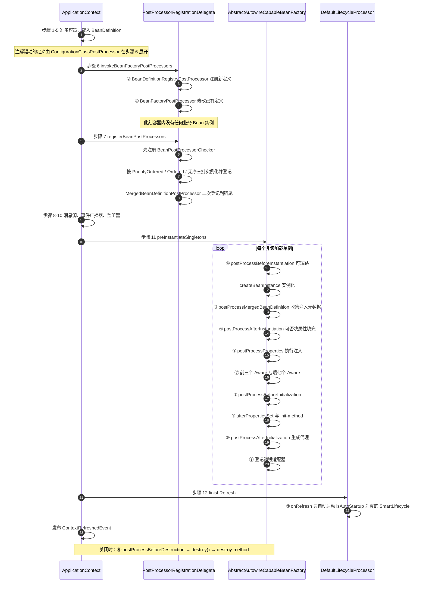
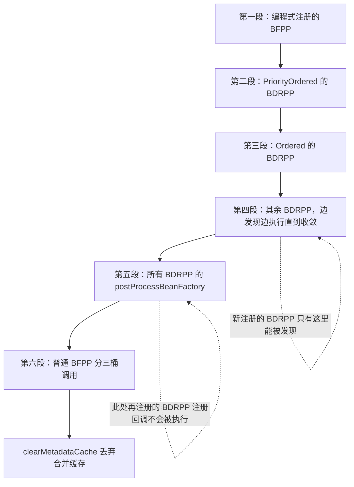
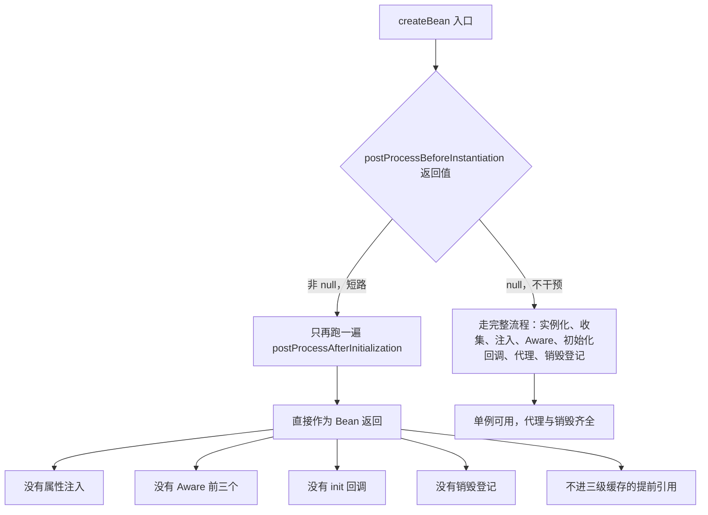
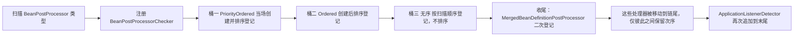
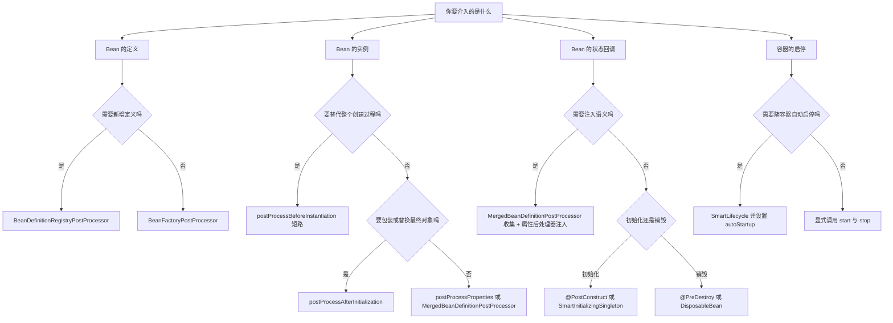

# Spring扩展点全景——BeanPostProcessor、BeanFactoryPostProcessor与Aware接口

**摘要：**

Spring 的扩展点常被写成一张接口清单：九个接口、二十几个方法，各自配一段示例。清单背得下来，遇到"我的 AOP 为什么没生效""启动日志里那条 not eligible 是什么意思"却排不上用场，因为答案不在"有哪些接口"，而在"这个接口在容器生命周期的哪一刻被调用，那一刻容器里有什么"。本篇按后一条线索重排这九个位置：先用一张时序图把 `refresh()` 的十二步与九个调用点对齐，逐个给出调用者、调用次数与可见对象；再把每个位置的能力写成"能改什么、不能改什么"的边界表，并交代这条边的机制来源——`BeanFactoryPostProcessor` 拿不到 Bean 实例，是因为 Bean 还没建；`BeanPostProcessor` 处理不了自己和自己的依赖，是因为它在注册阶段就被提前创建；`MergedBeanDefinitionPostProcessor` 必须卡在注入之前，是因为注入元数据要先被收集成缓存。三个把顺序搞错的高频事故、`@Order` 的生效面、`is not eligible` 这条警告的完整来历各列一章，最后落到需求到扩展点的判据表与一笔示例推算的账。

> [!info] 本篇的边界
> 本篇写机制视角：谁在什么时刻调用了什么、那一刻能看到什么。应用层怎么组织 Starter、怎么用条件注解，属 [[Java/SpringBoot/00 专栏导览|Spring Boot 专栏]]；代理模式、观察者模式、策略模式在 Spring 里的取舍，已在 [[Java/OOP设计模式/09 设计模式在Spring中的应用全景|设计模式在 Spring 中的应用全景]] 落过结论，本篇遇到只给一句判断加双链。

---

## 第 1 章 九个位置排在同一根时间轴上

### 1.1 清单为什么背不下来

关于 Spring 扩展点的文章，多数以"接口清单"开场：先列 `BeanPostProcessor`，再列 `BeanFactoryPostProcessor`，然后逐个数子接口。这种组织方式有一个隐蔽的缺陷——它把接口当成了主体，而接口本身几乎不携带信息。`BeanPostProcessor` 的两个方法签名是 `Object postProcessBeforeInitialization(Object bean, String beanName)` 与 `Object postProcessAfterInitialization(...)`，读过一遍就知道参数是什么，但读完之后依然回答不了"我的代理为什么没生成"。

真正决定一个扩展点能做什么的，是三件事：调用者是谁、调用发生在哪一刻、以及调用发生几次。调用者决定了它拿到的那只手能伸多长，`AbstractApplicationContext` 递给 `BeanFactoryPostProcessor` 的是一份可枚举、可修改的图纸库，而 `AbstractAutowireCapableBeanFactory` 递给 `BeanPostProcessor` 的是已经成型的对象；调用时刻决定了容器里已经有什么、还缺什么；调用次数则决定了这件事能不能写重、要不要缓存。

把 `refresh()` 想象成一条流水线，九个扩展点就是流水线上被凿开的九个工位。工位能干什么，由它卡在哪道工序决定，与站在这道工序上的工人叫什么名字无关。同一个动作——改一个 Bean 的属性值——在图纸工位上改的是 `BeanDefinition`，在成品工位上改的是对象字段，两者看起来都在"改属性"，后果却完全不同：前者影响之后所有从这个图纸造出来的实例，后者只影响手上这一个。

### 1.2 九个位置与它们的调用者

先把九个位置摆出来。表里的"次数"一栏值得留意，它区分了两类完全不同的扩展点：容器级的调用一次，Bean 级的每 Bean 调用一次。

| 编号 | 扩展点 | 调用点 | 调用者 | 次数 |
| :--- | :--- | :--- | :--- | :--- |
| 1 | `BeanFactoryPostProcessor` | 步骤 6 尾段 | `PostProcessorRegistrationDelegate` | 每实例 1 次 |
| 2 | `BeanDefinitionRegistryPostProcessor` | 步骤 6 前段 | `PostProcessorRegistrationDelegate` | 每实例 1 次 |
| 3 | `MergedBeanDefinitionPostProcessor` | `doCreateBean` 中，注入之前 | `AbstractAutowireCapableBeanFactory` | 每 Bean 1 次 |
| 4 | `InstantiationAwareBeanPostProcessor` | `createBean` 入口与 `populateBean` | `AbstractAutowireCapableBeanFactory` | 每 Bean 3 次 |
| 5 | `BeanPostProcessor` | `initializeBean` 前后 | `AbstractAutowireCapableBeanFactory` | 每 Bean 2 次 |
| 6 | `DestructionAwareBeanPostProcessor` | `DisposableBeanAdapter#destroy` | 销毁适配器 | 每登记单例 1 次 |
| 7 | `Aware` 接口族 | `invokeAwareMethods` 与 `ApplicationContextAwareProcessor` | 两个不同调用者 | 每 Bean 1 次/接口 |
| 8 | 生命周期回调 | `invokeInitMethods` 与销毁链 | `AbstractAutowireCapableBeanFactory` | 每 Bean 各 1 次 |
| 9 | `Lifecycle`/`SmartLifecycle` | `finishRefresh` 的 `onRefresh` | `DefaultLifecycleProcessor` | 每容器 1 次 |

这九个里有两个的身份容易搞混。`MergedBeanDefinitionPostProcessor` 名字里有 "BeanDefinition"，但它既不是容器级扩展点，也不在步骤 6 被调用——它在 Bean 实例化之后、属性注入之前被调用，操作的是**合并后**的 `RootBeanDefinition`，落点在 Bean 级。`DestructionAwareBeanPostProcessor` 同理，它的调用点不在 `refresh()` 里，而在容器关闭或手动销毁时，属于"生命周期尾段"。

### 1.3 主时序图

把九个位置压到一张图上，会看到它们并不是均匀分布的：步骤 6 与步骤 7 之间挤了两个容器级扩展点，步骤 11 的 `doCreateBean` 里挤了五个 Bean 级扩展点，尾声还有两个。



图上有两处容易被看漏的分岔。一处是 `postProcessBeforeInstantiation` 返回非 `null` 时整条流水线被截断，另一处是 `ApplicationContextAwareProcessor` 与 `invokeAwareMethods` 是两个不同的调用者——这不是实现上的随意，而是模块依赖方向逼出来的结果，第五章会展开。

### 1.4 一次与 N 次

容器级扩展点每个实例只调用一次，Bean 级扩展点每个 Bean 调用一次，这个差别决定了写法的纪律。容器级可以放心做全量遍历：`getBeanDefinitionNames()` 之后逐条读取属性、逐条替换占位符，几万个定义也只走一遍。Bean 级不行，它的调用次数是 Bean 数与处理器数的乘积，任何一次多余的反射、任何一次按字段遍历，都会被放大成启动时间上的可观数字。

由此推出一条派生规则：Bean 级的元数据必须**按类缓存**，不能按 Bean 缓存。同一个类被声明成五个 Bean，注解扫描的结果完全一样，`AutowiredAnnotationBeanPostProcessor` 因此把 `InjectionMetadata` 挂在 `Class` 维度而不是 `beanName` 维度上。这条规则也解释了 `MergedBeanDefinitionPostProcessor` 为什么存在——它存在的唯一理由，就是把"每个 Bean 都要做一遍的反射"压缩成"每个类做一遍，结果缓存复用"。

### 1.5 图外的三件东西

有三样东西经常被塞进扩展点清单，但它们并不在这张时序图的九个位置里，边界需要先划清。

`ApplicationListener` 是事件机制的消费端，注册发生在步骤 10，比任何业务 Bean 的创建都早，触发则取决于事件发布的时刻，与 Bean 生命周期没有固定的相对位置。它的排序与双链在 [[08 Spring事件机制与观察者模式]] 里已经写过，本篇只在"能排序的扩展点"一节引用结论。

`FactoryBean` 是"用工厂造 Bean"的容器级约定，它的 `getObject()` 在有人 `getBean("name")` 时才被调用，`getBean("&name")` 拿到的才是工厂本身。它经常与 `BeanPostProcessor` 一起出现（代理创建器本身就实现了 `SmartInstantiationAwareBeanPostProcessor`），但它的定位是"生产方式"，不是"介入时机"，模式视角见 [[Java/OOP设计模式/09 设计模式在Spring中的应用全景|设计模式视角]]。

`Ordered` 与 `@Order` 不是扩展点，是排队规则。它们作用于哪几个扩展点、在哪一步生效、为什么对另一些完全不生效，留到第八章单独处理，因为这里的误解比接口本身更多。

---

## 第 2 章 容器级：BeanDefinition 阶段的四个入口

### 2.1 此刻容器里有什么

要理解 `BeanFactoryPostProcessor` 的能力边界，先要数清楚它在被调用的那一刻，容器里到底有什么。答案是三样：完整的 `BeanDefinition` 注册表、一个可以配置的 `ConfigurableListableBeanFactory`、以及两个基础设施型 `BeanPostProcessor`——`prepareBeanFactory` 里手工 `addBeanPostProcessor` 进去的 `ApplicationContextAwareProcessor` 与 `ApplicationListenerDetector`。业务 Bean 一个都没有，`@Autowired` 的处理器、`@PostConstruct` 的处理器、AOP 的代理创建器全都还没有被实例化，因为它们属于步骤 7 的活儿。

这个现场像什么？像一栋楼还在审图阶段：图纸齐了，施工队没进场。审图的人可以改承重、改层高、加一堵墙，甚至可以要求增补一张图纸，但他没法验收任何一间已经建好的房间，因为房间还不存在。改图纸的收益是全局的——改一次，之后所有按这张图施工的房间都变了；代价也是全局的——改错了，整栋楼都跟着错。

### 2.2 BFPP 能改的三样东西

`BeanFactoryPostProcessor#postProcessBeanFactory` 拿到的是 `ConfigurableListableBeanFactory`，沿这个接口能摸到三类可写对象。

第一类是 `BeanDefinition` 本身。属性值、类名、作用域、`init-method` 与 `destroy-method`、懒加载标记、`dependsOn`、`primary`、自动装配模式，都可以在这里改。`PropertySourcesPlaceholderConfigurer` 做的就是这一类里最典型的一件事：把属性值里的 `${...}` 换成解析后的字符串。它必须在 Bean 实例化之前完成，否则属性值已经被注入进对象，再改定义就没有意义了。

第二类是工厂自身的配置。`setConversionService` 换掉类型转换器，`addEmbeddedValueResolver` 补一个占位符解析器，`registerResolvableDependency` 登记一个"按类型可直接解析、但不是 Bean"的对象——这三件事都只能在步骤 6 做，做晚了已经装配好的 Bean 不会回头重建。

第三类是注册表能力，但它不属于 `BeanFactoryPostProcessor`，而属于它的子接口，也就是下一节。

不能做的事同样清楚：不能拿 Bean 实例（`getBean` 会真的创建，但创建出来的对象缺处理器，见第六章），不能改已经实例化的对象（此刻没有），不能指望发出去的事件有人接（监听器还没创建）。这三条禁区的共同点，是把**图纸阶段的权限**误当成**成品阶段的权限**。

### 2.3 BDRPP：从改定义到注册定义

`BeanDefinitionRegistryPostProcessor` 之所以单列，是因为它多了一个 `BeanDefinitionRegistry` 参数，从而多了一种能力：把原本不存在的 `BeanDefinition` 塞进注册表。改与增是两种不同量级的权限，Spring 把它们分成两个接口，调用顺序也定死——先 `postProcessBeanDefinitionRegistry`，后 `postProcessBeanFactory`。

这个接口在框架内的分量极重。`ConfigurationClassPostProcessor` 就是它的实现，注解驱动体系里 `@Configuration`、`@ComponentScan`、`@Import`、`@Bean` 的全部展开动作，都发生在它的 `postProcessBeanDefinitionRegistry` 里。换句话说，一个 Spring Boot 应用启动时容器里绝大部分 `BeanDefinition`，都是这个"后处理器"在步骤 6 现场造出来的。这也解释了一个反直觉的事实：注解扫描不是容器的固有步骤，而是扩展点干出来的活儿。

两个方法的调用次序带来一条实用推论：在 `postProcessBeanDefinitionRegistry` 里注册的定义，同一阶段稍后调用的 `postProcessBeanFactory` 能看到；反过来，在 `postProcessBeanFactory` 里注册的定义，本轮的其他 `BeanFactoryPostProcessor` 是否能看到，取决于它们登记的先后——这个不确定性在第九章的边界表里会被记成一条明确的"不能依赖"。

```java
// 摘其结构，非完整源码：BDRPP 的注册能力与 BFPP 的修改能力分两段执行
public interface BeanDefinitionRegistryPostProcessor extends BeanFactoryPostProcessor {
    void postProcessBeanDefinitionRegistry(BeanDefinitionRegistry registry) throws BeansException;
}
```

### 2.4 invokeBeanFactoryPostProcessors 的六段结构

这个方法被 Spring 自己在注释里标注为"看起来可以合并，但千万不要合并"，原因就是顺序本身就是契约。按 6.x 的实现，它分成六段。

```java
// 摘其骨架，省略异常与启动指标
// 第一段：编程式注册的 BFPP（context.addBeanFactoryPostProcessor 进来的）
for (BeanFactoryPostProcessor pp : beanFactoryPostProcessors) {
    if (pp instanceof BeanDefinitionRegistryPostProcessor rpp) rpp.postProcessBeanDefinitionRegistry(registry);
    else regularPostProcessors.add(pp);
}
// 第二段：所有 PriorityOrdered 的 BDRPP
for (String name : beanFactory.getBeanNamesForType(BeanDefinitionRegistryPostProcessor.class, true, false)) {
    if (beanFactory.isTypeMatch(name, PriorityOrdered.class)) { /* getBean 后收集 */ }
}
sortPostProcessors(currentRegistryProcessors, beanFactory);
invokeBeanDefinitionRegistryPostProcessors(currentRegistryProcessors, registry, startup);
// 第三段：所有 Ordered 的 BDRPP；第四段：剩下的 BDRPP，边发现边执行，直到不再出现新的
// 第五段：所有 BDRPP 的 postProcessBeanFactory，再调用编程式注册的普通 BFPP
// 第六段：按 PriorityOrdered / Ordered / 无序三桶调用普通 BFPP，最后 clearMetadataCache()
```

这六段的执行次序可以画成一条单向流程，注意"重扫"只发生在第四段，而 `postProcessBeanFactory` 全部排在它之后。



六段结构里有三个设计意图值得点出。其一，`getBeanNamesForType(..., true, false)` 的第三个参数 `allowEagerInit=false`，意思是扫类型时不要为了判断类型而提前初始化 `FactoryBean`——这一层克制保护了"所有普通 Bean 都还没实例化"这个前提。其二，第四段用 `while (reiterate)` 反复重扫，是为了支持"后处理器注册后处理器"这种套娃场景，注册出来的 `BDRPP` 有机会在同一轮被调用。其三，只有 `BDRPP` 才有这个重扫待遇，普通 `BFPP` 没有——这是第七章事故三的机制根。

### 2.5 Ordered 在这一层的作用

排序接口在这一层承担的是"谁能看见谁"的职责，而不是美观。最典型的一对关系是 `ConfigurationClassPostProcessor` 与其他 `BeanFactoryPostProcessor`：前者要在 `PriorityOrdered` 桶里，才能保证它展开出来的注解定义，赶得上后续普通 `BFPP` 的遍历；而它在 `PriorityOrdered` 桶里的 order 值，6.x 的源码给的是 `Ordered.LOWEST_PRECEDENCE`，注释写着 "within PriorityOrdered"——意思是它在自己的桶里排最后，把位置让给别的 `BDRPP`，因为它注册出来的 Bean 里可能还有 `BDRPP`，那些需要先跑。

这里可以顺手纠正一个流传很广的说法：不少资料写 `ConfigurationClassPostProcessor` 返回 `Ordered.LOWEST_PRECEDENCE - 1`，并据此解释"为什么它在大多数 BFPP 之前"。按 6.2.x 的源码，`getOrder()` 返回的就是 `Ordered.LOWEST_PRECEDENCE`，没有减一。它排在普通 `BFPP` 之前，靠的是"在 `PriorityOrdered` 桶里"这一条，与具体的 order 数值无关——三个桶是依次调用的，桶与桶之间不存在数值比较。

真正需要靠数值排的，是同一桶内部的相对次序。判断依据只有一条：一个 `BFPP` 若要看到另一个 `BDRPP` 注册的定义，必须保证自己后执行，也就是要么落在同一个桶里 order 更大，要么干脆落在更靠后的桶里。

### 2.6 BFPP 改不了的三件事

第一件是"拿一个已经装配好的 Bean 来用"。这一条在下一章用整章篇幅拆，这里只留结论：步骤 6 里没有 `@Autowired` 的处理器，所以字段注入不会发生；`getBean` 能造出对象，但造出来的是没有注入、没有初始化回调、没有代理的"素坯"。

第二件是"改变已经发生的装配结果"。如果某个 Bean 因为 `dependsOn` 在步骤 6 之前就被创建（例如某个 `BFPP` 自己依赖了它），那么之后再改它的 `BeanDefinition`，对已经存在的实例无效——定义与实例在那一刻已经分叉。

第三件是"让早期事件立刻送达全部听众"。事件本身不会丢：广播器未就绪时，`publishEvent` 会把事件暂存进 `earlyApplicationEvents`，等步骤 10 的 `registerListeners` 末尾再统一投递。但那一刻能收到消息的只有实现了 `ApplicationListener` 的 Bean，用 `@EventListener` 声明的方法还没被注册进来，收不到。这条落差的成因在注解监听器的注册时机上，不在后处理器。

---

## 第 3 章 实例化阶段：InstantiationAwareBeanPostProcessor 的三个方法

### 3.1 三个方法的位置

`InstantiationAwareBeanPostProcessor` 是九个位置里唯一一个"一个接口占三个时点"的扩展点，三个方法各自守着一道不同的门：`postProcessBeforeInstantiation` 守在实例化之前，`postProcessAfterInstantiation` 守在属性填充之前，`postProcessProperties` 守在属性填充之中。三者的返回值语义完全不同——前两个返回对象或布尔，第三个返回 `PropertyValues` 或 `null`，而每一种"空值"都对应一条不同的短路路径。

| 方法 | 调用位置 | 返回值语义 | 框架内典型实现 |
| :--- | :--- | :--- | :--- |
| `postProcessBeforeInstantiation` | `createBean` 入口，`resolveBeforeInstantiation` | 非 `null` 直接作为 Bean 返回，跳过整个创建流程 | 自定义 `TargetSourceCreator` 的代理路径 |
| `postProcessAfterInstantiation` | `populateBean` 开头 | `false` 跳过整个属性填充 | 少见，多用于手工装配场景 |
| `postProcessProperties` | `populateBean` 中段 | 返回新的 `PropertyValues`；返回 `null` 跳过后续填充 | `@Autowired`、`@Resource`、`@Value` 注入 |

### 3.2 短路门：返回非 null 之后发生什么

`resolveBeforeInstantiation` 的代码很短，但它决定了整条流水线的分叉。

```java
// AbstractAutowireCapableBeanFactory#resolveBeforeInstantiation（摘其结构）
if (!mbd.isSynthetic() && hasInstantiationAwareBeanPostProcessors()) {
    Class<?> targetType = determineTargetType(beanName, mbd);
    if (targetType != null) {
        bean = applyBeanPostProcessorsBeforeInstantiation(targetType, beanName);
        if (bean != null) {
            // 注意这一行：短路之后仍会走一遍 after-initialization
            bean = applyBeanPostProcessorsAfterInitialization(bean, beanName);
        }
    }
}
```

两个细节最容易被误述。第一个是"短路之后仍然会执行 `postProcessAfterInitialization`"——很多资料写"直接返回，什么都没走"，按源码是错的：容器会拿这具半成品再过一遍所有 `BeanPostProcessor` 的 after 方法，所以一个短路产物仍然可能被再次包装（AOP 的二次判断正是靠这一点做保护）。第二个是"短路截断的到底是哪几段"：`createBeanInstance`、`applyMergedBeanDefinitionPostProcessors`、`addSingletonFactory` 的提前引用、`populateBean`（注入）、`invokeAwareMethods`、`initializeBean` 的 before 与 init 回调、以及 `registerDisposableBeanIfNecessary` 的销毁登记，全部跳过。也就是说，短路产物是一个"注入没有、Aware 没有、初始化回调没有、销毁也不归容器管"的对象。

这条短路的值不值，取决于被截断的那几段里有没有你真正需要的东西。把它画成分叉会看得更清楚。



AOP 为什么留着这道门却几乎不用？因为常规的 `@Aspect` 增强走的是 `postProcessAfterInitialization`，而短路门留给的是"连目标对象都不该被实例化"的极端场景——例如自定义 `TargetSource` 让每次调用都路由到池里的实例，或者代理的是远程对象。判断依据很直接：如果被代理对象需要参与注入与初始化，就不能走短路；如果它本来就是个由工厂产出的替代物，短路才是对的。

### 3.3 否决权：postProcessAfterInstantiation

这个方法的返回值是布尔，`false` 的含义是"属性填充到此为止"。注意"到此为止"的范围：`populateBean` 遇到 `false` 会直接 `return`，连后面的 `applyPropertyValues` 都不执行，因此对象上所有字段都停在默认值。它不是一个"跳过某个属性"的细粒度开关，而是一个整体的否决按钮。

6.x 还多了一条与它并列的跳过规则：如果被创建的类是 `record`，`populateBean` 直接返回，一个属性都不填；若 `BeanDefinition` 里还带了属性值，则直接抛 `BeanCreationException`。这条规则把"不可变对象不该被反射改写"从建议变成了硬约束，写 record 与 `@ConfigurationProperties` 组合时需要留意。

### 3.4 postProcessProperties 与它的 null

`postProcessProperties` 是九点里最忙的一个方法：`@Autowired`、`@Value`、`@Inject` 的字段与方法注入在 `AutowiredAnnotationBeanPostProcessor` 里，`@Resource` 的按名注入在 `CommonAnnotationBeanPostProcessor` 里，两者都落在这个方法上。它的返回值语义还有一层容易被忽略的细节：返回 `null` 不只是"我没改"，而是"属性填充结束"，循环直接 `return`，排在后面的 `InstantiationAwareBeanPostProcessor` 都轮不到，`applyPropertyValues` 也不执行。

链路是把 `pvs` 逐层传下去的：每个处理器拿到上一层的返回，改完再交给下一个，任何一个环节返回 `null`，链就断在那里。这个设计让"注入器"可以互相看见对方补进去的值，也让一个写错的处理器能够悄无声息地掐掉后面所有人的工作。排查"某个字段没被注入"时，先确认链上有没有人返回了 `null`，比逐个怀疑注解配置更有效。

### 3.5 MergedBeanDefinitionPostProcessor：为什么收集必须早于注入

`MergedBeanDefinitionPostProcessor#postProcessMergedBeanDefinition` 的调用点在 `doCreateBean` 里，位置很讲究：实例化之后、`populateBean` 之前、提前引用登记之前。

```java
// AbstractAutowireCapableBeanFactory#doCreateBean（摘其顺序，省略异常处理）
instanceWrapper = createBeanInstance(beanName, mbd, args);          // 1. 实例化
applyMergedBeanDefinitionPostProcessors(mbd, beanType, beanName);   // 2. 收集注入元数据
addSingletonFactory(beanName, () -> getEarlyBeanReference(...));    // 3. 提前暴露，支持循环依赖
populateBean(beanName, mbd, instanceWrapper);                       // 4. 注入
exposedObject = initializeBean(beanName, exposedObject, mbd);       // 5. 初始化回调与代理
registerDisposableBeanIfNecessary(beanName, bean, mbd);             // 6. 登记销毁
```

为什么收集必须卡在实例化之后？因为只有拿到实例、拿到实际类型，才能确定注哪些点。`@Bean` 方法的返回类型是声明类型，实际产物可能是子类；`FactoryBean` 的产物类型要到 `getObjectType` 才知道；父类字段、泛型桥接方法，也都要在实际类型上才能正确解析。收集得太早，拿到的是不完整的类型信息。

为什么收集必须卡在注入之前？因为注入时需要一张"注哪些字段、每个字段要什么类型、有没有 `@Qualifier`"的表，这张表如果每次注入都重新反射构建，成本会按 Bean 数放大。**收集一次、缓存复用**，是整个设计的核心取舍。

这条设计还解释了两个常见现象。其一，`@PostConstruct` 的方法元数据也是在 `postProcessMergedBeanDefinition` 里收集的（`CommonAnnotationBeanPostProcessor` 继承的 `InitDestroyAnnotationBeanPostProcessor` 干这件事），所以"注解方法没执行"的排查顺序应该是：这个 Bean 有没有走到收集这一步（比如被短路了），而不是注解写错了。其二，`mbd.postProcessed` 是一个一次性开关，同一个 `BeanDefinition` 只会收集一次，`prototype` 的第二次、第三次创建都直接复用缓存——缓存按类而不是按实例，正是这条开关逼出来的。

---

## 第 4 章 初始化与销毁：BPP 的两端与 DestructionAware

### 4.1 initializeBean 的四段

`initializeBean` 是 `BeanPostProcessor` 的主场，四段动作次序固定，中间没有插队的余地。

```java
// AbstractAutowireCapableBeanFactory#initializeBean（摘其结构）
invokeAwareMethods(beanName, bean);                                  // 前三个 Aware
if (mbd == null || !mbd.isSynthetic()) {
    wrappedBean = applyBeanPostProcessorsBeforeInitialization(wrappedBean, beanName);
}
invokeInitMethods(beanName, wrappedBean, mbd);                       // InitializingBean 与 init-method
if (mbd == null || !mbd.isSynthetic()) {
    wrappedBean = applyBeanPostProcessorsAfterInitialization(wrappedBean, beanName);
}
```

`synthetic` 标记在这一层的表现是：合成 Bean（容器内部生成、没有对应定义的那些）跳过两轮 `BeanPostProcessor`，避免基础设施对象被业务后处理器误伤。`invokeInitMethods` 内部还有一层去重：如果 `afterPropertiesSet` 同时被声明成 `init-method`，或者某个方法已经被外部生命周期注解接管，就不会被执行两次。

### 4.2 before-init 能改的是什么

`postProcessBeforeInitialization` 的返回值会成为后续调用链上的当前对象，因此它既能改状态（反射写字段），也能换对象（返回一个包装实例）。但它的能力有一条硬边界：**注入已经完成**，它在注入之后。任何"想借此参与依赖解析"的想法都不成立——依赖解析在 `populateBean` 里就结束了。

这一轮里还夹着 `@PostConstruct`。`CommonAnnotationBeanPostProcessor` 的 `postProcessBeforeInitialization` 会调用收集到的初始化方法，因此 `@PostConstruct` 的实际执行时点是"某个 `BeanPostProcessor` 的 before 方法内部"，而不是"容器在初始化阶段统一调度"。这个位置带来一个实用结论：`@PostConstruct` 里能不能拿到 `ApplicationContext`？能。因为注入 `ApplicationContext` 的 `ApplicationContextAwareProcessor` 在 `prepareBeanFactory` 里就被登记进链头，执行次序上早于链尾的 `CommonAnnotationBeanPostProcessor`。`@PostConstruct` 里"有的拿得到、有的拿不到"的分裂感，根子就在这条链的排序上，回调点的完整时序与"哪一步能看到什么"的对照见 [[04 Bean的生命周期——从定义到销毁的完整流程]]。

### 4.3 after-init 是代理生成点

`postProcessAfterInitialization` 是九个位置里唯一能"合法替换最终单例"的地方，AOP 的代理在这里生成：`AbstractAutoProxyCreator` 检查该 Bean 有没有匹配的 `Advisor`，有则创建 JDK 动态代理或 CGLIB 代理，返回代理对象，容器把这个返回值当作最终单例放进单例池。此后再有人 `getBean`，拿到的是代理，不是原始对象。

这条替换有两个前提需要记住。第一个前提是返回值必须与原始类型兼容，否则按类型注入的地方会在运行期拿到 `ClassCastException` 或 `BeanNotOfRequiredTypeException`。第二个前提是它与循环依赖的配合：提前引用走的是三级缓存里的 `getEarlyBeanReference`，那条路径上生成的代理与这里生成的必须是同一个对象，否则会出现"注入的是裸对象、最终单例是代理"的分裂——这套机制的源码级细节在 [[02 IoC容器——BeanFactory与ApplicationContext的层次设计]] 与 [[05 依赖注入的三种方式与循环依赖的三级缓存解决方案]] 里已经拆过。

代理方式的选择（JDK 动态代理与 CGLIB 的判据）与切点匹配的细节，机制侧见 [[06 AOP实现原理——JDK动态代理与CGLIB]]。

### 4.4 销毁链的真实次序

销毁侧的次序比初始化侧更容易记错。真实次序是：`DestructionAwareBeanPostProcessor#postProcessBeforeDestruction` → `DisposableBean#destroy` → `AutoCloseable#close`（或自定义 `destroy-method`）。

```java
// DisposableBeanAdapter#destroy（摘其结构）
for (DestructionAwareBeanPostProcessor processor : this.beanPostProcessors) {
    processor.postProcessBeforeDestruction(this.bean, this.beanName);   // ① 先跑，@PreDestroy 在这一步
}
if (this.invokeDisposableBean) { ((DisposableBean) this.bean).destroy(); }  // ② 异常只记 warn
if (this.invokeAutoCloseable) { ((AutoCloseable) this.bean).close(); }
else if (this.destroyMethods != null) { /* 自定义 destroy-method */ }
```

这张次序表最反直觉的一处是 `@PreDestroy` 早于 `destroy()`。很多人把 `DisposableBean` 当成"最外层的销毁回调"，实际上它是中间层，`@PreDestroy` 在外层先跑。原因在于 `@PreDestroy` 的调用者是 `DestructionAwareBeanPostProcessor`，而销毁适配器把"先给后处理器机会"写在了第一行。由此推出一条纪律：如果 `@PreDestroy` 里释放了 `destroy()` 还要用的资源，就会得到一串 `IllegalStateException`；两个回调的职责要划分清楚，注解管"业务资源"，接口管"对象内部状态"。

另一个细节是异常处理的不对称：销毁回调抛出的异常被吞掉，只打一条 warn 日志，接着执行下一个 Bean 的销毁。初始化回调抛出异常会中断整个启动，销毁回调抛出异常只留下日志——这个不对称是刻意的，容器关闭过程中不能因为一个 Bean 的收尾失败而卡住其余 Bean。

### 4.5 prototype 的销毁为什么要手工

`registerDisposableBeanIfNecessary` 的第一行判断就是答案：

```java
// AbstractBeanFactory#registerDisposableBeanIfNecessary
if (!mbd.isPrototype() && requiresDestruction(bean, mbd)) {
    if (mbd.isSingleton()) { registerDisposableBean(beanName, new DisposableBeanAdapter(...)); }
    else { /* 自定义作用域：登记到 Scope 的销毁回调 */ }
}
```

`prototype` 在第一行就被排除，容器从不替它登记销毁适配器，因此 `@PreDestroy`、`destroy()`、`destroy-method` 一律不会自动执行。理由不难推：容器不持有 `prototype` 的引用，也就无从知道它什么时候该被销毁，登记了反而会留下一张永不释放的表。责任转移给调用方，是这一取舍的必然结果。

手工销毁有一条现成的路：`AbstractAutowireCapableBeanFactory#destroyBean(Object)`。它的实现是一行 `new DisposableBeanAdapter(existingBean, getBeanPostProcessorCache().destructionAware).destroy()`，注意这个重载**没有** `BeanDefinition` 参数——因此它能跑 `@PreDestroy` 与 `DisposableBean#destroy()`，但推断不出 `destroy-method`，也推断不出 `close()`。想让自定义销毁方法在 `prototype` 上生效，只能自己调，或者改成登记到自定义作用域里由作用域负责。

---

## 第 5 章 Aware：两批注入与那条分界线

### 5.1 前三个

`invokeAwareMethods` 是 `AbstractAutowireCapableBeanFactory` 的私有方法，只处理三个接口，次序写死在 `if` 链里。

```java
// AbstractAutowireCapableBeanFactory#invokeAwareMethods（摘其结构）
if (bean instanceof Aware) {
    if (bean instanceof BeanNameAware bna) bna.setBeanName(beanName);
    if (bean instanceof BeanClassLoaderAware bcla) {
        ClassLoader bcl = getBeanClassLoader();
        if (bcl != null) bcla.setBeanClassLoader(bcl);
    }
    if (bean instanceof BeanFactoryAware bfa) bfa.setBeanFactory(AbstractAutowireCapableBeanFactory.this);
}
```

三个接口的共同点是它们只需要 `BeanFactory` 级别的信息：名字、类加载器、工厂本身。它们位于 `spring-beans` 模块，不依赖 `spring-context`，所以可以放在 `initializeBean` 的第一段，由 Bean 工厂自己直接调用，不需要任何 `BeanPostProcessor` 参与。这也解释了为什么 `BeanFactoryAware#setBeanFactory` 早于所有 `BeanPostProcessor` 的 before 方法——调用者就是工厂本身。

### 5.2 后七个

其余需要 `ApplicationContext` 的 `Aware` 接口，由 `ApplicationContextAwareProcessor` 统一处理，它是 `prepareBeanFactory` 里直接 `addBeanPostProcessor` 进去的实例（不是一个 Bean）。它的 `invokeAwareInterfaces` 也是一条 `if` 链，次序固定。

```java
// ApplicationContextAwareProcessor#invokeAwareInterfaces（摘其顺序）
if (bean instanceof EnvironmentAware ea)                 ea.setEnvironment(ctx.getEnvironment());
if (bean instanceof EmbeddedValueResolverAware erva)     erva.setEmbeddedValueResolver(this.embeddedValueResolver);
if (bean instanceof ResourceLoaderAware rla)             rla.setResourceLoader(ctx);
if (bean instanceof ApplicationEventPublisherAware aepa) aepa.setApplicationEventPublisher(ctx);
if (bean instanceof MessageSourceAware msa)              msa.setMessageSource(ctx);
if (bean instanceof ApplicationStartupAware asa)         asa.setApplicationStartup(ctx.getApplicationStartup());
if (bean instanceof ApplicationContextAware aca)         aca.setApplicationContext(ctx);
```

这条链的实际条目是七个，不是六个。`ApplicationStartupAware` 从 Spring 5.3 起就在里面，用于把启动步骤指标交给 Bean；`spring-web` 还有另一个处理器负责 `ServletContextAware` 与 `ServletConfigAware`，那是第三批。所以"九个 `Aware`"这个说法要限定范围：它指的是主线上的九个——三个在 `invokeAwareMethods`，六个在 `ApplicationContextAwareProcessor`；把 `ApplicationStartupAware` 算进去是十个，把 Web 层那两个算进去是十二个。本篇沿用九个的口径，但把它当作"主线的九个"，而不是"Spring 全部定义了九个"。

| 批次 | 接口 | 注入内容 | 调用者 |
| :--- | :--- | :--- | :--- |
| 第一批 | `BeanNameAware` | 当前 `beanName` | `invokeAwareMethods` |
| 第一批 | `BeanClassLoaderAware` | 加载该类的 `ClassLoader` | `invokeAwareMethods` |
| 第一批 | `BeanFactoryAware` | 当前 `BeanFactory` | `invokeAwareMethods` |
| 第二批 | `EnvironmentAware` | `Environment` | `ApplicationContextAwareProcessor` |
| 第二批 | `EmbeddedValueResolverAware` | `StringValueResolver` | `ApplicationContextAwareProcessor` |
| 第二批 | `ResourceLoaderAware` | `ResourceLoader` | `ApplicationContextAwareProcessor` |
| 第二批 | `ApplicationEventPublisherAware` | `ApplicationEventPublisher` | `ApplicationContextAwareProcessor` |
| 第二批 | `MessageSourceAware` | `MessageSource` | `ApplicationContextAwareProcessor` |
| 第二批 | `ApplicationContextAware` | `ApplicationContext` | `ApplicationContextAwareProcessor` |

### 5.3 分界线为什么不能合并

分界线之所以存在，不是历史包袱，而是模块依赖方向决定的：`spring-beans` 不能依赖 `spring-context`。`BeanFactory`、`ClassLoader`、`beanName` 这三个概念在 `spring-beans` 里就存在，工厂可以直接调用；`Environment`、`MessageSource`、`ApplicationEventPublisher` 这些概念属于 `spring-context`，Bean 工厂不认识它们，只能由一个注册在上下文层的 `BeanPostProcessor` 代为注入。这条依赖方向的判据在 [[01 Spring全局架构——模块划分与核心设计理念]] 里作为模块切分的第一条依据出现过，`Aware` 的两批注入是它最直接的产物。

代价是时序不统一：同一批 Bean 里，实现了 `BeanFactoryAware` 的能更早拿到引用，实现了 `ApplicationContextAware` 的要等到 `postProcessBeforeInitialization`。这个不一致没法消除，除非让 `spring-beans` 反向依赖 `spring-context`，而那样一来容器就无法在脱离上下文的环境里独立使用——这正是 `BeanFactory` 作为最小容器仍然被保留下来的原因。

### 5.4 Aware 的三个使用判据

第一条：能用 `@Autowired` 就不用 `Aware`。`@Autowired ApplicationEventPublisher`、`@Autowired Environment` 都能注入，语义更直白，测试也更容易替换。`Aware` 的优势只在一种情形下成立——这个 Bean 本身处在依赖注入还不可用的阶段，比如它自己就是一个 `BeanPostProcessor`，或者它的创建早于注入器的注册。

第二条：只有三个接口值得优先考虑。`BeanNameAware` 拿到的名字是容器赋予的身份，日志与监控里需要区分同名类实例时它最直接；`BeanFactoryAware` 提供的是延迟查找能力，即"先用名字记下来，真正要用时再 `getBean`"，这在打破启动期循环依赖时是正当手段；`EmbeddedValueResolverAware` 给的是占位符解析器，适合需要在运行期拼接属性键的场景。

第三条：`ApplicationContextAware` 要当作最后手段。把它当作服务定位器使用，等于用 `getBean` 绕开声明式注入，依赖关系从代码里消失，测试与重构的成本随之上升。这条判断在 [[Java/OOP设计模式/09 设计模式在Spring中的应用全景|设计模式视角]] 里已经从模式角度谈过，机制侧的补充只有一句：`ApplicationContextAware` 注入发生在 `postProcessBeforeInitialization`，此时容器尚未完成全部单例的创建，在 `setApplicationContext` 里立刻 `getBean` 一个还没轮到的 Bean，会把这个 Bean 的创建提前，从而带来第六章那条警告。

---

## 第 6 章 那条警告：is not eligible for getting processed by all BeanPostProcessors

### 6.1 谁打出的

这条警告是启动日志里最容易被忽略、也最容易被误读的一条。它的原文大致是：

```text
Bean 'xxx' of type [com.example.Foo] is not eligible for getting processed by all BeanPostProcessors
(for example: not eligible for auto-proxying). Is this bean getting eagerly injected/applied to a
currently created BeanPostProcessor [yyy]? Check the corresponding BeanPostProcessor declaration and
its dependencies/advisors. If this bean does not have to be post-processed, declare it with
ROLE_INFRASTRUCTURE.
```

打出它的是 `PostProcessorRegistrationDelegate` 内部的一个私有类 `BeanPostProcessorChecker`，这个类本身就是一个 `BeanPostProcessor`，在 `registerBeanPostProcessors` 的第一行被注册进去。

```java
// PostProcessorRegistrationDelegate#registerBeanPostProcessors（摘其开头）
int beanProcessorTargetCount = beanFactory.getBeanPostProcessorCount() + 1 + postProcessorNames.length;
beanFactory.addBeanPostProcessor(new BeanPostProcessorChecker(beanFactory, postProcessorNames, beanProcessorTargetCount));
```

`BeanPostProcessorChecker` 的 `postProcessAfterInitialization` 里有一个判断：当前已登记的后处理器数量小于 `beanProcessorTargetCount`，并且被处理的 Bean 不是 `BeanPostProcessor` 本身、也不是基础设施 Bean，就打这条警告。

### 6.2 targetCount 的算术

`beanProcessorTargetCount` 的算式值得拆开看：`当前数量 + 1 + 待注册数量`。`+1` 是检查器自己，`+待注册数量` 是这一轮要登记的全部后处理器。等步骤 7 执行完，已登记数量恰好等于目标值，判断不再成立。换句话说，这条警告的观测窗口只有"注册后处理器的那一段时间"，凡是这段时间内被创建的非后处理器 Bean，都会被打上标记。

由此得出一个更重要的推论，也是理解这条警告的关键：它报告的不是"这个 Bean 有问题"，而是"这个 Bean **出生得太早**"。它的出生时间落在后处理器还没登记齐的窗口里，因此只享受了当时已经就位的那几个处理器，剩下的那些与它无缘。警告文案里那句 "Is this bean getting eagerly injected/applied to a currently created BeanPostProcessor" 就是在提示这个因果——某个后处理器在创建过程中急切地要了一个依赖，容器只好提前把这个依赖造出来。

### 6.3 后果

第一条后果是代理可能不生效。AOP 的代理创建器（`AnnotationAwareAspectJAutoProxyCreator`）本身是一个 `BeanPostProcessor`，如果某个 Bean 在它登记之前就被创建，这个 Bean 就没有机会被 `postProcessAfterInitialization` 包装，`@Transactional`、`@Async`、`@Cacheable` 全部落空。更麻烦的是这种失效是**静默**的：业务代码照常运行，事务照常"没有"，直到某次数据不一致才被发现。事务拦截器如何被织进这条代理链，见 [[07 Spring事务管理——声明式事务的传播行为与失效场景]]。

第二条后果是 `@PostConstruct` 可能没有执行。`@PostConstruct` 的调用者是 `CommonAnnotationBeanPostProcessor`，它也是步骤 7 才登记的。在此之前创建的 Bean，其初始化方法根本没有调用者，字段可能还是 `null`。这与第一条后果经常同时出现，因为两者都源于"出生太早"这同一个原因。

第三条后果是状态不一致：同一个类可能有一部分实例被代理、一部分没有，取决于它们各自的创建时刻。这种分裂在排查时最难定位，因为代码、注解、配置全都正确，只有启动顺序不同。

### 6.4 被提前创建的 Bean 各缺什么

按出生时间分成三段，缺的东西并不相同。这张表是排查这类问题的第一张对照表。

| 出生阶段 | 现场 | 已登记的后处理器 | 缺什么 | 有无警告 |
| :--- | :--- | :--- | :--- | :--- |
| 步骤 6（`BFPP` 阶段） | `BFPP` 的字段或 `getBean` 触发 | 仅 `ApplicationContextAwareProcessor`、`ApplicationListenerDetector` | 注入、`@PostConstruct`、代理、销毁推断 | 无 |
| 步骤 7（`BPP` 注册中） | 某个 `BPP` 的依赖被创建 | 部分已登记 | 视已登记的部分而定 | 有 |
| 步骤 11 及以后 | 正常创建 | 全部 | 无 | 无 |

第一段最危险的地方在于**没有警告**。`BeanPostProcessorChecker` 是在步骤 7 开头才注册的，步骤 6 里创建出来的 Bean 从它眼前过不去，所以什么都没打。一个在 `BFPP` 里被 `getBean` 出来的 Bean，字段全是 `null`、`@PostConstruct` 没执行、日志一片安静——这也是把这类问题归到"最难排查"一类的原因。

### 6.5 构造器注入为什么不是解药

不少资料给出的药方是"把 `BeanPostProcessor` 的字段注入改成构造器注入"。这个建议一半对一半错：它解决了"字段注入发生在注入器尚未登记时"这一层，但没有解决"依赖被提前创建"这一层。构造器注入的解析发生在 `getBean(bppName)` 内部，容器必须先把这个构造器参数对应的 Bean 造出来，才能调用构造器——于是那个依赖照样在步骤 7 的窗口里出生，照样只享受部分后处理器。Spring 官方文档对这一点的表述很直白：`BeanPostProcessor` 及其直接引用的 Bean 都不参与自动代理。

正确的判断顺序是：先问"这个依赖是不是必须在后处理器创建时就要有"，如果必须，那么它注定无法被完整后处理，应该把它降级成基础设施（`ROLE_INFRASTRUCTURE`，让检查器闭嘴）或者干脆不让它依赖后处理器提供的任何能力；如果不必须，就改成延迟获取。

### 6.6 可用的四种规避

第一种是延迟查找。注入 `ObjectProvider<T>`、`Provider<T>` 或者 `@Lazy` 代理，把"什么时候真的取"推迟到第一次使用，后处理器创建时只持有一个空壳，依赖不会提前出生。

第二种是拿到工厂后延迟 `getBean`。实现 `BeanFactoryAware`，在 `setBeanFactory` 里只保存引用，等到真正需要时再 `getBean`——此时步骤 7 已经结束，后处理器齐了，取到的对象是完整的。

第三种是把依赖搬到更晚的时点。`SmartInitializingSingleton#afterSingletonsInstantiated` 在所有非懒加载单例创建完之后执行，是"启动后做事"的合适位置，比在后处理器里塞业务逻辑干净得多。

第四种是标注角色。给这个 Bean 的定义设 `ROLE_INFRASTRUCTURE`，检查器会把基础设施 Bean 排除在警告之外。这只是让日志安静，不改变任何机制，用之前要确认这个 Bean 确实不需要被后处理——否则等于把问题藏起来。

---
## 第 7 章 三个把顺序搞错的事故

### 7.1 事故一：后处理器里注入业务 Bean

现场通常长这样：写一个审计用的后处理器，顺手把数据源注进来，准备在 `postProcessAfterInitialization` 里记一笔。

```java
@Component
public class AuditBeanPostProcessor implements BeanPostProcessor {
    @Autowired
    private DataSource dataSource;   // 依赖在这里被提前创建

    @Override
    public Object postProcessAfterInitialization(Object bean, String beanName) {
        // 用 dataSource 记审计
        return bean;
    }
}
```

这个后处理器的命运取决于它落在哪个桶。若它是无序的（第三批被创建），此时 `AutowiredAnnotationBeanPostProcessor` 已经登记在链上，字段能注进去，但 `DataSource` 是在步骤 7 的窗口里被创建的——它只享受了当时已登记的那部分后处理器，事务同步、连接池监控、AOP 代理一概没有，日志里还会留下一条 `not eligible`。若它声明成 `PriorityOrdered`，情况反过来：这一桶的处理器先在循环里逐个 `getBean`、全部创建完才统一登记，所以它创建时注入器还没进链，字段直接是 `null`，直到第一次 `postProcessAfterInitialization` 时抛出空指针。

两种结局的共同点是**不稳定**——同一份代码，换一个排序声明，故障形态就变了。这条不确定性的来源是后处理器的创建时机早于大部分后处理器的登记完成，属于机制层面的固有约束，不是配置问题。

判据可以压成一句：启动日志里出现 `not eligible`，就去读警告里点名的那个后处理器，看它声明了哪些依赖。那些依赖只要不是基础设施，就应该改成延迟查找。

### 7.2 事故二：BeanFactoryPostProcessor 里 @Autowired

同一个依赖注入动作，写在不同位置，结局分成三种。

第一种是字段注入。`@Autowired private KmsService kmsService;` 写在 `BFPP` 上，字段永远是 `null`——因为 `postProcessBeanFactory` 执行时，负责字段注入的 `AutowiredAnnotationBeanPostProcessor` 还没有被创建，注入这件事根本没有人做。这里的坑在于"没有报错"：Spring 不会因为你注了个没人处理的字段而失败，它只是安静地跳过。

第二种是构造器注入。单构造器加参数的写法，在业务 Bean 上能靠"只有一个构造器"隐式生效，但那是 `AutowiredAnnotationBeanPostProcessor#determineCandidateConstructors` 提供的便利；注入器不在链上时，容器退回到无参构造器的路径，找不到就抛 `BeanInstantiationException`，消息里带 "No default constructor found"。这个失败倒是响亮的，代价是整个应用起不来。

第三种是在方法体里 `getBean`。`beanFactory.getBean(KmsService.class)` 能拿到一个对象，但这个对象是第六章表里第一段的产物：字段没注入、`@PostConstruct` 没执行、代理没生成，而日志里一条警告都没有。用它去解密一个配置值，往往在第一次调用时就崩在某个 `null` 上，排查方向还会被"我明明拿到了对象"误导。

可以顺手纠正原稿里的一句错话：早期版本的这篇写成"Spring 会为了满足 `BFPP` 的依赖，提前实例化 `KmsService`"。按字段注入的机制，`KmsService` 根本不会被创建，字段就是 `null`；会被提前创建的是"你在方法体里主动 `getBean`"的那一种。这两种情形的排查路径完全不同，混为一谈会把人带到错的方向。

### 7.3 事故三：BDRPP 的"太晚"与一个流传说法的纠正

关于 `BeanDefinitionRegistryPostProcessor`，流传最广的一句是"注册得太晚，注册出来的 Bean 就不会被 `BeanPostProcessor` 处理"。这句话在机制上不成立：`BeanPostProcessor` 的生效点是**创建时**，与定义何时注册无关。哪怕一个定义是在 `refresh()` 结束之后才塞进注册表，只要它第一次被 `getBean` 时后处理器已经齐了，它就享受全套处理。

真正成立的是两个更窄的情形。

第一个情形是"`BDRPP` 自己的注册回调被漏掉"。如果某个 `BDRPP` 是在另一个 `BFPP` 的 `postProcessBeanFactory` 里注册进去的，那么它的 `postProcessBeanDefinitionRegistry` 永远不会被调用——因为 `invokeBeanFactoryPostProcessors` 里那个 `while (reiterate)` 的重扫循环，在调用 `postProcessBeanFactory` 之前就已经结束了。更阴险的是它并不会彻底失效：这个类同时是 `BeanFactoryPostProcessor`，只要它赶在后面的 `BFPP` 类型扫描之前完成注册，它的 `postProcessBeanFactory` 还是会被调用。于是出现**一半执行**的状态——注册逻辑没跑，修改逻辑跑了，依赖它注册的定义的代码全部落空。

第二个情形是"注册出来的 Bean 被立刻使用"。在 `BDRPP` 或 `BFPP` 里注册完定义，紧接着 `getBean` 一下"验证是否注册成功"，这个动作会把 Bean 的创建提前到步骤 6，于是它落进第六章表里的第一段，缺注入、缺回调、缺代理，且没有警告。这才是"跳过后处理器"的真实路径，与注册的早晚无关，与有没有在错误的时刻取用有关。

判据只有一条：在 `BFPP` 与 `BDRPP` 里，**只碰定义，不碰实例**。要验证注册结果，用 `containsBeanDefinition`、`getBeanDefinitionNames` 这类只看注册表的方法，不要用 `getBean`。

---

## 第 8 章 @Order 的生效面

### 8.1 三套排序契约

Spring 里的排序由三套东西提供，它们不是同一层的东西。

`PriorityOrdered` 继承自 `Ordered`，语义是"我要排在所有普通 `Ordered` 之前"，是一个分桶标记而不是数值比较；`Ordered#getOrder` 返回整数，越小越靠前；`@Order` 与 `@Priority` 是注解形态，需要比较器把它翻译成数值，翻译工作是 `AnnotationAwareOrderComparator` 干的。

三者在同一个扩展点上的优先级是分桶优先：实现了 `PriorityOrdered` 的排在最前，其次是实现了 `Ordered` 的，最后是其余；只有在同一个桶内部，才轮到 `getOrder()` 与 `@Order` 的数值比较。这个**先分桶、后比较**的顺序，是理解生效面的前提——一个只标了 `@Order(1)` 的 `BeanPostProcessor`，永远排在一个实现了 `Ordered` 且返回 `Integer.MAX_VALUE` 的处理器后面。

### 8.2 生效面

| 扩展点 | 是否支持排序 | 依据 | 生效阶段 |
| :--- | :--- | :--- | :--- |
| `BeanFactoryPostProcessor` | 支持 | `PriorityOrdered`/`Ordered`/`@Order` | 步骤 6 调用前排序 |
| `BeanDefinitionRegistryPostProcessor` | 支持 | 同上 | 步骤 6 前段，分三桶 |
| `BeanPostProcessor` | 支持 | 同上 | 步骤 7 注册时排序 |
| `ApplicationListener` | 支持 | `AnnotationAwareOrderComparator` | 广播时对监听器列表排序 |
| `@EventListener` 方法 | 支持 | 注解顺序 | 监听器注册时排序 |
| `SmartLifecycle` | 不支持 `Ordered` | 用 `getPhase()` | 启停时按 phase 分组 |
| `Aware` 接口族 | 不支持 | 若链顺序固定 | 无排序入口 |
| 生命周期回调 | 不支持 | 次序由流水线固定 | 无排序入口 |

三行"支持"里有两个坑。`ApplicationListener` 的排序发生在广播时，`AbstractApplicationEventMulticaster` 在 `retrieveApplicationListeners` 的末尾调用 `AnnotationAwareOrderComparator.sort`，因此监听器声明顺序不影响执行顺序，`@Order` 才作数。`SmartLifecycle` 完全不吃 `Ordered`——它有自己的 `getPhase()`，值小的先启动，关闭时反过来，值大的先停；把 `@Order` 加在 `SmartLifecycle` 上不会有任何效果，这是实践中最常踩的一个空。

### 8.3 BPP 的排序在注册阶段定型

`BeanPostProcessor` 的排序有一个别处没有的特点：它在**登记**时就定死了，之后链上新增的处理器一律追加到末尾，不参与重新排序。

```java
// PostProcessorRegistrationDelegate#registerBeanPostProcessors（摘其结构）
// 1) 分三桶收集：PriorityOrdered 当场 getBean，Ordered 与无序只留名字
// 2) PriorityOrdered：排序后登记
// 3) Ordered：getBean 后排序、登记
// 4) 无序：按名字扫描顺序登记，不排序
// 5) 收尾：把 MergedBeanDefinitionPostProcessor 再登记一次，移动到链尾
beanFactory.addBeanPostProcessor(new ApplicationListenerDetector(applicationContext));
```

这条登记流程的分桶与挪尾，可以按下面的顺序读一遍。



第四步的"无序桶不排序"值得留意：既没有 `PriorityOrdered` 也没有 `Ordered` 的后处理器，登记顺序取决于 `getBeanNamesForType` 的扫描顺序，也就是定义注册的顺序，而不是代码里的书写顺序。

第五步的"再登记"是一个容易被忽略的细节。`addBeanPostProcessor` 的实现是先 `remove` 再 `add`，因此把实现了 `MergedBeanDefinitionPostProcessor` 的处理器重新登记一次，等于把它们**整体挪到链尾**。`AutowiredAnnotationBeanPostProcessor` 与 `CommonAnnotationBeanPostProcessor` 都是这条规则的当事人——它们在自己的桶里排过序，最终却被挪到链的末尾，只在彼此之间保留相对次序。所以"后处理器链上的绝对位置"这件事，不能靠直觉推，要靠这条规则推。

### 8.4 不受排序约束的三处

`Aware` 的注入次序由两条 `if` 链写死：`invokeAwareMethods` 里是名字、类加载器、工厂，`invokeAwareInterfaces` 里是环境、值解析器、资源加载器、事件发布器、消息源、启动指标、上下文。这个次序不能改，也没有提供扩展点去改——想调整只能换掉 `ApplicationContextAwareProcessor`，而它是包级私有的。

初始化回调的次序同样固定：`invokeAwareMethods` → `BeanPostProcessor` 的 before → `@PostConstruct`（在 `CommonAnnotationBeanPostProcessor` 的 before 里）→ `afterPropertiesSet` → `init-method` → `BeanPostProcessor` 的 after。`@PostConstruct` 一定早于 `afterPropertiesSet`，因为前者是后处理器的一环，后者是流水线自己的环节。

`prototype` 的销毁没有任何排序可言，因为它根本不进销毁名单，第五章与第四章都谈过。

还要补一条前提：`@Order` 在 `BFPP`、`BPP` 上生效，依赖容器的 `dependencyComparator` 被设成 `AnnotationAwareOrderComparator`。注解驱动的上下文里这件事由 `AnnotationConfigUtils` 自动完成，所以通常不需要操心；但如果手工 `new DefaultListableBeanFactory()` 再逐条注册处理器，默认比较器是 `OrderComparator`，它只认 `Ordered` 接口，`@Order` 会被静默忽略。

---

## 第 9 章 能力边界表

这一章是全文的收束点：把九个位置各自"能改什么、不能改什么"写成表，再解释这些边为什么长成这样。表格按层分三张，每张的最后一列是"越界的典型症状"，用来做反向排查。

### 9.1 容器级

| 扩展点 | 能改什么 | 不能改什么 | 越界症状 |
| :--- | :--- | :--- | :--- |
| `BeanFactoryPostProcessor` | `BeanDefinition` 的属性值、类名、作用域、回调方法、懒加载、`dependsOn`；工厂的 `ConversionService`、值解析器、可解析依赖 | 拿不到已装配的 Bean 实例；改不了已创建实例的状态；发事件时收件人不全 | 字段 `null`、提前 `getBean` 得到"素坯"、事件少一半听众 |
| `BeanDefinitionRegistryPostProcessor` | 在 `BFPP` 之上，还能注册、移除、替换 `BeanDefinition`，包括以编程方式造出的定义 | 同上；且它的注册回调只在本轮重扫窗口内有效 | 注册的定义存在但依赖它的逻辑没跑；`BDRPP` 的注册回调整段没执行 |
| `Ordered`/`@Order` | 决定同桶内的相对次序 | 改不了桶与桶的次序；对 `Aware`、生命周期回调、`SmartLifecycle` 无效 | 加了 `@Order` 却毫无反应 |

### 9.2 Bean 级

| 扩展点 | 能改什么 | 不能改什么 | 越界症状 |
| :--- | :--- | :--- | :--- |
| `MergedBeanDefinitionPostProcessor` | 合并后的 `RootBeanDefinition`；把注入点元数据收集成缓存 | 改不了 Bean 的注入结果；不能替代注入本身 | 注解方法没执行、注入点解析不到 |
| `InstantiationAwareBeanPostProcessor#postProcessBeforeInstantiation` | 返回非 `null` 可完全替代创建流程 | 被替代的对象不享受注入、Aware、初始化回调、销毁登记 | 代理有了但事务没有；Bean 不销毁 |
| `postProcessAfterInstantiation` | 返回 `false` 可整体跳过属性填充 | 不能选择性地跳过某个属性；跳过之后不会再补 | 字段全为默认值 |
| `postProcessProperties` | 增删改 `PropertyValues`；执行注入；返回 `null` 可终止填充链 | 改不了已经写入对象的值；返回 `null` 会连带掐掉后面所有人 | 部分字段未注入、后续处理器未执行 |
| `BeanPostProcessor` | 改状态、包装对象、替换最终单例（AOP 在此） | 不改变"注入已完成"的事实；处理不了自己与被自己直接引用的 Bean | 代理没生成、`@PostConstruct` 没跑、日志有 `not eligible` |
| `DestructionAwareBeanPostProcessor` | 在销毁前插入逻辑（`@PreDestroy` 在此） | `prototype` 不自动触发；管不了自定义作用域之外的销毁 | `@PreDestroy` 没执行、`prototype` 资源泄漏 |

### 9.3 回调与契约类

| 扩展点 | 能改什么 | 不能改什么 | 越界症状 |
| :--- | :--- | :--- | :--- |
| `Aware`（第一批三个） | 注入名字、类加载器、`BeanFactory` | 拿不到上下文级组件；不参与排序 | `setBeanFactory` 里 `getBean` 提前创建对象 |
| `Aware`（第二批六个） | 注入环境、值解析器、资源加载器、事件发布器、消息源、上下文 | 注入发生在 before-init，之前拿不到；不能当注入器用 | `@PostConstruct` 之外的地方拿到 `null` |
| `InitializingBean`/`init-method`/`@PostConstruct` | 在依赖就绪后执行初始化逻辑 | 构造器里拿不到注入字段；代理还没生成 | 初始化里调用本类 `@Transactional` 方法不生效 |
| `DisposableBean`/`destroy-method`/`@PreDestroy` | 容器关闭或手动销毁时收尾 | `prototype` 与未登记的单例不会触发；异常被吞 | 关闭时资源没释放、异常静默 |
| `Lifecycle`/`SmartLifecycle` | 参与容器启停 | 普通 `Lifecycle` 不被 `refresh()` 自动启动；`Ordered` 对其无效 | `start()` 没被调用、启停次序错乱 |

### 9.4 边界为什么长成这样

三条成因，分别对应三类边界。

第一条是**创建次序**。`BeanFactoryPostProcessor` 拿不到 Bean 实例，是因为它比所有 Bean 都早；`BeanPostProcessor` 处理不了自己的依赖，是因为它比大部分后处理器都早。这条边界与接口设计无关，只与"谁先出生"有关。凡是想突破这条边界的做法，本质上都是在要求容器改变启动次序，而那会破坏"所有普通 Bean 都还没实例化"这个前提。

第二条是**模块依赖方向**。`Aware` 分成两批、`ApplicationContextAwareProcessor` 必须由上下文层注册、`spring-beans` 里没有 `Environment` 这个概念，都是同一条依赖纪律的不同投影。这条边界的代价是时序不统一，收益是 `BeanFactory` 可以脱离上下文独立工作。

第三条是**所有权**。`prototype` 不销毁、短路产物不登记销毁、自定义作用域的销毁交给作用域自己，回答的都是同一个问题：这个对象归谁管。容器只对自己持有的对象负责，一旦不持有引用，就不会替它安排后事。把这三条分清之后，绝大多数"扩展点为什么不生效"的疑问都能自助解答。

### 9.5 五个误区的判据

| 误区 | 机制上的错误假设 | 判据 |
| :--- | :--- | :--- |
| 在 `BFPP` 里注业务 Bean | 以为此时注入器已就绪 | 步骤 6 时注入器还没登记 |
| 在 `BPP` 里注业务 Bean | 以为后处理器能在完整环境里创建 | 步骤 7 的后处理器还没登记齐 |
| 用 `@Order` 调 `Aware` 次序 | 以为所有扩展点都吃排序 | `Aware` 是写死的 `if` 链 |
| 用 `SmartLifecycle` 的 `@Order` | 以为生命周期也走 `Ordered` | 它只认 `getPhase()` |
| 期待 `prototype` 的 `@PreDestroy` | 以为容器管所有 Bean 的生死 | 销毁登记第一行就排除了 `prototype` |

---

## 第 10 章 该用哪个扩展点

### 10.1 需求映射

| 需求 | 首选 | 次选 | 不要用 |
| :--- | :--- | :--- | :--- |
| 改 Bean 的定义（属性、类、作用域） | `BeanFactoryPostProcessor` | `BDRPP`（需要新增定义时） | `BeanPostProcessor` |
| 包装或替换 Bean 实例 | `BeanPostProcessor#postProcessAfterInitialization` | 自定义 `@Aspect` | `BFPP` |
| 加注入语义（自定义注解） | `MergedBeanDefinitionPostProcessor` 收集 + `postProcessProperties` 注入 | `BeanPostProcessor` 里直接反射 | `BFPP` |
| 加销毁逻辑 | `@PreDestroy` | `DisposableBean`/`destroy-method` | 依赖 `prototype` 的销毁 |
| 改全局配置（占位符、转换器） | `BeanFactoryPostProcessor` | `EnvironmentPostProcessor`（Boot） | `@PostConstruct` 里改 |
| 启动完成后做事 | `SmartInitializingSingleton` | `ApplicationRunner`/`ContextRefreshedEvent` | `BFPP`/`BPP` 里做业务 |
| 参与容器启停 | `SmartLifecycle` | `Lifecycle` + 显式 `start()` | `@PostConstruct` 里启线程 |
| 拿容器的基础设施引用 | `@Autowired` | 对应 `Aware` 接口 | 静态字段存上下文 |

### 10.2 同一需求的四条路径

"启动后做一件事"是最典型的多解需求，四条路的时点与边界完全不同，选错就会踩到前面几章的坑。

| 路径 | 时点 | 能假设什么 | 代价 |
| :--- | :--- | :--- | :--- |
| `@PostConstruct` | 本 Bean 注入完成、代理生成之前 | 只保证自己的字段就绪 | 看不到其他 Bean 是否就绪 |
| `InitializingBean#afterPropertiesSet` | 同上，位置略后 | 同上 | 与 `init-method` 功能重叠 |
| `SmartInitializingSingleton` | 所有非懒加载单例创建完 | 全部单例就绪，代理已生成 | 只调一次，无阶段概念 |
| `ApplicationRunner`/`CommandLineRunner` | 容器刷新完成、`ContextRefreshedEvent` 之后 | 一切就绪，含 Web 容器 | Boot 特有，非 Boot 环境没有 |

四者的差距在于"能假设什么"。`@PostConstruct` 能假设的是自己完备，`SmartInitializingSingleton` 能假设的是全体完备，`ApplicationRunner` 能假设的还包括内嵌容器已经起来。选择依据不是习惯，而是这段代码需要依赖多少外部状态。

### 10.3 决策图

把前面几节的判据连起来，就是一棵从"介入对象"出发的决策树；顺着它走，比记住九个接口名更省事。



### 10.4 三条选择纪律

第一条，**就近原则**。能满足需求的位置里，选时点最晚的那一个。时点越晚，能假设的前提越多，出错的面越小。`@PostConstruct` 能解决的事，不要用 `BeanPostProcessor`；`SmartInitializingSingleton` 能解决的事，不要用 `BFPP`。

第二条，**能声明就不编程**。能用注解与配置表达的，不要写成后处理器里的反射。后处理器的代码对每个 Bean 都执行，一处笔误的影响面是全容器；注解写错只影响一个类。

第三条，**只碰自己能负责的对象**。`BFPP` 只碰定义，`BPP` 只碰实例，`DestructionAware` 只碰销毁，各自的边界清楚，排查时才有据可依。跨过边界的写法往往能跑通，但跑通的方式依赖具体的启动顺序，换个环境就会失效——这类代码是后面所有"偶发问题"的来源。

---

## 第 11 章 四个反例

### 11.1 非 static 的 @Bean 方法声明后处理器

```java
@Configuration
public class Config {
    @Bean
    public AuditBeanPostProcessor auditBeanPostProcessor() {   // 非 static
        return new AuditBeanPostProcessor(dependency());
    }
}
```

这条写法的代价比看上去大。为了让 `AuditBeanPostProcessor` 这个 Bean 就位，容器必须先实例化整个 `Config` 配置类，而 `Config` 的实例化发生在后处理器尚未登记齐的窗口里，于是它的注入、代理、`@PostConstruct` 全部打折；更麻烦的是 `Config` 会被 CGLIB 增强（`proxyBeanMethods` 默认值在 6.x 仍为 `true`），而增强本身依赖代理创建器——一个在代理创建器登记之前被创建的配置类，它的 `@Bean` 互调语义会退化成普通方法调用。

这条警告有专门的文案，点明"declared through a non-static factory method on that class; consider declaring it as static instead"。把 `@Bean` 方法改成 `static`，配置类就不必为了产出这个后处理器而提前实例化，整条提前创建的链条被切断。同类问题的通用解法在 [[03 Bean的定义与注册——从XML到注解驱动]] 的 `proxyBeanMethods` 一节里已经拆过。

### 11.2 BFPP 里发事件

"`BFPP` 发事件没人收"是一个流传很广的判断，但它只对了一半。

事件不会丢。`prepareRefresh` 里初始化了一个 `earlyApplicationEvents` 集合，`publishEvent` 发现广播器还没就绪时，会把事件暂存进去；等到步骤 10 的 `registerListeners` 末尾，容器才把暂存的事件逐一广播。所以 `BFPP` 里发出去的事件，会在所有 `ApplicationListener` Bean 登记之后被投递，收件人是齐的。

漏掉的是另一类听众：`@EventListener` 标注的方法。这类方法的适配器由 `EventListenerMethodProcessor` 注册，而它本身是一个 `SmartInitializingSingleton`，要到步骤 11 才被创建并执行 `afterSingletonsInstantiated`。步骤 10 末尾广播的早期事件，赶在它注册之前，于是那些用注解声明的监听方法一条都收不到。同一个事件，`ApplicationListener` 实现类收到了，`@EventListener` 方法没收到——这个分裂很难从代码上看出，只能从时点上看。

判断依据是：启动早期需要被感知的事件，监听端必须实现 `ApplicationListener` 接口，不能依赖注解。事件机制的完整广播链在 [[08 Spring事件机制与观察者模式]] 里。

### 11.3 用 Lifecycle 却等 refresh 自动 start

`Lifecycle` 与 `SmartLifecycle` 的差别常被理解成"后者多个 phase"，真正的差别在**自动启动**。`finishRefresh` 调用的是 `lifecycleProcessor.onRefresh()`，而 `DefaultLifecycleProcessor#onRefresh` 走的是 `startBeans(true)`——`true` 表示 `autoStartupOnly`，只有 `isAutoStartup()` 返回 `true` 的 `SmartLifecycle` 会被启动。普通 `Lifecycle` 不在自动启动之列，它要等外部显式调用 `context.start()`，那条路径走的是 `LifecycleProcessor#start` → `startBeans(false)`。

所以"实现了 `Lifecycle`，`start()` 却从没被调用"不是容器忘了，而是这条契约本就不承诺自动启动。反过来的坑同样存在：用 `SmartLifecycle` 并把 `isAutoStartup()` 写成 `true`，容器关闭时会自动 `stop()`，但如果 `stop()` 里有需要排空的队列，还得实现 `stop(Runnable callback)` 并配合超时，否则关闭会被拖住。

### 11.4 期待 @PreDestroy 在 prototype 上执行

`prototype` 上 `@PostConstruct` 是会执行的——每次创建都会走一遍初始化流水线；不会执行的是 `@PreDestroy`，因为销毁登记的第一行就把 `prototype` 排除了。这两件事经常被混成一句"`prototype` 的生命周期回调都不执行"，进而得出"`prototype` 的 `@PostConstruct` 也没跑"的错误结论。

正确的判断是：初始化归创建方，销毁归持有方。谁 `getBean` 拿到这个 `prototype`，谁负责在不用时销毁它。容器提供的辅助是 `AbstractAutowireCapableBeanFactory#destroyBean(Object)`，但它只跑 `@PreDestroy` 与 `DisposableBean#destroy()`，推断不出 `destroy-method` 与 `close()`——因为这个重载没有 `BeanDefinition` 可依据。要用自定义销毁方法，只能自己显式调用，或者把对象登记进一个由容器管理的自定义作用域，让作用域的销毁回调代劳。

---

## 第 12 章 量化：多一个扩展点贵多少

### 12.1 调用次数的乘法

Bean 级扩展点的开销结构是一道乘法：单例数 × 处理器数 × 每个处理器的方法数。容器级扩展点是加法：处理器数 × 1。

| 场景 | 单例数 | 后处理器数 | `BeanPostProcessor` 调用次数 | 说明 |
| :--- | :--- | :--- | :--- | :--- |
| 小型应用 | 200 | 8 | 3,200 | 前后各一轮，共两轮 |
| 中型应用 | 800 | 12 | 19,200 | 每加一个处理器，多 1,600 次 |
| 大型应用 | 3,000 | 15 | 90,000 | 与单例数线性相关 |

表里的数字只做乘法，不含单次调用的耗时。真正决定这笔开销是否可观的是下半句：每一次调用里做了什么。

### 12.2 单次调用的成本构成

从 5.3 起，`AbstractBeanFactory` 缓存了一份按接口类型预过滤的处理器列表，`getBeanPostProcessorCache()` 把处理器分成 `instantiationAware`、`smartInstantiationAware`、`destructionAware`、`mergedDefinition` 几组，遍历时不再对每个处理器做全表 `instanceof`。这个优化把"每 Bean 扫描一遍处理器"的成本压到了一个很低的量级，一个什么都不做、直接返回入参的处理器，单次调用的成本接近一次虚方法调用。

成本的大头不在这个方法调用上，而在处理器内部做的事。`AutowiredAnnotationBeanPostProcessor` 第一次遇到某个类时要反射扫描字段与方法，构建 `InjectionMetadata`；`CommonAnnotationBeanPostProcessor` 要扫初始化与销毁方法；AOP 的创建器要解析切点、匹配 `Advisor`、判断是否需要代理。这些成本都按类分摊，类数远小于 Bean 数，所以整体上仍是可控的——但它也解释了为什么"按类缓存"是这类处理器的标配，一旦有人按 Bean 缓存，复杂度就退化成乘法。

### 12.3 示例推算

下面是示例推算，用来说明量级关系，不是实测数据，换一个应用形态数字会变。

| 变量 | 取值 | 推算 |
| :--- | :--- | :--- |
| 单例数 | 800 | 含框架与业务 |
| 后处理器数 | 12 | 内置约 9 个，自定义 3 个 |
| `BeanPostProcessor` 两轮调用 | 800 × 12 × 2 | 19,200 次 |
| 实例化感知的三次调用 | 800 × 4 × 3 | 9,600 次 |
| 元数据收集 | 800 × 2 × 1 | 1,600 次 |
| 类数 | 约 500 | 缓存按类分摊 |

按这张表，后处理器带来的直接调用在两三万次量级。若单次平均耗时落在百纳秒级，总时长在毫秒量级；真正把启动时间推到秒级的，通常是注解反射、类加载、代理生成与配置解析这几笔，而不是这些空转的链式调用。这也是为什么"删掉几个自定义后处理器"往往对启动时间没什么帮助，而"减少扫描范围"与"减少反射"效果明显。

### 12.4 该裁的与不该裁的

该裁的是重复工作：同一个能力被两三个自定义处理器各实现一遍，每个都在 `postProcessAfterInitialization` 里做一遍反射；或者处理器里做了本可以按类缓存的判断。这类重复会乘上单例数，是最值得动刀的地方。

不该裁的是基础设施型处理器。`AutowiredAnnotationBeanPostProcessor`、`CommonAnnotationBeanPostProcessor`、AOP 创建器这三个是所有注解语义的来源，拿掉它们省下的是毫秒，失去的是全部声明式能力。真正需要克制的是"为了一个小功能注册一个全容器处理器"的写法——这类需求多半有更晚、更窄的落点，第十章的判据表可以直接用。

---

## 结语

九个位置拆完，会发现它们的能力不是由接口名字决定的，而是由三样东西共同决定的：调用者递过来的那只手能伸多长、调用发生的那一刻容器里有什么、这次调用会被重复多少次。`BeanFactoryPostProcessor` 只能改图纸，因为施工队还没进场；`BeanPostProcessor` 能换成品，代价是自己也得提前出生；`MergedBeanDefinitionPostProcessor` 卡在注入之前，是因为注入需要一张提前建好的元数据表；`DestructionAwareBeanPostProcessor` 管不到 `prototype`，是因为容器不持有它的引用。每一条边界背后都有一条具体的机制，而不是一条风格建议。

`is not eligible` 那条警告值得单独记一遍：它报告的不是 Bean 有问题，而是 Bean 出生太早，早到只享受了当时已登记的那几个处理器。与此对应，`BeanFactoryPostProcessor` 阶段提前创建出来的对象连这条警告都不会有，静默地缺注入、缺回调、缺代理。把这两个事实记住，多数"注解没生效"的排查可以在读日志这一步收敛。

排序的边界同样如此。分桶优先于数值，`BeanPostProcessor` 的次序在注册阶段定型，`MergedBeanDefinitionPostProcessor` 会被整体挪到链尾，`Aware` 与生命周期回调根本不参与排序，`SmartLifecycle` 只认它自己的 `phase`。这些规则凑在一起，说明 Spring 给的是一套**位置决定能力**的模型，而不是一套可以随意组合的开关。选扩展点的判据因此可以压成一句话：先确定这件事应该发生在生命周期的哪一刻，再找那一刻上离得最近的那个钩子，最后检查自己有没有越过那一刻的边界。

---

## 参考资料

1. [BeanPostProcessor（Spring Framework 6.2.x API）](https://docs.spring.io/spring-framework/docs/6.2.x/javadoc-api/org/springframework/beans/factory/config/BeanPostProcessor.html) —— 两个回调的契约，以及"后处理器及其直接引用的 Bean 不参与自动代理"的官方提示。
2. [BeanFactoryPostProcessor（Spring Framework 6.2.x API）](https://docs.spring.io/spring-framework/docs/6.2.x/javadoc-api/org/springframework/beans/factory/config/BeanFactoryPostProcessor.html) —— 与 `BeanDefinitionRegistryPostProcessor` 的调用次序约定。
3. [InstantiationAwareBeanPostProcessor（Spring Framework 6.2.x API）](https://docs.spring.io/spring-framework/docs/6.2.x/javadoc-api/org/springframework/beans/factory/config/InstantiationAwareBeanPostProcessor.html) —— 短路、否决、属性后处理三个方法的返回值语义。
4. [MergedBeanDefinitionPostProcessor（Spring Framework 6.2.x API）](https://docs.spring.io/spring-framework/docs/6.2.x/javadoc-api/org/springframework/beans/factory/support/MergedBeanDefinitionPostProcessor.html) —— 元数据收集时点，以及 `resetBeanDefinition` 的作用。
5. [DestructionAwareBeanPostProcessor（Spring Framework 6.2.x API）](https://docs.spring.io/spring-framework/docs/6.2.x/javadoc-api/org/springframework/beans/factory/config/DestructionAwareBeanPostProcessor.html) —— `requiresDestruction` 的过滤语义与销毁回调的执行位置。
6. [ApplicationContextAwareProcessor（Spring Framework 6.2.x 源码）](https://github.com/spring-projects/spring-framework/blob/v6.2.0/spring-context/src/main/java/org/springframework/context/support/ApplicationContextAwareProcessor.java) —— 包级私有类，负责七个上下文级 `Aware` 的注入次序。
7. [PostProcessorRegistrationDelegate（Spring Framework 6.2.x 源码）](https://github.com/spring-projects/spring-framework/blob/v6.2.0/spring-context/src/main/java/org/springframework/context/support/PostProcessorRegistrationDelegate.java) —— 后处理器注册、排序、`BeanPostProcessorChecker` 与 `is not eligible` 警告的产生位置。
8. [Spring Framework Reference：Container Extension Points](https://docs.spring.io/spring-framework/reference/core/beans/factory-extension.html) —— 官方对两类后处理器定位差异的说明。
9. [Spring Framework Reference：Customizing the Nature of a Bean](https://docs.spring.io/spring-framework/reference/core/beans/factory-nature.html) —— 生命周期回调与 `Aware` 接口的官方清单。
10. [JSR 250: Common Annotations for the Java Platform](https://jcp.org/en/jsr/detail?id=250) —— `@PostConstruct` 与 `@PreDestroy` 的规范来源，Spring 6 起对应 `jakarta.annotation` 包。
11. [Spring Framework Reference：Context Functionality 中的 Lifecycle 一节](https://docs.spring.io/spring-framework/reference/core/beans/context-introduction.html) —— `Lifecycle`、`SmartLifecycle` 的启动与关闭契约。

---

> [!note] 思考题
> 1. 如果一个 `BeanFactoryPostProcessor` 需要读取某个 Bean 的属性值来决定如何修改另一个定义，它应该怎么做？`getBean` 会带来什么代价，有没有不创建实例的替代路径？
> 2. `BeanPostProcessor` 的排序在注册阶段定型，之后追加的处理器一律排在末尾。这个设计对自定义后处理器的编写有什么隐含要求？如果两个自定义后处理器必须按固定次序协作，靠 `@Order` 够不够？
> 3. `is not eligible` 警告在 `BeanFactoryPostProcessor` 阶段创建的 Bean 上不会出现。如果要在 CI 里提前发现这类"出生太早"的对象，能检查哪些信号？
> 4. 早期事件会在步骤 10 末尾统一广播，因此 `ApplicationListener` 能收到而 `@EventListener` 收不到。如果业务上必须在启动最早阶段通知一个用注解声明的监听器，你会怎么改造？
> 5. 如果一个应用启动耗时 4 秒，其中后处理器相关的调用只有毫秒量级，剩下的时间花在哪里？这个判断会怎样影响你的优化顺序？
