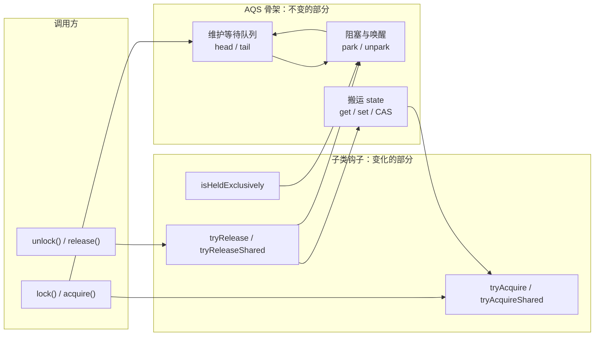
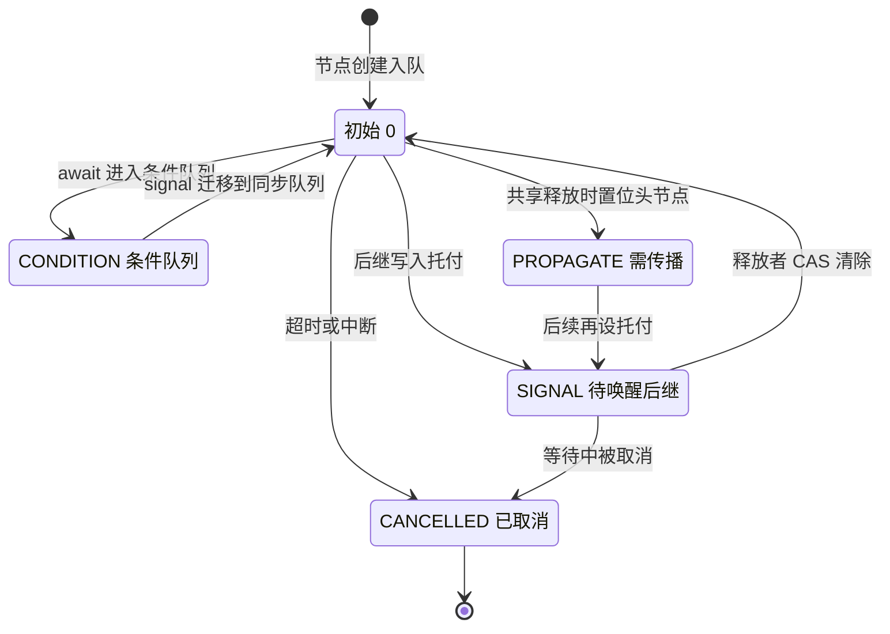
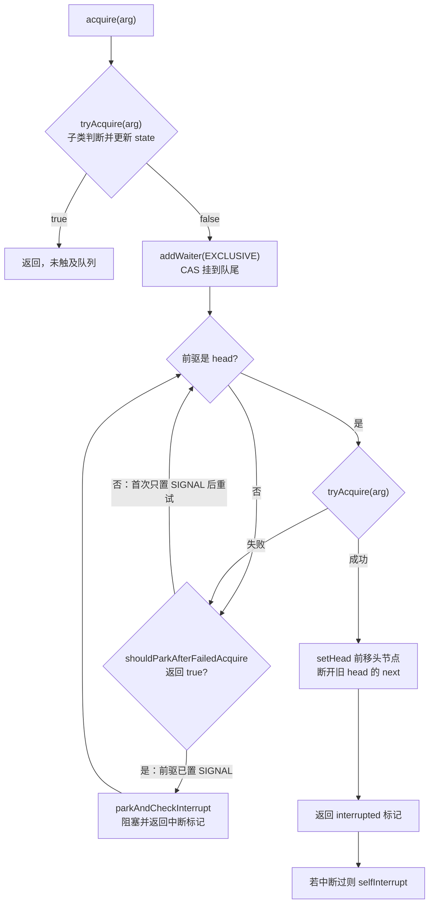
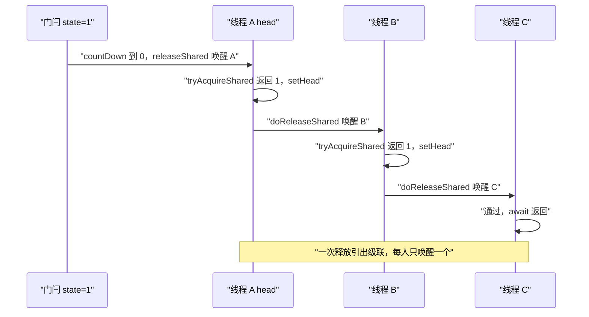
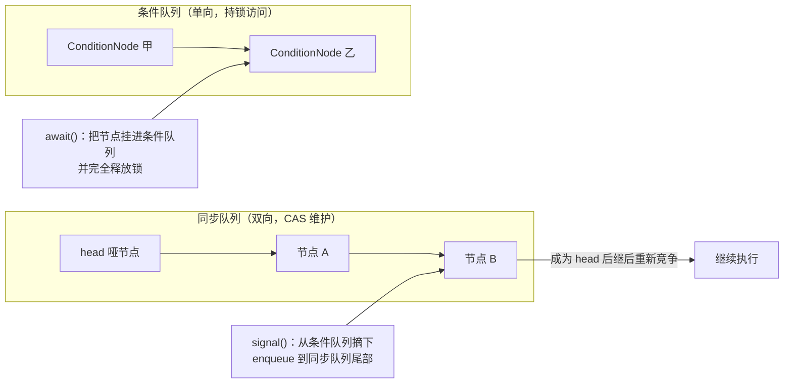

# 06 AQS 框架——AbstractQueuedSynchronizer 的设计与实现

**摘要：**

JUC 里绝大多数同步器共享同一副骨架：排队、阻塞、唤醒由抽象队列同步器（AbstractQueuedSynchronizer，AQS）完成，"什么情况算获得"由子类回答。本文以这条分工为主线展开：先看 `state` 一个 int 如何承载重入次数、许可数、剩余计数、读写位拆分与任务状态；再顺着 CLH 变体队列看 `Node` 的状态位怎样把"唤醒责任"记在前驱身上，以及从尾部反向遍历为何总是安全；然后逐步走完独占模式 `acquire`/`release` 的每一步、共享模式 `setHeadAndPropagate` 的级联唤醒与 `PROPAGATE` 状态的来历，以及 `ConditionObject` 的两队列迁移与 `awaitNanos` 的超时预算。文中刻意区分两套实现：JDK 13 及以前教材里那套 `addWaiter`/`acquireQueued`/`shouldParkAfterFailedAcquire` 结构，与 JDK 14 经 JDK-8229442 重写后、在 JDK 21 与 JDK 25 上实际运行的单一 `acquire` 主循环加位编码 `status` 加指数退避。文中还给出两代实现的逐项对照，方便把教材里的结构映射到现行源码。最后落到公平性的唯一落点 `hasQueuedPredecessors()`、绕过 AQS 直接继承时的典型反例，以及入队、出队、`park`/`unpark` 与上下文切换之间的量级差异。读完应当能回答两个问题：AQS 到底替子类承担了什么，以及为什么同一个 `state` 能表达六种不同的同步语义。

---

## 第 1 章 骨架的由来：从 CLH 到 AQS

### 1.1 所有同步器都在回答同一道题

互斥锁、信号量、倒计时门闩、读写锁、条件队列，语汇不同，语法却惊人一致：条件不成立时，线程停在哪里；条件成立时，谁把它叫醒；停与醒之间，等待者的顺序如何记录。差别只在"条件"二字如何定义——互斥锁的条件是"没有别的线程持有"，信号量的条件是"还有剩余许可"，倒计时门闩的条件是"计数已归零"，读锁的条件是"没有写线程在场"。这些定义千差万别，可支撑它们的机械装置却是同一套。

1993 年，Travis Craig、James Landin 与 Erik Hagersten 在华盛顿大学的技术报告里给出了后来被称作 CLH 锁的排队自旋方案；更早两年，Mellor-Crummey 与 Scott 的 MCS 锁已在做同一件事的另一条路线。两者排队的视角相反：MCS 让每个线程在自己的节点上自旋、靠前驱显式递交锁，CLH 让每个线程盯着前驱节点的一个字段自旋，前驱一改状态后继立刻感知。CLH 实现简单、无需递交协议，代价是所有自旋都落在别人的缓存行上，跨 NUMA 节点时不如 MCS 友好。

AQS 选择了 CLH 的视角，却换掉了自旋这个动作。Doug Lea 在 2004 年随 JSR-166 交付的 `java.util.concurrent` 里给出这份骨架，一年后在《Science of Computer Programming》第 58 卷第三期发表论文《The java.util.concurrent Synchronizer Framework》。AQS 对 CLH 做了两点改造：其一，自旋改为阻塞，线程不再空转，而是把控制权交还调度器，等被显式唤醒；其二，单向链表改为双向链表，使得取消一个节点时能迅速找到前驱，也使得唤醒者能在直接后继已经取消时，从尾部反向找出真正的第一个有效等待者。两点改造让 CLH 从自旋锁变成了可承载各种同步语义的队列基础设施。

### 1.2 三件事与一件事

笔者把 AQS 的职责拆开看，只有三件事：维护等待队列、在合适的时机阻塞线程、在合适的时机唤醒线程。它不知道 `state` 的数值意味着什么，不知道 `tryAcquire` 内部做了哪些判断，也不知道共享模式下"还剩几个许可"如何计算。它只在 `getState`、`setState`、`compareAndSetState` 之间搬运数值，只在 `tryAcquire` 返回 `true` 时认定线程取得了同步状态，只在 `tryRelease` 返回 `true` 时认定可以唤醒后继。

子类负责的那一件事，就是"何时算获得、何时算完全释放"。这五个钩子——`tryAcquire`、`tryRelease`、`tryAcquireShared`、`tryReleaseShared`、`isHeldExclusively`——构成**模板方法模式**（Template Method Pattern）在并发编程里最经典的一次应用：骨架定义的流程固定不变，流程中每个判断点交给子类填。Java 的 `ReentrantLock`、`Semaphore`、`CountDownLatch`、`ReentrantReadWriteLock` 的内部类 `Sync` 都是 `AbstractQueuedSynchronizer` 的子类，`ThreadPoolExecutor.Worker` 与 `FutureTask.Sync` 同样如此；`CyclicBarrier` 则是例外，它不直接继承 AQS，而是用 `ReentrantLock` 与 `Condition` 组合出来、间接复用同一套骨架。这些子类唯一的共性是都实现五个钩子里的一部分，而排队的正确性只需在 AQS 里被证明一次。



图里有一条容易被忽略的边：`tryAcquire` 既被调用方直接调用，也被 AQS 在排队循环里反复调用。同一个方法同时服务于"无竞争快路径"与"排队后的重试路径"，这是理解 AQS 全部行为的前提。

### 1.3 不这样会怎样

不妨做一次反事实推演：假设没有 AQS，每个同步器都要自己写一套排队逻辑。这意味着每个实现都要独立解决这些问题：竞争失败后把线程放到哪个结构里；入队与阻塞之间如何避免"刚准备睡就被叫醒"的**唤醒丢失**；超时与中断如何把已入队的节点安全摘除；被唤醒的线程发现自己前面的节点已经取消时怎么办；共享模式下一次释放要唤醒一个还是一串。这些问题的正确答案都不直观，任何一处写错，症状都是"偶发挂起"或者"偶发超时"，在压测里可能几百万次才现一次。

JDK 自己在 `Semaphore` 上就踩过一次这样的坑。一份 2009 年初的缺陷报告记录了这样的现象：信号量初值为 0，四个线程两两配对，两个执行 `acquire`、两个执行 `release`，跑上千万次后偶发出现"计数已经回到 1，但仍有一个线程在等待"的挂起（JDK-6801020，第 6 章会完整复盘）。修复方式很有代表性：不是改某个子类的 `tryAcquireShared`，而是回到 AQS 的状态机里补一个 `PROPAGATE` 状态，把这次释放的唤醒意图记下来。骨架的缺陷只能在骨架里修，这正是把机制收拢到一处的价值。

---

## 第 2 章 state：一个 int 的六种读法

### 2.1 三个字段与一条可见性约定

AQS 的实例字段少得不像一个框架：

```java
// JDK 21，AbstractQueuedSynchronizer
private volatile int state;          // 同步状态，语义由子类定义
private transient volatile Node head; // 队列头，懒初始化
private transient volatile Node tail; // 队列尾，只通过 CAS 修改
```

`state` 是 `volatile` 的，`getState`/`setState` 就是普通读写，`compareAndSetState` 走 `jdk.internal.misc.Unsafe` 的 `compareAndSetInt`。这份约定看起来朴素，却藏着一条贯穿全类的内存序假设：`state` 的 volatile 读写提供了 happens-before 边，AQS 与子类所有"跟着 `state` 走"的普通字段都借这条边获得可见性。

最典型的例子是持有者字段。`AbstractQueuedSynchronizer` 继承 `AbstractOwnableSynchronizer`，后者只有一个 `private transient Thread exclusiveOwnerThread`，而且是个**普通字段**，源码注释写得很直白：这些方法不施加任何同步，也不做 `volatile` 访问。它凭什么能安全地被跨线程读取？因为读写它的线程同时也在读写 `state`。`ReentrantLock` 的获取路径先 `compareAndSetState(0, 1)` 成功，再 `setExclusiveOwnerThread(current)`；释放路径先把 `exclusiveOwnerThread` 置空，再 `setState(0)`。两条路径的写序相反，方向却恰好正确：任何线程只要 volatile 读到 `state == 0`，就一定能看到之前那次"清空持有者"的写；反之，只要读到 `state > 0`，就可能看到一个尚未写入的 `null` 持有者，此时它只会得出"锁被别人持有"的保守结论，退出尝试去排队。这种"允许保守、不允许激进"的不对称，是锁实现里常见的手法。

### 2.2 六种含义，同一个字段

`state` 的具体含义完全由子类定义，AQS 只做数值搬运。JUC 内部至少有六种截然不同的读法，前五种来自完整同步器，最后一种来自线程池的工作线程：

| 子类 | `state` 的含义 | 取值区间 | 写入者 |
| :--- | :--- | :--- | :--- |
| `ReentrantLock.Sync` | 重入次数，0 表示未持有 | `0..Integer.MAX_VALUE` | 持有者线程（CAS 或普通写） |
| `Semaphore.Sync` | 剩余许可数 | `0..Integer.MAX_VALUE` | 任意释放者、获取成功者（CAS） |
| `CountDownLatch.Sync` | 剩余待倒数计数 | `0..N`，单调递减 | 任意 `countDown` 调用者（CAS） |
| `ReentrantReadWriteLock.Sync` | 高 16 位读锁计数、低 16 位写锁重入 | 两个 `0..65535` 拼进一个 int | 读锁用 CAS，写锁持有者普通写 |
| `FutureTask.Sync` | 任务生命周期状态 | `0..6` 七个离散值 | 执行线程与取消者（CAS） |

`ReentrantLock` 的读法最朴素：`state` 是重入层数，配合 `exclusiveOwnerThread` 才能表达"谁持有"。这一对字段的组合说明 AQS 的抽象并非万能——"互斥且可重入"需要两个信息维度，AQS 只提供一个，另一个由父类字段补上。

`Semaphore` 的读法最宽松：`state` 是许可余额，初值由构造器通过 `setState(permits)` 写入，获取时 CAS 减、释放时 CAS 加，余额不足就返回负数进入等待。注意它没有"所有者"概念，任何线程都能释放许可，`state` 也不必回到初始值，子类只维护"不得溢出"这一条不变量。

`CountDownLatch` 的读法最苛刻：`state` 只能减不能增，`tryReleaseShared` 里的 `if (c == 0) return false;` 把"归零之后不可再动"写成了硬约束，而 `tryAcquireShared` 干脆返回 `(getState() == 0) ? 1 : -1`，把"一次性的门闩"表达成"只有两种结果的状态查询"。

`ReentrantReadWriteLock` 的读法最激进：把 32 位切成两半，高 16 位记读锁总数、低 16 位记写锁重入数，一次 CAS 同时表达两个维度的变化。位拆分的细节（`SHARED_SHIFT`、`SHARED_UNIT`、`MAX_COUNT`）与由此带来的写饥饿、锁降级限制，属于读写锁的话题，留给 [[08 读写锁与 StampedLock——从 ReentrantReadWriteLock 到乐观读]] 展开，这里只需记住一个结论：同一个 int 被当成两个计数器用，`state` 的语义自由度已经到了极限。

`FutureTask.Sync` 是第五种读法，也是最能说明问题的读法。它把 `state` 当成有限状态机：`NEW(0)`、`COMPLETING(1)`、`NORMAL(2)`、`EXCEPTIONAL(3)`、`CANCELLED(4)`、`INTERRUPTING(5)`、`INTERRUPTED(6)`。七个状态之间有严格的迁移规则，`FutureTask.get()` 的逻辑就是"在 `state` 上等一个终态"。第六种读法来自 `ThreadPoolExecutor.Worker`，它把 `state` 当成三值标志：`-1` 表示"尚未启动、禁止中断"，`0` 表示"空闲"，`1` 表示"持有运行权"，而它的 `tryRelease` 无条件把状态归零并返回 `true`，因为锁只被工作线程自己持有，无须所有者校验。

### 2.3 为什么一个字段够用

五个子类、六种语义，共用同一个 `volatile int`，这件事成立的前提是：AQS 从不解释 `state` 的数值，它只判断"钩子返回什么"。`tryAcquire` 说成功就是成功，`tryRelease` 说完全释放就是完全释放，`tryAcquireShared` 返回负数就是失败。`state` 的加减乘除、位运算、状态迁移，全部发生在子类方法内部，AQS 只在需要搬运时提供 `getState`/`setState`/CAS 三件工具。

这种分工的收益是接口极窄：子类只需要回答布尔问题（外加共享模式下一个表示剩余量的整数）。代价是子类作者必须承担全部语义责任：不变量自己维护、溢出自己检查、非法调用自己抛异常。AQS 甚至不知道"释放一个没被持有的锁"是非法的——`tryRelease` 是子类的地盘，`IllegalMonitorStateException` 由 `ReentrantLock` 自己抛出。

`AbstractQueuedLongSynchronizer` 是这条设计的另一个证明：同一个骨架把 `state` 换成 `long`，其余代码几乎逐行克隆，用于需要 64 位状态的多级锁或屏障。

### 2.4 反例：把 state 当布尔量

最常见的误用是把 `state` 当成 `0/1` 标志。这样写能跑通最简单的互斥，但立刻失去重入能力——同一线程第二次进入会在 `compareAndSetState(0, 1)` 上失败，然后把自己挂到等待队列里，等一个永远不会到来的释放，直接死锁。可重入的判定不是"再抢一次"，而是"先看持有者是不是自己"，这一条在 `tryAcquire` 里必须显式写出。

第二个误用是忘了在 `tryRelease` 里校验持有者。AQS 不校验，`tryRelease` 返回 `true` 它就唤醒后继；如果一个实现允许任意线程调用释放，那么未持锁的线程可以把别人的锁"释放"掉，队列里的等待者被唤醒后发现 `state` 不对，再回到队列——表现为同步状态被破坏后的诡异行为，而不是一个干净的异常。

第三个误用是忽略取值范围。`ReentrantLock` 在 `state` 溢出时抛 `Error("Maximum lock count exceeded")`，`Semaphore` 在许可相加溢出时抛 `Error("Maximum permit count exceeded")`，读写锁把每侧限制在 65535，这些检查都在子类里。

---

## 第 3 章 队列：CLH 变体与 Node 的状态位

### 3.1 为什么必须是"变体"

纯粹的自旋锁在等待时间稍长时会把 CPU 烧在无意义的轮询上，AQS 于是把自旋换成 `LockSupport.park`。这一步替换带来三个连锁后果。

第一个后果是队列必须双向。自旋锁里节点只关心前驱，单向足够；一旦线程可能被取消，就必须把已取消节点从链上摘掉，而摘除要同时改前驱的 `next` 与后继的 `prev`，单向链表做不到。第二个后果是必须记录"谁应该被唤醒"——自旋锁靠前驱改字段通知后继，阻塞之后这条通路断了，于是需要一个显式状态位，由后继写进前驱、由前驱在释放时读取。第三个后果是必须容忍虚假与多余的唤醒，`park` 可能在没有 `unpark` 的情况下返回（中断、伪唤醒），等待者醒来后必须重新验证条件。

AQS 的头节点设计也由此而来。第一个节点是不承载线程的哑节点（dummy head），`thread` 字段为空，语义上表示"当前持有同步状态的位置"，真正的首个等待者是 `head.next`。有了它，入队只需操作 `tail`，出队只需把成功者自己变成新 head，两种操作都不必为"队列空不空"写分支。队列还是懒初始化的：没有竞争时 `head` 与 `tail` 都是 `null`，第一次竞争才创建哑节点。

### 3.2 Node 的字段与五个状态

JDK 13 及以前的 `Node` 定义如下（这也是几乎所有教材、面经与源码分析文章描述的那一版）：

```java
static final class Node {
    static final Node SHARED = new Node();   // 共享模式标记
    static final Node EXCLUSIVE = null;      // 独占模式标记，复用 nextWaiter 字段

    static final int CANCELLED =  1;   // 节点已取消，永不再阻塞
    static final int SIGNAL    = -1;   // 后继需要被唤醒
    static final int CONDITION = -2;   // 节点在条件队列中
    static final int PROPAGATE = -3;   // 共享模式下应无条件向后传播

    volatile int waitStatus;   // 上述五值之一：1 / -1 / -2 / -3 / 0
    volatile Node prev;
    volatile Node next;
    volatile Thread thread;    // 等待的线程；head 节点此字段为 null
    Node nextWaiter;           // 条件队列的链，兼作 SHARED / EXCLUSIVE 标记
}
```

`nextWaiter` 有双重身份：在同步队列里它只是模式标记（`SHARED` 是哨兵节点，`EXCLUSIVE` 是 `null`），在条件队列里它是真正的后继指针。字段复用省下一个字段，代价是读代码时要先判断自己处在哪个队列的语境里。

| 值 | 名称 | 谁写入 | 含义 | 能否离开 |
| :--- | :--- | :--- | :--- | :--- |
| `0` | 初始 | 节点创建 | 无特殊含义，不需要唤醒后继 | 可迁移 |
| `-1` | `SIGNAL` | **后继**为前驱设置 | 前驱释放时必须唤醒我 | 可被释放者清回 `0` |
| `1` | `CANCELLED` | 节点自己（超时/中断） | 我已放弃，别再管我 | 终态，不可逆 |
| `-2` | `CONDITION` | 节点自己（进入条件队列） | 我在条件队列里，不在同步队列 | 被 `signal` 迁移时改为 `0` |
| `-3` | `PROPAGATE` | 共享模式的释放者 | 这次释放的唤醒意图要继续向后传播 | 可迁移 |

这张表最容易被讲反的一点是 `SIGNAL` 的写入者。`SIGNAL` 不是节点头上"我是信号"的标记，而是后继在入睡前写进前驱的托付："我马上要睡了，你释放的时候记得叫我。"把这句话记住，后面所有关于 `shouldParkAfterFailedAcquire` 的讨论都会顺理成章。



### 3.3 入队顺序：先 prev，后 next

入队是整条链上唯一的并发写点，AQS 用一次 CAS 解决：

```java
// JDK 13，addWaiter 的核心循环
for (;;) {
    Node oldTail = tail;
    if (oldTail != null) {
        node.setPrevRelaxed(oldTail);          // 先写自己的 prev，无需屏障
        if (compareAndSetTail(oldTail, node)) {
            oldTail.next = node;               // CAS 成功后才接前驱的 next
            return node;
        }
    } else {
        initializeSyncQueue();                 // 懒初始化哑头节点
    }
}
```

注意两处写的次序与强度：`prev` 用 `setPrevRelaxed` 写入，是普通写加更弱的内存序（JDK 13 里是 `Unsafe.putReference`，JDK 14 之后仍保留这个 relaxed 语义），`next` 则在 CAS 成功之后才写，且是 volatile 字段。这个不对称造就了队列的一条稳定性质：从 `tail` 沿 `prev` 反向遍历永远能覆盖所有已入队节点，从 `head` 沿 `next` 正向遍历则可能在短暂窗口里看不到刚入队者。所以所有"找一个有效节点"的内部逻辑都选反向遍历，`unparkSuccessor` 与 `cleanQueue` 都是受益者。

反向遍历的代价是 O(n)。极端情况下队列很长、取消节点很多，一次唤醒可能扫过大半个队列。这是 AQS 少数在复杂度上不占优的地方，换来的是实现正确性的极大简化。

### 3.4 取消：CANCELLED 是单程票

线程在等待中被中断或超时，节点必须退出竞争。`cancelAcquire` 分三种情况处理：如果自己是 `tail`，把 `tail` CAS 回退到前驱并断开前驱的 `next`；如果自己不是 `tail` 但前驱需要信号，把前驱的 `next` 直接指到自己的后继，等价于把自己从链上摘掉；否则说明前驱是 `head` 或已经取消，直接唤醒自己的后继，让后继自己重新找位置。

关键在于取消前的第一步：`node.waitStatus = CANCELLED`。这是一次无条件写而不是 CAS，因为写入时该节点还被自己独占，其他线程即使读到中间态也只会跳过它。状态一旦置为 `CANCELLED` 就永不回头，这保证了"取消"这件事在并发下是单调的——任何线程只要看到 `waitStatus > 0`，就可以确定这个节点不会再变成等待者，放心跳过。

JDK 14 之后取消被拆成两步：`cancelAcquire` 给自己打上 `CANCELLED` 并触发清理，`cleanQueue` 从尾部向前摘除取消节点、按需唤醒新的首等待者。结构变了，语义没变。

---

## 第 4 章 独占模式：acquire 的四步与它省下的唤醒

### 4.1 四步骨架

`acquire` 是整类方法里最重要的一条，JDK 13 及以前的实现只有四行：

```java
// JDK 13，AQS 的 acquire：模板方法，子类不覆盖
public final void acquire(int arg) {
    if (!tryAcquire(arg) &&                                // 1. 子类判断 + 更新 state
        acquireQueued(addWaiter(Node.EXCLUSIVE), arg))     // 2. 入队并等待
        selfInterrupt();                                   // 3. 补回中断标记
}
```

四步可以这样读：先问子类"现在能不能拿"，能拿就直接返回，全程只有一次 CAS，AQS 的队列根本不会被触碰；拿不到才创建节点、挂到队尾，进入等待循环；若等待期间被中断过，退出前把标记补回。方法声明为 `final`，子类无法覆盖，能改的只有 `tryAcquire` 的内容。

流程图画出来是这样：



### 4.2 tryAcquire：唯一的判断点

`tryAcquire` 的契约只有两条：不阻塞，成功时返回 `true` 并把 `state` 改到能表达"我已持有"的数值，失败时返回 `false` 并且不改动任何状态。这两条是 AQS 能在循环里反复调用它的前提：调用可能发生在任意时刻、任意线程上，钩子必须足够快且没有副作用。

`ReentrantLock` 在这里做了两件事：无竞争时 CAS 一次拿到锁，有竞争但持有者是自己时把重入计数加一。JDK 14 起，这段逻辑被拆成 `initialTryLock` 与 `tryAcquire` 两个入口，前者在进入 AQS 之前先试一次，后者供 AQS 在排队循环里调用。拆分带来的收益很直接：无竞争路径连 `acquire` 的调用都不必发生，而这条路径占了实际生产里绝大多数加锁次数。公平与非公平的差异也藏在这两个入口里，第 10 章再谈。

### 4.3 acquireQueued：只有头节点的后继才有资格尝试

节点入队之后并不立刻睡，而是进入一个自旋循环：

```java
// JDK 13，acquireQueued 的核心
final boolean acquireQueued(final Node node, int arg) {
    boolean interrupted = false;
    try {
        for (;;) {
            final Node p = node.predecessor();
            if (p == head && tryAcquire(arg)) {   // 只有队列第一名才尝试
                setHead(node);
                p.next = null;                    // 断开引用，帮助 GC
                return interrupted;
            }
            if (shouldParkAfterFailedAcquire(p, node))
                interrupted |= parkAndCheckInterrupt();
        }
    } catch (Throwable t) {
        cancelAcquire(node);                      // 钩子抛异常时也要取消
        if (interrupted) selfInterrupt();
        throw t;
    }
}
```

`p == head` 这个判断是整个队列秩序的来源。锁只可能在 `head` 对应的"已取得同步状态的位置"上，也就是刚被它的前驱释放，所以只有直接后继值得尝试；排在后面的人去 CAS 只会白白消耗总线。对非公平锁而言这条限制并非绝对——队列外的新线程随时可以插队，那正是不公平的来源；但对队列内部，秩序必须靠它维持，否则队列就退化成一群人同抢一个变量。

把队列想成银行的取号机：只有被叫到号的人（`head` 的后继）才去窗口，其余人继续坐着。`predecessor()` 在经典实现里还有一行看似多余的检查：`prev == null` 就抛空指针。它防的是"节点已取消并被摘链、`prev` 被清空"之后再访问前驱的情况。

### 4.4 shouldParkAfterFailedAcquire：三条分支

真正决定"睡不睡"的是这个方法：

```java
private static boolean shouldParkAfterFailedAcquire(Node pred, Node node) {
    int ws = pred.waitStatus;
    if (ws == Node.SIGNAL)
        return true;                       // 前驱已受托，放心睡
    if (ws > 0) {                          // 前驱已取消，跳过它
        do {
            node.prev = pred = pred.prev;
        } while (pred.waitStatus > 0);
        pred.next = node;
    } else {                               // ws 为 0 或 PROPAGATE
        pred.compareAndSetWaitStatus(ws, Node.SIGNAL);
    }
    return false;                          // 注意：这一次不睡
}
```

三条分支对应三种处境。前驱已经是 `SIGNAL`，说明托付已经完成，可以安全入睡；前驱已取消，则沿着 `prev` 往回跳过所有取消节点，把自己接在第一个有效前驱之后；其余情况（`0` 或 `PROPAGATE`）说明还没有人负责叫醒自己，于是把前驱置为 `SIGNAL`，但**返回 `false`**，让外层循环再走一圈。

最后这个 `false` 是 AQS 里最容易读漏的一行。它意味着"该睡了但先别睡"，理由是：置完 `SIGNAL` 之后锁可能已经被释放了，而这次释放是在置位之前发生的，释放者看不到 `SIGNAL`，自然不会 `unpark` 我；如果此时直接 `park`，就可能在没有任何人负责唤醒的情况下睡过去。多转一圈，重新 `tryAcquire` 一次，既堵上了这个窗口，又省掉了一次无谓的 `park`。`park` 本身不贵，但从 `park` 到 `unpark` 再到线程被调度器真正唤醒，这条往返的代价是微秒级，比一次 CAS 贵两个数量级（量级判断，见 11.5 节）。

### 4.5 入队之后为什么还要再 tryAcquire

把上面的讨论收拢：入队后再次尝试获取，同时承担了三件事。

第一，处理"入队与置位之间锁已释放"的窗口。刚才描述过，这是正确性要求，不是优化。

第二，利用 CLH 结构里的"临近性"。节点刚入队时排在最尾部，本来没有资格尝试；但队列移动很快，几轮循环之后前驱可能已经是 `head`，此时一次 `tryAcquire` 成功就能免去一次阻塞。对短临界区、高并发的场景，这一点直接决定吞吐——大量线程在"还没睡就被轮到"的状态下完成，`park` 调用次数远少于入队次数。

第三，为非公平锁保留插队机会。队列外的新线程可以插队，队列内的头号等待者也能在被唤醒后与插队者竞争的间隙里抢回锁，两种插队走的是同一条 `tryAcquire`，只是触发位置不同。

### 4.6 中断：先记账，最后补

`acquire` 声明自己不响应中断，但并不会把中断吞掉。`parkAndCheckInterrupt` 的实现是：

```java
private final boolean parkAndCheckInterrupt() {
    LockSupport.park(this);
    return Thread.interrupted();   // 返回并清除中断标记
}
```

`Thread.interrupted()` 读标记的同时把它清零，清掉之后必须有人补回，否则上层再也看不到这次中断。补的动作由 `selfInterrupt()` 完成，位置在 `acquireQueued` 返回之后、方法退出之前。为什么不立即抛出？因为 `acquire` 的契约是"不可中断的获取"：它保证线程一定拿到锁，中断只在事后以标记形式呈现；可中断版本由另一个方法承担，第 9 章展开。

---

## 第 5 章 释放与唤醒：为什么叫醒的是后继

### 5.1 release 只做三件事

```java
// JDK 13，release 的全部内容
public final boolean release(int arg) {
    if (tryRelease(arg)) {
        Node h = head;
        if (h != null && h.waitStatus != 0)
            unparkSuccessor(h);   // 唤醒头节点的第一个有效后继
        return true;
    }
    return false;
}
```

`tryRelease` 由子类实现，返回值有一个精确含义：**是否已经完全释放**。`ReentrantLock` 在 `state` 减到 0 时返回 `true`，减到 1 以上时返回 `false`，因为锁还握在自己手里，唤醒后继只会让它白跑一趟。共享模式下的 `tryReleaseShared` 返回值含义稍宽——表示"这次释放是否可能让某个等待者成功"，`Semaphore` 无条件返回 `true`，`CountDownLatch` 只在计数恰好归零时返回 `true`。

`h != null && h.waitStatus != 0` 这个判断是纯粹的节省：队列为空（`head` 为 `null`）或头节点状态为 `0`（没有人向后继托付过）时，没有需要唤醒的对象，连遍历都省了。状态为 `0` 只会出现在两种情况下：队列里只有哑头节点，或者后继还没走到置位分支。

### 5.2 unparkSuccessor：先清状态，再找真人

```java
private void unparkSuccessor(Node node) {
    int ws = node.waitStatus;
    if (ws < 0)
        node.compareAndSetWaitStatus(ws, 0);   // 1. 清掉自己的状态

    Node s = node.next;
    if (s == null || s.waitStatus > 0) {       // 2. 直接后继不可用
        s = null;
        for (Node p = tail; p != node && p != null; p = p.prev)
            if (p.waitStatus <= 0)
                s = p;                             // 从尾部反向找第一个有效者
    }
    if (s != null)
        LockSupport.unpark(s.thread);
}
```

第一步清状态是为了让下一次释放能重新建立托付关系：`SIGNAL` 表示"我有一个待唤醒的后继"，这次已经处理完，必须归还为 `0`，否则下一轮唤醒会因为状态判断失真而漏掉新人。

第二步才是找真正的唤醒对象。多数情况下 `node.next` 就是答案，例外有两个：后继为 `null`（并发入队与出队造成的短暂空窗），或后继已取消（状态为正）。此时从 `tail` 反向遍历取第一个有效节点，理由在 3.3 节：`next` 链可能暂时不完整，`prev` 链始终完整。这个遍历是"最终一致"的——找到的未必是最靠前的等待者，但一定是正在等待的节点，它醒来后会重新检查前驱、把自己放回正确位置。

### 5.3 唤醒后继而不是自己

这是一个常被当成哲学问题来问的设计：释放锁的线程正在运行，为什么它不"顺便"继续持有，而要把机会交给队列里的某个人？

答案有三层。机制层面，释放者的任务已经完成，它退出临界区正是为了让别人进入。结构层面，CLH 队列的传递是逐跳的：每个节点只关心自己的前驱，锁沿队列一跳一跳交接，释放者只需通知"下一个"，无须知道后面还有多少人，这天然避免了广播惊群。语义层面，`head` 代表"当前持有同步状态的位置"，`head.next` 是最该拿到它的那一位，唤醒后继就是把"持有位置"这个抽象实体往前推一格。

反过来说，唤醒自己毫无意义；广播唤醒所有人则会让队列里所有线程同时醒来抢一个资源，除第一个外全部重新入睡，白白付出 N 次调度成本。AQS 的设计一直在避免这种浪费。

### 5.4 唤醒会不会丢

会，有两种形态，而 AQS 对两者都留了后手。

第一种是"先 `unpark`，后 `park`"。线程 A 判断该睡了，刚要把自己挂起；线程 B 恰好释放并把 `unpark` 发给了 A；A 真正执行的 `park` 发生在 `unpark` 之后。如果没有补偿，A 会一直睡下去。`LockSupport` 的**许可制**正好解决这个问题：`unpark` 给线程置上一个许可，随后到来的 `park` 立即消耗许可返回，不会阻塞。AQS 依赖这个语义，把"唤醒可能早到"当成正常情况处理；反过来说，任何用 `Object.wait` 实现的同步器都得自己在监视器里维护标志位，正是因为拿不到许可制。

第二种是"后继刚好取消"。`unparkSuccessor` 从尾部反向找有效节点的逻辑覆盖了这种情况；此外取消节点自己也会在 `cancelAcquire` 里唤醒后继，避免"取消者与被取消者之间出现断链"。

把两种形态合起来看，AQS 的唤醒策略可以概括为**保守**：不保证只唤醒一次，只保证需要唤醒时至少有人醒着。多余的唤醒会带来一点开销，漏掉的唤醒会导致永久挂起，两者的代价完全不对等，AQS 因此一律偏向保守。

### 5.5 一次释放的代价

量级上，无竞争的一次 `release` 就是一次 `tryRelease`（读写 `state`，可能带一次 CAS）加一次头节点检查，落在几十纳秒到百纳秒；真正进入 `unparkSuccessor` 时多出一次遍历与一次系统调用，`unpark` 本身也是几十纳秒量级，但被唤醒线程从"许可被置位"到"真正在 CPU 上运行"要经过调度器，这段延迟在微秒量级，并随系统负载与核数浮动。唤醒的成本主要不在 `unpark`，而在之后那次上下文切换，这也是非公平锁更快、`shouldParkAfterFailedAcquire` 要多转一圈的经济学基础（数值均为量级判断，不同硬件与内核差异很大）。

---

## 第 6 章 共享模式：传播、PROPAGATE 与一次唤醒丢失的复盘

### 6.1 返回值不是布尔

共享模式的钩子换了个签名，返回值从布尔变成整数，语义也随之精细：

```java
protected int tryAcquireShared(int arg) {
    // 负数：失败，需要排队
    // 0：成功，但没有余量，不必唤醒后继
    // 正数：成功，且有余量，应继续唤醒后继
}
```

三种返回值把"是否成功"与"是否还能传播"压进一个 int。多数实现只用到"负数失败、非负成功"这个粗粒度：`CountDownLatch` 在门闩未开时返回 `-1`，开了返回 `1`；`Semaphore` 返回减完许可之后的余额，余额不足直接返回负数，余额足够则返回剩余量（可能是 0）。

`0` 与正数的差别在传播判断里会被用到：返回 0 表示资源恰好用尽，按语义可以不唤醒后继。但 AQS 对传播一律倾向保守，只要共享节点成为新头节点就继续向后唤醒，因为"资源刚好用尽"这个判断在并发下随时会过期。

### 6.2 doAcquireShared 与独占版的唯一区别

共享模式的排队循环与独占版几乎逐行对应，差异只有一处：集合点调用的是 `tryAcquireShared` 而不是 `tryAcquire`，且获取成功后要走到传播逻辑。

```java
// JDK 13，doAcquireShared 的核心
private void doAcquireShared(int arg) {
    final Node node = addWaiter(Node.SHARED);
    boolean interrupted = false;
    try {
        for (;;) {
            final Node p = node.predecessor();
            if (p == head) {
                int r = tryAcquireShared(arg);
                if (r >= 0) {                       // 非负即成功
                    setHeadAndPropagate(node, r);   // 前移头节点并尝试传播
                    p.next = null;
                    return;                         // 中断标记在 finally 里补回
                }
            }
            if (shouldParkAfterFailedAcquire(p, node))
                interrupted |= parkAndCheckInterrupt();
        }
    } catch (Throwable t) {
        cancelAcquire(node);
        throw t;
    } finally {
        if (interrupted) selfInterrupt();
    }
}
```

`p == head` 在共享模式里同样成立，语义却略有不同：独占模式下前驱持有锁，共享模式下前驱"曾经取得过共享状态"，资源可能还有剩余，也可能已被别的线程耗尽，所以必须再问一次 `tryAcquireShared`。

### 6.3 setHeadAndPropagate 与级联唤醒

```java
// JDK 13，setHeadAndPropagate
private void setHeadAndPropagate(Node node, int propagate) {
    Node h = head;              // 记下旧头节点
    setHead(node);              // 自己成为新头节点
    if (propagate > 0 || h == null || h.waitStatus < 0 ||
        (h = head) == null || h.waitStatus < 0) {
        Node s = node.next;
        if (s == null || s.isShared())
            doReleaseShared();  // 唤醒后继，由后继继续向前传播
    }
}
```

条件是三重"或"：本次获取还有余量（`propagate > 0`）、旧头节点状态为负（意味着有人留下过唤醒托付或传播意图）、新头节点状态为负。任意一条成立，且下一个节点也是共享节点（或者根本看不见下一个节点，无法判断），就继续转发一次释放。**级联唤醒**就是靠这段代码形成的：第一个被唤醒的共享节点成为新头节点，它再唤醒下一个，下一个再唤醒下一个，最终所有等待者依次通过。



`CountDownLatch` 的"一次开闸、全员通过"就是这幅图；`Semaphore` 一次性 `release` 多个许可时，也会形成长度等于许可数的传播链。级联的关注点是"每人只负责叫醒下一个"，而不是让释放者挨个叫醒所有人，这与第 5 章的结论一致。

### 6.4 PROPAGATE 的来历

传播逻辑里为什么需要一个专门的状态？2009 年初提交的 JDK-6801020 给出了答案，标题是"Concurrent Semaphore release may cause some require thread not signaled"。报告里的复现步骤很朴素：信号量初值 0，两个线程 `acquire`，两个线程 `release`，循环上千万次，偶发其中一个 `acquire` 永久挂起，而 `state` 已经回到 1。

把时间线展开，竞态就清楚了：

| 时刻 | 线程 A（acquire） | 线程 R（release） | `head.waitStatus` |
| :--- | :--- | :--- | :--- |
| t1 | 入队，成为 `head.next` | — | `0` |
| t2 | 准备置前驱 `SIGNAL`，尚未执行 | `tryReleaseShared` 成功，走 `doReleaseShared` | `0` |
| t3 | — | 看到状态是 `0` 不是 `SIGNAL`，按经典实现不唤醒 | `0` |
| t4 | 执行 `compareAndSetWaitStatus(0, SIGNAL)` 后 `park` | 循环退出 | `-1` |
| t5 | 睡下，无人再释放 | — | `-1` |

问题出在 t3：释放者的判断是"头节点不是 `SIGNAL` 就不唤醒"，但 t4 里等待者几乎同时建立了 `SIGNAL` 托付。两者交错，导致"释放已经发生、托付却没人看见"。修复方案正是引入 `PROPAGATE`：`doReleaseShared` 发现头节点状态是 `0` 时，不再直接退出，而是尝试 CAS 成 `PROPAGATE`，把"这次释放的唤醒意图"留在头节点上；而 `setHeadAndPropagate` 里那句 `h.waitStatus < 0` 的检查，会把 `PROPAGATE` 也认作"应该继续传播"。于是 t4 的等待者醒来后再传播一次，链条接续。

```java
// JDK 13，修复后的 doReleaseShared：注意 PROPAGATE 分支
for (;;) {
    Node h = head;
    if (h != null && h != tail) {
        int ws = h.waitStatus;
        if (ws == Node.SIGNAL) {
            if (!h.compareAndSetWaitStatus(Node.SIGNAL, 0))
                continue;              // CAS 失败说明有人动过，重来
            unparkSuccessor(h);
        } else if (ws == 0 &&
                   !h.compareAndSetWaitStatus(0, Node.PROPAGATE))
            continue;                  // 把意图记下来，避免丢失
    }
    if (h == head)                     // 头节点没变才退出
        break;
}
```

这段代码的形状值得留意：它没有 `return`，只有一个在"头节点未变"时退出的循环。共享模式的释放可能被多个线程同时执行，任何一个线程的成功都必须能推动队列，而不是被另一个线程的失败掩盖。

### 6.5 为什么新实现能删掉 PROPAGATE

JDK 14 的重写把整个状态编码换掉了，`PROPAGATE` 这个常量在 JDK 21/25 里已经不存在。替代方案只有两个方法：

```java
// JDK 21，唤醒头节点的后继；注意先清 WAITING 位再 unpark
private static void signalNext(Node h) {
    Node s;
    if (h != null && (s = h.next) != null && s.status != 0) {
        s.getAndUnsetStatus(WAITING);      // 原子地清位，避免 park 竞态
        LockSupport.unpark(s.waiter);
    }
}

private static void signalNextIfShared(Node h) {
    Node s;
    if (h != null && (s = h.next) != null &&
        (s instanceof SharedNode) && s.status != 0) {
        s.getAndUnsetStatus(WAITING);
        LockSupport.unpark(s.waiter);
    }
}
```

关键变化是"清标志"与"唤醒"从两步并成一步，也就是把**状态位**与唤醒动作绑定在同一次原子操作里：经典实现要先 CAS 把 `SIGNAL` 清成 `0`（失败重试），再取后继、再 `unpark`；新实现用一次原子位清除拿掉等待者的 `WAITING` 位并立刻唤醒，等待者醒来看到 `status` 已空便知唤醒已经发生，无须再推断托付关系。既然不再需要"把这次释放留给下一次"的中间状态，`PROPAGATE` 自然消失。

代价是语义更依赖位操作的原子性，收益是循环结构简单了一大截。第 7 章会完整拆开这次重写。

### 6.6 保守传播的代价

共享模式的传播天生保守：判断条件写成 `s == null || s.isShared()`，看不见后继时也选择唤醒，于是有少量多余唤醒——被唤醒者可能发现资源已被取走，重新入睡。不做精确唤醒的原因是不划算：精确需要回答"当前还剩多少资源"，等于把子类语义重新引入骨架，破坏前面那条分工线；何况资源余额在并发下随时变化，任何精确判断也只能准确一瞬。

用一点多余唤醒换掉"需要子类参与传播决策"的复杂度，这笔交易在 JUC 里被反复做——`Semaphore` 的公平与非公平、`CountDownLatch` 的一次性、读写锁的读锁共享，都建立在"骨架只管传，子类只管答"之上。

---

## 第 7 章 JDK 14 的重写：现在真正在跑的那套代码

### 7.1 一次不太出名的重写

第 3 到 6 章描述的结构来自 JDK 13 及以前的源码，也是绝大多数教材、面试题与源码分析文章讲的版本。但它已经不是现在跑在机器上的代码。

2019 年 9 月，OpenJDK 提交了一次名为"AQS and lock classes refresh"的变更（JDK-8229442），改动覆盖 `AbstractQueuedSynchronizer`、`AbstractQueuedLongSynchronizer`、`ReentrantLock`、`StampedLock` 与 `LockSupport`，其中 AQS 单文件新增 613 行、删除 1,102 行。这次变更随 JDK 14 在 2020 年 3 月正式发布，此后 JDK 17 到 JDK 25 一直沿用这套结构，后续版本只在主循环里补了少量健壮性处理，譬如把 `park` 调用包进 `try`/`catch`，以免运行时异常绕过取消逻辑。状态常量换成了位编码，`addWaiter`、`acquireQueued`、`shouldParkAfterFailedAcquire`、`unparkSuccessor`、`doReleaseShared`、`setHeadAndPropagate` 这些方法名在现行源码里已经全部消失。

这件事值得单独列一章，因为它恰好演示了本文的核心论点：AQS 的对外契约（五个钩子、入口方法、公平性落点）十几年没变，内部实现却可以整体替换。只记方法名，读到现行源码会一头雾水；记住分工与不变量，换一套实现也读得懂。

### 7.2 六条路径并成一条

经典实现有六条获取路径：三条独占（`acquire`、`acquireInterruptibly`、`doAcquireNanos`）与三条共享（`doAcquireShared`、`doAcquireSharedInterruptibly`、`doAcquireSharedNanos`），六份循环体彼此极度相似，差别只在中断与超时。重写把差异参数化，收进一个方法：

```java
// JDK 21，所有获取路径的公共主循环（节选，注释为源码原意转述）
final int acquire(Node node, int arg, boolean shared,
                  boolean interruptible, boolean timed, long time) {
    Thread current = Thread.currentThread();
    byte spins = 0, postSpins = 0;        // 被唤醒后的重试预算，逐次翻倍
    boolean interrupted = false, first = false;
    Node pred = null;

    for (;;) {
        // 1. 重新判断"我是不是队列第一名"，并校验前驱
        if (!first && (pred = (node == null) ? null : node.prev) != null &&
            !(first = (head == pred))) {
            if (pred.status < 0) {        // 前驱已取消
                cleanQueue();
                continue;
            } else if (pred.prev == null) { // 前驱尚未完全挂上
                Thread.onSpinWait();
                continue;
            }
        }
        // 2. 未入队，或已是第一名：尝试获取
        if (first || pred == null) {
            boolean acquired;
            try {
                acquired = shared ? (tryAcquireShared(arg) >= 0) : tryAcquire(arg);
            } catch (Throwable ex) {
                cancelAcquire(node, interrupted, false);
                throw ex;
            }
            if (acquired) {
                if (first) {              // 只有第一名才需要前移头节点
                    node.prev = null;
                    head = node;
                    pred.next = null;
                    node.waiter = null;
                    if (shared) signalNextIfShared(node);
                    if (interrupted) current.interrupt();
                }
                return 1;
            }
        }
        // 3. 尚未创建则创建；尚未入队则入队一次
        if (node == null) {
            node = shared ? new SharedNode() : new ExclusiveNode();
        } else if (pred == null) {
            node.waiter = current;
            Node t = tail;
            node.setPrevRelaxed(t);
            if (t == null) tryInitializeHead();
            else if (!casTail(t, node)) node.setPrevRelaxed(null); // 退让重来
            else t.next = node;
        } else if (first && spins != 0) {
            --spins;                      // 被唤醒的第一名：先自旋几次再失败
            Thread.onSpinWait();
        } else if (node.status == 0) {
            node.status = WAITING;        // 声明"我要睡了，记得叫我"
        } else {
            spins = postSpins = (byte)((postSpins << 1) | 1);  // 指数退避
            if (!timed) LockSupport.park(this);
            else if ((nanos = time - System.nanoTime()) > 0L)
                LockSupport.parkNanos(this, nanos);
            else break;                   // 超时
            node.clearStatus();
            if ((interrupted |= Thread.interrupted()) && interruptible)
                break;                    // 可中断模式下被中断
        }
    }
    return cancelAcquire(node, interrupted, interruptible);
}
```

方法尾部的返回值也在传递语义：源码注释写的是"positive if acquired, 0 if timed out, negative if interrupted"，一个 int 同时编码三种结局。导出方法因此薄到只有几行，例如 `acquireInterruptibly`：

```java
// JDK 21
public final void acquireInterruptibly(int arg) throws InterruptedException {
    if (Thread.interrupted() ||
        (!tryAcquire(arg) && acquire(null, arg, false, true, false, 0L) < 0))
        throw new InterruptedException();
}
```

注意第一个参数 `node` 通常是 `null`：主循环会自己创建 `ExclusiveNode` 或 `SharedNode`；只有条件队列里已经被 `signal` 迁移到同步队列的节点才会带着自己的节点进来，复用同一段逻辑完成"重新竞争"。这个设计把"从条件队列返回"和"从入口获取"统一成一条路径，省掉了一份几乎相同的代码。

### 7.3 status：从五个取值到一个位域

新实现不再用"`waitStatus` 取五值"表达一切，改为**位编码**：

```java
// JDK 21
static final int WAITING   = 1;          // 必须为 1：节点正在同步队列里等
static final int CANCELLED = 0x80000000; // 必须为负：已取消
static final int COND      = 2;          // 在条件队列里等

abstract static class Node {
    volatile Node prev;
    volatile Node next;
    Thread waiter;            // 只在入队后可见
    volatile int status;      // 由所有者写，其他人只做原子位操作
}
```

三个常量的取值不是随手挑的：`CANCELLED` 被定义为符号位，于是"是否取消"退化成一次符号判断，`status < 0` 一条语句就能覆盖；`WAITING` 必须为 1，因为清除它要按位取反后再与（`getAndUnsetStatus(WAITING)` 底层就是 `getAndBitwiseAndInt(status, ~WAITING)`）；`COND` 是独立的一位，使得一个节点可以同时处于"条件队列中且等待中"（`status = COND | WAITING`）——这在经典实现里是做不到的，因为那时 `waitStatus` 只能取五个互斥的值。

位编码带来两个直接好处。第一，取消与等待可以叠加判断，不必反复枚举五种情况。第二，清状态与判断状态可以合并成一次原子操作，这正是第 7.4 节要说的关键。

节点类型也从"一个 `Node` 类加 `nextWaiter` 标记"变成了三个类：`ExclusiveNode`、`SharedNode`、`ConditionNode`。类型即模式，判断模式从读字段变成 `instanceof`，JIT 可以据此做更好的内联与分支预测；`nextWaiter` 挪进 `ConditionNode`，`Node` 本体少一个字段。

### 7.4 先清位，再唤醒

旧实现里，释放者的动作是两步：CAS 把 `SIGNAL` 清成 0，失败就重试；成功后再取后继、`unpark`。两步之间有一个窗口，等待者可能在窗口里做各种事，所以旧实现必须用"多转一圈"和 `PROPAGATE` 这些补丁来兜底。

新实现把两步压成一步：

```java
// JDK 21，唤醒头节点的后继
private static void signalNext(Node h) {
    Node s;
    if (h != null && (s = h.next) != null && s.status != 0) {
        s.getAndUnsetStatus(WAITING);   // 原子清位 + 返回旧值
        LockSupport.unpark(s.waiter);
    }
}
```

`getAndUnsetStatus(WAITING)` 在底层是一次 `Unsafe.getAndBitwiseAndInt`，把等待者的 `WAITING` 位清掉并返回旧值。这个次序有两个作用：唤醒者确认自己"抢到了这次唤醒的责任"，同一次托付不会被两个释放者各唤醒一遍；等待者醒来后看到自己的 `status` 已经是 0，就知道"唤醒已经发生"，不必再检查前驱的托付字段。旧实现里那些围着 `SIGNAL` 打转的补丁，在新实现里失去了存在的位置。

`CANCELLED` 节点怎么办？`s.status != 0` 这个判断不排除已取消节点（`0x80000000` 也是非零），但取消时 `waiter` 已被置空，`unpark(null)` 是空操作；真正需要清理的链路由 `cleanQueue` 负责，它在主循环发现前驱 `status < 0` 时被调用，从尾部向前把取消节点逐个摘掉，并按需唤醒新的首等待者。

### 7.5 指数退避：postSpins

新主循环里有一行很扎眼：

```java
spins = postSpins = (byte)((postSpins << 1) | 1);
```

`postSpins` 是一个字节，每次 park 之前按"左移一位再或 1"的方式增长：1、3、7、15、31、63、127，到 255 后按字节溢出停在 -1（无符号仍是 255）。它记录的是"被唤醒之后最多自旋几次再重新入睡"，源码注释给的上限是 256 次。动机写在 AQS 的类注释里：非公平策略允许新来的线程插队，被唤醒的第一名可能反复抢不到，于是每次失败后多给几次自旋机会，避免"唤醒—失败—立刻再睡"的高频往返。这是对插队副作用的一次补偿，也解释了第 10 章要谈的公平性为什么会退化。

自旋用的是 `Thread.onSpinWait()`（JDK 9 引入），向处理器提示"我在忙等"，让超线程的兄弟核心让出执行资源，比空转循环体轻一些。

### 7.6 两代实现对照

| 维度 | JDK 13 及以前 | JDK 14 及以后（21/25 同构） |
| :--- | :--- | :--- |
| 获取主循环 | 六个方法各写一遍 | 一个 `acquire(node, arg, shared, interruptible, timed, time)` |
| 结果表示 | 布尔加异常 | 返回值 `1 / 0 / 负数` 三种结局 |
| 节点模式 | `nextWaiter` 哨兵标记 | `ExclusiveNode` / `SharedNode` / `ConditionNode` 三个类 |
| 状态编码 | `waitStatus` 五值互斥 | `status` 位域：`WAITING` / `CANCELLED` / `COND` |
| 唤醒后继 | `unparkSuccessor`：CAS 清状态再 `unpark` | `signalNext`：原子清 `WAITING` 位再 `unpark` |
| 共享传播 | `setHeadAndPropagate` + `PROPAGATE` | `signalNextIfShared`，无需专门状态 |
| 取消清理 | `cancelAcquire` 就地摘链 | `cancelAcquire` 标记 + `cleanQueue` 从尾统一清理 |
| 被唤醒后的重试 | 每次失败重走一遍循环 | `postSpins` 指数退避，上限 256 次 |
| 条件等待 | 自建 `park` 循环，`isOnSyncQueue` 判断 | `ConditionNode` 实现 `ManagedBlocker`，`canReacquire` 判断 |

### 7.7 契约与实现分离

这次重写没有改任何公开契约：五个钩子还在，`acquire`/`release`/`acquireShared`/`releaseShared` 还在，`AbstractOwnableSynchronizer` 的持有者字段还在，`Condition` 的语义还在。改的全是实现：怎么表示状态、怎么组织循环、用什么顺序清标志。子类（包括 JUC 之外的第三方同步器）一行都不用改。

这次重写相当于换了发动机却没动方向盘。如果 AQS 当年把队列结构、状态位编码、唤醒次序都暴露成 API，这次重写就会变成不兼容升级；正因为契约只包含"钩子怎么回答"与"入口怎么调用"，实现才有整体替换的空间，这正是骨架模式的价值。反过来说，读源码的人如果只背方法名，就会把"某版本的实现细节"误当成"框架的机制"，这是读 JUC 源码时最常见的一类失真。

---

## 第 8 章 Condition：两条队列与一次迁移

### 8.1 为什么锁需要自己的条件变量

`synchronized` 配 `Object.wait`/`notify` 也能做等待通知，但限制很硬：一个监视器只有一个等待集，所有等待原因混在一起，`notify` 只能随机挑一个；缺精细的超时控制；必须在 `synchronized` 块里调用。`Condition` 把三点都松开了：一把锁可以生成任意多个 `Condition`，各有独立等待队列，`signal` 只影响本队列；等待有 `awaitNanos`、`awaitUntil`；还有不响应中断的 `awaitUninterruptibly`。

`ConditionObject` 是 `Condition` 在 AQS 内部的实现，作为内部类可以直接调用 `enqueue`、`acquire`、`release`，不必绕公开 API。

### 8.2 两条队列，两种纪律

AQS 里同时存在两种队列，纪律完全不同：

| 队列 | 结构 | 并发访问 | 承载者 | 节点类型 |
| :--- | :--- | :--- | :--- | :--- |
| 同步队列 | 双向，`prev`/`next` | 全并发，靠 CAS 与状态位 | AQS 本体（`head`/`tail`） | `ExclusiveNode` / `SharedNode` |
| 条件队列 | 单向，`nextWaiter` | 只在持锁时访问，无需 CAS | 每个 `ConditionObject` 私有（`firstWaiter`/`lastWaiter`） | `ConditionNode` |

**条件队列**能省掉 CAS，是因为"操作条件队列必须持锁"这条约束由 `isHeldExclusively()` 强制：`await` 与 `signal` 一进来就检查，不持有就抛 `IllegalMonitorStateException`。单线程访问的链表不需要原子操作，这是 AQS 把复杂度压到最低的一处设计。

两种队列的关系可以用一句话概括：条件队列是"因为条件不满足而离开同步队列的候车室"，`signal` 则是把人从候车室送回站台的搬运工。



### 8.3 await：先离场，再排队

```java
// JDK 21，await 的完整结构（省略 OOME 降级分支的细节）
public final void await() throws InterruptedException {
    if (Thread.interrupted())
        throw new InterruptedException();
    ConditionNode node = newConditionNode();      // 创建条件节点
    if (node == null) return;                     // 内存不足时的降级路径
    int savedState = enableWait(node);            // 记层数、挂条件队列、完全释放
    LockSupport.setCurrentBlocker(this);          // 供诊断工具读取阻塞原因
    boolean interrupted = false, cancelled = false, rejected = false;
    while (!canReacquire(node)) {                 // 尚未被迁移回同步队列
        if (interrupted |= Thread.interrupted()) {
            if (cancelled = (node.getAndUnsetStatus(COND) & COND) != 0)
                break;                            // 在 signal 之前就被中断
        } else if ((node.status & COND) != 0) {
            try {
                if (rejected) node.block();
                else ForkJoinPool.managedBlock(node);
            } catch (RejectedExecutionException ex) { rejected = true; }
            catch (InterruptedException ie) { interrupted = true; }
        } else {
            Thread.onSpinWait();                  // 正在被入队，稍等一瞬
        }
    }
    LockSupport.setCurrentBlocker(null);
    node.clearStatus();
    reacquire(node, savedState);                  // 带着保存的层数重新竞争
    if (interrupted) {
        if (cancelled) {
            unlinkCancelledWaiters(node);
            throw new InterruptedException();
        }
        Thread.currentThread().interrupt();
    }
}
```

`enableWait` 是理解"完全释放"的关键：

```java
private int enableWait(ConditionNode node) {
    if (isHeldExclusively()) {
        node.waiter = Thread.currentThread();
        node.setStatusRelaxed(COND | WAITING);    // 条件队列中，且等待中
        ConditionNode last = lastWaiter;
        if (last == null) firstWaiter = node;
        else last.nextWaiter = node;
        lastWaiter = node;
        int savedState = getState();              // 记下当前重入层数
        if (release(savedState))                  // 一次性释放全部层数
            return savedState;
    }
    node.status = CANCELLED;
    throw new IllegalMonitorStateException();
}
```

为什么要 `release(savedState)` 而不是 `release(1)`？因为可重入锁在 `await` 期间必须彻底让出：如果持锁者重入了三层，只释放一层，其他线程仍然拿不到锁，等待条件永远不会被满足，而持锁者自己又已经睡下，直接死锁。保存层数并一次性释放，醒来后再用 `reacquire(node, savedState)` 把层数原样恢复，这样调用方在 `await` 前后看到的 `getHoldCount()` 是一致的。

`canReacquire(node)` 的判断不看 `status`，而看链表的双向连接是否已经建立：`node.prev != null && (p.next == node || isEnqueued(node))`。源码注释给的理由是"避免入队竞态"——`signal` 在 `enqueue` 的过程中，`status` 的 `COND` 位可能已经被清，但节点还没真正挂上同步队列，此时若按状态判断就会提前跳出循环。

### 8.4 signal：只做搬运

```java
// JDK 21，doSignal：把条件队列头部节点搬到同步队列
private void doSignal(ConditionNode first, boolean all) {
    while (first != null) {
        ConditionNode next = first.nextWaiter;
        if ((firstWaiter = next) == null) lastWaiter = null;
        else first.nextWaiter = null;                 // 断开旧链，帮助 GC
        if ((first.getAndUnsetStatus(COND) & COND) != 0) {
            enqueue(first);                            // 挂到同步队列尾部
            if (!all) break;
        }
        first = next;                                 // 已取消的节点跳过，继续找
    }
}
```

`signal` 本身只做两件事：检查持锁（否则抛 `IllegalMonitorStateException`），然后调用 `doSignal` 搬一个节点；`signalAll` 搬全部。搬运的实现是 `enqueue`——把节点挂到同步队列尾部，如果挂的过程中发现前驱已经取消（`t.status < 0`），立即 `unpark` 让被唤醒者自己去清理链路。

这里有一个必须说清的语义：`signal` 不等于"你现在可以继续了"，它只等于"你从候车室被送到了站台"。被唤醒的线程仍然要排队竞争锁，竞争时可能发现条件又被别人改回去了，于是再次 `await`。这就是为什么 `await` 必须放在 `while` 循环里判断条件——虚假唤醒、抢先唤醒、条件被消费，三种情况在并发下都是常态。

经典实现的 `transferForSignal` 与新实现的 `enqueue` 做的是同一件事，只是前者还要额外维护"CAS 把 `CONDITION` 改成 0"这一步，以及"如果前驱已取消就立即 `unpark`"的兜底。第 7 章说过，新实现把状态位的维护整体简化了，条件队列的迁移逻辑是受益者之一。

### 8.5 awaitNanos：时间预算怎么记

带超时的等待比无超时版本多两件事：算剩余时间、超时后把自己从条件队列摘干净。

```java
// JDK 21，awaitNanos 的核心
long nanos = (nanosTimeout < 0L) ? 0L : nanosTimeout;
long deadline = System.nanoTime() + nanos;
boolean cancelled = false, interrupted = false;
while (!canReacquire(node)) {
    if ((interrupted |= Thread.interrupted()) ||
        (nanos = deadline - System.nanoTime()) <= 0L) {
        if (cancelled = (node.getAndUnsetStatus(COND) & COND) != 0)
            break;                       // 抢占"取消"的权利
    } else {
        LockSupport.parkNanos(this, nanos);   // 用剩余时间而不是原始超时
    }
}
node.clearStatus();
reacquire(node, savedState);
long remaining = deadline - System.nanoTime();
return (remaining <= nanosTimeout) ? remaining : Long.MIN_VALUE;
```

三个细节值得琢磨。其一，循环每次重算 `deadline - System.nanoTime()`，而不是只 `parkNanos` 一次；`park` 可能虚假返回，也可能被 `signal` 唤醒后条件仍不满足，时间必须按死线累计，不能被多次唤醒偷走。其二，超时与中断共用同一条取消路径：`getAndUnsetStatus(COND)` 返回非零表示抢到了取消权，此时节点不会再被 `signal` 迁移，不会出现"取消与唤醒同时成功"的双重身份。其三，返回值是剩余纳秒数而不是布尔，调用方据此能判断是超时还是被提前唤醒，也能把余量用到下一轮等待里。

经典实现里还有一个 `SPIN_FOR_TIMEOUT_THRESHOLD = 1000L`（纳秒）：剩余时间小于它时不调用 `parkNanos`，直接重试一轮。理由很朴素——`park` 一次的系统调用成本远大于 1 微秒，剩余时间这么短，睡下去再醒来的开销比空转还大。

### 8.6 中断在 await 里的两条出路

`await` 是响应中断的，但响应方式取决于中断发生的时机。JDK 13 及以前把这件事显式编码成三个值：`THROW_IE`（在 `signal` 之前被中断，必须抛异常）、`REINTERRUPT`（在 `signal` 之后被中断，等重新拿到锁后再补中断标记）、`0`（未中断）。判据是 `transferAfterCancelledWait` 的返回值——CAS 把 `CONDITION` 改成 0 成功，说明自己抢在 `signal` 之前，抛异常；失败说明节点已经被 `signal` 搬走，改为补标记。

JDK 21 用两个布尔量表达同样的事：`cancelled` 表示"我抢到了取消权"，`interrupted` 表示"期间被中断过"。最终处理逻辑一样：`cancelled && interrupted` 时先清理再抛 `InterruptedException`，只有 `interrupted` 时重新置位中断标记。两种写法是同一套状态机的不同编码，理解语义比记字段名重要。

### 8.7 三个常见误用

第一个误用是把 `await` 写成 `if`。`if (condition) await();` 在绝大多数并发场景里都是错的，因为被唤醒后条件可能已经变了，必须 `while (!condition) await();`。

第二个误用是在没持锁时调用 `await` 或 `signal`。这不是"未定义行为"，而是立刻抛 `IllegalMonitorStateException`——`isHeldExclusively` 就是为这一条准备的。

第三个误用是拿 `Condition` 做跨锁通知。`Condition` 与创建它的 `Lock` 绑定，`signal` 只能唤醒在这把锁的同一个 `Condition` 上等待的线程；用错对象，等待者永远不会被叫醒。`Condition` 的典型用法、多条件队列的组织方式，在 [[07 ReentrantLock 深度剖析——公平锁、非公平锁与可中断]] 里有完整示例。

---

## 第 9 章 中断与超时：为什么判断放在 park 之后

### 9.1 三种获取语义

同一个同步状态有三种等待策略：

| 入口 | 中断行为 | 超时行为 | 典型调用点 |
| :--- | :--- | :--- | :--- |
| `acquire` | 不响应，结束后补中断标记 | 不超时 | `ReentrantLock.lock()` |
| `acquireInterruptibly` | 立刻抛出并取消节点 | 不超时 | `lockInterruptibly()` |
| `tryAcquireNanos` | 立刻抛出并取消节点 | 到时返回 `false` 并取消节点 | `tryLock(timeout, unit)` |
| `acquireShared` | 同 `acquire`，共享模式 | 不超时 | `CountDownLatch.await()` 的底层 |
| `tryAcquireSharedNanos` | 立刻抛出 | 到时返回 `false` | `CountDownLatch.await(timeout, unit)` |

三种语义共用同一段排队循环，差别只在退出条件与退出时对节点的处理。

### 9.2 可中断版的唯一差别

```java
// JDK 13，doAcquireInterruptibly 与 acquireQueued 的差异只有一行
private void doAcquireInterruptibly(int arg) throws InterruptedException {
    final Node node = addWaiter(Node.EXCLUSIVE);
    try {
        for (;;) {
            final Node p = node.predecessor();
            if (p == head && tryAcquire(arg)) {
                setHead(node);
                p.next = null;
                return;
            }
            if (shouldParkAfterFailedAcquire(p, node) && parkAndCheckInterrupt())
                throw new InterruptedException();     // 睡了就被中断：直接抛
        }
    } catch (Throwable t) {
        cancelAcquire(node);                          // 抛出前必须取消节点
        throw t;
    }
}
```

差别就在 `parkAndCheckInterrupt()` 的返回值被当成异常信号：一旦为 `true`，立刻抛出 `InterruptedException`，不做任何"再试一次"的挣扎。对比不可中断版本，它把这个 `true` 记在 `interrupted` 变量里继续循环，等拿到锁再补标记。

`cancelAcquire` 放在 `catch` 里而不是 `finally` 里，是因为只有异常路径需要取消；正常返回时节点已经通过 `setHead` 变成新的哑头节点，没有可取消的东西。

### 9.3 超时版的预算

```java
// JDK 13，doAcquireNanos 的核心
private boolean doAcquireNanos(int arg, long nanosTimeout)
    throws InterruptedException {
    if (nanosTimeout <= 0L) return false;                 // 预算为零，直接失败
    final long deadline = System.nanoTime() + nanosTimeout;
    final Node node = addWaiter(Node.EXCLUSIVE);
    try {
        for (;;) {
            final Node p = node.predecessor();
            if (p == head && tryAcquire(arg)) {
                setHead(node);
                p.next = null;
                return true;
            }
            nanosTimeout = deadline - System.nanoTime();  // 每次重算剩余
            if (nanosTimeout <= 0L) {
                cancelAcquire(node);
                return false;
            }
            if (shouldParkAfterFailedAcquire(p, node) &&
                nanosTimeout > SPIN_FOR_TIMEOUT_THRESHOLD)    // 剩余太短就别睡
                LockSupport.parkNanos(this, nanosTimeout);
            if (Thread.interrupted())
                throw new InterruptedException();
        }
    } catch (Throwable t) {
        cancelAcquire(node);
        throw t;
    }
}
```

三处设计值得单独说。其一，超时用绝对死线 `System.nanoTime() + nanosTimeout`，不是每轮递减的剩余量，避免多次唤醒累积误差。其二，剩余时间小于 1000 纳秒时跳过 `parkNanos` 直接重试，理由同 `awaitNanos`：系统调用比这段等待还贵。其三，循环末尾检查中断而不只在 `park` 之后检查——`shouldParkAfterFailedAcquire` 返回 `false` 的轮次没有 `park`，少了这一句，中断就得拖到下一次睡眠才被发现。

### 9.4 park 不告诉你为什么醒来

所有中断与超时的处理都放在 `park` 返回之后，根本原因是 `LockSupport.park` 的返回值是 `void`。它不抛异常、不返回原因：有人 `unpark`、线程被中断、虚假唤醒、超时，都会让它返回，但调用方拿不到区分信息。JVM 也无法在 `park` 内部抛中断异常，因为中断只是置一个标志位，是否转成异常、在哪一层转，属于库的设计选择而不是运行时职责。

于是判断只能由调用方在返回后自己做：`Thread.interrupted()` 读标志并清零，`System.nanoTime()` 与死线比对判断是否超时，前驱状态与自身位置判断是否该继续等待。笔者把这套"退出即自查"的模式看作所有等待路径的骨架，也是 `Object.wait` 必须配 `while` 循环的原因——阻塞原语的唤醒原因不可靠，醒来之后必须重新验证条件。

三种结局在 JDK 21 里被压进一个返回值：正数为成功，`0` 为超时，负数为中断；异常只在入口与出口出现，循环体里只剩状态。

---

## 第 10 章 公平性的落点：一行 hasQueuedPredecessors

### 10.1 队列是 FIFO 的，获取不是

AQS 的类注释里写得很清楚：它内部有一个 FIFO 队列，但并不自动强制 FIFO 的获取策略。这句话常被读错，以为在说"队列只保证排队顺序、不保证唤醒顺序"；更准确的读法是：队列是 FIFO 的，但"什么时候允许一个线程尝试获取"由子类决定，队列说了不算。入队前先调一次 `tryAcquire`，譬如一个刚刚调用 `lock()` 的线程，可以在队列之外直接拿到锁，源码里把这种行为叫 **barging**；队列内的线程也只在成为 `head` 后继时才被允许尝试；而被唤醒的线程从"拿到 CPU"到"执行 `tryAcquire`"之间还有一个窗口，插队者可以在这个窗口里再抢一次。

所以 AQS 提供的是"排队机制"，不是"公平策略"。公平与否完全落在子类的 `tryAcquire` 里，而落点只有一行：

```java
// JDK 13，FairSync.tryAcquire 的关键判断
if (c == 0) {
    if (!hasQueuedPredecessors() && compareAndSetState(0, acquires)) {
        setExclusiveOwnerThread(current);
        return true;
    }
}
```

`hasQueuedPredecessors()` 回答的问题是"队列里有没有排在我前面的人"。返回 `true` 就让出，返回 `false` 才尝试 CAS。它的实现要考虑并发：先从 `head.next` 取第一个等待者，如果取不到（后继为 `null`、线程字段为空、前后指针不一致），退回到 `getFirstQueuedThread()` 做一次完整遍历，最终判断"第一个等待者是不是我自己"。

### 10.2 两个粒度不同的判断

JDK 14 起，公平锁的快路径与排队路径用了两个不同的判断，这个细节值得单独指出：

```java
// JDK 14+，FairSync.initialTryLock：进入 AQS 之前的快路径
if (c == 0) {
    if (!hasQueuedThreads() && compareAndSetState(0, 1)) { ... }
}
// JDK 14+，FairSync.tryAcquire：AQS 排队循环里的判断
if (getState() == 0 && !hasQueuedPredecessors() && compareAndSetState(0, acquires)) { ... }
```

`hasQueuedThreads()` 只问队列里有没有人，`hasQueuedPredecessors()` 问有没有人排在我前面。前者更保守：哪怕队列里只剩自己或只剩已取消节点，快路径也放弃插队、退回排队循环；进循环后判断换成更精确的后者，发现自己已是第一名便可正常获取。这种"快路径从严、慢路径从宽"的分工，是为了在无竞争时以最小代价维持公平语义，又不在竞争中把本该轮到的线程挡在门外。

### 10.3 插队的经济学

非公平锁为什么通常是默认选项？因为它把一段本来会被浪费的时间利用起来了。释放到被唤醒线程真正运行之间隔着一次上下文切换，这段时间 CPU 可能正好在跑一个刚调用 `lock()` 的线程；如果它能直接拿到锁，临界区就被填满，不必等调度器唤醒等待者。窗口在微秒量级，一次失败的 `tryAcquire` 只花几十纳秒（示例推算，见 11.5 节），比值决定了非公平在高竞争下往往吞吐更高。

代价是队列里的线程可能被反复**插队**。极端情况下的饥饿需要三个条件同时成立：锁的持有时间足够长、释放频率足够高、插队者的到达率足够稳定。三者齐备时，队列里的某个线程确实可能长时间拿不到锁——AQS 用 `postSpins` 给被唤醒者一点自旋补偿，但那是缓解，不是保证。这正是公平锁存在的理由：当"延迟可预期"比"吞吐"更重要（任务调度、请求排队），付出吞吐换确定性是值得的。

公平锁付出的正是这段窗口：每次释放都必须把锁交给队列头，哪怕此刻正好有线程可以立即接手；唤醒链条一环扣一环，任何一环的调度延迟都会累积成端到端延迟。`ReentrantLock` 的公平模式因此在吞吐上低于非公平模式，具体差距依场景而定，不宜引用单一倍数。

### 10.4 AQS 为什么不管公平

把公平性推给子类，形式上是为了框架中立，实质原因是"公平"并非队列的属性，而是"谁有资格尝试"的属性。队列只知道谁排在前面，不知道锁的持有时间、请求的优先级、调用方是否愿意等待，这些信息都在子类语义里，AQS 无从判断。

读 AQS 的排队机制时因此要习惯一个视角转换：把"队列"看成"记录谁在等"，把"公平"看成"子类决定是否让等待者优先"。读写锁的公平模式还要额外处理"读锁批量通过"与"写锁饥饿"的矛盾，那是 [[08 读写锁与 StampedLock——从 ReentrantReadWriteLock 到乐观读]] 的内容；`ReentrantLock` 四种加锁方式在公平与非公平下的行为差异，则在 [[07 ReentrantLock 深度剖析——公平锁、非公平锁与可中断]] 里逐条展开。

---

## 第 11 章 边界与反例：直接继承 AQS 时踩的坑

### 11.1 一个能跑的最小同步器

先看一个正确的、只实现独占模式的互斥锁骨架，它是理解契约的基准：

```java
final class SimpleMutex extends AbstractQueuedSynchronizer {
    @Override
    protected boolean tryAcquire(int arg) {
        if (compareAndSetState(0, 1)) {          // 只能从 0 到 1，不支持重入
            setExclusiveOwnerThread(Thread.currentThread());
            return true;
        }
        return false;
    }

    @Override
    protected boolean tryRelease(int arg) {
        if (getExclusiveOwnerThread() != Thread.currentThread())
            throw new IllegalMonitorStateException();   // AQS 不管，自己管
        setExclusiveOwnerThread(null);                  // 先清持有者
        setState(0);                                    // 再写 state
        return true;                                    // 完全释放，唤醒后继
    }

    @Override
    protected boolean isHeldExclusively() {
        return getExclusiveOwnerThread() == Thread.currentThread();
    }

    void lock()          { acquire(1); }
    boolean tryLock()    { return tryAcquire(1); }
    void unlock()        { release(1); }
    boolean isLocked()   { return isHeldExclusively(); }
}
```

这段代码短，却每一行都在回应**契约**——Brian Goetz 等人在《Java Concurrency in Practice》第 14 章把这种"钩子 + 队列"的写法当作自定义同步器的标准范式：`tryAcquire` 不阻塞、不抛异常、成功时把状态改到位；`tryRelease` 校验持有者，先清持有者再写 `state`（保证"读到 `state == 0` 的线程一定看到持有者为空"），返回 `true` 只表示"已经完全释放"；`isHeldExclusively` 供 `ConditionObject` 判断调用方是否持锁。少了任何一条，行为都会在某个并发窗口里出错。

### 11.2 六类典型错误

| 错误写法 | 表现出来的症状 | 根因 | 正确做法 |
| :--- | :--- | :--- | :--- |
| `tryRelease` 不校验持有者 | 任意线程都能"解锁"，同步状态被破坏，等待者被错误唤醒 | AQS 不校验语义，校验是子类责任 | 在 `tryRelease` 开头比对 `getExclusiveOwnerThread()` |
| `state` 只当 `0/1` 用 | 同线程重复获取时自锁死 | 缺少"持有者是自己就递增计数"的分支 | 重入需要在 `tryAcquire` 里判持有者并累加 |
| `tryRelease` 在部分释放时返回 `true` | 重入锁每次 `unlock` 都唤醒后继，后者白跑一趟 | 混淆了"释放一次"与"完全释放" | 只在 `state` 归零时返回 `true` |
| 共享模式 `tryAcquireShared` 返回 0 表示"余量用尽" | 级联传播提前停止，部分等待者长睡 | 0 被当作"不应传播"，但实现可能还想唤醒后继 | 有余量就返回正数，或接受保守传播 |
| 以为 AQS 保证公平 | 压测中出现长尾延迟，个别线程久等 | 公平判断在子类 `tryAcquire` 里，与队列无关 | 需要公平就在 `tryAcquire` 里调 `hasQueuedPredecessors` |
| 在 `tryAcquire` 里阻塞或做 IO | 唤醒链条卡住，队列整体停摆 | 钩子的契约是"快且不阻塞"，AQS 在锁内调用它 | 所有耗时动作移到锁外 |

第六类的后果最隐蔽：`tryAcquire` 可能在被唤醒的线程里被调用，该线程长时间不返回会把队列推进卡住——下一个节点还等它把 `head` 前移。AQS 没有超时机制去打断钩子，它默认钩子是纯内存操作。

### 11.3 什么时候不该继承 AQS

AQS 是给"需要排队语义的同步器"准备的工具，不是所有并发需求的默认答案。纯计数用 `AtomicInteger`/`LongAdder`（见 [[05 CAS 与原子类——Unsafe、AtomicInteger 到 LongAdder 的演进]]），一次性事件用 `CompletableFuture` 或 `CountDownLatch`，简单互斥用 `synchronized` 或 `ReentrantLock`，剩下的场景才轮到继承 AQS，而且通常还要求"自定义等待条件 + 类库没有对应实现"。

另一个容易忽略的边界是 `Condition` 的支持范围。`ConditionObject` 只适用于独占模式：它的 `await` 会调用 `isHeldExclusively`，共享模式没有"持有者"概念，硬接会直接抛 `UnsupportedOperationException`。JUC 里共享模式的同步器（`Semaphore`、`CountDownLatch`）都没有对外提供条件队列，原因就在这里。

### 11.4 与虚拟线程的边界

AQS 的阻塞靠 `LockSupport.park`，而 JDK 21 的 `park` 对虚拟线程是"卸载"而不是"阻塞载体线程"：虚拟线程被摘下来，载体线程转去跑别的虚拟线程。因此基于 AQS 的锁（`ReentrantLock`、`Semaphore`）在虚拟线程里不会造成载体线程 pinning；`synchronized` 在 JDK 21 及以前会 pin 住载体线程，JDK 24 起（JEP 491）才解除。取舍与调度细节见 [[16 JDK 21 虚拟线程——Project Loom 的协程实现与平台线程的边界]]，这里只需记住：AQS 的阻塞语义天然适配用户态调度，它的"阻塞"从来不是"占着线程睡觉"。

### 11.5 开销量级

下表给的是量级判断而非基准结果，不同硬件、内核与负载下会有一到两个数量级浮动，用途是判断"哪里贵、哪里便宜"，不能当作性能承诺。

| 动作 | 典型量级 | 主要成本构成 |
| :--- | :--- | :--- |
| 无竞争 `tryAcquire` 成功 | 十几纳秒到几十纳秒 | 一次 CAS（缓存行独占 + 内存屏障） |
| 入队（`addWaiter`） | 几十纳秒 | 节点分配 + 两次指针写 + 一次 CAS |
| 出队（`setHead`） | 十几纳秒 | 两次普通写 + 一次 volatile 写 |
| `LockSupport.unpark` | 几十纳秒 | 一次系统调用或运行时介入 |
| `park` 到被唤醒线程真正运行 | 一两微秒起，随负载上升 | 调度器排队 + 上下文切换 |
| 一次上下文切换 | 一到几微秒 | 寄存器保存恢复、缓存局部性损失 |
| 队尾反向遍历（队列长 N） | O(N) 次指针读 | 取消节点多时最坏扫过整条链 |

把表里的几行放在一起看，就明白 AQS 为什么处处偏向"能插队就插队、能少唤醒就少唤醒"：CAS 的成本在纳秒级，而一次唤醒往返的成本在微秒级，两者差着两到三个数量级。`shouldParkAfterFailedAcquire` 多转一圈、非公平锁允许 barging、共享模式保守传播，全都是在花纳秒换微秒。

---

## 第 12 章 骨架与语义的分野

AQS 把同步器拆成两半：一半是**不变的三件事**——排队、阻塞、唤醒；另一半是每个同步器自己的语义——什么算获得、什么算释放。拆开之后，前一半的正确性只需要在 AQS 里证明一次，后一半的语义可以自由生长，于是同一个 `state` 字段在六个子类里有六种读法，而队列机制一行不动。

代价同样清楚：子类作者必须守住契约，钩子要快、不阻塞、状态自洽、边界自检；AQS 不会兜底，语义出错时也不会给出干净的异常，只会让错误在某个并发窗口里以偶发挂起的形式现身。反过来，读源码的人若只记方法名与状态常量，就会把某一版实现当成机制本身——JDK 14 那次重写把 `addWaiter`、`acquireQueued`、`waitStatus` 五值编码整体换掉，公开契约却一处未改，就是最直接的提醒。

该用公平锁还是接受插队，该自己继承 AQS 还是用现成组件，答案落在具体的延迟预算与吞吐目标上，没有普适解。骨架提供能力，权衡仍由使用它的人来做。

---

## 参考资料

1. Doug Lea, "The java.util.concurrent Synchronizer Framework", *Science of Computer Programming*, Vol. 58, No. 3, 2005, pp. 293–309.
2. OpenJDK, `java.util.concurrent.locks.AbstractQueuedSynchronizer` 源码（JDK 21）：<https://github.com/openjdk/jdk21u/blob/master/src/java.base/share/classes/java/util/concurrent/locks/AbstractQueuedSynchronizer.java>
3. OpenJDK 缺陷 JDK-8229442 "AQS and lock classes refresh"（2019-09，随 JDK 14 发布）：<https://bugs.openjdk.org/browse/JDK-8229442>
4. OpenJDK 缺陷 JDK-6801020 "Concurrent Semaphore release may cause some require thread not signaled"（JDK 7 修复，`PROPAGATE` 状态的由来）：<https://bugs.openjdk.org/browse/JDK-6801020>
5. Travis Craig, James Landin, Erik Hagersten, "Building FIFO and Priority-Queuing Spin Locks from Atomic Swap", Technical Report 93-02-02, Department of Computer Science, University of Washington, 1993.
6. John Mellor-Crummey, Michael Scott, "Algorithms for Scalable Synchronization on Shared-Memory Multiprocessors", *ACM Transactions on Computer Systems*, Vol. 9, No. 1, 1991, pp. 21–65.
7. `AbstractQueuedSynchronizer` 与 `Condition` 的 JDK 21 API 文档：<https://docs.oracle.com/en/java/javase/21/docs/api/java.base/java/util/concurrent/locks/AbstractQueuedSynchronizer.html>
8. JSR 166: Concurrency Utilities（JCP）：<https://jcp.org/en/jsr/detail?id=166>
9. Brian Goetz et al., *Java Concurrency in Practice*, Addison-Wesley, 2006，第 14 章 "Building Custom Synchronizers".

---

> [!note] 思考题
> 1. `state` 在 `ReentrantLock` 里是重入次数，在 `Semaphore` 里是许可数，在 `CountDownLatch` 里是剩余计数。如果要实现"最多允许 3 个线程同时进入，且每个线程可重入"的同步器，只靠一个 `int` 够不够，还需要哪些额外字段？
> 2. `LockSupport` 的许可制让"先 `unpark` 后 `park`"不会丢唤醒。假如没有这个语义，AQS 需要在 `shouldParkAfterFailedAcquire` 与控制循环之间增加什么同步，代价是什么？
> 3. 非公平锁存在饿死队列中线程的理论可能，但现实系统里很少真的饿死。是哪些现实条件在替你兜底，这些条件在什么场景下会同时失效？
> 4. JDK 14 的重写把"清等待位"和"`unpark`"合并成一次原子操作。如果把它拆回两步，`PROPAGATE` 那类唤醒丢失的竞态会不会重新出现，为什么？
> 5. `Condition.await` 必须写在 `while` 循环里，而 `acquire` 却可以放心地"一次 `tryAcquire` 成功就返回"。同样是等待，为什么一个需要反复验证条件，另一个不需要？