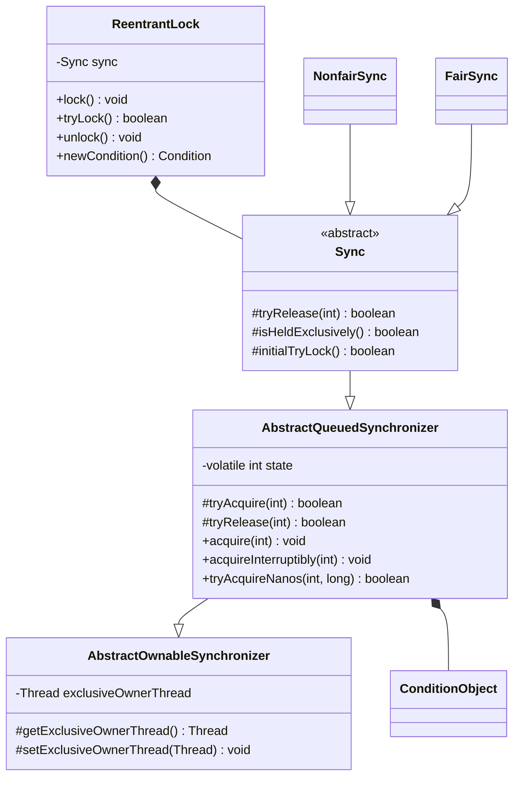
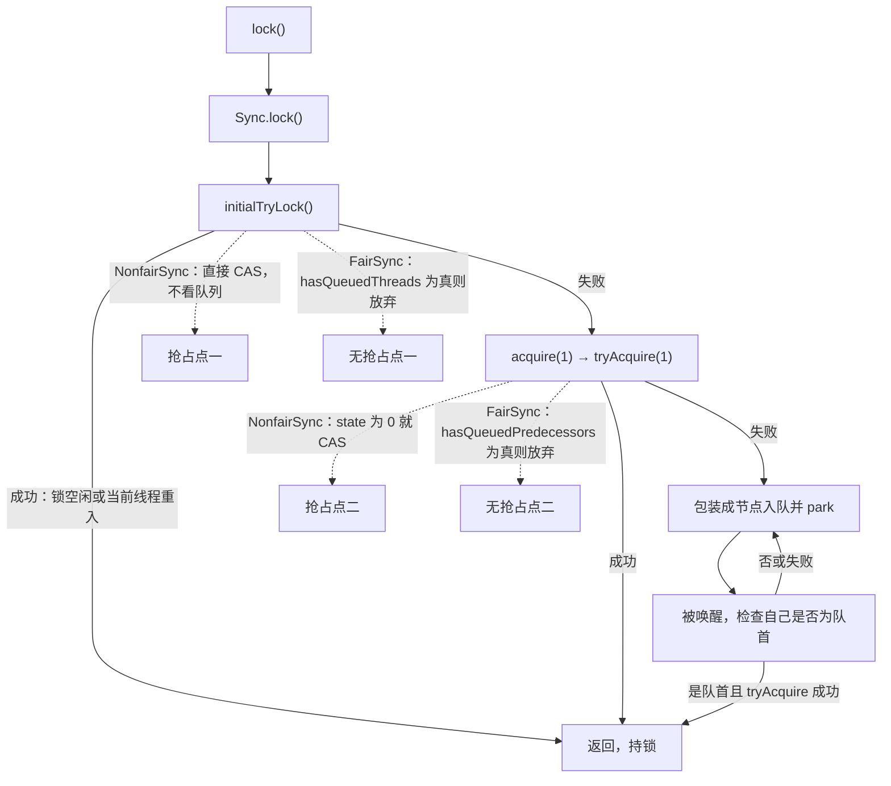
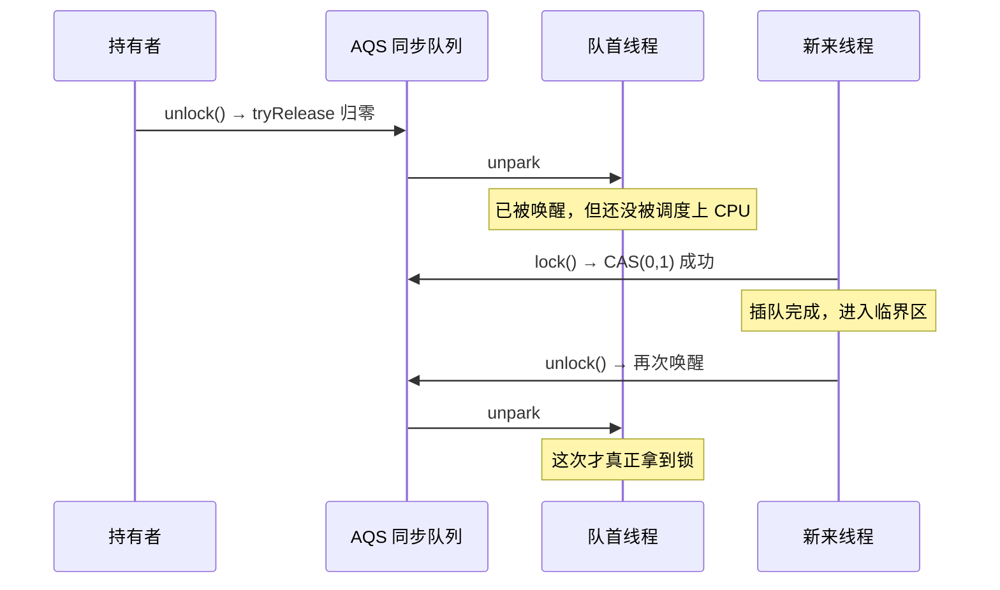
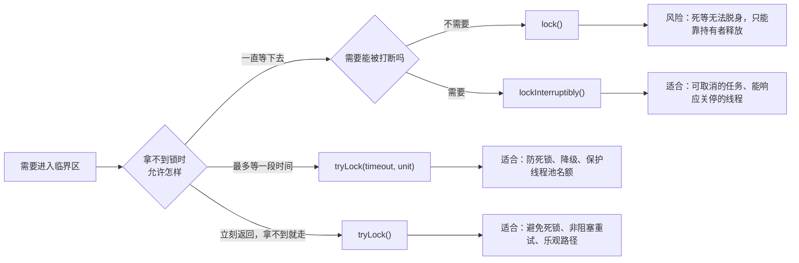
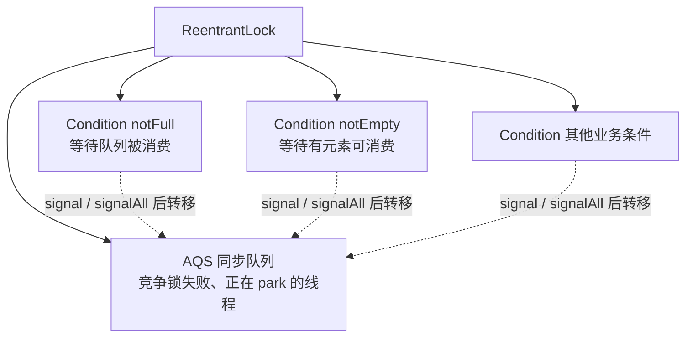
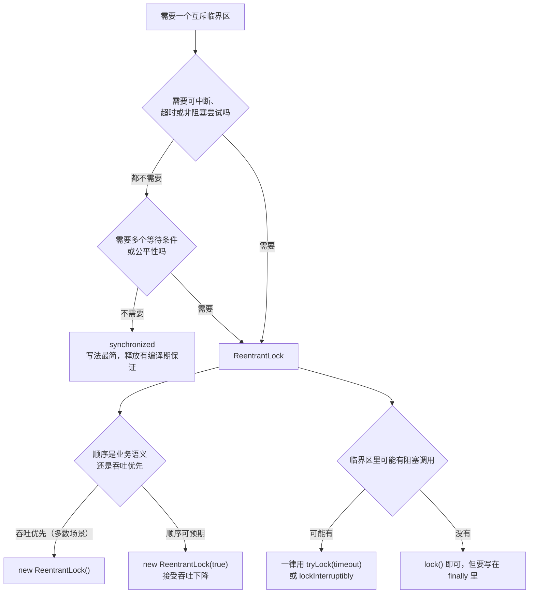

# 07 ReentrantLock 深度剖析——公平锁、非公平锁与可中断

**摘要：**

`ReentrantLock` 是 `java.util.concurrent.locks` 里使用最广的显式锁，它与 `synchronized` 提供同样的互斥与重入语义，却把"等待"这件事从 JVM 手里拿回来，放到了可以编程的类库层面。本篇只回答两个问题：它在 AQS 之上定制了什么，"公平"这个选择又付出了什么。排队、park、唤醒传播这些通用机制由 AQS 统一解决，落在这里的内容是：`Sync`、`NonfairSync`、`FairSync` 三个内部类如何分工，`state` 如何被解释成重入计数，公平与非公平的差别为什么最后收敛成"锁空闲时要不要先问队列一句"，重入与释放靠什么配对，可中断与超时如何让等待变得可以退出，`Condition` 又如何把一条等待队列拆成多条。笔者把每一处差异落到源码上，并附上本机实测：公平锁的代价落在哪个量级、`tryLock` 与公平设置为什么彼此错位、死锁该用哪个 `ThreadMXBean` 方法去查。最后给出与 `synchronized` 的选型判据与五类反例。结论并不复杂：公平不是一个"更正确"的选项，而是一份关于顺序的承诺，代价是每次交接都要换人。

---

## 第 1 章 显式锁要解决的问题

2004 年，JSR 166 的成果随 J2SE 5.0 一起发布，`java.util.concurrent` 从这一天起成为 JDK 的一部分。在此之前，Java 程序员手里只有两种同步手段：`synchronized` 关键字与 `Object.wait/notify`，两者都直接对应 JVM 的监视器（monitor）实现。这样一套原语撑起了 Java 早期的并发编程，但它有一个结构性的限制：监视器的获取、排队与唤醒全部由 JVM 实现，Java 层拿不到任何插手的余地，想加一种新的等待语义，只能改虚拟机。

Doug Lea 的选择是绕开它，用可以在 Java 层实现的方式重建一套同步基础设施。`ReentrantLock` 就是这套基础设施给出的第一把锁，它复用 `synchronized` 的语义（互斥、可重入、由持有者释放），却在"线程拿不到锁时该怎么办"这个问题上给出了多个答案。理解这一点，才能理解这个类为什么长得像现在这样。

### 1.1 等待这件事有几种形态

把线程拿不到锁时的处境列一遍，会发现它并不只有"等着"一种：

- 线程可以一直等下去，直到别的线程把锁放出来，中途发生什么与它无关；
- 线程可以等到某个外部信号，一旦有人喊停就立刻放弃，把异常抛给调用者；
- 线程可以只等到某个期限，期限一到就自己走开，把失败当成正常结果返回；
- 线程可以根本不等，只试一次，拿不到就立刻返身去做别的事。

内置锁只实现了第一种。第二、三、四种在工程上都有明确的适用面：请求被外部取消需要第二种，请求超时需要第三种，服务降级与死锁避免需要第四种。`Lock` 接口把这四种形态都写进了方法签名。

```java
public interface Lock {
    void lock();                                     // 一直等，不响应中断
    void lockInterruptibly() throws InterruptedException; // 一直等，但可以被中断打断
    boolean tryLock();                               // 只试一次，不等待
    boolean tryLock(long time, TimeUnit unit) throws InterruptedException;
    void unlock();
    Condition newCondition();
}
```

把五个方法按"等待行为"排成矩阵，可以看清它们各自的位置。

| 方法 | 拿不到锁时 | 可被中断 | 尊重公平设置 | 是否进入同步队列 |
| :--- | :--- | :--- | :--- | :--- |
| `lock()` | 一直等 | 否 | 是 | 是 |
| `lockInterruptibly()` | 一直等 | 是 | 是 | 是 |
| `tryLock()` | 立即返回 `false` | 不涉及（不阻塞） | 否，总是插队 | 否 |
| `tryLock(long, TimeUnit)` | 等到超时 | 是 | 是 | 是 |
| `newCondition()` | 不涉及 | 不涉及 | 不涉及 | 不涉及 |

这张表里有两个位置容易被想当然地读错。`tryLock()` 那一行的"不尊重公平"并不是实现疏漏，`ReentrantLock` 的 javadoc 明确写着即使构造时指定了公平模式，无参的 `tryLock()` 也会在锁空闲时立即获取，不管有没有别的线程在排队；而 `tryLock(long, TimeUnit)` 反而会尊重公平设置，这两者的差别来自它们走的是两条不同的代码路径，第 5 章会把源码摊开。

### 1.2 把等待搬到类库层意味着什么

监视器的等待发生在 JVM 内部：字节码 `monitorenter` 进入对象头里的重量级锁时，线程被挂到该对象的 WaitSet 或 EntryList 上，这套链表结构对 Java 代码不可见，也没有 API 能让它变一变。`ReentrantLock` 换了一个思路，把"状态"和"队列"都做成 Java 对象：锁的持有情况编码在一个 `volatile int` 里，等待的线程被包装成队列节点，阻塞用 `LockSupport.park` 完成。这些机制在 `AbstractQueuedSynchronizer`（AQS）里实现了一次，`ReentrantLock` 只需要回答一个问题：什么条件下允许线程通过。

这个分工值得记住，因为它决定了后面所有讨论的边界。AQS 负责"怎么排队、怎么阻塞、什么时候唤醒下一个"，`ReentrantLock` 负责"什么时候算拿到锁"。前者是通用机制，后者是这把锁的策略。凡是在 `ReentrantLock` 里看到的差异，都是策略差异，不是排队机制差异。

打个比方，内置锁像是物业统一安装的门禁：刷卡进门，规则固定，谁想改成人脸识别或者限时通行，得整栋楼一起改；`ReentrantLock` 像是自己在门上装的智能锁，指纹、密码、临时授权都能配，但电池要自己换、配置要自己维护，忘带钥匙也没人替你开门。后者的自由度不是免费的，自由度对应的维护责任全部转移到了使用者身上。

### 1.3 一个外壳和它的内核

`ReentrantLock` 类本身几乎没有逻辑：它只持有一个 `Sync` 类型的字段，把 `Lock` 接口的每个方法原样转发过去。

```java
public class ReentrantLock implements Lock, java.io.Serializable {
    private final Sync sync;   // 所有实现机制都在这里

    public void lock()                { sync.lock(); }
    public void lockInterruptibly()   { sync.lockInterruptibly(); }
    public boolean tryLock()          { return sync.tryLock(); }
    public void unlock()              { sync.release(1); }
    public Condition newCondition()   { return sync.newCondition(); }
}
```

`sync` 字段是 `final` 的，在构造器里一次性决定用哪个子类：

```java
public ReentrantLock()               { sync = new NonfairSync(); }
public ReentrantLock(boolean fair)   { sync = fair ? new FairSync() : new NonfairSync(); }
```

也就是说，公平性在一把锁的生命周期里是**不可变的**：没有 `setFair()` 这样的方法，`isFair()` 也只是 `sync instanceof FairSync` 的判断。这个设计不是省事，而是在表达一个立场：公平性属于锁的身份，不属于锁的运行时配置。中途切换公平性会让已经排队的线程处于"按旧规则等待、按新规则被唤醒"的尴尬位置，与其处理这种边界，不如让它不可能发生。

到这里，类库里"看起来简单"的部分已经交代完了。真正的内容在 `Sync` 及其两个子类里，那是第 2 章要拆的东西。

---

## 第 2 章 三个内部类的分工

`ReentrantLock` 内部有三个类：抽象的 `Sync`，以及 `NonfairSync` 与 `FairSync`。三者的关系不是并列的三种实现，而是"一份共同的重入语义 + 两种准入策略"。



这张图里有一条容易被忽略的继承线：`AbstractQueuedSynchronizer` 继承 `AbstractOwnableSynchronizer`，后者只装了一个字段 `exclusiveOwnerThread`。锁的"持有者是谁"这件事，AQS 并不关心，是更上层那个极小的父类提供的。这个拆分解释了后面很多细节，比如 `isHeldExclusively()` 可以只比较持有者、不必先读一次 `state`，这种简化为什么是安全的，第 4 章会给出答案。

### 2.1 Sync：把 state 解释成重入计数

AQS 只提供 `volatile int state` 这个容器，它可以表示任何东西，`ReentrantLock` 把它定义为持有计数，于是契约变成三句话：`state` 为 0 表示没人持有；`state` 为正表示有人持有，数值等于重入次数；持有者记录在 `exclusiveOwnerThread` 里，正常路径下与 `state` 的取值必然一致。

| `state` | `exclusiveOwnerThread` | 含义 |
| :--- | :--- | :--- |
| 0 | `null` | 锁空闲，任何线程都可以通过 CAS 竞争 |
| n > 0 | 持有线程 | 该线程重入了 n 次，必须释放 n 次才真正解锁 |
| n > 0 | 其他线程 | 锁被某个线程持有，其余线程只能入队等待 |

这张表里没有 `state < 0` 的行，因为 `ReentrantLock` 的正常 API 不会产生这种状态：越权释放会先抛 `IllegalMonitorStateException`，异常发生在写 `state` 之前，数值不受影响。这一点在第 4 章会展开，它纠正了一个流传很广的说法。

`Sync` 里最值得看的是四个加锁入口和释放方法，它们把"先试一次、失败再交给 AQS"这个模式固定了下来：

```java
abstract static class Sync extends AbstractQueuedSynchronizer {
    @ReservedStackAccess
    final boolean tryLock() {          // 注释原文：Performs non-fair tryLock
        Thread current = Thread.currentThread();
        int c = getState();
        if (c == 0) {
            if (compareAndSetState(0, 1)) { setExclusiveOwnerThread(current); return true; }
        } else if (getExclusiveOwnerThread() == current) {   // 重入
            if (++c < 0) throw new Error("Maximum lock count exceeded");
            setState(c);
            return true;
        }
        return false;
    }

    abstract boolean initialTryLock();   // 子类决定第一次尝试是否要查队列

    @ReservedStackAccess
    final void lock() { if (!initialTryLock()) acquire(1); }

    @ReservedStackAccess
    final void lockInterruptibly() throws InterruptedException {
        if (Thread.interrupted()) throw new InterruptedException();
        if (!initialTryLock()) acquireInterruptibly(1);
    }

    @ReservedStackAccess
    final boolean tryLockNanos(long nanos) throws InterruptedException {
        if (Thread.interrupted()) throw new InterruptedException();
        return initialTryLock() || tryAcquireNanos(1, nanos);
    }

    @ReservedStackAccess
    protected final boolean tryRelease(int releases) {
        int c = getState() - releases;
        if (getExclusiveOwnerThread() != Thread.currentThread())
            throw new IllegalMonitorStateException();
        boolean free = (c == 0);
        if (free) setExclusiveOwnerThread(null);
        setState(c);
        return free;
    }
}
```

三件事值得停下来看。

其一，`lock()` 不是直接调 `acquire(1)`，而是先调 `initialTryLock()`。JDK 8 的实现是内联的一次 CAS（`if (compareAndSetState(0,1)) ... else acquire(1)`），JDK 21 上改成了先调 `initialTryLock()`；这样安排的好处是把**无竞争获取**与**重入**这两条最热的路径完全挡在 AQS 模板方法之外，无竞争时连 `tryAcquire` 的虚调用都省了。

其二，`lockInterruptibly()` 的第一行是 `Thread.interrupted()`。方法名的第一直觉是"等待过程中能被打断"，但代码告诉我们中断检查发生在**尝试获取之前**：线程如果进来时就带着中断标志，哪怕锁是空闲的、哪怕当前线程就是持有者，也要先抛异常。javadoc 对此有一句明确的表述，大意是本实现作为显式中断点，响应中断的优先级高于正常获取与重入获取。

其三，`tryLockNanos` 用了一个短路表达式 `initialTryLock() || tryAcquireNanos(1, nanos)`。这一行决定了 `tryLock(timeout)` 是否尊重公平：第一次尝试走的是子类的 `initialTryLock()`，公平锁在这里会查队列；只有第一次失败后，才进入 AQS 的超时等待。第 5 章会用实测数据验证这条推理。

### 2.2 两个子类的差异只有一处

把 `NonfairSync` 与 `FairSync` 的代码并排看，差异小得有点意外：

```java
static final class NonfairSync extends Sync {
    final boolean initialTryLock() {
        Thread current = Thread.currentThread();
        if (compareAndSetState(0, 1)) {                 // 直接抢，不看队列
            setExclusiveOwnerThread(current);
            return true;
        } else if (getExclusiveOwnerThread() == current) {
            int c = getState() + 1;
            if (c < 0) throw new Error("Maximum lock count exceeded");
            setState(c);
            return true;
        } else
            return false;
    }

    protected final boolean tryAcquire(int acquires) {   // 入队前的最后一次抢
        if (getState() == 0 && compareAndSetState(0, acquires)) {
            setExclusiveOwnerThread(Thread.currentThread());
            return true;
        }
        return false;
    }
}

static final class FairSync extends Sync {
    final boolean initialTryLock() {
        Thread current = Thread.currentThread();
        int c = getState();
        if (c == 0) {
            if (!hasQueuedThreads() && compareAndSetState(0, 1)) {   // 先看队列
                setExclusiveOwnerThread(current);
                return true;
            }
        } else if (getExclusiveOwnerThread() == current) {
            if (++c < 0) throw new Error("Maximum lock count exceeded");
            setState(c);
            return true;
        }
        return false;
    }

    protected final boolean tryAcquire(int acquires) {   // 入队前的最后一次抢，也要公平
        if (getState() == 0 && !hasQueuedPredecessors() &&
            compareAndSetState(0, acquires)) {
            setExclusiveOwnerThread(Thread.currentThread());
            return true;
        }
        return false;
    }
}
```

差异可以精确地归纳成两点：`initialTryLock()` 的空闲分支多一个 `hasQueuedThreads()` 判断，`tryAcquire()` 的空闲分支多一个 `hasQueuedPredecessors()` 判断。也就是说，公平与非公平在语义上只差一件事：锁空闲时要不要先问队列一句。代码里它出现在两个位置，因为这条路径上有两个抢占点，而不是两套不同的逻辑。

| 位置 | `NonfairSync` | `FairSync` | 后果 |
| :--- | :--- | :--- | :--- |
| `initialTryLock()` 空闲分支 | 直接 CAS | 先 `hasQueuedThreads()` 再 CAS | 新线程能不能插队 |
| `tryAcquire()` | `state == 0 && CAS` | 多一个 `!hasQueuedPredecessors()` | 入队重试时能不能插队 |
| 重入分支 | 在 `initialTryLock()` 中 | 同左 | 无差别，重入永远优先 |
| `tryAcquire()` 是否处理重入 | 不处理 | 不处理 | 重入已在第一步被截获 |

最后一行值得记一笔。很多人以为 `tryAcquire` 里应该有重入分支，实际上两个子类都没有：读一下 `Sync.lock()` 就知道，`tryAcquire` 只会在 `initialTryLock()` 返回 `false` 之后被调用，而"当前线程就是持有者"这种情况在 `initialTryLock()` 里已经返回 `true` 了。这带来一个容易被忽略的推论：**重入永远优先于公平**，一个已经持锁的线程再次 `lock()`，无论队列里排了多少人都不会去排队。

### 2.3 lock() 的完整路径

把上面这些拼起来，一次 `lock()` 调用实际走的路径如下。



这张图里，虚线标出的两个位置就是非公平锁的全部"特权"。它们不在 AQS 里，而是 `ReentrantLock` 自己的子类加进去的；AQS 的队列语义对两种锁完全一致。理解这个边界，"非公平锁是不是没有队列"这类问题就自然消失了。

---

## 第 3 章 公平到底意味着什么

公平性在并发语境里是一个被高估的词。它听起来像是一种道德属性，实际上它只是一个**关于顺序的承诺**：当锁空闲时，把它交给等待时间最长的线程。承诺越强，实现它的代价越具体。

### 3.1 插队发生在两个瞬间

非公平锁的"特权"出现在两个瞬间。第一个是线程调用 `lock()` 时，`initialTryLock()` 直接对 `state` 做 CAS，不看队列里有没有人。第二个是任何一次重试 `tryAcquire()` 的时机——非公平版本只看 `state`，只要它恰好为 0 就抢下来，排队情况一概不问。

这两次机会加起来，构成了一个在短临界区下极有效的策略：一个刚刚到达的线程，如果碰巧撞上锁刚被释放的空档，就可以在"被唤醒的线程还没真正跑起来"之前完成一次完整的加锁与解锁。这不是抢了别人的东西，而是利用了一段本来会被浪费的时间。这段窗口有多长、插队者又是怎么钻进去的，用一张时序图看得更清楚。



时序图里的空档是这段逻辑的全部依据。`unpark` 只是把线程的许可位设为 1，真正从内核态回到用户态执行还要经过调度器，这段延迟在微秒量级；而一次 `CAS` 的耗时是纳秒量级。两者相差三个数量级，插队线程正是在这个空隙里完成了工作。

### 3.2 非公平不等于没有队列

一个常见的误解是把"非公平"读成"不排队"。事实恰好相反：非公平锁的排队逻辑与公平锁完全共用，失败一样入队，一样 `park`，一样只能在被唤醒后重试。差别只在于入队之前允许先抢两次，抢不到再排。

这个区别在代码里非常清楚：`Sync.lock()` 是 `if (!initialTryLock()) acquire(1)`，`acquire(1)` 是 AQS 的模板方法，入队、挂起、唤醒一视同仁。非公平锁没有覆盖 `acquire`，也无从覆盖，它是 `final` 的。

所以准确的说法是：非公平锁把"排队"从**唯一的准入方式**降级为**兜底方式**。高竞争下队列照样会变长，`getQueueLength()` 照样能读到几十上百，只是队列里的线程还要额外承受"每次锁释放都可能被别人截胡"的风险。

### 3.3 两个谓词的精确语义

公平锁用到的两个判断方法，名字相近，语义不同，混用会直接死锁。

```java
// 队列里有没有等待者（快路径读 head.next，读到陈旧值就从 tail 反向遍历）
public final boolean hasQueuedThreads() {
    return getFirstQueuedThread() != null;
}

public final Thread getFirstQueuedThread() {
    Thread first = null, w; Node h, s;
    if ((h = head) != null && ((s = h.next) == null ||
                               (first = s.waiter) == null ||
                               s.prev == null)) {
        for (Node p = tail, q; p != null && (q = p.prev) != null; p = q)
            if ((w = p.waiter) != null) first = w;   // 从 tail 反向找第一个有效节点
    }
    return first;
}

// 我前面有没有等待者
public final boolean hasQueuedPredecessors() {
    Thread first = null; Node h, s;
    if ((h = head) != null && ((s = h.next) == null ||
                               (first = s.waiter) == null ||
                               s.prev == null))
        first = getFirstQueuedThread();
    return first != null && first != Thread.currentThread();
}
```

`hasQueuedThreads()` 回答的是"队列里有没有人"，`hasQueuedPredecessors()` 回答的是"排在我前面的人有没有"。队列里只有当前线程自己时，前者返回 `true`，后者返回 `false`，这就是它们全部的区别。

为什么两个位置要用不同的谓词？想一下把 `tryAcquire` 里的 `hasQueuedPredecessors()` 换成 `hasQueuedThreads()` 会发生什么：队首线程被唤醒后重试 `tryAcquire`，此时它仍然在队列里，队列非空，`hasQueuedThreads()` 返回 `true`，于是它被拒绝；它继续等，队列永远非空，它永远被拒绝。**整个同步器就此停摆**。`hasQueuedPredecessors()` 额外排除"第一个等待者就是我自己"这种情况，正是为了让队首线程能够顺利通过。反过来，把 `initialTryLock()` 里的 `hasQueuedThreads()` 换成 `hasQueuedPredecessors()` 并不会出错，因为调用它的线程还没入队，两个谓词的判定结果相同，用前者只是因为"队列是否为空"更贴合那个位置要问的问题。

| 维度 | `hasQueuedThreads()` | `hasQueuedPredecessors()` |
| :--- | :--- | :--- |
| 回答的问题 | 队列里有没有等待者 | 我前面有没有等待者 |
| 队列里只有当前线程 | `true` | `false` |
| 调用位置 | `FairSync.initialTryLock()` | `FairSync.tryAcquire()` |
| 能否互换 | 不能，换到 `tryAcquire` 里会让队首线程永久等待 | 可以，调用者还没入队时两者等价 |

两个谓词还有一个共同性质：它们返回的都是**某一瞬间的快照**。AQS 的 javadoc 对此说得很直白，返回 `true` 不保证一定有别的线程先于你获得锁（对方可能刚好被中断取消），返回 `false` 也不保证没有线程在竞态中抢先入队。这种"估计式"语义是并发数据结构的常态，只要它只在准入判断里使用、而不是被当成正确性保证，就没问题。

### 3.4 交接的代价

公平锁的代价可以用一句话概括：**每一次交接都必须换人**。锁释放时，`tryRelease` 归零，`release` 调用 `signalNext(head)` 唤醒队首，然后释放者退出；队首线程被唤醒后从 `park` 返回，重新检查队首位置，重试获取，成功后才进入临界区。这一整条链路里，唤醒、调度、重试都是实打实的开销。

非公平锁允许刚释放锁的线程（或另一个正在运行的线程）直接把锁接过去，免掉了"把你叫醒，再等你被调度上来"这段纯空转。换个更准确的说法：非公平锁避免了**唤醒者与被唤醒者之间的交接延迟**，而这段延迟对短临界区来说是致命的，因为交接成本可能远大于临界区本身的执行时间。

用本机实测把量级摆出来。测量方式为 8 个线程、空临界区、每个线程在 1 秒窗口内反复 `lock/unlock`，记录总成功次数，OpenJDK 17.0.17（Apple Silicon），两次独立运行取量级。

| 实验（本机粗测，非 JMH） | 非公平（默认） | 公平（`new ReentrantLock(true)`） |
| :--- | :--- | :--- |
| 8 线程空临界区总吞吐（两次） | 3.35 × 10⁷ / 4.26 × 10⁷ 次每秒 | 4.69 × 10⁵ / 4.98 × 10⁵ 次每秒 |
| 单线程最多与最少获取次数之比 | ≈ 1.0 | ≈ 1.0 |

差距接近两个数量级，公平锁的吞吐只有非公平的百分之一出头。这个数字不能直接外推到业务代码：空临界区把交接成本放到了最大，真实临界区越长，交接开销占比越小，差距也会收窄。JDK 的 javadoc 对公平锁性能的表述是"lower overall throughput (i.e., are slower; often much slower)"，用词是 often much slower，与这里的量级方向一致。

> [!warning] 关于这组数字
> 上表是单机、单次测量、没有 JMH 预热与隔离的粗测，只用于说明"差距在哪个量级"，不能当作基准数据引用。要评估真实业务里的差异，得用带真实临界区长度的 JMH 基准，并且关注延迟分位数而不是总吞吐。

顺带说一下单线程分布那一行。在纯自旋的竞争下，非公平锁的插队机会实际上被所有活跃线程分享了，8 个线程的获取次数几乎相等（最大最小比约为 1）。这说明**非公平不等于随机，也不等于天然饥饿**；饥饿需要特定的调度形态才会出现，比如部分线程被换出、线程池里的任务交替执行、或者临界区里有阻塞操作。

### 3.5 公平锁解决不了什么

公平锁的承诺比多数人以为的要窄。JDK 的 javadoc 在描述公平参数时专门写了三段限定，大意是：公平锁只保证等得最久的线程在**锁这一层**优先，不保证线程调度本身的公平；因此使用公平锁时，仍可能出现某个线程连续多次获得锁，而其他活跃线程没有进展；另外无参的 `tryLock()` 不遵守公平设置。

第一段限定的意思是，公平锁管的是"锁的发放顺序"，管不了"谁能被 CPU 选中"。线程被唤醒后还要排队等 CPU，操作系统的调度器不会因为你在 Java 层排得早而优待你。所以公平锁能降低的是**获锁时间的方差**，不能把它压缩到零。

第二段限定更要紧：公平锁**不解决活锁**。活锁的形态是所有线程都在动、都在重试，但系统整体没有前进，比如两个线程反复 `tryLock` 失败、退避、再重试，节奏完全同步。这种问题与获锁顺序无关，公平锁帮不上忙，能解决它的是随机化退避或者给重试加上限。

第三段限定回到代码：`tryLock()` 走的是 `Sync.tryLock()`，而那个方法的注释写的是 "Performs non-fair tryLock"，没有任何公平性检查。用本机实测把这个现象量化：构造一个公平锁，让一个线程持锁、另一个线程进入队列并 `park`，然后主线程在锁释放的瞬间尝试获取。

| 场景（公平锁，队列里已有等待者） | 插队成功次数 / 轮次 |
| :--- | :--- |
| 新线程调用 `tryLock()` | 500 / 500 |
| 新线程调用 `tryLock(0, TimeUnit.NANOSECONDS)` | 6 / 500 |

同一个公平锁，无参的 `tryLock()` 全部插队成功，把超时设成 0 的 `tryLock(0, ...)` 只有 1% 左右成功。原因在 `tryLockNanos` 的短路表达式里：`tryLock(0, ...)` 的第一步是 `initialTryLock()`，公平锁在这里查队列，发现有人排队就放弃；`tryLock()` 走的是 `Sync.tryLock()`，直接 CAS，压根不问队列。想在不阻塞的前提下保持公平，就得用 `tryLock(0, ...)`，这也是 `ReentrantLock` javadoc 给出的建议写法。

### 3.6 什么时候才值得用公平锁

把公平锁的收益与代价放在一起，判断标准其实是场景里的**顺序本身是否承载业务语义**。

| 维度 | 非公平（默认） | 公平（`new ReentrantLock(true)`） |
| :--- | :--- | :--- |
| 获锁顺序 | 不保证 | 近似 FIFO，偏向等待最久者 |
| 吞吐（本机粗测） | 约 4 × 10⁷ 次每秒 | 约 5 × 10⁵ 次每秒 |
| 获锁延迟方差 | 大 | 小 |
| 饥饿风险 | 存在，取决于调度形态 | 显著降低，但不保证线程调度公平 |
| 每次交接 | 有机会免掉一次唤醒 | 必然多一次 park/unpark 往返 |
| 典型适用 | 短临界区、吞吐优先的通用场景 | 顺序即语义、延迟需要可预期 |

"顺序即语义"的例子并不罕见：按提交顺序处理的任务队列（先到的工单先被处理）、需要公平轮转的限流器、审计日志里的加锁顺序必须与时间顺序一致。这些场景如果换成非公平锁，功能上可能仍然"能用"，但业务语义会被实现细节侵蚀，测试很难测出来，线上表现为偶发的顺序颠倒。

不过公平锁也不是唯一解。如果真正需要的是"公平的排队"而不是"公平的锁"，用 `Semaphore(true)` 或者自己在业务层维护一个有界队列，往往比把整把锁降级为公平模式更划算，因为前者只让真正需要顺序的环节付出代价。

---

## 第 4 章 重入与释放的契约

可重入是 `ReentrantLock` 与 `synchronized` 共享的性质，也是最容易被当成"天然"的性质。它不天然，它是靠两个字段的配合精确实现的。

### 4.1 重入靠什么实现

重入的判定只有一句话：**当前线程是不是 `exclusiveOwnerThread`**。是，就把 `state` 加一，直接返回成功；不是，就走正常的竞争流程。`NonfairSync.initialTryLock()` 的第二个分支与 `Sync.tryLock()` 的 `else if` 分支都是这段逻辑。

这里有一个小的实现风格差异，两段代码的语义相同但写法不同：非公平锁先算 `int c = getState() + 1` 再判断 `if (c < 0)`，公平锁用 `if (++c < 0)`。看起来是无关紧要的笔误级差别，但它暴露了一个事实：这两段代码是分别手写的，而不是从同一份模板生成的。

为什么需要重入，反例比正例更有说服力。假设锁不可重入：

```java
public synchronized void outer() {
    inner();     // 已经持有锁，再进来会等自己释放
}

public synchronized void inner() {
    // ...
}
```

`outer()` 持有锁后调用 `inner()`，`inner()` 尝试获取同一把锁。如果锁不可重入，`inner()` 会认为锁被别的线程占着，于是挂起等待，而它等待的正是自己，永久阻塞。递归、回调、委托调用这些常见的代码组织方式都会撞上这个问题，这也是为什么现代锁几乎默认提供重入。

### 4.2 释放必须配对

释放路径是 `unlock()` → `sync.release(1)` → `tryRelease(1)`。`tryRelease` 做了三件事：把 `state` 减一，判断减完是否为 0，若为 0 则清空持有者并返回 `true`。只有返回 `true`，AQS 的 `release` 才会去唤醒后继节点。

```java
@ReservedStackAccess
protected final boolean tryRelease(int releases) {
    int c = getState() - releases;
    if (getExclusiveOwnerThread() != Thread.currentThread())
        throw new IllegalMonitorStateException();
    boolean free = (c == 0);
    if (free)
        setExclusiveOwnerThread(null);
    setState(c);
    return free;
}
```

这段代码里有个很实际的细节：`c` 在越权检查**之前**就被算出来了，但 `setState(c)` 在检查之后。所以非持有者调用 `unlock()` 时，异常抛出，`state` 保持原样，锁的状态没有被破坏。这一点在实测中得到了确认：主线程 `lock()` 之后让另一个线程调用 `unlock()`，抛 `IllegalMonitorStateException`，随后锁仍可被正常获取。

更常见的问题是"多解一次"。这里要纠正一个流传很广的说法：**多解一次不会把 `state` 打成负数**，而是同样抛 `IllegalMonitorStateException`。原因是第一次 `unlock()` 让 `state` 归零的同时已经把 `exclusiveOwnerThread` 置为 `null`，第二次进入 `tryRelease` 时，线程身份检查必然失败，异常在 `setState` 之前抛出。实测结果：`lock()` → `unlock()` → 再 `unlock()`，第二次抛异常，`isLocked()` 为 `false`，`getHoldCount()` 为 0，锁状态完好，其他线程可以正常加锁。

```java
// 契约：lock 与 unlock 必须严格配对，且 unlock 写在 finally 里
lock.lock();
try {
    // 临界区
} finally {
    lock.unlock();
}
```

`unlock()` 的实现是 `sync.release(1)`，它返回布尔值，但 `unlock()` 把返回值丢掉了。这个设计是有意的：对使用者而言，`unlock()` 成功就是成功，失败只有一种形态，就是抛异常。丢掉返回值换来的简洁，是"释放不需要判断结果"这个语义前提。

### 4.3 重入深度与栈的保护

`state` 是 `int`，理论上最多重入 `Integer.MAX_VALUE` 次（约 21 亿），超过时抛出 `Error("Maximum lock count exceeded")` 而不是让 `int` 静默溢出。这个上限在现实中不可能撞到，但防御性检查的成本只有一次比较。

真正与栈有关的保护是另一个注解。`Sync` 的 `lock()`、`tryLock()`、`lockInterruptibly()`、`tryLockNanos()`、`tryRelease()` 上都标了 `@ReservedStackAccess`。这个注解告诉 JVM：这个方法应该在一块预留的栈空间里执行，即便线程的普通栈已经接近耗尽，它也能执行完。它解决的是一个很具体的死锁场景：深度递归的线程在临界区里遇到 `StackOverflowError`，如果释放锁的那几行代码也因为栈耗尽而无法执行，锁就永久泄漏了，其他线程全部卡死。给释放路径留一块预留栈，等于给这种极端情况留了一条退路。

这个细节也说明了一件事：AQS 与 `ReentrantLock` 的代码里没有一行是随手写的，看起来只是"减一并判断是否为零"的方法，背后对应着一类已经被踩过的线上故障。

### 4.4 持有者字段为什么可以不是 volatile

`exclusiveOwnerThread` 的声明是 `private transient Thread exclusiveOwnerThread`，没有 `volatile`。这在 JMM 的视角下会让人警觉：别的线程读它，会不会读到过期的值？

答案藏在访问方式里。`isHeldExclusively()` 的实现是 `getExclusiveOwnerThread() == Thread.currentThread()`，只有持有者自己会走这条路径，而持有者对自身字段的读永远是自己写的值；`tryRelease` 里的身份检查同理，由释放者自己判断。真正需要跨线程读持有者的，是 `getOwner()` 这类监控方法：

```java
final Thread getOwner() {
    return getState() == 0 ? null : getExclusiveOwnerThread();
}
```

注意它先读 `state` 再读持有者。`state` 是 `volatile`，写在释放锁时与 `setExclusiveOwnerThread(null)` 相邻，读到的 `state` 非零意味着"锁被持有"这个事实已经通过 `state` 的读屏障传播过来，随后的持有者读取虽然不保证是最新的，但对监控用途而言已经足够。源码注释把这种取舍写得很直白：为了判断"是不是自己持有"不需要先读 `state`，但一般性地读持有者之前应该先读 `state`。

用一句话概括这条规则：**同步语义都压在 `state` 上**，其余字段的正确性依附于它。这是 [[02 Java 内存模型（JMM）——happens-before 与可见性保证]]里那条 happens-before 规则在库代码中的典型用法，也是理解整个 AQS 家族的一把钥匙。

### 4.5 序列化会把锁重置

`ReentrantLock` 实现了 `Serializable`，但它的 `readObject` 里有一行容易被忽略的代码：

```java
private void readObject(java.io.ObjectInputStream s)
        throws java.io.IOException, ClassNotFoundException {
    s.defaultReadObject();
    setState(0); // reset to unlocked state
}
```

反序列化得到的锁一定是未锁定状态，持有者字段为空。javadoc 对此的说明是，反序列化后锁处于未锁定状态，与序列化时的状态无关。这在分布式或缓存场景里会变成一个真实的问题：如果一个持有锁的对象被序列化后传输或落盘，反序列化得到的是一把"崭新"的锁，与原来的锁毫无关系，两份副本各自保护各自的数据。锁不适合跨进程传递，这条边界的根源就在这里。

---

## 第 5 章 可中断、超时与放弃

`Lock` 接口给出的四种获取方式，真正的差别不在"能不能拿到锁"，而在"拿不到锁的时候，线程有没有退路"。这一章把四条退路逐一拆开，并把 `lock()` 为什么没有退路讲清楚。

### 5.1 为什么 lock() 是不可中断的

`lock()` 的路径是 `Sync.lock()` → `initialTryLock()` 失败 → `acquire(1)`。`acquire` 是 AQS 的模板方法，它调用子类的 `tryAcquire`，失败就入队并 `park`。整条路径上没有任何一处会因为中断标志而放弃获取。

```java
// AQS：不可中断获取的入口（JDK 17）
public final void acquire(int arg) {
    if (!tryAcquire(arg))
        acquire(null, arg, false, false, false, 0L);  // 第四个参数 false = interruptible
}
```

第四个参数是 `interruptible`，`lock()` 传的是 `false`。进入队列循环后，中断只会被记录：

```java
// acquire 循环中的 park 与中断处理（节选）
} else {
    long nanos;
    spins = postSpins = (byte)((postSpins << 1) | 1);
    if (!timed) LockSupport.park(this);
    else if ((nanos = time - System.nanoTime()) > 0L) LockSupport.parkNanos(this, nanos);
    else break;
    node.clearStatus();
    if ((interrupted |= Thread.interrupted()) && interruptible)
        break;   // interruptible 为 false 时，中断不构成退出条件
}
```

中断标志被记进局部变量 `interrupted`，循环继续；最终拿到锁时，`acquire` 里的 `if (interrupted) current.interrupt();` 会把中断位重新置上，取消路径上则由 `cancelAcquire` 负责同样的事。所以 `lock()` 期间发生的中断既不会丢失，也不会让线程提前退出。

实测确认了这两点：一个线程在 `lock()` 上阻塞，`interrupt()` 之后线程状态仍然是 `WAITING`，没有被唤醒出队；等持有者释放锁、该线程拿到锁并继续执行时，`Thread.currentThread().isInterrupted()` 返回 `true`。中断被完整地保留了，但它对"何时退出等待"没有任何影响。

这个设计的后果很直接：**卡在 `lock()` 上就没有退路**。在服务化的场景里，这意味着请求已经超时返回、客户端已经断开，而工作线程仍然挂在锁上，占着线程池的名额。线程池的"取消任务"用的是 `Future.cancel(true)`，它靠的正是中断，而 `lock()` 不吃中断，任务取消就成了空操作。

> [!info] 为什么 JDK 不让 lock() 响应中断
> 这与 `synchronized` 的行为保持了一致，是刻意的兼容选择。如果把响应中断的语义放进 `lock()`，那么所有原本等价于 `synchronized` 的代码在引入 `ReentrantLock` 后都会多出一个 `InterruptedException` 的处理分支，检查型异常的传染会扩散到每一个调用点。JDK 的做法是把"可中断"单独做成 `lockInterruptibly()`，让需要它的人显式选择。

### 5.2 lockInterruptibly 的两处差异

`lockInterruptibly()` 与 `lock()` 的差异有两处，第一处比第二处更容易被忽略。

第一处在入口：`if (Thread.interrupted()) throw new InterruptedException();`。线程进入方法时如果已经带着中断标志，直接抛异常，连尝试获取都不做。这一点在实测里表现得非常干脆：锁完全空闲、没有任何竞争，主线程先给自己置上中断标志，再调用 `lockInterruptibly()`，仍然立刻抛出 `InterruptedException`，并且抛出后中断标志被清零。

第二处在等待过程中：`acquireInterruptibly` 把 `interruptible` 传成 `true`，`acquire` 循环里那个 `if ((interrupted |= Thread.interrupted()) && interruptible) break;` 就会生效，退出循环后返回负值，入口方法据此抛出 `InterruptedException`。

```java
public final void acquireInterruptibly(int arg) throws InterruptedException {
    if (Thread.interrupted() ||
        (!tryAcquire(arg) && acquire(null, arg, false, true, false, 0L) < 0))
        throw new InterruptedException();
}
```

注意这个表达式的结构：`Thread.interrupted() ||` 放在最前面，短路求值保证了"带着中断标志进来"这种情况不会再去尝试获取。`acquire` 的返回值也被约定成三值语义：正数表示成功，0 表示超时，负数表示被中断。

### 5.3 tryLock 的三种形态

`tryLock` 在工程里的使用频率远高于它的名气，因为它对应的是"宁可失败也不要阻塞"这整类需求。它有三种形态，行为差异比 `lock` 家族更细。

| 形态 | 内部入口 | 是否等待 | 是否可中断 | 是否尊重公平 | 失败时 |
| :--- | :--- | :--- | :--- | :--- | :--- |
| `tryLock()` | `Sync.tryLock()` | 否，只抢一次 | 不涉及 | 否，总是插队 | 返回 `false` |
| `tryLock(t, u)` | `Sync.tryLockNanos()` → `initialTryLock()` 或 `tryAcquireNanos()` | 是，最多 t | 是 | 是 | 返回 `false` 或抛 `InterruptedException` |
| `tryLock(0, u)` | 同上，超时立即到期 | 否 | 是（入口检查） | 是 | 返回 `false` |

第一种形态的实现就是 `Sync.tryLock()`，注释直接写着 "Performs non-fair tryLock"：`state` 为 0 就 CAS，否则检查是否重入，两者都不成立就返回 `false`。它不等待、不入队、不抛中断异常，也没有任何公平性检查。公平锁调用它同样会插队，第 3 章的 500/500 实测就是这个结果。

第二种形态是唯一"带等待又尊重公平"的版本。`tryLockNanos` 先做一次 `initialTryLock()`（公平锁在这里查队列），失败后交给 AQS 的 `tryAcquireNanos` 做带超时的等待。因为 `tryAcquireNanos` 是 `interruptible` 的，所以它有第三种可能的结局：等到一半被中断，抛 `InterruptedException`，此时超时还没到。实测中，一个阻塞在 `tryLock(10, TimeUnit.SECONDS)` 上的线程被中断后立刻抛出了 `InterruptedException`，中断标志在抛出时被清除。

第三种形态 `tryLock(0, TimeUnit.NANOSECONDS)` 常被当成"公平版的 tryLock()"，严格说来它多一层语义：入口处会检查中断标志，如果进来时已经被中断，它抛 `InterruptedException` 而不是返回 `false`。需要绝对不抛检查型异常的地方，还得用无参版本。

javadoc 还给了一个组合写法，用来表达"先插队试一次，不行就公平地等一会儿"：

```java
if (lock.tryLock() || lock.tryLock(timeout, unit)) {
    try {
        // 临界区
    } finally {
        lock.unlock();
    }
}
```

这个组合的实际含义是：第一次尝试允许插队，第二次尝试遵守公平。它适合"绝大多数情况下锁是空闲的、但偶尔需要排队"的场景。

### 5.4 超时等待在 JDK 17 之后长什么样

网上流传较广的那份 `ReentrantLock` 源码解读，讲超时等待时引用的是 JDK 8 的 `doAcquireNanos`，配一句"剩余时间小于 `SPIN_FOR_TIMEOUT_THRESHOLD`（1000 纳秒）时直接自旋，不再 park"。这段分析在 JDK 8 上是对的，但 JDK 17 之后 AQS 被重写过一轮，`doAcquireNanos` 与 `SPIN_FOR_TIMEOUT_THRESHOLD` 这两个符号已经不存在，照着它去读新源码会找不到对应的位置。

以 JDK 17 起的 AQS 源码为准，所有带等待的获取（可中断、超时、条件重获）都被统一到一个方法里：

```java
final int acquire(Node node, int arg, boolean shared,
                  boolean interruptible, boolean timed, long time) {
    Thread current = Thread.currentThread();
    byte spins = 0, postSpins = 0;   // 被 unpark 后重试自旋的次数
    boolean interrupted = false, first = false;
    Node pred = null;
    for (;;) {
        // ... 判断自己是否成为队首、前驱是否已取消 ...
        if (first || pred == null) {
            boolean acquired;
            try {
                acquired = shared ? (tryAcquireShared(arg) >= 0) : tryAcquire(arg);
            } catch (Throwable ex) {
                cancelAcquire(node, interrupted, false);
                throw ex;
            }
            if (acquired) {
                if (first) {
                    node.prev = null;
                    head = node;
                    pred.next = null;
                    node.waiter = null;
                    if (interrupted) current.interrupt();
                }
                return 1;
            }
        }
        if (node == null) {                     // 分配节点，先不入队，回到循环开头重判
            node = shared ? new SharedNode() : new ExclusiveNode();
        } else if (pred == null) {              // 首次尝试入队
            node.waiter = current;
            // ... casTail 入队，细节从略 ...
        } else if (first && spins != 0) {
            --spins;                       // reduce unfairness on rewaits
            Thread.onSpinWait();
        } else if (node.status == 0) {
            node.status = WAITING;         // 允许被唤醒，然后重判
        } else {
            long nanos;
            spins = postSpins = (byte)((postSpins << 1) | 1);
            if (!timed) LockSupport.park(this);
            else if ((nanos = time - System.nanoTime()) > 0L) LockSupport.parkNanos(this, nanos);
            else break;                    // 超时
            node.clearStatus();
            if ((interrupted |= Thread.interrupted()) && interruptible) break;
        }
    }
    return cancelAcquire(node, interrupted, interruptible);
}
```

几个与旧版显著不同的点：

参数 `time` 是**绝对截止时刻**（`System.nanoTime()` 的基准），由 `tryAcquireNanos` 在入口算好 `System.nanoTime() + nanosTimeout` 传进来，循环里每次只做一次减法判断，避免了相对时间的累积误差。这一点对长超时尤其重要，否则每次 park 返回都重新计算相对时间，误差会滚雪球。

自旋策略从"剩余时间小于阈值就自旋"改成了 `spins` 与 `postSpins` 两个 `byte` 计数：每次 park 之后，自旋重试的次数按 `postSpins = (postSpins << 1) | 1` 翻倍（1、3、7、15……直到字节溢出回绕），先用一段自旋吃掉"对方刚好在释放锁"的窗口，再真正挂起。源码注释写着 `// reduce unfairness on rewaits`，意思是这段自旋在减少"被唤醒后又被别人抢走"的概率，属于对公平性的一点补偿。

返回值约定为三值：`1` 表示成功，`0` 表示超时，负值表示被中断。`tryAcquireNanos` 把 `0` 翻译成 `false`、负值翻译成 `InterruptedException`，`acquireInterruptibly` 只关心负值，`acquire` 的非中断模式则完全不关心负值，因为它的 `interruptible` 是 `false`，中断只会被记录并稍后恢复。

还有一个旧版没有的细节：节点状态常量变了。JDK 8 用 `waitStatus` 表示 `SIGNAL(-1)`、`CANCELLED(1)`、`CONDITION(-2)`，JDK 17 的 `Node` 改成了 `volatile int status`，常量是 `WAITING = 1`、`CANCELLED = 0x80000000`（必须为负）、`COND = 2`。如果在排查问题时阅读的是新版源码，却按旧版常量去解释 `status` 的值，会得出完全相反的结论。

### 5.5 超时是"至少等这么久"

`tryLock(timeout)` 与 `awaitNanos` 都容易给人一种"精确计时"的错觉。实际上 `LockSupport.parkNanos` 只保证线程至少挂起这么久，什么时候被调度回来取决于操作系统，真正的返回时刻总是晚于截止时刻，晚多少取决于机器负载。

本机实测（OpenJDK 17.0.17，20 次采样）：

| 调用 | 请求时长 | 实测耗时（最小 / 中位 / 最大） |
| :--- | :--- | :--- |
| `awaitNanos` | 50 ms | 51 ms / 56 ms / 60 ms |
| `awaitNanos` | 100 ms（单次） | 110 ms |

超时抖动在毫秒量级，相对 50 毫秒的请求，实测最大偏差约 20%。这个量级对"防死等"完全够用，但如果代码把 `tryLock(timeout)` 当成定时器来用，误差会直接体现在业务时序上。合理的用法是把它当**上界保护**：用足够大的超时兜住异常情况，而不是用精确的小超时实现节拍。

### 5.6 一条判据，四个出口

把四种获取方式的选择整理成决策路径，实际编码时就不用再犹豫。



关于 `lock()` 的选择，把它放在最左边而不是最右边是有原因的：它的问题不在于慢，而在于一旦进入等待就没有退路。在服务端代码里，凡是可能长时间持锁的临界区（涉及 IO、远程调用、不可控的第三方代码），都不应该用 `lock()` 等待，因为一旦对方卡住，等待方会跟着无限期卡住，而且没有任何外部手段能把它拉出来。`Thread.stop()` 早已废弃，它的替代品 `Thread.interrupt()` 对 `lock()` 无效，剩下的唯一手段是重启进程。

---

## 第 6 章 Condition：把等待条件拆开

`Condition` 是 `ReentrantLock` 相对 `synchronized` 最实质的一个能力增量。内置锁的等待只有一条队列，所有等待这个对象的线程挤在一起；`Condition` 让一把锁拥有任意多条等待队列，每条对应一种"我在等什么"。

### 6.1 一把锁，多条等待队列

先把拓扑画出来：同一把锁下面挂着多条条件队列，它们与同步队列之间隔着一次"转移"。



这张图只表达拓扑：一把锁可以挂多个 `Condition`，每个 `Condition` 是一条独立的条件队列，`signal` 把节点从条件队列搬到同步队列。搬家的具体机制、`ConditionObject` 内部那套单向链表的维护、以及 `signal` 为什么要先判断 `isHeldExclusively`，都属于 AQS 的职责，见 [[06 AQS 框架——AbstractQueuedSynchronizer 的设计与实现]]。

与内置锁对比，差别在"唤醒的精确度"上。`Object.notifyAll()` 会把该对象 WaitSet 上所有线程全部移到 EntryList，让它们一起竞争监视器，绝大多数线程醒来后发现条件不满足，又重新挂回去；这就是所谓的惊群。多个 `Condition` 把等待者按条件分桶，生产者只在"队列非满"这个条件上唤醒一个生产者，消费者只在"队列非空"上唤醒一个消费者，跨组的无效唤醒就此消失。

### 6.2 await 做了四件事

`await()` 的实现可以拆成四步，每一步都对应一个容易忽略的语义。

```java
// ConditionObject 的等待入口（节选，JDK 17）
private int enableWait(ConditionNode node) {
    if (isHeldExclusively()) {                 // 1. 必须持锁，否则抛 IMSE
        node.waiter = Thread.currentThread();
        node.setStatusRelaxed(COND | WAITING);
        // ... 挂到 firstWaiter / lastWaiter 单向链表尾部 ...
        int savedState = getState();           // 2. 记住完整重入次数
        if (release(savedState))               // 3. 全量释放锁
            return savedState;
    }
    node.status = CANCELLED;
    throw new IllegalMonitorStateException();
}

public final void await() throws InterruptedException {
    if (Thread.interrupted()) throw new InterruptedException();
    ConditionNode node = new ConditionNode();
    int savedState = enableWait(node);
    LockSupport.setCurrentBlocker(this);
    boolean interrupted = false, cancelled = false, rejected = false;
    while (!canReacquire(node)) {              // 4. 等到节点被搬回同步队列
        if (interrupted |= Thread.interrupted()) {
            if (cancelled = (node.getAndUnsetStatus(COND) & COND) != 0)
                break;                         // 中断时还在条件队列 → 取消等待
        } else if ((node.status & COND) != 0) {
            try {
                if (rejected) node.block();
                else ForkJoinPool.managedBlock(node);
            } catch (RejectedExecutionException ex) { rejected = true; }
            catch (InterruptedException ie) { interrupted = true; }
        } else Thread.onSpinWait();            // 刚被唤醒、还在转移中
    }
    LockSupport.setCurrentBlocker(null);
    node.clearStatus();
    acquire(node, savedState, false, false, false, 0L);   // 重获锁并恢复重入计数
    // ... 中断与取消的收尾处理 ...
}
```

第一步的 `isHeldExclusively()` 是硬约束。`Condition` 的 javadoc 与 `ReentrantLock.newCondition()` 的文档都写明：调用 `await`、`signal`、`signalAll` 时必须持有与该 `Condition` 绑定的锁，否则抛 `IllegalMonitorStateException`。实测结果与此一致：不持锁调用 `await()` 抛 `IllegalMonitorStateException`，不持锁调用 `signal()` 同样抛。

第三步的"全量释放"是 `await` 与直觉最不一致的地方。如果线程重入了两次再 `await`，它会释放两次，`state` 直接归零，锁对别人完全开放；`await` 返回时再把这两次重入一次性恢复。实测确认：一个重入两次的线程进入 `await` 后，另一个线程可以立刻获取这把锁；`await` 返回后，该线程的 `getHoldCount()` 仍然是 2。

第四步里那个 `canReacquire` 循环还有一个实现细节值得提一句：等待期间的阻塞走的是 `ForkJoinPool.managedBlock(node)`，而不是裸的 `LockSupport.park`。这意味着在 `ForkJoinPool` 的工作线程里等待条件时，池子知道这个线程被阻塞了，可以按需补偿工作线程，不会因为等待把并行度拖死。JDK 17 把 `ConditionNode` 实现成 `ManagedBlocker`，正是为了这一点。

### 6.3 中断与 signal 的时序

`await` 的中断处理有三条不同的结局，取决于中断在什么时候到达。

| 中断到达时机 | 结局 |
| :--- | :--- |
| 进入 `await` 之前已有中断标志 | 立即抛 `InterruptedException` |
| 条件队列里等待、尚未被 `signal` | 节点标为取消、搬回同步队列、重获锁后抛 `InterruptedException` |
| 已被 `signal`、正在同步队列里等锁 | 正常返回，不抛异常，但把中断标志重新置上 |

第三条最容易被误判。它来自 `await` 里那个 `cancelled` 变量的含义：如果中断发生时节点的 `COND` 状态已经被清掉，说明 `signal` 先到、中断后到，"等待的条件已经满足"，于是不该抛异常；但中断这个事实不能吞掉，所以要恢复中断标志，交给调用者在外层处理。实测把 `signal` 与 `interrupt` 的顺序固定成先 `signal` 后 `interrupt`，`await` 正常返回，`Thread.currentThread().isInterrupted()` 为 `true`。

这个设计对业务代码的含义是：**不抛异常不等于没被中断**。需要在 `await` 返回后检查中断状态的代码，必须在返回后自己查一次。

### 6.4 三种超时等待

`Condition` 提供了三个带超时的版本，返回语义各不相同。

| 方法 | 时间基准 | 返回语义 | 注意点 |
| :--- | :--- | :--- | :--- |
| `awaitNanos(long nanosTimeout)` | 相对，`System.nanoTime()` | 返回剩余纳秒数，超时则为负值 | 剩余值可能被用于下一轮等待，但要自己处理负值 |
| `await(long time, TimeUnit unit)` | 相对 | `true` 表示被 `signal`，`false` 表示超时 | 内部转成 `awaitNanos` 并换算 |
| `awaitUntil(Date deadline)` | 绝对墙钟时间 | `true` 表示被 `signal`，`false` 表示超时 | 用 `System.currentTimeMillis()` 与 `parkUntil`，受系统时间调整影响 |

`awaitNanos` 的返回值有一个不太常见的边界处理：源码里 `return (remaining <= nanosTimeout) ? remaining : Long.MIN_VALUE;`，如果算出来的剩余时间比请求的时长还大（时钟异常或溢出），返回 `Long.MIN_VALUE`。这个约定意味着调用方不能简单地把返回值加到下一次请求上，而要先判断符号。

三个方法都遵循同一个精度前提：超时是下界不是精确值。本机实测 `awaitNanos(50ms)` 的 20 次采样落在 51 到 60 毫秒之间，中位数 56 毫秒。

### 6.5 为什么必须用 while 包住

`Condition` 的 javadoc 与 `Object.wait` 的 javadoc 都提到"虚假唤醒"（spurious wakeup）：线程可能在没被 `signal`、没被中断、没超时的情况下自己醒来。JDK 的文档措辞是允许这种情况发生，实现者不保证不会出现。

```java
// 正确：循环检查条件
lock.lock();
try {
    while (!条件成立) {
        condition.await();
    }
    // 条件成立，继续
} finally {
    lock.unlock();
}

// 错误：只检查一次
lock.lock();
try {
    if (!条件成立) {
        condition.await();
    }
    // 被唤醒不代表条件成立：可能有别的线程先消费掉了
} finally {
    lock.unlock();
}
```

即使用 `signalAll()` 唤醒了全部等待者，也只有一个能真正拿到满足条件的资源，其余线程醒来后必须重新检查。虚假唤醒只是把这件事从"很可能发生"变成"必须防御"，`while` 循环的根因在于**唤醒是一个提示，不是一份保证**。

### 6.6 一个有界队列的实现

把上面这些拼起来，就是一个标准的生产者消费者队列。这段代码几乎是 `ArrayBlockingQueue` 的骨架。

```java
class BoundedBuffer<E> {
    private final ReentrantLock lock = new ReentrantLock();
    private final Condition notFull  = lock.newCondition();
    private final Condition notEmpty = lock.newCondition();
    private final Object[] items = new Object[16];
    private int putIndex, takeIndex, count;

    public void put(E e) throws InterruptedException {
        lock.lock();
        try {
            while (count == items.length) notFull.await();  // 等待"未满"
            items[putIndex] = e;
            if (++putIndex == items.length) putIndex = 0;
            count++;
            notEmpty.signal();                             // 只叫醒一个消费者
        } finally {
            lock.unlock();
        }
    }

    @SuppressWarnings("unchecked")
    public E take() throws InterruptedException {
        lock.lock();
        try {
            while (count == 0) notEmpty.await();           // 等待"非空"
            E e = (E) items[takeIndex];
            items[takeIndex] = null;
            if (++takeIndex == items.length) takeIndex = 0;
            count--;
            notFull.signal();                              // 只叫醒一个生产者
            return e;
        } finally {
            lock.unlock();
        }
    }
}
```

这里有一个流传很广的错误说法需要纠正：`ArrayBlockingQueue` 一直是"一把锁 + 两个 `Condition`"，在 JDK 17 的源码里可以看到 `final ReentrantLock lock`、`private final Condition notEmpty`、`private final Condition notFull` 三个字段并排存在，从 JDK 5 到现在没有改成两把锁。用两把锁（`putLock`/`takeLock`）的是 `LinkedBlockingQueue`，两把锁让生产与消费在同一时刻可以并行，代价是队列长度计数要用 `AtomicInteger` 维护。这个差异在 [[10 并发容器（下）——CopyOnWriteArrayList、BlockingQueue 家族]]里有展开。

### 6.7 signal、signalAll 与 notify、notifyAll

把 `Condition` 与内置锁的等待机制放在一起对照，差异集中在几处能力上。

| 维度 | `Object.wait/notify/notifyAll` | `Condition.await/signal/signalAll` |
| :--- | :--- | :--- |
| 绑定对象 | 内置监视器 | 任意 `Lock` 实现 |
| 等待队列数量 | 每个监视器一个 WaitSet | 每把锁可挂多个 `Condition` |
| 是否可中断 | 是 | 是，另有 `awaitUninterruptibly()` |
| 超时能力 | `wait(long)`，毫秒级；`wait(long, int)` 纳秒参数依赖实现 | `awaitNanos`、`await(t, u)`、`awaitUntil(Date)` |
| 前置约束 | 必须持有监视器 | 必须持有锁，否则抛 `IllegalMonitorStateException` |
| 释放深度 | 全量释放监视器，保留重入计数 | 全量释放 `state`，返回后恢复重入计数 |
| 唤醒顺序 | `notify` 唤醒哪个不确定 | `signal` 唤醒条件队列队首（FIFO） |
| 唤醒后的路径 | 竞争监视器 | 先搬到同步队列，再竞争锁 |

`signal` 与 `notify` 最实质的差别在"精准度"上：`signal` 只影响本 `Condition` 队列的队首，`notifyAll` 与 `signalAll` 会把整条队列搬到同步队列。所以选择其实是一道权衡题：单条队列里等待者条件一致时，`signal` 足够；如果不同等待者等的是不同条件、却共用一条队列（这正是内锁的处境），就只能 `notifyAll`，代价是大量无效唤醒。

`awaitUninterruptibly()` 是内置锁没有的形态：等待期间被中断不会被抛出，而是记下中断状态，等到条件满足、重新获得锁之后再把中断标志恢复。它适合"这一步必须等完，但中断不能被吞掉"的场景，比如清理逻辑里必须等某个状态迁移完成。

还有一个细节容易被忽略：`signal` 的唤醒对象是队首，这个顺序由条件队列的 FIFO 结构保证；但被 `signal` 之后，线程重新获取锁的顺序并不由 `Condition` 决定，而是由锁的公平性决定，javadoc 明确写了公平锁在这里偏向等待最久的线程。

---

## 第 7 章 与 synchronized 的选型

关于这道选择题，最需要先放下的是性能焦虑。在 JDK 21 上，多数场景里两者的性能差距已经被压缩到"功能之外的噪声"这个量级，真正该看的是一张能力表。

### 7.1 能力矩阵

| 能力 | `synchronized` | `ReentrantLock` |
| :--- | :--- | :--- |
| 可重入 | 是 | 是 |
| 可中断等待 | 不支持 | `lockInterruptibly()` |
| 超时等待 | 不支持 | `tryLock(t, u)` |
| 非阻塞尝试 | 不支持 | `tryLock()` |
| 公平性选择 | 无 | 构造参数 |
| 多等待条件 | 单个 WaitSet | 任意多个 `Condition` |
| 状态查询 | 仅 `Thread.holdsLock` | `isLocked`、`getHoldCount`、`getQueueLength`、`hasWaiters` 等 |
| 忘记释放的后果 | 编译器保证 `monitorexit` | 锁泄漏，必须在 `finally` 里释放 |
| jstack 中的形态 | monitor 地址与 `waiting to lock` | `parking to wait for ... ReentrantLock$NonfairSync` |
| 死锁检测 API | `findMonitorDeadlockedThreads()` 可覆盖 | 必须 `findDeadlockedThreads()`（ownable synchronizer） |
| JIT 优化 | 锁消除、锁粗化、逃逸分析 | 无对应优化 |
| 虚拟线程（JDK 21） | 阻塞时 pin 载体线程 | 不 pin |

表里有三行值得单独说，因为它们各自对应一个流传较广的误解。

### 7.2 JDK 21 上的性能现状

第一条误解是"`synchronized` 无竞争时几乎零成本，因为走偏向锁"。这句话在 JDK 15 之前基本成立，现在已经不成立：JEP 374 从 JDK 15 起把偏向锁默认禁用并废弃相关参数，JDK 18 起这些参数被标记为过时（JDK-8256425）。在 JDK 21 上，无竞争的 `synchronized` 走的是轻量级锁的 CAS 路径，成本与 `ReentrantLock` 的一次 CAS 加一次 `setExclusiveOwnerThread` 在同一个量级，没有"偏向"这一层便宜可占。

第二条误解是"JIT 会把两者都优化掉"。锁消除（lock elision）与锁粗化（lock coarsening）都是 C2 针对内置监视器实现的优化，作用对象是 `monitorenter`/`monitorexit` 这对字节码；`ReentrantLock` 的加锁是普通 Java 方法加 CAS，JIT 没有为它准备等价的变换。反过来 `ReentrantLock` 有一处内置锁没有的保护：`@ReservedStackAccess` 让释放路径能在栈耗尽时执行完。两条优化各有各的来路，谁也不是白送的。

所以性能比较的正确问法是"在什么负载下，谁的哪一部分开销占主导"。低竞争、短临界区，两者都在一两次 CAS 的量级，差异在测量噪声里；高竞争，两者都退化成内核阻塞与调度，真正的差别不是锁本身，而是**排队与唤醒策略**，也就是第 3 章讨论的公平性选择。

### 7.3 线上排查的差别

第三条误解是"死锁检测工具对两者一视同仁"。这个差别在故障现场会直接影响判断方向。

用一段真实的两锁交叉代码（线程 1 先 A 后 B，线程 2 先 B 后 A）在本机跑出死锁，再分别用 `jstack -l` 与 `ThreadMXBean` 观察：

`jstack` 的线程段显示的是等待语义而非 monitor：

```text
"worker-1" #14 prio=5 os_prio=31 ... waiting on condition
   java.lang.Thread.State: WAITING (parking)
        at jdk.internal.misc.Unsafe.park(java.base@17.0.17/Native Method)
        - parking to wait for  <0x000000701061bb90> (a java.util.concurrent.locks.ReentrantLock$NonfairSync)
        at java.util.concurrent.locks.LockSupport.park(java.base@17.0.17/LockSupport.java:211)
        at java.util.concurrent.locks.AbstractQueuedSynchronizer.acquire(java.base@17.0.17/AbstractQueuedSynchronizer.java:938)
        at java.util.concurrent.locks.ReentrantLock$Sync.lock(java.base@17.0.17/ReentrantLock.java:153)
        at java.util.concurrent.locks.ReentrantLock.lock(java.base@17.0.17/ReentrantLock.java:322)
```

死锁汇总段用的词是 ownable synchronizer：

```text
Found one Java-level deadlock:
"worker-1":
  waiting for ownable synchronizer 0x000000701061bb90, (a java.util.concurrent.locks.ReentrantLock$NonfairSync),
  which is held by "worker-2"
"worker-2":
  waiting for ownable synchronizer 0x000000701061bb60, (a java.util.concurrent.locks.ReentrantLock$NonfairSync),
  which is held by "worker-1"
```

`ThreadMXBean` 这一侧更容易踩坑。同一进程里，`findDeadlockedThreads()` 返回了两个线程 id，而只查监视器的 `findMonitorDeadlockedThreads()` 返回 `null`：

```text
isSynchronizerUsageSupported=true
findDeadlockedThreads=[14, 15]
findMonitorDeadlockedThreads=null
thread worker-1 state=WAITING lockName=java.util.concurrent.locks.ReentrantLock$NonfairSync@76ed5528 lockOwner=worker-2
```

`findMonitorDeadlockedThreads()` 的 javadoc 写得很清楚，它只找对象监视器上的死锁，不涉及 ownable synchronizer；后者要找 `findDeadlockedThreads()`，并且要求 `isSynchronizerUsageSupported()` 返回 `true`。线上如果用了 `ReentrantLock`，却把监控脚本写成只调 `findMonitorDeadlockedThreads()`，死锁会被报告成"没检测到"，这是排查方向被带偏的典型原因。反过来，用 `findDeadlockedThreads()` 可以同时覆盖 `synchronized` 死锁与 `ReentrantLock` 死锁。

### 7.4 虚拟线程带来的新变量

JDK 21 的虚拟线程改变了这道选择题的一个权重。虚拟线程在 `park` 时会从载体线程上卸载，因此基于 `LockSupport.park` 的 `ReentrantLock` 天然友好；而 JDK 21 的 `synchronized` 在阻塞时会固定（pin）载体线程，让虚拟线程"占着载体不放"，扩展性受限。JDK 24 的 JEP 491 解决了这个问题，`synchronized` 阻塞的虚拟线程也能卸载，这条差异随之收窄。虚拟线程一侧的机制与 pinning 的完整讨论见 [[16 JDK 21 虚拟线程——Project Loom 的协程实现与平台线程的边界]]。

对选型的实际影响是：在 JDK 21 上用虚拟线程跑大量阻塞任务时，`ReentrantLock` 比 `synchronized` 安全；升级到 JDK 24 之后，这条理由弱化，决策重新回到功能需求本身。

### 7.5 决策树

把能力矩阵与代价整理成一条判断路径。



这棵树里最后一个分支值得强调。临界区里出现 IO、远程调用、第三方库这类不可控的阻塞，是"线程池莫名打满"最常见的成因之一：所有线程都在等同一把锁，而锁的持有者卡在某个不会返回的调用上。这种场景下 `tryLock(timeout)` 能做的不是让持锁者变快，而是让等待者有退路，把失败暴露成可观测的超时，而不是把线程池慢慢吸干。

### 7.6 五类反例

反例比正例更能说明约束在哪里。以下五处都是常见的错误写法，每一处都给出症状与根因。

#### 反例一：`lock()` 之后不写 `finally`

```java
// 错误：临界区抛异常，锁永不释放
lock.lock();
doWork();          // 抛出 RuntimeException
lock.unlock();     // 这一行不会执行
```

症状是线程池中的线程逐个卡死在 `parking to wait for ... ReentrantLock$NonfairSync`，且再也拿不到锁。根因不是异常，而是 `unlock` 的执行不再受保证。`synchronized` 不会犯这个错，因为 `monitorexit` 由字节码保证执行；`ReentrantLock` 把这个保证交给了使用者。

#### 反例二：`lock()` 与 `try` 之间插入业务代码

```java
// 错误：lock 与 try 之间不该有任何语句
lock.lock();
int retry = config.getRetryCount();   // 这里抛异常，锁泄漏
try {
    doWork();
} finally {
    lock.unlock();
}
```

症状与上一条相同，但更容易出现在代码评审里被忽略，因为它看起来"只差一行"。约定很简单：`lock()` 的下一行必须是 `try`，中间不插任何东西。

#### 反例三：需要可中断的场景用了 `lock()`

```java
// 错误：任务取消靠中断，但 lock() 不吃中断
public void run() {
    lock.lock();
    try {
        while (!Thread.currentThread().isInterrupted()) { doWork(); }
    } finally {
        lock.unlock();
    }
}
```

症状是 `Future.cancel(true)` 之后任务仍在 `WAITING`，线程池无法回收线程。根因是 `lock()` 的等待路径不响应中断，中断标志被保留下来，但循环里的检查根本执行不到。正确写法是把入口换成 `lockInterruptibly()`，并让异常向上抛出。

#### 反例四：为了"看起来更公平"默认开启公平锁

症状是吞吐随竞争线程数上升而下降，且临界区越短下降越剧烈。根因是第 3 章那组量级数据：每一次交接都强制换人，短临界区下交接成本远大于临界区本身。公平锁应该由业务语义驱动，而不是由"这样更公平"的直觉驱动。

#### 反例五：在 `Condition.await()` 前没持有锁

```java
// 错误：Condition 必须与锁一起使用
Condition condition = lock.newCondition();
condition.await();     // 抛 IllegalMonitorStateException
```

症状是运行期抛 `IllegalMonitorStateException`，堆栈指向 `ConditionObject.enableWait`。根因是 `enableWait` 的第一行就是 `isHeldExclusively()` 检查，不持锁直接拒绝。这条约束同样适用于 `signal` 与 `signalAll`，而且必须是由**同一把锁**创建的那个 `Condition`，拿 A 锁的 `Condition` 在 B 锁的临界区里调用，同样抛异常。

### 7.7 一句话判据

如果只能记住一句话，那就是：**"等待"需要被管理**时用 `ReentrantLock`，**只需要"互斥"**时用 `synchronized`。可中断、可超时、可放弃、可分组唤醒、可公平，这五个"可"是 `ReentrantLock` 存在的理由，而它们都不是免费的：每一个都需要使用者在 `finally`、在超时值、在中断处理上承担相应的责任。

需要留意的另一个方向是，这些"可"往往有更轻的替代品：需要一个有界队列时，`BlockingQueue` 已经把锁与条件封装好了；需要限制并发度时，`Semaphore` 比"自己拿锁计数"更直接；需要读写分离时，读写锁的状态位拆分比一把互斥锁更贴合场景，这部分见 [[08 读写锁与 StampedLock——从 ReentrantReadWriteLock 到乐观读]]。`ReentrantLock` 更像是这些构件的地基，而不是它们的第一选择。

---

## 第 8 章 选择的落点

回到最初的问题：既然 AQS 已经把排队、阻塞与唤醒都解决了，`ReentrantLock` 在上面到底定制了什么？

定制的是准入策略。`Sync` 把 `state` 解释成重入计数，`NonfairSync` 与 `FairSync` 只在这一个解释的基础上回答"锁空闲时要不要先问队列"，而这一问的差别，最终体现为两个数量级的吞吐差与一种顺序承诺的取舍。重入靠 `state` 累加与持有者判断实现，释放靠归零触发唤醒；可中断、可超时、可放弃这三条退路分别落在不同的入口方法上，而 `lock()` 恰恰是不设退路的那一个。`Condition` 把一条等待队列拆成多条，把"叫醒谁"从随机变成可选。

公平与非公平之争的落点，其实是对"延迟"这个词的两种理解。非公平优化的是平均延迟，它让机器在单位时间里完成更多次交接，代价是个别线程的等待时间可能被无限拉长；公平优化的是延迟的方差，它保证没人被无限期跳过，代价是每次交接都要经历一次唤醒与调度的完整流程。哪一个更合适，取决于业务里被保护的资源是"越多越好"还是"人人有份"。这也是并发编程里反复出现的那条规律：没有更正确的锁，只有与场景匹配的承诺。

---

## 参考资料

1. JSR 166: Concurrency Utilities，随 J2SE 5.0 发布（2004），`java.util.concurrent.locks` 包的来源。
2. Doug Lea, "The java.util.concurrent synchronizer framework", *Science of Computer Programming*, 58(3): 293–309, 2005. DOI: 10.1016/j.scico.2005.03.007。
3. OpenJDK 21 `java.util.concurrent.locks.ReentrantLock` 源码与 javadoc（本文引用的公平性说明、`tryLock()` 不遵守公平设置、序列化重置行为均出自此处）。
4. OpenJDK 17 起的 `AbstractQueuedSynchronizer` 源码（`acquire` 统一实现、`hasQueuedPredecessors`、`ConditionObject`；本文核对 JDK 17 的 `src.zip`，JDK 21 的 `ReentrantLock` 与该版本结构一致）。
5. JEP 374: Deprecate and Disable Biased Locking，JDK 15。
6. JDK-8256425: Obsolete Biased Locking in JDK 18。
7. JEP 491: Synchronize Virtual Threads without Pinning，JDK 24。
8. `java.lang.management.ThreadMXBean` javadoc（`findDeadlockedThreads` 与 ownable synchronizer）。
9. Brian Goetz et al., *Java Concurrency in Practice*, Chapter 13: Explicit Locks。

---

> [!note] 思考题
> 1. 非公平锁允许新线程在入队前抢两次锁。如果只保留公平策略、把这两个抢占点都去掉，吞吐与延迟分布会各自往哪个方向变？
> 2. 一个已经持锁的线程再次调用 `lock()` 时会跳过公平性检查。这个设计在什么情况下是必要的，又在什么情况下会让公平锁失去意义？
> 3. `tryLock()` 不遵守公平设置，而 `tryLock(0, TimeUnit.NANOSECONDS)` 遵守。如果业务代码需要"绝不阻塞但保持公平"，还有哪些替代写法？
> 4. `await()` 在 `signal` 之后被中断时不抛异常。这个语义对"等待必须可取消"的业务意味着什么，调用方该如何收尾？
> 5. 如果监控脚本只调用 `findMonitorDeadlockedThreads()`，使用 `ReentrantLock` 的服务会出现什么样的排查盲区？