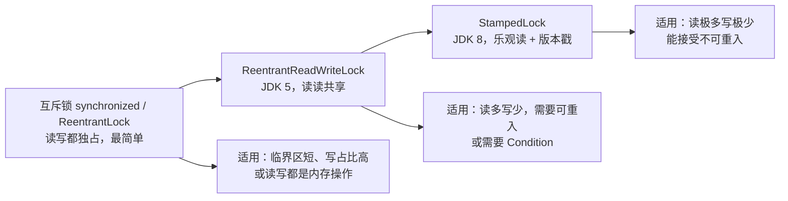
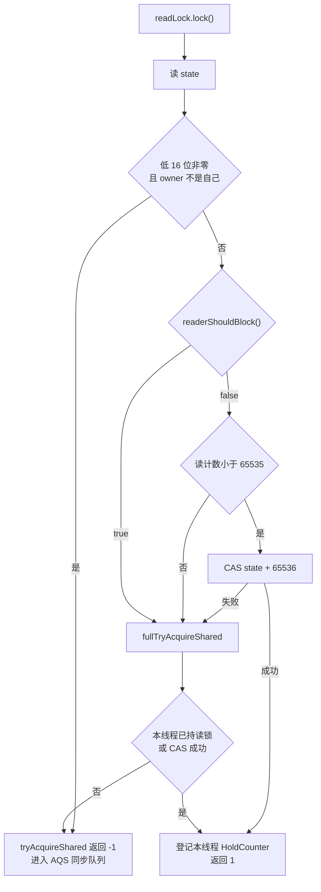
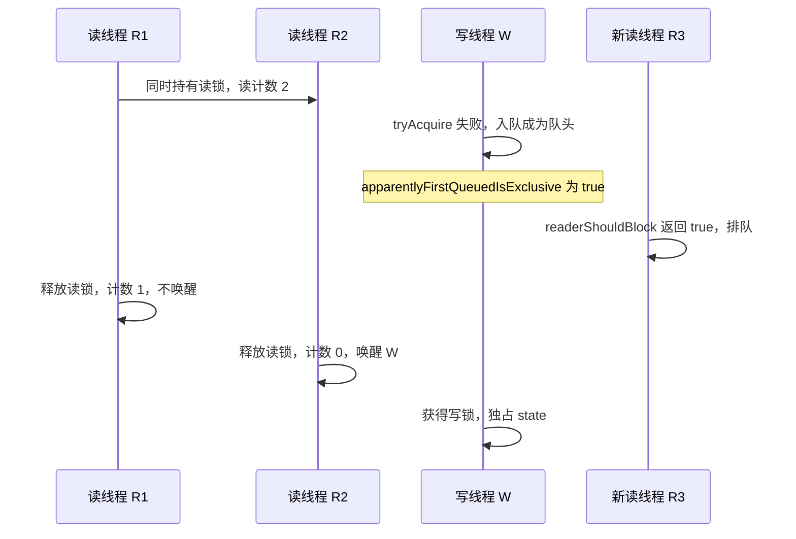
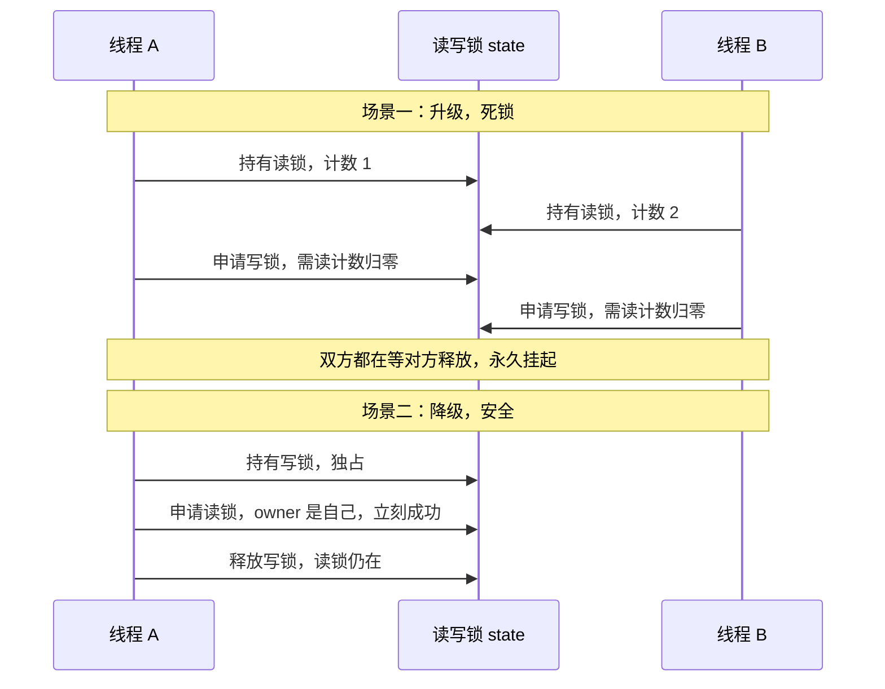
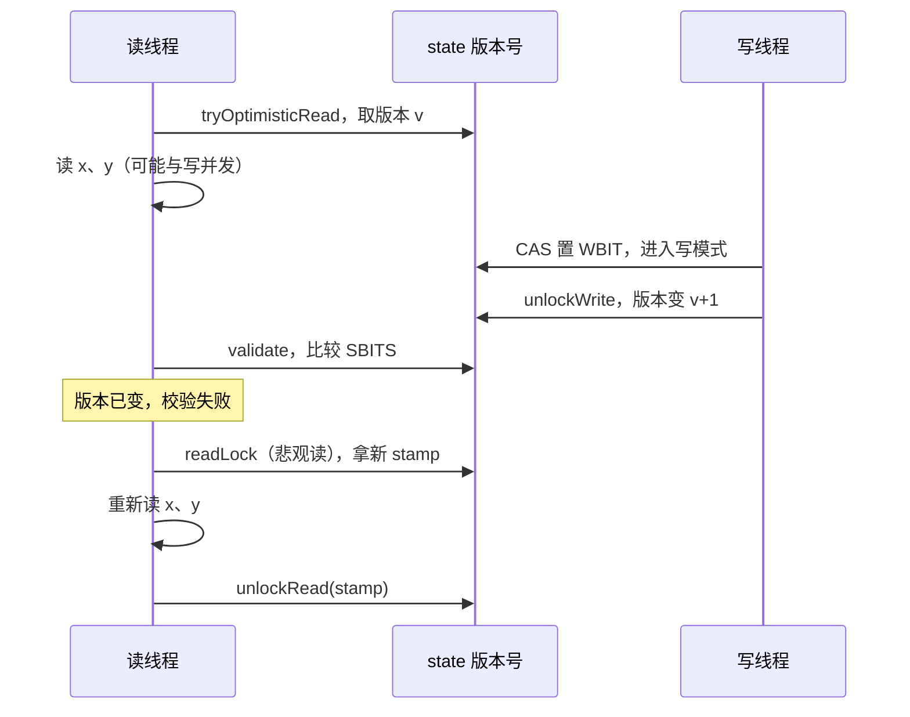
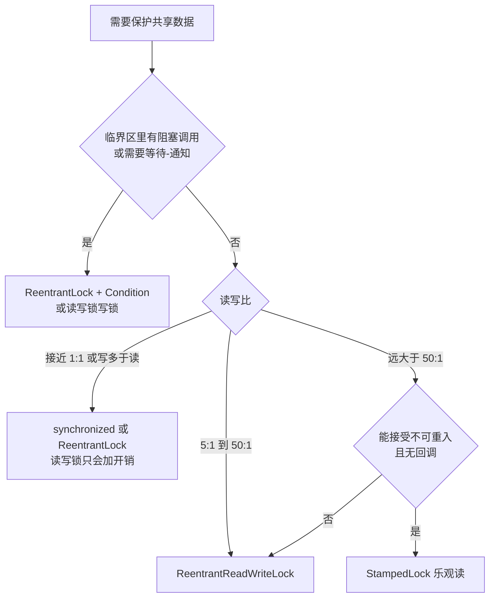

# 08 读写锁与 StampedLock——从 ReentrantReadWriteLock 到乐观读

**摘要：**

读写锁把"互斥"拆成"共享读 + 独占写"，它赌的是冲突只发生在写者出现的那一刻，而不是每一次访问。但共享读本身并不免费：`ReentrantReadWriteLock` 要在 AQS 唯一的 `volatile int state` 里同时存放读锁持有总数与写锁重入次数，只能把 32 位切成高 16 位与低 16 位各一半，于是读锁上限与写锁重入上限一起被钉死在 65535——这是位域切分的算术后果，不是实现疏漏；而且每次读锁获取仍然是一次对同一个 `state` 的 CAS，读者越多，那条缓存行的争用越重。`StampedLock` 把这条路走到尽头：读路径上一次写都不做，只取一个版本戳，读完用 `validate` 检查期间有没有写者，失败再退回悲观读。代价是不可重入、没有 `Condition`、stamp 必须成对使用，而它闹出的死锁在 `jstack` 里连锁的持有者都看不到。本文从位域切分讲起，说清写锁独占与读锁共享如何共用 `tryAcquire`/`tryAcquireShared`，写者优先为什么只是概率性的，锁降级为什么允许、升级为什么必然死锁，最后给出三档方案的选型判据与两类负载下的量级判断。

---

## 第 1 章 读多写少：三个层次的选择

一张路由表、一份字典、一段不常变的配置，这类数据的读写比例常常是 100:1，甚至 1000:1。`ReentrantLock` 保护它们的时候，读线程排队进场，一百个线程里九十九个在门外等一个正在做纯查询的线程——这不是锁太慢，而是读操作根本不该出现在互斥路径上。

**读写锁（ReadWriteLock）** 的规则可以写成三条：读-读共享，读-写互斥，写-写互斥。它的合法性来自一个朴素观察：两个线程同时读，谁也没改变任何人看得见的东西；只有写者会改变。共享锁与排他锁的概念本身比 Java 老得多，数据库里的 S 锁与 X 锁早就是这套语义，JSR-166 在 JDK 5（2004 年）把它带进了标准库，成为 `ReentrantReadWriteLock`；到 JDK 8（2014 年），Doug Lea 又加了 `StampedLock`，引入了第三种思路——读的时候不加锁。

不妨用阅览室打这个比方。互斥锁是一间只能进一个人的自习室，无论你进去看书还是换书。读写锁是一间允许所有读者同时看同一本书的阅览室，但任何人要换书，必须请全场读者放下书先出去。`StampedLock` 的乐观读则更激进：读者把当前内容抄在便签上直接走人，走到门口时对一眼书脊上的改版号，号没变就用抄下来的内容，号变了就老老实实回去排队借阅。三档方案的差别，本质上是"什么时候为冲突付出代价"——事前预防，事中互斥，还是事后校验。



三者的能力边界并不连续，有些是语义差异，不能靠调参抹平：

| 能力 | `synchronized` | `ReentrantReadWriteLock` | `StampedLock` |
| :--- | :--- | :--- | :--- |
| 读-读并发 | 否 | 是 | 是（悲观读）/ 完全无锁（乐观读） |
| 可重入 | 是 | 是（读、写各自可重入） | 否 |
| `Condition` | 是（`wait`/`notify`） | 写锁可用，读锁抛 `UnsupportedOperationException` | 否 |
| 公平性可配置 | 否 | 是 | 否（近似 FIFO 相位公平） |
| 中断响应 | 是 | 是（`lockInterruptibly`） | 仅 `*Interruptibly` 变体 |
| 锁所有权概念 | 有 | 有（`getOwner`） | 无（可跨线程释放） |
| 读路径写共享状态 | 是（monitor 头） | 是（`state` 的 CAS） | 乐观读不写 |
| 死锁可被 `jstack` 识别 | 是 | 是 | 否 |

---

## 第 2 章 一个 int 里装两种锁

### 2.1 位域切分的由来

AQS 给子类留下的全部状态空间，只有一个 `volatile int state`，外加一个 `exclusiveOwnerThread`。对 `ReentrantLock` 来说这刚好够：`state` 是重入次数，owner 是持有者。但读写锁要同时表达三件事——读锁一共被多少个线程持有（含重入）、写锁被重入了几次、写锁的持有者是谁。前两个都得挤进同一个 `state`。

`ReentrantReadWriteLock` 的做法是把 32 位一分为二：高 16 位记读锁持有总数，低 16 位记写锁重入次数。

| 位范围 | 含义 | 提取方式 | 取值范围 |
| :--- | :--- | :--- | :--- |
| bit 31–16 | 读锁持有总数（所有线程的重入计数之和） | `c >>> 16` | 0–65535 |
| bit 15–0 | 写锁重入次数 | `c & 0xFFFF` | 0–65535 |

对应到源码里就是四个常量与两个静态方法，`SHARED_UNIT` 是读锁计数的"单位"——读锁加一次不是 `+1` 而是 `+65536`：

```java
static final int SHARED_SHIFT   = 16;
static final int SHARED_UNIT    = (1 << SHARED_SHIFT);      // 65536，读锁计数的步长
static final int MAX_COUNT      = (1 << SHARED_SHIFT) - 1;  // 65535，两个计数的共同上限
static final int EXCLUSIVE_MASK = (1 << SHARED_SHIFT) - 1;  // 0xFFFF，取低 16 位

static int sharedCount(int c)    { return c >>> SHARED_SHIFT; }
static int exclusiveCount(int c) { return c & EXCLUSIVE_MASK; }
```

为什么要挤在一个 int 里，而不是用两个 `AtomicInteger`？因为**一次 CAS 只能原子地更新一个字**。若读计数与写计数分处两个字段，"检查读计数为 0 且写计数为 0"与"写入写计数"之间就出现窗口，读者可能在窗口里插入，写者拿到的就不再是独占。切成两半之后，写者判断 `state == 0` 这一个条件就等价于"读写都没人持有"，读锁也只需 `state + 65536` 一次加法就能同时保留写者信息。这不是耍小聪明，是被硬件原子宽度逼出来的编码方式，与 `ConcurrentHashMap` 用 `sizeCtl` 的高位存扩容标记、低位存阈值是同一种手艺。

### 2.2 65535：切分的算术后果

16 位能表达 0 到 65535，于是两个上限同时成立：读锁最多被 65535 个"持有单位"占用，写锁最多重入 65535 次。JDK 文档把这句写得很直白：该锁支持最多 65535 个递归写锁与 65535 个读锁。

读锁这一侧尤其容易误判——65535 不是"65535 个线程"，而是**所有线程读锁重入计数之和**。一个线程递归调用 65536 层、每层都加读锁，仅它自己就能把这个额度用光。触发时的行为也不体面：快速路径 `tryAcquireShared` 里写着 `r < MAX_COUNT`，额度不够时它不会报错，只是安静地退到 `fullTryAcquireShared`；而 `fullTryAcquireShared` 里是 `throw new Error("Maximum lock count exceeded")`。

```java
// 快速路径：额度不足时静默回退，把错误推迟到完整路径
if (!readerShouldBlock() && r < MAX_COUNT && compareAndSetState(c, c + SHARED_UNIT)) { ... }

// 完整路径：真的到顶了才抛，抛的是 Error 而不是 Exception
if (sharedCount(c) == MAX_COUNT)
    throw new Error("Maximum lock count exceeded");
```

抛 `Error` 而不是 `Exception` 是个值得注意的选择：大多数业务代码的 `catch (Exception e)` 抓不到它，`finally` 里的 `unlock` 仍会执行，但此时该线程并没有成功持锁，于是 `tryReleaseShared` 里 `count <= 0` 的分支抛出 `IllegalMonitorStateException`，把真正的根因埋掉。看到"读锁重入到六万多层"这种堆栈，先怀疑的是递归有没有终止条件、或者某个框架在每一层 getter 上都套了一层读锁，而不是去调大上限——上限没有可调项。

写锁一侧同理，`tryAcquire` 的重入分支里 `w + exclusiveCount(acquires) > MAX_COUNT` 直接抛同一个 `Error`。

### 2.3 为什么不切 24/8

既然 16/16 会在读侧撞天花板，为什么不用 24 位给读者、8 位给写者？因为写侧重入的 255 次上限比读者侧的 65535 更容易被真实代码碰到：递归下降的解析器、嵌套回调、一个方法里连续多层代理，写锁重入几十上百层并不罕见；而 65535 个并发读锁持有单位，需要同时有数万个线程在同一个锁上做重入，这种规模在平台线程模型下先撞到的是线程数上限。

| 切分方案 | 读者上限 | 写者重入上限 | 判断 |
| :--- | :--- | :--- | :--- |
| 16 / 16（实际采用） | 65535 | 65535 | 两侧都远离常规用量，风险对称 |
| 24 / 8 | 约 1677 万 | 255 | 读者额度用不上，写者重入太紧 |
| 8 / 24 | 255 | 约 1677 万 | 并发读者极容易撞墙，完全不可行 |
| 两个字段 | 无理论上限 | 无理论上限 | 丧失单字 CAS 的原子性，需要额外协议 |

真正值得记住的不是"65535 这个数字"，而是位域切分把两类语义绑在同一份状态里，一侧的上限会变成另一侧的隐性成本。`StampedLock` 后来给出的解法很不一样：读者计数只留 7 位，超出后用一个独立的 `readerOverflow` 整数兜底，于是读者数不再有硬顶。

### 2.4 同时持有读锁与写锁是合法状态

有一个流传很广的误解：`state` 高 16 位与低 16 位同时非零，是编码上可表达、运行中不会出现的中间态。恰恰相反，锁降级期间这个状态就是实打实存在的——线程持有写锁时再去拿读锁，`state` 会变成"写重入次数 + 读持有数左移 16 位"。`tryAcquireShared` 开头那段判断正是为此开的口子：

```java
// 写锁被持有，但持有者就是当前线程 —— 这是在走锁降级，必须放行
if (exclusiveCount(c) != 0 && getExclusiveOwnerThread() != current)
    return -1;
```

如果这里不做 `owner == current` 的例外，锁降级就永远拿不到读锁，只能死等自己释放写锁。这个例外不是补丁，而是降级语义在 AQS 层的落点。

### 2.5 读计数是总数，不是线程数

这个编码选择有一个直接后果：从 `state` 里读不出"现在有几个线程在读"。`getReadLockCount()` 返回的是 `sharedCount(getState())`，也就是所有线程读锁重入计数之和；想知道本线程自己重入了几次，得去看 ThreadLocal 里的 `HoldCounter`（`getReadHoldCount()` 走的就是这条路）。两种信息不在一个地方，用途也不同：前者给写者判断"能不能进"，后者给 `unlock` 判断"该不该清"。

把这个差别放到监控上就更清楚了。一个线程重入读锁一千次、与一千个线程各持一次读锁，在 `state` 上完全等价，但等待行为天差地别：前者的写者只需要等一个临界区结束，后者的写者要等一千个各自独立的临界区全部结束。因此"读锁数量"不是一个可靠的告警指标，只能当趋势参考；真正决定写者延迟的是读锁持有者的**分布与持有时长**，而这两样从 `state` 里看不到。

再看 `getOwner()` 的实现，它先在 `exclusiveCount(getState()) == 0` 时返回 `null`，否则返回 `exclusiveOwnerThread`。源码在这里留了一句注释，说明必须先读 `state` 再读 owner 字段——顺序反了会读到"状态已释放、owner 还是旧值"的错位组合。这种读写顺序上的讲究，是共享状态被拆成两个字段之后的必然代价。

---

## 第 3 章 写锁：独占模式的三条分支

### 3.1 三条分支的判据

写锁走的是 AQS 独占模式的 `tryAcquire`。`AQS` 的排队与唤醒机制已在 [[06 AQS 框架——AbstractQueuedSynchronizer 的设计与实现]] 里拆过，这里只看读写锁对它的定制。

```java
protected final boolean tryAcquire(int acquires) {
    Thread current = Thread.currentThread();
    int c = getState();
    int w = exclusiveCount(c);              // 当前写锁重入次数
    if (c != 0) {
        // c != 0 而 w == 0，说明占着 state 的是读者；写者一律失败排队
        if (w == 0 || current != getExclusiveOwnerThread())
            return false;
        if (w + exclusiveCount(acquires) > MAX_COUNT)
            throw new Error("Maximum lock count exceeded");
        setState(c + acquires);             // 重入：不可能有并发写者，无需 CAS
        return true;
    }
    // 读写都空闲，仍然要过 writerShouldBlock 这一关
    if (writerShouldBlock() || !compareAndSetState(c, c + acquires))
        return false;
    setExclusiveOwnerThread(current);
    return true;
}
```

三条分支值得逐个看。第一条，`c != 0 && w == 0` 是"读锁在场"的判据——因为读计数占了高位，只要高位非零，低 16 位必然是 0；反过来 `w != 0` 且 owner 是自己，就是重入。第二条，重入路径用 `setState` 而非 CAS，理由是写锁独占，此刻不存在第二个写者能改 `state`，CAS 只是浪费一条 `lock cmpxchg`。第三条，从零到一这一跳必须先 `writerShouldBlock()` 再 CAS，顺序不能反：先 CAS 再检查，非公平模式下会让一个本应排队的写者抢到锁，公平模式下则破坏 FIFO。

释放侧同样有讲究，`tryRelease` 用 `isHeldExclusively()` 校验调用者，再以 `exclusiveCount(nextc) == 0` 判断写者是否彻底退出，最后仍然用 `setState` 写回——同一时刻不会有别人动它。

### 3.2 writerShouldBlock 决定写者的插队权

`writerShouldBlock()` 在两个子类里的实现截然不同，这决定了写者的插队权：

| 子类 | `writerShouldBlock()` | `readerShouldBlock()` | 效果 |
| :--- | :--- | :--- | :--- |
| `NonfairSync`（默认） | 恒 `false` | `apparentlyFirstQueuedIsExclusive()` | 写者可无条件插队抢空闲锁；新读者只在"队头像是写者"时被拦 |
| `FairSync` | `hasQueuedPredecessors()` | `hasQueuedPredecessors()` | 两侧都必须先看前面有没有人排队 |

### 3.3 写锁是唯一能挂 Condition 的一侧

`ReentrantReadWriteLock` 的 `Condition` 由写锁提供，`writeLock().newCondition()` 返回的 `ConditionObject` 挂在同一个 `Sync` 上；读锁的 `newCondition()` 直接抛 `UnsupportedOperationException`。原因不在实现偷懒：`Condition` 的语义要求"等待时释放锁、被唤醒时重新获取同一把锁"，而 AQS 的 `ConditionObject` 通过 `addConditionWaiter` 把节点串进条件队列、再通过 `transferForSignal` 移交同步队列，整条链路都依赖"锁有唯一持有者"这个前提。读锁是共享的，一次 `await` 要释放谁持有的那一份、唤醒后又重新计入哪个线程的 `HoldCounter`，都没有定义。

于是出现一个容易写错的组合：业务期望"读者也能等条件"，但读写锁给不了。读锁上的等待只能用"释放读锁 → 等待 `Condition` → 重新尝试读取"的模式手工实现，而这段手写逻辑必然带着检查-等待-重试的循环，等价于自己实现了一个简易的条件队列。

---

## 第 4 章 读锁：共享计数与每线程重入计数

读锁走 AQS 共享模式，`tryAcquireShared` 返回负数表示失败、非负数表示成功，AQS 据此决定是否入队。与写锁最大的不同是：写锁的重入次数可以直接从 `state` 低位读出来，而读锁的重入次数不能——同一个 `state` 的高 16 位记的是所有读者的总数，无法区分"三个线程各持有一份"和"一个线程持有了三份"。

### 4.1 两套计数各管一件事

解决办法是把计数拆成两套：`state` 高 16 位记**全局持有总数**，一个 `ThreadLocal<HoldCounter>` 记**本线程的重入次数**。前者是给写者看的（只要非零，写者就得等），后者是给 `unlock` 看的（要判断本线程是否还在持锁、释放后是否该清理 ThreadLocal 条目以避免内存滞留）。

```java
protected final int tryAcquireShared(int unused) {
    Thread current = Thread.currentThread();
    int c = getState();
    // 写锁在场且不是我持有：只能排队
    if (exclusiveCount(c) != 0 && getExclusiveOwnerThread() != current)
        return -1;
    int r = sharedCount(c);
    if (!readerShouldBlock() && r < MAX_COUNT && compareAndSetState(c, c + SHARED_UNIT)) {
        if (r == 0) {                       // 从零到一：最常见的单读者路径
            firstReader = current;
            firstReaderHoldCount = 1;
        } else if (firstReader == current) { // 同一线程在读锁内重入
            firstReaderHoldCount++;
        } else {
            HoldCounter rh = cachedHoldCounter;
            if (rh == null || rh.tid != LockSupport.getThreadId(current))
                cachedHoldCounter = rh = readHolds.get();
            else if (rh.count == 0)
                readHolds.set(rh);
            rh.count++;                      // 本线程重入计数 +1
        }
        return 1;
    }
    return fullTryAcquireShared(current);    // CAS 失败或需要再判断，走完整路径
}
```

### 4.2 三级缓存：`firstReader`、`cachedHoldCounter`、ThreadLocal

这段代码里塞了三级优化，全部服务于同一个目标——把最热的"单读者进进出出"路径上的 `ThreadLocal.get` 省掉。

第一级是 `firstReader` 与 `firstReaderHoldCount`：第一个拿到读锁的线程被单独记在两个字段里，它的重入计数直接放在字段上，完全不碰 ThreadLocal。绝大多数低竞争场景只有一到两个读者，这一级就吃掉了绝大部分流量。

第二级是 `cachedHoldCounter`，缓存"最近一次操作的那个线程"的计数器，命中条件是 `rh.tid == getThreadId(current)`。它解决的是读者多于一个时的局部性：一个线程往往连续多次获取读锁，缓存命中率不低。

第三级才是真正的 `ThreadLocal`。它只在两级缓存都落空时被访问。读锁释放时必须判断本线程的计数是否归零并 `readHolds.remove()`，否则线程池里的线程会带着一个永不清空的 ThreadLocal 条目——这是 `ThreadLocal` 在 JUC 内部被使用时的经典写法，与 [[15 ThreadLocal 的实现原理与内存泄漏——线程封闭的正确姿势]] 里说的泄漏成因是同一件事，只不过这里由 JDK 自己负责清理。

`tid` 的取法也有一处版本差异：早期用 `Thread.getId()`，JDK 19 起 `Thread.threadId()` 与 `LockSupport.getThreadId()` 取代了它，JDK 21 的源码里已经是后者。差异看似无关紧要，但在虚拟线程场景下 `getId()` 的语义（单调递增、不复用）与线程对象生命周期的耦合方式变了，JUC 内部随之调整。

### 4.3 `fullTryAcquireShared` 的两个职责

被 `return` 到完整路径的调用有两种：CAS 失败（有并发读者或写者刚抢到锁），以及 `readerShouldBlock()` 为真（队头疑似写者）。完整路径干两件事：

第一，循环重试 CAS，直到成功或者确定该失败。第二，**给"已经持有读锁的线程"开一条免排队通道**：

```java
} else if (readerShouldBlock()) {
    if (firstReader == current) {
        // 本线程就是 firstReader，重入必须放行
    } else {
        if (rh == null) { /* 取 cachedHoldCounter 或 readHolds */ }
        if (rh.count == 0)
            return -1;                  // 不是重入，老实排队
    }
}
```

若不这么做，队头有个写者在等的时候，一个已经在读锁里的线程再次重入就会把自己挡在门外，形成"我等我自己的锁"的自锁。这个例外说明一件事：公平性与写者优先都必须让位于重入的自洽性，否则锁会自己把自己锁死。常见的二手讲解把这句代码解释成"读线程的第二次机会"，这是误读——它不是给新来者插队的机会，恰恰相反，它只对已经在读锁里的线程生效。

### 4.4 释放：读者不互相唤醒

```java
protected final boolean tryReleaseShared(int unused) {
    // 先减本线程的 HoldCounter（省略），计数归零时移除 ThreadLocal 条目
    for (;;) {
        int c = getState();
        int nextc = c - SHARED_UNIT;
        if (compareAndSetState(c, nextc))
            // 只有最后一个读者离场，才需要唤醒排队的写者
            return nextc == 0;
    }
}
```

返回值 `nextc == 0` 是给 AQS 的信号：只有全部读者退场，共享状态才算"彻底释放"，才需要 `unpark` 后继节点。读者之间不需要互相唤醒——它们不是竞争关系。这一条直接导致一个后果：一个长期持有读锁的线程（譬如一次慢查询、一次远程调用）会把所有写者按住，写者苏醒的时机不是"读者减少"，而是"读者归零"。

若释放时本线程的计数已经不大于零，源码抛 `unmatchedUnlockException()`，即 `IllegalMonitorStateException`，消息说明"没有由当前线程持有"。写锁也用同一套检查，只是判据从 `HoldCounter` 换成了 `exclusiveOwnerThread`。

### 4.5 四个获取变体的差别

读锁与写锁各有四个获取入口，它们在源码里走的路径不同，行为差异比方法名暗示的更大。

| 方法 | 底层调用 | 是否看排队 | 中断 | 超时 |
| :--- | :--- | :--- | :--- | :--- |
| `lock()` | `acquire` / `acquireShared` | 是（走 `readerShouldBlock`/`writerShouldBlock`） | 不响应 | 无 |
| `lockInterruptibly()` | `acquireInterruptibly` / `acquireSharedInterruptibly` | 是 | 响应，抛 `InterruptedException` | 无 |
| `tryLock()` | `tryWriteLock` / `tryReadLock` | 否，直接 CAS 插队 | 不响应 | 无 |
| `tryLock(t, unit)` | `tryAcquireNanos` / `tryAcquireSharedNanos` | 是 | 响应 | 有界 |

第三行是一个容易被忽略的公平性缺口。`tryReadLock()` 的注释写得很直白，它与 `tryAcquireShared` 效果相同，只是不调用 `readerShouldBlock`，因此按源码注释的说法是"可以在两个方向上都插队"。也就是说，即便有写者已经排在队头、`lock()` 的新读者会被拦下来，一个走 `tryLock()` 的读者照样能当场拿到读锁。公平模式下 `tryLock()` 同样不受公平设置约束，文档专门提醒过这一点。

在写者本就容易饿死的场景里，大量使用 `tryLock()` 的读路径会把"写者优先"这条兜底彻底架空。常见的事故形态是：缓存访问用 `tryLock()` 加读锁，命中率很高，于是读者几乎总能成功；写者偶发刷新时排进队列，却发现读锁始终有人插队，刷新延迟从毫秒级涨到秒级。此时把读侧改回 `lock()`，写延迟立刻下来了——代价是读侧在写者排队时会短暂阻塞。

`tryLock(t, unit)` 走的是带超时的完整路径，会经过 `readerShouldBlock`，因此不受这个缺口影响，代价是等待期间要处理中断和超时两套返回路径。

### 4.6 读锁只保护"读的那一刻"

读锁的语义边界常被高估。它保证的是"持有期间没有写者能拿到写锁"，不保证"读到的对象之后不会变"。一旦把读到的可变对象引用带到 `unlock()` 之后使用，读锁就白加了：

```java
// 错误：读锁只覆盖了取引用这一步
List<Route> snapshot;
rwl.readLock().lock();
try {
    snapshot = routes;          // 拿到的是同一个可变列表的引用
} finally {
    rwl.readLock().unlock();
}
render(snapshot);               // 锁外遍历，写者随时可以改这个列表
```

正确做法只有两条：要么在锁内把需要的数据复制/投影成不可变结构，要么让被保护的对象本身不可变、写侧用替换引用代替原地修改（做法见第 9 章）。读写锁不是快照隔离，它只排除"同时有写"，不排除"之后有写"。

读锁获取的完整判定顺序可以画成这样：



---

## 第 5 章 写者优先只是概率事件

读多写少场景里，写者是最容易饿死的那一类线程：只要读者前后脚接上，写者永远等不到"读者归零"的那一刻。非公平模式下的 `readerShouldBlock()` 就是为缓解这件事而存在的启发式：

```java
final boolean readerShouldBlock() {
    /* As a heuristic to avoid indefinite writer starvation,
     * block if the thread that momentarily appears to be head
     * of queue, if one exists, is a waiting writer. This is
     * only a probabilistic effect since a new reader will not
     * block if there is a waiting writer behind other enabled
     * readers that have not yet drained from the queue.
     */
    return apparentlyFirstQueuedIsExclusive();
}
```

### 5.1 只在队头是写者时才拦

这段注释把话说得很清楚：新读者只在"队头看起来是独占节点"时被拦下，而且这只是概率性的。如果队列里排着几个还没被唤醒的读者，写者排在它们后面，那么新来的读者照样可以插队——因为队头是读者，`apparentlyFirstQueuedIsExclusive()` 返回 `false`。插队本身是吞吐量优化的副产品：省掉入队、挂起、唤醒这一串开销，代价是把最坏等待时间变成了不可预估。

### 5.2 公平模式的真实代价

公平模式下没有这个模糊地带，`FairSync` 两侧都用 `hasQueuedPredecessors()`：只要前面有人排队，一律排到后面。它还有一个常被误解的细节：公平模式下的读者并不是一个一个被放行的。当队头的写者完成、队列里排着的一批读者成为最长等待者时，AQS 的共享传播（`setHeadAndPropagate`，机制见 [[06 AQS 框架——AbstractQueuedSynchronizer 的设计与实现]]）会让这批读者一起通过。真正的代价不在"读者被串行化"，而在每一次获取都要走完整的入队/出队/挂起/唤醒链路，把一次 CAS 的成本抬高到微秒级。

### 5.3 饥饿的四种成因与观测

写饥饿的真实成因，比"读者太多"更具体：

| 成因 | 机制 | 观测特征 |
| :--- | :--- | :--- |
| 长读持有 | 写者只在读计数归零时被唤醒 | 写线程在 `WAITING`，写锁等待时间随单个读操作耗时线性上升 |
| 新读者插队 | 非公平模式下兜底路径不拦新读者 | 写线程持续 `park` 又被唤醒，`getQueuedWriterThreads()` 不为零 |
| `tryLock` 绕过公平 | `tryLock` 不走 `writerShouldBlock` 检查 | 公平模式下仍有写者偶发抢锁失败/成功的不均匀分布 |
| 读者队列头 | `apparentlyFirstQueuedIsExclusive()` 只看队头 | 队列里读者与写者交替时，新读者持续通过 |

如果线上真的遇到写者长期拿不到锁，能用的观测手段只有 `ReentrantReadWriteLock` 暴露的几个只读方法：`getReadLockCount()`、`getReadHoldCount()`、`getWriteHoldCount()`、`getQueuedWriterThreads()`、`getQueuedReaderThreads()`、`hasQueuedThreads()`。这些方法的设计意图是监控而非同步控制，文档里专门有一句说明，把它们写进业务判断里是另一种误用。



---

## 第 6 章 降级允许，升级禁止

`ReentrantReadWriteLock` 的文档里有一句很不客气的表述：写者可以获取读锁，读者去获取写锁则永远不可能成功。前者叫锁降级，后者叫锁升级，一个被支持，一个被物理拒绝。

### 6.1 降级解决的到底是什么

降级的写法是：持有写锁 → 获取读锁 → 释放写锁 → 继续以读锁身份工作。

```java
class CachedData {
    Object data;
    boolean cacheValid;
    final ReentrantReadWriteLock rwl = new ReentrantReadWriteLock();

    void processCachedData() {
        rwl.readLock().lock();
        if (!cacheValid) {
            rwl.readLock().unlock();        // 升级无门，只能先退读者身份
            rwl.writeLock().lock();
            try {
                if (!cacheValid) {          // 双重检查：可能有人抢先更新了
                    data = computeNewData();
                    cacheValid = true;
                }
                rwl.readLock().lock();      // 降级：写锁还在手里时先拿读锁
            } finally {
                rwl.writeLock().unlock();   // 放掉写锁，读锁仍在，中间没有空窗
            }
        }
        try {
            use(data);                      // 这里读到的一定是自己（或别人）写完的版本
        } finally {
            rwl.readLock().unlock();
        }
    }
}
```

反事实地看：如果先释放写锁、再获取读锁，两步之间就是一段真空，别的写者可以挤进来改掉 `data`，随后的 `use(data)` 读到的就不是刚刚写完的那个版本。这类"写完立刻读"的场景在缓存刷新、配置热加载、索引重建里很常见，降级就是为了让"写"与"紧接着的读"落在同一个可见性窗口内。

还有一层隐含价值：读锁在写锁内获取时，`tryAcquireShared` 的 `owner == current` 例外让它立刻成功，不需要排队；释放写锁后读锁继续有效，其他写者仍然拿不到锁。整个过程不依赖任何其他线程的配合，所以不可能死锁。

### 6.2 升级为什么不行

假设升级可用。线程 A 与线程 B 各自持有读锁，同时都想升级成写锁。写锁的获取条件是 `state` 低 16 位所有者是自己、且没有读者——但 A 要成功，B 必须释放；B 要成功，A 必须释放。两边都在等对方先退，谁也不会退，死锁。这不是"排队顺序没设计好"，而是共享计数无法原子地转成独占：从 N 个读者变成 1 个写者，必须等其他 N-1 个读者先离开，而那个"等"如果发生在持有读锁的状态下，就是自己堵死自己的前提。

代码层面 `tryAcquire` 的第一条分支已经把这个结论写死了：`c != 0 && w == 0` 直接返回 `false`，连"等一等"的机会都不给，线程会进入 AQS 队列挂起——于是两个读者就永远互相挂起。

```java
// 反例：读锁升级为写锁，必然死锁
void upgradeDeadlock() {
    rwl.readLock().lock();
    try {
        if (needUpdate) {
            rwl.writeLock().lock();   // 这里永久阻塞：state 的高位被自己占着
            try { /* 永远到不了 */ } finally { rwl.writeLock().unlock(); }
        }
    } finally {
        rwl.readLock().unlock();      // 永远执行不到
    }
}
```

单线程也会死锁——这是升级比"两个线程互等"更隐蔽的地方。一个线程自己占着读锁去申请写锁，等的是"读计数归零"，而读计数里就有它自己那一份，它必然等不到自己释放。`jstack` 里看到的现象是一个线程停在 `WriteLock.lock()`、状态 `WAITING (parking)`、栈帧是 `AbstractQueuedSynchronizer.acquire`，而等待链指向的正是它自己持有的那个 `ReadLock`。这类死锁用超时探测也不好办，因为等待环只有一个线程。



### 6.3 正确的"先退再进"与它的代价

既然升级禁止，需要更新数据的读者只能走"释放读锁 → 拿写锁 → 复查 → 降级"的路径，也就是上面 `CachedData` 的写法。它的代价是中间那段真空期必须靠复查补回来：先释放读锁之后，任何写者都可能插进来改掉状态，所以拿到写锁后必须重新判断一次条件（`if (!cacheValid)` 就是这次复查）。漏掉复查的后果是重复计算、覆盖别人的更新，或者基于过期数据做决策。

```java
// 常见错误：释放读锁直接拿写锁，忘了复查
rwl.readLock().unlock();
rwl.writeLock().lock();
try {
    data = computeNewData();        // 可能覆盖别人刚写进去的新值
} finally {
    rwl.writeLock().unlock();
}
```

`StampedLock` 提供了一种不同的取舍：`tryConvertToWriteLock(stamp)` 尝试把当前 stamp 对应的持有状态原子地转成写锁，只有在"当前是唯一读者"或"已经持有写锁"时才成功，其他情况返回 `0` 而不是阻塞。它把"死锁"换成了"失败重试"，语义上安全得多，但也意味着调用方必须处理转换失败。

| 方向 | `ReentrantReadWriteLock` | `StampedLock` |
| :--- | :--- | :--- |
| 写 → 读 | 允许（先拿读锁再放写锁），原子无空窗 | `tryConvertToReadLock`，原子完成 |
| 读 → 写 | 禁止，阻塞即死锁 | `tryConvertToWriteLock`，仅在唯一读者时成功，否则返回 0 |
| 读 → 乐观 | 无此概念 | `tryConvertToOptimisticRead`，释放读锁并返回新的版本戳 |
| 失败时的行为 | 永久挂起 | 立即返回 0，由调用方决定重试或排队 |

---

## 第 7 章 StampedLock：把版本号也塞进 state

读写锁的读路径上还有一件事没省掉：每次 `readLock()` 都要对 `state` 做一次 CAS，每次 `unlockRead()` 又要做一次。32 个线程高频读同一份数据时，每轮读要发起 64 次对 `state` 的写操作，全部打在同一个缓存行上——读者之间并不冲突，但它们争抢同一个原子变量，这份争抢本身就是串行化点。

`StampedLock` 的思路是：读的时候根本不碰共享状态。先取一个版本戳（`stamp`），把要读的字段读到局部变量里，读完之后问一句"这期间有写者动过吗"，没有就用，有就退回悲观读重来。这在数据库领域叫乐观并发控制，在锁的语境里叫**乐观读（Optimistic Reading）**。

### 7.1 64 位 state 的分区

`StampedLock` 用 `long state`，切法比读写锁复杂得多，因为它要同时表达"读者数""是否被写者占用""版本号"三样东西：

| 位范围 | 含义 | 相关常量 | 说明 |
| :--- | :--- | :--- | :--- |
| bit 0–6 | 读者计数 | `RUNIT = 1`，`RBITS = 127`，`RFULL = 126` | 计到 126 后不再加，改用溢出计数器 |
| bit 7 | 写锁标志 | `WBIT = 1 << 7 = 128` | 置位表示有写者持有 |
| bit 8–63 | 版本号 | `SBITS = ~RBITS` | 每次写者释放时 +1，56 位 |
| 全 0 回避 | 初始值 | `ORIGIN = WBIT << 1 = 256` | 让"失败返回 0"与合法状态不撞车 |

几个常被记错的点：版本号在 bit 8 到 bit 63，而不是"bit 63 一个溢出标志"；读者计数只有 7 位、上限 127，而不是 65535；读者溢出不是靠某个标志位，而是靠一个独立的 `int readerOverflow` 字段，`RBITS` 那个值 127 被临时借用作自旋锁标记，用来串行化溢出更新的 CAS。

```java
private static final int  LG_READERS = 7;                  // 127 readers
private static final long RUNIT = 1L;                      // 读者计数步长
private static final long WBIT  = 1L << LG_READERS;        // 128，写锁位
private static final long RBITS = WBIT - 1L;               // 127，读者计数掩码
private static final long RFULL = RBITS - 1L;              // 126，到顶后转溢出处理
private static final long ABITS = RBITS | WBIT;            // 255，低 8 位的全部
private static final long SBITS = ~RBITS;                  // 版本位 + 写锁位
private static final long ORIGIN = WBIT << 1;              // 256，初始 state
```

读者数只有 7 位却不妨碍高并发，靠的就是溢出计数器：`tryAcquireRead` 里若 `(state & ABITS) < RFULL` 就直接 CAS 加一，否则走 `tryIncReaderOverflow` 去更新那个独立的 int。读写锁的 65535 是硬顶，`StampedLock` 的读者上限则是"内存能撑多少线程"——同一个"状态位不够用"的问题，两种完全不同的解法。

### 7.2 它本质上是一个 seqlock

源码的设计说明写得很直白：这把锁的 state 里有一个序列号，写锁持有时为奇数，其他时候为偶数，读者计数叠加在这个序列号上，而在校验乐观读的 stamp 时读者计数被忽略。这就是 seqlock 的经典结构——用版本号判断"读的过程中有没有发生写"，代价是读到一半可能不一致，收益是读侧零写入。

```java
public long tryOptimisticRead() {
    long s;
    return (((s = state) & WBIT) == 0L) ? (s & SBITS) : 0L;   // 写者在场就返回 0
}

public boolean validate(long stamp) {
    U.loadFence();                                            // 关键：先插 LoadLoad/LoadStore 屏障
    return (stamp & SBITS) == (state & SBITS);                // 只比版本位与写锁位，不比读者数
}
```

`validate` 只比较 `SBITS`，意味着其他读者的进出不会让 stamp 失效——读者不修改数据，自然不该让别人的读作废。而写者无论"正在持有"还是"已经释放"，都会让比较失败：持有期间 `WBIT` 位不同，释放之后版本号已经递增。

版本号递增的时机在 `unlockWrite` 而不是 `writeLock`：

```java
private static long unlockWriteState(long s) {
    return ((s += WBIT) == 0L) ? ORIGIN : s;   // 加 WBIT 等于清掉写锁位并把版本号 +1
}

private long releaseWrite(long s) {
    long nextState = state = unlockWriteState(s);   // 普通 volatile 写，不需要 CAS
    signalNext(head);                               // 唤醒后继
    return nextState;
}
```

`+= WBIT` 这个写法一石二鸟：加上 128 会把 bit 7 的进位送到 bit 8，等价于"清写锁位 + 版本号加一"；加完若恰好变成 0（版本位溢出），则回到 `ORIGIN`，保证 `state` 永不为 0，因为 0 被留作"获取失败"的返回值。JDK 文档对版本回收给了一个保守承诺：在连续运行的情况下，stamp 的可复用间隔不短于一年。

### 7.3 乐观读的正确姿势

JDK 文档给出的模板是一个带标签的 `for` 循环，比常见博客里的 `if (validate)` 两段式更严谨：

```java
double distanceFromOrigin() {
    long stamp = sl.tryOptimisticRead();
    try {
        retryHoldingLock: for (;; stamp = sl.readLock()) {
            if (stamp == 0L)            // 写者正在持有，直接转悲观读
                continue retryHoldingLock;
            double currentX = x;        // 可能与写者并发，值可能是"半新半旧"
            double currentY = y;
            if (!sl.validate(stamp))    // 期间有写者，重来
                continue retryHoldingLock;
            return Math.hypot(currentX, currentY);
        }
    } finally {
        if (StampedLock.isReadLockStamp(stamp))
            sl.unlockRead(stamp);       // 只有真的退化成读锁才需要解锁
    }
}
```

三处细节值得逐一说明。第一，`tryOptimisticRead` 之后、`validate` 之前的代码不能有副作用：那些字段值随时可能被推翻，如果拿它去算索引、写缓存、发消息，`validate` 失败时就撤不回来了。第二，读到的多个字段之间没有一致性保证：`x` 与 `y` 可能分别来自不同版本的写，甚至非 `volatile` 的 `long`/`double` 在 32 位平台上还可能读撕裂。第三，`validate` 之前的读不能拿去支撑任何判断，判断必须放在 `validate` 之后。

`StampedLock` 的 javadoc 对内存语义只有一句话，但这句话决定了整个机制的合法性：只有在后续 `validate` 返回 `true` 的前提上，最近一次写锁释放之前的动作才 happens-before 到 `tryOptimisticRead` 之后的动作；否则，`tryOptimisticRead` 到 `validate` 之间的读**不保证**拿到一致快照。乐观读因此不提供可见性保证本身，它提供的是"校验通过则可见性成立"的条件保证。

`loadFence()` 是这条保证的落地方式。它挡的是两种重排：编译器把 `validate` 里的读提前到字段读之前，以及弱序 CPU（ARM、POWER）把字段读排到 `state` 读之后。没有它，可能出现"字段读拿到旧值、`state` 读拿到新值"从而校验通过的错误组合。在 x86 上 LoadLoad/LoadStore 天然有序，这条屏障退化为编译器屏障，成本接近于零——这也是乐观读在 x86 上几乎免费的硬件原因。背景可参见 [[03 volatile 的实现原理——内存屏障与禁止重排序]] 与 [[02 Java 内存模型（JMM）——happens-before 与可见性保证]]。



### 7.4 转换方法：把升级变成可失败的操作

`StampedLock` 还提供了三个转换方法，它们把"模式切换"做成了单次 CAS，避免了"先释放再获取"的空窗。

`tryConvertToWriteLock(stamp)` 的判定很短：当前状态为空且 stamp 是乐观戳、或当前持有写锁且 stamp 就是写戳、或当前只有自己一个读者（`m == RUNIT` 且 stamp 非零），三种情况成功，其余返回 `0`。第三种情况是把"唯一读者升级"做成了原子操作——因为它不需要等别人。多读者时它不阻塞、不排队，直接告诉调用方"不行，你自己决定"。

`tryConvertToReadLock(stamp)` 处理三种来源：写戳（释放写锁并加一个读者）、乐观戳（直接拿悲观读锁）、读戳（再增一个读者单位）。`tryConvertToOptimisticRead` 则朝反方向走：把持有的锁放掉，返回一个新版本戳，用于"我读完了，接下来只做校验性使用"。

这三个方法共同的语义是：转换失败返回 0，与死锁无关。它们把读写锁那种"要么成功要么永久挂起"的二值局面，变成了"成功 / 失败 / 重试"的三值局面。

### 7.5 排队结构：读者合并成一个节点

`StampedLock` 没有复用 AQS，而是自带一套 CLH 变体的等待队列，节点类型是 `WriterNode` 与 `ReaderNode`。两处结构差异值得知道。

第一，读者被合并。`ReaderNode` 里有一个 `cowaiters` 字段，指向一串同批次的读者；这串读者在 CLH 机制里表现得像一个节点，由一个 leader 代表排队。释放时主线程唤醒 leader，leader 再唤醒自己的 `cowaiters`，被唤醒的读者还会顺手帮忙唤醒其余的——源码注释把这套做法称为"primary thread 负责，其他 cowaiters 协助"。相比之下，读写锁给每个读者一个独立的 AQS 节点，读者一多，队列的入队出队、`unpark` 风暴都是实打实的开销。

第二，调度策略是近似的相位公平。设计说明里写的是"主要是 FIFO，并吸收相位公平锁的部分要素"，同时承认在出现中断取消或超时的线程后，相位公平只能算大致成立。这与读写锁的"公平/非公平"二元开关不同：`StampedLock` 没有可配置的公平模式，`tryXxx` 系列一律尽力而为，文档明确说它们不遵循任何调度或公平策略。

还有一处内存布局上的取舍：源码把锁状态与队列头指针放在一起，正常情况下落在同一个缓存行里。对读为主的负载这是合适的——状态本来就常驻读路径；对写竞争激烈的场景，这种布局会让队列指针与状态互相干扰，源码注释也承认后续可能改进。

---

## 第 8 章 四个硬约束与它们的故障形态

`StampedLock` 的文档开头就写明了它面向的场景：作为线程安全组件的内部工具，不推荐直接暴露给业务代码。它的四条限制全部来自"没有所有权概念"这个设计选择。

### 8.1 不可重入

`writeLock()` 的第一次 CAS 要求 `(state & ABITS) == 0`。持有写锁的线程再调 `writeLock()`，条件不满足，线程进入 WNode 队列，然后 `LockSupport.park` 自己——等的是自己释放，永远等不到。

```java
// 反例：StampedLock 不可重入，嵌套写锁即自锁
void nestedWrite() {
    long s1 = sl.writeLock();
    try {
        long s2 = sl.writeLock();   // 永久挂起，s1 永远释放不了
        try { /* 不可达 */ } finally { sl.unlockWrite(s2); }
    } finally {
        sl.unlockWrite(s1);
    }
}
```

读锁的嵌套看起来"能用"，因为第二次 `readLock()` 只是一次计数加一，不会检查队列。但它依赖一个巧合——版本号在读者持有期间不会变，所以两个 stamp 都还能通过 `unlockRead` 的版本比较。这份"能用"没有任何文档承诺，一旦中间插了转换调用或写者释放，stamp 的版本就对不上，`unlockRead` 会抛 `IllegalMonitorStateException`。把它当可重入来用，等于把一个未定义行为建立在实现细节上。

还有一条更反直觉的：`StampedLock` 没有所有权概念，一个线程拿的锁可以由另一个线程释放。javadoc 明确写了这一点（与 `Semaphore` 类似）。这意味着 `try/finally` 里"谁拿谁放"的隐含假设不再成立，线程池里任务交接 stamp 也不会报错——错误被推迟到版本校验失败或者别人拿到的状态莫名其妙时才暴露。

### 8.2 没有 Condition

`StampedLock` 不实现 `Lock` 接口（它同时有三种模式，`Lock` 表达不了），也没有 `Condition`。`asReadLock()` / `asWriteLock()` 返回的视图是 `Lock` 实例，但它们的 `newCondition()` 直接抛 `UnsupportedOperationException`。需要等待-通知语义的代码只能用 `ReentrantLock` 或读写锁的写锁，或者用 `CountDownLatch`、`Semaphore` 这类同步器绕开（它们的能力边界见 [[14 并发工具类——CountDownLatch、CyclicBarrier、Semaphore 与 Exchanger]]）。

### 8.3 中断不响应

`readLock()` 与 `writeLock()` 是不可中断的。等待期间若线程被中断，`acquireWrite` 里的 `interrupted |= Thread.interrupted()` 只是把中断位记在局部变量里，继续等；等到真正拿到锁之后，再把中断位重新设回去。调用方看到的是"锁拿到了，中断标志还在"，需要自己在合适的位置处理。只有 `readLockInterruptibly()` 与 `writeLockInterruptibly()` 会在等待中抛 `InterruptedException`。

| 方法 | 等待中响应中断 | 拿到锁后中断标志 | 适用 |
| :--- | :--- | :--- | :--- |
| `writeLock()` / `readLock()` | 否，继续等 | 保持置位 | 临界区短、确定不会长期阻塞 |
| `writeLockInterruptibly()` / `readLockInterruptibly()` | 是，抛 `InterruptedException` | 由抛出语义决定 | 可取消任务、需要快速响应停止 |
| `tryWriteLock(timeout)` / `tryReadLock(timeout)` | 是 | 视返回路径 | 有界等待，避免无限挂起 |

混用这两种风格是常见事故：一个任务用 `writeLock()` 拿到锁后没检查中断位，随后执行了一段长计算，取消信号被吞掉；或者反过来，用 `writeLockInterruptibly()` 的代码在 catch 里没有释放之前已持有的悲观读锁（如果外层还套着一层），造成锁泄漏。

### 8.4 stamp 的生命周期

stamp 是能力令牌，不是普通数值。三条规则：拿锁返回的 stamp 必须原样传给对应的 `unlock*`；写戳在释放后即作废，重复释放抛 `IllegalMonitorStateException`；乐观戳不能拿去 `unlockRead`——`unlockRead` 首先检查 `(stamp & RBITS) != 0`，乐观戳的读者位是 0，直接抛异常。

容错版本 `tryUnlockWrite(stamp)` / `tryUnlockRead(stamp)` 把异常换成 `false`，适合在 `finally` 里做防御性释放，代价是错误被静默吞掉。用哪个取决于项目对"锁状态错乱"的容忍度：宁可抛异常让问题立刻暴露，还是宁可返回 false 让流程继续。

### 8.5 为什么这类死锁特别难查

`jstack` 的自动死锁检测依赖"可拥有同步器（ownable synchronizer）"，也就是能报出持有者的锁：`ReentrantLock`、`ReentrantReadWriteLock` 的写锁这些基于 AQS 且能报出持有者的实现。`StampedLock` 没有 owner，不在这个名单里，于是：

- 线程转储里，阻塞在 `StampedLock` 上的线程状态是 `WAITING (parking)`，栈顶是 `StampedLock.acquireWrite` / `acquireRead`，但**没有** `waiting to lock <0x...>` 那一行。
- `jstack` 结尾的 `Found one Java-level deadlock` 不会把它们列进去；`ThreadMXBean.findDeadlockedThreads()` 同样抓不到。
- 嵌套写锁、跨线程误释放这类问题，只能靠"线程栈里有 `acquireWrite` 帧、却没有对应的 `unlockWrite` 帧"这种人工比对来定位。

| 约束 | 症状 | 判据 | 处置 |
| :--- | :--- | :--- | :--- |
| 不可重入 | 线程长期停在 `acquireWrite` | 栈里同一线程有多层 `writeLock()` 调用 | 拆掉嵌套，或外层改用读写锁 |
| 无 `Condition` | `UnsupportedOperationException` | 栈指向 `newCondition` | 换 `ReentrantLock`，或用 `Semaphore` 传递 |
| 中断不响应 | 取消信号无效，线程不退出 | 中断位为 true 但线程仍 `WAITING` | 改用 `*Interruptibly`，或在锁外检查中断 |
| stamp 误用 | `IllegalMonitorStateException` 或状态错乱 | 释放处的 stamp 与获取处不一致 | 一次获取对应一次释放，禁止缓存复用 |

`StampedLock` 的合理性边界因此很清楚：它适合写在自己完全掌控、代码路径短、不会有回调重入的组件内部，比如一个索引结构的读写。把它暴露成公共 API，或者放进会有监听器回调的代码路径，等于把上面四类问题一起引进来。

---

## 第 9 章 选型：三档方案与两类负载

三种方案不是替代关系，而是三条成本曲线：互斥锁把成本放在"并发度"上，读写锁把成本放在"读路径的 CAS"上，`StampedLock` 把成本放在"校验失败重试"上。选型就是判断哪条曲线在你的读写比例下最低。



| 判据 | `synchronized` | `ReentrantReadWriteLock` | `StampedLock` |
| :--- | :--- | :--- | :--- |
| 读写比 | 任意，临界区短即可 | 5:1 以上才有收益 | 50:1 以上才明显 |
| 重入需求 | 支持 | 支持 | 不支持，需拆平调用链 |
| 条件等待 | 支持 | 写锁支持 | 不支持 |
| 临界区能否含阻塞 | 能（虚拟线程下见 9.3） | 能 | 悲观读能，乐观读不应含 |
| 代码复杂度 | 最低 | 中 | 高（重试、stamp 管理、失败路径） |
| 故障可诊断性 | 好 | 好 | 差（无 owner，`jstack` 不报死锁） |
| 典型用法 | 字段级小临界区 | 缓存、配置、索引快照 | 只读热点路径、内部数据结构 |

### 9.1 两类负载下的量级判断

下面的表格给的是**量级判断**，不是基准测试结果：具体倍数取决于 JDK 版本、CPU 微架构、核数、读写比对与临界区长度，任何一组数字都只在特定条件下成立。表中的相对值是针对"读路径只做几次内存访问"这种短临界区的估算。

| 负载 | `synchronized` / `ReentrantLock` | `ReentrantReadWriteLock` | `StampedLock` 乐观读 |
| :--- | :--- | :--- | :--- |
| 单线程无竞争读 | 基准 1× | 略差于基准（多一层 CAS 与簿记） | 与基准同量级，甚至更省（无 monitor 进入/退出） |
| 读多写少，16 线程读 1 线程偶发写 | 1×，随线程数近似线性变慢 | 3-8×，读可并行但共享 `state` 争用随核数上升 | 5-20×，读侧几乎不随核数变慢 |
| 读写约 1:1 | 1×，读写都短的场景最省 | 0.6-1×，读锁开销抵不过并发收益 | 0.5-0.8×，`validate` 频繁失败把每次读变成两次 |
| 读极多写极少，写延迟几十毫秒一次 | 受限于写者，读者排队 | 读很好，写者被长读拖住 | 读最好，写者仍需独占 |

读多写少那一行的机制解释很清楚：互斥锁的读被串行化，吞吐天花板是一个核；读写锁的读可以并行，但每次读仍要两次对同一 `state` 的 CAS，`state` 所在缓存行在核间来回迁移，核数越多迁移越频繁，吞吐曲线在核数超过个位数之后很快趋平；乐观读只读 `state`、不写，缓存行可以长期留在各核的共享状态（x86 的 S 状态），因此接近线性扩展到核数上限。最后一行的机制同样清楚：`validate` 的失败概率约等于"读期间发生写入的概率"，当它超过三成，一次读的平均成本就接近"乐观尝试 + 悲观读"两倍，反而不如直接上读写锁。

### 9.2 用一个示例推算把成本说清

假设 16 核机器上，`state` 所在缓存行在核间迁移一次约几十纳秒（跨 NUMA 节点更贵），单个读操作本身只需几个纳秒。

读写锁的读要两次写共享变量（加锁 CAS、解锁 CAS），每次写都要拿到缓存行的独占状态，其他核的副本全部失效。于是所有读者的实际进度被这条缓存行的迁移速度限住——不是 16 个核各跑各的，而是 16 个核轮流持有那一行。折算下来，这条路径的并发上限只有每秒千万级到亿级量级，且与核数基本无关。

乐观读的读只读 `state`，不写，缓存行可以同时存在于多个核的 S 状态，各核并行推进；每核的吞吐上限由指令数决定（一次 volatile 读 + 一次 `loadFence` + 字段读），与总核数无关。因此乐观读的总吞吐大致等于单核能力乘以核数，直到内存带宽或伪共享成为新瓶颈。

这个推算解释了一个现象：在读者数从 1 增到 16 的过程中，读写锁的吞吐增长远低于线性，而乐观读接近线性。具体倍数必须实测，推荐用 JMH 而不是自写 `for` 循环计时——后者会把 JIT 预热、死代码消除、伪共享和 GC 一起混进结果里。

### 9.3 虚拟线程下的边界

JDK 21 起，`LockSupport.park` 本身支持虚拟线程：虚拟线程调用 `park` 时会把载体线程让出去，`unpark` 则负责重新调度它。JEP 444 的变更说明里写得很明确——正是这个改动让所有建在 `LockSupport` 之上的 API（锁、信号量、阻塞队列）都能"优雅地 park"。

这纠正了一个常见说法：**`StampedLock` 阻塞时并不会钉住载体线程**。它内部确实用 `LockSupport.park(this)`，`ReentrantReadWriteLock` 走 AQS 的 `park`，两者在虚拟线程下的行为一致，阻塞时都会卸载。JDK 21 真正会 pin 住载体的情况只有两种：在 `synchronized` 块内阻塞，以及执行 native 方法或外部函数。前者在 JDK 24 由 JEP 491 修掉了（`synchronized` 不再钉住载体），后者是 native 语义决定的，不会变。

| 场景 | JDK 21 | JDK 24 及以后 |
| :--- | :--- | :--- |
| 虚拟线程阻塞在 `synchronized` | 钉住载体 | 不再钉住（JEP 491） |
| 虚拟线程阻塞在 `ReentrantLock` / 读写锁 | 卸载 | 卸载 |
| 虚拟线程阻塞在 `StampedLock` 悲观读/写锁 | 卸载 | 卸载 |
| 虚拟线程走乐观读 | 根本不阻塞 | 根本不阻塞 |

真正该注意的是另一件事：虚拟线程把"线程数"变成几乎免费之后，读写锁的 `state` 争用会被放大——几万个虚拟线程同时读同一个缓存，每一次读锁获取都是一次共享变量写，争用点不会因为线程更轻而变轻。**线程变轻只是降低了调度成本，不会降低共享状态的争用成本**。乐观读在这个场景里的相对优势因此比平台线程时代更明显。

### 9.4 落地：一次读写分工的完整写法

把前面几章拼起来，一个典型的高频读、低频写结构大致长这样：

```java
final class MetricIndex {
    private final StampedLock sl = new StampedLock();
    private double[] buckets = new double[64];   // 写侧整体重建，读侧只读
    private long version;                        // 与 buckets 一起受锁保护

    double percentile(double p) {
        long stamp = sl.tryOptimisticRead();
        double[] local = buckets;                // 只取引用，不复制数据
        if (stamp != 0L && sl.validate(stamp)) {
            return pick(local, p);               // 乐观路径：一次锁都没获取
        }
        stamp = sl.readLock();                   // 回退：悲观读重读一次
        try {
            return pick(buckets, p);
        } finally {
            sl.unlockRead(stamp);
        }
    }

    void rebuild(double[] next) {                // 写很少发生
        long stamp = sl.writeLock();
        try {
            buckets = next;                      // 引用替换，读侧看到的是完整的新数组
            version++;
        } finally {
            sl.unlockWrite(stamp);
        }
    }
}
```

这段代码里有三个刻意的选择。读侧先走乐观路径、失败再回退，把最坏情况收敛成"两次读"，而不是"无锁 + 脏数据"；`validate` 在校验之前不做任何有副作用的动作，所以回退时没有需要撤销的中间结果；写侧整数组替换而不是原地修改，使"读到一半数组被改"这件事从根上不会发生——乐观读只解决"读到旧版本"的问题，解决不了"读到被就地改坏的数据"。如果写侧必须原地修改，那么乐观读之后读到的字段组合可能既不是旧版本也不是新版本，`validate` 虽然能发现写者来过，但代价是把重试概率抬高。

监控这套结构时，`StampedLock` 能给出的信息比读写锁更少：没有 `getReadLockCount()`、没有队列长度、没有 owner。可观测性只能从外部补——统计回退到悲观读的次数（回退率就是写频率的代理指标），以及在关键路径上记录乐观读的耗时分布。回退率持续偏高说明读写比已经不适合乐观读，该换回读写锁了。

### 9.5 还有第四条路：不共享可变状态

三种锁方案都建立在"数据原地修改"这个前提上。如果把前提换掉——用不可变快照加 `volatile` 引用发布，那么所有读都只是读一个引用，连版本校验都不需要：

```java
// 每写一次就换一个新数组，读方只读 volatile 引用
final class RouteTable {
    private volatile ImmutableList<Route> routes = ImmutableList.of();

    Route lookup(String key) { return routes.find(key); }   // 无锁，读到的是某个完整快照

    void reload(List<Route> next) { routes = ImmutableList.copyOf(next); }  // 引用赋值即发布
}
```

代价转移到写侧：每次更新都要复制一份，写操作变成 O(n) 的内存分配；好处是读路径彻底无锁、无校验、无饥饿，且不存在任何死锁可能。`CopyOnWriteArrayList` 就是这条路线的标准实现（见 [[10 并发容器（下）——CopyOnWriteArrayList、BlockingQueue 家族]]），它把"读多写少"优化到了极限——前提是写少到复制成本可以摊薄。当数据量大到复制不可接受时，退回 `StampedLock` 的乐观读；当写不算少时，退回读写锁。

### 9.6 收束

三种方案的分野不在性能数字上，而在**你把复杂度放在哪一侧**：读写锁把复杂度放在锁本身（位域切分、写者优先的启发式），使用者只需要记住"读锁不能升级"；`StampedLock` 把复杂度推给了使用者（不可重入、stamp 生命周期、校验-重试循环），换取读路径的零写入；写者的等待时间也不再被每一个读者按持有次数等比拉长，因为乐观读根本不碰锁状态。

选型的第一问从来不是"哪个快"，而是这段代码有没有重入、有没有回调、有没有条件等待、出问题后能不能查。四个答案里只要有任何一个落在 `StampedLock` 的禁区，读写锁就是正确的默认值；四个都过关，并且读写比确实到了 50:1 以上，再用乐观读。这也解释了为什么 JDK 把 `StampedLock` 定位成"组件内部工具"而非通用锁：它的高性能是用可诊断性和可组合性换来的，而这两样在公共 API 上比几倍吞吐更贵。

---

## 参考资料

1. OpenJDK 源码：`java.util.concurrent.locks.ReentrantReadWriteLock`（JDK 21），类注释与 `Sync`、`NonfairSync`、`FairSync` 的内部文档。
2. OpenJDK 源码：`java.util.concurrent.locks.StampedLock`（JDK 21），状态位常量、`tryOptimisticRead`、`validate`、`acquireWrite`/`acquireRead` 及其设计说明。
3. OpenJDK 源码：`java.util.concurrent.locks.LockSupport`（JDK 21），`park` 对虚拟线程的分派。
4. JEP 444: Virtual Threads（JDK 21），"java.util.concurrent" 一节关于 `LockSupport` 支持虚拟线程的说明与 pinning 的两种成因。
5. JEP 491: Synchronize Virtual Threads without Pinning（JDK 24）。
6. Java Language Specification, Java SE 21 Edition, Chapter 17（Threads and Locks），17.4 内存模型与 17.7 非原子 `long`/`double` 读写的说明。
7. Hans-J. Boehm, "Can seqlocks get along with programming language memory models?", MSPC 2012（HP Labs Technical Report HPL-2012-68），seqlock 与语言内存模型的相容性论证。
8. B. B. Brandenburg, "Scheduling and Locking in Multiprocessor Real-Time Operating Systems", PhD dissertation, UNC Chapel Hill, 2011，相位公平（phase-fair）读写锁。

---

> [!note] 思考题
> 1. 读锁上限是 65535 个"持有单位"而非 65535 个线程。如果一段递归代码在每一层都加读锁，触发 `Maximum lock count exceeded` 时会抛 `Error` 而不是 `Exception`，此时 `finally` 里的 `unlock` 会引发什么连锁问题？
> 2. `StampedLock` 只给读者计数 7 位，靠 `readerOverflow` 兜底；读写锁给了 16 位却变成硬顶。为什么后者不采用类似的溢出方案？
> 3. 非公平模式下 `readerShouldBlock()` 只在"队头疑似写者"时生效，注释里承认它只是概率性的。如果把判断改成"队列里存在任何写者就拦新读者"，吞吐量和写者延迟各会怎么变？
> 4. 乐观读的 `validate` 只比较版本位与写锁位，读者进出不影响校验结果。这个设计在什么情况下会导致读者读到"看起来一致、实际不一致"的数据？
> 5. 虚拟线程让线程数几乎免费，共享状态的争用成本却不变。在这个前提下，`StampedLock` 的乐观读与"不可变快照 + `volatile` 引用"两种无锁读方案，各自的成本瓶颈落在哪里？