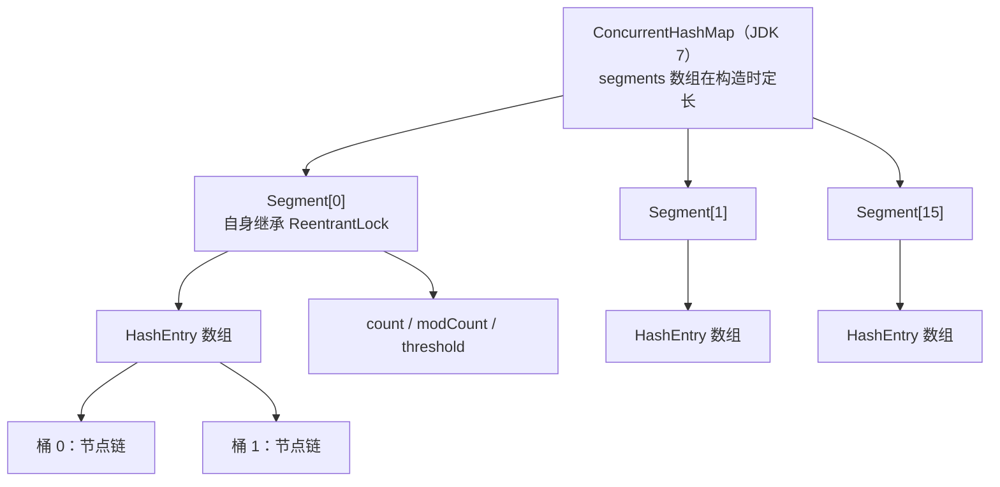
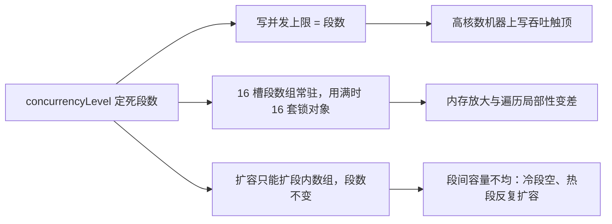
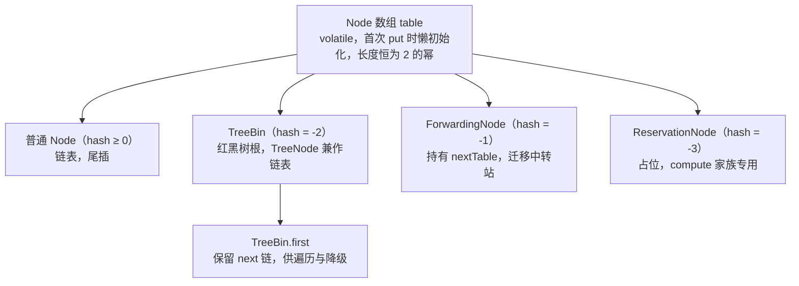
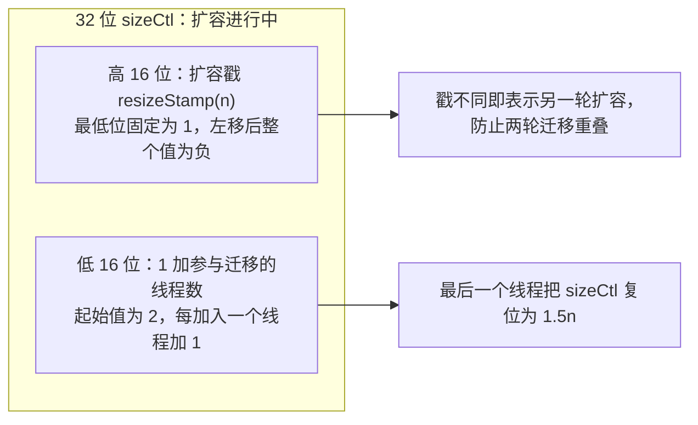
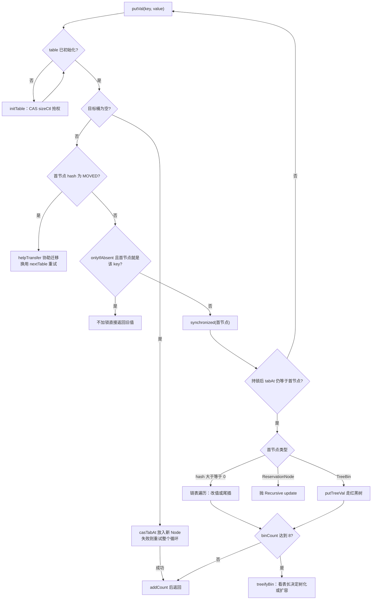
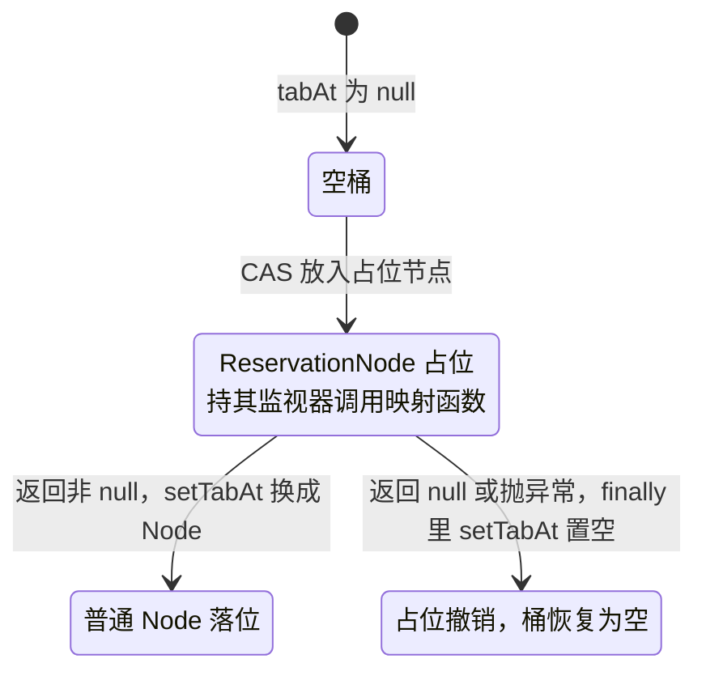

# 09 并发容器（上）——ConcurrentHashMap 从 JDK7 到 JDK8 的重构

**摘要：**

`ConcurrentHashMap` 从 JDK 7 到 JDK 8 的那次重写，常被压缩成一句“分段锁换成了 CAS 加 `synchronized`”，但真正的分野在于两个版本对“一次写操作应该锁住多大一块”给出了不同答案。JDK 7 把整张表切成固定数目的段，每段是一个自带 `ReentrantLock` 的小哈希表，段数由构造时的并发级别决定，此后终身不变；JDK 8 拆掉段这一层，回到单张 `Node[]` 数组，空桶插入走 CAS 无锁路径，非空桶用桶首节点自带的监视器互斥，锁粒度降到单个桶，并发度随扩容自然增长。本文按 JDK 7u 与 JDK 21 的源码逐段对照：段的两级寻址与 `HashEntry` 的 volatile 契约、`ensureSegment` 的惰性建段、段内 `rehash` 的高低位分流；以及 JDK 8 的 `sizeCtl` 位编码、`putVal` 的五条分支、`treeifyBin` 的 8 与 64 双阈值、`transfer` 与 `helpTransfer` 的区间认领、`baseCount` 加 `CounterCell[]` 的分散计数、弱一致迭代器里的 `TableStack`。对照下来可以看到，两个版本的并发度来源不同：一个靠构造参数赌，上限写死在段数上；一个由表长现算，在稀疏小表上并不占优。行文最后落回使用边界：复合操作、`size()`、值对象、mapping 函数，这四处才是 `ConcurrentHashMap` 真正不会替你兜底的地方。

---

## 第 1 章 两个版本的取舍起点

### 1.1 单锁容器留下的空位

Java 1.0 的 `Hashtable` 把所有公开方法都挂上 `synchronized`，等于给整张表配了一把锁：任何两个操作，无论它们碰的是不是同一个桶，都要排队。`Collections.synchronizedMap` 只是把这层包装挪到装饰器里，语义没有变化，连遍历都要调用方自己 `synchronized (map)` 才能保证一致。

读多写少的访问模式下，这种串行化浪费得尤其明显。缓存、注册表、会话表这类结构，绝大多数请求是 `get`，`put` 只发生在装载或过期时，让九成的读操作去等一成的写操作，是纯粹的结构性损耗。2004 年 JDK 5 引入 `java.util.concurrent` 时，Doug Lea 给 `ConcurrentHashMap` 定下的目标是三条：**读操作完全不加锁**；写操作只与真正冲突的写操作竞争；写的结果对后续读可见，但可见性由 volatile 语义保证，而不是由锁的互斥保证。

第三条容易被读漏。前两条讲的是并发度，第三条讲的是正确性，三者要同时成立，就不能沿用“一把锁保护整张表可变状态”的老路子。

### 1.2 JDK 7 的答案：把表切成段

JDK 7 的做法是把一张表拆成若干张表，每张表配一把锁。拆出来的单位叫段（Segment），段数由并发级别（concurrencyLevel）决定，默认 16。哈希值的高位选段，低位选段内的桶，**一次哈希**算完两级索引。



段数组一旦建好就不再变长，能变的只有段内的 `HashEntry` 数组。这一点决定了 JDK 7 写并发的天花板：能真正并行的写线程数，不会超过段数。

### 1.3 分段方案当时解决了什么

段的设计相当务实。每个 `Segment` 直接继承 `ReentrantLock`，省掉了“锁对象与数据对象分离”的额外指针与额外分配；`tryLock` 失败时不是立刻阻塞，而是先做一轮预扫，把接下来要遍历的链表节点读进缓存，再回头看锁是否已经释放，这是后面 2.5 节要展开的 `scanAndLockForPut`；段内扩容只影响本段，其他段的读写完全不受干扰。相比 `Hashtable` 的全局锁，16 段在默认配置下就把写并发放大了 16 倍，而读操作从一开始就没有进锁。

### 1.4 JDK 8 前后暴露出的三处不适

第一处是并发度被写死。段数在构造时确定，运行期无法调整，默认 16 意味着无论机器有 8 核还是 128 核、无论表里存 100 个元素还是 1000 万个元素，写并发上限都是 16。要突破这个上限，只能在构造时把并发级别调大，代价是空表就要分配更多段对象与段内数组。

第二处是内存形状。默认构造会先分配 16 槽的 `Segment` 数组并建好 0 号段，其余 15 段在首次被访问时惰性创建；一旦全部用上，每个 `Segment` 自身就是一个锁对象，内部还挂着一个 `ReentrantLock.Sync`、一段 AQS 队列的头尾引用，以及一个初始长度为 2 的 `HashEntry` 数组。段号相邻的段在堆上并不相邻，遍历全表要跨 16 个数组走，缓存局部性比单张数组差。

第三处与 JDK 8 的新 API 有关。JDK 8 给 `Map` 补了 `compute`、`computeIfAbsent`、`merge`、`replaceAll` 等默认方法，`ConcurrentMap` 必须给出按 key 原子的实现，否则这些方法只能退化成“先 `get` 再 `put`”。在分段结构里做这件事很别扭：方法拿到的是 key 的哈希，锁却在段上，一次复合操作要么锁整个段（把并发度压到段数分之一），要么在段内另造一层锁，前者退化明显，后者与“段即锁”的设计自相矛盾。顺便说一句，JDK 7 的 `ConcurrentHashMap` 里根本没有这几个方法，拿 JDK 8 之后的行为去解释 JDK 7 的实现，是阅读旧源码时最常见的误解之一。

还有一条容易被忽略的历史线索。2011 年那轮哈希碰撞拒绝服务攻击之后，JDK 7 在 `hash()` 里加了一个 `jdk.map.althashing.threshold` 开关，对 `String` 键启用替代哈希，试图让攻击者无法构造出大量同桶的键；这个开关是全局的，只能全开或全关，精度很差。JDK 8 换了个思路：不再猜哪些键危险，而是规定桶内节点超过阈值就转成红黑树（Red-Black Tree），把最坏情况的查找从 O(n) 压到 O(log n)，与键的类型无关。树化机制因此不只是性能优化，也是一次安全设计的重构。

---

## 第 2 章 JDK 7：Segment 分段锁的结构

### 2.1 一次哈希，两段寻址

读旧文章时常看到“JDK 7 的 put 要算两次哈希，先定位段再定位桶”，这句话是错的。JDK 7 只调用一次 `hash()`，得到的是一个扰动过的 32 位值，段索引用它的高位，桶索引用它的低位。

```java
// JDK 7：一次哈希，两处取位
private int hash(Object k) {
    int h = hashSeed;
    if ((0 != h) && (k instanceof String))
        return sun.misc.Hashing.stringHash32((String) k);
    h ^= k.hashCode();
    // 单字 Wang/Jenkins 变体，把高位的差异摊到低位
    h += (h << 15) ^ 0xffffcd7d;
    h ^= (h >>> 10);
    h += (h << 3);
    h ^= (h >>> 6);
    h += (h << 2) + (h << 14);
    return h ^ (h >>> 16);
}

// 段索引：取哈希最高的 sshift 位
int j = (hash >>> segmentShift) & segmentMask;
// 桶索引：段内取低位
int index = (tab.length - 1) & hash;
```

默认并发级别 16 时，`sshift` 为 4，`segmentShift` 为 28，`segmentMask` 为 15，段号就是哈希值最高的 4 位；段内桶数从 2 起，按 2 的幂增长，桶号取最低若干位。两级索引互不干扰，代价只是一次移位和一次掩码。段数上限是 `1 << 16`，并发级别超过这个值会被截断，这是 `MAX_SEGMENTS` 的约束。

### 2.2 Segment 为什么继承 ReentrantLock

`Segment` 的声明只有一行，但这一行浓缩了整段设计的取舍：

```java
static final class Segment<K, V> extends ReentrantLock implements Serializable {
    transient volatile HashEntry<K, V>[] table;  // 桶数组，换表时整引用替换
    transient int count;      // 段内元素数，只在锁内改，读侧靠 volatile 传播
    transient int modCount;   // 结构修改次数，供 size() 判断“统计期间是否稳定”
    transient int threshold;  // 扩容阈值 = table.length * loadFactor
    final float loadFactor;
}
```

继承而非组合，省下的是一个 `lock` 字段和一次解引用，代价是 `Segment` 与 `ReentrantLock` 的字段布局绑死，序列化兼容性也要跟着走。`ReentrantLock` 默认是非公平实现，`tryLock` 直接尝试一次 CAS 抢状态位，抢不到就走预扫，这段路径比公平锁短得多，也符合哈希表“锁内临界区极短”的特点。

把段做成一把锁，还带来一个不太显眼的好处：`size()` 需要一个“把某个段整体冻住”的能力，段是锁对象，直接 `lock()` 即可，不必再维护一个专门的锁。

### 2.3 HashEntry 的 volatile 契约

无锁读的正确性全部压在 `HashEntry` 的字段修饰上：

```java
static final class HashEntry<K, V> {
    final int hash;   // 不可变，读侧无需同步
    final K key;      // 不可变
    volatile V value; // 值的发布靠它
    volatile HashEntry<K, V> next; // 链的发布也靠它

    final void setNext(HashEntry<K, V> n) {
        // 用 putOrderedObject 而非 volatile 写：后面一定跟着 unlock
        UNSAFE.putOrderedObject(this, nextOffset, n);
    }
}
```

`value` 与 `next` 是 `volatile`，于是即便读线程完全没有加锁，`get()` 顺着 `next` 走链表时读到的每个节点、每个值都是发布完成的版本。`setNext` 用的 `putOrderedObject` 是 release 语义的写，只保证前面的写不会重排到它之后，不保证立即可见；这样做的依据是段内所有结构修改都在锁内完成，`unlock()` 本身带有一个释放屏障，紧随其后的读线程在 `lock()` 时又有一个获取屏障，屏障把写入推到了该到的地方。屏障与重排序的细节在 [[03 volatile 的实现原理——内存屏障与禁止重排序]] 里完整推过，这里只需记住结论：JDK 7 的写路径敢用更便宜的 ordered 写，是因为锁的释放替它兜了底。

### 2.4 段的惰性构建：ensureSegment 的 CAS

`segments` 数组在构造时就分配，但只有 0 号段是构造时建好的，其余 15 段等第一次被访问时才创建：

```java
private Segment<K, V> ensureSegment(int k) {
    final Segment<K, V>[] ss = this.segments;
    long u = (k << SSHIFT) + SBASE;
    Segment<K, V> seg;
    if ((seg = (Segment<K, V>) UNSAFE.getObjectVolatile(ss, u)) == null) {
        Segment<K, V> proto = ss[0];          // 以 0 号段为模板，省下重复计算
        int cap = proto.table.length;
        float lf = proto.loadFactor;
        int threshold = (int) (cap * lf);
        HashEntry<K, V>[] tab = (HashEntry<K, V>[]) new HashEntry[cap];
        if ((seg = (Segment<K, V>) UNSAFE.getObjectVolatile(ss, u)) == null) {
            Segment<K, V> s = new Segment<K, V>(lf, threshold, tab);
            while ((seg = (Segment<K, V>) UNSAFE.getObjectVolatile(ss, u)) == null) {
                // 多个线程同时到达时，只有一个 CAS 成功，其余复用胜者的段
                if (UNSAFE.compareAndSwapObject(ss, u, null, seg = s))
                    break;
            }
        }
    }
    return seg;
}
```

两个线程同时访问同一段，各自 `new` 了一个 `Segment`，但只有一个能把引用写进数组槽，失败者立即丢弃自己的对象改用胜者的。这里用 CAS 是为了避免“为建一个段而先加一把全局锁”，与 JDK 8 `initTable` 里 CAS `sizeCtl` 抢初始化权是同一个套路，只是粒度更细。段内数组长度取自 0 号段，因此所有段的初始桶数一致。

### 2.5 写路径：scanAndLockForPut 的预扫

段一旦存在，写操作就落在 `Segment.put` 上。它没有直接 `lock()`，而是先 `tryLock()`，失败才进**预扫**：

```java
final V put(K key, int hash, V value, boolean onlyIfAbsent) {
    // 抢到锁则不预建节点；抢不到就边扫边等，顺便把节点建好
    HashEntry<K, V> node = tryLock() ? null : scanAndLockForPut(key, hash, value);
    V oldValue;
    try {
        HashEntry<K, V>[] tab = table;
        int index = (tab.length - 1) & hash;
        HashEntry<K, V> first = entryAt(tab, index);
        for (HashEntry<K, V> e = first; ;) {
            if (e != null) {
                if (e.hash == hash && key.equals(e.key)) {  // 命中，只改值
                    oldValue = e.value;
                    if (!onlyIfAbsent) { e.value = value; ++modCount; }
                    break;
                }
                e = e.next;
            }
            else {
                if (node != null) node.setNext(first);
                else node = new HashEntry<K, V>(hash, key, value, first);
                int c = count + 1;
                if (c > threshold && tab.length < MAXIMUM_CAPACITY)
                    rehash(node);                 // 段内扩容，本段独享
                else
                    setEntryAt(tab, index, node);
                ++modCount;
                count = c;
                break;
            }
        }
    } finally {
        unlock();
    }
    return oldValue;
}
```

注意新节点挂在链头：`new HashEntry<K, V>(hash, key, value, first)` 直接让新节点成为桶首，冲突用拉链法解决，写路径无需先走到链尾。这与 JDK 8 的尾插相反，后者不是随手改的——只有“新节点一律追加在尾部、首节点确定后不再更动”，`synchronized (f)` 加一次 double-check 才能成立；换成头插，锁住的首节点随时会被别人顶替，这套办法就不灵了。

`scanAndLockForPut` 的注释写得很坦白：抢锁失败后一边 `tryLock` 一边沿链表找目标节点，把自己将要访问的缓存行提前拉进 CPU 缓存，并对偶数次重试检查一次桶首是否变化，最多自旋 `MAX_SCAN_RETRIES`（多核机器上为 64）次再改为阻塞式 `lock()`。如果扫到桶尾仍未找到 key，就顺手把 `HashEntry` 建出来，等真正持锁后直接挂上，省掉一次分配。这是典型的“把等待时间用来做有用的事”，哈希表的锁竞争通常只有几十纳秒量级，预扫正好填满这段空窗。

### 2.6 段内扩容：rehash 的高低位分流

段内元素数超过阈值时触发 `rehash`，新表长度翻倍。旧链表被拆成两组：哈希值在新增那一位上为 0 的留在原索引，为 1 的移到 `i + oldCapacity`。为了避免整条链全部重新建节点，JDK 7 找出一条“尾部连续同索引”的最长子串，把这段整体搬到新表，只重建它前面的节点，源码注释给的经验值是翻倍时大约只有六分之一的节点需要克隆。

克隆是必须的：无锁读线程可能正沿着旧链表往下走，如果直接在原节点上改 `next`，读者会掉进一条结构已经错乱的链。所以旧节点保持原样直到没有读者引用，新表另建节点，最后一次性把 `table` 引用换成新数组。这一步是 `volatile` 写，读写双方在换表瞬间达成新的共识。

这里也埋下了 JDK 7 扩容的第一个结构性短板：扩容**以段为单位**，一次 `rehash` 只搬本段的元素，其他段完全不动，于是 16 个段会在不同时间点各自进入扩容状态，表的总容量增长是碎步式的；更要紧的是，扩容期间该段的所有写操作都被这把段锁挡住，而其他段即使很空也无法分担这段的搬迁工作。

### 2.7 读路径：全部压在 volatile 读上

`get()` 是整段设计里最省的一段代码：

```java
public V get(Object key) {
    Segment<K, V> s;
    HashEntry<K, V>[] tab;
    int h = hash(key);
    long u = (((h >>> segmentShift) & segmentMask) << SSHIFT) + SBASE;
    if ((s = (Segment<K, V>) UNSAFE.getObjectVolatile(segments, u)) != null &&
        (tab = s.table) != null) {
        for (HashEntry<K, V> e = (HashEntry<K, V>) UNSAFE.getObjectVolatile(
                 tab, ((long) (((tab.length - 1) & h)) << TSHIFT) + TBASE);
             e != null; e = e.next) {
            K k;
            if ((k = e.key) == key || (e.hash == h && key.equals(k)))
                return e.value;  // value 是 volatile 字段，读到的是发布后的值
        }
    }
    return null;
}
```

段数组槽用 `getObjectVolatile` 读，是因为段可能正被别的线程惰性创建；段内 `table` 字段本身是 `volatile`，普通读即可；桶首同样用 `getObjectVolatile`，因为桶首可能刚被换掉；之后沿 `next` 走链表，节点与值都是 `volatile` 字段。四层访问各有各的理由，一处都不能省。

### 2.8 size() 的乐观统计与全局锁兜底

`size()` 要汇总 16 个段的 `count`，逐段加锁显然太重，JDK 7 用了一个类似乐观读的两次采样法：

```java
public int size() {
    final Segment<K, V>[] segments = this.segments;
    int size;
    boolean overflow;
    long sum;                 // 本轮 modCount 总和，充当版本号
    long last = 0L;           // 上一轮的总和
    int retries = -1;         // 首轮不算重试
    try {
        for (;;) {
            if (retries++ == RETRIES_BEFORE_LOCK) {   // 无锁重试 2 次仍不稳定
                for (int j = 0; j < segments.length; ++j)
                    ensureSegment(j).lock();          // 锁住全部段，强制稳定
            }
            sum = 0L;
            size = 0;
            overflow = false;
            for (int j = 0; j < segments.length; ++j) {
                Segment<K, V> seg = segmentAt(segments, j);
                if (seg != null) {
                    sum += seg.modCount;              // 只增不减，适合当版本号
                    int c = seg.count;
                    if (c < 0 || (size += c) < 0)
                        overflow = true;
                }
            }
            if (sum == last) break;                   // 两轮版本号相同，采信本轮结果
            last = sum;
        }
    } finally { /* 若锁过，逐段解锁 */ }
    return overflow ? Integer.MAX_VALUE : size;
}
```

判据不是“两轮 `count` 相同”，而是“两轮 `modCount` 总和相同”。因为 `count` 可能因一增一减恰好抵消而变化为零，`modCount` 只增不减，能更可靠地反映“这期间有没有发生过结构修改”。连续两轮稳定才采信，否则重试；重试两次还不行，就锁住全部段算一遍。这套机制与 StampedLock 的乐观读在思路上同源，只是手写得粗糙了些：它没有版本号回滚，只能靠重试次数兜底。

### 2.9 固定并发度的三重代价



三种代价最终都指向同一个结论：段数是一个必须在“创建时”回答、且**答错无法纠正**的参数。JDK 7 的文档也承认这一点，`concurrencyLevel` 的注释写的是“估计值，高估浪费空间，低估引发竞争，但数量级上的偏差通常影响不大”；对负载稳定、并发度可预测的系统，这句话成立；对负载会随业务增长的通用库，它就变成了一个必须靠调用方赌运气的旋钮。

---

## 第 3 章 JDK 8：单层数组加 CAS 与 synchronized

### 3.1 一张表代替十六张表

JDK 8 把段这一层整个删掉，回到 `HashMap` 那种单张数组的形状，但节点类型比 `HashMap` 复杂得多：



四种节点共用一个 `Node` 基类，靠 `hash` 字段的**符号位**区分：普通节点的 `hash` 被 `spread()` 保证为非负，特殊节点直接占用负数。这个设计把“类型判断”压缩成一次比较，热路径上不需要 `instanceof` 就能先分流：`get()` 里看到 `eh < 0` 才走多态的 `find()`。

```java
static final int MOVED = -1;      // 转发节点
static final int TREEBIN = -2;    // 树根
static final int RESERVED = -3;   // 占位节点
static final int HASH_BITS = 0x7fffffff;

static final int spread(int h) {
    return (h ^ (h >>> 16)) & HASH_BITS;  // 高位摊到低位，同时清掉符号位
}
```

### 3.2 sizeCtl：一个 int 的五种读法

JDK 8 把初始化、扩容、阈值三件事塞进了同一个 `int` 字段，它是全类最难读的地方。字段注释给的分法是：负数表示正在初始化或扩容，`-1` 表示初始化，其余负数表示“负的（1 加正在迁移的线程数）”；非负数在表为空时是初始容量，表建好后是下一次扩容的元素数阈值。



扩容戳由表长算出来，`resizeStamp(n)` 取 `n` 的前导零个数，再把第 15 位置 1，于是同一个表长得到固定的戳，左移 16 位后必为负数。起始值写成 `(rs << 16) + 2`，低位的 2 表示“一个线程在干活”，后续线程每加入一个就 `+1`，因此“最后一个线程”的判据是 `sc - 2 == rs << 16`。这套编码让“加入扩容”“退出扩容”“判定是否最后一人”三个动作都能用一次 CAS 完成，不需要额外的状态变量。

```java
private final Node<K, V>[] initTable() {
    Node<K, V>[] tab; int sc;
    while ((tab = table) == null || tab.length == 0) {
        if ((sc = sizeCtl) < 0)
            Thread.yield();                       // 已有线程在初始化，让出 CPU 等结果
        else if (U.compareAndSetInt(this, SIZECTL, sc, -1)) {
            try {
                if ((tab = table) == null || tab.length == 0) {
                    int n = (sc > 0) ? sc : DEFAULT_CAPACITY;
                    Node<K, V>[] nt = (Node<K, V>[]) new Node<?, ?>[n];
                    table = tab = nt;
                    sc = n - (n >>> 2);           // 0.75n，写成减法避免浮点
                }
            } finally {
                sizeCtl = sc;                     // 无论成功失败都恢复为正阈值
            }
            break;
        }
    }
    return tab;
}
```

这段代码值得逐行看的地方有三处。`table` 字段本身是 `volatile`，赋值即发布，读者不会看到“数组已存在但元素未初始化”的中间态；`sizeCtl` 用 CAS 从正数改成 `-1`，抢到的线程才建表，没抢到的 `yield()` 后重试，而不是阻塞，因为初始化只是一次数组分配，耗时在微秒级；`finally` 里恢复 `sizeCtl`，保证即使建表过程中抛出 `OutOfMemoryError`，其他线程也不会永远卡在 `sizeCtl < 0` 的自旋里。

### 3.3 putVal 的五条分支

JDK 8 的写入口 `putVal` 是一个不带锁的循环，每轮先看当前桶的状态，再决定走哪条路：

```java
final V putVal(K key, V value, boolean onlyIfAbsent) {
    if (key == null || value == null) throw new NullPointerException();
    int hash = spread(key.hashCode());
    int binCount = 0;
    for (Node<K, V>[] tab = table; ;) {
        Node<K, V> f; int n, i, fh; K fk; V fv;
        if (tab == null || (n = tab.length) == 0)
            tab = initTable();                        // 分支 1：懒初始化
        else if ((f = tabAt(tab, i = (n - 1) & hash)) == null) {
            if (casTabAt(tab, i, null, new Node<K, V>(hash, key, value)))
                break;                                // 分支 2：空桶，CAS 直接落位
        }
        else if ((fh = f.hash) == MOVED)
            tab = helpTransfer(tab, f);               // 分支 3：撞上迁移，先去帮忙
        else if (onlyIfAbsent && fh == hash &&
                 ((fk = f.key) == key || (fk != null && key.equals(fk))) &&
                 (fv = f.val) != null)
            return fv;                                // 分支 4：putIfAbsent 命中首节点
        else {
            V oldVal = null;
            synchronized (f) {                        // 分支 5：以桶首节点为锁
                if (tabAt(tab, i) == f) {             // 持锁后确认首节点没换人
                    if (fh >= 0) {                    // 链表：遍历、更新或尾插
                        /* ... 找到同名 key 就改 val，否则 pred.next 挂新节点 ... */
                    } else if (f instanceof TreeBin) {
                        /* ... putTreeVal ... */
                    } else if (f instanceof ReservationNode)
                        throw new IllegalStateException("Recursive update");
                }
            }
            if (binCount != 0) {
                if (binCount >= TREEIFY_THRESHOLD) treeifyBin(tab, i);
                if (oldVal != null) return oldVal;
                break;
            }
        }
    }
    addCount(1L, binCount);                           // 计数与扩容检查
    return null;
}
```



五条分支对应五种成本模型，放在一起看比逐条背更清楚：

| 分支 | 触发条件 | 主要成本 | 是否需要互斥 |
| :--- | :--- | :--- | :--- |
| 懒初始化 | `table` 为空 | 一次数组分配，CAS 抢权 | 无（CAS 抢权） |
| 空桶插入 | `tabAt == null` | 一次 CAS 加一次分配 | 无 |
| 迁移协助 | 桶首为 `ForwardingNode` | 帮搬若干个桶，再重试本次写 | 无（内部按段协调） |
| 首节点命中 | `onlyIfAbsent` 且首节点即目标 | 一次比较 | 无 |
| 桶内修改 | 其余情况 | 监视器加锁、链表或树查找 | 需要，只锁该桶首节点 |

真正高频的是前两条加最后一条。空桶 CAS 是无锁的，桶内修改只锁一个桶首节点，两者合起来把“写操作的竞争面”从整张表压到了单个桶；而按官方注释的估算，随机哈希下两个线程访问不同元素的锁冲突概率大约是 `1 / (8n)`，n 为元素个数，元素上万时冲突已经可以忽略。

### 3.4 以桶首节点为锁：可行性与那次 double-check

用桶首节点本身当锁对象，省掉了为每个桶配一个 `ReentrantLock` 的内存开销，但也带来一个前提：锁住首节点之后，必须确认首节点还是当初那个。因为在你拿到锁之前，别的线程可能已经把首节点删掉、或者扩容把整条链搬到新表了，此时锁住的是一个已经脱离主结构的对象，改它毫无意义。

这就是 `if (tabAt(tab, i) == f)` 这行 double-check 的全部意义：持锁后重新读一次数组槽，只有**仍然是同一个对象**，才说明“我锁住的这条链还在表里”，否则退出重来。能这么做还有一个结构上的前提：新节点总是追加到链尾，首节点在“被删除”或“桶被迁移”之前不会变；一旦首节点变了，说明这条链要么被删空、要么已经在别处，重新来一遍即可。

这道检查也解释了为什么 JDK 8 敢把锁类型从 `ReentrantLock` 换成 `synchronized`：桶内临界区只有“遍历一条短链、改一个 `val`、或做一次尾插”，锁持有时间在**纳秒级**，且绝大多数情况下无竞争，`synchronized` 在这种场景下的薄锁路径（一次 CAS 改对象头）比 `ReentrantLock` 的 `tryLock` 路径还短，还省掉了一个锁对象。至于偏向锁，JDK 15 起已按 JEP 374 默认关闭并废弃，所以如今“偏向锁让无竞争 `synchronized` 几乎零成本”这句话已经不能当作论据，能站得住的只剩薄锁路径本身够快。

### 3.5 treeifyBin：8 与 64 两个阈值

桶内节点数达到 8 时调用 `treeifyBin`，但它不保证树化：

```java
private final void treeifyBin(Node<K, V>[] tab, int index) {
    Node<K, V> b; int n;
    if (tab != null) {
        if ((n = tab.length) < MIN_TREEIFY_CAPACITY)   // 64
            tryPresize(n << 1);                        // 小表先扩容，树化留给大表
        else if ((b = tabAt(tab, index)) != null && b.hash >= 0) {
            synchronized (b) {
                if (tabAt(tab, index) == b) {
                    /* 逐个转成 TreeNode，串成树并保留 next 链 */
                }
            }
        }
    }
}
```

两个阈值各管一件事。8 是“链表已经太长”的信号，官方注释给出的依据是泊松分布：在 0.75 的扩容阈值下，桶内节点数的期望大约是 0.5，长度为 8 的桶出现概率约为 `0.00000006`，也就是千万分之一量级（源码注释另有一句“更长的桶不到千万分之一”），正常哈希下几乎不可能发生，所以一旦发生就说明哈希函数质量有问题或有人在构造碰撞。64 是“表本身还太小”的信号：表长 32 时桶数只有 32，冲突本来就更频繁，把表扩到 64 带来的收益大于树化，因此先扩容。只有当表长至少 64、冲突仍然达到 8 个，才认定这是真碰撞，动手建树。

反向的降级阈值是 6，低于 8 而不是相等，是为了在 6 到 8 之间留一段缓冲区，避免“树化—退树—再树化”的抖动。这个不对称是刻意的。

### 3.6 TreeBin 的寄生读写锁

红黑树在插入、删除时会旋转，旋转会改根节点与父子指针，正在查找的读者可能走进一条已经改过的路径。JDK 8 没有给 `TreeBin` 配 `ReentrantReadWriteLock`（那是另一个对象、另一份内存），而是造了一个极简的读写锁寄生在桶首节点的监视器策略之上：

```java
static final int WRITER = 1;   // 写锁已持有
static final int WAITER = 2;   // 有写者在等
static final int READER = 4;   // 每个读者加 4

// 读者：无写者且无等待者时，CAS 加 4 进读锁，读完减 4
final Node<K, V> find(int h, Object k) {
    for (Node<K, V> e = first; e != null; ) {
        int s;
        if (((s = lockState) & (WAITER | WRITER)) != 0) {
            // 有写者持锁或等待：退化成链表扫描，靠 next 链保证正确
            if (e.hash == h && (e.key == k || (e.key != null && k.equals(e.key))))
                return e;
            e = e.next;
        } else if (U.compareAndSetInt(this, LOCKSTATE, s, s + READER)) {
            // 抢到读锁，走树查找
            TreeNode<K, V> r, p;
            try { p = ((r = root) == null ? null : r.findTreeNode(h, k, null)); }
            finally { /* 减 4，若发现 READER|WAITER 则唤醒等待的写者 */ }
            return p;
        }
    }
    return null;
}
```

这段代码里有三个值得记住的细节。第一，读锁用 CAS 加一个计数值实现，天然支持多读者并发；第二，写者先在 `lockRoot` 里试一次“从 0 置 `WRITER`”的 CAS，失败后改走 `contendedLock`：置 `WAITER` 位、登记等待线程、`park` 自己，读者撤出后若发现 `READER | WAITER` 就 `unpark` 写者，写者醒来再试 CAS；第三，也是最容易被忽略的：**退化为链表扫描**，因为 `TreeNode` 保留了 `next` 指针。也就是说树化后的读并非永远 O(log n)，在结构修改进行中它会退化成 **O(n) 的链表扫描**；用正确性换延迟，是这里的取舍。

`TreeBin` 的另一个坑在比较上。树需要全序，而 `ConcurrentHashMap` 的键只保证 `hashCode` 与 `equals`，不保证 `Comparable`，于是插入时先比 `hash`，再试 `compareTo`，两者都分不出胜负时用 `tieBreakOrder` 按类名、再按 `identityHashCode` 兜底。这意味着“树化后的遍历顺序”没有任何语义，不要依赖它。

### 3.7 get 的 acquire 读

`get` 是整张表最热的路径，它一行锁都没有：

```java
public V get(Object key) {
    Node<K, V>[] tab; Node<K, V> e, p; int n, eh; K ek;
    int h = spread(key.hashCode());
    if ((tab = table) != null && (n = tab.length) > 0 &&
        (e = tabAt(tab, (n - 1) & h)) != null) {   // acquire 语义的读
        if ((eh = e.hash) == h) {                  // 首节点即目标，最快路径
            if (e.key == key || (e.key != null && key.equals(e.key)))
                return e.val;
        } else if (eh < 0)                         // 转发节点或树根，交给 find 多态
            return (p = e.find(h, key)) != null ? p.val : null;
        while ((e = e.next) != null) {             // 普通链表
            if (e.hash == h && (e.key == key || (e.key != null && key.equals(e.key))))
                return e.val;
        }
    }
    return null;
}
```

`tabAt` 在 JDK 8 里是 `Unsafe.getObjectVolatile`，JDK 9 之后换成了 `Unsafe.getReferenceAcquire`，对应的写侧是 `putReferenceRelease`。volatile 读保证顺序一致性，acquire 读只保证“后续读写不重排到它之前”，配合写侧的 release，足以让读者看到发布完成的节点，却省掉一次全屏障的成本。这是 JDK 8 之后读路径变快的一个细小但真实的来源，也是读 `table`、桶首、`next` 三层访问各自“该用哪一种读”的依据。

---

## 第 4 章 扩容：把搬迁工作分给所有路过的线程

### 4.1 触发点不止一个

扩容由三处触发。最常见的路径是 `putVal` 末尾的 `addCount(1L, binCount)`：计入新元素后若发现元素数已达到阈值，就把 `sizeCtl` 改成扩容戳并启动 `transfer`。第二条是 `treeifyBin` 发现表长不足 64 时调用的 `tryPresize(n << 1)`，先扩表再谈树化。第三条是 `putAll`，它在逐个写入之前先调 `tryPresize` 预估容量，把表一次性扩到够用的长度。构造函数里给的初始容量并不预分配数组，只是记进 `sizeCtl`，等首次写入时才按这个值建表，这也解释了为什么 `new ConcurrentHashMap<>(1_000_000)` 本身几乎不耗内存。

三条路径最终都收敛到同一个状态机：把 `sizeCtl` 从正数 CAS 成 `(rs << 16) + 2`，谁 CAS 成功谁负责建新表并启动迁移。这里 `(rs << 16) + 2` 的写法值得再看一眼：`+2` 不是随手取的常数，它表示“当前有一个线程在迁移”，后续线程加入时执行 `sizeCtl + 1`，于是低位数值始终等于“活跃迁移线程数加一”。

### 4.2 stride 与 transferIndex：区间认领

迁移不是每个线程各搬一个桶，那样协调成本高于收益；也不是平均切开，因为线程数是动态的。JDK 8 让每个参与的线程用 CAS 从 `transferIndex` 上认领一段连续区间，每段长度由 `stride` 决定：

```java
private final void transfer(Node<K, V>[] tab, Node<K, V>[] nextTab) {
    int n = tab.length, stride;
    // 按核数切，每线程至少 16 个桶，避免认领本身的 CAS 比搬运还贵
    if ((stride = (NCPU > 1) ? (n >>> 3) / NCPU : n) < MIN_TRANSFER_STRIDE)
        stride = MIN_TRANSFER_STRIDE;            // 16
    if (nextTab == null) {                       // 第一个到达的线程负责建新表
        nextTab = (Node<K, V>[]) new Node<?, ?>[n << 1];
        nextTable = nextTab;
        transferIndex = n;                       // 从末尾往前搬
    }
    int nextn = nextTab.length;
    ForwardingNode<K, V> fwd = new ForwardingNode<K, V>(nextTab);
    boolean advance = true;
    boolean finishing = false;
    for (int i = 0, bound = 0; ;) {
        Node<K, V> f; int fh;
        while (advance) {
            int nextIndex, nextBound;
            if (--i >= bound || finishing) advance = false;
            else if ((nextIndex = transferIndex) <= 0) { i = -1; advance = false; }
            else if (U.compareAndSetInt(this, TRANSFERINDEX, nextIndex,
                     nextBound = (nextIndex > stride ? nextIndex - stride : 0))) {
                bound = nextBound; i = nextIndex - 1; advance = false;  // 认领成功
            }
        }
        if (i < 0 || i >= n || i + n >= nextn) { /* 收尾：见 4.5 节 */ }
        else if ((f = tabAt(tab, i)) == null)
            advance = casTabAt(tab, i, null, fwd);   // 空桶：直接插转发节点
        else if ((fh = f.hash) == MOVED)
            advance = true;                          // 别人搬过了，跳过
        else {
            synchronized (f) {                       // 搬非空桶要先锁桶首
                if (tabAt(tab, i) == f) { /* 高低位拆分：见 4.4 节 */ }
            }
        }
    }
}
```

从末尾往前搬，是因为遍历数组的读者（后面 6.2 节的 `Traverser`）也是从低索引往高索引走。迁移方向与遍历方向相反，读者刚走过的区间不会被再次改动，遍历可以借助一个栈回到旧表继续处理高位部分。这个方向选择不是随意的，它是遍历器那套 `TableStack` 机制得以成立的前提。

`stride` 取 `(n >>> 3) / NCPU`，即表长的八分之一按核数均分，下限 16。表长 1024、8 核时 stride 为 16，一次认领 16 个桶；表长 16 时 stride 也是 16，即整张表一次认领完，此时多线程协助没有意义，因为表本身太小了。

### 4.3 ForwardingNode 与 helpTransfer

搬完一个桶，迁移线程在该位置放一个 `ForwardingNode`，它持有指向新表的引用，`hash` 为 `MOVED`。这个节点是整套协作机制的**枢纽**：它把“此桶已迁走”这个信息，以数据结构的形式写进了旧表本身，任何线程都能通过一次普通读发现，不需要额外的标志位或锁。

- `get` 撞上它，调 `ForwardingNode.find` 到新表继续找，读路径依旧无锁。
- `put` 撞上它，调 `helpTransfer` 加入迁移，搬完再回到新表重试本次写。
- 迭代器撞上它，切到新表继续遍历，并用栈记住旧表的处理位置。
- 另一个迁移线程撞上它，直接跳过。

`helpTransfer` 的加入条件写得很严：

```java
final Node<K, V>[] helpTransfer(Node<K, V>[] tab, Node<K, V> f) {
    Node<K, V>[] nextTab; int sc;
    if (tab != null && (f instanceof ForwardingNode) &&
        (nextTab = ((ForwardingNode<K, V>) f).nextTable) != null) {
        int rs = resizeStamp(tab.length) << RESIZE_STAMP_SHIFT;
        while (nextTab == nextTable && table == tab && (sc = sizeCtl) < 0) {
            // 三种不加入的情况：线程数已满、迁移已收尾、没有可认领区间
            if (sc == rs + MAX_RESIZERS || sc == rs + 1 || transferIndex <= 0)
                break;
            if (U.compareAndSetInt(this, SIZECTL, sc, sc + 1)) {
                transfer(tab, nextTab);
                break;
            }
        }
        return nextTab;
    }
    return table;
}
```

三个退出条件分别对应三种局面。`sc == rs + MAX_RESIZERS` 说明活跃线程数已达上限（`MAX_RESIZERS` 为 32767），再加人会溢出低 16 位；`sc == rs + 1` 说明迁移已进入收尾，只剩最后一个线程在复位；`transferIndex <= 0` 说明可认领区间已经分完，加进来也无桶可搬。循环条件里的 `nextTab == nextTable && table == tab` 则是在防“扩容已完成”或“又开了新一轮扩容”这两种时间穿越：只要表引用或 `nextTable` 变了，说明当前这轮已经结束，本次协助就失去意义。

`helpTransfer` 的返回值是 `nextTab` 而不是 `table`，调用方拿到它之后直接在新表上重试写操作，省掉一次“先发现转发节点、再读 `nextTable`”的往返。

### 4.4 高低位拆分与 lastRun 复用

非空桶的搬迁逻辑与 JDK 7 的 `rehash` 同源，但更省：新表长度是旧表的两倍，于是旧桶 `i` 的每个节点只有两种去处，`i` 或 `i + n`，取决于 `hash & n` 是 0 还是 1，不需要重算哈希，也不需要重算掩码。

```java
int runBit = fh & n;                 // 首节点落在低位还是高位
Node<K, V> lastRun = f;              // 记住“尾部连续同一去向”的起点
for (Node<K, V> p = f.next; p != null; p = p.next) {
    int b = p.hash & n;
    if (b != runBit) { runBit = b; lastRun = p; }
}
// 以 lastRun 为界：它之后的所有节点去向相同，可以整段复用
Node<K, V> ln, hn;
ln = (runBit == 0) ? lastRun : null;
hn = (runBit == 0) ? null : lastRun;
for (Node<K, V> p = f; p != lastRun; p = p.next) {
    if ((p.hash & n) == 0) ln = new Node<K, V>(p.hash, p.key, p.val, ln);
    else                    hn = new Node<K, V>(p.hash, p.key, p.val, hn);
}
setTabAt(nextTab, i, ln);
setTabAt(nextTab, i + n, hn);
setTabAt(tab, i, fwd);               // 旧桶钉上转发节点
```

和 JDK 7 一样，未复用的节点必须克隆而不能原地改 `next`，因为可能有读者正沿旧链遍历；`lastRun` 之后的整段因为后续去向一致，可以整体挂到新表，省掉逐个克隆。官方注释给的经验值同样是“翻倍时约六分之一需要克隆”，这个数字来自随机哈希下链尾连续同向的概率分布。

树桶的搬迁要复杂一档：先把 `TreeBin` 里的 `TreeNode` 按 `hash & n` 分成两串，再按各自长度决定去向——长度不超过 6 的降级成普通链表（`untreeify`），超过的重新构造成 `TreeBin`。这一段逻辑保证“树不会随着扩容变成一堆单节点桶”，也顺手解释了为什么树化的门槛是 8 而降级门槛是 6。

### 4.5 收尾：finishing 与 sizeCtl 复位

每个线程搬完自己认领的区间后递减 `sizeCtl`，递减结果若表明自己是最后一个，就把 `finishing` 置位并回头再扫一遍全表，确认没有遗漏：

```java
if (U.compareAndSetInt(this, SIZECTL, sc = sizeCtl, sc - 1)) {
    // 低位只剩 2，说明除自己外没有别的迁移线程
    if ((sc - 2) != resizeStamp(n) << RESIZE_STAMP_SHIFT)
        return;                       // 还有人没搬完，直接退出
    finishing = advance = true;
    i = n;                            // 从尾到头再扫一遍，兜住收尾期间的插入
}
```

最后那个“再扫一遍”不是多余动作。迁移线程递减 `sizeCtl` 与新线程插入之间存在竞态：某个桶可能在迁移线程的判断之后、`finishing` 置位之前被插入新节点，而那时该桶已经是转发节点，插入线程会走 `helpTransfer` 协助迁移；如果协助失败（比如可认领区间已空），它会在新表上完成插入。那一轮全表复扫就是为了确认旧表里不再有“既非转发节点、也非已迁移”的桶。

收尾时执行三件事：`nextTable = null` 清掉中间态，`table = nextTab` 发布新表，`sizeCtl = (n << 1) - (n >>> 1)` 复位为 `1.5n`，也就是新表长度乘以 0.75。写成 `(n << 1) - (n >>> 1)` 而不是浮点乘法，是因为 `sizeCtl` 是 int，用整数位移既避免精度问题也少一次类型转换。

### 4.6 扩容期间三类访问者的行为

| 访问者 | 撞上 `ForwardingNode` 的动作 | 是否阻塞 | 结果语义 |
| :--- | :--- | :--- | :--- |
| `get` | `ForwardingNode.find` 转到新表继续找 | 不阻塞 | 读到迁移前后一致的值 |
| `put` / `compute` | `helpTransfer` 加入迁移，完成后在新表重试 | 搬桶期间可能短暂同步 | 写落在新表，不丢 |
| 迭代器 | `Traverser` 切到新表，用栈记住旧表位置 | 不阻塞 | 弱一致，见第 6 章 |
| 另一个迁移线程 | 直接跳过（`advance = true`） | 不阻塞 | 只搬未搬的桶 |

这套协作让扩容从“停顿”变成了“**分摊**”：单次扩容的总工作量仍是 O(n)，但被切成 16 个桶一段，由所有恰好在扩容期间写表的线程分摊，任一时刻真正阻塞在某个桶锁上的写操作，只涉及那一个桶。作为对照，JDK 7 的 `rehash` 是段内单线程的完整搬迁，同一段上的所有写操作在搬迁期间全部排队，而其他段即使很空也无法分担——这是两个版本在扩容维度上最本质的差别。

不过这套机制也有代价。`sizeCtl` 的编码把“扩容代数”与“线程计数”挤在同一个 int 里，任何一处 CAS 写错都会导致迁移提前结束或永远结束不了，这类 bug 只能靠压力测试暴露；而 `transfer` 里“空桶直接插转发节点”的写法虽然省锁，却要求读者必须能识别转发节点，于是读路径、写路径、迭代路径三处都要处理 `MOVED`，复杂度是扩散的。

---

## 第 5 章 计数：baseCount 与 CounterCell[]

### 5.1 单点计数为什么会成为热点

最简单的做法是一个 `volatile long size`，每次 `put` 成功后 `size++`。问题在于这个字段只有一份缓存行，所有核的写都要抢同一条缓存的独占权，核数一多，CAS 重试就会把这个字段变成串行点；这与 `AtomicLong` 在高竞争下的退化是同一个机理，`LongAdder` 的分散计数正是为此而生，完整推演在 [[05 CAS 与原子类——Unsafe、AtomicInteger 到 LongAdder 的演进]] 里。`ConcurrentHashMap` 的计数需要一个变体而不是直接用 `LongAdder`，原因是它要在计数的同时判断“该不该扩容”，还得把“这次写是否发生竞争”这个信息带上来。

### 5.2 addCount 与 fullAddCount

```java
private transient volatile long baseCount;              // 无竞争时的主计数
private transient volatile CounterCell[] counterCells;  // 有竞争时的分散计数
private transient volatile int cellsBusy;               // 建表与扩容的互斥位

@jdk.internal.vm.annotation.Contended
static final class CounterCell { volatile long value; }  // 填充缓存行，防伪共享

private final void addCount(long x, int check) {
    CounterCell[] cs; long b, s;
    if ((cs = counterCells) != null ||
        !U.compareAndSetLong(this, BASECOUNT, b = baseCount, s = b + x)) {
        // 主计数 CAS 失败：说明有竞争，改走分散单元
        CounterCell c; long v; int m;
        boolean uncontended = true;
        if (cs == null || (m = cs.length - 1) < 0 ||
            (c = cs[ThreadLocalRandom.getProbe() & m]) == null ||
            !(uncontended = U.compareAndSetLong(c, CELLVALUE, v = c.value, v + x))) {
            fullAddCount(x, uncontended);        // 建单元、扩数组、找空位
            return;
        }
        if (check <= 1) return;                  // 低冲突桶不触发扩容检查
        s = sumCount();
    }
    if (check >= 0) { /* 见 5.4 节：判断是否需要扩容或协助 */ }
}
```

逻辑分三层。第一层试 `baseCount`，无竞争时一次 CAS 就完事，绝大多数场景停在这里。第二层在 CAS 失败后挑一个 `CounterCell`，用线程探针 `getProbe() & (length - 1)` 选槽，这相当于把写热点按线程打散到不同缓存行。第三层 `fullAddCount` 处理“槽为空要新建单元”“数组太小要翻倍”“还是抢不到就换个探针重试”这些边角，`cellsBusy` 位保证建单元与扩数组是互斥的，数组长度上限是 `NCPU`，再大也没有意义，因为同时写计数的线程数不会超过核数。

`@Contended` 的作用是给每个 `CounterCell` 补齐填充，避免两个相邻单元落在同一条 64 字节缓存行上而互相失效；这个注解在 JDK 8 里属于内部 API（`sun.misc.Contended`），需要 `-XX:-RestrictContended` 才能在用户代码里生效，JDK 9 之后迁移到 `jdk.internal.vm.annotation.Contended`。

### 5.3 sumCount：求和不保证精确

```java
final long sumCount() {
    CounterCell[] cs = counterCells;
    long sum = baseCount;                       // 先读主计数
    if (cs != null)
        for (CounterCell c : cs)
            if (c != null) sum += c.value;      // 再逐个读分散单元
    return sum;
}

public int size() {
    long n = sumCount();
    return (n < 0L) ? 0 : (n > (long) Integer.MAX_VALUE) ? Integer.MAX_VALUE : (int) n;
}

public long mappingCount() {
    long n = sumCount();
    return (n < 0L) ? 0L : n;                   // 不做 int 截断
}
```

`sumCount` 是一个**纯读循环**，没有锁也没有版本校验。在它执行的过程中，其他线程可能正在改 `baseCount`、正在往某个 `CounterCell` 里加值、正在建新单元，甚至正在扩容 `counterCells` 数组。它读到的各分量因此不属于同一个时间点，求和结果可能偏大、偏小、甚至短暂为负（某个分量刚被减去而另一分量还没加上），所以 `size()` 与 `mappingCount()` 都把负数兜成 0。

把求和口径与 `LongAdder.sum()` 对照会更清楚：两者都不是快照，都只保证“最终一致”，差别在于 `ConcurrentHashMap` 把这个不精确结果直接暴露给了 `size()` 这个看起来很像“精确查询”的方法。

### 5.4 扩容检查为什么挂在计数路径上

`addCount` 的第二个参数 `check` 是这次 `put` 走过的桶内节点数，它不是为了计数，而是为了省读：

```java
if (check >= 0) {
    Node<K, V>[] tab, nt; int n, sc;
    while (s >= (long) (sc = sizeCtl) && (tab = table) != null &&
           (n = tab.length) < MAXIMUM_CAPACITY) {
        int rs = resizeStamp(n) << RESIZE_STAMP_SHIFT;
        if (sc < 0) {                     // 已有线程在扩容
            if (sc == rs + MAX_RESIZERS || sc == rs + 1 ||
                (nt = nextTable) == null || transferIndex <= 0) break;
            if (U.compareAndSetInt(this, SIZECTL, sc, sc + 1)) transfer(tab, nt);
        }
        else if (U.compareAndSetInt(this, SIZECTL, sc, rs + 2))
            transfer(tab, null);          // 自己发起扩容
        s = sumCount();                   // 搬完再算一次，可能还超
    }
}
```

注意 `if (check <= 1) return;` 这一句：只有当本次写落入“本来就有两个以上节点的桶”时，才付出一次 `sumCount()` 的代价去判断扩容。官方注释解释了这么设计的理由：读计数会在高并发下造成缓存行抖动，而随机哈希下“写进一个已有两个节点的桶”的概率在阈值附近只有百分之十几，于是绝大多数 `put` 都能跳过这次读。这是用“扩容判断略有滞后”换“写路径更便宜”，滞后由后续的 `put` 补上。

`while` 循环而不是 `if`，是因为扩容可能追不上插入：搬完一轮之后元素数可能又超过新阈值，此时同一个线程会再发起或再协助一轮，直到追平或触顶 `MAXIMUM_CAPACITY`。

### 5.5 近似值的适用边界

`size()` 的语义在 `ConcurrentHashMap` 的类注释和 `size()` 的文档里写得很直白：聚合状态方法（`size`、`isEmpty`、`containsValue`）的结果，只有在地图不处于并发更新时才有用；否则它反映的是瞬时状态，适合监控与估算，不适合做程序控制。

这句话不是免责声明，而是对成本结构的诚实描述。要让 `size()` 精确，只有两条路：要么在每次修改时用锁保护计数（等于把写路径串行化），要么在求和时锁住整张表（等于让一次查询阻塞所有写）。两条路的代价都远超“数字偶尔差几个”的收益。`ConcurrentHashMap` 选择让计数服务于扩容判断（它只需要近似），把精确性留给调用方按需自己保证，譬如下午的报表任务可以在业务低峰期统计，或者用外部计数器维护权威值。

由此也能理解 `size()` 与 `mappingCount()` 的差别：前者返回 `int`，超过 `Integer.MAX_VALUE` 会截断成 `Integer.MAX_VALUE`；后者返回 `long`，JDK 8 新增，文档明确建议用它替代 `size()`，理由是元素数可能超过 `int` 能表示的范围。用 `int` 装元素个数，在元素数上亿的缓存里是会出错的。

---

## 第 6 章 弱一致迭代器：不抛异常，也不保证看到什么

### 6.1 “弱一致”到底承诺了什么

`ConcurrentHashMap` 的迭代器有三条明确承诺与两条明确的“不承诺”：

| 项目 | 承诺内容 |
| :--- | :--- |
| 抛 `ConcurrentModificationException` | 永不抛出 |
| 遍历起点 | 反映迭代器创建时刻“或之后某个时刻”的状态 |
| 单个节点 | 不会重复返回同一个节点 |
| 遍历期间的新增 | 可能看到，也可能看不到 |
| 遍历期间的删除 | 可能仍返回已删除的节点 |

这套语义通常被称为**弱一致**（weakly consistent）。它与“快照”不是一回事：`CopyOnWriteArrayList` 的迭代器拿到的是数组引用的一个快照，遍历期间的所有修改都不可见；`ConcurrentHashMap` 不复制数据，它让迭代器直接在活结构上走，靠结构本身的性质保证不崩、不重、不死循环。

### 6.2 Traverser 与 TableStack

能在活结构上走而不出错，靠的是遍历器（`Traverser`）对三种特殊节点的处理：

```java
static class Traverser<K, V> {
    Node<K, V>[] tab;                    // 当前表，遇到转发节点会换成新表
    Node<K, V> next;
    TableStack<K, V> stack, spare;       // 从新表回到旧表的路径记录
    int index, baseIndex, baseLimit;
    final int baseSize;                  // 起始表长度，用于计算高位桶

    final Node<K, V> advance() {
        Node<K, V> e;
        if ((e = next) != null) e = e.next;
        for (;;) {
            Node<K, V>[] t; int i, n;
            if (e != null) return next = e;
            if (baseIndex >= baseLimit || (t = tab) == null ||
                (n = t.length) <= (i = index) || i < 0) return next = null;
            if ((e = tabAt(t, i)) != null && e.hash < 0) {
                if (e instanceof ForwardingNode) {
                    tab = ((ForwardingNode<K, V>) e).nextTable;  // 切到新表
                    e = null;
                    pushState(t, i, n);                          // 记住旧表位置
                    continue;
                } else if (e instanceof TreeBin) {
                    e = ((TreeBin<K, V>) e).first;               // 树按 next 链遍历
                } else {
                    e = null;                                    // ReservationNode 跳过
                }
            }
            if (stack != null) recoverState(n);   // 回到旧表继续处理高位部分
            else if ((index = i + baseSize) >= n) index = ++baseIndex;
        }
    }
}
```

这里有两个精妙处。第一，遇到转发节点时不是“跳过”，而是切到新表继续走，同时把旧表的表引用与当前位置压进 `TableStack`；等新表走完，再弹出栈恢复旧表位置，继续处理旧表里还没搬走的高位桶。这样同一批元素既不会因为“旧表已搬走”而漏掉，也不会因为“新表已走过”而重复。

第二，树桶的遍历走的是 `TreeBin.first` 这条 `next` 链，而不是树的中序。`TreeNode` 同时维护红黑树的父子指针和一条单链表，遍历用链表、查找用树，一套节点两种索引。这也解释了为什么树化不改变迭代器的行为：迭代器从来不需要理解树结构。

### 6.3 可能漏、可能旧、绝不重复

把遍历期间的行为摊开看，有三种时态：

- 遍历开始后新插入、且落在尚未访问的桶里的元素，可能被看到；落在已访问桶里的，一定看不到。
- 遍历开始后被删除的元素，如果所在桶尚未访问，多数情况下看不到；如果已经拿到了节点引用，仍可能被返回一次。
- 因为扩容而搬到新表的元素，可能在新表里被访问到一次，也可能因为遍历已经走过对应位置而漏掉；但不会访问两次。

对于“用 `entrySet()` 遍历做统计”这类任务，这意味着结果是一个近似值，误差取决于遍历期间有多少写操作发生。要精确统计，要么在业务上取一个静默窗口，要么用外部计数器，要么接受“统计值与 `size()` 也不一致”这个事实。反过来，`forEach`、`search`、`reduce` 这些批量操作的文档也明确说结果反映的是各元素关系的组合，而不是全表的原子快照。

### 6.4 遍历期间可以做什么

可以做的事：用 `iterator.remove()` 删除当前元素（JDK 8 的 `BaseIterator.remove` 会调用 `map.replaceNode` 完成条件删除）；在遍历中读取其他键；把遍历结果写进一个只有本线程可见的集合。

不宜做的事：在 `forEach` 的 action 里修改同一个 map 的其他键并期望这些修改对本次遍历可见；遍历期间依赖“已访问的元素集合”做全局判断；把遍历当作一致性检查（例如“如果遍历发现某键缺失就认为数据有问题”）——你看到的缺失可能只是时态问题。

---

## 第 7 章 复合操作的原子性边界

### 7.1 computeIfAbsent 的占位协议

`computeIfAbsent` 要保证“同一个 key 只计算一次”，难点在于“计算”是一个可能耗时、可能失败的用户函数，不能把它塞进 CAS 里。JDK 8 的办法是在桶里放一个占位节点，把“正在计算”这件事写进数据结构：



```java
public V computeIfAbsent(K key, Function<? super K, ? extends V> mappingFunction) {
    if (key == null || mappingFunction == null) throw new NullPointerException();
    int h = spread(key.hashCode());
    V val = null;
    int binCount = 0;
    for (Node<K, V>[] tab = table; ;) {
        Node<K, V> f; int n, i, fh;
        if (tab == null || (n = tab.length) == 0)
            tab = initTable();
        else if ((f = tabAt(tab, i = (n - 1) & h)) == null) {
            Node<K, V> r = new ReservationNode<K, V>();
            synchronized (r) {                      // 锁住占位节点再入表
                if (casTabAt(tab, i, null, r)) {
                    binCount = 1;
                    Node<K, V> node = null;
                    try {
                        if ((val = mappingFunction.apply(key)) != null)
                            node = new Node<K, V>(h, key, val);
                    } finally {
                        setTabAt(tab, i, node);    // 无论正常返回还是抛异常都收尾
                    }
                }
            }
            if (binCount != 0) break;
        }
        else if ((fh = f.hash) == MOVED) tab = helpTransfer(tab, f);
        else if (fh == h && (f.key == key || (f.key != null && key.equals(f.key)))
                 && (val = f.val) != null)
            return val;                            // JDK 9 起的新快路径：命中不加锁
        else {
            boolean added = false;
            synchronized (f) {
                if (tabAt(tab, i) == f) {
                    if (fh >= 0) { /* 遍历链表：命中则取 val；否则调用映射函数，非 null 时 added = true 并尾插 */ }
                    else if (f instanceof TreeBin) { /* 同上的树版本 */ }
                    else if (f instanceof ReservationNode)
                        throw new IllegalStateException("Recursive update");
                }
            }
            if (binCount != 0) {
                if (binCount >= TREEIFY_THRESHOLD) treeifyBin(tab, i);
                if (!added) return val;      // 命中已有 key，值没变，不计数
                break;
            }
        }
    }
    if (val != null) addCount(1L, binCount);
    return val;
}
```

`finally` 里的 `setTabAt` 是整个协议的收口：映射函数返回非 null 就把占位换成真节点，返回 null 或抛异常就把桶置空。占位节点因此不会永久残留，除非映射函数自己永不返回。

### 7.2 同 key 原子，不跨 key

`compute` 家族的原子性范围只有“同一个桶”，而且只对“同一个 key”给出语义保证：

| 方法 | 对同一个 key | 跨 key | 备注 |
| :--- | :--- | :--- | :--- |
| `computeIfAbsent` | 原子，映射函数至多执行一次 | 不保证 | 命中已有 key 时 JDK 8 也加锁，JDK 9 起有不加锁快路径 |
| `compute` | 原子，函数恰好执行一次 | 不保证 | 返回 null 表示删除该映射 |
| `computeIfPresent` | 原子 | 不保证 | key 不存在时函数不执行 |
| `merge` | 原子 | 不保证 | `value` 不能为 null，函数返回 null 表示删除 |
| `get` 后 `put` | 不原子 | 不保证 | 典型 check-then-act，见 8.1 节 |

“跨 key 不保证”是一条**硬边界**。两个线程分别对 `a` 与 `b` 做 `compute`，落点不同桶时完全并发，落点同桶时由一个桶锁串行化；任何一种情况下，`a` 与 `b` 的更新都不构成一个原子对。要做跨键的原子，只能靠外部锁、把两个键合并成一个复合键，或者接受最终一致。

另一个容易忽略的点是：映射函数在持有桶锁的期间执行。同桶的其他 key 的读写都会被这次计算挡住，直到函数返回。这就是文档反复强调“函数应当短小”的原因，它不是风格建议，而是对锁持有时间的约束。

### 7.3 mapping 函数里的三条禁令

第一条，不要在映射函数里做长耗时操作。网络请求、数据库查询、文件读取都属于此类。它不仅让同桶的其他线程排队，在空桶路径放了占位节点之后，还会让同桶的写操作先在这个占位节点上等待，等它被替换或撤销后才发现桶已经变了、只能重试。缓存穿透防护里常见的“在 `computeIfAbsent` 里查数据库”，代价是把一次缓存未命中放大成一次桶级停顿。

第二条，不要在映射函数里修改同一个 map。如果动的是同一个桶（哪怕 key 不同），JDK 9 起会抛 `IllegalStateException("Recursive update")`，JDK 8 则可能陷入空转（7.4 节）；如果动的是别的桶，当前线程不会立刻报错，但两个线程做镜像操作时会出现锁序反转——线程 A 在桶 3 的锁内去拿桶 7 的锁，线程 B 在桶 7 的锁内去拿桶 3 的锁，两个桶锁互相等待，这是真正的死锁，与递归无关。

第三条，不要让映射函数依赖“计算期间 map 不会被别人改”这个假设。它持的是桶锁而不是表锁，其他桶照常读写；即使同一个桶，`helpTransfer` 也可能在计算期间把桶搬走，占位节点的收尾会落到新表上。函数里读到的其他键值，只能当作某次读的结果，不能当作一致的视图。

### 7.4 JDK 8 的空转与 JDK 9 的修复

递归调用同一个 key 是这套协议最容易踩的坑。在 JDK 8 里，空桶路径先锁住一个新建的 `ReservationNode`、把它 CAS 进空桶，再在它的监视器内调用映射函数；如果映射函数内部再次对同一个 key 调 `computeIfAbsent`，内层看到的桶首是一个 `hash` 为 `RESERVED`（-3）的节点，既不匹配 key、也不满足树化分支，`binCount` 保持为 0，于是外层 `for (;;)` 原地重试；而 `synchronized` 是可重入的，同一线程重入不会阻塞，结果就是**空转**：CPU 占满，栈上看不到任何 `BLOCKED` 状态。JDK-8074374 记录了这个现象。

严格说这不是“死锁”，而是活锁式的空转，很多文章把两者混为一谈。之所以值得区分，是因为排查手段完全不同：死锁看 `jstack` 里的 `BLOCKED` 与锁拥有者，空转看的是某线程 CPU 100% 且栈上反复停在同一个方法。

JDK 9 的修复很直接：在 `else` 分支里加一条判断，遇到 `ReservationNode` 就抛 `IllegalStateException("Recursive update")`，把“不可检测的挂死”换成“可检测的异常”。JDK-8062841（“computeIfAbsent 卡在死循环里”，用户现场报告的就是撞上占位节点后原地空转）被合并处理，同一轮修复也把这条检查加到了 `compute`、`computeIfPresent`、`merge` 与 `putVal` 里。

同一次修复还带来一处性能改善：JDK 8 的 `computeIfAbsent` 即使 key 已经存在，也要先 `synchronized` 桶首再查一次链表，缓存场景下命中路径同样要抢锁；JDK 9 起加了“首节点即目标就直接返回”的快路径（JDK-8161372）。如果线上还有跑在 JDK 8 上的缓存服务，`computeIfAbsent` 的命中路径是带锁的，这一点会影响容量评估。

### 7.5 merge 与 compute 的差异

三个复合方法语义相近，边界条件不同：

```java
// computeIfAbsent：只在 key 不存在或值为 null 时调用，命中时不调用
map.computeIfAbsent(key, k -> init(k));

// compute：无论 key 是否存在都调用，函数拿到旧值（可能为 null）
map.compute(key, (k, old) -> old == null ? first(k) : next(old));

// merge：只在 key 存在时调用，参数是旧值与给定的合并值
map.merge(key, delta, Integer::sum);   // 计数场景的标准写法
```

计数场景首选 `merge(key, 1L, Long::sum)` 或 `computeIfAbsent(key, k -> new LongAdder()).increment()`，两者都把“读-改-写”压进了一次桶内临界区。`merge` 的好处是不需要额外对象，缺点是每来一个 delta 都要做一次装箱与一次函数调用；`LongAdder` 方案的好处是后续自增完全无锁，缺点是第一次装载要占一个 map 槽，且元素永远不会自动清理。

`merge` 还比 `compute` 严格一档：`value` 为 null 直接抛 `NullPointerException`，所以它不能用“传入 null 表示删除”这种写法，删除只能由函数返回 null 表达。

### 7.6 异常传播：映射不变

映射函数抛出的运行时异常会原样传给调用方，`ConcurrentHashMap` 的保证是“映射不变”：没有插入、没有更新、没有删除。这个保证靠的是 `finally` 里的收尾与“先算完再改结构”的顺序——函数返回之前不会碰 `tab`，异常时 `finally` 把占位节点清掉，原先的节点（如果有）原封不动。

要注意的是异常期间桶锁已被释放，其他线程可能已经完成了它们自己的修改，所以“映射不变”指的是“本方法没有改动这条映射”，不是“map 回到了调用前的状态”。

---

## 第 8 章 它不是线程安全的万能答案

### 8.1 单个操作安全，组合操作不安全

`ConcurrentHashMap` 保证的是“每一个方法调用是线程安全的”，不是“**任意两个调用连起来**是线程安全的”。最常见的误用是把“先查后写”当成原子：

```java
// 反例：check-then-act，两个线程可能同时通过检查
if (!map.containsKey(key)) {
    map.put(key, expensiveLoad(key));   // 可能被重复执行，且后写覆盖先写
}

// 正确写法：把判断与写入压进同一个桶内临界区
map.computeIfAbsent(key, k -> expensiveLoad(k));

// 或者用 putIfAbsent 的返回值判断谁赢了
V exist = map.putIfAbsent(key, value);
if (exist != null) { /* 别人先写了，用 exist */ }
```

`putIfAbsent` 与 `computeIfAbsent` 的区别在于“值是否已备好”：前者要求你先把值算出来，哪怕最后没用上（`expensiveLoad` 被白算一次）；后者把计算推迟到确认不存在之后，且计算在桶锁内完成，连“算完再写”的竞态窗口都不留。缓存场景应当选后者，除非计算结果很便宜。

同样的坑还有“先读后判断再删除”“先 `get` 累加再 `put` 回去”。后者的正确写法是 `merge`，或者用 `LongAdder` 作为值对象把累加交给它。判断标准很简单：只要代码里出现了“从 map 取出的值参与了下一个写操作”的形状，就要检查这个组合是否被别的线程打断过。

### 8.2 size() 不能用来做精确控制

```java
// 反例：用 size() 做配额限制
if (map.size() < MAX_ENTRIES) {
    map.put(key, value);   // 并发下可能远远超过 MAX_ENTRIES
}
```

这段代码在并发下会失效，原因有两层。第一层是第 5 章讲过的不精确：`sumCount` 的求和不是快照，读到的数字本身就可能偏小。第二层更根本：即使 `size()` 精确到个位，检查与写入之间也存在窗口，两个线程可以同时看到 `size() == MAX_ENTRIES - 1` 然后各自插入。真正需要硬上限时，正确的工具是信号量：

```java
Semaphore permits = new Semaphore(MAX_ENTRIES);
if (permits.tryAcquire()) {
    try {
        map.put(key, value);     // 许可与写入之间仍需处理释放时机
    } catch (RuntimeException e) {
        permits.release();       // 写失败要归还许可
        throw e;
    }
}
```

或者换用本身就带容量约束的结构（有界队列、Guava 的 Cache、Caffeine 的 maximumSize）。用 `size()` 做软性触发是可以的，譬如“超过十万条就启动一轮清理”，差几个条目无伤大雅；把 `size()` 当成硬阈值就是另一回事了。

### 8.3 值对象不是线程安全的

`ConcurrentHashMap` 保护的是“键值映射”这个结构，不保护“值对象内部的状态”。这一点在值是集合时格外容易出错：

```java
ConcurrentHashMap<String, List<Integer>> index = new ConcurrentHashMap<>();

// 反例：映射本身安全，但 list 的追加不安全
index.computeIfAbsent(word, k -> new ArrayList<>()).add(docId);
```

`computeIfAbsent` 保证“列表只被创建一次”，但紧接着的 `.add()` 完全在 map 的保护范围之外：两个线程可能同时往同一个 `ArrayList` 里加元素，轻则丢数据，重则数组扩容时读到 `null` 或抛 `ArrayIndexOutOfBoundsException`。三种改法各有取舍：

- 值改用 `CopyOnWriteArrayList`（读多写极少适用，写法最简）；
- 值用 `Collections.synchronizedList`（读写都要进锁，简单但并发度低）；
- 用 `compute` 做“整体替换”：取出旧列表、复制、追加、写回，代价是 O(n) 的复制，但读侧拿到的是不可变快照。

同样的道理适用于任何可变值对象：`StringBuilder`、自定义的计数器、缓存条目里的过期时间字段。map 只保证“引用发布是可见的”，不保证“引用指向的对象被安全地并发修改”。需要可变状态时，要么让值对象自己线程安全（`LongAdder`、`AtomicInteger`、并发容器），要么把值做成不可变对象，用 `compute` 整体替换。

### 8.4 长耗时操作与恶意 hash

桶锁的持有时间直接取决于桶内操作的长度。`hashCode` 与 `equals` 是用户代码，如果它们慢，桶锁就被拖长；如果某个键的 `hashCode` 恒定，所有键会挤进同一个桶，退化成一条长链（JDK 8 在表长足够时转成树，把 O(n) 压到 O(log n)，但仍然是单桶串行）。构造这种输入的难度很低，这正是 2011 年哈希碰撞攻击的原理，也是 JDK 8 引入树化的直接动因。

实践上能做三件事：键类型优先选 `String`、`Long`、`UUID` 这类哈希分布良好的不可变类型；不要在 `equals` 里做远程调用或复杂计算；对外部输入作为键的场景，评估是否需要先做一层哈希或长度限制。

### 8.5 与 Hashtable、synchronizedMap 的对比

| 维度 | `Hashtable` | `Collections.synchronizedMap` | `ConcurrentHashMap`（JDK 8） |
| :--- | :--- | :--- | :--- |
| 锁粒度 | 方法级，整表一把锁 | 装饰器内一把互斥锁，整表 | 空桶 CAS，非空桶锁首节点，扩容另有协作 |
| 读操作是否加锁 | 是 | 是 | 否 |
| 写并发度 | 1 | 1 | 随桶数增长 |
| 迭代语义 | 非快速失败，但不加锁遍历可能看到不一致状态 | 迭代器来自被包装的 map，遍历必须外部加锁 | 弱一致，永不抛 `ConcurrentModificationException` |
| 遍历时是否要外部同步 | 建议加锁 | 必须加锁（文档明确要求） | 不需要 |
| `null` 键值 | 都不允许 | 取决于被包装的 map | 都不允许 |
| 复合操作 | 无 | 无 | `compute`、`merge`、`putIfAbsent` 等按 key 原子 |
| 适用场景 | 遗留代码兼容 | 需要把非线程安全 map 临时包一层 | 绝大多数并发读写场景 |

`ConcurrentHashMap` 不允许 `null` 键与 `null` 值，这条限制常被抱怨，但它换来的是“`get` 返回 `null` 就一定表示键不存在”这个无歧义的判断。JDK 里允许 `null` 值的并发 map 基本找不到，`ConcurrentSkipListMap` 同样禁止，原因正在这里：一旦允许，`get` 返回 `null` 就同时可能表示“键不存在”和“键存在但值是 `null`”，`containsKey` 与 `get` 之间那种二段式判断的竞态又回来了。

---

## 第 9 章 两个版本的设计分野

### 9.1 锁粒度：从“一组桶”到“一个桶”

| 维度 | JDK 7 | JDK 8 |
| :--- | :--- | :--- |
| 结构 | `Segment[]` 加段内 `HashEntry[]` | 单张 `Node[]` |
| 锁对象 | 段自身（`Segment extends ReentrantLock`） | 桶首节点（`synchronized`） |
| 并发度 | 等于段数，构造时固定（默认 16） | 等于桶数，随扩容增长 |
| 空桶插入 | 需要段锁 | CAS，无锁 |
| 扩容 | 段内单线程 `rehash`，粒度是段 | `transfer` 多线程协作，粒度是桶 |
| 链表过长 | 始终是链表，O(n) | 长度达 8 且表长够 64 时转红黑树 |
| 计数 | 逐段 `count`，重试加全局锁兜底 | `baseCount` 加 `CounterCell[]`，求和近似 |
| 遍历 | 逐段遍历，跨段无协调 | `Traverser` 处理转发节点，保证不重复 |
| 内存 | 段对象与段内数组分散 | 单数组，局部性好 |
| 初始化 | 构造时建好 0 号段，其余段惰性创建 | 首次写入时懒建整张表 |

这张表里最容易被低估的一行是“空桶插入”。JDK 7 的每一次写，哪怕目标桶是空的，也要先拿段锁；JDK 8 把“写入一个空桶”变成一次 CAS。在表刚建立、元素稀疏的阶段，绝大多数插入都落在空桶上，这一行的差别就是两个版本写入吞吐差距的主要来源。

### 9.2 并发度的可变性是分水岭

JDK 7 的并发度是一个构造参数，与负载无关；JDK 8 的并发度是**表长的函数**，而表长随元素数增长。于是两个版本面对“并发度随时间增长”的负载时表现完全不同：JDK 7 需要在创建时就赌一个够大的并发级别，赌小了将来成为瓶颈，赌大了从第一天起就背着多余的内存；JDK 8 不需要赌，它随元素增长自动给出更多可并行的桶。

不过这也意味着 JDK 8 的并发度在“元素很少”时并不高：表长 16 时只有 16 个桶，写并发上限与 JDK 7 默认配置相当。差别在于 JDK 8 会随着元素增多把表扩到 64、256、1024，而 JDK 7 的 16 段永远不会变多。

### 9.3 吞吐差异的量级判断

下面这段是量级判断与示例推算，不是基准测试结论，具体数字随机器、JDK 小版本、键分布变化很大。

设想 8 核机器、元素规模十万、读写比 9:1 的缓存负载。读路径两者都无锁，差距主要来自内存局部性（单数组对比 16 个段内数组）以及 JDK 9 之后把 volatile 读换成 acquire 读这一点，量级上接近，通常感觉不到。写路径的差距在并发写线程数上升时拉开：JDK 7 只有 16 把段锁，8 个写线程时平均每段半把锁，冲突尚可；写到 32 个线程时，无论怎么分，同时只能有 16 个线程进入临界区，其余排队。JDK 8 在十万元素时表长约 26 万桶，桶数比线程数高出数千倍，官方注释估算的锁冲突概率 `1/(8n)` 已经可以忽略，于是写吞吐随线程数近似线性增长直到核数饱和。把写线程数从 16 提到 32、64 时，两个版本的写吞吐差距约为一个量级，而不是百分之几十。

碰撞场景的差距可以更大。若所有键落在同一个桶，JDK 7 是一条长度为 n 的链表，每次查找 O(n)；JDK 8 在表长足够时把它转成红黑树，查找 O(log n)，十万个键对应约 17 次比较，量级差距接近四个数量级。真实业务里很难出现这种极端分布，但恶意构造或低质量 `hashCode` 造成的局部聚集并不罕见。

还应当交代一个反向的代价：JDK 8 的结构在“元素很少但并发写很多”的场景里并不占优。表长 16、只有几十个元素时，写操作照样会撞在同一批桶上，而 JDK 7 的段锁至少能在 16 个段之间打散，此时两者的写并发其实相当。这也是“没有银弹”的具体版本：JDK 8 的重构优化的是“大表加高并发”，对小表并不必然更快。

### 9.4 版本口径：JDK 21 与 JDK 25

本文的源码以 JDK 21 为基线，同时对照了 JDK 7u 与 JDK 25 的实现。从 JDK 8 到 JDK 25，`ConcurrentHashMap` 的结构没有再次发生 JDK 7 到 JDK 8 那种级别的重构，仍是单张 `Node[]`、CAS 空桶插入、桶首节点监视器、`ForwardingNode` 协作迁移、`CounterCell[]` 分散计数这一套。变化集中在细节：JDK 9 起 `computeIfAbsent` 有了命中不加锁的快路径并加入 `Recursive update` 检查；`tabAt` 与 `setTabAt` 从 `getObjectVolatile`／`putOrderedObject` 迁移到 `getReferenceAcquire`／`putReferenceRelease`，读路径少一次全屏障；`Unsafe` 逐步被 `VarHandle` 与 `jdk.internal.misc.Unsafe` 替代，但语义未变。

`synchronized` 的侧写则变了一次：JDK 15 起偏向锁按 JEP 374 默认关闭并标记废弃，无竞争的 `synchronized` 不再有“偏向”这条近零成本路径，只剩薄锁的一次 CAS。这不影响 `ConcurrentHashMap` 的设计前提——桶内临界区短、绝大多数无竞争，薄锁路径已经足够——但“靠偏向锁把锁成本抹平”这个说法从此不再成立。JDK 25 的源码里这套结构依旧，所以本文的结论对 JDK 21 与 JDK 25 都适用。

---

## 第 10 章 落地清单

### 10.1 选型决策

| 场景 | 建议 | 理由 |
| :--- | :--- | :--- |
| 多线程读写的键值缓存 | `ConcurrentHashMap` | 读无锁，写按桶并发，`computeIfAbsent` 可做原子装载 |
| 需要按 key 原子更新计数 | `ConcurrentHashMap` 配 `LongAdder` 值，或 `merge` | 避免 `get` 后 `put` 的竞态 |
| 需要强一致的遍历快照 | 不合适，改用复制或外部快照 | 迭代器只保证弱一致 |
| 需要按范围查询、有序遍历 | `ConcurrentSkipListMap` | `ConcurrentHashMap` 无顺序语义 |
| 读极多写极少的列表 | `CopyOnWriteArrayList` | 见 [[10 并发容器（下）——CopyOnWriteArrayList、BlockingQueue 家族]] |
| 只需要互斥、不需要并发 | `synchronized` 加 `HashMap` | 结构简单，便于推理 |
| 需要容量上限的缓存 | 专用缓存库 | `size()` 不能做硬阈值 |

### 10.2 使用清单

- 复合操作一律用 `computeIfAbsent`、`compute`、`merge`、`putIfAbsent`，不要手写“先查后写”。
- 映射函数保持短小，不发起远程调用，不访问同一个 map，不依赖锁序。
- 需要精确计数时不要依赖 `size()`，用独立的计数器或 `LongAdder`。
- 值对象要么不可变，要么自身线程安全；map 不保护值的内部状态。
- 遍历结果只当作近似快照，不要在遍历中做全局一致性判断。
- 需要批量删除时用 `entrySet().removeIf` 会走迭代器删除路径，逐条条件删除；若删除量很大，重建一张新表往往更快。
- 键类型优先选哈希分布良好的不可变类型；对外部输入做长度与格式约束。
- 预期容量较大时在构造时给初始容量，避免运行期反复扩容；但不要盲目给一个巨大的值，扩容本身是分摊成本，预分配过大反而浪费内存。

### 10.3 与其他并发容器的分工

本文只讨论 `ConcurrentHashMap` 本身：两个版本的结构、锁、扩容、计数与使用边界。分散计数背后的 `LongAdder` 机制在 [[05 CAS 与原子类——Unsafe、AtomicInteger 到 LongAdder 的演进]] 里已经完整推演，本文只在 5.2 节引用结论；`CopyOnWriteArrayList` 的写时复制语义与 `BlockingQueue` 家族的锁分离设计属于另一类并发容器，放在 [[10 并发容器（下）——CopyOnWriteArrayList、BlockingQueue 家族]] 里讲。三者共同构成“并发容器”这一层的选型地图：按 key 并发用 `ConcurrentHashMap`，按位置读多写极少用写时复制，按生产消费解耦用阻塞队列。

---

## 参考资料

1. OpenJDK 7u 源码：`java/util/concurrent/ConcurrentHashMap.java`（Segment、HashEntry、rehash、size），<https://github.com/openjdk/jdk7u/blob/master/jdk/src/share/classes/java/util/concurrent/ConcurrentHashMap.java>
2. OpenJDK 21 源码：`java.base/java/util/concurrent/ConcurrentHashMap.java`（putVal、transfer、helpTransfer、addCount、TreeBin），<https://github.com/openjdk/jdk21u/blob/master/src/java.base/share/classes/java/util/concurrent/ConcurrentHashMap.java>
3. OpenJDK 25 源码：同路径文件，用于核对 JDK 21 之后的结构变化，<https://github.com/openjdk/jdk/blob/master/src/java.base/share/classes/java/util/concurrent/ConcurrentHashMap.java>
4. Java SE 21 API 文档：`ConcurrentHashMap`，类注释中的弱一致语义与聚合方法说明，<https://docs.oracle.com/en/java/javase/21/docs/api/java.base/java/util/concurrent/ConcurrentHashMap.html>
5. JDK-8062841：ConcurrentHashMap.computeIfAbsent stuck in an endless loop（JDK 9 修复，`Recursive update`），<https://bugs.openjdk.org/browse/JDK-8062841>
6. JDK-8074374：Recursive ConcurrentHashMap.computeIfAbsent() call never terminates，<https://bugs.openjdk.org/browse/JDK-8074374>
7. JDK-8161372：ConcurrentHashMap.computeIfAbsent(k,f) locks bin when k present（JDK 9 加入首节点快路径），<https://bugs.openjdk.org/browse/JDK-8161372>
8. JEP 374：Deprecate and Disable Biased Locking（JDK 15），<https://openjdk.org/jeps/374>
9. Brian Goetz 等，《Java Concurrency in Practice》，第 5 章 Building Blocks（并发集合的弱一致语义）。
10. Doug Lea，`ConcurrentHashMap` 类内 Overview 注释（泊松分布估算、锁冲突概率 `1/(8n)`、迁移复用比例），即上述源码文件头部注释。

---

> [!note] 思考题
> 1. JDK 7 的段数在构造时固定，JDK 8 的桶数随扩容增长；如果一台 128 核机器上跑一个元素数始终不超过一千的缓存，两个版本的写并发谁更强，为什么？
> 2. `size()` 与 `mappingCount()` 都调用 `sumCount()`，差别只在返回值类型与截断；在元素数可能超过 `Integer.MAX_VALUE` 的场景里，用 `size()` 做容量判断会出什么问题？
> 3. 桶首节点作锁的前提是“首节点在被删除或桶被迁移之前不变”，那么删除链表中唯一节点时，`replaceNode` 是怎么保证这个前提不被打破的？
> 4. 弱一致迭代器“可能漏、可能旧、绝不重复”，如果业务要求遍历期间必须看到一致快照，你会选复制整表、分段加锁，还是换用别的数据结构，各自代价是什么？
> 5. `computeIfAbsent` 的映射函数里对同一个 map 的另一个 key 调用 `computeIfAbsent`，在什么条件下会死锁？换成两个不同的 map 又为什么同样可能死锁？
