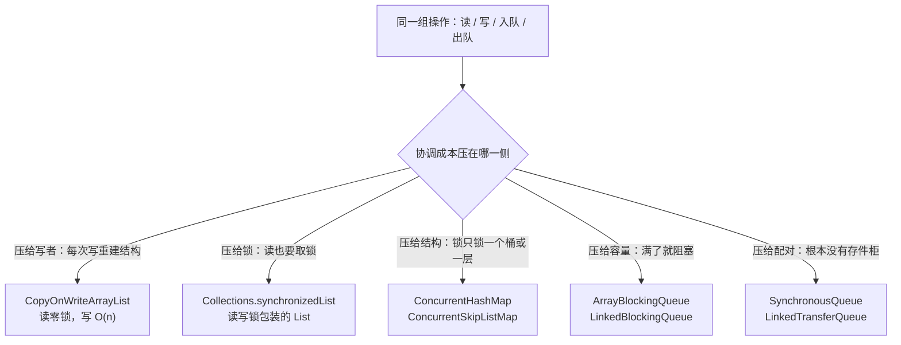
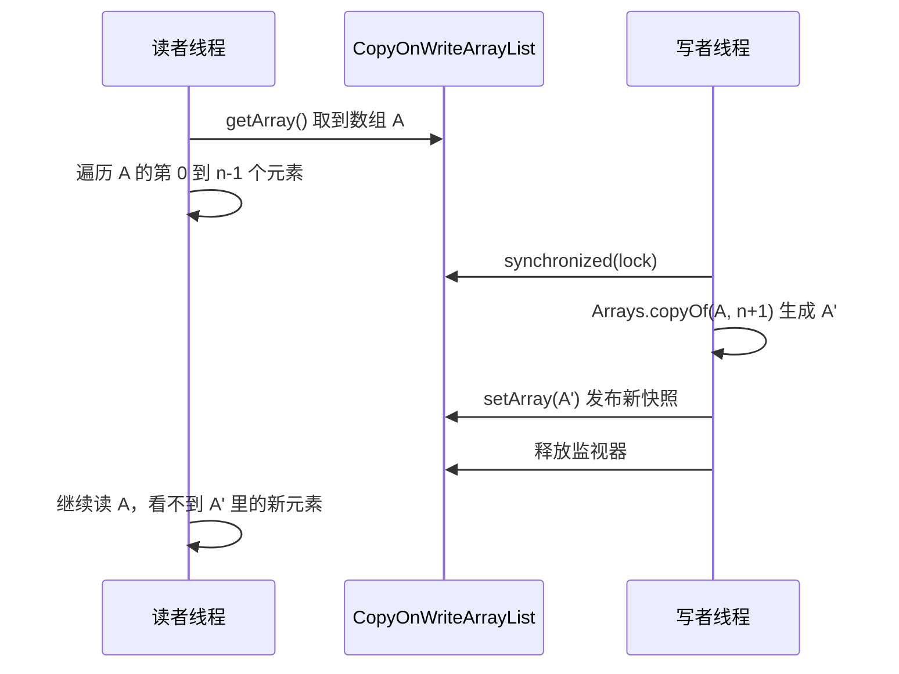
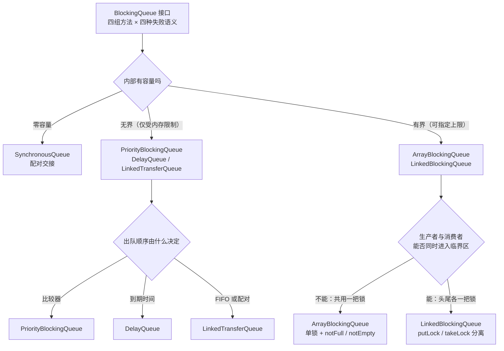
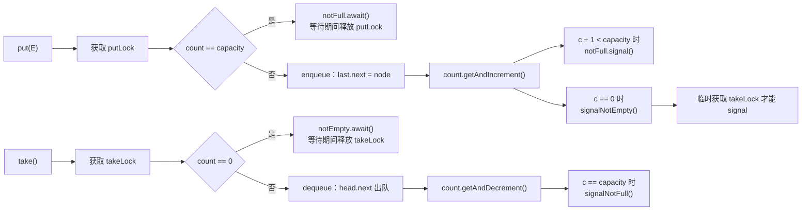
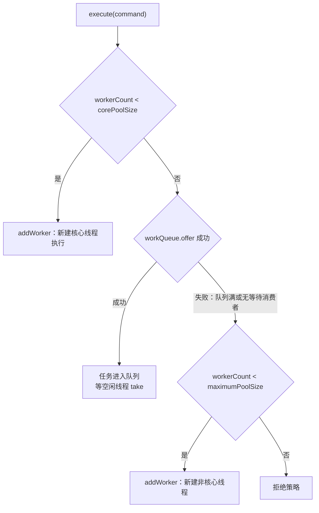
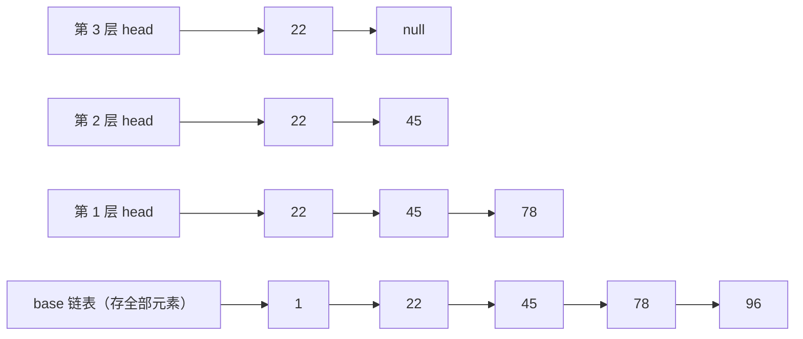

# 10 并发容器（下）——CopyOnWriteArrayList、BlockingQueue 家族

**摘要：**

并发容器常被当成一张选型对照表来记，但真正决定线上表现的不是"用哪个类"，而是"这套实现在读写路径上把代价记在了谁头上"。本篇以代价谱系为主线：`CopyOnWriteArrayList` 把全部协调成本压给写者，换来读者完全无锁，代价是写 O(n)、内存瞬时翻倍、迭代器只认创建那一刻的快照；`BlockingQueue` 的六种实现在容量（零/有界/无界）、锁的形状（单锁双条件/双锁分离/无锁配对）与出队顺序（FIFO/优先级/到期时间/配对）三个分岔点上走出了完全不同的成本曲线。文章用 JDK 21 源码逐条拆开这些分岔：单锁与双锁的临界区边界、零容量队列的配对与帮助机制、堆与堆数组的扩容阶段拆分、双队列里 `transfer` 与 `put` 的语义分野；用本机实测给出两次量级判断（写时复制的分配量、单锁与双锁的吞吐交叉点）；并把"有界还是无界"还原为背压这个更本质的问题——无界队列不会消灭过载，只是把过载从阻塞挪成延迟与 OOM。最后落在一张按操作模式、规模与一致性要求索引的判据表，以及八个真实反例上。

---

## 第 1 章 代价谱系：先把比较的坐标系立起来

### 1.1 三根轴：读路径、写路径、一致性

把并发容器放在一起比较时，最容易犯的错误是只比"吞吐"一个数。同样叫队列，`SynchronousQueue` 与 `ArrayBlockingQueue` 在压测曲线上几乎没有相似之处；同样叫列表，`CopyOnWriteArrayList` 在写密集场景下比 `Collections.synchronizedList` 差出很远。这些差异不是实现水平的高下，而是对三种代价的不同分配方式。

第一种是读路径成本：一次 `get`、一次 `take` 要走多少原子指令、多少屏障、是否需要取锁。第二种是写路径成本：一次 `add`、一次 `put` 是否触发结构重建、是否分配对象、复杂度是 O(1) 还是 O(n)。第三种是空间与一致性：为了并发安全多花了多少内存，以及对外暴露的一致性语义是强一致、弱一致还是快照。

| 并发策略 | 代表实现 | 读成本 | 写成本 | 额外空间 | 一致性语义 |
| :--- | :--- | :--- | :--- | :--- | :--- |
| 不可变快照 | `CopyOnWriteArrayList` | volatile 读一次，之后是普通数组访问 | O(n) 复制 + 一次发布 | 写时新旧两份数组并存 | 读看到快照，迭代器不感知后续修改 |
| 全局互斥 | `Collections.synchronizedList` | 取锁 | 取锁 + 可能复制搬移 | 无 | 强一致（需自行在迭代时持锁） |
| 分桶加锁 | `ConcurrentHashMap`（JDK 8） | 无锁读 | 锁单个桶头 | 节点 + 表 | 单 key 操作原子，聚合量弱一致 |
| 双锁分离 | `LinkedBlockingQueue` | 取 takeLock | 取 putLock + 分配节点 | 每个元素一个 Node | 弱一致，`size()` 为时点值 |
| 单锁双条件 | `ArrayBlockingQueue` | 取同一把锁 | 取同一把锁 | 预分配数组 | 弱一致，`size()` 在锁内精确 |
| 无锁配对 | `SynchronousQueue` | 一次 CAS 尝试 | 一次 CAS 尝试 + 可能的 park | 无缓冲 | 交接成功或阻塞，无中间态 |
| 无锁有序 | `ConcurrentSkipListMap` | 无锁查找，O(log n) | 无锁 CAS 插入 + 建索引 | 索引节点约 n/3 | 弱一致迭代器，`size()` 为求和 |

这张表只给出了成本的位置，没给出成本的量级。量级要靠后文的源码与测算来填。

### 1.2 谱系：协调成本压在哪一侧

所有并发容器都在回答同一个问题：当多个线程同时想动同一份数据时，谁先让一步。不同的答案把成本压到了不同位置。



图里最关键的分界线，是"读者要不要与写者协调"。压给写者的方案（C）让读者彻底退出协调，代价是写者每次都要重建；压给锁的方案（D）让每一方都付出协调成本，但写者可以只改局部。这条分界线决定了 COW 类容器的适用边界：只要写足够少，写者的重建成本就被读者省下的协调成本覆盖。

### 1.3 判据的形状：什么时候该看"操作比"，什么时候该看"容量"

选型时真正可操作的三个输入，是操作模式（读多写少、写多读少、读写相当）、集合规模（十、千、十万）以及一致性要求（能否接受旧视图、能否接受估算值）。这三个输入之所以有效，是因为它们分别决定了上面三根轴上的取值：操作比决定哪一侧的成本占主导，规模决定 O(n) 是否致命，一致性要求决定能不能选快照或弱一致语义。

---

## 第 2 章 CopyOnWriteArrayList：用写的代价买读的自由

### 2.1 为什么会出现：读写锁的读路径仍有协调

读写锁解决了"读读可并发"，但读线程并没有退出协调——它仍要取一次读锁，仍要在锁的计数器上做一次 CAS，仍要与写者的等待队列发生交互。在读操作占比达到百分之九十九、集合又只有几十个元素的场景里，这次 CAS 的绝对开销不大，可它带来的缓存行争用与伪共享概率并不为零，而且它把读路径与写者的存在绑定在了一起：写者持锁时，读者要排队。

`CopyOnWriteArrayList` 的思路是把协调从运行时的每一次读，挪到写时的一次性重建。读线程拿到的数组在它持有期间不会被任何人修改，于是"并发修改"这个问题在读者侧根本不成立——不是被解决了，而是被绕开了。写时复制并非 JUC 的发明，Unix 的 `fork` 早就是它的著名先例：父子进程共享只读页，谁要写谁复制。它的适用前提在操作系统与集合这两个场景里完全一致：读远多于写，且允许读者看到一份稍微旧一点的视图。

### 2.2 实现：一个 volatile 数组加一个监视器

JDK 21 的实现短到可以完整背下来，这是它作为教学样本的另一个价值。

```java
public class CopyOnWriteArrayList<E>
        implements List<E>, RandomAccess, Cloneable, java.io.Serializable {
    // 写路径互斥靠这个监视器；JDK 8 及以前用的是 ReentrantLock，
    // 源码注释给出的理由很朴素：能用内置监视器时优先用内置监视器
    final transient Object lock = new Object();

    // 数组引用：写者整体替换它，读者直接取这个引用
    private transient volatile Object[] array;

    final Object[] getArray() { return array; }
    final void setArray(Object[] a) { array = a; }
}
```

读路径只有一次 volatile 读：

```java
public E get(int index) {
    return elementAt(getArray(), index);   // 一次 acquire 读，之后全是普通数组访问
}
```

写路径则把"复制 — 修改 — 发布"三步放在监视器内完成：

```java
public boolean add(E e) {
    synchronized (lock) {
        Object[] es = getArray();
        int len = es.length;
        es = Arrays.copyOf(es, len + 1);   // 全量复制，成本与 len 成正比
        es[len] = e;
        setArray(es);                      // volatile 写，把新快照发布出去
        return true;
    }
}
```

`set(int, E)` 里有个容易被忽略的细节：当新值与旧值是同一个引用时，代码跳过复制，但仍然调用一次 `setArray`。源码注释写得很直白——这是为了保证 volatile 写的内存语义，让读线程即便读到"值没变"也能看到该线程此前对元素内部状态的写入。这类"语义优先于优化"的写法，是 JUC 源码里反复出现的判断方式。

把三处放在一起看，COW 的成本结构就清楚了：读是 volatile 读加一次数组下标，零锁、零 CAS；写是 O(n) 复制加一次 volatile 写，全部串行。所谓"用写的代价买读的自由"，买的就是这个不对称。

### 2.3 写路径的成本形状：单价线性，累计平方

单次写的成本与集合长度成正比，这一点从 `Arrays.copyOf` 一眼可见。真正需要警惕的是累计成本：对空列表连续 `add` n 次，第 k 次复制 k-1 个引用，总量是 n(n+1)/2 个引用，也就是 O(n²)。这条曲线在 n 小的时候看不出来，在 n 上万之后会立刻显形。

| 集合长度 n | 一次 `add` 的数组分配量 | 与 4 字节/引用 + 16 字节头部的理论值对比 | 构建 n 个元素的总分配量 |
| :--- | :--- | :--- | :--- |
| 1,000 | 4,024 字节 | 4,004 字节 | 1.9 MB |
| 10,000 | 40,024 字节 | 40,004 字节 | 191 MB |
| 100,000 | 400,024 字节 | 400,004 字节 | 约 19 GB（按平方级外推） |

上表是笔者在一台 Apple Silicon 机器、JDK 17、默认压缩指针配置下用 `ThreadMXBean.getCurrentThreadAllocatedBytes()` 实测的结果，只测分配量、不测耗时，因此不受 JIT 与 GC 抖动影响，属于可复现的示例测算。它说明两件事：第一，在 64 位 HotSpot 默认开启压缩指针（`-XX:+UseCompressedOops`，适用于堆小于 32 GB 的绝大多数部署）时，一个引用占 4 字节，十万个元素的数组本体约 391 KiB，而不是常被引用的"800 KB"——那个数字对应的是关闭压缩指针后的 8 字节引用；第二，累计分配量是平方级的，元素从一万涨到两万，总分配量从 191 MB 涨到 764 MB，翻倍的是元素个数，翻四倍的是分配量。

再叠加一层时间视角。假定复制一条引用的有效带宽按 3 GB/s 估算（内存带宽的一个保守取值，属于量级假设），十万个元素单次复制约 0.13 毫秒；一万个元素约 0.013 毫秒。这个耗时本身不算大，但它落在监视器内，意味着这段时间里所有写者都在排队，而 GC 要为每一份被丢弃的旧数组付出标记与回收的成本。反复复制还带来一个隐性代价：新数组每次都是全新分配，对象年龄从零开始，绝大部分旧数组在年轻代就被回收，表面上不会晋升，但分配速率本身会直接推高年轻代 GC 频率。

### 2.4 迭代器是快照：语义与陷阱

COW 的迭代器实现只有十几行，却定义了它与调用方之间最重要的一份契约。

```java
static final class COWIterator<E> implements ListIterator<E> {
    private final Object[] snapshot;   // 创建迭代器那一刻的数组
    private int cursor;

    public E next() {
        if (!hasNext()) throw new NoSuchElementException();
        return (E) snapshot[cursor++];  // 之后永远只读这份快照
    }

    public void remove() { throw new UnsupportedOperationException(); }
    public void set(E e)  { throw new UnsupportedOperationException(); }
    public void add(E e)  { throw new UnsupportedOperationException(); }
}
```

这份契约有三条内容。其一，迭代过程中列表被增删，迭代器看不到——它读的是快照，而不是列表的当前状态。其二，正因为只读快照，它永远不抛 `ConcurrentModificationException`，也不需要调用方在遍历时持锁。其三，迭代器自身的 `remove`、`set`、`add` 全部抛 `UnsupportedOperationException`，因为它们操作的是一份不属于任何人的旧数组，改它没有任何意义——这正是"快照"三个字在 API 层面的体现。



快照语义在业务上是优势还是陷阱，取决于一个问题的答案：遍历期间发生的修改，应不应该对本次遍历生效。监听器列表的答案是不应该——注册请求到达后派发一次事件，本次派发只该通知到"派发开始时已注册"的那些监听器，否则会出现某个监听器被通知两次、或者遍历过程中列表长度变化导致下标错乱。白名单、路由表同理：一次请求用一份一致的视图判断完，比中途看到半新半旧的规则更安全。

反过来，凡是要"读到最新"的场景，快照语义都是缺陷。典型误用是把它当缓存容器：读线程从快照里取到配置项，写线程更新后读线程还在用旧值，且没有任何机制提示它该刷新。这类场景要么换成 `volatile` 引用指向不可变对象（一次性整体替换，语义与 COW 相同但只有一个元素、成本恒定），要么换 `ConcurrentHashMap` 并承担单 key 的一致性而非整体快照。

### 2.5 适用判据：三条同时成立才算合适

COW 的适用条件无法用"读多写少"四个字概括，它要求三条同时成立：读远多于写、集合规模小、允许读到旧视图。缺一条就会踩坑。

| 条件 | 满足时的形态 | 不满足时的替代 |
| :--- | :--- | :--- |
| 读写比高，且写的绝对频率低 | 每秒数千次遍历、每分钟几次注册 | 写频繁：`ConcurrentHashMap` 或加锁 `ArrayList` |
| 集合规模小（十到千级） | 监听器、插件、白名单条目 | 十万级：`ConcurrentHashMap.newKeySet()` |
| 允许读到旧视图 | 派发、鉴权、路由决策 | 要求强一致：`StampedLock` 乐观读或加锁 |

判据里的第二条常被低估。规模不仅影响单次 `add` 的复制成本，还影响快照的存活时间：一份十万元素的旧数组会一直活到最后一个持有它的读者退出遍历，只要有一个慢读者，这份数组就多活一段时间，GC 的回收压力因此被放大。换句话说，规模越大，读写的耦合越不明显，但内存的耦合越明显。

### 2.6 反例与批量操作的补偿

第一类反例是把 COW 当大集合用。十万级元素、每秒一次写，单次就是约 391 KiB 的分配，一天累计三十余 GB 的分配量，年轻代 GC 的频率会被这个分配速率直接推高，而每次写还要让所有写者排队等待复制。如果这个集合实际是"按 ID 查某些记录"，`ConcurrentHashMap` 的 O(1) 查询与单桶加锁才是正解。

第二类反例是需要读到最新值的场景，前面已经说过，此处不重复。

第三类反例是逐个元素的小步修改。COW 的设计里有一个明确的补偿机制：批量操作只复制一次。`addAll`、`removeAll`、`removeIf`、`retainAll`、`addAllAbsent`、`addIfAbsent` 这些方法都在**同一个临界区内完成最终判定、一次复制与一次发布**，把 n 次 O(n) 压成 1 次 O(n)。`addIfAbsent` 还多一层优化：先在锁外拿当前数组做一次线性预检，未命中才进临界区，并在临界区内比对数组是否已被别人替换、只检查差异部分，避免在"注册同一个监听器"的高并发场景下把锁外的判断浪费掉。所以对 COW 的正确用法是：能用 `removeIf` 就不要用 `for` 循环逐个 `remove`，能一次 `addAll` 就不要分十次 `add`，能一次 `addAllAbsent` 就不要循环 `addIfAbsent`。这不是微优化，是把复杂度从平方拉回线性。

还有一处与虚拟线程相关的细节。COW 的写路径整体在监视器内完成，而监视器在 JDK 21 的虚拟线程模型下有一条 pinning 规则：虚拟线程在持有监视器期间若发生阻塞，载体线程无法被释放。COW 的复制过程本身没有阻塞点，因此这条规则不落在复制上；真正要留意的是不要把阻塞调用（远程调用、`take()`、文件读写）写进同一个临界区，那会把"借用监视器做一次复制"变成"粘住一个载体线程干等"。JDK 24 的 JEP 491 取消了这一束缚，线程模型的细节边界见 [[16 JDK 21 虚拟线程——Project Loom 的协程实现与平台线程的边界]]。

---

## 第 3 章 BlockingQueue：四条路线与三个分岔点

### 3.1 接口的十六种组合其实是四乘四

`BlockingQueue` 的设计价值，一半在阻塞语义，另一半在它把"失败怎么办"这件事显式摊开成四种选择：抛异常、返回特殊值、无限阻塞、超时阻塞。每一种选择对应一类调用方处境。

| 操作 | 抛异常 | 返回特殊值 | 阻塞 | 超时 |
| :--- | :--- | :--- | :--- | :--- |
| 入队 | `add(e)` 满时抛 `IllegalStateException` | `offer(e)` 满时返回 `false` | `put(e)` 满时等待 | `offer(e, t, u)` 超时返回 `false` |
| 出队 | `remove()` 空时抛 `NoSuchElementException` | `poll()` 空时返回 `null` | `take()` 空时等待 | `poll(t, u)` 超时返回 `null` |
| 查看 | `element()` 空时抛异常 | `peek()` 空时返回 `null` | 不适用 | 不适用 |

这四列对应四种失败语义，差别不在风格：抛异常那一列要求调用方把"队列满"当程序错误处理；返回特殊值那一列要求调用方自己决定重试还是丢弃；阻塞与超时两列才是把"快慢不匹配"当成正常状态。线程池的 `execute` 用的是第二列的 `offer`，这个选择直接决定了后文第十章要讲的"拒绝时机"。

### 3.2 三个分岔点与四条实现路线

家族里的六个实现，差异可以归结为三个分岔点：内部有没有容量、锁是什么形状、出队按什么顺序。三个分岔点交叉出来的组合并不都成立，实际落地的是四条路线：有界数组单锁、可选容量的链表双锁、零容量配对、无界的有序结构。



容量决定了过载时会发生什么：有界队列把过载变成生产者的等待，零容量队列把过载变成"必须有消费者就位才可能成功"，无界队列则把过载变成堆的增长。锁的形状决定了吞吐的上限与一致性语义的强弱。出队顺序决定了它服务于哪一类业务：速率均衡、优先级调度、时间驱动、还是直接交接。

四条路线各自承担一种过载处理策略。有界数组单锁的路线把等待交给生产者，代价是两端共用一把锁；链表双锁的路线同样把等待交给生产者，改用两把锁换两端并行，代价是节点分配与跨锁握手；零容量配对的路线不设缓冲，把同步性直接写进 API，等待发生在交接点上而不是队列里；无界的堆与双队列路线干脆取消了"满"这个状态，把等待推给未来的堆。所谓选型，先要在这四种过载处理方式里选一种，再谈具体实现。

一句话概括这六种实现：**它们不是同一件事的六种写法，而是六种不同的过载处理策略。**

---

## 第 4 章 ArrayBlockingQueue：一把锁与两个条件

### 4.1 循环数组：三个游标与一把锁

`ArrayBlockingQueue` 用定长数组做环形缓冲。环形缓冲的好处不需要额外论证：没有节点分配、内存连续、GC 无压力，代价是容量在构造时就得定下来，且必须自己维护游标。

```java
public class ArrayBlockingQueue<E> extends AbstractQueue<E>
        implements BlockingQueue<E>, java.io.Serializable {

    final Object[] items;    // 环形数组，长度即容量
    int takeIndex;           // 下一次出队位置
    int putIndex;            // 下一次入队位置
    int count;               // 当前元素数，非 volatile，靠锁保护

    final ReentrantLock lock;             // 一把锁，读写共用
    private final Condition notEmpty;     // 消费者在此等待
    private final Condition notFull;      // 生产者在此等待
}
```

三个游标都在锁内读写，因此不需要任何原子类或 volatile 修饰；`count` 是普通 int，因为所有读写它的线程都必须先拿到同一把锁。这是"单锁方案简单"的最直接体现：整个类的并发正确性只需要证明一件事——所有对共享状态的操作都在 `lock` 之内。

### 4.2 等待与唤醒：为什么是两个 Condition

```java
public void put(E e) throws InterruptedException {
    Objects.requireNonNull(e);
    final ReentrantLock lock = this.lock;
    lock.lockInterruptibly();
    try {
        while (count == items.length)      // 用 while 而不是 if
            notFull.await();               // 等待期间锁被释放
        enqueue(e);
    } finally {
        lock.unlock();
    }
}

private void enqueue(E e) {
    final Object[] items = this.items;
    items[putIndex] = e;
    if (++putIndex == items.length) putIndex = 0;   // 环形回头
    count++;
    notEmpty.signal();                              // 只唤醒一个消费者
}
```

三个细节值得逐条说清。

第一，`while` 而不是 `if`。`await()` 返回不代表条件已成立：被唤醒与真正拿到锁之间有窗口期，另一个生产者可能已经抢先把空位占满；中断、`signalAll` 带来的惊群、以及条件队列的先进先出语义都可能让线程在条件不成立时苏醒。AQS 的 `Condition` 实现本身遵循"从 `await` 返回时必须重新检查条件"的契约，机制细节见 [[06 AQS 框架——AbstractQueuedSynchronizer 的设计与实现]]。

第二，两个 `Condition` 而不是一个。生产者只在 `notFull` 上等，消费者只在 `notEmpty` 上等；`enqueue` 之后只 `signal()` 一个消费者，`dequeue` 之后只 `signal()` 一个生产者，唤醒量恰好等于本次操作创造出的可用名额。若共用一个条件变量，一次入队会把等待中的生产者也一起唤醒，它们醒来发现队列还是满的，又得睡回去，白付一次上下文切换。这是条件变量分离的原始动机，与读写锁里分离读等待队列是同一个道理。

第三，等待期间锁是释放的。这一点常被误解为"单锁队列的 put 会挡住 take"：`await()` 在把线程挂上条件队列之前会释放锁，`signal` 之后线程重新竞争锁。所以生产者阻塞时并不占着锁；真正互斥的是两个操作各自的临界区，而不是"等待"本身。

### 4.3 单锁的代价：临界区串行与公平性

因为只有一把锁，`put` 的临界区与 `take` 的临界区严格互斥。在容量小、生产者与消费者数量接近的场景里，两端会频繁地交替阻塞与唤醒，每交接一个元素都要经历"入队方放锁 — 出队方取锁"的完整握手，锁的手递手成本直接成为吞吐上限。这一点在第 5 章的本机测算里会有具体数字。

构造器还提供了公平模式 `new ArrayBlockingQueue<>(capacity, true)`，内部用 `new ReentrantLock(true)`。公平锁的语义是让等待最久的线程优先获得锁，代价是每次释放锁都要唤醒队列头部并做一次精确的队列维护，吞吐通常比非公平模式低。它换来的是延迟上界：非公平模式下某个线程可能连续插队，导致个别请求的排队时间被拉长到不可预期。选择公平模式，本质是用吞吐换可预测性——只有当业务对尾延迟而非平均吞吐敏感时，这笔交易才划算。

### 4.4 一致性：迭代器弱一致，size 在锁内精确

`ArrayBlockingQueue` 的迭代器是弱一致的：它不复制整个队列，而是在遍历时沿着环形数组走，并用一套 `Itrs` 记账机制在队列被修改时维护游标位置，保证不重复、不越界，但不保证看到某个时刻的完整快照。`size()` 则在锁内返回 `count`，因此取到的是一个真实时点值——只是它在返回之后立即可能过期。

弱一致的迭代器意味着：遍历时统计的数量与随后 `size()` 的返回值可以不相等，两者之间没有一致性保证。若业务需要"某一个时刻的完整快照"，要么在锁内 `toArray()`，要么用 `drainTo` 一次性取走。

### 4.5 反例：容量拍脑袋与批量取用

最常见的误用是把容量随手写成 100 或 10000 而不做任何测算。容量太小时，生产者与消费者被压成"严格交替"，单锁的握手成本被最大化；容量太大时，队列积压被当成缓冲区，实际是把背压推迟了，而后文要讲的"无界风险"以温和的形式重现。

另一个误用是逐条 `take` 而不 `drainTo`。每条消息一次取锁、一次唤醒，在吞吐敏感的场景里是纯粹的浪费；`drainTo(list, maxElements)` 一次取锁搬走一批，把锁的开销摊薄。批量取用还有个附带好处：消费者可以顺带做批量提交或批量落盘。

---

## 第 5 章 LinkedBlockingQueue：两把锁的收益边界

### 5.1 链表给了双锁一个天然的切口

`ArrayBlockingQueue` 无法拆锁，是因为环形数组的入队与出队都要读 `count` 并共享同一块内存区域：`putIndex` 追上 `takeIndex` 意味着满，`takeIndex` 追上 `putIndex` 意味着空，两个游标互为对方的边界条件。链表没有这个约束：入队只动 `last`，出队只动 `head.next`，头尾之间只要还有元素，两端就可以同时进行。

```java
public class LinkedBlockingQueue<E> extends AbstractQueue<E>
        implements BlockingQueue<E>, java.io.Serializable {

    private final int capacity;                              // 上限，默认 Integer.MAX_VALUE
    private final AtomicInteger count = new AtomicInteger(); // 跨两把锁的唯一共享量

    transient Node<E> head;    // 哑头节点，head.item 恒为 null
    private transient Node<E> last;

    private final ReentrantLock takeLock = new ReentrantLock();   // 出队锁
    private final Condition notEmpty = takeLock.newCondition();

    private final ReentrantLock putLock = new ReentrantLock();    // 入队锁
    private final Condition notFull = putLock.newCondition();
}
```

`count` 是这套设计的枢纽。它必须被两把锁同时读写，所以不能是普通 int，只能退化为原子量；而一旦它变成了原子量，空满判定就失去了锁的保护，只能靠"读到的值是一个时点值"这个弱保证来工作。源码注释专门解释了为什么这样仍然安全：判断满时只有入队方在动 `count`（其他入队者被 `putLock` 挡在门外），`count` 只可能因为出队而减少，而出队方一旦把队列从满变为不满就会发信号。这个论证是"锁内状态"退化成"原子状态"时最典型的推理方式。

### 5.2 put 与 take：跨锁发信号的成本

```java
public void put(E e) throws InterruptedException {
    final Node<E> node = new Node<E>(e);
    final ReentrantLock putLock = this.putLock;
    final AtomicInteger count = this.count;
    putLock.lockInterruptibly();
    try {
        while (count.get() == capacity)
            notFull.await();
        enqueue(node);                       // last = last.next = node
        c = count.getAndIncrement();
        if (c + 1 < capacity)
            notFull.signal();                // 还有空位：叫醒下一个生产者
    } finally {
        putLock.unlock();
    }
    if (c == 0)
        signalNotEmpty();                    // 队列从空变为非空：叫醒消费者
}
```

入队与出队各自持有自己的锁，只有在队列被推到两端（从空变非空、从满变不满）时才需要跨锁发信号。这张图把两边的临界区与那次跨锁握手画在了一起：



`signalNotEmpty()` 的实现只有三行，却揭示了双锁方案的真实成本：

```java
private void signalNotEmpty() {
    final ReentrantLock takeLock = this.takeLock;
    takeLock.lock();          // 为了发一个信号，必须先拿对方的锁
    try { notEmpty.signal(); }
    finally { takeLock.unlock(); }
}
```

`notEmpty` 这个 `Condition` 是从 `takeLock` 上创建的，按 `Condition` 的契约，只有持有对应锁的线程才能对它 `signal`。于是生产者每完成一次"把队列从空变为非空"的入队，就必须额外获取一次 `takeLock`；消费者每完成一次"把队列从满变为不满"的出队，也必须额外获取一次 `putLock`。这个跨锁握手在队列长期处于中间状态时很少触发，在队列频繁触到两端的场景里却会频繁触发——这正是后文实测要解释的现象。

### 5.3 弱一致：size 是时点值，不是估算

关于 `LinkedBlockingQueue.size()`，流传最广的说法是"它是估算值"，这个说法需要更精确的版本。`size()` 的实现就是 `return count.get();`，读的是一个原子量：在读取的那一瞬间，值是真的；问题在于这个瞬间之后，入队与出队线程立刻可以改变它，而调用方无法把"读到 size"与"基于 size 做决定"这两步变成原子操作。所以在并发环境下它不适合作为判断依据，但它也不是 `ConcurrentLinkedQueue.size()` 那样的遍历式估算。

这个区分有实际意义。真正需要遍历计数的是 `ConcurrentLinkedQueue` 与 `LinkedTransferQueue`，它们的 `size()` 是 O(n) 且结果弱一致；而 `LinkedBlockingQueue`、`ArrayBlockingQueue`、`PriorityBlockingQueue` 的 `size()` 都是"某个时点的准确值"，只不过这个时点稍纵即逝。把三者混为一谈，会导致对性能与语义的双重误判。

### 5.4 两把锁的收益边界：一组本机测算

双锁能否带来吞吐提升，取决于生产与消费是否同时被阻塞在队列两端：只有当两端都在等对方时，让它们分别持有各自的锁并行推进才有意义。这个判断可以测量。

| 场景（4 生产者 + 4 消费者，共 80 万条） | `ArrayBlockingQueue` | `LinkedBlockingQueue` | 观察 |
| :--- | :--- | :--- | :--- |
| 容量 65,536（队列几乎不触边界） | 30 至 56 毫秒 | 37 至 63 毫秒 | 单锁略快，六轮全部成立 |
| 容量 64（队列频繁触满与触空） | 190 至 243 毫秒 | 81 至 97 毫秒 | 双锁快约 2.3 倍 |

这是示例测算而非基准测试：单机、六轮、未使用 JMH、未隔离 GC 与 JIT，绝对数字没有参考价值（第一轮含 JIT 预热，所以区间上界偏高），但两组之间的相对关系六轮全部复现。它给出的量级判断是：**双锁的吞吐优势不是无条件的，它出现在两端都被阻塞、需要真正并行的场景里；队列足够深时，单锁的短临界区加上数组的内存局部性，反而比双锁的额外握手与节点分配更快。**

这条结论与直觉相反，但对选型有直接影响。很多"高吞吐场景用 LinkedBlockingQueue"的经验，实际成立的前提是队列浅、压力大、两端同时排队。如果队列本身很深、生产与消费速率基本匹配，双锁并没有发挥空间，而它带来的节点分配与跨锁信号反而成了纯成本。

### 5.5 默认容量：最大的坑就在构造函数里

```java
public LinkedBlockingQueue() {
    this(Integer.MAX_VALUE);   // 不传容量，等于不设上限
}
```

类注释把这一点写得很清楚：可选的容量参数用来"阻止队列过度膨胀"，不指定时容量等于 `Integer.MAX_VALUE`。这意味着一个看似无害的 `new LinkedBlockingQueue<>()`，实际上创建了一个在真实内存耗尽前永远不会满的队列。`Integer.MAX_VALUE` 这个数字给人的心理暗示是"几乎无限"，而它真正的含义是：**这个队列不会对生产者产生任何反压。**

后果可以精确描述。当生产速率持续高于消费速率时，元素以 `Node` 对象的形式留在堆里，队列长度的增长直接体现为老年代占用的增长；随后是 GC 时间占比上升、单次停顿变长、吞吐下降，最终以 `java.lang.OutOfMemoryError: Java heap space` 收场。在这个过程里，队列的 `put` 一直是成功的，调用方看不到任何异常，直到堆被撑破。这正是无界队列最危险的地方——它把"来不及处理"这个信号彻底藏起来了。

`Executors.newFixedThreadPool` 用的就是无界 `LinkedBlockingQueue`，这也是"不要用 `Executors` 的工厂方法"这条建议的核心证据之一，线程池侧的完整分析见 [[11 线程池（上）——ThreadPoolExecutor 的七大参数与执行流程]]。

### 5.6 何时选它：容量深、速率波动、可接受节点分配

把上面的结论收起来，`LinkedBlockingQueue` 的适用面是：容量要足够深以吸收突发流量，生产与消费速率大体匹配，且能接受每个元素一次 Node 分配与 GC 压力。它不适合的场景同样清晰：容量浅且要求低延迟的场合，`ArrayBlockingQueue` 的数组局部性更好；要求严格的有界与可预测延迟的场合，需要显式指定容量并配合拒绝策略；需要公平调度时，它根本没有公平模式。

---

## 第 6 章 SynchronousQueue：零容量与配对交接

### 6.1 没有存件柜的交接

快递柜的存在意义是"放件的人与取件的人不必同时在场"。`SynchronousQueue` 要做的恰好相反：它没有柜子，只有交接窗口，投递者必须等到取件者伸手，取件者也必须等到有人递件，两者在时间上必须重叠。

这个语义让一系列方法变成了恒定的怪值：`size()` 永远返回 0，`isEmpty()` 永远返回 `true`，`remainingCapacity()` 永远返回 0，`clear()` 是空操作，`iterator()` 返回空迭代器。这些取值并非未实现的占位，它们忠实表达了"队列里从来没有元素驻留"这一事实。误用往往就从这里开始：拿 `size()` 判断"有没有待处理任务"永远得到否定答案，拿 `isEmpty()` 做轮询式等待会立即返回然后空转。

### 6.2 两种实现：栈与队列，以及一次撮合

所有方法都汇聚到一个入口，`e` 是否为 `null` 用来区分方向：

```java
abstract static class Transferer<E> {
    /** e != null 表示投递，e == null 表示接收；timed 决定是否带超时 */
    abstract E transfer(E e, boolean timed, long nanos);
}

// 非公平（默认）：TransferStack，LIFO；公平：TransferQueue，FIFO
public SynchronousQueue(boolean fair) {
    transferer = fair ? new TransferQueue<E>() : new TransferStack<E>();
}

public void put(E e) throws InterruptedException {
    if (transferer.transfer(e, false, 0) == null) {   // 无限等待，直到被配对或中断
        Thread.interrupted();
        throw new InterruptedException();
    }
}

public boolean offer(E e) {                            // 只尝试一次立即配对
    return transferer.transfer(e, true, 0) != null;
}
```

非公平模式的 `TransferStack` 是一叠等待者。新来的线程看到栈顶是同类模式（都是投递或都是接收），就把自己压栈并等待；看到栈顶是互补模式，就创建一个带 `FULFILLING` 位的节点压栈，与栈顶完成匹配，然后两个节点一起弹出。栈结构决定了它是 LIFO：最后到达的等待者最先被配对。

公平模式换成队列，配对顺序变成 FIFO，等待最久的线程优先。源码里还有一处值得注意的工程手法：当一个线程发现栈顶已经是一个正在撮合的 `FULFILLING` 节点时，它不会干等，而是先帮对方把匹配和弹出做完，再重新尝试自己的操作。这种"帮助推进"（helping）在无锁数据结构里很常见，目的是避免某个线程被挂起后把整个结构卡住。

JDK 25 重写了这部分实现：`SynchronousQueue` 内部改为复用 `LinkedTransferQueue` 的双队列，`Transferer` 变成 `LinkedTransferQueue` 的子类，LIFO 语义由子类里的 `xferLifo` 提供。对外语义一个字没变，变化在于两条代码路径合并成了一条。选 LIFO 还是 FIFO，源码注释给出了一份量级判断：LIFO 在低竞争下通常更快、高竞争下更慢，且在资源管理类场景（譬如缓存线程池）里因为更好的时间局部性而更合适，但不适合消息传递类应用。这句话解释了为什么默认是非公平的栈：线程池取任务的模式，恰好是"最近活跃的线程最可能再次活跃"。

### 6.3 在线程池里的角色：任务驱动的伸缩

```java
public static ExecutorService newCachedThreadPool() {
    return new ThreadPoolExecutor(
        0,                                 // 核心线程数 0
        Integer.MAX_VALUE,                 // 上限无穷
        60L, TimeUnit.SECONDS,
        new SynchronousQueue<Runnable>()); // 零缓冲，直接交接
}
```

`ThreadPoolExecutor.execute` 在核心线程之外走的是 `workQueue.offer(command)`。对 `SynchronousQueue` 而言，`offer` 只有在"此刻恰好有消费者在等"时才成功：有等待者时任务直接交给它执行；没有等待者时 `offer` 立刻失败，线程池于是新建线程——新线程起来后正好成为那个等待者。这就是 `CachedThreadPool` 按需伸缩的机制：空闲线程存活 60 秒，超出部分自然回收，任务量突增时立刻扩线程。

同一份机制在别处就是风险。`SynchronousQueue` 没有缓冲，意味着它没有任何平滑能力：任务到达速率只要短暂超过处理速率，线程池就只能靠新建线程吸收，而 `CachedThreadPool` 的上限是 `Integer.MAX_VALUE`。JDK 源码在 `ThreadPoolExecutor` 的类注释里对此有明确提示：直接交接通常需要配合无上限的 `maximumPoolSize` 以避免任务被拒，而这又"允许了命令持续以高于处理速率到达时线程数无限增长的可能性"。线程爆炸的后果不是队列 OOM，而是线程栈占用、上下文切换与调度开销共同把系统拖垮——故障形态换了，本质还是无界。

### 6.4 反例：三个常见误解

第一个误解是把它当缓冲区用。以为 `put` 会先把任务放进某个地方，实际是必须有人同时伸手；任务提交方与执行方在时间上不重叠时，`put` 就是纯等待。

第二个误解是给 `SynchronousQueue` 配一个有限的 `maximumPoolSize`。这样做等于把"队列满"替换成了"线程数满"：并发一旦超过上限，`offer` 失败、`addWorker` 也失败，任务立即被拒绝。这个组合本身没有错，但它的语义是"限流立即拒绝"，不是"排队等待"，与很多人的预期相反。

第三个误解是混淆 `put` 与 `offer`。`put` 无限等待配对，`offer(e)` 只做一次立即尝试就返回布尔值。在需要"不阻塞提交线程"的地方用 `put`，会得到一个安静的、持续挂起的生产者。

---

## 第 7 章 PriorityBlockingQueue 与 DelayQueue：有序出队的两种时间观

### 7.1 堆加全局锁：能排队取出，不能排队放入

`PriorityBlockingQueue` 的语义是"每次取出当前最小的元素"，实现是二叉堆加一把全局锁。堆的数组表示、上浮下沉这些属于数据结构常识，这里只关注它与并发语义相交的部分。

```java
public class PriorityBlockingQueue<E> extends AbstractQueue<E>
        implements BlockingQueue<E>, java.io.Serializable {

    private static final int DEFAULT_INITIAL_CAPACITY = 11;

    private transient Object[] queue;      // 堆数组
    private transient int size;
    private transient Comparator<? super E> comparator;

    private final ReentrantLock lock = new ReentrantLock();
    private final Condition notEmpty = lock.newCondition();
    private transient volatile int allocationSpinLock;   // 扩容用的自旋锁

    // 没有 notFull：这个队列没有上限
}
```

字段列表里少了一个 `Condition`，这比任何文字都更能说明它的定位：**没有 `notFull`，因为不存在"满"这个状态。** 与之对应，`put` 被直接实现成 `offer` 的别名：

```java
public void put(E e) {
    offer(e);   // 永不需要阻塞
}
```

于是这个队列出现了一个不对称的行为：`take()` 会阻塞在"空"上，`put()` 永远不会阻塞在"满"上。这个不对称不是缺陷，而是无界设计的必然结果，但对于把它当限流器的人就是陷阱——生产端永远不会被减速，队列会一直长。它的正确用法是"优先级调度"，而不是"带缓冲的限流"。

扩容是这类无界队列唯一需要进行内存分配的地方，`tryGrow` 的处理方式值得单独看：

```java
private void tryGrow(Object[] array, int oldCap) {
    lock.unlock();                       // 先放主锁，让 put/take 继续
    Object[] newArray = null;
    if (allocationSpinLock == 0 &&
        ALLOCATIONSPINLOCK.compareAndSet(this, 0, 1)) {   // 抢扩容权
        try {
            int growth = (oldCap < 64) ? (oldCap + 2) : (oldCap >> 1);
            int newCap = ArraysSupport.newLength(oldCap, 1, growth);
            if (queue == array)
                newArray = new Object[newCap];            // 分配在主锁外
        } finally {
            allocationSpinLock = 0;
        }
    }
    if (newArray == null)                // 没抢到：让出 CPU，等对方分配完
        Thread.yield();
    lock.lock();                         // 重新获取主锁
    if (newArray != null && queue == array) {
        queue = newArray;
        System.arraycopy(array, 0, newArray, 0, oldCap);  // 复制在主锁内
    }
}
```

这段代码把一次扩容拆成了两个阶段：分配新数组（可能触发 GC，耗时不可控）放在主锁之外，只用一个 CAS 自旋锁防止并发扩容；替换引用与复制元素（必须与其他写操作互斥）放在主锁之内。拆分的收益是显著的：分配大数组期间，其他线程可以继续正常的入队出队；没抢到扩容权的线程让出 CPU 而不是忙等，避免多个线程同时触发大量分配。这个"重活移出临界区、轻活留在临界区"的拆分，是并发容器里最实用的一类优化手法，在任何需要扩容或懒初始化的结构里都值得借用。

增长倍数由 `ArraysSupport.newLength(oldCap, 1, growth)` 算出：容量小于 64 时增长 `oldCap + 2`，总长接近翻倍；超过 64 之后按 `oldCap >> 1` 增长，即约 1.5 倍。小于 64 时增长得更快，是为了尽早脱离小容量区间，减少早期频繁扩容。

### 7.2 可变对象是堆的共同禁忌

堆的正确性依赖一条隐含前提：元素入队之后，它的相对顺序不再变化。`PriorityBlockingQueue` 在插入时只做一次上浮，之后不再检查任何元素的优先级；如果业务对象用了可变字段做比较键，入队后改了它，堆的结构就与元素的实际顺序脱节。

症状很有特征。改过优先级的元素会停在它入队时所在的位置：优先级被调高的元素可能沉在堆底，永远等不到先出队的机会；优先级被调低的元素可能浮在堆顶，提前出队。更麻烦的是这种错乱不会抛任何异常，`size()` 正常、`take()` 正常，只有业务顺序不对，排查成本极高。

正确的处理方式只有三条路：入队后不再修改用于比较的字段（把键设计成不可变）；需要调整优先级时先 `remove` 再 `add`（注意 `remove` 是 O(n) 的堆查找）；或者用独立的索引结构维护位置，让调整变成 O(log n)——`ScheduledThreadPoolExecutor` 的 `DelayedWorkQueue` 就是这条路的实证，后文会提到。

顺带一个同类问题：`PriorityBlockingQueue` 的 `remove(Object)`、`contains(Object)` 依赖 `equals`，而堆排序依赖 `compareTo`。当两者不一致时，会出现"`contains` 返回 true 却 `remove` 失败"这类现象，因为 `remove` 先用 `equals` 线性查找，再用 `compareTo` 决定下沉位置。

另一处与家族里其他成员不同的是迭代器语义：`PriorityBlockingQueue.iterator()` 在锁内 `toArray()` 复制一份数组再遍历，因此它是**快照**语义，而不是 `ArrayBlockingQueue` 那样的弱一致。快照有它的道理：堆数组的内部顺序不代表业务顺序，沿数组遍历本来就只是"看到全部元素"而非"看到排序结果"，复制一份反而更简单也更安全。代价仍然是 O(n) 的复制。

### 7.3 DelayQueue：按到期时间取

`DelayQueue` 是"时间驱动"版本的优先队列。元素必须实现 `Delayed`，它同时扩展了 `Comparable<Delayed>`，这意味着队列的排序键是元素自己算出来的剩余延迟：

```java
public interface Delayed extends Comparable<Delayed> {
    /** 返回剩余延迟；小于等于 0 表示已到期 */
    long getDelay(TimeUnit unit);
}
```

内部结构是 `PriorityQueue` 加一把锁，再加一个 `Thread` 字段充当"领导者"：

```java
public class DelayQueue<E extends Delayed> extends AbstractQueue<E>
        implements BlockingQueue<E> {

    private final transient ReentrantLock lock = new ReentrantLock();
    private final PriorityQueue<E> q = new PriorityQueue<E>();
    private Thread leader;                                  // 当前负责精确等待的线程
    private final Condition available = lock.newCondition();
}
```

`take()` 用 Leader-Follower 模式减少无效唤醒：

```java
public E take() throws InterruptedException {
    final ReentrantLock lock = this.lock;
    lock.lockInterruptibly();
    try {
        for (;;) {
            E first = q.peek();
            if (first == null)
                available.await();                        // 队列空：无限期等待
            else {
                long delay = first.getDelay(NANOSECONDS);
                if (delay <= 0L)
                    return q.poll();                      // 已到期：直接取走
                first = null;                             // 等待期间不持有元素引用
                if (leader != null)
                    available.await();                    // 已有领导者在等：跟着睡
                else {
                    Thread thisThread = Thread.currentThread();
                    leader = thisThread;
                    try {
                        available.awaitNanos(delay);      // 只有领导者做定时等待
                    } finally {
                        if (leader == thisThread) leader = null;
                    }
                }
            }
        }
    } finally {
        if (leader == null && q.peek() != null)
            available.signal();                           // 让出领导权，交给下一位
        lock.unlock();
    }
}
```

朴素的实现会让所有等待线程都做 `awaitNanos(delay)`，到期时全部醒来抢同一个元素，只有一个成功，其余重新计算延迟再睡回去。Leader-Follower 把定时等待收敛到一个人身上，其余线程用无限期 `await()` 睡着，等领导者取走元素后通过 `signal()` 移交领导权。这个模式的价值随等待线程数量线性增长：十个消费者时，朴素实现每次到期产生十次唤醒与一次成功，Leader-Follower 只产生一次有效唤醒。

`DelayQueue` 有几处语义与普通队列不同，需要单独记住。`poll()` 在队头尚未到期时返回 `null`，而不是返回元素——它把"还没有到期的东西"当作"暂时无可取"。`peek()` 却会返回队头元素，不管它是否到期，因此用 `peek` 判断"有没有可取元素"是错误的。`drainTo` 只搬迁已到期的元素，未到期的留在队列里。`remove(Object)` 走 `PriorityQueue` 的线性查找再调整堆，是 O(n)。

### 7.4 与 ScheduledThreadPoolExecutor 的对比：为什么不用 DelayQueue

`ScheduledThreadPoolExecutor` 用的是 `DelayedWorkQueue`，源码注释称它是"无界 `DelayQueue` 的一个变体"（a variant of unbounded DelayQueue），而不是 `DelayQueue` 本身。差异的核心不在延迟语义，而在删除成本。

线程池里的定时任务经常被取消：`Future.cancel()`、`shutdownNow()`、周期任务抛异常后自取消。`DelayQueue` 删除一个元素要先在堆数组里线性找到它（O(n)），再调整堆（O(log n)）；`DelayedWorkQueue` 让每个任务自己记住它在堆数组里的下标 `heapIndex`，取消时直接按下标定位，删除退化为 O(log n)。源码注释对这一点的表述是"从 O(n) 降到 O(log n)，并减少因等待元素浮到堆顶才清理而产生的垃圾滞留"。

对一个每秒处理成千上万个定时任务、取消率又不低的调度器来说，这个差别是决定性的。更小的堆数组初值（16）也是同一取向：不为偶发的大批量任务预分配过多内存。

---

## 第 8 章 LinkedTransferQueue：把交接语义从线程池里拿出来

### 8.1 双队列：节点既可以是数据，也可以是请求

JDK 7 引入的 `LinkedTransferQueue` 实现的是"双队列"（dual queue）：队列里的节点不再只是数据，也可以是一个"请求"。节点带一个方向标记（JDK 21 里是 `Node.isData` 字段，JDK 25 改名为 `DualNode`），入队时若遇到互补方向的节点，就直接配对、双方都不必驻留。

这个设计把 `SynchronousQueue` 的配对语义与普通队列的缓冲语义统一到了同一份数据结构里，代价是实现复杂度集中在一个 `xfer` 方法上，收益是同一族操作只有一套并发路径。

### 8.2 三种交接语义：transfer、tryTransfer、put

```java
public void transfer(E e) throws InterruptedException {   // 同步交接：阻塞到被取走
    if (xfer(e, true, SYNC, 0L) != null) {
        Thread.interrupted();
        throw new InterruptedException();
    }
}

public boolean tryTransfer(E e) {                          // 立即尝试：不等待
    return xfer(e, true, NOW, 0L) == null;
}

public void put(E e) {                                     // 异步入队：立即返回
    xfer(e, true, ASYNC, 0L);
}
```

三个方法对应三种完全不同的契约，而它们的名字最容易被混淆。`put` 在这里是**异步**的：把元素挂进链表就返回，不会等待任何消费者——这与 `ArrayBlockingQueue.put` 的"满则阻塞"是两件事，与 `SynchronousQueue.put` 的"等待配对"更是两件事。`transfer` 才是同步交接：调用线程会一直等到某个消费者取走元素。`tryTransfer` 只做一次立即尝试。

误用的形态很具体：以为 `put` 会像 `transfer` 那样把生产者的速度压到消费者速度，结果生产端全速跑，队列无限增长——因为 `put` 走的是 `ASYNC`，从不阻塞。需要背压就必须用 `transfer` 或 `tryTransfer(e, timeout, unit)`，或者干脆换回有界队列。

### 8.3 与 SynchronousQueue 的关系

两者的定位是互补的：`SynchronousQueue` 只有交接、没有缓冲，适合"有人接才能交出去"的线程池；`LinkedTransferQueue` 既有缓冲（`put`/`offer` 异步入队），也能按需同步交接（`transfer`），且底层是无锁的。JDK 25 的 `SynchronousQueue` 直接复用了这套双队列实现，把 LIFO 语义作为子类的扩展加上去，正说明两条路径在结构上本来就是同源的。

家族里也有"谁在等"的可观测接口：`hasWaitingConsumer()` 与 `getWaitingConsumerCount()`。它们返回的是某一时点的观察值，不能作为精确判据用，但可以用来做粗略的自适应：没有等待者时，某些实现可以选择先异步入队而不是同步交接。

### 8.4 何时选它

三个条件同时满足时它是一个好选择：单进程内的高吞吐生产者-消费者；需要弹性缓冲，不想在容量上做硬性取舍；希望用同步交接作为可选的背压手段而不是全局策略。它不适合需要优先级、需要延迟、或需要严格有界的场景——这三类需求分别由 `PriorityBlockingQueue`、`DelayQueue` 与有界 `ArrayBlockingQueue` 覆盖。

---

## 第 9 章 有界与无界：背压才是真正的选型轴

### 9.1 满的时候怎么办：三种处理

把队列塞满之后，系统只有三种出路：让生产者等（阻塞）、丢掉新元素（丢弃）、让提交方自己执行（调用方执行）。这三种出路的工程含义截然不同。

阻塞把压力传回上游：上游如果是用户请求线程，用户会感到变慢；上游如果是一个消息拉取循环，拉取会自然降速。丢弃适用于可以承受丢失的场景：日志、指标、以及有明确 TTL 的缓存刷新。调用方执行（线程池的 `CallerRunsPolicy`）是一种温和的负反馈：当池与队列都满时，提交任务的那个线程自己跑这个任务，于是它自然没法继续提交，压力沿调用链向上扩散。

三种出路里，只有前两种与队列本身有关，第三种属于线程池的拒绝策略。但它们共同的前提是同一个：**队列必须有一个"满"的定义。**

### 9.2 无界队列：把过载从阻塞挪成延迟

无界队列没有这个定义，于是它把"满"这个问题从队列里删掉了，问题并没有消失，只是换了个地方出现：堆占用。生产速率持续高于消费速率时，元素留在堆里，队列长度增长直接表现为老年代占用增长，接着是 GC 频率与停顿时间上升，最后是 OOM。

这个链条上有几个可观测的中间态，可以用来做判据。队列的 `size()` 如果持续单调增长而不是在某个区间内波动，说明它没有在履行缓冲职责，只是在记账；GC 日志里老年代占用呈锯齿向上，同时 Full GC 后的回收比例越来越低，说明堆里的对象大多是长命的待处理任务；线程 dump 里大量消费者线程停在 `take()` 的 `park` 上，而队列长度仍然增长，说明问题在消费能力而不在供给。把这三个信号合起来看，通常能在 OOM 之前很久就定位到"队列没有上界"这个根因。

反过来说，有界队列未必就安全。容量设成十万而消费能力只有每秒一百，队列同样是"实际无界"的，只是 OOM 之前多了一层可以观测的征兆。**有界只是必要条件，"容量与消费能力匹配"才是充分条件。**

### 9.3 用 size 做限流：一个必然失效的检查

```java
// 想限流到 1000：这个写法在并发下必然失效
if (queue.size() < 1000) {
    queue.offer(task);   // 检查与写入之间，别的线程可以插进来
}
```

这是典型的 check-then-act：`size()` 与 `offer` 之间存在窗口期，N 个线程同时通过检查，就会有 N 个元素越界入队。窗口期越长、并发越高，越界越严重。更根本的问题是，即使窗口期为零，这段代码的语义也只是"限制队列长度"，而不是"限制并发量"——队列长度与在途任务数并不相等。

要限并发，用计数信号量（`Semaphore`，见 [[14 并发工具类——CountDownLatch、CyclicBarrier、Semaphore 与 Exchanger]]）；要限队列，直接用有界队列的 `offer` 返回值，让容器自己去保证边界的原子性。用估算值或时点值做判据，本质是把原子性要求寄希望于运气。

### 9.4 容量策略对照

| 容量策略 | 过载时的行为 | 适用场景 | 主要风险 |
| :--- | :--- | :--- | :--- |
| 零容量（`SynchronousQueue`） | 无缓冲，必须配对 | 任务驱动伸缩、请求-响应交接 | 线程数或提交方无限增长 |
| 有界且容量匹配（`ArrayBlockingQueue`/`LinkedBlockingQueue`） | 生产者阻塞或拒绝 | 背压明确的生产者-消费者 | 容量估算错误导致吞吐塌陷 |
| 有界但容量过大（同上，容量十万级） | 长时间静默积压 | 突发流量吸收 | 延迟先崩、OOM 后至 |
| 无界（`LinkedBlockingQueue` 默认、`PriorityBlockingQueue`、`DelayQueue`、`LinkedTransferQueue`） | 永不阻塞生产 | 速率匹配的管道、优先级或时间调度 | 堆耗尽、延迟无上界 |

---

## 第 10 章 BlockingQueue 在线程池里：队列选择决定拒绝时机

### 10.1 execute 的三段式

线程池是整个 JUC 里唯一把"队列"与"线程数"耦合在一起的地方，而这个耦合的入口只有十几行代码：

```java
public void execute(Runnable command) {
    int c = ctl.get();
    if (workerCountOf(c) < corePoolSize) {         // 第一段：核心线程未满，先建线程
        if (addWorker(command, true))
            return;
        c = ctl.get();
    }
    if (isRunning(c) && workQueue.offer(command)) { // 第二段：入队用的是 offer
        int recheck = ctl.get();
        if (! isRunning(recheck) && remove(command))
            reject(command);
        else if (workerCountOf(recheck) == 0)
            addWorker(null, false);
    }
    else if (!addWorker(command, false))            // 第三段：入队失败才扩线程
        reject(command);
}
```

第二段用的是 `offer` 而不是 `put`，这个选择是整个设计的关键：**提交线程永远不会因为队列满而阻塞，队列满只会让它进入第三段。** 如果换成 `put`，提交线程会在队列满时挂起，线程池的拒绝策略就永远不会触发，`maximumPoolSize` 也失去了意义。

由此可以推出队列与拒绝策略的耦合关系：



### 10.2 队列类型与拒绝时机的对应

| 工作队列 | 什么时候会走到"扩线程" | 什么时候会拒绝 | 核心/最大线程数的实际作用 |
| :--- | :--- | :--- | :--- |
| `SynchronousQueue` | 每次 `offer` 都可能失败（无等待消费者） | 线程数达到上限时立即拒绝 | 上限即并发上限，无排队 |
| 有界 `ArrayBlockingQueue` | 队列满时 | 队列满且线程数达上限 | core 先满、队列填满、再扩到 max |
| 有界 `LinkedBlockingQueue` | 队列满时 | 同上 | 同上，但入队与出队可并行 |
| 无界 `LinkedBlockingQueue`（默认） | 永不（`offer` 恒成功） | 只有 shutdown 之后 | max 与 keepAlive 完全失效，只有 core 有意义 |
| `PriorityBlockingQueue` | 永不（无界） | 只有 shutdown 之后 | 同上，且任务按优先级而非提交顺序执行 |
| `DelayQueue` | 永不（无界） | 只有 shutdown 之后 | 不适合做工作队列，worker 会在未到期前空等 |

表的第四行是最常见的生产事故来源。`Executors.newFixedThreadPool`、`newSingleThreadExecutor` 都使用无界 `LinkedBlockingQueue`，所以在它们身上配置 `maximumPoolSize` 没有任何效果，拒绝策略也永远不会触发：池子只有 corePoolSize 个线程，其余任务全部在队列里排队，直到堆被撑破。这不是"队列不工作"，而是"队列把线程池的第二、三段全部短路了"。

表的第五、六行揭示了另一个层面的问题：`PriorityBlockingQueue` 与 `DelayQueue` 作为工作队列时同样是无界的，且它们还会改变任务的执行顺序（优先级、到期时间），把"提交顺序即执行顺序"的直觉打破。`DelayQueue` 更麻烦：worker 从队列里 `take` 时若队头未到期，会一直等到到期，这段时间这个 worker 无法执行别的任务，等于用线程数换取时间精度。

### 10.3 有界队列与拒绝策略的配合

一旦用了有界队列，`maximumPoolSize` 与拒绝策略就都活了。此时三种策略对应三种过载语义：`AbortPolicy` 抛异常，把过载暴露给调用方；`CallerRunsPolicy` 让提交线程自己跑，形成自然减速；`DiscardPolicy` 与 `DiscardOldestPolicy` 静默丢弃，适合可丢的任务。这三者的取舍与队列容量的取舍必须一起做：容量小、拒绝快，系统行为可预测但吞吐可能有损；容量大、拒绝少，行为平滑但过载被藏进延迟里。

线程池这边的完整参数推导与 `ctl` 位布局，见 [[11 线程池（上）——ThreadPoolExecutor 的七大参数与执行流程]]；分治式的并行框架则换了一条路，把工作队列做成每个 worker 自己的双端队列，见 [[12 线程池（下）——ForkJoinPool 与工作窃取算法]]。

---

## 第 11 章 ConcurrentSkipListMap：有序并发的地基

### 11.1 哈希把顺序抹掉了

`ConcurrentHashMap` 的能力边界不在并发度，而在顺序：哈希函数的目的正是把 key 均匀打散，一旦打散，范围查询、前驱后继、按序遍历这些操作就没有了可依托的结构。`ConcurrentHashMap` 的迭代器只能给出弱一致的乱序视图，`subMap`、`headMap`、`ceilingKey` 这类方法在它身上根本不存在。

需要"有序 + 并发"时，JDK 6 给出的答案是跳表（skip list），而不是并发红黑树。原因不在查询复杂度——两者都是 O(log n) 期望——而在并发实现的难度：红黑树的平衡依赖旋转，旋转会牵动一整条路径上的指针，无锁实现几乎不可行；跳表的"平衡"来自随机层数，插入时不需要旋转，只需要在若干层上做局部 CAS，天然适合无锁。

### 11.2 结构：底链加多层索引



底链是一条按 key 升序的链表，保存所有元素；上面若干层是稀疏索引，每一层的节点跳过若干个底链节点，用来把查找的步数从 O(n) 降到 O(log n)。比喻上它像一栋多层建筑里的电梯：从顶层坐电梯跳到接近目标的楼层，再走楼梯到具体房间，省的是"逐间走过去"的步数。

索引层数由随机数决定。源码里，插入成功后以 1/4 的概率生成索引，并在同一循环里决定要不要继续往上加层：

```java
int lr = ThreadLocalRandom.nextSecondarySeed();
if ((lr & 0x3) == 0) {                  // 1/4 概率建索引
    ...
    for (;;) {                           // 最多 62 层
        x = new Index<K,V>(z, x, null);
        if (rnd >= 0L || --skips < 0) break;
        else rnd <<= 1;
    }
    addIndices(h, skips, x, cmp);        // 在各层做 CAS 插入
}
```

1/4 是一个可以推算的取舍。每一层索引的期望节点数按几何级数衰减，总索引节点数约为 n/4 + n/16 + … = n/3，也就是每个元素平均多带 1/3 个索引节点；查找的期望比较次数则与 `log_{4}(n)` 成正比。把概率从 1/4 调到 1/2，索引节点会翻倍到约 n 个，查找步数减少一半。JDK 选择了更省内存的那一侧：跳表本身已经比哈希表多占不少指针空间，索引概率再提高，空间代价会变成主要矛盾。

### 11.3 并发控制：VarHandle 加删除标记

`ConcurrentSkipListMap` 不用锁，所有指针更新都走 CAS。JDK 9 之后这些操作通过 `VarHandle` 完成：`HEAD`、`NEXT`、`VAL`、`RIGHT`、`ADDER` 五个句柄，分别对应头索引、节点后继、节点值、索引右指针与计数器。相比把所有字段声明成 `volatile`，`VarHandle` 允许对读使用 acquire 语义、对写使用 release 或 CAS 语义，省掉不必要的全屏障。

插入的逻辑分两步：先在底链找到插入点并 CAS 挂上新节点，再按随机层数在索引层逐层挂索引。第一步失败就重试，第二步允许失败（索引是加速结构，少一层不影响正确性）。删除则更复杂，采用"逻辑删除 + 物理摘除"的三段式：先把节点的 `val` 置空或挂上一个标记，表示它已失效，然后由后续操作（包括读操作）顺手把无效节点从链上摘掉。这种"先让所有人都看到它死了，再慢慢收拾尸体"的做法，是所有无锁有序结构共有的特征：它保证了任何时刻都不会出现"节点被摘掉但别人还在用"的状态。

### 11.4 一致性：size 求和、子视图遍历、迭代器弱一致

三个容易误判的地方都在一致性语义上。

`size()` 返回的是 `LongAdder` 的求和结果。`LongAdder` 把计数分散在一组 cell 上，求和时要遍历所有 cell，因此 `size()` 的值是一个近似即时值，并发更新下会有短暂滞后；同时它被裁剪到 `Integer.MAX_VALUE` 以内。这个设计是为了让插入路径上的计数不成为热点，代价就是 `size()` 不再精确。

子视图的 `size()` 更贵。`subMap(...)` 返回的视图没有独立计数，它的 `size()` 是一次 O(n) 的遍历，在百万级 map 上调用它相当于做一次全表扫描。这一点与 `ConcurrentHashMap` 的子视图行为一致，但更容易被忽略，因为跳表的子视图看起来像是"结构的一部分"。

迭代器是弱一致的：它沿着底链走，能看到迭代期间的部分修改，不保证快照，也不抛 `ConcurrentModificationException`。这与 COW 的快照语义正好相反，与 `ArrayBlockingQueue` 的弱一致同类。

### 11.5 定位与代价

| 维度 | `ConcurrentHashMap` | `ConcurrentSkipListMap` |
| :--- | :--- | :--- |
| 单 key 读写 | O(1) 期望，分桶加锁或无锁读 | O(log n) 期望，无锁 CAS |
| 有序性 | 无 | 全序，支持范围、前驱后继、按序遍历 |
| 空间 | 表 + 节点 | 底链节点 + 约 n/3 索引节点 + 多层指针 |
| `size()` | `sumCount()` 遍历计数单元，弱一致 | `LongAdder` 求和，弱一致 |
| 迭代顺序 | 哈希序（实际是桶序） | key 升序，可 `descendingMap` 反向 |
| 典型场景 | 缓存、索引、去重、计数 | 排行榜区间查询、时间窗口、按 key 范围扫描 |

它的定位可以压成一句话：**当"能否排序"成为硬需求时，跳表是并发场景里唯一现成的答案；当排序不是硬需求时，哈希表在常数因子上的优势很难被追平。** 跳表的每个元素要额外维护多层指针，遍历时缓存不友好，插入要做 CAS 重试与索引构建，这些成本在纯点查场景里全是浪费。

使用上还有两条约束。key 必须全序且不可变：比较依赖 `compareTo` 或传入的 `Comparator`，入表之后修改 key 的效果与堆里的可变元素同构。`compareTo` 与 `equals` 不一致时，`get`、`containsKey` 这类走比较的路径与集合视图的行为会出现不一致，这在自定义 key 上并不罕见。

---

## 第 12 章 选型判据与反例清单

### 12.1 按操作模式、规模与一致性索引

| 操作模式 | 规模 | 一致性要求 | 推荐实现 |
| :--- | :--- | :--- | :--- |
| 读极多、写极少、需遍历 | 十到千级 | 可接受旧视图 | `CopyOnWriteArrayList` / `CopyOnWriteArraySet` |
| 读多、写少、需按 key 查 | 任意 | 单 key 原子 | `ConcurrentHashMap`（见 [[09 并发容器（上）——ConcurrentHashMap 从 JDK7 到 JDK8 的重构]]） |
| 读写相当、需 List 语义 | 千级 | 需强一致 | 加锁的 `ArrayList`，迭代时持锁 |
| 生产消费、要求背压 | 任意 | 缓冲可有界 | 有界 `ArrayBlockingQueue`（低延迟）或有界 `LinkedBlockingQueue`（深队列） |
| 生产消费、速率匹配、要弹性 | 任意 | 可接受无界 | `LinkedTransferQueue`，必要时用 `transfer` 施加背压 |
| 直接交接、无线程池排队 | 任意 | 必须同步 | `SynchronousQueue` |
| 按优先级出队 | 任意 | 元素入队后不可变 | `PriorityBlockingQueue` |
| 按到期时间出队 | 任意 | 元素入队后不可变 | `DelayQueue`，取消频繁时改用调度线程池 |
| 有序、范围查询、并发写 | 任意 | 弱一致迭代 | `ConcurrentSkipListMap` |

### 12.2 八个反例

| 反例 | 症状 | 根因 | 替换方案 |
| :--- | :--- | :--- | :--- |
| COW 存十万级集合并高频写 | 年轻代 GC 频繁、写者排队 | 单次写 O(n)，累计分配平方级 | `ConcurrentHashMap` 或加锁 `ArrayList` |
| 用 COW 保存"必须读到最新"的配置 | 读取方长期使用旧值 | 迭代器与读路径只认快照 | `volatile` 引用指向不可变对象 |
| `new LinkedBlockingQueue<>()` 不设容量 | 堆持续增长直至 OOM，`put` 从不失败 | 默认容量 `Integer.MAX_VALUE`，没有背压 | 显式容量 + 拒绝策略 |
| 用 `size()` 做限流 | 并发下越界入队，限流形同虚设 | check-then-act 非原子；`size` 只是时点值 | `Semaphore` 或有界队列的 `offer` 返回值 |
| 往 `PriorityBlockingQueue` 放可变对象 | 顺序错乱、元素"卡"在堆里 | 入队后不做顺序校验，改键破坏堆序 | 不可变键、`remove` 后重插、或独立索引 |
| 用 `SynchronousQueue` 当缓冲区 | 提交线程莫名阻塞，任务无处停留 | 零容量，必须配对 | 有界队列吸收突发 |
| 给 `SynchronousQueue` 配有限 `maximumPoolSize` | 并发超限立即抛拒绝异常 | 队列满被翻译成线程数满 | 换成有界队列排队，或接受即时拒绝语义 |
| 把 `LinkedTransferQueue.put` 当 `transfer` 用 | 生产端全速跑，队列无界增长 | `put` 是异步入队，从不等待配对 | `transfer` 或带超时的 `tryTransfer` |

### 12.3 代价的量级备忘录

把散在各章的量化收成一张表，方便在评审时快速给出数量级而非断言：

| 量 | 量级 | 依据类型 |
| :--- | :--- | :--- |
| COW 单次写分配量 | 4 字节/元素 + 16 字节数组头部（压缩指针下） | 实测可复现 |
| COW 构建 n 元素累计分配 | n(n+1)/2 × 4 字节，n=1 万约 191 MB | 实测 + 公式 |
| COW 十万级单次写 | 约 391 KiB 分配，复制耗时约 0.1 毫秒量级 | 实测 + 带宽假设推算 |
| 单锁与双锁的吞吐交叉 | 队列深时单锁略优；队列浅、两端同时阻塞时双锁约 2 倍 | 本机示例测算 |
| 跳表索引空间 | 约 n/3 个索引节点（1/4 建索概率） | 源码 + 几何级数推算 |
| 有界队列 vs 无界队列 | 无界不消灭过载，只把阻塞改成延迟与 OOM | 机制论证 |

### 12.4 落点：代价形状的匹配

回头看这些容器，它们的差异最终都能落回同一句话：**没有万能的队列，只有代价形状与业务形状是否匹配。** 写时复制把成本压给写者，于是它只适合写者稀少的结构；双锁把成本压给节点的分配与跨锁握手，于是它只在两端同时排队时才划算；零容量把成本压给时间上的同步，于是它只适合生产与消费本就同步的场景；无界把成本压给未来的堆，于是它只在速率本就匹配时安全。

选型时真正要回答的，不是"哪个容器更快"，而是"这个结构在过载时希望系统以什么方式表现"。回答清楚这个问题，剩下的实现选择往往只有一个明显合理的答案。

---

## 参考资料

1. Java SE 21 API 文档：`java.util.concurrent` 包说明与弱一致迭代器约定，<https://docs.oracle.com/en/java/javase/21/docs/api/java.base/java/util/concurrent/package-summary.html>
2. Java SE 21 API 文档：`CopyOnWriteArrayList`、`BlockingQueue`、`ThreadPoolExecutor`、`ScheduledThreadPoolExecutor`，<https://docs.oracle.com/en/java/javase/21/docs/api/java.base/java/util/concurrent/CopyOnWriteArrayList.html>
3. OpenJDK 源码（JDK 21 GA）：`CopyOnWriteArrayList`、`ArrayBlockingQueue`、`LinkedBlockingQueue`、`SynchronousQueue`、`PriorityBlockingQueue`、`DelayQueue`、`LinkedTransferQueue`、`ConcurrentSkipListMap`，<https://github.com/openjdk/jdk/tree/jdk-21-ga/src/java.base/share/classes/java/util/concurrent>
4. OpenJDK 源码（JDK 25 GA）：`SynchronousQueue` 与 `LinkedTransferQueue` 的双队列合并实现，<https://github.com/openjdk/jdk/tree/jdk-25-ga/src/java.base/share/classes/java/util/concurrent>
5. W. N. Scherer III, D. Lea, M. L. Scott, "Scalable Synchronous Queues", Communications of the ACM, 2009，<http://www.cs.rochester.edu/u/scott/papers/2009_Scherer_CACM_SSQ.pdf>
6. W. N. Scherer III, M. L. Scott, "Nonblocking Concurrent Objects with Condition Synchronization", DISC 2004，<http://www.cs.rochester.edu/~scott/papers/2004_DISC_dual_DS.pdf>
7. M. Michael, M. Scott, "Simple, Fast, and Practical Non-Blocking and Blocking Concurrent Queue Algorithms", PODC 1996，<https://www.cs.rochester.edu/~scott/papers/1996_PODC_queues.pdf>
8. M. Herlihy, N. Shavit, "The Art of Multiprocessor Programming"（跳表与无锁数据结构章节），Morgan Kaufmann
9. B. Goetz et al., "Java Concurrency in Practice", Ch.5 "Building Blocks"、Ch.6 "Task Execution", Addison-Wesley
10. JEP 444: Virtual Threads（JDK 21），<https://openjdk.org/jeps/444>；JEP 491: Synchronize Virtual Threads without Pinning（JDK 24），<https://openjdk.org/jeps/491>

---

> [!note] 思考题
> 1. 一个包含十万条白名单规则的 `CopyOnWriteArrayList`，每十分钟热更新一次，查询每秒十万次。按本章的分配量测算，这个设计每天会产生多少数组分配量？它会先在哪一项指标上暴露问题——GC 频率、单次停顿、还是写者的排队时间？
> 2. `LinkedBlockingQueue` 的双锁在队列深时反而输给单锁，这个结论对"高吞吐就该用双锁"的经验构成了什么限制？如果要设计一个既能吸收突发又能保持低延迟的管道，你会怎么组合数量与容量？
> 3. 把 `SynchronousQueue` 换成容量为 1 的 `ArrayBlockingQueue`，`CachedThreadPool` 的行为会怎样变化？线程数、任务延迟与拒绝率会如何移动？
> 4. `PriorityBlockingQueue` 与 `ConcurrentSkipListMap` 都要求"入队后比较键不可变"，但两者失效后的症状并不相同。请分别描述它们在顺序错乱时的可观测表现，并解释为什么一个会"卡住"另一个只是"顺序乱"。
> 5. 如果业务要求"队列里最多积压一万条，超过就让上游收到明确失败"，用 `size()` 判断与用有界队列的 `offer` 返回值判断，在并发下的失败模式分别是什么？为什么前者无法通过加锁之外的任何方式修正？