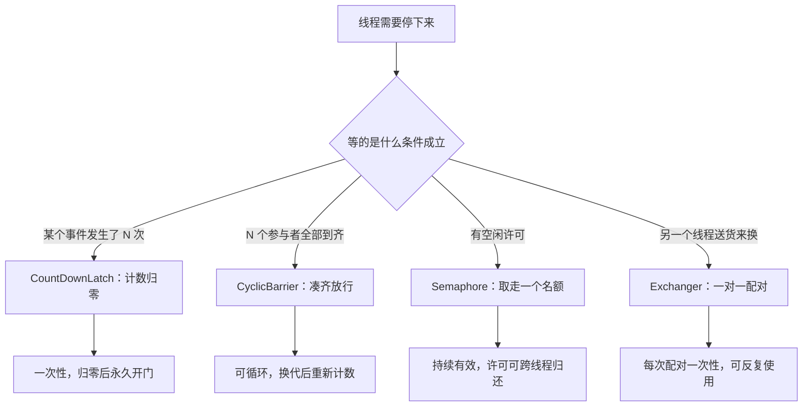
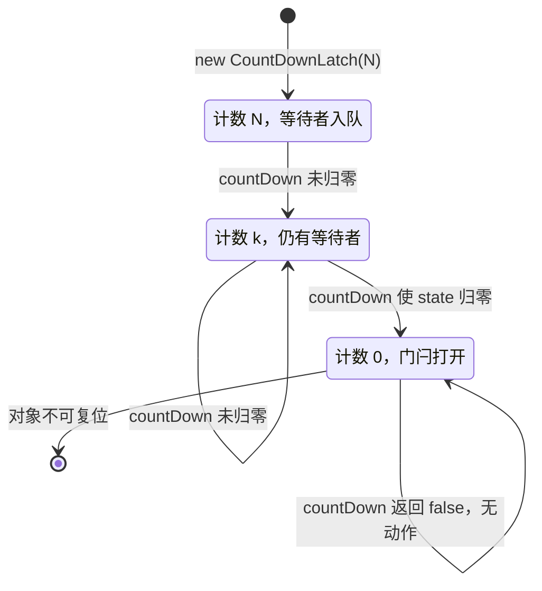
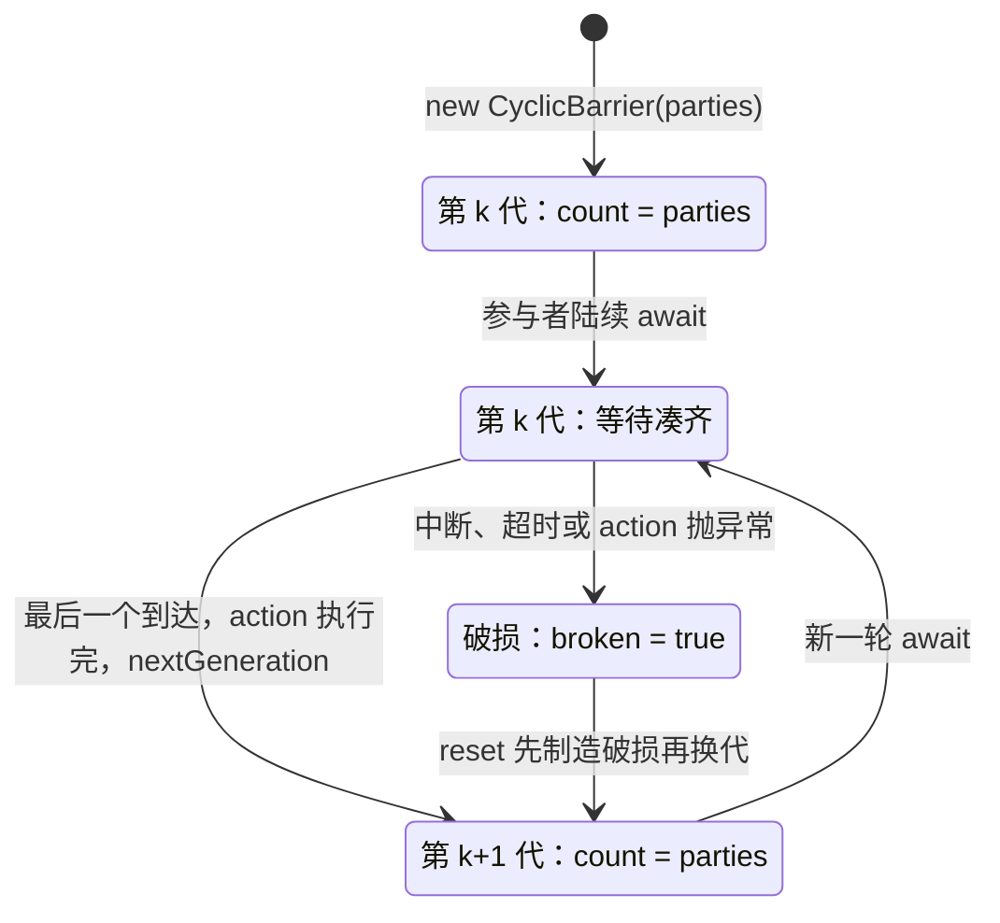
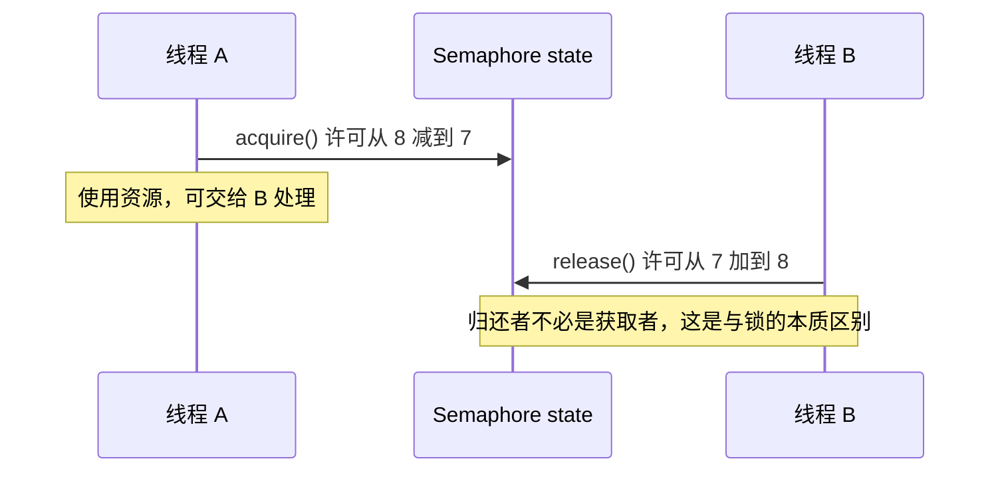
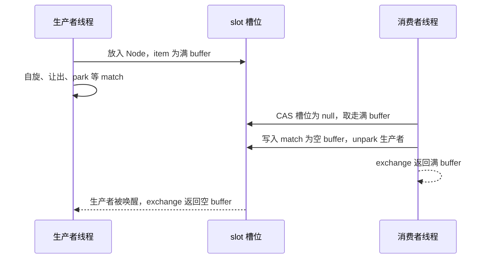
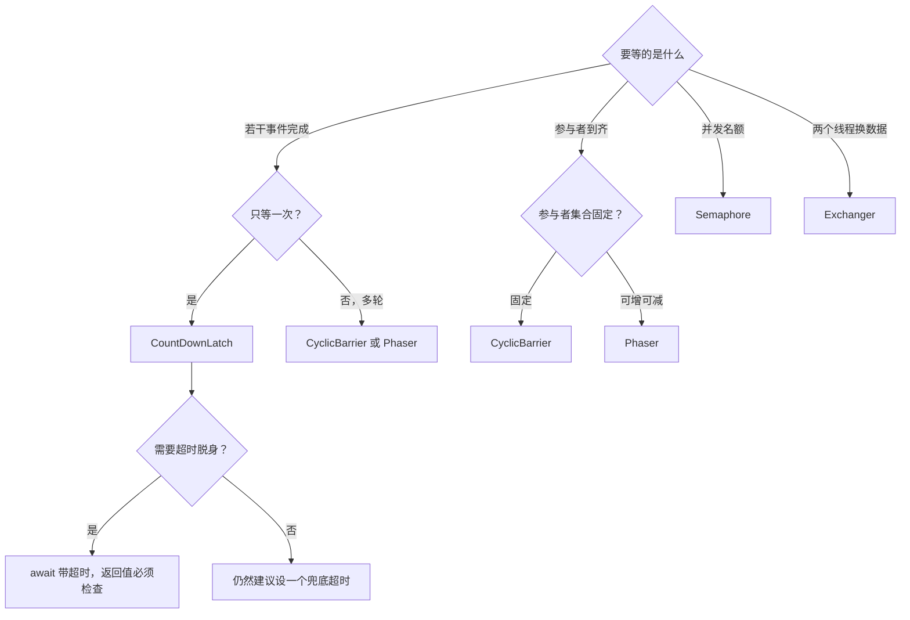

# 14 并发工具类——CountDownLatch、CyclicBarrier、Semaphore 与 Exchanger

**摘要：**

这四个类都能让线程停下来，但停下来的理由、让条件成立的人、失败之后的收场方式各不相同。`CountDownLatch` 等的是「某件事发生了 N 次」，计数归零即永久开门，与谁减掉计数无关；`CyclicBarrier` 等的是「N 个参与者到齐」，用代（Generation）区分轮次，因此能循环，也因此在有人中途退出时整体破损；`Semaphore` 等的是「有空闲许可」，许可不属于任何线程，可以跨线程归还；`Exchanger` 等的是「另一个线程带着东西来换」。本文按「等什么、谁等谁、失败怎么办」三个问题逐个拆开实现，把四个类放进同一张语义对照表，再讨论它们与 AQS 的关系、四个高频误用的机理与处置、`Phaser` 补上的动态成员与分层场景，最后落到开销量级与选型。四个类在源码层面的差别其实只有三处：state 的读法、唤醒的方式、失败的处理；这三处又恰好对应三类典型故障——少等一次、限流失效、任务挂起。协调原语的真正差别不在 API，而在等待的**语义边界**；边界画错时程序往往不报错，只是偶发地少等了一次，或者在某个负载拐点上安静地停住。

---

## 第 1 章 四种「等」：把协调拆成三个问题

1965 年，Dijkstra 在《Cooperating Sequential Processes》里用一对 P、V 操作解决了进程之间的互斥与同步，信号量（Semaphore）从此成为并发协调的通用货币。此后几十年的实践反复验证一件事：绝大多数等待只落在少数几种固定形状上——等若干件事全部发生、等若干人全部到齐、等一个名额空出来、等另一个人带着东西来换。用通用货币描述这些形状当然可行，但「等的条件究竟由谁满足」这层意思会退化成 P/V 周围的注释，而注释不会被编译器检查。

2004 年，Doug Lea 随 JSR-166 交付 `java.util.concurrent`，为上述形状各造了一个专用类：倒计时门闩（CountDownLatch）、循环屏障（CyclicBarrier）、信号量（Semaphore）、交换器（Exchanger）。四个类的核心方法加起来不到十个，容易被误当成同一类东西的四种写法；但它们的差别不在方法签名，而在等待的**语义边界**——谁在等、等什么、条件由谁满足、失败之后各自往哪走。

把这层差别压成三个问题，后面每一章都可以按同样的顺序展开：等的是什么条件，由谁让这个条件成立，条件成立或失败之后等待者如何脱身。第一个问题决定「等」的粒度，第二个问题决定「能不能跨线程」，第三个问题决定「死等还是可恢复」。三个问题问完，一个原语的能力与边界基本就清楚了。

设想一个每日对账系统：四个分片并行核对当天流水，全部完成后由主线程汇总差异；校准阶段要迭代三轮，每轮结束后四个分片交换中间结果再进入下一轮；对账过程中要向风控库写入命中记录，而风控库只允许八个并发连接；为了少分配缓冲区，读文件的生产者与跑规则的消费者各持一个 buffer，一方填满、一方取空时对调。四个等待点恰好落在四个原语上：主线程等四个分片完成是 `CountDownLatch`，分片之间等齐进入下一轮是 `CyclicBarrier`，写风控库的并发上限是 `Semaphore`，两个 buffer 的对调是 `Exchanger`。

如果把这些等待点统一换成一个原语，代码未必跑不起来。全用 `Semaphore` 也能拼出「等四个分片」和「等四个人到齐」，代价是每个等待点都要额外维护一个计数器和一段归还逻辑，等待的语义从类型退化成了约定。约定不参与编译，也不参与代码评审时的心智检查；一旦有人在异常路径上少减一次计数，程序不会报错，只会偶发地少等一次。

四种等待的拓扑放在一张图里，差别一目了然：有的等的是计数，有的等的是人，有的等的是名额，有的等的是对端。



| 原语 | 等的条件 | 由谁满足 | 一次性还是可循环 | 对账系统里的位置 |
| :--- | :--- | :--- | :--- | :--- |
| `CountDownLatch` | 计数从 N 减到 0 | 任何线程调用 `countDown()` | 一次性，归零后不可复位 | 主线程等四个分片完成 |
| `CyclicBarrier` | 登记在册的 N 个参与者全部到达 | 参与者自己调用 `await()` | 可循环，每轮自动复位 | 分片之间等齐进入下一轮 |
| `Semaphore` | 还有可用许可 | 任何线程调用 `release()` | 持续有效 | 写风控库的并发上限 |
| `Exchanger` | 另一个线程也到达交换点 | 恰好一个对端线程 | 每次配对一次性 | 两个 buffer 对调 |

后面的章节按「一个原语一章、最后统一对照」的顺序安排，并不是为了逐个介绍 API，而是因为可重用性与失败语义都由实现结构决定：先看清结构，对照表才不是需要死记的结论。

---

## 第 2 章 CountDownLatch：等的是事件，不是人

### 2.1 语义：计数与身份脱钩

`CountDownLatch` 把等待抽象成「某个条件发生了 N 次」，而不是「某 N 个线程完成了任务」。这个抽象层次的选择直接决定了它的能力边界：`countDown()` 不校验调用者是谁，也不校验被减掉的那一次对应什么事件，所以它既能表达「N 个线程各完成一次」，也能表达「一个线程分 N 个阶段完成」，还能表达「某个外部系统回调 N 次」。代价是它无法回答「哪些事已经发生」——计数只记得还剩多少，不记得是谁减的。

这层**不关心谁**的语义，常被概括成一句话：门闩等的是事件发生 N 次，不是等 N 个线程。理解这句话有两面：正面是灵活，事件的来源可以完全异构；反面是没有任何身份校验，少减一次会死等，多减一次会提前放行，两者都不报错。

### 2.2 实现：一个 int 与三个方法

JDK 21 里 `CountDownLatch` 的全部同步逻辑就是一个继承 AQS 的内部类，三个方法而已：

```java
// JDK 21，CountDownLatch.Sync
private static final class Sync extends AbstractQueuedSynchronizer {
    Sync(int count) { setState(count); }
    int getCount() { return getState(); }

    // 只看是否归零，不看 acquires：计数没有方向，也不区分谁在拿
    protected int tryAcquireShared(int acquires) {
        return (getState() == 0) ? 1 : -1;
    }

    protected boolean tryReleaseShared(int releases) {
        for (;;) {
            int c = getState();
            if (c == 0) return false;          // 归零后再减是空操作
            int nextc = c - 1;
            if (compareAndSetState(c, nextc))
                return nextc == 0;             // 只有从 1 减到 0 的那一次返回 true
        }
    }
}
```

`await()` 走 `acquireSharedInterruptibly(1)`：`tryAcquireShared` 返回 -1 就进 AQS 的共享队列等待。`countDown()` 走 `releaseShared(1)`：state 减一，只有 `nextc == 0` 的那一次 `tryReleaseShared` 返回 true，AQS 才继续调用 `doReleaseShared` 唤醒后继。

归零那一次 `countDown` 之后的行为值得单独描述：`doReleaseShared` 唤醒头节点的后继，被唤醒的线程在 `tryAcquireShared` 拿到 1 之后调用 `setHeadAndPropagate`，把自己变成新头节点并继续唤醒下一个。**级联唤醒**的细节——状态位的演进、`PROPAGATE` 的来历、JDK 14 一次重写带来的实现变化——在 [[06 AQS 框架——AbstractQueuedSynchronizer 的设计与实现]] 里已经拆过，这里只需记住结论：门闩打开不是一次广播，而是一条链，每个被唤醒者负责叫醒下一个。链式唤醒的直接后果是唤醒延迟随等待队列长度线性增长，这一点在第 10 章的量级表里还会出现。

### 2.3 一次性是语义选择，不是缺陷

`CountDownLatch` 没有 `reset()`，也没有任何能把 state 加回去的公开方法。这不是疏忽：门闩一旦打开，物理上就不该再关上。若允许重置，正在 `await` 的线程就得分清自己等的是哪一轮，于是需要「代」的概念——那正是 `CyclicBarrier` 的做法。把「代」省掉，换来的是实现极简：一个 int、三个方法、没有额外的对象状态。

想复用只有两条路：每一轮新建一个实例，用对象的生命周期表达轮次；或者换用天然带轮次概念的 `CyclicBarrier`、`Phaser`。前者并不是坏主意，新建一个 `CountDownLatch` 的成本只是一次对象分配，比维护重置逻辑更不容易错。

### 2.4 归零之后发生了什么

计数归零之后的行为是「误当可重用」这类 Bug 的机理所在：`tryAcquireShared` 看到 state 为 0 就返回 1，`acquireShared` 直接返回、根本不入队；`tryReleaseShared` 看到 state 为 0 就返回 false，`releaseShared` 因此不唤醒任何人。于是第二轮的 `await()` 会立刻通过，第二轮的 `countDown()` 静默无效。整个过程没有异常、没有日志、没有任何提示——程序在「看起来等过了」和「其实没等」之间没有可观测的差别。把这段状态变化画出来，归零之后不可复位这一条就落在最后几个自环上。



### 2.5 发令枪：两个门闩而不是一次 sleep

门闩最实用的变体是发令枪：一群线程等同一个信号，信号一到同时起跑。常见写法是主线程 `sleep` 一秒再 `countDown`，这种写法在负载低时能跑，负载高时就成了概率问题——`sleep` 结束时可能还有线程没启动完毕，也可能早就全部就位空等了一秒。

用两个门闩可以把等待的语义从「睡够时间」改成「条件成立」：

```java
int n = 10;
CountDownLatch ready = new CountDownLatch(n);   // 每个线程就位减一
CountDownLatch start = new CountDownLatch(1);   // 主线程发令

for (int i = 0; i < n; i++) {
    executor.execute(() -> {
        ready.countDown();
        try {
            start.await();          // 起跑线
            doWork();
        } catch (InterruptedException e) {
            Thread.currentThread().interrupt();
        }
    });
}

if (!ready.await(5, TimeUnit.SECONDS)) {
    // 有线程没能在时限内就位：取消本轮压测，而不是照常发令
    return;
}
start.countDown();
```

`ready` 保证「全员就位」这件事真的发生过，`start` 保证起跑时刻一致。两个 `await` 都要带超时，否则只要有一个线程因为池满没被调度起来，主线程就永远卡在 `ready.await()` 上。

### 2.6 happens-before：门闩不只传递信号，还能传递结果

`CountDownLatch` 的 Javadoc 里有一句常被略过的约定：在计数归零之前，一个线程调用 `countDown()` 之前的动作，**happen-before** 另一个线程从 `await()` 成功返回之后的动作。这条约定让门闩不只是「完成信号」，还可以承载「结果传递」：把计算结果写进普通字段，等门闩归零后直接读，不需要额外的 volatile 或锁。

不过方向要读准：它保证的是每个 `countDown()` 之前发生的写，不是 `countDown()` 之后发生的写。若某个线程在 `countDown()` 之后才去写结果，等待者读到的可能是旧值，甚至可能读到只写了一半的对象。把 `countDown()` 放在结果写完之后的最后一步，是这条约定成立的前提。

### 2.7 中断与超时：两种不同的脱身方式

`await()` 抛 `InterruptedException`，`await(long, TimeUnit)` 返回布尔值——超时不算异常，只是一次条件未成立的返回。这个区分不是风格问题：异常适合调用方没预料到的情况，超时是协调代码里必须处理的正常控制流，用返回值表达才能迫使调用方分支处理。

返回值必须被检查，忽略它等价于宣称「我等到它了」。`false` 意味着至少有一个任务没完成，后续汇总读到的可能是不完整的数据；此时要么按已完成部分降级，要么取消剩余任务并报错，不能继续往下走。

### 2.8 模板与两个方向的反例

```java
CountDownLatch done = new CountDownLatch(tasks.size());
Queue<Throwable> failures = new ConcurrentLinkedQueue<>();

for (Task t : tasks) {
    try {
        executor.execute(() -> {
            try {
                process(t);
            } catch (Throwable e) {
                failures.add(e);        // 失败也要记账，但不能阻止计数
            } finally {
                done.countDown();       // 放在 finally 的第一行
            }
        });
    } catch (RejectedExecutionException e) {
        failures.add(e);
        done.countDown();               // 任务根本没提交，提交方必须补一次
    }
}

if (!done.await(30, TimeUnit.SECONDS)) {
    // 超时是一条控制流：取消剩余任务、告警、按已完成部分汇总
}
```

模板里最容易被忽视的细节，是 `countDown()` 放在 `finally` 的第几行。它应当是第一行：如果前面还有别的清理动作，而那些动作又可能抛异常，`countDown()` 就会被跳过。任务本身失败并不可怕，可怕的是失败的任务静默地从计数里消失，让主线程永远等一个不会到来的归零。

另一处容易漏掉的是任务提交失败。`execute` 抛 `RejectedExecutionException` 意味着任务从未进入队列，闭包里的 `finally` 不会执行，所以提交方必须在这条路径上补一次 `countDown()`；只写闭包内的 finally，等于假设所有任务都提交成功。

反例的方向也可以反过来：`countDown()` 被多调了一次。因为不校验身份，多出来的那一次会让门闩提前打开，主线程在还有任务没完成时就开始汇总。重试逻辑、幂等框架、以及「任务被重复提交」的调度 Bug 都可能制造这种重复。`getCount()` 只能事后看到剩余计数，看不出多减；能兜住的还是超时之后的完整性校验，比如此刻已汇总的结果条数与预期条数是否一致。

---

## 第 3 章 CyclicBarrier：等人，而且等人齐

### 3.1 语义：到达序号与轮次

`CyclicBarrier` 把等待抽象成「N 个参与者全部到齐」，凑齐之后一起通过，然后自动进入下一轮。它与门闩的差别可以概括成一句话：门闩等的是事件发生 N 次，屏障等的是人到了 N 个。这句话有三层含义，分别对应三种行为差异：谁能让条件成立（任何线程 vs 只能是登记在册的参与者）、条件成立后计数是否复原（永不复原 vs 自动复原）、有人中途退出时怎么办（其他人继续等 vs 全体破损）。

`await()` 的返回值是本次到达的序号：第一个到达者拿到 `getParties() - 1`，最后一个到达者拿到 0。这个返回值常被当成「到达顺序」使用，但它的真正用途是让最后一个到达者承担收尾工作——Javadoc 给出的例子就是 `if (barrier.await() == 0) { ... }`。这也解释了为什么 barrier action 不需要额外线程：轮到最后一个到达者时，它本来就在做「凑齐」这件事。

### 3.2 结构：一把锁、一个条件、一个代

`CyclicBarrier` 没有继承 AQS，而是用 `ReentrantLock` 加 `Condition` 自己搭了一套：

```java
public class CyclicBarrier {
    private final ReentrantLock lock = new ReentrantLock();  // 默认非公平
    private final Condition trip = lock.newCondition();
    private final int parties;                // 参与者总数，构造后不变
    private final Runnable barrierCommand;    // 可选的屏障动作
    private Generation generation = new Generation();
    private int count;                        // 本代还差几个到达，初值 parties
}
```

所有 `await` 都在同一把锁里执行，等待挂在 `trip` 这个条件队列上。核心方法 `dowait` 的骨架如下：

```java
private int dowait(boolean timed, long nanos)
        throws InterruptedException, BrokenBarrierException, TimeoutException {
    final ReentrantLock lock = this.lock;
    lock.lock();
    try {
        final Generation g = generation;
        if (g.broken) throw new BrokenBarrierException();

        if (Thread.interrupted()) {          // 进入前已被中断
            breakBarrier();
            throw new InterruptedException();
        }

        int index = --count;                 // 唯一修改计数的地方
        if (index == 0) {                    // 最后一个到达者
            Runnable command = barrierCommand;
            if (command != null) {
                try {
                    command.run();           // 持锁执行，其他人在 trip 上睡着
                } catch (Throwable ex) {
                    breakBarrier();          // 动作失败即全体破损
                    throw ex;
                }
            }
            nextGeneration();                // signalAll + 重置 count + 换新代
            return 0;
        }

        for (;;) {
            try {
                if (!timed) trip.await();
                else if (nanos > 0L) nanos = trip.awaitNanos(nanos);
            } catch (InterruptedException ie) {
                if (g == generation && !g.broken) {
                    breakBarrier();
                    throw ie;                // 本代未结束：由我制造破损并退出
                } else {
                    Thread.currentThread().interrupt();  // 代已结束：中断留给后续
                }
            }

            if (g.broken) throw new BrokenBarrierException();
            if (g != generation) return index;         // 正常放行
            if (timed && nanos <= 0L) {
                breakBarrier();
                throw new TimeoutException();
            }
        }
    } finally {
        lock.unlock();
    }
}
```

醒来之后的三次判断是关键。`Condition.await()` 会响应虚假唤醒（spurious wakeup），也可能因为 `signalAll()` 被唤醒却发现自己这一代其实已经破损；只有把破损、换代、超时三种情况分开判断，等待者才能知道自己该抛异常、正常返回还是继续等。

### 3.3 Generation：为什么需要一个对象

为什么要一个 `Generation` 对象，而不是只把 `count` 重置回 `parties`？因为等待者醒来时需要一个**轮次身份**来判断自己是被正常放行，还是被别的轮次的事件误唤醒。只重置计数做不到这一点：破损时 `breakBarrier()` 会把 `count` 重置为 `parties`，正常放行时 `nextGeneration()` 同样重置为 `parties`，两件事在计数上看起来一模一样。代对象把「这一轮」变成可比较的引用，`g != generation` 就意味着自己等的那一轮已经结束。

Javadoc 还有一句容易读漏的限定：一个 barrier 上可能同时存在多个代与若干线程关联（因为锁的分配不确定），但任何时刻只有一个活跃代，其余要么已经破损、要么已经通过。代的寿命与一轮同步绑定：`nextGeneration()` 新建一个，旧代不再被任何字段引用，而等待者手里攥着的旧引用恰好成了判断依据。把代的流转画成状态图，正常放行与破损这两条岔路就分得开了。



### 3.4 broken：all-or-none 的失败模型

`CyclicBarrier` 采用 **all-or-none** 的破损模型：一个线程因中断、超时或 action 抛异常而提前离开屏障点，其他所有等待者都会以 `BrokenBarrierException` 离开。这个选择背后的判断是：屏障的意义在于齐步，一旦确定齐不了，让剩下的人继续等下去只会把故障扩散成挂起；与其让所有人陪着等一个不会到的参与者，不如让所有人同时失败，把问题暴露在调用方。

破损之后 `count` 被重置为 `parties`，当前代被标记 `broken`；此后每次 `await` 在入口就抛 `BrokenBarrierException`，不会进入等待。想恢复只有两条路：`reset()` 或重建对象。`reset()` 的实现是 `breakBarrier()` 加 `nextGeneration()`，也就是说它会再次把当前代标记破损——正在等待的线程会收到 `BrokenBarrierException`。因此 `reset()` 只适合确认没有线程在等时的错误恢复，不适合当作正常运行时的轮次控制。

| 成因 | 触发者收到的异常 | 其他等待者看到 | 恢复方式 |
| :--- | :--- | :--- | :--- |
| 在 `await` 等待中被中断 | `InterruptedException` | `BrokenBarrierException` | `reset()` 或重建，需确认无人正在等待 |
| 带超时的 `await` 超时 | `TimeoutException` | `BrokenBarrierException` | 同上，通常重建更清晰 |
| barrier action 抛异常 | action 抛出的那个异常 | `BrokenBarrierException` | 修复 action 后重建 |
| 进入 `await` 前中断标志已置位 | `InterruptedException` | `BrokenBarrierException` | 同上 |

### 3.5 barrier action：在最后一个到达者的临界区里

barrier action 由最后一个到达的线程执行，而且在 `nextGeneration()` 之前、在持有锁的情况下执行。这个顺序不是实现细节，而是内存可见性的一部分：Javadoc 承诺，各线程 `await()` 之前的动作 happen-before barrier action，barrier action 又 happen-before 其他线程从 `await()` 返回。把 action 放到 `signalAll()` 之后就会破坏这个承诺——被唤醒的线程可能在新一轮里继续跑，而 action 还在改上一轮的共享状态。

代价也随之而来：action 的耗时直接加在最后一个到达者的**临界区**里，所有等待者的放行时间一起被推后；如果 action 里做了慢查询或大批量写，最慢的那个线程会变得更慢，而它恰好是决定整轮节奏的那一个。action 应当只做切换阶段标志、记录统计、投递一个汇总任务这类短操作。

更隐蔽的一类反例是在 action 里再次调用同一个 barrier 的 `await()`。此时 `count` 已经是 0，`--count` 得到 -1，`index` 不等于 0，线程进入 `trip.await()`；而能推进这一代的最后到达者正是它自己，于是没有人再能触发 `nextGeneration()`，全体永久等待。同样的道理，action 里等待其他线程的 latch 也会拖住最后一个到达者，只是危害取决于那个 latch 是否会被别人归零。

### 3.6 与线程池的配合：parties 与池容量

`CyclicBarrier` 与线程池的配合有一个硬约束：`parties` 必须能被同时满足。池里线程数小于 `parties` 时，先到的线程会把池线程全部占住在 `await` 上，剩下的任务还在队列里等空闲线程，而空闲线程永远不会出现——典型的**线程池饥饿（pool starvation）**，表现为任务全部卡住、CPU 空闲、`jstack` 里池线程停在 `Condition.await`。

这个问题在「任务内部循环 `await`」的写法下更严重：一轮结束后线程并不退出，而是继续在池里跑下一轮，池的容量被长期占用，其他类型的任务也被拖住。可行的处理有三条：给屏障准备一组容量足够的专用线程，不与业务任务共享池；把屏障从任务内部提到任务外部，用两阶段提交—等待的方式；或者改用 `Phaser`，让参与者可以动态注册。

如果屏障用在 `ForkJoinPool` 的 worker 里，还要额外考虑并行度补偿：worker 阻塞在 `await` 上时池不会自动扩容，需要把阻塞调用包进 `ForkJoinPool.managedBlock`，或者保证并行度足以容纳所有同时阻塞的参与者。工作窃取的调度细节见 [[12 线程池（下）——ForkJoinPool 与工作窃取算法]]。

### 3.7 与门闩之间的选择

只需要等一次时，`CountDownLatch` 更直接，因为它不要求「参与者」这个概念——发令的是谁、等的是谁，都可以是任意线程；需要多轮时，`CyclicBarrier` 才值得引入代与破损这两层复杂度。反过来，用 `CountDownLatch` 模拟多轮屏障也能做到，办法是每轮新建一个 latch 并用一个共享的轮次变量做二次校验，但那已经是在手写一个更差的 `CyclicBarrier`。

---

## 第 4 章 Semaphore：等的是名额，与线程身份无关

### 4.1 语义：许可、计数与负值辨析

信号量维护的是一组抽象的**许可（permit）**：`acquire()` 取走一个，`release()` 归还一个，取不到就等。许可总数在构造时给定，但 `release()` 可以增加许可，甚至让可用许可超过初始值。

Dijkstra 的原始信号量允许值变成负数，负值的绝对值表示正在等待的进程数；Java 的实现没有沿用这个约定。`Semaphore` 的 state 在 `acquire` 路径上不会被写成负数：`nonfairTryAcquireShared` 算出 `remaining < 0` 时直接返回负值表示失败，并不执行 CAS，所以 state 停在原处；等待者的数量由 AQS 队列单独记录。真正能让 state 变负的只有 `reducePermits(int)` 这个 protected 方法——它是留给子类建模「资源暂时不可用」的，可以把许可压到零以下，之后再靠 `release` 慢慢补回来。把「许可可为负」当成 Java 信号量的日常语义，会在读源码时找不到对应代码。

### 4.2 公平与非公平：只在 CAS 之前差一行

```java
// 非公平：直接扣减，扣不动就返回负数
final int nonfairTryAcquireShared(int acquires) {
    for (;;) {
        int available = getState();
        int remaining = available - acquires;
        if (remaining < 0 || compareAndSetState(available, remaining))
            return remaining;
    }
}

// 公平：先看队列里有没有人排队
static final class FairSync extends Sync {
    protected int tryAcquireShared(int acquires) {
        for (;;) {
            if (hasQueuedPredecessors()) return -1;   // 有人排队就去队尾
            int available = getState();
            int remaining = available - acquires;
            if (remaining < 0 || compareAndSetState(available, remaining))
                return remaining;
        }
    }
}
```

两者的差别不在正确性，而在「新来的线程要不要给已经在等的线程让路」。默认构造用的是非公平版本，理由与 `ReentrantLock` 相同：允许插队可以让刚到的线程直接拿走刚释放的许可，省掉一次唤醒与上下文切换，吞吐更高；代价是等待时间长的线程可能持续被插队。公平性对吞吐的影响与临界区长度、竞争强度都相关，与 `ReentrantLock` 的公平性讨论同源，见 [[07 ReentrantLock 深度剖析——公平锁、非公平锁与可中断]]。

### 4.3 tryAcquire：无视公平设置的快路径

`tryAcquire()` 有一个容易被忽略的实现细节：它直接调用 `nonfairTryAcquireShared`，完全绕过公平性设置。也就是说，即使构造时传了 `true`，`tryAcquire()` 仍然会在许可可用时立刻拿走，不管队列里是否有人等。Javadoc 明确写了这一点，并建议需要尊重公平设置时改用 `tryAcquire(0, TimeUnit.SECONDS)`。

这条规则的用途是快路径优先：调用方已经准备好降级逻辑时，就不该为了排队再付出一次阻塞的代价。反过来，如果系统里既有公平的 `acquire()` 又有大量 `tryAcquire()`，公平性会被后者的插队悄悄破坏——这是排查「公平模式仍然饥饿」时常见的盲点。

### 4.4 release：不校验持有者的能力与风险

`release()` 不校验调用线程是否持有许可，Javadoc 对此的措辞是，信号量的正确用法由应用中的编程约定保证。这条设计带来两个方向的能力与风险。

能力是跨线程归还：A 线程取的许可由 B 线程归还，适合资源在流水线上换手的场景，也给死锁恢复留了口子——监控线程可以强行归还一个卡住的许可，让等待者继续。风险是**许可膨胀**：多调一次 `release()` 就会凭空多出一个许可，并发上限被悄悄抬高，而且不会有任何异常。下面这张时序图只看一次跨线程归还：A 取走许可，B 归还，计数回到原值。



判断是否发生了膨胀有一个简单判据：定时采样 `availablePermits()`，长期高于初始许可数就说明释放多于获取。修复通常不在 `Semaphore` 本身，而在调用方的配对逻辑：把 `acquire` 与 `release` 收进同一个方法、用 try-finally 保证配对、并且在 finally 里只放 `release()` 这一句。

### 4.5 与锁的本质区别

| 维度 | `ReentrantLock` | `Semaphore` |
| :--- | :--- | :--- |
| 持有者 | 记录持有线程，`unlock` 必须由持有者调用 | 无持有者概念，任何线程都能 `release` |
| 可重入 | 同一线程可重复加锁，state 记重入次数 | 不可重入，同一线程再取一次就再消耗一个许可 |
| 释放语义 | 解锁，把锁交给下一位 | 增加许可，许可可以被凭空多造 |
| 条件队列 | 支持多个 `Condition` | 不提供条件队列，只提供许可计数 |
| 典型用途 | 临界区互斥、可中断或带超时的加锁 | 并发度控制、资源池名额 |

把 `Semaphore(1)` 当互斥锁用是可行的，但它与锁的差别会在三处露出来：同一线程二次 `acquire` 会把自己锁死；`release` 可以由任意线程调用，等于放弃了「谁加锁谁解锁」的纪律；许可数可以被增加到超过 1，互斥性丢失。需要互斥时用锁，需要名额时用信号量，两者不要互相顶替。

### 4.6 限流限的是并发度，不是速率

用 `Semaphore` 做限流时，限制的是**并发度**，不是**速率**。两者的换算关系很直接：设并发上限为 C、单次处理耗时为 T，则吞吐上限约为 C/T。`Semaphore(100)` 在每次调用 100 毫秒时能撑到约每秒一千次；同一个信号量遇到一次十秒的慢查询，吞吐立刻掉到每秒十次。

所以「每秒一千次」这类需求不能用 `Semaphore` 表达，因为许可的归还时刻由处理完成时间决定，而不由时间窗口决定。需要速率语义时要引入时间维度：令牌桶按固定速率补充令牌，漏桶按固定速率放行请求，Guava 的 `RateLimiter` 与 Sentinel 的流控规则都属于这一类。把 `Semaphore(1000)` 当成「每秒一千次」的限流器，突发流量下瞬时并发仍可能达到一千，下游照样被打穿。

### 4.7 资源池：名额与资源是两件事

资源池是 `Semaphore` 的经典用途：许可代表名额，拿到名额才有资格去取资源。但这里有个语义缺口——许可只保证名额，不保证资源真的存在。如果 `acquire()` 成功之后取资源失败，名额必须显式归还，否则池的容量会永久缩小。

另一种建模方式是把资源本身放进队列：`BlockingQueue<Connection>` 的 `take()` 同时承担「等名额」与「取资源」两件事，队列空即无资源，语义更紧。连接池实现通常走这条路或它的变体，譬如 HikariCP 用自定义的并发容器管理连接状态，而不是用一个裸信号量加一个连接数组。选择哪一种，取决于「资源是否存在」与「名额是否可用」是否可能不一致；若两者严格同源，队列更省心。

---

## 第 5 章 Exchanger：等的是一个对端

### 5.1 语义：严格的两方以物易物

`Exchanger` 让两个线程在一个交换点相遇，各自交出对象、取走对方的对象。它是严格的两方 rendezvous：先到的一方阻塞等待，后到的一方到达时完成配对并唤醒先到者，双方各自返回对方交出的对象。Javadoc 把它描述成 `SynchronousQueue` 的双向版本，这个类比抓住了要害——都是手递手，都不经过缓冲区，区别在于 `SynchronousQueue` 有明确的 put/take 角色，而 `Exchanger` 的双方是对称的，既交又取。

把交换点想象成旧时的**以物易物**集市：两个人必须同时在场、各自拿出货物、互相验看、然后各取所需；没有柜台，没有存货，任何一方不到场，交易就不成立。这个比喻的限定在于，集市可以有多对人同时交易，而 `Exchanger` 的每一次配对只发生在两个线程之间。

### 5.2 实现：单槽、竞技场与三级等待

实现上它没有用 AQS，也没有排队队列。核心是一个可 CAS 的槽位（slot）：线程把自己的 `Node`（带 `item`、`match`、`parked` 三个字段）放进槽位；后到者把槽位 CAS 成 null，取出前者的 `item`，把自己的 `item` 写进前者的 `match`，然后 `unpark` 前者；前者醒来读 `match` 拿到对方的数据。

```java
// JDK 21，Exchanger.Node：@Contended 用来隔开伪共享
@jdk.internal.vm.annotation.Contended static final class Node {
    int index;              // 竞技场索引
    int bound;              // 上次记录的竞技场边界
    int collides;           // 当前边界下的 CAS 失败次数
    int hash;               // 伪随机数，用于打散自旋与槽位
    Object item;            // 本线程要交换的对象
    volatile Object match;  // 对端写入的对象
    volatile Thread parked; // 本线程进入 park 前登记，供对端 unpark
}
```

配对的**线性化点**是槽位的 CAS，谁 CAS 成功谁定局，因此交换要么整体完成，要么什么都没发生——超时的一方不会出现「东西已经交出去、却没收到回礼」的半交换。一次成功配对的时序可以画成下面这样。



单槽在参与者多时会成为热点，于是实现里还有一个竞技场（arena）：检测到竞争（CAS 失败次数累积）之后，把槽位扩展成一组带间隔的槽位，线程按各自的索引散列到不同槽位上配对，减少同一缓存行上的争用。槽位间隔由 `ASHIFT = 5` 决定（约 32 个引用，避开常见缓存行大小），`Node` 上加了 `@Contended`，竞技场边界 `bound` 带版本号，扩容与收缩都靠 CAS 更新它。

等待策略也是分级的：先在本地自旋（`SPINS = 1 << 10`），再让出 CPU，最后才 `park`；单核机器上不建竞技场，因为散列没有意义。这套「先把竞争消解掉、再退化为阻塞」的思路，与 `LongAdder` 的分段计数、`ConcurrentHashMap` 的分桶扩容属于同一类设计。

### 5.3 双缓冲流水线

`Exchanger` 最典型的用法是双缓冲：生产者填一个 buffer，消费者清空另一个，两者通过交换对调，读写始终作用于不同的对象，不必加锁。

```java
Exchanger<List<String>> exchanger = new Exchanger<>();
List<String> buffer = new ArrayList<>();

while (running) {
    fill(buffer);
    try {
        // 交出满 buffer，换回消费者清空的 buffer
        buffer = exchanger.exchange(buffer, 1, TimeUnit.SECONDS);
    } catch (TimeoutException e) {
        // 对端长时间未到：记录、降级或退出，不能假设交换一定成功
        break;
    } catch (InterruptedException e) {
        Thread.currentThread().interrupt();
        break;
    }
}
```

交换的是引用而不是拷贝，所以双方必须约定清楚 buffer 的归属：交出之后本线程不应再写它，收到之后应当先确认内容状态（清空或按约定处理残留）。这一点在代码里看不出来，只能靠注释与命名约束。

### 5.4 与 SynchronousQueue 的区别

| 维度 | `SynchronousQueue` | `Exchanger` |
| :--- | :--- | :--- |
| 角色 | 生产者 `put` 与消费者 `take` 角色分明 | 双方对称，既交又取 |
| 参与者规模 | 多对多，可以排队 | 严格两两配对，第三个线程只能等下一对 |
| 数据方向 | 单向，元素被消费一次 | 双向，双方都交出并取回 |
| 适用场景 | 线程池的直接交接、手递手任务分发 | 双边缓冲交换、两阶段算法的状态对调 |
| 底层结构 | 队列或栈（公平/非公平两种实现） | 无锁槽位与竞技场 |

`SynchronousQueue` 的两种实现（公平的队列版与非公平的栈版）都建立在「dual data structure」的思路之上（Scott 与 Scherer 在 DISC 2004 的论文里系统讨论过），所以两者在底层有亲缘关系；但 API 层面的角色差异决定了它们不可互换：需要「交付即离开」用队列，需要「以物易物」用交换器。

### 5.5 误用：把它当队列、或吞掉超时

最常见的误用是把它当队列：多个线程共享一个 `Exchanger`，两两配对的对象不确定，A 可能把数据交给 C 而不是预期的 B。`Exchanger` 的语义只保证「与某一个对端配对」，不保证「与指定的对端配对」；需要指定对端就不该用它。

另一类问题是超时与中断的处理。`exchange(x, timeout, unit)` 抛 `TimeoutException`，两个版本都可能抛 `InterruptedException`；一旦抛出，本线程交出的对象仍然在自己手里，需要由调用方决定是重试、丢弃还是转入别的通道。若在循环里吞掉异常继续下一轮，容易出现一方长期拿不到对端、另一方已经退出的单边流水线，表现为交换点上一个线程孤零零地等。

---

## 第 6 章 Phaser：当参与者会变、同步需要分层

### 6.1 三个原语拼不出的形状

前四个原语覆盖的等待形状都有一个共同前提：参与者在开始之前就确定，并且中途不增不减。真实系统经常破坏这个前提——分片数随数据量伸缩、部分参与者提前完成、某些阶段只有一部分线程需要同步。把这些场景硬塞进 `CyclicBarrier`，只能在每一轮重建对象；参与者集合一变，轮次就断。

`Phaser`（阶段器，Java 7 引入）就是为参与者可变、可循环、可分层这三种需求准备的。它保留了屏障的循环语义，同时把「注册」从构造参数变成运行期操作。

### 6.2 状态编码与 API

它的状态是一个 long：高 32 位是**阶段号（phase）**（从 0 开始，每轮推进一次，到 `Integer.MAX_VALUE` 回绕），中间 16 位是已注册参与者数，低 16 位是本阶段尚未到达的参与者数。三个字段挤进一个 long，所有更新走 CAS，所以既不需要 AQS 的队列，也不需要锁。

| 方法 | 语义 |
| :--- | :--- |
| `register()` / `bulkRegister(n)` | 运行期增加参与者，可与同步过程并发 |
| `arrive()` | 到达但不阻塞，返回到达时的阶段号 |
| `arriveAndDeregister()` | 到达并注销自己，用于提前完成的参与者 |
| `arriveAndAwaitAdvance()` | 到达并等本阶段结束，等价于屏障的 `await` |
| `awaitAdvance(phase)` | 等阶段离开 `phase`，不响应中断，阶段已推进则立即返回 |
| `awaitAdvanceInterruptibly(phase)` | 同上，但可中断、可超时 |
| `forceTermination()` | 强制终止，所有等待者立即返回 |
| `onAdvance(phase, parties)` | 阶段推进时的钩子，返回 true 表示终止 |

`arrive()` 与 `awaitAdvance(phase)` 的分离是它区别于 `CyclicBarrier` 的关键：到达与等待解耦，一个线程可以先到达、先去干别的事、稍后再检查阶段是否推进；阶段已经推进时 `awaitAdvance` 立即返回。这种「到达与等待分离，并且能指定要等哪一个阶段」的能力，在其他四个原语里没有对应物。

### 6.3 分层：把一次同步拆成两层

阶段器可以**分层**：子 phaser 注册到父 phaser，子 phaser 的参与者数从零变正时自动向父注册，归零时自动注销。把一千个参与者分成十组，组内用子 phaser 同步，组间用父 phaser 同步，一次全局同步就变成十次组内同步加一次组间同步；每次同步需要唤醒的线程数从一千降到一百。

代价是同步路径变长、参与者要多经过一层，而且层数越多，单次同步的固定开销越难被摊薄。分层的收益与参与者规模相关：几十个参与者时分层几乎没有意义，上千个时收益才明显。

### 6.4 与屏障、门闩的取舍

`Phaser` 能覆盖 `CyclicBarrier` 的大部分用法，但两者并不等价：`CyclicBarrier` 的 barrier action 只由最后一个到达者执行一次，`Phaser` 的 `onAdvance` 由触发阶段推进的线程执行，参数是旧阶段号与注册数，返回 true 就终止；`CyclicBarrier` 的参与者集合固定，`Phaser` 可增可减；`CyclicBarrier` 的 `await` 必须阻塞到齐，`Phaser` 可以只到达不等待。

用哪一个，取决于参与者集合是否稳定、是否需要「到达与等待分离」、以及是否能接受 `onAdvance` 这套稍微复杂的终止协议。只需要固定人数、固定轮次时，`CyclicBarrier` 的 API 更短，出错面更小。

---

## 第 7 章 语义对照：等什么、谁等谁、可重用、失败语义

把五个原语放到同一张表里，前面各章的结论可以一次收拢。这张表是本篇的骨架：判断一个场景该用哪个原语，本质上是在表里找一列一列对得上的那一行。

| 原语 | 等的是什么 | 谁等谁 | 可重用 | 失败语义 | 典型场景 |
| :--- | :--- | :--- | :--- | :--- | :--- |
| `CountDownLatch` | N 次事件全部发生 | 少数线程等任意线程减计数 | 一次性，归零后永久打开 | 没有失败概念，只能超时或中断 | 主线程等子任务、启动门闩、发令枪 |
| `CyclicBarrier` | N 个参与者全部到齐 | 参与者互相等，角色对等 | 可循环，自动换代 | all-or-none 破损，全体抛 `BrokenBarrierException` | 多轮迭代计算、并行算法阶段同步 |
| `Semaphore` | 有可用许可 | 申请者等许可，归还者可为任意线程 | 持续有效 | 没有失败概念，超时返回 false 或中断 | 并发度控制、资源池名额、限流 |
| `Exchanger` | 另一个线程到达交换点 | 两个线程对称互等 | 每次配对一次性，可反复配对 | 超时抛 `TimeoutException`，交换原子 | 双缓冲流水线、两阶段状态对调 |
| `Phaser` | 本阶段所有注册者到达 | 注册者互相等，可只到达不等待 | 可循环，阶段号递增 | 无破损语义，靠 `onAdvance` 返回 true 终止 | 参与者动态变化、分层同步 |

机制层面的对照同样有必要，因为它决定了「失败之后能不能恢复」以及「能不能跨线程满足条件」：

| 原语 | 实现基础 | 唤醒方式 | 超时支持 | 条件能否被非参与者满足 |
| :--- | :--- | :--- | :--- | :--- |
| `CountDownLatch` | AQS 共享模式 | 归零后级联唤醒 | `await` 返回布尔 | 能，任何线程都可 `countDown` |
| `CyclicBarrier` | `ReentrantLock` + `Condition` | `signalAll` 集体唤醒 | 超时即破损 | 不能，只能是登记在册的参与者 |
| `Semaphore` | AQS 共享模式 | 归还许可后唤醒后继 | `tryAcquire` 返回布尔 | 能，任何线程都可 `release` |
| `Exchanger` | 无锁槽位 + 竞技场 | 配对后 `unpark` 对端 | 超时抛异常 | 不能，必须是恰好一个对端 |
| `Phaser` | 自维护 long 状态 + CAS | 阶段推进时唤醒 | `awaitAdvanceInterruptibly` | 不能，只能是注册者 |

三组辨析可以把表读薄。

第一组是**数量与身份**。门闩计的是次数，屏障计的是人数，信号量计的是名额，交换器计的是对端；只有屏障要求满足条件的人必须是登记在册的那 N 个，其余三者都不关心满足者是谁。这个差别是「能不能跨线程满足」那一列的全部来源。

第二组是一次性与可循环。门闩一次性，屏障自动循环，信号量持续有效，交换器每次配对一次性但可以反复使用。判断是否需要循环，等价于判断「同一批线程是否要多次经过同一个同步点」。

第三组是**失败语义**。门闩与信号量没有失败概念，等不到就只能超时或中断，等待者之间也不存在「一个出事全体失败」的联动；屏障是 all-or-none，一个人出事全体破损；交换器只有配对成功与超时两种结局，且交换是原子的。失败语义决定故障会以什么形态出现：是单点挂起，还是集体异常。

回到对账系统，四个等待点在这张表里的位置很清楚：主线程等分片是「数量 + 一次性」，分片等齐是「身份 + 可循环」，写风控库是「名额 + 持续有效」，buffer 对调是「对端 + 原子交换」。四个判断各自独立，所以四个原语各司其职；若把其中任意一个换成别的原语，要么需要额外的状态变量，要么会丢掉某条失败语义。

从计算能力上说，这些原语互相模拟并不困难：`Semaphore(0)` 加一次 `release()` 就能当门闩，`CountDownLatch` 加一个循环就能当屏障。但模拟的代价是把语义从类型退化成约定，而约定不会被编译器和代码评审强制检查。专用类的价值不在于「能做到」，而在于「只能这么做」——它把正确用法变成唯一自然的写法。

---

## 第 8 章 与 AQS 的关系：为什么 CyclicBarrier 不用它

### 8.1 五个原语只有两个直接用 AQS

把五个原语按实现基础排一下，会看到一条清晰的分界：`CountDownLatch` 与 `Semaphore` 直接继承 AQS 的**共享模式**，`CyclicBarrier` 用 `ReentrantLock` 加 `Condition`，`Exchanger` 用无锁槽位加竞技场，`Phaser` 自己用 CAS 维护一个 long。五个类里只有两个直接复用 AQS，其余三个各自造了更贴合自身语义的骨架。

`CountDownLatch` 与 `Semaphore` 之所以能直接复用，是因为它们的语义正好落在 AQS 共享模式的两条钩子上：状态只由 `acquire` 与 `release` 推动，条件成立时唤醒后继、并由后继继续传播。门闩的状态只减不增，信号量的状态一增一减，两者都不需要「代」、不需要在临界区里执行动作、也不需要区分持有者。

### 8.2 CyclicBarrier 绕开 AQS 的四个理由

第一，它需要代与重置。AQS 的 state 是「一个可被 CAS 的 int」，语义完全由子类赋予，理论上 `setState(parties)` 就能重置；但重置之后，正在等待的线程无法区分「自己等的那一轮已经正常结束」与「计数被别人改回去了」。这个身份问题必须靠额外的对象解决，而 `CountDownLatch` 干脆放弃了重置，把问题消掉。

第二，它需要集体唤醒，而不是逐个发放。AQS 共享模式的传播是链式的：一个被唤醒者唤醒下一个，每人只负责一个。门闩要的正是这个效果——开闸后全员通过，谁先谁后无所谓。屏障要的是「同一时刻全员放行」，`Condition.signalAll()` 一次把整个条件队列搬回锁队列，语义与「齐步走」同构，不需要逐级传递。

第三，它需要在临界区内执行一次动作，且动作与其他线程的返回之间有明确的 happens-before 顺序。用锁时，动作、计数修改、代切换天然处在同一个临界区里，`nextGeneration()` 之前的 `signalAll` 保证等待者醒来时新代已经就绪；用 AQS 则要把「执行动作」安插在某个钩子的返回值之后，而钩子本身不持有临界区，动作执行与状态切换的边界会变得模糊。

第四，`Condition` 只支持独占模式。AQS 的 `ConditionObject` 在 `await` 时会检查 `isHeldExclusively`，共享模式没有「持有者」概念，硬接会直接抛 `UnsupportedOperationException`。`CyclicBarrier` 既然要用条件队列，就必须配一把独占锁。这条限制在 [[06 AQS 框架——AbstractQueuedSynchronizer 的设计与实现]] 讲条件队列时已经说明过。

反过来推演一遍：若硬用 AQS 写一个可循环屏障，需要在 state 里编码剩余计数、破损标志、甚至代编号，再用 `setState` 重置、用 `doReleaseShared` 逐级唤醒，还要处理「谁执行 action」「破损后如何让后来者立即失败」。这等于在 AQS 外面再造一套状态机，代码量不会比现在少，正确性却更难论证。

### 8.3 Exchanger 与 Phaser 为什么也不走 AQS

`Exchanger` 没有排队语义，它要的是「一对一配对」，而不是「一串等待者按序获得资源」。AQS 的队列擅长处理后者，处理前者反而多余：配对只需要一个可 CAS 的槽位，加上一套竞争消解的结构。`Phaser` 的参与者数可以动态变化、阶段号需要回绕、还要支持分层，这些都不适合压进 AQS 的单个 int；它自己维护一个 long，把阶段、注册数、未到达数三个字段位编码进去，反而更直接。

这也说明 AQS 不是「并发原语的唯一正确答案」，而是一套针对「排队等待 + 状态条件」的通用骨架。语义偏离这个形状时，另起一套结构往往更省事。

### 8.4 公平性的落点

`CyclicBarrier` 内部的 `ReentrantLock` 是默认的非公平锁，所以「谁先被唤醒」「谁先通过」都不保证；`await()` 返回的序号是到达序号，不是调度顺序。`Semaphore` 的公平性落在 `hasQueuedPredecessors()` 一行，但 `tryAcquire()` 会绕过它；`CountDownLatch` 根本没有公平性参数，因为它的等待者之间没有竞争关系——门闩打开后所有人一起通过，先醒后醒只影响延迟，不影响结果。

公平性只在「等待者之间存在竞争」时有意义。门闩与交换器的等待者之间没有资源竞争，屏障的等待者是集体放行，只有信号量在「有限许可 + 多个申请者」的格局下才需要讨论谁先拿到。这个判断可以省掉很多不必要的公平锁开销。

---

## 第 9 章 四个高频误用：症状、机理与处置

### 9.1 把 CountDownLatch 当可重用

症状是第二轮及以后的 `await()` 全部立即返回，程序看起来「没等」；日志里任务并未完成，汇总结果缺数据，而且没有任何异常。机理已经拆过：state 归零后 `tryAcquireShared` 返回 1，`acquireShared` 不入队直接返回，`countDown` 也不再有任何效果。

修复有两条路：每轮新建实例，用对象生命周期表达轮次；或者换用 `CyclicBarrier`、`Phaser`。检测手段是断言等待前后 `getCount()` 的语义，或者在等待返回后校验完成数与预期数是否一致——后者才是真正兜底的校验，因为计数本身不记录谁完成了。

### 9.2 Semaphore 的 release 多于 acquire

症状是并发度逐渐升高、下游连接被打满、限流形同虚设；采样 `availablePermits()` 会看到它高于初始值。机理是 `release()` 不校验持有者，多调一次就多一个许可。

最常见的来源是把 `acquire()` 放进 `try` 块内部，然后在 `finally` 里无条件 `release()`：

```java
// 错误：acquire 抛异常时，finally 仍然 release，许可被凭空造出
try {
    semaphore.acquire();
    doWork();
} finally {
    semaphore.release();
}

// 正确：acquire 成功之后才进入受保护的区段
semaphore.acquire();
try {
    doWork();
} finally {
    semaphore.release();
}
```

更稳的做法是把 acquire 与 release 封装进同一个方法，让许可的配对在词法上就成立，外部调用者看不到许可的存在。

### 9.3 CyclicBarrier 与线程池的容量错配

症状是任务全部卡住、CPU 空闲、`jstack` 里池线程停在 `Condition.await`，而线程池队列里还有任务在等。机理是 `parties` 大于池容量：已到达的线程占住池线程等待，剩余任务等不到线程来执行，屏障永远凑不齐。

修复有三条：给屏障准备容量足够的专用线程组；把屏障从任务内部提到任务外部，先提交全部任务再由主线程等结果；或者改用 `Phaser` 配合能感知阻塞的调度。检测手段很朴素——把「池容量 ≥ 最大同时阻塞的参与者数」写进启动自检，容量不满足时直接拒绝启动，比运行期挂起好排查。

### 9.4 await 不设超时

症状是线程永久停在 `WAITING`，`jstack` 能看到等待点却没有死锁报告，`ThreadMXBean.findDeadlockedThreads()` 返回空。原因在于这类等待既不是监视器上的环，也不是 ownable synchronizer 上的环：`CyclicBarrier` 等的是 `Condition`，`CountDownLatch` 与 `Semaphore` 等的是 AQS 共享队列，死锁检测覆盖不到它们，只能看到「很多线程在等」。

修复的原则是：所有跨系统、跨线程的等待都带超时；超时后走取消、降级或告警，而不是继续等；把超时当作正常控制流处理，在返回值或异常里明确表达「没等到」。检测则要靠看门狗：定期采样等待时长，超过阈值就把线程栈打出来并告警，因为这类问题往往在业务量变化时才暴露。

### 9.5 误用速查表

| 误用 | 症状 | 根因 | 处置 | 检测手段 |
| :--- | :--- | :--- | :--- | :--- |
| 门闩当可重用 | 第二轮不等待，结果缺失 | 归零后 state 永为 0 | 每轮新建，或换屏障 | 等待后校验完成数 |
| `release` 多于 `acquire` | 并发度上升、下游被打满 | 无持有者校验 | 配对写法，封装方法 | 采样 `availablePermits` |
| 屏障与池容量错配 | 任务全卡、CPU 空闲 | 池线程被等待者占满 | 专用线程组或两阶段 | 启动时校验容量 |
| 等待不设超时 | 线程永久挂起、无死锁报告 | 缺少脱身路径 | 全部等待带超时 | 看门狗采样栈 |
| action 里做重活 | 每轮放行被整体推后 | 动作在持锁临界区内 | 动作只做短操作 | 记录 action 耗时 |
| 信号量当互斥却忽略公平 | 长任务饥饿、短任务被插队 | 默认非公平 | 按场景选公平策略 | 统计等待时长分布 |

### 9.6 三个附加反例

第一个是在 barrier action 里做重活。action 在最后一个到达者的临界区里执行，耗时直接变成所有线程的等待时间；如果其他参与者用的是带超时的 `await`，action 慢到超过超时阈值还会反过来触发破损。正确做法是 action 只切换阶段标志、记录统计、投递一个汇总任务，真正的重活交给别的线程。

第二个是用信号量做互斥却忘了公平性。`Semaphore(1)` 能提供互斥，但默认非公平，一个长任务线程可能反复抢到许可，短任务被持续插队；同时它不可重入，同一线程第二次 `acquire` 会自锁。若代码是从 `ReentrantLock` 迁移过来的，这两个差异都会在特定负载下暴露。

第三个是异常路径漏 `countDown`，这一条与 9.1 方向相反：漏减让等待者永远等不到归零。除了 `finally` 第一行的写法，还要注意任务提交失败的分支——`execute` 抛 `RejectedExecutionException` 时闭包根本没执行，提交方必须补一次 `countDown`，否则计数值永远差一个。

---

## 第 10 章 开销量级：贵在唤醒，不在计数

下表的数字是**量级判断**，取自常见的 x86 服务器与 Linux 内核组合，不同硬件、负载与 JVM 参数下会有一到两个数量级的浮动。它的用途是帮助判断「哪一步贵」，不能当作性能承诺，也不能用来估算具体业务的延迟。

| 动作 | 典型量级 | 主要成本构成 |
| :--- | :--- | :--- |
| `countDown()` 一次（无竞争） | 十几纳秒 | 一次 CAS，缓存行独占与内存屏障 |
| `tryAcquireShared` 成功（无竞争） | 十几到几十纳秒 | 一次 CAS |
| 入队（AQS 或条件队列） | 几十纳秒 | 节点分配、指针写、一次 CAS |
| `unpark` 一个等待线程 | 几十纳秒到微秒 | 运行时介入，可能触发系统调用 |
| 线程从被唤醒到真正运行 | 一到几微秒 | 调度器排队、上下文切换、缓存局部性损失 |
| 一次上下文切换 | 一到几微秒 | 寄存器保存恢复、TLB 与缓存失效 |
| `CyclicBarrier.await` 一轮（N 个参与者） | N 次加锁解锁、N-1 次唤醒 | 锁竞争加集体唤醒的调度开销 |
| `Exchanger` 配对成功（无竞争） | 几十纳秒加可能的 `park` | 两次 CAS，必要时一次唤醒 |

把这些行放在一起，可以做一个示例推算（量级判断，不是基准测试）：一个有一千个等待者的门闩，一千次 `countDown()` 每次一次 CAS，合计十几到几十微秒；归零之后级联唤醒要一千次 `unpark` 加一千次上下文切换，按每次一到三微秒算，合计一到三毫秒。两者的差距说明协调的成本主要在**唤醒**，不在**计数**。

这也解释了为什么非公平模式在多数场景更划算：插队省下的正是一次唤醒加一次切换，而 CAS 的成本比它低两到三个数量级。反过来，当协调频率很高（譬如每毫秒一轮屏障）、参与者又很多时，唤醒成本会主导整个系统的开销；此时应当减少参与人数（分层、批处理、改成每 N 轮同步一次），而不是去优化计数那一行代码。

`CyclicBarrier` 的每轮成本还包括锁的获取与释放：每个参与者进入 `dowait` 都要抢一次锁，最后到达者还要在持锁状态下执行 action 并 `signalAll`。参与者越多，这把非公平锁上的竞争越明显；到了几千人的规模，`signalAll` 一次搬动整个条件队列的成本会变得可观，这正是 `Phaser` 分层要解决的问题。

---

## 第 11 章 选型：先问等什么，再问失败怎么办

选型不是从 API 出发，而是从两个问题出发：等的是什么条件，失败之后希望怎样收场。把这两个答案写下来，原语基本就定了，路径大致如下。



| 需求 | 首选 | 备选与注意 |
| :--- | :--- | :--- |
| 等 N 个任务完成 | `CountDownLatch` | 结果与异常需要聚合时用 `CompletableFuture.allOf` |
| 多轮迭代的阶段同步 | `CyclicBarrier` | 参与者会变时用 `Phaser` |
| 限制并发访问数 | `Semaphore` | 需要速率语义时用令牌桶，不是信号量 |
| 资源池借还 | `BlockingQueue` 或连接池实现 | `Semaphore` 只保证名额，不保证资源存在 |
| 两线程对调缓冲 | `Exchanger` | 对端不固定时改用队列 |
| 动态参与者、分层同步 | `Phaser` | 参与者少时不必分层 |

还有两条边界值得单独说明。其一，门闩能被 `CompletableFuture` 部分替代：如果等待的目的是拿到结果并处理异常，`allOf` 加 `join` 比门闩更直接，链式编排的细节见 [[13 CompletableFuture 与异步编程模型——从 Future 到响应式]]；如果等待的只是一个「发生过了」的信号，门闩仍然更轻。其二，JDK 21 的虚拟线程不改变这些原语的语义：`LockSupport.park` 对虚拟线程是卸载而非阻塞载体线程（JEP 444），所以基于 AQS 的 `Semaphore`、`CountDownLatch` 在虚拟线程里不会 pin 住载体，用信号量限制对连接、文件句柄这类有限资源的并发是合适的；但不要用它去限制虚拟线程的数量，虚拟线程本身不贵，贵的是它背后的资源，调度细节见 [[16 JDK 21 虚拟线程——Project Loom 的协程实现与平台线程的边界]]。

结构化并发在 JDK 25 仍是预览特性，它在语言层面表达「等一组子任务、一起成功或一起取消」，语义上更接近门闩加异常传播的组合，而不是屏障。等到它转正，门闩在「等一组任务」这个场景里的份额大概会继续下降，但在「等一个外部信号」的场景里，它仍然是最短的那条路。

---

## 第 12 章 语义先于 API

四个原语的 API 都短，短到可以背下来；它们的难点不在用法，而在用错时不会报错。门闩被当成可重用的，程序只是少等了一次；许可被多归还一次，限流只是悄悄失效；屏障的参与者比线程池多一个，任务只是安静地挂起；等待没设超时，线程只是永久停在那里。这些失效都不抛异常，也不会在单元测试里稳定复现，只能靠对语义的理解提前避开。

所以选型的第一步应当落在三个问题上：等什么、谁等谁、失败怎么办。答完之后，**一次性与可循环**、对等与非对等、**有失败语义与无失败语义**这三组属性会自动把候选缩到一两个；剩下的工作是在**超时与死等**、**公平与吞吐**、简单与灵活之间做取舍。这类取舍没有普适解，只有与场景匹配的解。

---

## 参考资料

1. OpenJDK, `java.util.concurrent.CountDownLatch` 源码（JDK 21）：<https://github.com/openjdk/jdk21u/blob/master/src/java.base/share/classes/java/util/concurrent/CountDownLatch.java>
2. OpenJDK, `java.util.concurrent.CyclicBarrier` 源码（JDK 21）：<https://github.com/openjdk/jdk21u/blob/master/src/java.base/share/classes/java/util/concurrent/CyclicBarrier.java>
3. OpenJDK, `java.util.concurrent.Semaphore` 源码（JDK 21）：<https://github.com/openjdk/jdk21u/blob/master/src/java.base/share/classes/java/util/concurrent/Semaphore.java>
4. OpenJDK, `java.util.concurrent.Exchanger` 源码（JDK 21）：<https://github.com/openjdk/jdk21u/blob/master/src/java.base/share/classes/java/util/concurrent/Exchanger.java>
5. OpenJDK, `java.util.concurrent.Phaser` 源码与 Javadoc（JDK 21）：<https://github.com/openjdk/jdk21u/blob/master/src/java.base/share/classes/java/util/concurrent/Phaser.java>
6. Doug Lea, "The java.util.concurrent Synchronizer Framework", *Science of Computer Programming*, Vol. 58, No. 3, 2005, pp. 293–309.
7. JSR 166: Concurrency Utilities（JCP）：<https://jcp.org/en/jsr/detail?id=166>
8. Dijkstra, E.W., "Cooperating Sequential Processes", Technological University Eindhoven, 1965.
9. W. Scherer, M. Scott, "Nonblocking Concurrent Data Structures with Condition Synchronization", DISC 2004（双数据结构与 `Exchanger`、`SynchronousQueue` 的算法来源）。
10. Brian Goetz et al., *Java Concurrency in Practice*, Addison-Wesley, 2006，第 5 章 "Building Blocks"。
11. OpenJDK 缺陷 JDK-6801020 "Concurrent Semaphore release may cause some require thread not signaled"（`PROPAGATE` 状态的由来，与门闩、信号量的共享模式唤醒相关）。
12. JEP 444: Virtual Threads（JDK 21）：<https://openjdk.org/jeps/444>

---

> [!note] 思考题
> 1. 门闩的 `countDown()` 不校验身份，屏障的 `await()` 必须是登记在册的参与者。如果要在门闩上增加身份校验，需要额外的什么状态，代价是什么？
> 2. `CyclicBarrier` 的 action 在最后一个到达者线程上持锁执行，`Phaser` 的 `onAdvance` 由触发阶段推进的线程执行。两种设计各自适合把什么逻辑放进去，又各自排斥什么？
> 3. 非公平信号量的 `tryAcquire()` 会绕过公平设置，Javadoc 说这是有意为之。在什么场景下这种插队是收益，在什么场景下它会让公平模式名存实亡？
> 4. 把线程池容量设成正好等于 `parties`，屏障确实能凑齐，但系统仍然可能卡住。还有哪些路径会让池线程在等待中耗尽？
> 5. 如果要用 `Semaphore` 实现每秒一千次的速率限制，需要额外引入什么结构，为什么单靠许可计数做不到？