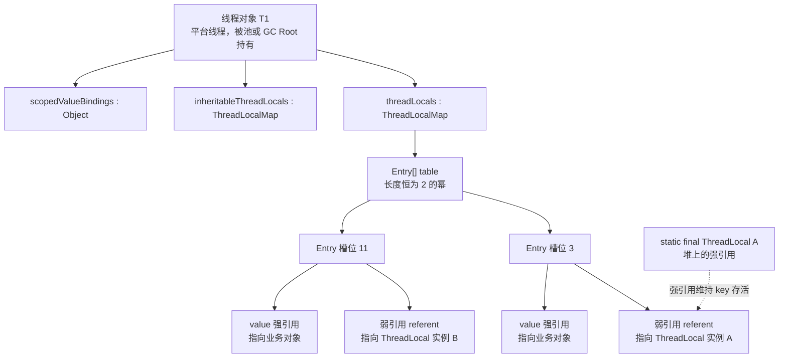
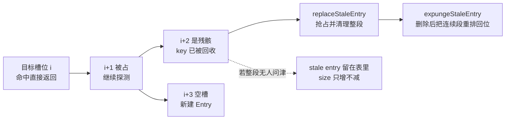
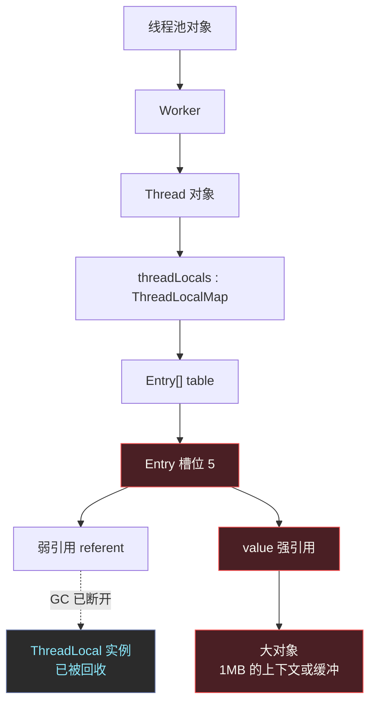
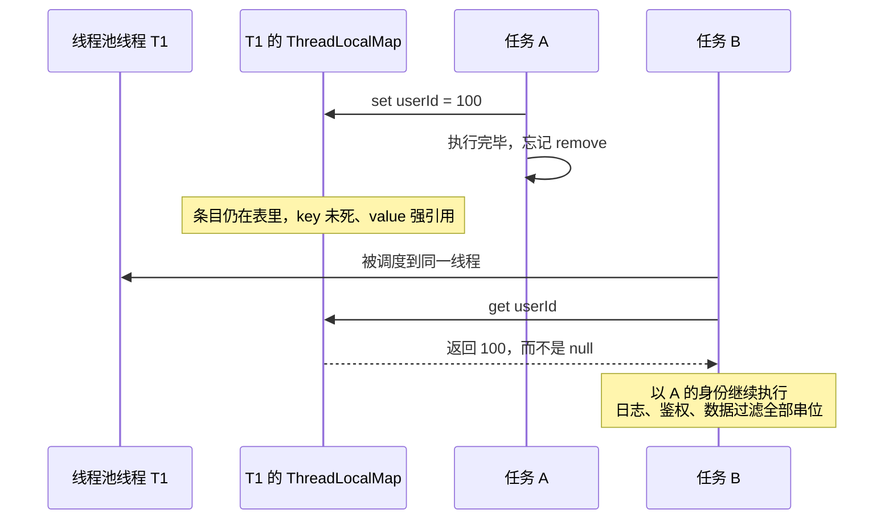
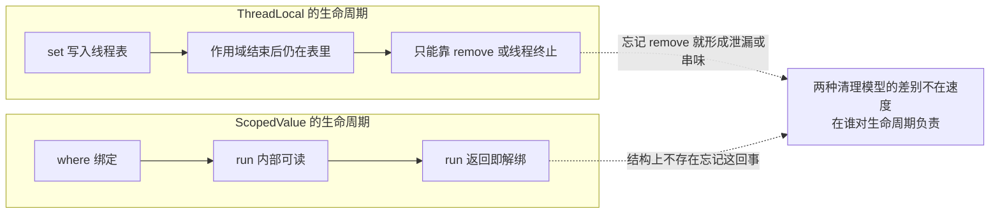

# 15 ThreadLocal 的实现原理与内存泄漏——线程封闭的正确姿势

**摘要：**

`ThreadLocal` 常被讲成“每个线程各有一份的变量”，这个比喻会把它的成本、失效条件和清理时机同时算错。按它本来的样子看——一张挂在 `Thread` 对象上的私有哈希表，`ThreadLocal` 实例只是这张表的 key——大部分行为可以逐条推出来：表在线程对象里，所以访问天然无竞争；key 是弱引用而 value 是强引用，所以回收的是 key、留下的是 value；清理寄生在 `get`/`set`/`remove` 的顺带探测里，所以不调用就不清理；表与线程同寿，所以线程池里上一轮任务的值会被下一轮任务读到。本文沿这条结构线索走四段路：先拆 `ThreadLocalMap` 的开放寻址、`0x61c88647` 增量与三分之二的负载因子；再算清 stale entry 的四个清理入口各自的强度，以及“泄漏”与“串味”这两种后果的分野；然后看替代方案的演进，从 `InheritableThreadLocal` 的一次性复制，到 TTL 把捕获点挪到提交侧，再到 JDK 25 转正的 `ScopedValue` 用词法作用域取代替换清理；最后把 `ThreadLocalRandom`、虚拟线程下每线程一张表的字节账、堆快照里的三个特征和一份可执行的检查表补齐。

---

## 第 1 章 表挂在 Thread 上，ThreadLocal 只是索引

### 1.1 变量类比会同时算错四件事

把 `ThreadLocal<T>` 当成一个 `T` 类型的变量，会连续踩四个坑，且这四个坑彼此关联：值存在哪里、谁持有它、它什么时候消失、它为什么不需要同步。变量的答案分别是“栈上或堆上有一个地址”“我的作用域持有它”“离开作用域就没了”“靠锁或 `volatile`”。`ThreadLocal` 对这四问的答案一条都不重合。

它没有自己的存储。`get()` 做的是两次间接寻址：先取 `Thread.currentThread()`，再从那个线程对象上取一张表，最后拿 `this` 当 key 去表里查。`set()` 只是往那张表里写一个键值对。也就是说，`ThreadLocal` 实例更像一个索引、一个句柄，或者数据库里的一列列名——它描述“取哪一格”，但从不存放格子里的事物。

这个视角一旦立住，很多原本要靠记忆的结论就变成推论。表在线程对象里，所以两个线程访问同一个 `ThreadLocal` 时，它们操作的其实是两张不同的表，根本没有共享的可变状态，也就不需要任何同步；表随线程对象存活，所以线程不死，表里的一切都不会自动消失；`ThreadLocal` 只是 key，所以它自己的死活与值的死活是两件可以分开的事——这正是后面所有泄漏讨论的根源。

有个细节容易被“表在线程里”这句话带偏：`ThreadLocal` 实例在堆上，`ThreadLocalMap` 也在堆上，两者的区别只在引用关系——表被线程对象引用，`ThreadLocal` 实例被静态字段引用。说“表在线程里”描述的是可达路径，不是内存布局；这决定了后面讲可达性时，GC Root 是线程对象，而不是 `ThreadLocal`。

### 1.2 Thread 的两个字段与一次 get 的完整路径

JDK 21 的 `Thread` 里有三个与本文相关的字段：前两个是包级可见，第三个是 `private`，三个都不是 `volatile`：

```java
// java.lang.Thread（JDK 21，节选）
ThreadLocal.ThreadLocalMap threadLocals;            // 普通线程本地变量
ThreadLocal.ThreadLocalMap inheritableThreadLocals; // 可继承的线程本地变量
private Object scopedValueBindings;                 // ScopedValue 的绑定，JDK 21 新增
```

这两个字段不声明 `volatile` 并非疏漏：它们按约定只由所属线程自己读写，没有跨线程发布的语义需求。JDK 内部偶尔会踩这条边界，譬如 `ThreadLocalRandom.eraseThreadLocals(Thread)` 用 `Unsafe.putReference` 直接清空别的线程的这两个字段，那是库代码对自己的约束，不是给应用代码开的门。

一次命中的 `get()` 只走两跳。第一步 `getMap(t)` 返回 `t.threadLocals`，为空就直接进入初始化；不为空则调用 `map.getEntry(this)`，先用 `threadLocalHashCode & (table.length - 1)` 算出槽位，命中就返回。源码注释写明这个方法是刻意做成“便于内联”的形状，热路径上它会被 JIT 展平成一串字段读取与一次数组访问，快得几乎看不出是一次哈希查找。

未命中才转入 `getEntryAfterMiss`，顺着线性探测往后走；整条探测链走空则返回 `null`，由外层调用 `setInitialValue()`：先算 `initialValue()`，再决定是 `createMap(t, value)` 建表还是 `map.set(this, value)` 写入。表是懒建的，一个线程只要没用过任何 `ThreadLocal`，它的 `threadLocals` 就一直是 `null`，这是后面算内存账时容易漏掉的一个前提。



图里那条虚线是整个设计的关键：`ThreadLocal` 实例的存活由外部强引用决定，而不是由表决定。表对 key 只有一条弱引用，对 value 却是一条实打实的强引用。

### 1.3 为什么不能反过来挂

反过来设计——让 `ThreadLocal` 内部持有一个 `Map<Thread, T>`——曾经是很多人的第一直觉，它在三个地方会立刻付出代价。

第一笔是并发。这张 `Map` 变成了所有线程的共同写点，`get` 和 `set` 都必须走同步或 CAS，于是“消除共享状态”的初衷被自己破坏，工具本身成了新的竞争热点。第二笔是生命周期。线程退出时，`ThreadLocal` 需要知道有哪些线程在用自己、并把对应条目删掉，这要求线程死亡路径上有回调，而 `Thread` 的退出路径并不认识业务侧的 `ThreadLocal` 对象。第三笔最隐蔽：既然 `ThreadLocal` 持有所有线程的值，那么一个长期存活的 `static` 字段就会把所有用过它的线程的值一起钉死，连弱引用这种兜底手段都没有——因为 key 恰恰是被强引用的那一端。

把表放进线程对象，这三笔账同时被勾销：每个线程只碰自己的表，不需要同步；线程对象成为垃圾时表随之消失，不需要回调；弱引用放在 key 上还能让 `ThreadLocal` 实例先走一步。代价则被挪到了另一个维度——表与线程同寿，于是“什么时候清理表里的条目”变成了使用者的责任。可以说 `ThreadLocal` 用一次生命周期上的耦合，换掉了全部同步开销。

### 1.4 结构定下的四条推论

| 结构事实 | 直接推论 | 失效时的表现 |
| :--- | :--- | :--- |
| 表在 `Thread` 对象里 | 访问天然无竞争，无需任何同步 | 无失效；这是它唯一没有代价的部分 |
| key 是 `ThreadLocal` 的弱引用 | `ThreadLocal` 实例可被单独回收 | key 死了 value 还活着，形成 stale entry |
| value 是强引用 | 只要表可达，值就一定可达 | 大对象随线程寿命滞留，堆快照里表现为“合法可达” |
| 清理寄生在 `get`/`set`/`remove` | 不调用这三个方法就不会清理 | 长期不用的表里 stale entry 越积越多 |

这四行是本文其余内容的索引。后面每一章做的，都是把其中一行往源码层面推一步，再看它在工程里长成什么形状。

---

## 第 2 章 ThreadLocalMap 的形状：开放寻址、黄金分割与三分之二

### 2.1 Entry 继承了什么

`ThreadLocalMap` 是 `ThreadLocal` 的静态嵌套类，`Thread` 才能直接声明 `ThreadLocal.ThreadLocalMap` 类型的字段；`Entry` 是它的静态嵌套类，关键在那一行 `extends WeakReference<ThreadLocal<?>>`：

```java
// java.lang.ThreadLocal.ThreadLocalMap（JDK 21）
static class Entry extends WeakReference<ThreadLocal<?>> {
    Object value;                       // 强引用，GC 不背这个锅

    Entry(ThreadLocal<?> k, Object v) {
        super(k);                       // referent 字段存放 ThreadLocal
        value = v;
    }
}
```

把 key 放进 `Reference.referent` 而不是普通字段，省下的是“自己维护一条弱引用再加一个指向它的字段”这种两跳结构，代价是 `Entry` 与 `Reference` 的字段布局绑死。一个 `Entry` 在 64 位、压缩指针开启的堆上大约占 32 字节：对象头 12 字节，`Reference` 自带的 `referent`、`queue`、`next`、`discovered` 四个字段 16 字节，再加 `value` 引用 4 字节。后文算内存账时按这个数走。

JDK 21 在这里还有一处容易被忽略的改写：判断 key 是否还存在，不再写 `e.get() == null`，而是 `e.refersTo(null)`。`Reference.get()` 的文档明确提示它返回的是强引用，可能让 GC 把 referent 当作强可达、推迟到下一轮才回收，并建议用 `ref.refersTo(obj)` 代替 `ref.get() == obj`。`ThreadLocalMap` 的探测过程中会反复检查 key 是否已被回收，若每次都用 `get()`，等于一边探测一边给待回收的 `ThreadLocal` 续命。`refersTo` 是 JDK 16 加进来的方法，语义就是“referent 现在还是不是我给的那个对象”，用它才没有这层副作用。

### 2.2 为什么是线性探测而不是链表

`HashMap` 用拉链法，桶里挂链表或红黑树；`ThreadLocalMap` 用开放寻址，冲突了就往后找下一个空槽。选择的分野在预期规模：一个线程用到的 `ThreadLocal` 通常只有几个到十几个，而 `HashMap` 想装几十个元素也要开出 16 个桶的数组、每个桶还可能带节点对象。开放寻址把所有条目放在同一个连续数组里，探测时命中缓存，没有额外的节点分配，内存与访问都更省。

代价有两处。删除变麻烦：拉链法摘链即可，开放寻址删掉一个槽会在探测链上留一个洞，让后面的条目“回不去”，所以 `expungeStaleEntry` 删完必须把它到下一个空槽之间的所有条目重新散列一遍。另一处是探测链长度随负载上升，聚簇会把查询拖成线性扫描，这也是负载因子被压到三分之二的原因。

| 维度 | `HashMap` | `ThreadLocalMap` |
| :--- | :--- | :--- |
| 冲突处理 | 拉链法，桶内链表或红黑树 | 线性探测，冲突留在数组里 |
| 初始容量 | 16，构造可指定 | 16，首次写入时懒建 |
| 负载因子 | 0.75 | 2/3 |
| 删除 | 摘链或缩树，局部修改 | 删除后需重排连续段 |
| 扩容 | 翻倍并高低位拆分 | 翻倍，先全量清 stale 再逐个重排 |
| 预期规模 | 数十到数百万 | 单个线程个位数到几十 |
| 哈希来源 | key 的 `hashCode()` 再扰动 | 构造时分配的 `threadLocalHashCode` |

表里“哈希来源”一行的差别常被低估：`HashMap` 依赖使用者实现 `hashCode`，`ThreadLocalMap` 的哈希在构造时由 JDK 统一发放，使用者无法干预，因此它可以把分布性质直接设计进发放策略里。

### 2.3 0x61c88647 与连续构造的 ThreadLocal

```java
// java.lang.ThreadLocal
private final int threadLocalHashCode = nextHashCode();
private static final AtomicInteger nextHashCode = new AtomicInteger();
private static final int HASH_INCREMENT = 0x61c88647;

private static int nextHashCode() {
    return nextHashCode.getAndAdd(HASH_INCREMENT);
}
```

`0x61c88647` 等于 `2^32` 减去 `0x9e3779b9`，而 `0x9e3779b9` 正是黄金比例常数 `2^32 / φ` 的整数近似。用递增的黄金比数列去乘散列，等价于在单位圆周上按黄金角跳步，任意前缀的点都近似均匀分布，这就是 Knuth 所说的斐波那契散列。源码注释对此的表述是：把原本连续的 thread-local 编号，转换成对 2 的幂长度表“接近最优分散”的乘法散列值。

有一个可以手算的推论：`0x61c88647` 的最低位是 7，为奇数，于是它与任何 2 的幂都互质。表长 16 时，连续构造的 `ThreadLocal` 会落在槽 0、7、14、5、12、3、10、1、8、15、6、13、4、11、2、9，走满 16 个槽才回到 0；表长 32、64 时同理，只是循环更长。这意味着只要同一个线程创建的 `ThreadLocal` 数量不超过表长，几乎不会发生冲突——不是概率上的“很少”，而是**构造性的不发生**。这也解释了一个常见的观察：绝大多数应用里 `ThreadLocalMap` 的探测链长度是 1。

不过这个性质只对“顺序创建”成立。若 `ThreadLocal` 在多个线程里被零散创建，全局计数器仍然按黄金比跳步发放，但落到某一张具体表里的槽位是否冲突，就要看运气了；真正的保护来自后面那条“2/3 阈值加全量清理”的扩容路径。

### 2.4 一次 set 的三条分支

```java
// ThreadLocalMap.set，JDK 21 节选；注释解释为什么没有快路径
private void set(ThreadLocal<?> key, Object value) {
    Entry[] tab = table;
    int len = tab.length;
    int i = key.threadLocalHashCode & (len - 1);
    for (Entry e = tab[i]; e != null; e = tab[i = nextIndex(i, len)]) {
        if (e.refersTo(key)) {          // 命中：只换值
            e.value = value;
            return;
        }
        if (e.refersTo(null)) {         // 撞上 stale entry：抢占并顺手清整段
            replaceStaleEntry(key, value, i);
            return;
        }
    }
    tab[i] = new Entry(key, value);     // 落在空槽
    int sz = ++size;
    if (!cleanSomeSlots(i, sz) && sz >= threshold)
        rehash();
}
```

三条分支对应三种状态：命中、撞上残骸、落在空位。源码注释专门解释为什么不给 `set` 加一条类似 `get` 的快路径——因为用 `set` 新建条目的频率不低于替换已有条目，快路径失败的概率太高，不如统一走探测循环。

撞上残骸时调用的 `replaceStaleEntry` 是整个类里最讲究的方法。它先向 `prevIndex` 方向回扫，找同一段探测链里更靠前的残骸，再向前扫描找目标 key：找到就把目标条目搬进残骸的槽位、把残骸搬到目标位置，然后从“更靠前的残骸”开始清理；找不到就直接占用残骸槽位。这种“整段清理”的动机写在注释里——避免 GC 批量清除引用之后，插入操作被一次又一次的增量重排拖成连续的小停顿。

新建条目之后还有一步容易被略过：`cleanSomeSlots(i, sz)` 做的是对数级扫描，从新槽位往后探 `log2(size)` 个槽位，若中途发现残骸则把扫描预算重置为表长，再扫 `log2(len) - 1` 个。它返回是否清理过东西，只有“没清理出空位且 size 已过阈值”时才真正触发 `rehash()`。



图里那条虚线标出了本章与下一章的交界：残骸不是错误状态，而是一种正常存在、只能被顺手机会清理的状态。

### 2.5 容量、阈值与扩容：先清再翻倍

初始容量固定 16，阈值是 `len * 2 / 3`，两次扩容之间按 2 的幂翻倍。扩容入口 `rehash()` 的两步顺序值得留意：

```java
private void rehash() {
    expungeStaleEntries();                        // 先全表扫一遍残骸
    // 清完之后仍接近阈值才真的翻倍，避免“刚清完又扩”的抖动
    if (size >= threshold - threshold / 4)
        resize();
}
```

`expungeStaleEntries` 是唯一一处全量扫描，它遍历整张表、对每个 key 为 `null` 的槽位调用 `expungeStaleEntry`。扩容本身把旧表逐槽重排进新表，遇到残骸顺手把 `value` 置 `null` 帮 GC 一把，并把 `size` 修正为真实存活条目数。

这套机制的效果是：只要线程还在持续使用 `ThreadLocal`，表就不会被残骸撑爆——因为塞满到阈值时一定会先全量清理，清出来仍不够才翻倍。十六个槽位对应十几个 `ThreadLocal` 是常见配置；若某个线程真的用了几十个，表长会顺利涨到 64、128，每次翻倍都是一次全量重排，成本仍然可以忽略。

### 2.6 冲突退化的边界

开放寻址的退化不是“变慢一点”，而是有明确形状的。探测链越长，一次未命中的 `get` 要读的槽位越多；更麻烦的是残骸在链中间形成的“虚假占位”——它们已经不指向任何 `ThreadLocal`，却仍然占着槽位，把后面的条目挤得更远，也让 `size` 虚高、提前触发扩容。

两种用法会把退化推到极端。第一种是每次调用都 `new ThreadLocal`：全局计数器永不回退，每个新实例拿到一个新的哈希值，于是表里条目数随调用次数线性增长，而每个条目在下一轮就可能变成残骸；表被撑大、扩容频繁、探测链变长，三者同时发生。第二种是把 `ThreadLocal` 当成注册表使用，一个线程里挂上几十上百个实例，这时候表长会被迫拉到 256 以上，单次访问的缓存局部性优势也随之消失。

反过来看，正常用法下这张表的规模小得可怜：一个线程十几条，表长 16 到 32，探测链长度 1 到 2。讨论性能时若脱离这个规模，很容易得出“开放寻址比拉链法差”的错判——它差的是最坏情况，赢的是常态。

---

## 第 3 章 弱引用 key：它解决的与它没解决的

### 3.1 反事实：key 若是强引用

假设 `Entry` 用普通字段强引用 `ThreadLocal`，那么只要线程活着、表里还有这个条目，`ThreadLocal` 实例就永远不可回收。这在两种场景里立刻变成事故。其一是热部署：Web 容器重载应用时，旧应用的类加载器本应被整体回收，但只要线程池里某个线程的表还攥着一个旧应用里的 `ThreadLocal` 实例，那条引用就顺着 `ThreadLocal` 的类、类的定义、类加载器一路钉住，整个旧应用都卸载不掉，`Metaspace` 持续上涨。其二是临时创建：方法里 `new ThreadLocal` 用完即弃，若 key 强引用，这个实例就永久留在表里，连同它的 value。

弱引用把这条链剪断：GC 发现 `ThreadLocal` 实例除了 `Entry.referent` 这条弱引用之外再无强引用，就清掉 referent，槽位变成“key 为 `null` 的残骸”。`ThreadLocal` 实例、它引用的类、类加载器，都可以走了。

### 3.2 弱引用到底给了什么

只给了一件事：**`ThreadLocal` 实例本身可以被回收**。它没有、也无法处理 value 的可达性。`ThreadLocal` 的类文档把这个边界写得很直白——每个线程对它的副本持有一条隐式引用，“只要线程还活着且 `ThreadLocal` 实例可访问”；线程消失之后，这些副本才“在没有其他引用的情况下”变得可回收。最后那个限定语正是漏洞所在：value 就在表里，表就在线程里，这条引用一直都在。

于是要分清两个截然不同的对象：`ThreadLocal` 实例的死活，由外部强引用（通常是 `static final` 字段）决定；value 的死活，由它所在的 `Entry` 与表是否可达决定。弱引用只管前者，后者从来没人管。

### 3.3 泄漏的真实形态是 value

把引用链画全，问题就一目了然：线程池的 `Worker` 引用线程对象，线程对象持有 `threadLocals`，表持有 `Entry[]`，`Entry` 强引用 value。这条链上没有任何一环是弱的，除了 `Entry.referent`。GC 清掉 referent 之后，`Entry` 仍然在表里，`value` 仍然被强引用，整条链依旧成立。



红色那三个节点是泄漏的实际内容：残骸 `Entry`、它强引用的 value，以及 value 能带到的整棵对象图。被回收的 `ThreadLocal` 实例反而是唯一干净退场的那一个。所以“`ThreadLocal` 内存泄漏”这个说法在指向上是错的——泄漏的主体是 value，`ThreadLocal` 只是被回收掉的索引。

这个错位会直接误导排查。按“泄漏 `ThreadLocal`”去查，会在堆里数 `ThreadLocal` 实例个数，得到的结论往往是“只有十几个，不像泄漏”；正确的做法是数 `Entry`、看 `Entry.value` 的类型构成，以及看 `table` 里 key 为 `null` 的槽位占了多少。笔者建议把顺序固定下来：先看残骸占比，再看 value 类型，最后才回头找是哪个 `ThreadLocal`。

### 3.4 两种形态：静态字段持有与每次新建

实际事故里，泄漏分两种，成因相反。

第一种是 `static final ThreadLocal` 配大 value。这种写法下 key 永不回收，条目永远是“活”的，堆快照里根本看不到残骸，看起来完全健康。但 value 一直挂在表里，只要线程不退出，它就一直在堆上。严格说这不是“弱引用没兜住”，而是“有意或无意地把 value 的生命周期绑到了线程上”；判断它是否算泄漏，要看业务上是否还需要这个值。譬如把一个 1MB 的请求体放进 `ThreadLocal` 做链路透传，请求结束后忘了 `remove`，那么这 1MB 就是一条一条挂在线程上的。

第二种是临时或每次新建 `ThreadLocal`。key 很快被回收，残骸出现，value 被挂住，条目数只增不减，表被撑大。这种形态在堆快照里特征最典型：`Entry[]` 数组长度远大于该线程实际在用的 `ThreadLocal` 数量，且表里大量槽位的 referent 是 `null`。

两种形态的清理手段其实一样——`remove()`，或者让线程退出。差别在于第一种形态连“残骸会自清”这条机会路径都没有：只要没有新条目插入触发 `cleanSomeSlots`，一个永远不会变成残骸的条目也不会被任何清理逻辑碰到。

### 3.5 四个顺带清理的入口

| 入口 | 触发条件 | 扫描范围 | 清理强度 |
| :--- | :--- | :--- | :--- |
| `getEntryAfterMiss` | 未命中且向后探测 | 单条探测链，逐个槽位 | 遇到残骸就删一个并重排该段 |
| `replaceStaleEntry` | `set` 撞上残骸 | 当前探测段的前后两端 | 清理整段，含回扫发现的更早残骸 |
| `cleanSomeSlots` | 每次新建条目后 | `log2(size)` 个槽位，发现残骸则加倍 | 对数级的“抽样清理” |
| `expungeStaleEntries` | `rehash()` 触发扩容判断前 | 整张表 | 全量清理，只此一处 |

这四者的共同点是“寄生”：都不由使用者直接调用，都挂在别的操作上。强度最高的是 `expungeStaleEntries`，但它只在 `set` 把表填到阈值附近时才被触发；`get` 路径上的清理只在探测链里遇到残骸时发生；`remove` 最精确，只清一个 key，但它取决于使用者是否记得调用。

### 3.6 不调用就不清理

“不调用就不清理”这句话有两个层次，必须分清。

层次一是只在 `set` 场景下，清理仍然会以粗粒度的方式发生：表填到三分之二阈值，`rehash()` 全量清一遍。所以“残骸导致无限膨胀”在持续写入的前提下并不成立，膨胀会被限制在一次翻倍的范围内。

层次二是若线程此后完全不再触碰这张表（不 `get`、不 `set`、不 `remove`），那么残骸就一直躺着，`value` 也一直活着，直到线程退出。这才是线程池场景的常态：任务 A 用过 `ThreadLocal` 之后，线程可能几个月都不再碰到它，而线程本身一直活着。清理的机会路径要求“再次使用”，泄漏的前提恰恰是“不再使用”。

---

## 第 4 章 线程池：从内存泄漏到语义污染

### 4.1 线程活多久，表就活多久

`Thread` 对象在 JVM 里是 GC Root 的一个分支：它被 `ThreadPoolExecutor` 的 `workers` 集合引用，池被应用的单例引用，于是这条链从应用启动一直通到堆底。核心线程默认不会超时退出，`allowCoreThreadTimeOut(false)` 是默认值；即便打开，线程在空闲超时前也活得很久。表挂在这样的对象上，寿命自然等同于池的寿命。

线程正常终止时，JDK 其实给了最彻底的清理：`Thread.exit()` 会先给注册过的 `TerminatingThreadLocal` 一次线程终止回调，再调用 `clearReferences()`，把 `threadLocals` 与 `inheritableThreadLocals` 直接置 `null`。这一步不需要任何 `remove`，因为线程对象即将成为垃圾，表随之消失。

问题恰好在于：线程池的设计目的就是不让线程终止。一次性的 `new Thread(…).start()` 里，忘记 `remove` 的代价接近于零；同一个写法放进池里，代价就被放大到“每次任务都可能留下一个永久驻留的值”。这也是为什么同一段代码在单元测试里干净、在生产里漏——测试里往往每个用例新建线程。

### 4.2 泄漏的量化

先算固定开销。某线程第一次 `set` 一个 `ThreadLocal` 时，会分配一个 `ThreadLocalMap`（对象头 12 字节加三个字段 12 字节，对齐到 24 字节）、一个长度 16 的 `Entry[]`（16 字节数组头加 16 个 4 字节引用，共 80 字节）和一个 `Entry`（约 32 字节），合计约 136 字节。两百个核心线程各挂一个 `ThreadLocal`，不过 27KB，可以忽略。

真正的大头是 value 与条目增长。做一段示例推算：设某接口 1000 QPS，某段代码每次调用都 `new ThreadLocal<byte[]>()` 并把 1KB 的上下文写进去，忘了 `remove`。一秒产生 1000 个新条目，每个条目至少 32 字节的 `Entry` 加 1KB 的 value，一小时约 360 万条目、约 3.6GB 的 value，还没算表被撑到 2^k 之后的数组本身。这个例子是推算而非实测，但量级足够说明问题：泄漏速率由“调用频率 × 单个 value 大小”决定，与线程数无关；而“什么时候 OOM”由堆大小与 GC 策略决定。

若是 `static final ThreadLocal` 配固定大小的大对象，泄漏量则是“线程数 × value 大小”。两百线程各挂 1MB，就是 200MB；这个数字看起来温和，但它不会随 GC 波动，会一直占着老年代，把 Full GC 的间隔一步步压短。

### 4.3 比泄漏更严重的串味

内存泄漏还可以用扩容、重启、调堆参数拖时间；串味不行，它直接产出错误结果。一句话概括两者的分量：**泄漏是慢，串味是错**。

线程池里的线程是复用的。任务 A 在 T1 上把 `userId = 100` 写进 `ThreadLocal`，任务结束后没有清理；任务 B 被调度到 T1，`get()` 读到的不是 `null`，而是 100。若这个值参与鉴权判断，B 就可能以 A 的身份执行；若参与数据过滤，B 就可能读到 A 的租户数据。这类缺陷的可怕之处在于复现条件苛刻——只有在“A 与 B 恰好落在同一线程、且 A 的清理被漏掉”时才出现，压测与灰度都可能漏过。



更隐蔽的一种串味发生在“值为 `null` 与值不存在”的混淆上。`ThreadLocal.get()` 在没有条目时会调用 `initialValue()`，默认返回 `null`，于是“上一任务的残留值”和“本任务还没设置”在代码里长得完全一样——只有 `get()` 返回非 `null` 时才暴露，返回 `null` 时反而什么都看不出来。若某个框架把 `null` 当作“未登录”处理，串味就变成了一次静默的降级。

### 4.4 remove 必须落在 finally

正确写法的骨架只有几行，但细节都在“作用域”上：

```java
private static final ThreadLocal<Context> CTX = new ThreadLocal<>();

void handle(Request req) {
    CTX.set(buildContext(req));
    try {
        doBusiness(req);          // 任何抛异常的位置都在 try 内
    } finally {
        CTX.remove();             // 与 set 同一层作用域，必然执行
    }
}
```

三个细节值得单独说。第一，`remove()` 不能写在 `try` 的成功分支里，因为异常路径才是最容易漏的那条。第二，`remove()` 与 `set()` 必须处在同一层方法作用域，跨方法“约定谁负责清”是事故的温床；如果 `set` 发生在拦截器、`remove` 发生在业务代码，那么任何一条绕过业务代码的路径都会漏。第三，如果任务内部派生异步操作，`finally` 只覆盖当前线程——异步那一段跑在别的线程上，那边的上下文要么显式传递，要么由那边的线程自己清理。

`remove()` 本身的实现是精确的：算出槽位、顺着探测链找到 `refersTo(key)` 的条目、`clear()` 掉弱引用、再调 `expungeStaleEntry` 重排这一段。它不依赖 GC，也不依赖后续是否还有访问，是四个清理入口里唯一“确定性”的一个。

> [!warning] 评审口径
> 同一方法里 `set` 与 `remove` 不成对的代码，按缺陷记录而不是按代码风格问题记录；跨方法“约定谁负责清”的实现，即使当下能跑通，也要在评审中列出清理责任的归属。

### 4.5 框架层的兜底与它的漏洞

主流框架都在替使用者兜底，模式高度一致：把“设置”和“清理”放在同一个 `try/finally` 里，且位置尽可能靠近线程的入口。Servlet 过滤器是最典型的一层，Spring 的 `RequestContextHolder`、`TransactionSynchronizationManager`、安全上下文、日志框架的 MDC 走的都是这条路。

这些兜底有共同的盲区。一是异步化：Servlet 3.0 的异步请求、`CompletableFuture` 回调、响应式链路都会换线程，原线程的 `finally` 只清理原线程，新线程上设置的上下文没有人清。二是线程池包装的错觉：`TaskDecorator` 一类机制做的是“把提交线程的上下文搬到执行线程”，搬过去之后同样需要搬回来——它复制 `MDC` 之类的值，却不会在任务结束时把执行线程的表恢复原状，除非装饰器自己实现了这一步。三是“只在入口清”的不对称：过滤器在请求结束时清，但请求处理过程中若线程被借去做别的事（譬如日志异步 appender 内部再提交任务），借出去的这段时间里表的状态就不受过滤器管辖。

稳妥的姿态是不依赖任何一层的兜底：自己 `set` 的自己清，框架兜底只当作额外一层保险。

### 4.6 堆快照里的三个特征

真到了现场，判断“是不是 `ThreadLocal` 的问题”有三条快照特征。

| 特征 | 采集方式 | 判读 |
| :--- | :--- | :--- |
| `Entry` 与 `Entry[]` 的总量持续上涨 | `jmap -histo:live <pid>` 看 `java.lang.ThreadLocal$ThreadLocalMap$Entry` 与 `[Ljava.lang.ThreadLocal$ThreadLocalMap$Entry;` | 单看数量不够，要与业务 QPS、线程数一起看趋势 |
| 大量 key 为 `null` 的残骸 | MAT 的 OQL：`SELECT * FROM java.lang.ThreadLocal$ThreadLocalMap$Entry WHERE referent = null` | 占比高说明“创建频率高、清理频率低” |
| 单个线程的表远大于其实际用量 | MAT 里展开 `Thread` 的 `threadLocals` 字段，看 `table` 长度与 `size` | 表长 512 而该线程只用 3 个 `ThreadLocal`，基本可以定性 |

要特别注意 MAT 的 `Leak Suspects` 在这种场景下常常沉默。它按支配树与强可达性找“可疑的大块”，而挂在线程上的表从支配关系看是线程“合法持有”的结构，报告里往往看不到。有用的入口是手动展开 `Thread` 实例的 `threadLocals` 字段，或者用 OQL 筛残骸，再用 `Path to GC Roots` 并排除弱引用、软引用，确认这条链的尽头确实是一个长寿命的线程。Arthas 的 `vmtool`、`ognl` 可以在不停机的情况下取当前线程的 `threadLocals` 做抽样，适合先定位“是哪个线程、哪类 value”，再决定要不要抓全量堆。

`jdk.traceVirtualThreadLocals` 是另一条诊断线，只对虚拟线程有效：把它设为 `true`，虚拟线程每次写 `ThreadLocal` 都会打印一条带栈的轨迹。它的设计意图写在 JEP 444 里——帮助迁移时找出哪些代码还在用线程本地变量。

---

## 第 5 章 InheritableThreadLocal：继承发生在创建那一刻

### 5.1 一次复制，终身不同步

`ThreadLocal` 的值不会自动传给子线程，这一点符合“线程封闭”的语义，但链路追踪的 traceId、用户上下文这类数据确实需要跨线程。`InheritableThreadLocal` 是最早的答案，实现方式是把“传值”挪到线程的创建时刻：

```java
// java.lang.Thread 的构造路径，JDK 21（节选）
if (!attached && (characteristics & NO_INHERIT_THREAD_LOCALS) == 0) {
    ThreadLocal.ThreadLocalMap parentMap = parent.inheritableThreadLocals;
    if (parentMap != null && parentMap.size() > 0) {
        this.inheritableThreadLocals = ThreadLocal.createInheritedMap(parentMap);
    }
}
```

`createInheritedMap` 遍历父线程的 `inheritableThreadLocals`，对每个条目调用 `key.childValue(value)` 算出子线程应得的值，放进一张同长度的新表。注意复制发生在**父线程里、子线程启动之前**，所以子线程拿到的是“创建那一刻”的快照。

这决定了它的三个性质：只复制一次，父子之后各改各的，互不可见；复制是浅的，`childValue` 默认原样返回同一个引用，可变对象因此在父子线程间共享；继承的触发点只有线程构造，与任务提交无关。

### 5.2 childValue 的契约

`InheritableThreadLocal` 只覆写了两个方法——`getMap` 与 `createMap` 指向 `inheritableThreadLocals` 字段，真正的复制语义落在 `childValue(T parentValue)` 上，默认实现是 `return parentValue`。源码注释说得很清楚：这个方法在父线程里、子线程启动前被调用，若需要不同的行为就覆写它。

默认实现是浅复制，这个默认值在什么情况下是对的？当 value 不可变，或者子线程只读不写时，共享引用最省内存也最安全。一旦 value 可变，父子就共享同一份可变状态，子线程的修改会被父线程读到——这直接破坏了“线程封闭”，把 `InheritableThreadLocal` 变成了一个带隐式共享的全局变量。需要可变副本时，唯一的办法是覆写 `childValue` 做深拷贝，代价是每次创建线程都付一次拷贝成本。

### 5.3 池里为什么必然失效

线程池与 `InheritableThreadLocal` 的冲突是结构性的，不是配置问题。池里的线程在池初始化或扩容时被创建，此后一直复用；任务提交时不会 `new Thread`，自然不触发构造路径上的复制。于是三个后果依次出现：

第一次提交任务时，池可能刚好在扩容、新建了一个线程，那个线程的父线程是“当时正在创建它的那个线程”——很可能是提交任务的线程，于是这一次继承成功了。之后所有提交都落在已有线程上，继承不再发生，读到的要么是 `null`，要么是那个池线程在很久以前从某个父线程继承下来的旧值。这种**第一次对、后面错**的行为比彻底失败更难排查，因为测试用例往往只提交一两次任务。

更麻烦的是值的方向被搞反了。池线程的 `inheritableThreadLocals` 一旦在某次创建时被写入，就固化在那条线程上；后续任何任务看到的都是那一次的快照。若这个快照里带着某个用户的身份，那么该线程此后处理的每个任务都会带着这个身份——这正是串味的另一个版本，只不过入口从“忘记 `remove`”换成了“初始化时的偶然继承”。

### 5.4 JDK 21 之后：可选继承与虚拟线程

JDK 21 在这条路径上做了两处可见的改动。一是把“是否继承”变成了显式特性位 `NO_INHERIT_THREAD_LOCALS`，对应 API 是 `Thread.Builder.inheritInheritableThreadLocals(boolean)`，平台线程与虚拟线程的 builder 都提供这个方法；构造路径上的检查也从“父线程字段非空”收紧为“非空且 `size() > 0`”，省掉一次空表复制。

二是虚拟线程的默认值。`ThreadBuilders` 里两个 builder 的 `characteristics` 初始都是 0，`setInheritInheritableThreadLocals` 只在显式传入 `false` 时置位，因此 `Thread.ofVirtual()` 创建的虚拟线程默认继承 `InheritableThreadLocal`。这与“虚拟线程上线程本地变量要少用”的建议并不矛盾：默认继承是为了兼容既有库，不是鼓励拿它传递请求上下文。真要传，JEP 444 的建议是把每任务上下文改用 `ScopedValue`，后者在结构化并发的子线程里是共享绑定而不是复制值。

### 5.5 反例：靠它做跨池传递

最典型的错误用法，是在入口处 `set` 一个 `InheritableThreadLocal`，然后指望 `executor.submit` 之后任务里能读到。写出来的代码大致是：

```java
private static final InheritableThreadLocal<String> TRACE_ID = new InheritableThreadLocal<>();

void entry() {
    TRACE_ID.set(newTraceId());
    executor.submit(() -> {
        // 期望：读到本次请求的 traceId
        // 实际：null，或某次建线程时留下的旧值
        log(TRACE_ID.get());
    });
}
```

它偶尔能跑通，这让问题更隐蔽。正确的判断标准不是“我测过能读到”，而是“池里那个线程是不是本次提交时新建的”。把继承机制换成提交时捕获（下一章）才能得到与线程创建历史无关的行为。

---

## 第 6 章 TransmittableThreadLocal：把捕获点挪到提交侧

### 6.1 一个显式的三段式

既然继承的时机是错的，那就在正确的时机手工做一次。TTL（`TransmittableThreadLocal`，阿里开源，当前版本 2.14.5）的全部设计可以压成三段：在**任务提交时**捕获提交线程当前的上下文快照，在**任务执行前**把快照灌进执行线程，在**任务结束后**把执行线程恢复原状。

它继承自 `InheritableThreadLocal`，因此值本身仍存放在线程的 `inheritableThreadLocals` 表里；真正新增的是第二张表——一份“本线程有哪些 TTL 实例处于活跃状态”的名册：

```java
// TTL 2.14.5 的核心结构（简化）：WeakHashMap 被当作 Set 用，value 恒为 null
private static final InheritableThreadLocal<WeakHashMap<TransmittableThreadLocal<Object>, ?>>
        holder = new InheritableThreadLocal<>() {
            protected WeakHashMap<TransmittableThreadLocal<Object>, ?> initialValue() {
                return new WeakHashMap<>();
            }
            protected WeakHashMap<TransmittableThreadLocal<Object>, ?> childValue(...) {
                return new WeakHashMap<>(parentValue);   // 只复制名册，值交给 inheritableThreadLocals 常规继承
            }
        };
```

名册的键是 TTL 实例，值恒为 `null`，只用来回答“这个实例在该线程上有没有值”；`WeakHashMap` 的弱键让实例被回收后条目可以自动消失，这是 `ThreadLocalMap` 那套弱引用思路在另一处实现上的复用。有了名册，`capture` 才能遍历出“当前线程可见的全部 TTL”而不必扫整张 `ThreadLocalMap`；也正因为值仍走 `inheritableThreadLocals`，`replay` 与 `restore` 要同时维护两张表的一致性。

### 6.2 capture / replay / restore

```java
// 包装任务的骨架（概念性代码，对应 TTL 2.14.5 的 TransmittableThreadLocal.Transmitter）
class TtlRunnable implements Runnable {
    private final Runnable task;
    private final Object captured;

    TtlRunnable(Runnable task) {
        this.task = task;
        this.captured = Transmitter.capture();   // 在提交线程执行
    }

    public void run() {
        Object backup = Transmitter.replay(captured);   // 覆盖执行线程的上下文
        try {
            task.run();
        } finally {
            Transmitter.restore(backup);                // 恢复执行线程原本的上下文
        }
    }
}
```

`replay` 返回的是 backup，而不是简单清空，这是整个设计里最容易被忽略的一处。执行线程上原本可能有它自己的上下文（譬如池线程自己也是某个任务的执行者，或者上层已经 replay 过一次），`restore` 必须把那些值放回去，而不是把它们抹掉。这种“先备份再恢复”的形状让它天然支持嵌套：两层包装各自维护自己的 backup，最内层退出后外层仍然完好。

`capture` 的采集口径是“当前线程可见的全部 TTL 值”，包含本线程 `set` 的、以及从父线程继承来的。因此捕获点必须放在提交线程里——写在任务体里就变成“执行线程自己捕获自己”，毫无意义。

### 6.3 三种接法与各自代价

| 接法 | 写法 | 优点 | 代价 |
| :--- | :--- | :--- | :--- |
| 手动包装 | `TtlRunnable.get(task)`、`TtlCallable.get(task)` | 无侵入配置，粒度可控 | 每个提交点都要记得包，容易漏 |
| 包装执行器 | `TtlExecutors.getTtlExecutorService(executor)` | 一次包装全局生效 | 必须把所有提交入口都经过这个包装对象 |
| Java Agent | 启动参数加 `-javaagent:transmittable-thread-local-x.x.x.jar` | 对业务代码零侵入 | 依赖字节码增强，启动参数与类加载行为相关 |

手动包装的问题在“漏”，包装执行器的问题在“绕”——只要有一处代码把原始 `ExecutorService` 泄出去（譬如某个工具类直接持有原始引用），那条路径就失效。Agent 方式覆盖面最广，但引入了一层字节码增强，排查问题时需要记得它的存在。

### 6.4 四个边界

边界一，捕获时机是提交时，不是执行时。这对定时任务、延迟任务是天然正确的语义（想要的是“谁提交就用谁的上下文”），但对“执行时才有意义”的上下文（譬如依赖执行线程本地状态的东西）就会错。

边界二，嵌套线程池要每层都包。A 提交给池一、池一再提交给池二，两次提交都要捕获；如果只包最外层，池一里那次提交用的是池一线程的上下文，而池一线程的上下文恰好是上一次 replay 留下的快照——结果既不是 A 的，也不是空的。

边界三，它与普通 `ThreadLocal` 不互通。TTL 只管自己这个家族，`ThreadLocal` 里的值不会被捕获；两者混用时，被捕获的只有一半。这种“一半对”的状态最难查。

边界四，TTL 只对“读上下文”这件事兜底。`replay` 覆盖的是进入时的状态，任务体里对 TTL 新写的值会在 `restore` 时被覆盖回去，所以它适合单向透传，不适合把 TTL 当任务内部的临时存储；捕获的快照本身由包装对象持有，任务对象被池丢弃之后才释放。

| 维度 | `ThreadLocal` | `InheritableThreadLocal` | TTL | `ScopedValue` |
| :--- | :--- | :--- | :--- | :--- |
| 值存放位置 | 线程的 `threadLocals` 表 | 线程的 `inheritableThreadLocals` 表 | `inheritableThreadLocals` 表加实例名册 | 线程上的绑定对象 |
| 跨线程传递 | 不支持 | 仅线程创建时复制一次 | 提交时捕获、执行前回放 | 仅结构化并发子线程共享 |
| 线程池可用 | 需要自己 `remove` | 结构上不可靠 | 是，需包装提交入口 | 现版本不支持普通线程池 |
| 谁负责清理 | 使用者 | 线程终止或使用者 | `restore` 加使用者 | 作用域结束自动解绑 |
| 值是否可变 | 可变 | 可变，浅复制 | 可变 | 绑定不可变 |
| 版本口径 | JDK 1.2 起 | JDK 1.2 起 | 第三方 2.14.5 | JDK 25 正式 |

---

## 第 7 章 ScopedValue：让忘记 remove 写不出来

### 7.1 从孵化到 JDK 25 转正

`ScopedValue` 从孵化到转正走了两年半、前后六个 JEP：JDK 20 以 JEP 429 孵化，JDK 21 以 JEP 446 进入预览，此后 JDK 22 的 JEP 464、JDK 23 的 JEP 481、JDK 24 的 JEP 487 各改一版，最终由 JDK 25 的 JEP 506 转正，随 JDK 25 在 2025 年 9 月 16 日 GA。因此“JDK 21 引入 `ScopedValue`”这个说法只对一半：21 里它存在，但是预览特性，要加 `--enable-preview` 才能编译；API 的形状也在这几轮里改过（`orElse` 在 JDK 25 里不再接受 `null` 参数）。

它的定位不是“更好的 `ThreadLocal`”。JEP 506 的非目标写得很清楚：不要求迁移离开线程本地变量，也不废弃 `ThreadLocal`。它要解决的是另一类需求——**单向、不可变、生命周期有界**的数据传递。

### 7.2 结构上的三处不同

```java
static final ScopedValue<FrameworkContext> CONTEXT = ScopedValue.newInstance();

void serve(Request req) {
    var ctx = buildContext(req);
    ScopedValue.where(CONTEXT, ctx)                 // 绑定，不是写入
             .run(() -> application.handle(req));   // 作用域结束即解绑
}

void readKey(String key) {
    var ctx = CONTEXT.get();                        // 只能读到绑定值
    // ...
}
```

第一处不同是没有 `set`。`where(...)` 产生一个 `Carrier`，`run` 或 `call` 在它的作用域内执行一段代码，绑定只在这段代码的直接与间接调用中可见；`run` 返回，绑定消失。想改值只能再嵌一层 `where`，而嵌套绑定对外层不可见——`bar` 里重新绑定 `X` 只影响 `bar` 调用的 `baz`，`bar` 自己读到的仍是外层值。

第二处不同是继承不需要复制。结构化并发（JEP 505，JDK 25 仍是第五版预览）里 `StructuredTaskScope.fork` 出的子线程，直接共享父线程已经建立的绑定；JEP 506 明确写了“不像线程本地变量那样复制父线程的值到子线程”。这正好击中 `InheritableThreadLocal` 与 `ThreadLocal` 的“昂贵继承”缺陷——百万虚拟线程各自复制一份上下文的开销被省掉了。

第三处不同是读取成本。绑定值放在线程对象的一个字段里（JDK 21 的 `Thread` 已经有 `scopedValueBindings` 字段），`get` 是一次字段读取加一次比较，JEP 506 的说法是“常常与读一个局部变量一样快”。相比之下 `ThreadLocal.get` 要先取 map、再哈希、再探测。



### 7.3 为什么它天然不会泄漏

JEP 506 在动机部分把线程本地变量的缺陷归为三条：不可约束的可变性、无界的生命周期、昂贵的继承。`ScopedValue` 对着这三条逐一给出反义：绑定不可变（没有 `set`）、生命周期由词法作用域界定（`run` 的边界）、继承是共享而非复制。

其中第二条直接消灭了本文前半部分讨论的所有事故形态。“忘记 `remove`”在前两节里是使用者纪律问题，在 `ScopedValue` 里根本不存在这个动作——绑定的销毁由 `run` 的正常返回或异常抛出触发，不依赖任何一行用户代码。JEP 506 还解释了为什么不提供 `AutoCloseable` 版本：如果清理依赖用户调 `close`，那么在 `close` 之前抛出 `StackOverflowError` 之类的错误就会留下不一致状态，而函数式接口加作用域由运行时保证，即使在异常路径上也能维持这个不变量。

代价是表达力被收窄。数据只能从调用者流向被调用者，不能反向；值不可改，需要“改”就只能嵌套绑定；作用域之外读不到，也不能跨作用域保留。对于“请求上下文透传”这一类需求，收窄正好；对于“每个线程一个可变累加器”，它就不合适。

### 7.4 继承只对结构化并发开放

这是目前最实际的限制。`ScopedValue` 的绑定可以被 `StructuredTaskScope` 的子线程继承，但普通线程池不行。JEP 506 对此的解释是：`ForkJoinPool` 之类的传统线程管理类无法保证“从父作用域 fork 出的子线程一定在父线程离开作用域之前结束”，没有这个保证就无法界定绑定的有效范围。

换句话说，在 JDK 25 上，`ScopedValue` 替代不了 TTL 的核心场景——跨线程池传递请求上下文。想在池线程里读到父任务的绑定，仍然要走 TTL 那条“提交时捕获、执行前回放”的路。这一点在选型时经常被“新特性替代老方案”的叙事掩盖。

另外要记得结构化并发本身在 JDK 25 仍是预览（JEP 505 第五版），用它的代码要开 `--enable-preview`，生产上是否接受取决于团队的预览特性策略。

### 7.5 它替代不了的四类用法

第一类是双向通信。被调用方需要把结果回传给远端的调用者，`ScopedValue` 没有这个通道，只能靠返回值或显式参数。

第二类是缓存昂贵对象。JEP 506 自己举了 `SimpleDateFormat` 的例子：按线程缓存一个昂贵且可变的格式化器，是 `ThreadLocal` 的合理用法；它也顺带指出今天更该做的是换成不可变的 `DateTimeFormatter` 放进 `static final` 字段。JEP 506 借这个例子承认“每线程一份”的需求真实存在，且不总能靠作用域表达。

第三类是需要 `set` 的状态机。累加器、开关、可变上下文，这些语义要求值可以在线程内被多处改写，作用域模型不允许。

第四类是非结构化的线程池。前面说过，绑定传不过去。

### 7.6 迁移的姿态

对已有系统，理性的顺序是：先把“请求上下文透传”这类单向只读需求标记出来，评估是否有结构化并发的落点；能落地的，等结构化并发转正后改成 `ScopedValue`，落不了地的继续用 TTL。`ThreadLocal` 本身不必急着清退，JDK 25 没有任何废弃它的计划。

对新建系统，如果线程模型本来就是“一个请求一个虚拟线程、内部用结构化并发 fork”，那么从第一天起就该用 `ScopedValue` 而不是 `ThreadLocal`——这时候省下的不只是 `remove` 的纪律，还有百万线程各复制一份上下文的内存。

> [!info] 版本提醒
> `ScopedValue` 从 JDK 21 到 JDK 24 一直是预览 API，只有 JDK 25 起才是正式特性；读到把它写成“JDK 21 新特性”的资料时，先确认那一版讲的是预览还是转正后的形态。

---

## 第 8 章 ThreadLocalRandom：同样的思路，更省的落法

### 8.1 它连 Entry 都不要

`ThreadLocalRandom` 把“每线程一份状态”做到了另一个极端：不建表，不发 key，不分配 `Entry`，直接把三个字段挂在 `Thread` 对象上。

```java
// java.lang.Thread（JDK 21），注释原文为“exclusively managed by ThreadLocalRandom”
long threadLocalRandomSeed;          // 当前种子
int  threadLocalRandomProbe;         // 非零表示种子已初始化
int  threadLocalRandomSecondarySeed; // 二级种子，供内部临时用途
```

`ThreadLocalRandom` 的所有实例方法都通过 `Unsafe` 的字段偏移直接读写当前线程的这三个字段，`current()` 返回的只是同一个单例（`instance`），真正区分线程的是字段所在的对象。这是“表挂在线程上”这一思路的最短路径版本：既然要的都是线程私有，那就别建表，直接放字段。

### 8.2 三个字段与一次 localInit

```java
static final void localInit() {
    int p = probeGenerator.addAndGet(PROBE_INCREMENT);   // 0x9e3779b9
    int probe = (p == 0) ? 1 : p;                        // 0 是“未初始化”的哨兵，要跳过
    long seed = RandomSupport.mixMurmur64(seeder.getAndAdd(SEEDER_INCREMENT));
    Thread t = Thread.currentThread();
    U.putLong(t, SEED, seed);
    U.putInt(t, PROBE, probe);
}
```

`current()` 的路径只有一次字段读：`PROBE` 非零就直接返回单例，为零才调 `localInit`。初值靠两个静态原子生成器发放——一个按 `0x9e3779b9` 递增产生 probe，另一个按固定增量递增后做一次 Murmur64 混合产生 seed。用全局原子计数器生成“线程本地”的初值，看似矛盾，实则是为了保证不同线程的序列起点足够分散；这一步每线程只做一次，代价可以忽略。

取数的热路径是一次字段读写：`nextSeed()` 先算出 `seed + (threadId() << 1) + GOLDEN_GAMMA`，写回字段，再把刚算出的新值作为结果返回；没有 CAS，也不需要 CAS，因为这三个字段只有本线程会写。混入 `threadId` 是为了让不同线程的序列即使种子相近也不会同步。

### 8.3 为什么比 ThreadLocal 快

对比一下两条路径的长度。`ThreadLocal<Random>` 版本：取 `currentThread()`、取 `threadLocals` 字段、判空、算哈希、掩码取槽、比较 referent、读 value——七步，其中包含一次数组访问与一次引用比较。`ThreadLocalRandom` 版本：取 `currentThread()`、读 `PROBE`、读 `SEED`——三步，全是对象字段读，JIT 之后几乎就是几条内存访问指令。

这个差距在压测里表现为“随机数不再是瓶颈”，在源码里表现为 JDK 内部大量借用它。`ConcurrentHashMap` 在 `addCount` 里用 `ThreadLocalRandom.getProbe() & (counterCells.length - 1)` 选计数单元，`ForkJoinPool` 用 probe 给 worker 做散列，都是为了拿一个“每线程稳定、彼此分散、取得极便宜”的整数。这些用法不需要随机数的统计性质，只需要一个 cheap hash，`probe` 正好。

### 8.4 虚拟线程下的账

虚拟线程同样是 `Thread` 实例，因此这三个字段照常存在，`ThreadLocalRandom` 在虚拟线程里直接可用，不需要 `ThreadLocal` 那样的表。代价是每个虚拟线程对象多出 16 字节（`long` 8 字节加两个 `int` 各 4 字节），一百万虚拟线程就是 16MB 左右，与线程对象本身的体量相比可以接受。

这里有一处版本差异值得记一笔。JDK 17 的 `Thread` 给这三个字段标了 `@jdk.internal.vm.annotation.Contended("tlr")`，让它们独占一段带填充的内存区域（HotSpot 默认前后各留 128 字节），避免与其他字段落在同一缓存行；JDK 21 的源码里这个注解已经不见了。对平台线程来说，几十上百个线程各多占几百字节无所谓；对可能以百万计的虚拟线程对象来说，padding 的账就必须重算。这也从侧面说明了“同一种优化在不同线程模型下的性价比会翻转”。

### 8.5 边界

`ThreadLocalRandom` 有几个硬性约束：`setSeed` 直接抛 `UnsupportedOperationException`，序列化只保留 `rnd` 与 `initialized` 两个字段（反序列化得到的实例与任何线程的种子都不相干），`current()` 返回的单例只允许当前线程使用——它的 API 约定就是“别把这个实例传给别的线程”。这些约束换来的是极低的成本，代价是它只能当随机数发生器用，不能当上下文容器。

---

## 第 9 章 虚拟线程：数量放大之后的两笔账

### 9.1 每线程一张表的绝对成本

虚拟线程把“线程数”这个量级改掉了：从几百变成几十万甚至上百万。前面算过，一个线程首次 `set` 一个 `ThreadLocal` 要分配约 136 字节；若一个请求里用了 10 个 `ThreadLocal`（框架层往往不止），单线程约 424 字节。做一段示例推算：一百万个虚拟线程各带 10 个 `ThreadLocal`，光表结构就是 424MB，加上每个 value 本身的体量。这与“虚拟线程很便宜”的直觉直接冲突——**线程便宜，表不便宜**。

JEP 506 在动机里正是这么担忧的：一百万个虚拟线程各持一份线程本地变量副本，内存占用会很可观。而 `ScopedValue` 的绑定是共享的，同样的场景几乎不增加内存。

### 9.2 生命周期变短，问题换了方向

虚拟线程的生命周期通常只有一个任务。这带来两个相反的效果。

好的一面是清理压力下降。线程终止时 `Thread.exit()` 会把表置 `null`，所以“忘记 `remove`”在虚拟线程里造成的残留窗口很短；JEP 506 也明确说，线程很快结束时调用 `remove` 是不必要的，因为终止会自动清除它的线程本地变量。坏的一面是量级问题被放大：泄漏窗口短不代表内存占用小，短命线程的“瞬时 N 份表”在高峰时同样能把堆压垮。

所以虚拟线程时代的正确问题不是“会不会泄漏”，而是“每个线程的非必要状态有多少”。JEP 444 的建议可以逐条对照：虚拟线程支持 `ThreadLocal` 与 `InheritableThreadLocal`，但要在谨慎考虑后使用；不要用线程本地变量在多个任务间池化昂贵资源（连接、缓冲）；虚拟线程本身不该被池化。

### 9.3 诊断与迁移

诊断上最直接的工具就是那个系统属性：`-Djdk.traceVirtualThreadLocals=true`。它让虚拟线程每次写线程本地变量时打印栈，用来回答“到底是谁还在用”。这个开关是 JEP 444 为迁移准备的，输出量会很大，适合短时间开启后抓样本。

迁移上分三步走：先把 `ThreadLocal` 的使用点盘点出来，区分“上下文透传”与“每线程缓存”两类；前者是 `ScopedValue` 的目标场景，后者要看能否换成不可变对象或显式的池化；最后再动代码，别在量级问题演变成事故时才做。若短期内上不了 `ScopedValue`（JDK 25 之前，或结构化并发预览策略不允许），至少把每个虚拟线程上的 `ThreadLocal` 数量压到个位数，并把大对象从 value 里挪出去。

### 9.4 两处路由

虚拟线程的调度、载体线程与 pinning 机制在 [[16 JDK 21 虚拟线程——Project Loom 的协程实现与平台线程的边界]] 里展开，本文只讨论它与线程本地变量的交点。线程池的生命周期、核心线程与队列的关系在 [[11 线程池（上）——ThreadPoolExecutor 的七大参数与执行流程]] 里；`ThreadLocal` 的泄漏之所以成立，全靠那里讲的“线程不退出”这个前提。垃圾回收如何判定这些对象可达，可对照 [[04 垃圾回收基础——可达性分析、安全点与安全区域]] 里的可达性分析部分；`volatile` 与内存屏障的细节见 [[03 volatile 的实现原理——内存屏障与禁止重排序]]，本文只在 `Reference.get()` 的可见性副作用上引用结论。

---

## 第 10 章 反例清单与落地检查表

### 10.1 六个反例

1. **只写不清**。池任务里 `set` 之后没有 `remove`，后果是泄漏与串味并存，且往往先表现为串味——泄漏要等堆涨，串味在第一个请求结束时就已经发生。
2. **大对象入表**。上传缓冲、大 JSON、结果集，哪怕只有一个线程，也意味着一份长期驻留；池里则乘以线程数。
3. **拿继承当传递**。用 `InheritableThreadLocal` 做跨池传递，依赖“池线程正在创建”这个偶然条件，第一次测试通过，上线后随机出错。
4. **当缓存用**。缓存需要淘汰策略、容量上限、命中率统计，`ThreadLocal` 一样都没有；它只能表达“每线程一份”，不能表达“最多 N 份”“多久过期”。
5. **在方法体里 new**。每次调用 `new ThreadLocal` 都会拿到唯一哈希值，条目只增不减，表被反复撑大与重排；这是最快把一张 16 槽的表推到 1024 槽的写法。
6. **把可变对象交出去**。`SimpleDateFormat` 放进 `ThreadLocal` 是对的，因为它只被所属线程使用；但若父子线程通过 `InheritableThreadLocal` 共享同一实例，或把它取出来传给别的线程，线程封闭就被破坏，安全性回到原点。

### 10.2 代码评审清单

| 检查项 | 判据 | 处置 |
| :--- | :--- | :--- |
| `set` 是否成对出现 `remove` | 同一方法作用域内，`finally` 中调用 | 补 `finally`，位置与 `set` 同层 |
| 是否存在跨方法约定清理 | `set` 与 `remove` 不在同一作用域 | 收敛到一个方法或一个拦截器 |
| 传递的是否为不可变值 | value 类型是否可变、是否被跨线程共享 | 改不可变值，或每次取用前复制 |
| 是否用了 `InheritableThreadLocal` 跨池 | 提交目标是线程池 | 换 TTL 或显式参数传递 |
| 是否有 `new ThreadLocal` 出现在方法体内 | 该行是否被高频调用 | 提为 `static final` 字段 |
| 异步派生链是否覆盖 | `CompletableFuture`、响应式、消息回调 | 显式传递或由执行线程自行清理 |
| 框架上下文是否自带清理 | 是否依赖 Filter 兜底 | 只当保险，不当作唯一手段 |

### 10.3 选型决策

| 场景 | 建议 | 理由 |
| :--- | :--- | :--- |
| 请求上下文透传，同线程调用链 | `ThreadLocal` 加 `finally` 清理 | 成本最低，语义最直接 |
| 每线程缓存昂贵且可变的对象 | `ThreadLocal`，优先考虑换成不可变对象 | 缓存语义需要“每线程一份”，作用域表达不了 |
| 异步任务跨线程池传递上下文 | TTL 包装提交入口 | `InheritableThreadLocal` 结构上不可靠 |
| 新代码、请求每线程一个、内部结构化并发 | `ScopedValue`（JDK 25） | 不可变、有界、继承零拷贝 |
| 高并发随机数 | `ThreadLocalRandom` | 单字段读，无表无哈希 |
| 计数、限流、统计 | 原子类或专用结构 | `ThreadLocal` 会把全局计数变成每线程计数 |

### 10.4 版本口径

本文以 JDK 21 为基线，源码对照 `jdk21u` 与 JDK 25。JDK 25 的变化集中在 `ScopedValue` 转正（JEP 506），`ThreadLocal` 的实现与 API 没有变动，仍未被废弃；结构化并发在 JDK 25 是第五版预览（JEP 505）。往前的关键节点有三个：`Reference.refersTo` 自 JDK 16 起可用，JDK 21 的 `ThreadLocalMap` 全面改用它替代 `e.get() == key`；`Thread.Builder.inheritInheritableThreadLocals(boolean)` 与 `NO_INHERIT_THREAD_LOCALS` 是 JDK 21 的 API；`Thread` 上随机数种子字段的 `@Contended` 注解在 JDK 17 还有、JDK 21 已无。

---

## 第 11 章 结语

`ThreadLocal` 的设计把一类并发问题转换成了一类生命周期问题。它用“表挂在线程上”换来了零同步，用“key 弱引用”换来了索引可回收，又把“value 何时该消失”这件事原样退还给了使用者。弱引用不是保险，`get`/`set` 的顺带清理也不是保险，它们都只是把最坏情况从“必然泄漏”降到“取决于是否再次访问”。

线程池把这份契约的期限从“一次任务”拉长到“一个进程的生命周期”。同一段代码，在一次性线程里忘记 `remove` 只是浪费一点内存，在池里就是慢性的泄漏与随机的越权；`InheritableThreadLocal` 的继承时机落在“线程创建”，而池恰好抹掉了这个时机。TTL 与 `ScopedValue` 各自从不同方向回应同一个矛盾：前者把捕获点挪到提交侧，用显式的回放与恢复换取可用性；后者把生命周期交给词法作用域，用表达力的收窄换取“不可能忘记”。

选择哪一种，取决于要传的东西是单向的还是双向的、值是否需要变化、线程模型是池还是结构化并发、能不能接受预览特性。这四类约束没有一种方案能同时满足，这也是这套 API 演进到 JDK 25 之后仍然三种并存的原因。笔者更愿意把 `ScopedValue` 看成一次“把纪律写进 API”的尝试：它没有让数据传递变得更强，只是把最容易出错的那一环——清理的时机——从使用者的记性里挪到了运行时的作用域里。

---

## 参考资料

1. OpenJDK 21u 源码：`java.lang.ThreadLocal`（`ThreadLocalMap`、`Entry`、`expungeStaleEntry`、`cleanSomeSlots`、`rehash`、`HASH_INCREMENT`），<https://github.com/openjdk/jdk21u/blob/master/src/java.base/share/classes/java/lang/ThreadLocal.java>
2. OpenJDK 21u 源码：`java.lang.Thread`（`threadLocals`、`inheritableThreadLocals`、`scopedValueBindings`、`clearReferences`、随机数种子字段），<https://github.com/openjdk/jdk21u/blob/master/src/java.base/share/classes/java/lang/Thread.java>
3. OpenJDK 21u 源码：`java.lang.InheritableThreadLocal`（`getMap`、`createMap`、`childValue`），<https://github.com/openjdk/jdk21u/blob/master/src/java.base/share/classes/java/lang/InheritableThreadLocal.java>
4. OpenJDK 21u 源码：`java.util.concurrent.ThreadLocalRandom`（`localInit`、`nextSeed`、`getProbe`、`eraseThreadLocals`），<https://github.com/openjdk/jdk21u/blob/master/src/java.base/share/classes/java/util/concurrent/ThreadLocalRandom.java>
5. OpenJDK 21u 源码：`java.lang.ref.Reference`（`get()` 的 apiNote 与 `refersTo`），<https://github.com/openjdk/jdk21u/blob/master/src/java.base/share/classes/java/lang/ref/Reference.java>
6. JEP 444：Virtual Threads（JDK 21），线程本地变量的使用建议与 `jdk.traceVirtualThreadLocals`，<https://openjdk.org/jeps/444>
7. JEP 506：Scoped Values（JDK 25，2025-09-16 GA），线程本地变量的三条缺陷与继承边界，<https://openjdk.org/jeps/506>
8. JEP 429：Scoped Values（Incubator，JDK 20），<https://openjdk.org/jeps/429>；JEP 446（Preview，JDK 21），<https://openjdk.org/jeps/446>
9. JEP 505：Structured Concurrency（Fifth Preview，JDK 25），<https://openjdk.org/jeps/505>
10. Alibaba TransmittableThreadLocal（`Transmitter`、`TtlRunnable`、`TtlExecutors`，当前版本 2.14.5），<https://github.com/alibaba/transmittable-thread-local>
11. 阿里巴巴 Java 开发手册，“并发处理”章节关于必须回收自定义 `ThreadLocal` 变量的强制规约。
12. Brian Goetz 等，《Java Concurrency in Practice》，第 3 章 Sharing Objects 中 Thread Confinement 一节。

---

> [!note] 思考题
> 1. `ThreadLocalMap` 的 `size` 字段把残骸也算在内，那么“表被填满”这件事是否可能由一堆已经失效的条目造成？此时 `get` 一个新 key 的期望探测步数是多少？
> 2. 若把 `ThreadLocal` 从 `static final` 改成局部变量但仍在线程池任务里使用，泄漏的重心会从“value 挂住”转到“Entry 堆积”，两种形态在堆快照上的区别是什么？
> 3. `transmittable-thread-local` 的 `restore` 恢复的是 backup 而不是清空，这个选择在“池线程自己是上层任务的执行者”这种嵌套结构下解决了什么问题？
> 4. `ScopedValue` 在普通线程池里无法继承绑定，如果业务确实需要在池线程里读父任务的绑定，除了 TTL 还有别的合法路径吗？
> 5. `ThreadLocalRandom` 把状态放在 `Thread` 的字段上而不是表里，这种设计对“每线程状态种类很少但访问极频繁”的场景显然更优；那么什么样的场景会让它反而不如 `ThreadLocal<Random>`？