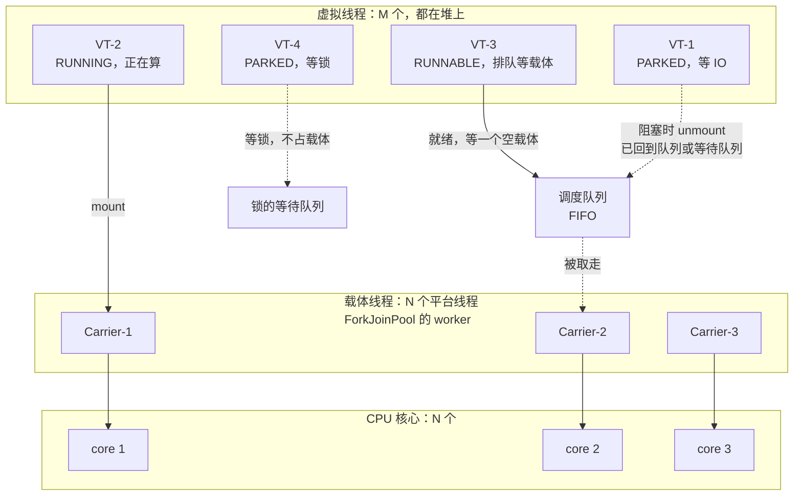
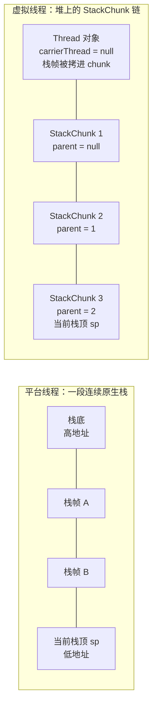
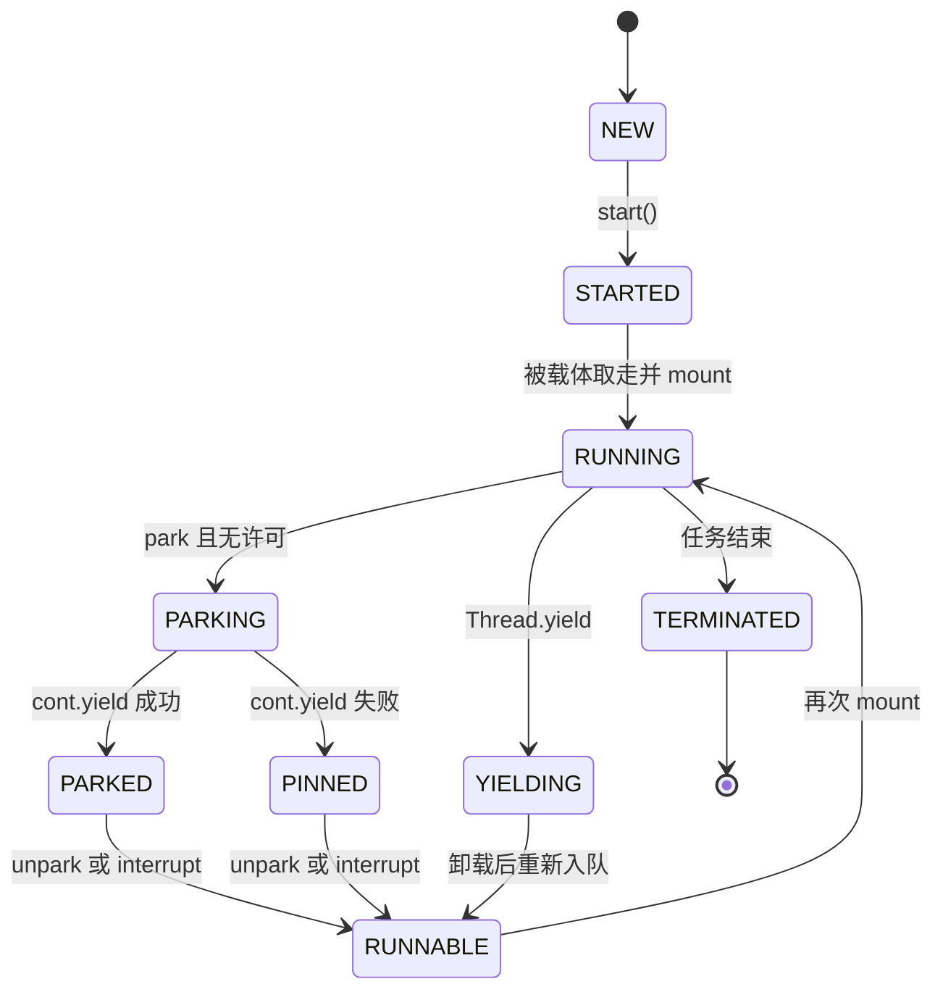
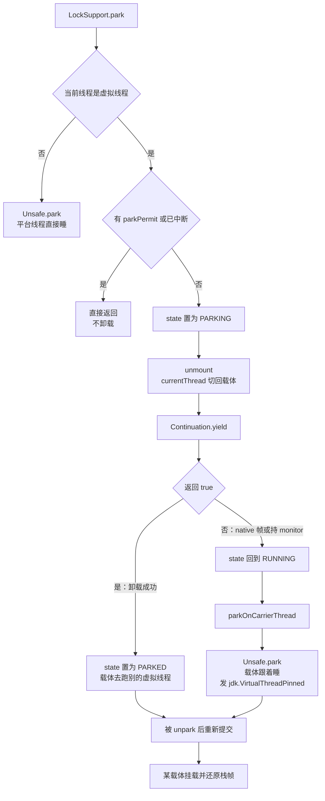
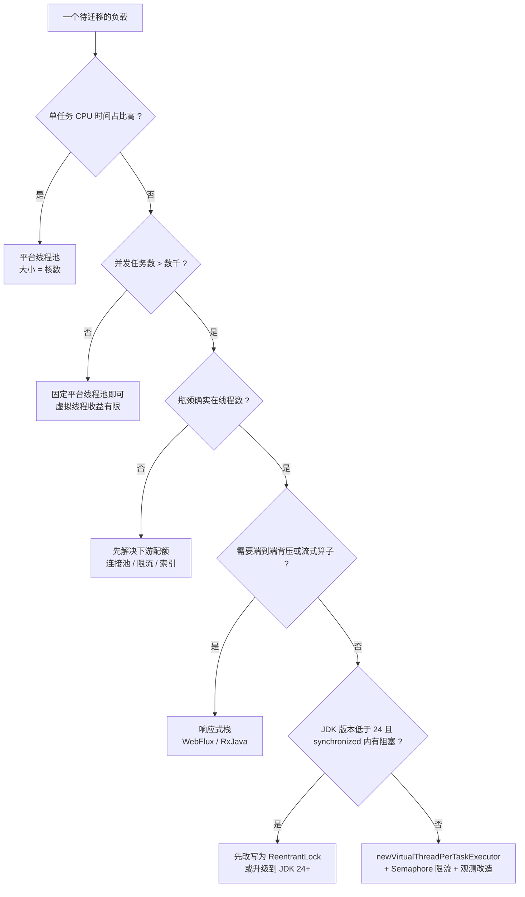

# 16 JDK 21 虚拟线程——Project Loom 的协程实现与平台线程的边界

**摘要：**

2023 年 9 月 JDK 21 转正的虚拟线程，常被概括成「更轻的线程，能开几百万个」，这句概括漏掉了真正重要的部分：虚拟线程改的不是计算的快慢，而是并发度的价格。它把线程的栈从「每线程预留一段连续原生栈」改成「堆上的 StackChunk 链」，把调度权从操作系统搬进 JVM 里一个 FIFO 的 ForkJoinPool，于是「一个请求一个线程」这种最朴素的写法重新变得可行。但价格便宜不等于能力变强：载体线程数仍等于核数，单请求延迟一分未减，任何一次卸载失败（pinning）都会把租出去的载体收回来。本篇先拆开 Continuation 与调度器的实现，用源码状态机和成本对照说明虚拟线程究竟改了哪几项开销，再逐项交代它改不动的部分：CPU 密集、ThreadLocal 的内存放大、优先级与 ThreadGroup 语义、native 边界，以及最容易被忽视的下游配额。版本线单独成节：JDK 21 的 synchronized pinning 与 JDK 24 的 JEP 491 修复，是两套完全不同的判断依据。整篇的落点可以压成一句：判断依据不是「线程够不够轻」，而是「瓶颈在不在线程数」。

---

## 第 1 章 成本结构：一次请求到底占用了什么

先看一个具体的现场。一台 16 核机器上的订单服务，线程池固定 200 个线程，压测到 1200 QPS 时 P99 是 80 毫秒，看起来还有余量；业务方要求撑到 5000 QPS，运维把池子调到 800，结果 P99 反而涨到 300 毫秒，CPU 使用率从 45% 掉到 38%。这个现象用「线程不够」解释不通，因为线程加了三倍，吞吐却只从 1200 涨到 1500。真正发生的事情是：请求的并发度需求确实涨了，但系统里同时多出了六百个随时准备被内核调度的实体，上下文切换、GC 线程扫描、锁竞争一起变贵。

要判断虚拟线程能不能救这个场景，先得把「一个请求占用了什么」拆成可计量的几项。

### 1.1 Little 定律给的是需求，不是线程数

排队论里那条最朴素的等式，是这一整套讨论的起点：

$$L = \lambda \times W$$

$L$ 是系统内同时存在的请求数（并发度），$\lambda$ 是到达率（吞吐），$W$ 是单个请求的平均驻留时间（延迟，含排队与处理）。对一个平均延迟 80 毫秒、目标 5000 QPS 的服务，$L = 5000 \times 0.08 = 400$，也就是任意瞬间必须有 400 个请求同时在处理中，才可能达成这个吞吐。这个 400 不是「线程数应该设 400」，而是「并发容量至少要 400」，至于用 400 个线程、40 个线程配 10 倍异步、还是 4 个事件循环去承载，是另一层选择。

平台线程把「并发容量」与**线程数**焊死了：一个请求占一个线程，从进来到返回，中间等待数据库的 60 毫秒里线程也占着。于是并发容量直接等于池大小，池大小又受制于线程的真实成本。这条焊死的等式，就是虚拟线程要撬开的地方。

### 1.2 平台线程的成本是三份，不是一份

教科书常说「一个线程 1MB 栈」，这个说法只讲了三分之一，而且容易误导。平台线程的开销分成三份，各自的约束机制完全不同。

第一份是**地址空间预留**。x86-64 上 HotSpot 的 `ThreadStackSize` 默认 1MB（`-Xss` 可调），创建线程时这块虚拟地址就被保留下来，栈保护页（guard page）也在其中。但保留不等于驻留：物理页按实际触碰分配，一个深栈只用了 40KB 的线程，RSS 也只有四十来 KB。所以「10 万个线程乘 1MB 等于 100GB 内存」这类算术是错的，它把虚拟地址当成了物理内存。真正的硬墙在第二份与第三份。

第二份是**内核对象**。每个线程在内核里是一套 `task_struct`、一个内核栈（通常十几 KB 到几十 KB，不可换出）、一份调度实体与 cgroup 记账。这部分不随栈使用量伸缩，创建即付。系统的 `ulimit -u`、`/proc/sys/kernel/threads-max`、容器的 `pids.max` 卡的都是这一份，与 `-Xss` 无关。

第三份是调度成本。线程被唤醒、被抢占、跨核迁移时，内核要保存与恢复寄存器组、切换栈指针、可能刷新 TLB 与污染各级缓存，还要做一次调度决策。这部分成本不体现在任何内存指标里，却直接吃吞吐：线程数远超核数时，CPU 有相当比例的时间花在「换人」而不是「干活」上。

三份成本合起来，平台线程的可用数量落在几千到几万这个区间，超出之后先崩的是第二份（创建失败），再崩的是吞吐（调度开销）。

### 1.3 两条绕路与它们的账单

既然「一个请求一个线程」撑不住，历史上走过两条路。

第一条是异步与响应式：用少量事件循环线程加回调，把「等待」从线程身上摘掉。Netty、Vert.x、Spring WebFlux、RxJava 都是这条路的产物。它确实解决了线程数量问题，账单开在编程模型上：请求处理逻辑被切成若干阶段，阶段之间靠 `CompletionStage` 或 `Mono`/`Flux` 组合，循环与 `try-catch` 这类最基本的顺序组合手段让位给算子；一个请求的执行轨迹散落在多个线程的多个栈片段里，栈追踪不再能回答「这个请求现在卡在哪」；而 JDBC、`FileInputStream`、大部分同步 SDK 这些阻塞 API 在这套模型里是毒药，一旦在事件循环线程里调用，整个循环停摆。

第二条是用户态线程，也就是协程。这条路 Java 并不陌生：JDK 1.1 的绿线程（green thread）就是 M:1 的用户态线程，所有绿线程共用一个 OS 线程，一个阻塞调用就让全体停摆，最终被 1:1 的平台线程淘汰。M:N 调度是第三条腿：M 个用户态线程映射到 N 个内核线程，阻塞时把用户态线程从内核线程上摘下来，让内核线程去跑别的。Go 的 goroutine、Erlang 的 process 走的是这条，Project Loom 让 Java 也走了上来。

### 1.4 本篇要回答的两个问题

围绕虚拟线程的讨论很容易滑向两个极端：一边是「百万线程，旧问题终结」，一边是「就换了个写法，性能没变」。两种说法都只对一半。笔者把问题拆成两个可验证的：其一，虚拟线程改变了哪几项成本，没有改变哪几项？每一项都要落到实现上——栈放在哪里、谁做调度、切换时到底发生了什么；其二，哪些场景它帮不上忙？这不只是「CPU 密集不适合」一句结论，还包括 pinning 会把租出去的载体收回来、`ThreadLocal` 被峰值并发放大、`ThreadGroup` 与 `ThreadMXBean` 这类观测语义直接缺失。

带着这两个问题往下走，先看它到底是什么。

---

## 第 2 章 虚拟线程是什么：Thread 的子类，而不是新原语

### 2.1 一个 Thread 子类

JDK 21 源码里，虚拟线程的类型声明只有两层：

```java
final class VirtualThread extends BaseVirtualThread {   // 包内可见
    ...
}
abstract class BaseVirtualThread extends Thread { ... }
```

它是一个 `Thread` 的子类，`isVirtual()` 返回 `true`，仅此而已。这个决定的分量比看起来重：`Thread.currentThread()`、`ThreadLocal`、`interrupt()`、`Thread.Builder`、`ExecutorService`、JVM TI 的线程事件、调试器的断点，全部不需要新概念就能作用在虚拟线程上。Loom 团队在 JEP 444 里解释过为什么不新造一个用户态线程类——`Thread.currentThread()` 在现有代码里被当作锁的持有者、`ThreadLocal` 的归属者、异常处理器的作用域，无处不在；新类必然要造一个「像 Thread 但不是 Thread」的包装对象，两个对象表示同一个执行体，混乱得不偿失。

创建入口在 JDK 21 里有四种，语义上等价，差别只在控制粒度：

```java
// 1. 最简：起一个就跑
Thread vt = Thread.startVirtualThread(() -> handle());

// 2. Builder：能设名字、能拿到未启动的实例、能产出 ThreadFactory
Thread vt2 = Thread.ofVirtual().name("order-vt-", 1).start(() -> handle());
ThreadFactory factory = Thread.ofVirtual().name("worker-", 0).factory();

// 3. 每任务一线程的 ExecutorService（业务代码的默认选择）
try (ExecutorService executor = Executors.newVirtualThreadPerTaskExecutor()) {
    for (Order order : orders) {
        executor.submit(() -> process(order));
    }
}   // close() 会等待所有任务结束

// 4. 结构化并发（JDK 21 起预览；JDK 25 的第五次预览改为 open() 加 Joiner）
try (var scope = StructuredTaskScope.open()) { ... }
```

公共构造函数 `new Thread(...)` 无法创建虚拟线程，这是刻意的：`Thread` 的构造函数里带着 `ThreadGroup`、`daemon`、`stackSize` 这些为平台线程准备的参数，语义上没法照搬。

### 2.2 调度权交给 JVM：载体线程

虚拟线程由 JVM 调度，不由操作系统调度。JVM 的调度器不直接把虚拟线程塞给 CPU，而是先把它分配给一个平台线程，再由操作系统把这个平台线程调度到 CPU 上。被分配到的平台线程叫**载体线程（carrier thread）**，分配的动作叫挂载（mount），收回的动作叫卸载（unmount）。三者的层次关系画成图是这样：



图和平台线程的差别只在中间那一层：虚拟线程与 CPU 之间多了一个可复用的跳板。这个跳板的数量是固定的（默认等于核数），虚拟线程的数量却可以与它差几个数量级。多对少的映射就是 M:N 调度。

载体对 Java 代码不可见，这是规格层面的隔离而非实现细节。JEP 444 明确了三条：`Thread.currentThread()` 永远返回虚拟线程本身；载体与虚拟线程的栈追踪分开，异常与线程转储都不会把两者叠在一起；载体的 `ThreadLocal` 对虚拟线程不可见，反之亦然。对 native 代码则是另一回事——同一个虚拟线程多次调用 native 方法，可能观察到不同的 OS 线程 id，所以任何在 C 侧按 pthread 缓存状态的 JNI 代码都要重新检查这个前提。

### 2.3 与平台线程的语义差异

同为 `Thread`，语义上有一批差异，其中大部分是「给不出有意义的语义，索性不支持」，而不是「还没做」。

| 维度 | 平台线程 | 虚拟线程 | 差异的根因 |
|---|---|---|---|
| 创建入口 | `new Thread(...)`、`Thread.Builder` | 只能 `Thread.ofVirtual()` 与相关工厂 | 构造函数参数语义无法映射到 JVM 调度 |
| 守护属性 | 可设 `setDaemon` | 永远是守护线程，`setDaemon` 无效 | 虚拟线程由 JVM 托管，JVM 退出时不需要它们保活 |
| 优先级 | `setPriority` 影响内核调度权重 | 固定 `NORM_PRIORITY`，`setPriority` 无效 | 调度权在 JVM，没有与内核 nice 值的对应关系 |
| 线程组 | 正常挂载在 `ThreadGroup` 树上 | `getThreadGroup()` 返回名为 `VirtualThreads` 的占位组 | 百万级线程挂进组树，枚举与统计会失控 |
| 传统线程转储 | `jstack` 可见 | `jstack` 不含虚拟线程 | 百万条扁平列表无法阅读，改用新的 JSON 转储 |
| `ThreadMXBean` | 支持监控与死锁检测 | 不支持，也检测不到虚拟线程的死锁 | MXBean 的语义建立在平台线程集合上 |
| 栈的位置 | 原生栈，`-Xss` 预留 | 堆上的 `StackChunk` 链 | 这是虚拟线程能便宜的根本 |
| 调度者 | 操作系统 | JVM（ForkJoinPool） | 同上 |
| 抢占 | 内核按时间片抢占 | 不做时间片抢占（JDK 21 至 JDK 25 均如此） | JEP 444 明确列为未实现，留待将来 |
| 池化 | 常规做法 | 明确反对，见第 8 章 | 创建成本低，池化只增加复杂度 |

表里有两行值得多说一句。优先级本质上是「给调度器一个排序建议」，而虚拟线程的调度器是 JVM 自己的 `ForkJoinPool`，既没有优先级队列，也没有映射到内核 nice 值的通道，允许设置也只是一句空话。守护属性是「别阻止 JVM 退出」，而虚拟线程由 JVM 托管、生命周期短，这条语义没有落点。两者都不是能力缺失，而是语义在新模型下没有对应物。

`Thread.stop()`、`suspend()`、`resume()` 在虚拟线程上抛 `UnsupportedOperationException`，这三者从 JDK 20 起对平台线程同样抛异常，不算虚拟线程特有的限制。

### 2.4 版本线

虚拟线程的版本脉络短而清晰：JEP 425 在 JDK 19 首次预览，JEP 436 在 JDK 20 二次预览，JEP 444 在 JDK 21 转正。转正时改了两件事：一是线程局部变量从「可以禁用」变成「无条件支持」，预览期那个 `Thread.Builder.allowSetThreadLocals(false)` 的开关被删掉了；二是用 `Thread.Builder` 直接创建的虚拟线程默认也被运行时追踪，能出现在新的线程转储里。

JDK 25 没有改动这套模型。JDK 24 的 JEP 491 改的是 `synchronized` 的实现（第 6 章），JDK 25 的 JEP 505 与 JEP 506 改的是结构化并发与 `ScopedValue` 的 API 形态。也就是说，本篇讲的调度与卸载机制，从 JDK 21 到 JDK 25 是稳定的；会随版本变化的是「什么情况下卸载会失败」。

---

## 第 3 章 Continuation：把栈冻进堆里

要理解虚拟线程为什么便宜，得先理解它的栈在哪里。平台线程的栈是操作系统在创建线程时分配的一段连续原生内存，栈指针一路往下长，栈里有什么、有多深，完全由 CPU 的调用约定决定。虚拟线程不能这么干：一段不能移动、不能压缩、必须连续的原生栈，注定要预留，注定与「百万级」冲突。

Loom 的解法是把栈的内容搬进堆：卸载时，把当前栈帧序列化成一组 `StackChunk` 对象；挂载时，再把这组对象还原成一段可执行的栈。这个「把执行状态冻起来、稍后解冻」的抽象，就是续体（Continuation）。

### 3.1 Continuation 的接口形状

`jdk.internal.vm.Continuation` 是 JDK 内部类，不对外暴露，但它的接口极小，读起来只花几分钟：

```java
public class Continuation {
    public Continuation(ContinuationScope scope, Runnable target) { ... }
    public final void run() { ... }                  // 挂载并执行，直到 yield 或结束
    public static boolean yield(ContinuationScope scope) { ... }   // 从当前续体让出
    public boolean isDone() { ... }
    public boolean isPinned() { ... }
    protected void onPinned(Pinned reason) { ... }   // 卸载失败时的回调
}
```

`scope` 负责嵌套校验：一个续体只能在它所属的 scope 内让出，跨 scope 的 `yield` 会被拒绝。`run()` 与 `yield()` 是一对逆操作——`run()` 在调用线程的栈上继续执行续体到下一个 `yield`，`yield()` 把控制权连同栈状态一起交回给调用 `run()` 的那一层。一个续体同一时刻只能挂载在一个线程上，`run()` 期间再调 `run()` 是错误。

`VirtualThread` 自己持有一个续体与一个用于重新提交的任务对象：

```java
private final Continuation cont;          // VThreadContinuation，scope 名为 "VirtualThreads"
private final Runnable runContinuation;   // this::runContinuation
```

载体线程执行的就是 `runContinuation`：它把虚拟线程的状态从 `STARTED` 或 `RUNNABLE` 推到 `RUNNING`，然后调 `cont.run()`。虚拟线程第一次跑和后续被唤醒，走的是同一条路径，区别只在状态起点是 `STARTED` 还是 `RUNNABLE`。

### 3.2 StackChunk：堆上的栈

栈的具体载体是 `jdk.internal.vm.StackChunk`，JDK 21 的字段少得出奇：

```java
public final class StackChunk {
    private StackChunk parent;
    private int size;    // in words
    private int sp;      // in words
    private int argsize; // bottom stack-passed arguments, in words
    // The stack itself is appended here by the VM, as well as some injected fields
}
```

`parent` 让 chunk 串成链，`size` 与 `sp` 描述这一段栈的容量与当前栈顶，`argsize` 记录栈底那些通过栈传递的参数。真正的栈帧内容由 VM 追加在对象尾部，所以一个 chunk 是一个「对象头 + 元数据 + 一段冻结的栈帧」的复合体。两种栈的布局对照如下：



为什么是「链」而不是「一块」：虚拟线程的栈**按需增长**，一块 chunk 装不下时再挂一块，`parent` 指向上游。这个设计同时解决三个问题：栈深不再受创建时的预留限制，浅栈的虚拟线程只付很小的代价；chunk 是堆对象，GC 可以搬迁与压缩，几十万个虚拟线程的栈不会因碎片化而浪费；卸载时只需把栈帧写进 chunk，挂载时还原，不需要一段连续的原生地址空间。

代价也在堆上。JEP 444 说明栈的上限仍是 `-Xss` 配置的平台线程栈大小，递归很深的虚拟线程，其冻结的栈最终会占用与平台线程栈同量级的堆空间，`StackOverflowError` 的语义不变，只是抛出的时机与「堆是否够用」绑在了一起。更要紧的是 GC 必须精确扫描这些冻结的栈帧——栈里的局部变量可能是对象引用，堆对象被搬迁时这些引用要一起更新。这正是 Loom 花了多年才落地的部分。

### 3.3 状态机：parking 与 pinned 的分岔

`VirtualThread` 的源码里有一段注释，把状态迁移写全了，照抄如下（注释保留原文）：

```java
/*
 *      NEW -> STARTED         // Thread.start
 *  STARTED -> TERMINATED      // failed to start
 *  STARTED -> RUNNING         // first run
 *
 *  RUNNING -> PARKING         // Thread attempts to park
 *  PARKING -> PARKED          // cont.yield successful, thread is parked
 *  PARKING -> PINNED          // cont.yield failed, thread is pinned
 *
 *   PARKED -> RUNNABLE        // unpark or interrupted
 *   PINNED -> RUNNABLE        // unpark or interrupted
 *
 * RUNNABLE -> RUNNING         // continue execution
 *
 *  RUNNING -> YIELDING        // Thread.yield
 * YIELDING -> RUNNABLE        // yield successful
 * YIELDING -> RUNNING         // yield failed
 *
 *  RUNNING -> TERMINATED      // done
 */
```

这段注释里最要紧的是 `PARKING` 的两个出口。虚拟线程想阻塞，先进入 `PARKING`，尝试让出续体：成功了进 `PARKED`，此时它已经在堆上，载体被腾出来；失败了进 `PINNED`，此时它还骑在载体上，载体跟着一起阻塞。整个第 6 章的 pinning 讨论，都是这一行 `PARKING -> PINNED` 的展开。状态迁移画全了是这样：



顺带解释许可（park permit）。`parkPermit` 是个 `volatile boolean`，语义与 `Semaphore(1)` 类似：`unpark` 在虚拟线程还没 park 时先置上许可，随后的 `park` 看到许可就立刻返回，不再走卸载流程。先存后取保证了「unpark 早于 park 不丢」，`LockSupport` 的经典用法照旧成立；`state` 字段同样是 `volatile int`，由 CAS 推进。

### 3.4 mount 与 unmount 做了什么

这两个方法短得不像是在做线程切换，但正因为短，才能解释切换为什么便宜。先看挂载：

```java
private void mount() {
    Thread carrier = Thread.currentCarrierThread();
    setCarrierThread(carrier);                    // 记录载体
    if (interrupted) {
        carrier.setInterrupt();                   // 虚拟线程的中断状态同步给载体
    } else if (carrier.isInterrupted()) {
        synchronized (interruptLock) {            // 载体上残留的中断不能带进虚拟线程
            if (!interrupted) carrier.clearInterrupt();
        }
    }
    carrier.setCurrentThread(this);               // 关键一步：让 currentThread() 返回虚拟线程
}
```

卸载是它的镜像：

```java
private void unmount() {
    Thread carrier = this.carrierThread;
    carrier.setCurrentThread(carrier);            // currentThread() 切回平台线程
    synchronized (interruptLock) {
        setCarrierThread(null);                   // 断开与载体的关联
    }
    carrier.clearInterrupt();
}
```

关键只有 `setCurrentThread` 这一处。`Thread.currentThread()` 读的是一个由 VM 维护的「当前线程」引用，挂载时把它指向虚拟线程，卸载时指回载体。一次线程切换的主体工作，就是**两次字段写**加上一次中断状态的同步，全在用户态，没有系统调用、没有内核栈切换、没有调度器介入。平台线程切换的那三份成本里，最贵的两份（内核对象与调度决策）在这里被整块省掉了。

不过省掉的是「切换」，不是「保存状态」。真正的开销藏在 `yieldContinuation` 里：卸载之后要调 `Continuation.yield`，把当前栈帧写进 `StackChunk`；再挂载回来时要反向还原。栈越深，这部分拷贝越贵。所以虚拟线程的切换成本不是常数，它随调用栈深度变化，这一点在长调用链的框架里会显现出来。

### 3.5 park 的协作：唯一入口是 LockSupport

虚拟线程的挂起最终都收敛到 `LockSupport.park()`，这一点很重要：`ReentrantLock`、`Semaphore`、`BlockingQueue.take()`、`Future.get()`、`CountDownLatch.await()` 全部建立在它之上，只要这一层能卸载，整层 `java.util.concurrent` 就自动获得虚拟线程友好性。

```java
@Override
void park() {
    assert Thread.currentThread() == this;
    if (getAndSetParkPermit(false) || interrupted)
        return;                                   // 有许可或已中断，不卸载直接返回

    boolean yielded = false;
    setState(PARKING);
    try {
        yielded = yieldContinuation();            // 试图卸载
    } finally {
        if (!yielded) {
            setState(RUNNING);                    // 卸载失败，回到 RUNNING
        }
    }

    if (!yielded) {
        parkOnCarrierThread(false, 0);            // 钉住了：载体一起睡
    }
}
```

`yieldContinuation` 只有三行实质代码，却是整个模型的枢纽：

```java
private boolean yieldContinuation() {
    notifyJvmtiUnmount(/*hide*/true);
    unmount();                                    // 先卸载体
    try {
        return Continuation.yield(VTHREAD_SCOPE); // 再冻栈；返回 false 表示被钉住
    } finally {
        mount();                                  // 恢复时重新挂载，可能换了载体
        notifyJvmtiMount(/*hide*/false);
    }
}
```

注意 `finally` 里的 `mount()`：无论 `yield` 成功还是失败，回来时都要重新挂载。成功的情形是「从别的载体上被唤醒」，失败的情形是「原地没动」，两种情形共用同一条收尾路径，这是实现上比较经济的一手。

`Continuation.yield` 返回 `false` 的三种理由，写在 `Continuation.Pinned` 枚举里：

```java
public enum Pinned {
    /** Native frame on stack */ NATIVE,
    /** Monitor held */          MONITOR,
    /** In critical section */   CRITICAL_SECTION }
```

栈上有 native 帧、持有 monitor、处在临界区——三者任一成立，VM 就拒绝冻结这段栈。前两条是第 6 章的主角。

`Thread.yield()` 走的是另一条路径，但机制上同样是卸载：状态从 `RUNNING` 推到 `YIELDING`，卸载后续体让出，再把任务重新提交给调度器，`YIELDING -> RUNNABLE`。也就是说虚拟线程的「让出 CPU」不是原地空转，而是真的把载体交出去，重新排队。这一点与平台线程的 `Thread.yield()` 语义相近而实现不同，别把它当成「睡一小会儿」来用。

---

## 第 4 章 调度器：一个 FIFO 的 ForkJoinPool

### 4.1 默认调度器的构造参数

虚拟线程的调度器是一个私有静态字段，JDK 21 的构造逻辑如下（去掉权限包装后）：

```java
// 摘自 JDK 21 VirtualThread.createDefaultScheduler
int parallelism = Runtime.getRuntime().availableProcessors();  // 默认并行度
int maxPoolSize = Integer.max(parallelism, 256);               // 载体数量上限
int minRunnable = Integer.max(parallelism / 2, 1);
boolean asyncMode = true;                                      // FIFO 而非 LIFO
return new ForkJoinPool(parallelism, factory, handler, asyncMode,
                        0, maxPoolSize, minRunnable, pool -> true, 30, SECONDS);
```

三个系统属性可以覆盖默认值：`jdk.virtualThreadScheduler.parallelism`、`jdk.virtualThreadScheduler.maxPoolSize`、`jdk.virtualThreadScheduler.minRunnable`。注意 `maxPoolSize` 的默认值是 `max(parallelism, 256)`——这个 256 在后面讲 pinning 的后果时会变成**一堵硬墙**。

| 参数 | 默认值 | 作用 | 调整的实际影响 |
|---|---|---|---|
| `parallelism` | CPU 核数 | 常驻载体数量，也是并行度的真实上限 | 调大不增加 CPU 并行能力，只增加同时挂载的虚拟线程数 |
| `maxPoolSize` | `max(parallelism, 256)` | 载体总数上限，阻塞时临时撑开 | 调大可缓解 pinning 造成的载体枯竭，但代价是更多平台线程 |
| `minRunnable` | `max(parallelism/2, 1)` | 保活下限，低于它就补充 worker | 很少需要动 |
| `asyncMode` | `true`（FIFO） | 任务队列的取用顺序 | 关掉会退化成 LIFO，老任务可能饥饿 |
| `keepAlive` | 30 秒 | 空载体的回收时间 | 突发流量场景下过短会反复创建载体 |

与 `ForkJoinPool.commonPool()` 的关系值得单独提一句。调度器是独立实例，不是公共池。parallel stream 用的公共池是 LIFO 的，虚拟线程调度器是 FIFO 的；公共池的并行度可以被 `-Djava.util.concurrent.ForkJoinPool.common.parallelism` 调，与虚拟线程的并行度互不影响。这种隔离是刻意的：把虚拟线程的调度和并行流的执行混在一个池里，任何一方的负载都会污染另一方的排队行为。

### 4.2 为什么是 FIFO

`ForkJoinPool` 的默认模式是 LIFO：工作线程从自己队列的顶端取任务，刚 fork 出来的子任务最先被执行，缓存局部性最好。虚拟线程调度器把 `asyncMode` 打开，改成 FIFO。

原因是使用场景变了。`ForkJoinPool` 原本服务的是分治计算，任务之间有父子关系，LIFO 让子任务尽快执行、递归尽快收敛；虚拟线程的队列里装的不是「子任务」，而是「已经就绪、等着上载体的虚拟线程」，它们之间没有依赖关系。LIFO 在这种场景下有一个坏处：某个虚拟线程反复阻塞又反复唤醒，它的续体会不断被压到队顶，于是它总能最快拿到载体，而队列底部那些等着被唤醒的虚拟线程可能长期拿不到。FIFO 把这种偏好抹平，先就绪的先跑，排队时间更可预期。

代价是缓存亲和性：同一个虚拟线程这次在载体 A 上跑、下次可能在载体 B 上跑，栈与数据要从别的核搬过来。JEP 444 明说了不维护亲和性（no affinity），这个代价是设计上认下的。

### 4.3 载体是 ForkJoinWorkerThread 的子类

调度器工厂造出的载体是 `CarrierThread`，继承自 `ForkJoinWorkerThread`，于是载体天然知道自己的 pool：重新提交任务时可以走 `lazySubmit`（当前就在载体上，直接压进本地队列，避开全局提交队列的争用）或 `externalSubmit`（从外部线程提交），载体的调度也直接复用 `ForkJoinPool` 的工作窃取、`ctl` 状态位、补偿线程与 `awaitWork`，不需要另造一套线程池。这套机制的执行细节在 [[12 线程池（下）——ForkJoinPool 与工作窃取算法]] 里已经拆过。

有一处差异要留意：`ForkJoinPool` 的补偿机制是为「工作线程阻塞在 `join` 上」设计的，而虚拟线程的阻塞不通过 `join` 表达，所以调度器不做通用的「阻塞即扩容」——JEP 444 明说不靠扩大并行度来补偿 pinning，唯一例外是 `Object.wait()`，调度器为它预留一个备用载体。

### 4.4 没有时间片

平台线程的公平性由内核保证：时间片用完，线程被抢占，下一个上。虚拟线程没有这一层。JEP 444 在「Scheduling virtual threads」一节里明确写着，调度器不实现时间共享（time sharing），并解释说不确定在百万虚拟线程的规模下强制抢占是否还有意义。

后果很具体：一个纯 CPU 的循环放在虚拟线程里，它会一直占着载体，直到自己结束、或者主动调用会 park 的操作。如果这样的虚拟线程有 16 个而载体只有 8 个，另外 8 个就在队列里干等，不是等 CPU，是等载体。更麻烦的是，这些「CPU 霸占者」会拖慢同一批载体上本来该跑 IO 请求的虚拟线程——这解释了为什么把 CPU 密集任务塞进虚拟线程池，不仅没有加速，还可能让整体延迟变差。

### 4.5 两层调度，一层被搬走了

把调度拆成两层看就清楚了。第一层是「虚拟线程到载体」，由 JVM 在用户态完成，成本是状态位 CAS、两次字段写、栈的冻结与还原、一次队列操作；第二层是「载体到 CPU」，由操作系统完成，成本与平台线程调度完全相同。

虚拟线程把第一层做得极便宜，第二层一分没省。当虚拟线程数量接近载体数量时，两层调度的总成本与平台线程几乎没有区别——收益只在「阻塞」时出现：第一层可以卸载、让出载体，第二层随之消失（载体转去执行别的虚拟线程）。所以收益与「任务中阻塞时间的占比」强相关，与「线程创建得多不多」关系不大。

---

## 第 5 章 成本结构改变了什么

前面四章是机制，这一章算账。所有数字都只给量级，并标注推算依据——JEP 本身不提供基准数据，任何精确到纳秒或字节的数字都不该被当成官方口径。

### 5.1 创建成本

平台线程的创建要走内核：`clone()` 系统调用、内核栈分配、调度实体初始化、地址空间预留。这是一次内核态往返，量级在毫秒级（量级判断，具体取决于内核与机器负载）。所以线程池的第一动机就是「别反复创建」。

虚拟线程的创建是纯用户态的对象分配：一个 `Thread` 子类实例，加上首次挂载时要用的第一个 `StackChunk`，量级在纳秒到微秒之间（量级判断）。JEP 444 的措辞是 cheap（廉价）而非给出数字，因为这个量级依赖堆状态与 JIT 阶段。

这个差别带来的不是「快一点」，而是**策略上的反转**：创建几乎免费，就不必为「复用」付出任何复杂度。池化的两个历史目的——**分摊创建成本**、限制并发——在虚拟线程这里被拆开：前者消失，后者交给信号量（第 8 章）。

### 5.2 内存

| 维度 | 平台线程 | 虚拟线程 | 变化的性质 |
|---|---|---|---|
| 栈的表示 | 原生栈，`-Xss` 预留（x64 默认 1MB） | 堆上的 `StackChunk` 链，按需增长 | 从「预留」变成「按需」 |
| 栈的物理占用 | 按实际触碰的页计（RSS） | 按实际栈深计，受 GC 管理 | 都被实际使用量约束，但后者可搬迁压缩 |
| 内核侧开销 | 每个线程一套内核对象与内核栈 | 无 | 整块消失 |
| 单实例基线 | 内核对象 + 预留地址空间 + guard page | 一个堆对象，数百字节量级 | 量级下降，具体字节数取决于实现版本 |
| 数量级 | 几千到几万 | 百万级（JEP 444 的示例用到 100 万） | 两个数量级 |
| 深栈的代价 | 仍在原生栈，触到 `-Xss` 抛 `StackOverflowError` | 冻结进堆，占堆空间，同样抛 `StackOverflowError` | 从地址空间压力变成堆压力 |

再强调一次量级关系：「10 万个平台线程乘 1MB 栈等于 100GB」算的是虚拟地址预留，不是物理内存；虚拟线程省下的是内核对象与地址预留，而在「栈的物理占用」这一栏，两者遵循同样的规律——用得深就占得多。

反过来，虚拟线程多了一笔平台线程没有的账：**堆上的栈要参与 GC**。一百万个虚拟线程就是一百万个堆对象加上各自的 chunk 链，标记、搬迁、引用更新都要覆盖它们。JEP 444 对「虚拟线程与异步写法谁更吃堆」的结论是谨慎的：大致相当——栈帧布局比紧凑对象浪费，但栈能原地复用，而异步流水线每一折都要分配新对象。它把内存压力从「地址空间与内核对象」转移到了「堆与 GC」，没有消除内存开销。

### 5.3 切换成本

| 切换路径 | 触发者 | 主要动作 | 量级 |
|---|---|---|---|
| 平台线程切换 | 操作系统调度器 | 陷入内核、保存/恢复寄存器组、切换内核栈、调度决策、TLB 与缓存污染 | 微秒级（量级判断） |
| 虚拟线程卸载 | `LockSupport.park` 等阻塞点 | 状态位 CAS、两次字段写、栈帧写入 `StackChunk`、任务重新入队 | 纳秒到亚微秒级（浅栈，量级判断） |
| 虚拟线程挂载 | 调度器取到续体 | 出队、状态位 CAS、字段写、从 `StackChunk` 还原栈帧 | 同上，随栈深上升 |

两个「量级判断」之外有一个确定的性质：虚拟线程的切换成本不是常数，它随栈深线性上升——栈帧写进 chunk、再从 chunk 还原，两次搬运都与栈里存活帧的数量成正比。「虚拟线程切换便宜」有前提：浅栈、短生命周期，JEP 444 设想的形态正是「大多数虚拟线程执行一次 HTTP 调用或一次 JDBC 查询」。深调用栈的框架里，把一个请求在 200 层栈帧深处 park 掉再唤醒，省下来的内核切换会被搬运抵掉一部分。

### 5.4 数量上限

平台线程的上限由内核侧资源决定，虚拟线程的上限由堆与 GC 决定。这个转移有个副作用：平台线程溢出时表现为「创建失败」，是立刻可见的错误；虚拟线程溢出时表现为「GC 压力上升、延迟变差」，是缓慢退化的过程，容易被误判成下游抖动。

JEP 444 的示例把任务数从一万改成一百万，说明百万级在堆容量允许时可行；但这是 JEP 的示例，不是基准测试，也不能推导成「任何服务都能开一百万」。能不能开取决于每个任务持有多少状态（局部变量、`ThreadLocal`、缓冲区），以及这些状态在峰值并发时要在堆里同时驻留多久。

### 5.5 没有改变的三件事

第一，单请求延迟。虚拟线程不加速任何一次 IO，也不会让查询变快。JEP 444 的措辞很直白：虚拟线程不是更快的线程，它们提供的是**规模（吞吐），不是速度（延迟）**。

第二，CPU 并行度。载体数量默认等于核数，所以同一时刻真正在执行指令的虚拟线程数量不超过核数。CPU 密集任务的加速比仍由核数决定。

第三，下游资源的容量。数据库连接、文件句柄、下游服务的 QPS 配额、锁的争用，全部与线程模型无关。这一条是下面这个结论的基础。

### 5.6 用 Little 定律重算一遍

回到第 1 章那个 200 线程的服务。把它换成虚拟线程，得到的不是「吞吐提升 500 倍」，而是「并发度不再受线程池限制」。此时吞吐的上限由谁决定？

$$\text{吞吐上限} = \min\left(\frac{\text{并发容量}}{W},\ \frac{\text{CPU 核数} \times \text{单核效率}}{\text{单任务 CPU 时间}},\ \text{下游配额}\right)$$

以前第一项被池大小锁死在「200 / 0.08 = 2500 QPS」，现在这一项被解开，上限立刻落到第二项或第三项身上。若瓶颈本来就是下游数据库（40 个连接、单查询 5 毫秒，理论上限 8000 QPS），虚拟线程只能把**排队位置**从「线程池队列」搬到「连接池队列」，吞吐不变而 P99 可能更差——这是迁移中最常见的坑，第 8 章给配比方法。

---

## 第 6 章 pinning：载体被钉住

### 6.1 定义：卸载失败

pinning 不是错误，它是一种**卸载失败**的状态。虚拟线程在阻塞点上试图让出载体，VM 检查当前栈：如果有 native 帧、持有 monitor、或处在临界区，就拒绝冻结栈，`Continuation.yield` 返回 `false`，虚拟线程进入 `PINNED` 状态，随后走 `parkOnCarrierThread`：

```java
private void parkOnCarrierThread(boolean timed, long nanos) {
    VirtualThreadPinnedEvent event;
    try {
        event = new VirtualThreadPinnedEvent();   // JFR 事件在此开始
        event.begin();
    } catch (OutOfMemoryError e) {
        event = null;
    }
    setState(PINNED);
    try {
        if (!parkPermit) {
            if (!timed) U.park(false, 0);          // 载体真的睡下去
            else if (nanos > 0) U.park(false, nanos);
        }
    } finally {
        setState(RUNNING);
    }
    setParkPermit(false);
    if (event != null) event.commit();             // 提交 jdk.VirtualThreadPinned
}
```

`U.park` 是 `Unsafe.park`，也就是平台线程的阻塞原语。到了这一步，虚拟线程与平台线程没有任何区别：一个载体被一个虚拟线程独占，直到阻塞结束。JEP 444 的说法是「pinning 不会让程序出错，但会妨碍可伸缩性」——错的不是结果，是账。

### 6.2 monitor 为什么钉住载体

`synchronized` 的语义建立在对象监视器（monitor）上，而 HotSpot 记录 monitor 归属时，记的是平台线程。JEP 491 把因果讲得很清楚：虚拟线程执行 `synchronized` 方法时获得 monitor，JVM 把「虚拟线程的载体」记为持有者，而不是虚拟线程。如果此时允许虚拟线程卸载，调度器马上会把另一个虚拟线程挂到这个刚空出来的载体上，那个新来的虚拟线程会因为「我的载体持有这把锁」而被 JVM 视为锁的主人，于是它可以进入其他 `synchronized` 方法，也可以释放这把锁——互斥就此失效。

所以 JVM 选择禁止卸载，用一个可伸缩性代价换取正确性。这条推理链里没有「mutex 绑在 OS 线程」这种粗糙说法，真正的约束是**「锁的归属记录粒度是平台线程」**，这也正是 JEP 491 后来改掉的东西。

同一个成因还派生出两种更隐蔽的形态：一是等锁，虚拟线程进入 `synchronized` 块但锁被别人持有，要阻塞在 JVM 内部，同样不能卸载；二是 `Object.wait()`，等待时释放 monitor，唤醒后要重新获取，整个过程都在 `synchronized` 作用域内，依旧被钉住。JEP 444 只对后者做了一点补偿——调度器为它预留一个备用载体。

把这条路径完整画出来，`park` 的每个分岔都对应一个可观测的状态：



### 6.3 后果：载体池被逐个吃掉

载体数量有三个约束：常驻并行度等于核数，上限是 `max(parallelism, 256)`，且不做时间片抢占。把这三个约束和 pinning 放在一起，后果就很清楚了。

设想一个 8 核服务，默认并行度 8，载体上限 256。如果每个请求都在 `synchronized` 块里做一次 50 毫秒的连接获取，每个等待中的请求都会独占一个载体：前 8 个占满常驻载体，调度器扩池；扩到 256 个后无法再扩，剩下的虚拟线程只能在队列里等。此时 CPU 接近空转、QPS 卡在「256 / 0.05 = 5120」、平台线程数稳定在 256，日志里没有任何异常。JEP 491 把这种状态描述为可能导致饥饿甚至死锁——所有载体都被钉住且彼此等锁时，队列永远动不了。

这个上限 256 值得记住。它不是「撑不住就调大」那么简单：调到 1024 意味着最多 1024 个平台线程，回归到第 1 章说的三份成本，虚拟线程的收益被吃回去一部分。正确的解法是消除 pinning，而不是无限扩池。

### 6.4 检测手段

JDK 21 提供两个入口，一个轻量一个完整。

轻量的是系统属性 `jdk.tracePinnedThreads`：`full` 打印完整栈并标出 native 帧与持有 monitor 的帧，`short` 只打印有问题的帧。它的用法是在预发环境挂上，跑一遍典型流量，看有没有输出：

```bash
java -Djdk.tracePinnedThreads=full -jar order-service.jar
```

完整的是 JFR 事件 `jdk.VirtualThreadPinned`。它在 JDK 21 里默认启用，默认阈值 20 毫秒——短于这个阈值的 pinning 不会记录，所以「没有事件」只能说明没有长时间的 pinning，不能说明没有 pinning。另外两个相关事件 `jdk.VirtualThreadStart` 与 `jdk.VirtualThreadEnd` 默认关闭，需要显式打开：

```bash
jcmd <pid> JFR.start name=vt settings=profile duration=60s filename=vt.jfr
jfr print --events jdk.VirtualThreadPinned vt.jfr
```

`jdk.tracePinnedThreads` 有个副作用：它在已经处在临界区里时打印栈，等于在锁的持有路径上做 IO。JEP 491 把它移除，一半是因为 synchronized 不再 pin，一半是因为这个副作用——JDK 24 及以上设了也不生效。

### 6.5 JDK 24 的修复：JEP 491

**JEP 491** 在 JDK 24 交付，改动落在 HotSpot 的 monitor 实现上，思路是把「锁的归属」从平台线程改为可以指向虚拟线程：

- 阻塞地获取 monitor 时，虚拟线程卸载，载体还给调度器；锁释放且 VM 选中该虚拟线程继续时，把它重新提交给调度器，可能挂到另一个载体上再试一次。
- `Object.wait()` 及其定时变体同样卸载；被 `notify` 唤醒、monitor 释放后，重新提交调度。
- 挂载与卸载时做必要的簿记（bookkeeping），保证虚拟线程在 `synchronized` 方法或语句内部卸载、重挂之后，monitor 的持有关系仍然正确。

这样改之后，第 6.2 节那条推理链的前提消失了：既然锁可以记在虚拟线程头上，卸载就不会让「新来的虚拟线程继承锁」。JDK 24 起，`synchronized` 块内做 IO 不再钉住载体。

一个必须交代的取舍写在 JEP 的风险小节里：线程退出 monitor 时，可能需要把一个虚拟线程排进调度器，而「给平台线程 unpark」比这更高效。也就是说 JDK 24 拿一点点吞吐换了可伸缩性，在无竞争的热路径上，`synchronized` 的绝对性能未必比 JDK 21 更好。这不妨碍结论——虚拟线程场景下 pinning 的代价远大于这点差异。

诊断侧也跟着变了。`jdk.tracePinnedThreads` 被移除（设了没效果），JFR 的 `jdk.VirtualThreadPinned` 保留下来，转而用于 native 场景，并且增强了事件内容：带上钉住的原因以及载体线程的标识。所以 JDK 24 之后看 pinning，只看 JFR，不看属性。

| 成因 | JDK 21 至 JDK 23 | JDK 24 及以后 |
|---|---|---|
| `synchronized` 块内阻塞（IO、sleep） | 钉住载体 | 可卸载 |
| 阻塞地获取被他人持有的 monitor | 钉住载体 | 可卸载 |
| `Object.wait()` | 钉住载体（调度器留备用载体） | 可卸载 |
| 调用 native 方法或 FFM 外部函数，且其内部阻塞 | 钉住载体 | 仍钉住载体 |
| native 代码回调 Java 再阻塞 | 钉住载体 | 仍钉住载体 |
| 类加载时解析符号引用阻塞（JVMS §5.4.3） | 钉住载体 | 仍钉住载体 |
| 在类初始化器中阻塞、等待别的线程完成类初始化 | 钉住载体 | 仍钉住载体 |
| 检测手段 | `jdk.tracePinnedThreads` + JFR | 仅 JFR（属性失效） |

### 6.6 仍然 pin 的情形

JDK 24 之后 pinning 从「常见」变成「罕见」，但没有消失。剩下的几类都有一个共同点：栈上存在 VM 无法冻结的帧，或者阻塞发生在 VM 内部的某个不可中断的阶段。

native 与 FFM 是主要来源。栈上有 native 帧时，VM 无法把这段栈写进 chunk（native 帧的布局由 C 编译器与 ABI 决定，VM 不解释它）。更隐蔽的是反向：native 代码回调 Java，而 Java 侧又执行了阻塞操作——此时栈上既有 native 帧又有 Java 帧，虚拟线程被钉住。JDK 22 起 FFM API 转正（JEP 454），用 `Linker` 调外部函数与 JNI 在这一点上等价，同样钉住。

类加载与类初始化是另一类。解析符号引用时如果虚拟线程阻塞，栈上有一个 native 帧，钉住；类初始化器里阻塞，同样钉住；等另一个线程完成类初始化（JVMS §5.5），那是 VM 内部阻塞，也钉住。JEP 491 把这些列在「Future Work」里，认为它们很少造成问题。

实践含义是判断依据换了位置。JDK 21 时代，排查 pinning 的直觉是「搜代码里的 `synchronized`」；JDK 24 之后，该搜的是**代码里的 native 边界**与 FFM 调用，以及「启动阶段有没有在 `<clinit>` 里做 IO」。后者尤其容易被忽略：一个在静态初始化块里建连接池的老代码，在 JDK 21 下会在启动时钉住载体，在 JDK 24 下依然钉住。

---

## 第 7 章 帮不上忙的场景

### 7.1 CPU 密集

机制层面有三重原因叠加：载体数默认等于核数；调度器不做时间片抢占；CPU 密集的虚拟线程不会主动 park，也就不会卸载。三者合起来，结论是虚拟线程对 CPU 密集任务不提供任何额外并行度，且可能与 IO 任务争抢载体。

| 单任务 CPU 时间 | 单任务 IO 等待 | 单任务总耗时 | 目标 QPS | 所需并发 | CPU 需求（核） | 结论 |
|---|---|---|---|---|---|---|
| 1 毫秒 | 99 毫秒 | 100 毫秒 | 5000 | 500 | 5 | 虚拟线程可承载，前提是下游扛得住 |
| 10 毫秒 | 90 毫秒 | 100 毫秒 | 5000 | 500 | 50 | 已超核数，虚拟线程无解 |
| 50 毫秒 | 0 | 50 毫秒 | 160 | 8 | 8 | 纯 CPU，平台线程池按核数配置即可 |

表内是示例推算，按 $L = \lambda W$ 与「CPU 需求 = QPS × 单任务 CPU 时间」算出，不涉及任何实测基准。中间一行是虚拟线程最无能为力的形态：并发需求已经超过核数能提供的计算量，加线程只会加排队，解法只能是降 CPU 时间（算法、缓存、批量化）或加核数。第三行是纯 CPU 负载，平台线程池按核数配置即可。

一个具体的反例：某服务把报表导出（CPU 密集，单次 2 秒）放进虚拟线程池。结果是导出任务把 8 个载体全部占满，同一时段进来的普通请求排队等载体，P99 从 120 毫秒涨到 900 毫秒。正确的做法是把这类任务放进独立的、有界的小平台线程池，与在线流量做物理隔离。

### 7.2 ThreadLocal 的内存放大

`ThreadLocal` 的数据结构是「每个线程一个 `ThreadLocalMap`」，这一点对虚拟线程同样成立（语义与实现见 [[15 ThreadLocal 的实现原理与内存泄漏——线程封闭的正确姿势]]）。放在平台线程池里，这个 map 只有一个副本，线程复用、map 复用，内存被摊薄；放在「每任务一线程」的模型里，每个虚拟线程都有自己的 map，峰值并发就是副本数量。

做一个量级推算：一百万并发虚拟线程，每个线程的 `ThreadLocal` 合计持有 1KB 就是 1GB 堆，存了 10KB 的请求上下文就是 10GB，第二个数字足以让任何堆配置失效。若这些虚拟线程还被池化（错误做法，见第 8 章），map 不会随线程结束回收，泄漏的时间维度也被拉长。

虚拟线程的生命周期短，客观上缓解了「泄漏」：线程结束，map 即可回收，不需要 `remove()`。但缓解的是「长期泄漏」，不是**峰值放大**。JDK 21 提供了诊断属性 `jdk.traceVirtualThreadLocals`，虚拟线程对任何 `ThreadLocal` 赋值时打印栈，用来找出是谁在往里塞东西：

```bash
java -Djdk.traceVirtualThreadLocals=true -jar order-service.jar
```

真正的解法是把「只读的、单向传递的上下文」从 `ThreadLocal` 换成 `ScopedValue`。版本线需要交代清楚：`ScopedValue` 在 JDK 20 以 JEP 429 孵化，JDK 21 以 JEP 446 首次预览，经 JEP 464（22）、JEP 481（23）、JEP 487（24）三轮修订，最终由 JEP 506 在 JDK 25 转正。把它说成「JDK 21 引入的孵化特性」是不准确的——JDK 21 上它是预览 API，要 `--enable-preview` 才能用。

```java
static final ScopedValue<UserContext> CONTEXT = ScopedValue.newInstance();

// 绑定只在一个动态作用域内有效，run 返回后自动解除，没有 set，也不需要 remove
ScopedValue.where(CONTEXT, user).run(() -> handle(request));
```

`ScopedValue` 的两点性质与虚拟线程直接相关。其一，绑定值由调用者与子线程共享，不做逐线程复制，所以百万虚拟线程不会放大成百万份副本；其二，绑定随 `StructuredTaskScope.fork` 传给子任务，但不随 `ForkJoinPool` 或普通 `ExecutorService` 传递——因为后者无法保证子任务在父作用域结束前退出，而 `ScopedValue` 的语义依赖这个保证。JDK 25 的 JEP 506 转正时还做了一处收紧：`ScopedValue.orElse` 不再接受 `null` 参数。

### 7.3 优先级、守护属性与 ThreadGroup

第 2.3 节列过差异，这里说影响。`setPriority` 无效，意味着任何靠线程优先级做 QoS 的老代码在虚拟线程上失效；如果服务里存在「低优先级后台任务 + 高优先级在线请求」的区分，只能靠独立的执行器与配额来隔离，线程优先级这条路断了。

`ThreadGroup` 的缺失影响更广。老框架常用 `ThreadGroup` 做三件事：枚举线程、统计线程数、批量中断。虚拟线程不是线程组的活跃成员（`getThreadGroup()` 返回一个叫 `VirtualThreads` 的空占位组），`Thread.Builder` 也没有设置线程组的方法，所以这三件事在虚拟线程上全部落空。同理，`Thread.getAllStackTraces()` 只返回平台线程，JVMTI 的 `GetAllThreads` 也只返回平台线程。

`ThreadMXBean` 是另一处断裂：它只支持平台线程的监控与管理，`findDeadlockedThreads()` 找的是平台线程之间的死锁环，虚拟线程之间的死锁它看不见。任何靠 MXBean 做「线程数」「死锁检测」的 APM 采集器、健康检查、告警规则，在虚拟线程化之后都会集体失真——指标看起来正常，因为采集的样本根本不含虚拟线程。这一条在迁移清单里必须单列（第 10 章）。

### 7.4 其他不适合的形态

`-XX:+PreserveFramePointer` 对虚拟线程性能有显著的负面影响，JEP 444 把它列在风险项里。这个参数通常是为了让 async-profiler 拿到可靠的原生栈，与虚拟线程存在冲突，需要权衡。

深递归与大栈帧不适合。栈被冻结进堆，深栈意味着大 chunk、更多的拷贝、更高的 GC 压力，而 `StackOverflowError` 的阈值仍是 `-Xss`。

在 native 侧按 pthread 缓存状态的代码不适合：载体是会漂移的，同一个虚拟线程两次调用可能落在不同的 OS 线程上，挂在当前线程上的 C 状态就会串味。

试图用虚拟线程实现限流也不适合。限流的本质是「限制同时进行的数量」，虚拟线程不提供这个，它提供的是「同时等待的数量」。这两件事在虚拟线程里必须分开：并发上限用 `Semaphore` 管，线程只负责等待（第 8 章）。

| 场景 | 是否适用 | 原因 |
|---|---|---|
| IO 密集的请求-响应服务 | 适用 | 阻塞时卸载，并发度不再受线程池限制 |
| 高并发短任务（HTTP 调用、单次查询） | 适用 | 创建成本低，浅栈切换便宜 |
| 每请求携带大量 `ThreadLocal` 状态 | 谨慎 | 峰值并发时内存放大，改用 `ScopedValue` |
| 纯 CPU 密集计算 | 不适用 | 并行度等于载体数，且无时间片抢占 |
| 依赖线程优先级做 QoS | 不适用 | 优先级固定为 `NORM_PRIORITY` |
| 依赖 `ThreadGroup` 枚举、批量中断 | 不适用 | 虚拟线程不挂线程组树 |
| 依赖 `ThreadMXBean` 做线程监控与死锁检测 | 不适用 | MXBean 不覆盖虚拟线程 |
| `synchronized` 内做阻塞 IO（JDK 21 至 23） | 先修再上 | 会钉住载体，JDK 24 起自动缓解 |
| native 调用内部阻塞、或 native 回调 Java 再阻塞 | 不适用 | JDK 24 之后仍钉住载体 |
| 需要在启动阶段做大量类初始化与 IO | 谨慎 | 类初始化与类加载阶段仍可能钉住载体 |

---

## 第 8 章 与线程池的关系

### 8.1 为什么不池化

JEP 444 的原文很硬：虚拟线程廉价且充裕，因此**永远不该池化**；每个应用任务都应该新建一个虚拟线程。这句话里有一个前提被反复误解——池化的目的是复用昂贵资源。线程池之所以存在，是因为平台线程昂贵（第 1 章的三份成本），复用能把这笔钱摊薄。虚拟线程不昂贵，池化省不下任何东西，只引入队列与生命周期管理。

更常见的误解是「用池化来限制并发」。这个习惯来自平台线程时代：想限制对某个下游的并发，就把池大小设成那个数，所有调用都从池里拿线程。JEP 444 专门点名了这个用法，替代方案是 `Semaphore` 或专门的限流构造。把虚拟线程池化来限流，等于把「限制并发」与「限制线程数」重新绑死，退回平台线程的语义。

池化虚拟线程还有三个具体坏处：线程变成长期存活对象，`ThreadLocal` 状态跨任务残留（[[15 ThreadLocal 的实现原理与内存泄漏——线程封闭的正确姿势]] 里讨论的线程复用污染）；栈不释放，冻结的 chunk 常驻堆；任务与线程的对应被打散，线程转储里看到的是「一堆池化线程」而不是「一堆请求」。

### 8.2 newVirtualThreadPerTaskExecutor 的真实语义

```java
try (ExecutorService executor = Executors.newVirtualThreadPerTaskExecutor()) {
    for (Order order : orders) {
        executor.submit(() -> process(order));
    }
}   // close() 等待所有任务结束
```

这个 `ExecutorService` 的行为要点：

- 每次 `submit` 新建一个虚拟线程，不排队、不复用，并发度只受下游与资源约束。
- 返回的 `Future` 语义不变，`cancel(true)` 通过中断虚拟线程实现——中断状态会同步给它当时的载体。
- `close()`（等价于 `shutdown()` 加等待）阻塞到所有任务结束。`ExecutorService` 从 JDK 19 起实现 `AutoCloseable`，可以放进 try-with-resources。
- 池的「预热」「核心线程数」「拒绝策略」在这里不存在，任务只在执行器已关闭时提交失败。

若任务卡在不响应中断的阻塞调用上（譬如某些 native 调用），`close()` 就无限期挂住；需要边界控制时用 `shutdownNow()` 加限时 `awaitTermination`，或在任务侧设超时。与 `ThreadPoolExecutor` 的对照如下，七个参数的语义见 [[11 线程池（上）——ThreadPoolExecutor 的七大参数与执行流程]]：

| 对比项 | `ThreadPoolExecutor` | `newVirtualThreadPerTaskExecutor` |
|---|---|---|
| 线程来源 | 池内复用 | 每任务新建 |
| 并发上限 | 核心/最大线程数 + 队列容量 | 无内建上限，靠外部限流 |
| 提交失败 | 队列满时触发拒绝策略 | 仅在已关闭时失败 |
| 关闭语义 | `shutdown` 等已有任务，`shutdownNow` 中断 | 同左，但任务数可能极多 |
| 适用负载 | CPU 密集、需要固定并发 | IO 密集、需要高并发度 |

### 8.3 限流的位置

「限制并发」在虚拟线程模型里是独立的一件事，位置要选对：放在请求入口，用 `Semaphore`，而不是放在线程池上。

```java
private static final Semaphore DOWNSTREAM = new Semaphore(40);   // 下游能承受的并发

String callDownstream(String key) throws InterruptedException {
    if (!DOWNSTREAM.tryAcquire(200, TimeUnit.MILLISECONDS)) {
        throw new RejectedExecutionException("downstream saturated");   // 快速失败
    }
    try {
        return client.get(key);        // 虚拟线程阻塞在这里时，载体被让出
    } finally {
        DOWNSTREAM.release();
    }
}
```

`Semaphore.acquire` 底层是 `LockSupport.park`，虚拟线程在此处正常卸载，不占载体。所以「十万个虚拟线程排队等 40 个信号量」是可行的，代价是十万个堆对象与它们冻结的栈，不是十万个平台线程。`tryAcquire` 带超时这一点很重要：没有超时，排队会无限增长，最终以堆压力的形式爆发，而不是以拒绝的形式暴露出来。

### 8.4 连接池配比

连接数与虚拟线程数没有关系。连接池的大小由数据库能力决定：连接数 × 单连接吞吐 ≈ 数据库能承受的吞吐。虚拟线程改变的是「等连接的请求如何排队」，不是「能同时执行多少查询」。

做一个示例推算。数据库能稳定支撑 40 个并发查询、单查询 5 毫秒，查询吞吐上限约为 $40 / 0.005 = 8000$ QPS。按这个配置上线、虚拟线程侧开 10 万并发，效果是 8000 QPS 以内基本不排队，超出部分在 `HikariCP` 获取连接处排队（默认连接超时 30 秒），表现为 P99 缓慢爬升而不是立刻报错。若据此认为「虚拟线程多了，连接池也该放大到 1000」，等于把压力原样传给数据库，换来更长的数据库侧排队。

还有一处 JDK 版本相关的细节：连接池内部若有 `synchronized` 包裹的等待路径，在 JDK 21 下会 pin 住载体；JDK 24 起这条风险消失。这也解释了为什么某些连接池在 JDK 21 的虚拟线程下「表现比预期差」，而在 JDK 24 上恢复正常。

---

## 第 9 章 与响应式编程的比较

### 9.1 两者解决的是不同的一半

两者要解决的问题并不重叠。虚拟线程解决「线程不够」：让同步写法获得异步的并发度，保留调用栈、阻塞语义、`try-catch` 与循环。响应式解决「在有限资源下如何组合流、如何施加背压」：把「等待」变成事件，用算子表达数据流的变换、合并与限流。

共同点是都做了 M:N 映射——虚拟线程把 M 个虚拟线程映射到 N 个载体，响应式把 M 个在途请求映射到 N 个事件循环线程。差别在于谁承担状态机：前者把状态机藏在栈里，由 VM 冻结与还原；后者把状态机摊在算子里，由开发者显式组合。

### 9.2 背压：虚拟线程的空白

**背压（backpressure）**是「消费者告诉生产者慢一点」的机制。Reactive Streams 把它做成协议的一部分：`request(n)` 逐元素表达需求，上游按需生产，下行压力逐层传回。

虚拟线程没有这个东西：它的限流手段是「在某一层放一个信号量」，粒度是整条调用、位置是集中的，既没法表达「下游一次只处理 16 个元素」，也没法让数据库游标按消费速度拉取。要做这些，得用阻塞队列与线程协调去拼，拼出来的就是手写的响应式框架。

流的组合也是如此。`merge`、`zip`、`window`、`throttle`、带退避的重试、超时与取消的传播，在 Reactor 里是算子，在虚拟线程里要么手写协调代码，要么用 `CompletableFuture` 组合（回调的线程模型见 [[13 CompletableFuture 与异步编程模型——从 Future 到响应式]]）。当需求本身是「事件流」而非「请求-响应」时，虚拟线程的写法优势不成立。

### 9.3 判据

| 判据 | 倾向虚拟线程 | 倾向响应式 |
|---|---|---|
| 交互形态 | 请求-响应，一次调用一个结果 | 事件流、长连接、扇出、SSE/WebSocket |
| 背压需求 | 入口限流即可（信号量） | 端到端逐元素背压 |
| 下游 API | 阻塞式 JDBC、同步 HTTP 客户端 | 原生异步客户端、非阻塞驱动 |
| 组合复杂度 | 少量并行调用、`StructuredTaskScope` 足够 | 大量算子组合、窗口、节流、重试策略 |
| 团队与存量 | 团队熟悉同步代码，存量是阻塞实现 | 已有 Reactor 技术栈与经验 |
| 资源约束 | 线程数是瓶颈 | 内存与连接数是瓶颈，线程早已不是问题 |

一个容易踩的坑：虚拟线程不会让 WebFlux 变快。Spring Boot 3.2 的 `spring.threads.virtual.enabled=true` 影响的是 Spring MVC 的请求处理线程，对 WebFlux 的 event loop 没有作用；在 event loop 上做阻塞调用，有没有虚拟线程都是反模式，把阻塞调用包进虚拟线程也只是换了个位置，并不会获得背压。

共存也可行，边界画在「是否跨进程流式」上：网关层用响应式做连接复用与背压，业务层用虚拟线程跑阻塞逻辑，两层之间用有界队列约束。混搭的复杂度介于两者之间，是否值得取决于流式需求的真实强度。

---

## 第 10 章 迁移路径与风险

### 10.1 迁移顺序

迁移不是「把线程池换掉」一步，顺序错了会同时踩好几个坑。下面每一步都能独立验证。

1. 升级 JDK。基线是 JDK 21；若能上 JDK 24 或更高，`synchronized` 的 pinning 直接消失，第 3 步可跳过。JDK 25 的改动集中在结构化并发与 `ScopedValue` 的 API 形态，不是阻塞项。
2. 打开框架开关。Tomcat 10.1 起提供 `org.apache.catalina.core.StandardVirtualThreadExecutor`（要求 Java 21+），Spring Boot 3.2 起一行 `spring.threads.virtual.enabled=true` 即可让 MVC 请求处理跑在虚拟线程上。这一步之后先别动业务代码，观察基础指标。
3. 处理 `synchronized` 内的阻塞（仅 JDK 21 至 23 需要）。改写为 `ReentrantLock` 或把 IO 移到锁外；JDK 24+ 可跳过，但「锁内不做 IO」仍是工程纪律。
4. 把业务侧 IO 线程池换成 `newVirtualThreadPerTaskExecutor`。CPU 密集的执行器、需要固定并发的执行器、以及依赖 `ThreadPoolExecutor` 队列监控的执行器都要单独评估。
5. 用 `Semaphore` 接管原来靠池大小实现的限流。这一步最容易漏，漏了等于把下游暴露在无上限的并发下。
6. 重新核算连接池与下游配额，连接数不随虚拟线程数放大（第 8.4 节）。
7. 改造观测。`jstack`、`ThreadMXBean`、线程组统计都看不到虚拟线程（第 7.3 节），要换成 `jcmd` 的 JSON 转储与 JFR。

### 10.2 锁竞争不是 pinning

常见的混淆是把「虚拟线程下的锁问题」等同于 pinning。两者不是一回事：pinning 是「卸载失败导致载体被占」，JDK 24 已经消解；锁竞争是「多个线程争同一把锁，临界区必须串行」，与线程模型无关，虚拟线程一点也帮不上。

JDK 24 之后，虚拟线程在 `synchronized` 上阻塞会正常卸载，载体不被占用，但临界区本身仍然串行：八个虚拟线程争一把锁，只有一个能进去，另外七个在等待队列里。此时的表现是 CPU 不满、吞吐上不去、火焰图里看不到热点。解法还是老办法——缩小临界区、分段、读写分离、无锁化，`ReentrantLock` 与 `StampedLock` 的取舍见 [[07 ReentrantLock 深度剖析——公平锁、非公平锁与可中断]] 与 [[08 读写锁与 StampedLock——从 ReentrantReadWriteLock 到乐观读]]。虚拟线程能让等待不占线程，不能让等待不发生。

### 10.3 压测必须用开环模型

这条最容易得出错误结论。闭环压测（固定 N 个客户端循环发请求）有一个内建的负反馈：服务变慢时客户端的请求间隔自然拉长，施压强度下降，系统看起来「没有崩」。这种模型天生掩盖排队，也体现不出虚拟线程的收益——收益恰恰是「在高并发下不排队」。

正确的做法是开环：按固定速率（或泊松到达）施加请求，不管服务是否变慢都保持施压，把「实际完成时间」与「计划发出时间」的差值（排队延迟）单独记录下来。**协调遗漏（coordinated omission）**这个概念说的就是闭环模型把这段延迟藏起来了。

```text
开环压测的伪代码，关键在于「按计划发出」而不是「等上一个返回再发」
每 200 微秒生成一个请求（5000 QPS），记录 planTime
请求完成后记录 doneTime
排队延迟 = doneTime - planTime - 服务内部耗时
```

做一个示例推算：目标 5000 QPS，服务延迟 20 毫秒，需要 100 个并发在途。如果一个压测脚本只有 50 个客户端循环发送，那么它的理论最大吞吐是 $50 / 0.02 = 2500$ QPS，永远测不到 5000；而在这个上限附近，客户端的排队已经发生，脚本会把「自己的排队」记成「服务的延迟」，得出「延迟 40 毫秒」的错误结论。

### 10.4 可观测性改造

观测工具被分成了两半：能看到虚拟线程的，和看不到的。

```bash
# 能看到：新的 JSON 线程转储，含平台线程与虚拟线程，不暂停应用
jcmd <pid> Thread.dump_to_file -format=json /tmp/dump.json

# 能看到：JFR 事件，含 pinning（默认阈值 20ms）、创建与结束（默认关闭）
jcmd <pid> JFR.start name=vt settings=profile duration=60s filename=vt.jfr

# 看不到：传统线程转储完全不含虚拟线程
jstack <pid> | grep -c "VirtualThread"    # 近似为 0：传统转储不含虚拟线程
```

| 工具 | 能看到什么 | 盲区 |
|---|---|---|
| `jstack` / 传统线程转储 | 平台线程 | 完全不含虚拟线程 |
| `jcmd Thread.dump_to_file -format=json` | 虚拟线程 + 平台线程 + 栈 | 需要工具解析，不适合人工扫读 |
| JFR `jdk.VirtualThreadPinned` | 时长超过阈值的 pinning | 短于阈值不记录 |
| JFR `jdk.VirtualThreadStart` / `End` | 生命周期 | 默认关闭，开启有开销 |
| `ThreadMXBean` | 平台线程的计数与死锁环 | 不含虚拟线程 |
| async-profiler | CPU、分配、锁 | 与 `-XX:+PreserveFramePointer` 存在取舍 |

指标侧要补：载体利用率、pin 事件速率与原因分布、虚拟线程创建与结束速率、信号量排队长度。前三项可从 JFR 聚合，第四项得在限流点埋点；缺了这些，「虚拟线程化之后为什么没变快」在线上无法回答。

### 10.5 四个反例

反例一：池化虚拟线程。写一个 `ThreadPoolExecutor` 再把虚拟线程工厂塞进去，看上去「既有池又有虚拟线程」。实际效果是把虚拟线程变成长期存活对象：`ThreadLocal` 残留、栈常驻、任务与线程的对应关系被打散，收益被削掉大半。正确做法是每任务新建加信号量限流。

反例二：指望虚拟线程加速 CPU 密集任务。机制上不成立（第 7.1 节），实测上表现为「并发上去了，吞吐没动，延迟变差」。判断方法很简单：粗略看单任务的 CPU 时间占比，超过一半就别指望。

反例三：开了虚拟线程但连接池没动。等待从线程池搬到连接池，吞吐不变，P99 更差（第 5.6 节）。判断方法是看连接池的等待指标与连接池大小是否与数据库能力匹配。

反例四：在 `ThreadLocal` 里存大对象。峰值一百万并发乘以每份几百字节到几十 KB，堆直接被打穿（第 7.2 节）。判断方法是用 `jdk.traceVirtualThreadLocals` 找出谁在赋值，再评估能否改成 `ScopedValue`。把前面的判断收成一张决策流：



| 风险 | 症状 | 判据 | 处置 |
|---|---|---|---|
| JDK 21 下 `synchronized` 内阻塞 | CPU 空转、QPS 卡住、平台线程数稳定在载体上限 | JFR 里 `jdk.VirtualThreadPinned` 密集 | 升级 JDK 24+，或把 IO 移出锁、改 `ReentrantLock` |
| 池化虚拟线程 | 吞吐低于预期，`ThreadLocal` 串味 | 代码里出现 `ThreadPoolExecutor` 加虚拟线程工厂 | 改成每任务新建 + 信号量 |
| 连接池未重新配比 | 吞吐不涨、连接池等待时间上升 | 连接池活跃数打满、等待队列变长 | 按数据库能力定连接数，入口加信号量 |
| `ThreadLocal` 存大对象 | 堆占用随并发线性上升、GC 频繁 | `jdk.traceVirtualThreadLocals` 有输出 | 改 `ScopedValue` 或缩短生命周期 |
| 闭环压测 | 结论与线上表现相反 | 压测脚本是「发一个等一个」 | 改开环，按计划速率施加 |
| 依赖 `ThreadMXBean` 的监控 | 线程数与死锁告警失真 | 采集到的线程数远小于实际并发 | 换 `jcmd` JSON 转储与 JFR |
| CPU 密集任务混入同一执行器 | 在线请求 P99 抖动 | 载体利用率打满、队列变长 | 物理隔离到独立的有界平台线程池 |

---

## 第 11 章 小结

虚拟线程改的是并发度的价格，不是计算的快慢。栈从预留在原生内存里的连续空间，变成堆上按需增长的 `StackChunk` 链；调度从操作系统搬进 JVM 里一个 FIFO 的 `ForkJoinPool`；切换从内核往返退化为两次字段写加一次栈的冻结与还原。三项改动合起来，把「一个请求一个线程」的可用规模从几千推到百万级，也让线程池这个存在了二十年的中间层在 IO 场景下失去必要性。

改不动的部分同样清晰：载体数仍等于核数，单请求延迟一分未减；调度器不做时间片抢占，CPU 密集任务不但无收益，还可能拖累同批载体；`ThreadLocal` 会按峰值并发放大，优先级与 `ThreadGroup` 语义直接缺失。pinning 则要看版本：JDK 21 时代 `synchronized` 内的阻塞会把载体钉住，检测靠 `jdk.tracePinnedThreads` 与 JFR；JDK 24 的 JEP 491 把 monitor 归属从平台线程改为虚拟线程，`synchronized` 不再钉住，属性失效，只剩 native、FFM 与类加载初始化几条窄边界。

判断标准可以收敛成一句话：先问**瓶颈在不在线程数**。若在，虚拟线程把等待从线程身上卸下来，收益立刻出现；若不在——瓶颈是数据库连接、CPU、锁竞争或下游配额——它只会把排队搬个位置，甚至因为队列变长而让长尾更差。这也解释了迁移后最常见的两种结局：一是「吞吐上去了、延迟没动」，二是「什么都没变、P99 还差了一点」。前者是瓶颈真的在线程，后者是瓶颈一直不在线程。

---

## 参考资料

1. JEP 444: Virtual Threads (JDK 21), Ron Pressler & Alan Bateman — https://openjdk.org/jeps/444
2. JEP 491: Synchronize Virtual Threads without Pinning (JDK 24), Patricio Chilano Mateo & Alan Bateman — https://openjdk.org/jeps/491
3. JEP 505: Structured Concurrency (Fifth Preview, JDK 25) — https://openjdk.org/jeps/505
4. JEP 506: Scoped Values (JDK 25) — https://openjdk.org/jeps/506
5. JEP 454: Foreign Function & Memory API (JDK 22) — https://openjdk.org/jeps/454
6. OpenJDK 源码（jdk-21-ga）：`java.lang.VirtualThread`、`jdk.internal.vm.Continuation`、`jdk.internal.vm.StackChunk` — https://github.com/openjdk/jdk/tree/jdk-21-ga
7. Java SE 21 API 文档：`Thread.Builder`、`Executors.newVirtualThreadPerTaskExecutor`、`Thread.isVirtual` — https://docs.oracle.com/en/java/javase/21/docs/api/java.base/java/lang/Thread.html
8. The Java Virtual Machine Specification, Java SE 21：§5.4.3（解析）、§5.5（初始化） — https://docs.oracle.com/javase/specs/jvms/se21/html/index.html
9. Apache Tomcat 10.1 文档：Executors，`StandardVirtualThreadExecutor` — https://tomcat.apache.org/tomcat-10.1-doc/config/executor.html
10. Spring Boot 3.2 Release Notes：Virtual Threads（`spring.threads.virtual.enabled`） — https://github.com/spring-projects/spring-boot/wiki/Spring-Boot-3.2-Release-Notes

---

> [!note] 思考题
> 1. 虚拟线程的栈被放在堆上，这让 GC 必须精确扫描冻结的栈帧。如果一个服务同时存在「浅栈百万并发」与「深栈几千并发」两种负载，堆与 GC 的压力会分别落在哪一侧？
> 2. JDK 21 下 `synchronized` 内的阻塞会钉住载体，而 JDK 24 之后不会。为什么「锁内不做 IO」这条纪律在 JDK 24 之后依然成立？
> 3. 调度器不做时间片抢占，这意味着一个纯 CPU 循环的虚拟线程会一直占着载体。如果业务里确实有少量 CPU 密集任务，你会把它放在哪里，判据是什么？
> 4. 把限流从「线程池大小」改成「信号量」，语义上有哪些细节会变（拒绝时机、排队可见性、超时行为）？
> 5. 用 WebFlux 还是虚拟线程，判据之一是「是否需要端到端背压」。能否构造一个场景，两种方案都能满足需求，但其中一个明显更省事？