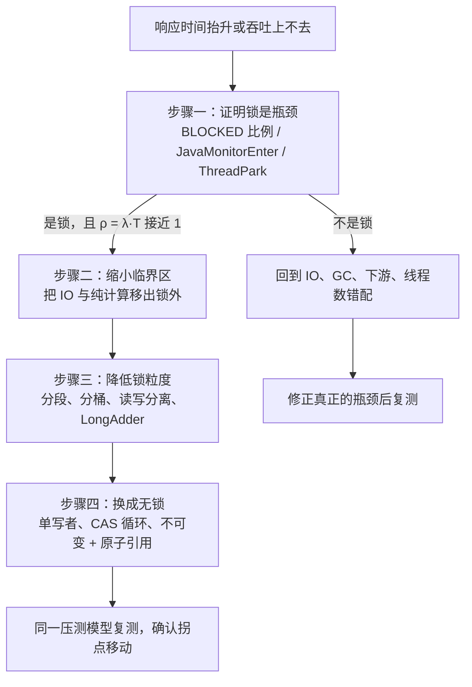
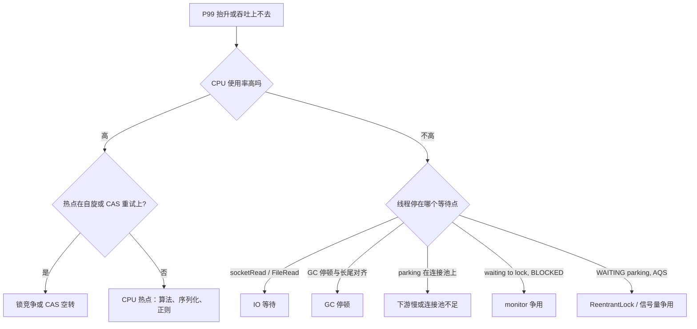
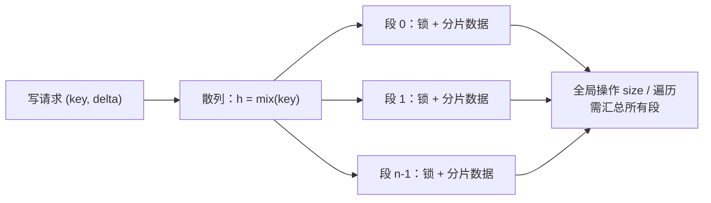
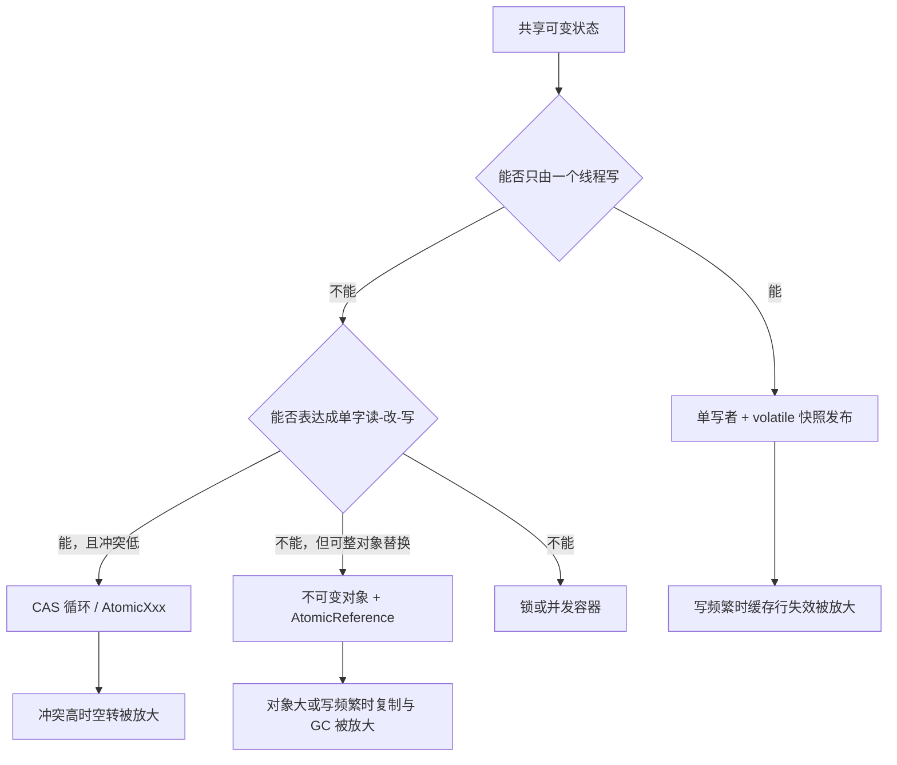
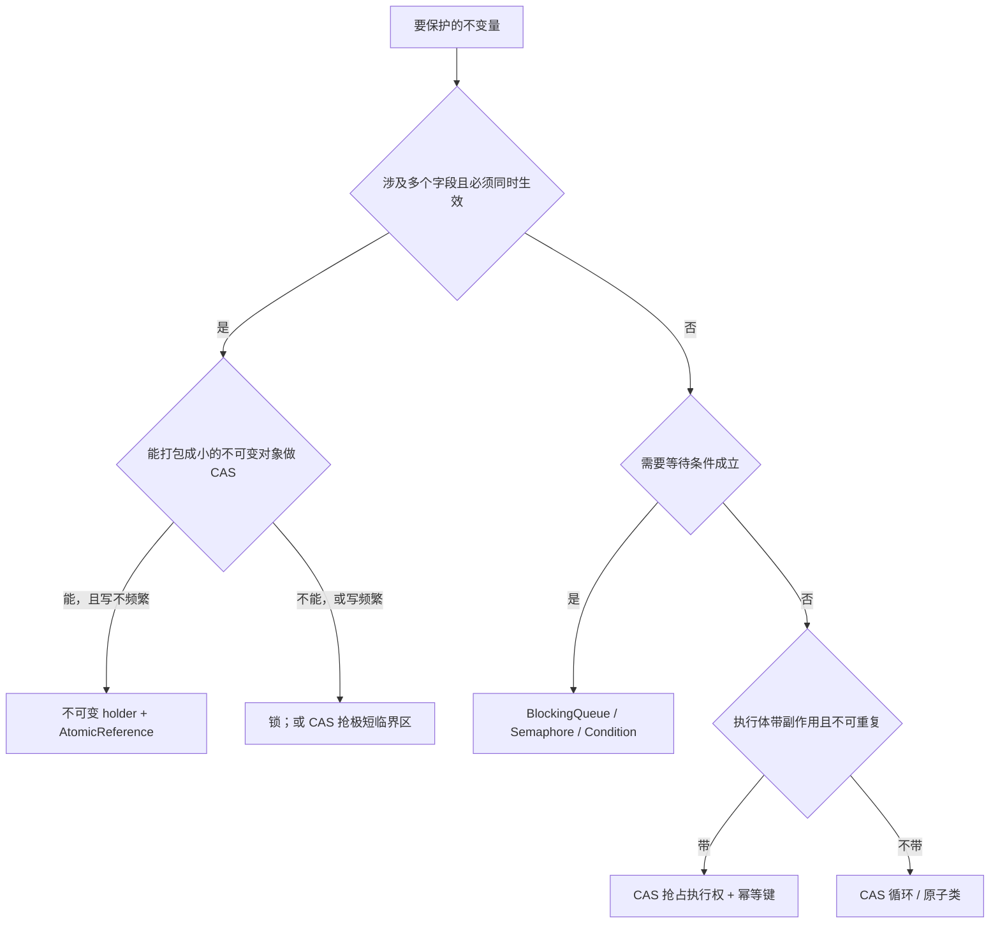
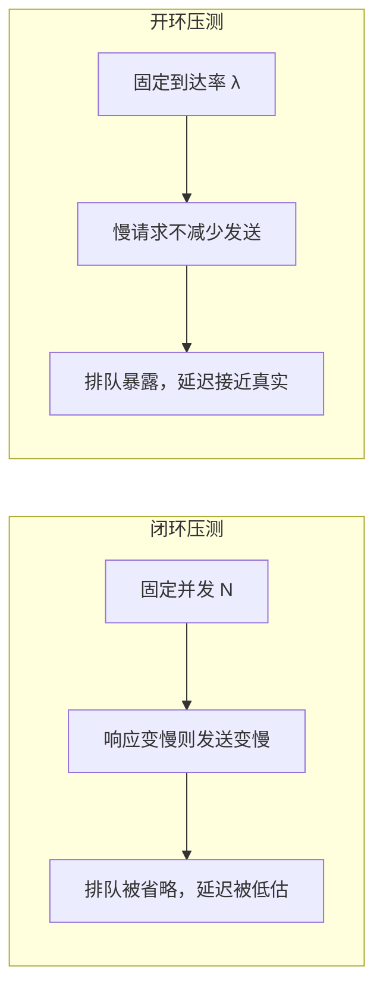

# 17 实战——高并发场景下的锁优化与无锁编程

**摘要：**

锁优化的话题极易滑向手段罗列：换 `ReentrantLock`、上 `LongAdder`、改无锁队列。机制在系列各篇里已经讲透，缺的是一套判断顺序，这是本篇的定位。它先把"该不该动锁"变成算得出来的问题，也就是锁的利用率 ρ = λ·T，再给出四步流程：证明锁是瓶颈、缩小临界区、降低锁粒度、换成无锁，每一步都配上取证工具（线程转储、JFR 锁事件、墙钟采样）与判据，并标出收益上限与失效条件。顺着流程推下去会得到一个不太讨喜的结论：多数被归因为"锁慢"的现场，收益其实来自把 IO 与慢调用挪出临界区，而不是换一把更高级的锁。文中用五个反例复盘这条流程失效的地方——同步方法换 `ReentrantLock`、`ConcurrentHashMap` 的 get 后 put、用 `LongAdder` 求精确值、分段锁把热点挤到一段、以及"降粒度一定更快"的直觉；随后补上无锁编程的三个可行模式、三类不能无锁的问题、闭环与开环压测之分、JMH 为何不能省，以及本地跑得欢而线上不一样的四个原因。手段是有限的，判断力才是稀缺品。

---

## 第 1 章 一条不能跳步的流程

### 1.1 从一次无效的优化说起

某电商的订单查询接口，平峰 QPS 四千上下，P99 从八十毫秒爬到六百毫秒，团队的第一反应很一致：这条链路里有一把全局锁保护用户会话缓存，`jstack` 里也确实抓到了几十个 BLOCKED 线程，于是把方法级 `synchronized` 换成 `ReentrantLock`，把计数改成 `LongAdder`，再加了一段自旋优化。上线后 P99 是六百二十毫秒。真正的原因是下游库存服务的 P99 从三十毫秒涨到三百毫秒，而那次调用恰好写在锁里，于是每一个请求都用三倍的时间去占着那把锁，锁的排队把下游的抖动放大成了雪崩。

这类情节在性能优化里的出现频率，远高于"锁真的成了瓶颈"。所以本篇不打算从"锁有几种优化手段"讲起，而是先把顺序摆出来：先证明锁是瓶颈，再谈怎么优化锁。顺序颠倒的代价不是多做了几步，而是所有后续工作都建立在错误的前提上，改得越多，越难回退。

### 1.2 四步流程

下面这条流程是全篇的骨架，四步之间存在严格的先后依赖：前一步没通过，后一步的收益就是零甚至负数。



四步的收益上限依次递减，代价依次递增。缩小临界区只是挪动几行代码，风险局限在一个方法内；降低粒度要重新设计数据结构，还要回答"全局操作怎么办"；换成无锁则把正确性的举证责任从 JVM 转移到了写代码的人身上。这条曲线决定了一个实践原则：能在第几步停下，就停在第几步。绝大多数线上问题是第二步能解决的，而人们往往直接跳到第四步，因为第四步听起来最"高级"。

### 1.3 为什么顺序不能颠倒

第一步的收益不是性能，而是避免负收益。假设一次采样显示锁等待占总响应时间的百分之八，那么即使把锁的开销压缩到零，理论上限也只有百分之八的改进，这还没有算上引入新缺陷的概率。Amdahl 定律在这里的用法不是算加速比，而是提醒你上限在哪里：串行部分占多少，天花板就在哪里。与此同时，第四步可能引入的新问题——ABA、丢失唤醒、可见性漏洞——的排查成本，往往是那百分之八的好几倍。收益上限可以事先估算，风险却不能，这就是顺序的意义。

第二、三、四步之间也有依赖。缩小临界区之后，ρ 降下来，再增加分片就未必划算；反过来，如果 ρ 已经很低，任何"提升并发度"的改造都只是在增加复杂度，因为并发度不是目标，等待时间才是。把一个 ρ = 0.1 的锁改成十六段，等待时间从可以忽略变成仍然可以忽略，代价是内存与代码可读性。

### 1.4 每一步的收益上限与失效条件

| 步骤 | 典型收益量级 | 主要代价 | 收益归零的条件 |
| :--- | :--- | :--- | :--- |
| 一、证明锁是瓶颈 | 不产生性能收益，只避免全部后续工作白做 | 采样与取证的时间成本 | 从不失效；跳过它的代价是后面三步可能全错 |
| 二、缩小临界区 | 临界区时长 T 缩短多少，利用率 ρ 与排队就降多少；量级由混进锁里的 IO 决定 | 需要重新论证不变量边界；锁外操作失败要另行处置 | 临界区只剩几条赋值，或缩短后破坏了不变量 |
| 三、降低锁粒度 | 并发上限近似乘以有效分片数（示例推算：8 个写线程配 16 段，平均仍有 1.25 个线程挤在同一段） | 内存占用、全局操作变贵、一致性语义变弱 | 单键热点；分片数少于同时进入临界区的线程数 |
| 四、换成无锁 | 省掉挂起与唤醒，低冲突下吞吐明显上升；高冲突下可能更差 | 正确性难验证、ABA、GC 压力、可观测性变差 | 需要多字段一致性、需要阻塞等待、执行体有副作用 |

### 1.5 优化的对象是不变量，不是锁

把上面四步抽象掉具体手段，剩下一个更根本的提问方式：这段临界区保护的不变量（invariant）究竟是什么，它需要多大的互斥范围？同一段代码，如果它保护的只是"一个计数不丢"，那么 `LongAdder` 就够了；如果保护的是"余额与流水必须同时成立"，那么任何单字 CAS 都是在骗自己；如果保护的其实是"副作用只执行一次"，那么该做的是状态机与幂等，而不是换锁实现。

临界区的范围应当恰好等于不变量的作用域，多一分是浪费，少一分是错误。这句话听起来像废话，但它是判断"缩到什么程度可以停"的唯一依据，也是本篇后面所有反例的共同落点。

---

## 第 2 章 第一步：先证明锁是瓶颈

### 2.1 锁等待在 CPU 火焰图里是隐形的

最容易被误判的一点：等待锁的线程不消耗 CPU。BLOCKED 状态的线程被操作系统挂起，`park` 的线程也不在运行队列里，所以 CPU 采样型 profiler 看不到它们，火焰图上只有真正在跑的栈。于是"CPU 利用率只有百分之三十，说明没有瓶颈"这类判断经常错得离谱——低 CPU 配高延迟，恰恰是锁等待与 IO 等待的典型形状。

要把等待看见，必须换采样口径：要么按墙钟采样（wall-clock），要么直接采 JVM 的锁事件，要么反复抓线程快照看状态分布。三种办法各有盲区，组合使用才可靠。

排查时先按"CPU 高不高"分叉，再按"线程停在哪个等待点"细分，比按工具名罗列有效得多。下面这张树不是理论分类，而是一次现场取证的行走顺序：



### 2.2 三类取证工具与它们的盲区

| 工具 | 看什么 | 关键判据 | 盲区 |
| :--- | :--- | :--- | :--- |
| `jcmd <pid> Thread.print`（间隔数秒连续三次） | 线程状态分布、等待点 | 同一线程在三次快照里停在同一个 `waiting to lock <0x...>` 或同一个 `parking to wait for <0x...>` | 只有等 monitor 的线程才是 BLOCKED；AQS 上的等待显示为 `WAITING (parking)`，数 BLOCKED 会漏掉 `ReentrantLock` 竞争 |
| JFR 的 `jdk.JavaMonitorEnter` / `jdk.JavaMonitorWait` / `jdk.ThreadPark` | 每次等待的时长与栈 | duration 的分布与累计等待时间 | 默认阈值 20 毫秒，短于阈值的等待根本不进入记录 |
| Async-profiler 的 `-e lock` / `-e wall` | 锁等待的调用点、墙钟时间分布 | wall 与 cpu 两次采样的差值 | 采样型 profiler 对极短临界区命中率低，只能定性 |
| `ThreadMXBean` 的 `blockedCount` / `blockedTime` | 单线程累计阻塞次数与时长 | 需先 `setThreadContentionMonitoringEnabled(true)` | 只覆盖 monitor 竞争，且开启监控本身有开销，不适合常态开启 |

JFR 那条盲区值得单独强调。`jdk.JavaMonitorEnter` 只在"进入 monitor 时发生了等待"时才记录，默认阈值是 20 毫秒（JDK 17 与 JDK 21 的 `default.jfc` 里由 `locking-threshold` 控制，三个锁事件共用），也就是说一次三毫秒的竞争在高并发下累积成灾，却一条事件都不会留下。正确做法是把阈值调低再看分布，例如用自定义配置把 `locking-threshold` 降到 1 毫秒甚至 0，代价是事件量上升、录制开销变大，所以只适合短时间诊断。

线程快照的读法也需要一点训练。下面是一次典型快照里两种等待的区别：

```text
"biz-worker-3" #42 ... java.lang.Thread.State: BLOCKED (on object monitor)
    at com.example.OrderService.deduct(OrderService.java:88)
    - waiting to lock <0x0000000712ab3c48> (a java.lang.Object)

"biz-worker-7" #46 ... java.lang.Thread.State: WAITING (parking)
    at jdk.internal.misc.Unsafe.park(Native Method)
    - parking to wait for  <0x0000000712dc4410> (a java.util.concurrent.locks.ReentrantLock$NonfairSync)
```

前者在等内置锁，后者在等 AQS 同步器。统计"锁竞争比例"时如果只数 BLOCKED，就会得出"没有 monitor 竞争"的结论，而真正的排队全在第二类里。`jcmd` 加 `-l` 参数还能列出每个线程持有的可拥有同步器（ownable synchronizer），把"谁持有、谁在等"配对起来。

### 2.3 先排除三类干扰

在把问题归因给锁之前，先花半天排除下面三类原因，性价比远高于直接改锁。每一类都有明确的证据形态。

| 干扰源 | 会看到的证据 | 排除动作 |
| :--- | :--- | :--- |
| IO 等待 | 线程栈停在 `socketRead0`、`FileChannel`；JFR 的 `jdk.SocketRead` 累计时间占比高；wall 采样时间远大于 cpu 采样时间 | 把 IO 移出锁外或改异步；复测同一指标 |
| GC 停顿 | `-Xlog:gc*` 的停顿时间与 P99 长尾对齐；JFR 的 `jdk.GCPhasePause` 累计时间可观；堆占用曲线呈锯齿且老年代增长快 | 降分配率、调堆与代际比例；复测 |
| 下游慢 | 链路里子调用的耗时占比高；线程 `parking to wait for` 连接池；线程池队列长度持续增长 | 超时、熔断、线程池隔离；复测 |
| 线程数错配 | CPU 使用率高但就绪线程少；上下文切换次数高；`jdk.ThreadContextSwitchRate` 有明显波动 | 调线程数或改用虚拟线程；复测 |

最后一类常与锁竞争混淆。线程数远大于核数时，即便没有锁，`park`/`unpark` 与调度切换也会把 P99 抬高；线程数远小于下游并发需求时，即便锁一点都不争，吞吐也被并行度卡住。这两种情况改锁都没有用。

### 2.4 用 ρ = λ·T 把判断变成算术

排队论里最简单的那个式子在这里意外好用：把锁看成一个服务台，到达率是 λ（每秒进入临界区的次数），单次服务时间是 T（平均持锁时间），那么锁的利用率就是 **ρ = λ·T**。当 ρ 逼近 1，队列长度与等待时间都会发散；按 M/M/1 这个简化模型，平均等待约等于 T·ρ/(1-ρ)，也就是说 ρ 从 0.5 涨到 0.9，等待时间会从 1T 涨到 9T。

这不是精确预测模型，真实系统的到达不是泊松分布、临界区时长也不是指数分布，但用它判断"是否接近饱和"与"改哪一项更有效"，量级是够的。下面这段计算就是诊断时的第一张草稿纸：

```python
# 示例推算：λ 为每秒进入临界区的次数，T 为平均持锁秒数
lam, T = 5000, 200e-6          # 5000 QPS，每次持锁 200 微秒
rho = lam * T                  # 利用率，1.0 表示服务台已满负荷
wait = T * rho / (1 - rho) if rho < 1 else float('inf')
print(f"rho={rho:.2f} 平均等待≈{wait*1e6:.0f}us")
# 把临界区里的下游调用移出后 T 降到 20 微秒
rho2, T2 = lam * 20e-6, 20e-6
print(f"rho={rho2:.2f} 平均等待≈{T2*rho2/(1-rho2)*1e6:.0f}us")
```

第一组数打印出 ρ = 1.0，等待发散，说明这把锁在五千 QPS 时已经满负荷，任何"换锁实现"的微调都救不了；第二组 ρ = 0.1，平均等待降到两微秒上下，整体耗时仍由那 20 微秒的临界区本身主导。这个算术同时解释了为什么案例里的团队改错了地方：ρ 由 λ 与 T 决定，λ 是业务给的，能动只有 T；案例里 T 混着一次三百毫秒的下游调用，锁实现的好坏在这三百毫秒面前可以忽略。

同一条判据也能反过来用：如果算出来 ρ 只有 0.05，那么无论线程快照里出现多少 BLOCKED，锁都不是瓶颈，那几十个线程在等的是别的东西。

### 2.5 反例的起点

回到开头那次优化。第一轮采样给出的证据是：BLOCKED 比例百分之零点三，`jdk.JavaMonitorEnter` 累计等待时间占整个请求时长的百分之二，线程转储里大多数线程停在 `socketRead0`。三个数放在一起，锁根本不是瓶颈；而 λ·T 算出来 ρ 已经超过 1，是因为 T 里包含了下游调用。真正该做的第一件事是把下游调用挪出临界区并加超时，而不是换锁。这件事放到第 7 章的第一个反例里再复盘，此处只留一个判据：采样证据里锁等待占比不到一成的，先别动锁。

---

## 第 3 章 第二步：缩小临界区

### 3.1 收益来自 T，而不是来自"锁更快"

ρ = λ·T 里唯一能改的是 T，而 T 由临界区里做了什么决定。换锁实现改变的是**进入与退出临界区的固定成本**，这个成本在无竞争时是十纳秒到几十纳秒的量级（JDK 15 起偏向锁默认禁用，`synchronized` 的快速路径比带偏向锁的年代略贵，但与 `ReentrantLock` 同量级），而临界区里一次数据库查询是毫秒级。两者相差四到五个数量级，所以第 2 章那个案例里换锁毫无效果，是必然的。

由此推论出一条容易被忽略的规则：缩小临界区的收益上限，等于"锁内那些本不必在锁内的时间"占 T 的比例。如果 T 里九成是 IO，把 IO 挪出去，ρ 就降到原来的十分之一；如果 T 里九成是必须原子的状态更新，那么任何挪动都只会破坏正确性。

### 3.2 一段典型的错误写法

```java
// 反例：整个方法被 synchronized 包住，IO 与纯计算都在锁内
public synchronized void processOrder(Order order) {
    validateOrder(order);                   // 纯计算
    String enriched = enrichFromRemote(order); // 远程调用，毫秒级
    orders.add(enriched);                   // 真正需要互斥的一行
    notifyUser(order);                      // 发消息，毫秒级
    auditLog(order);                        // 日志 IO
}
```

这段代码的问题不是"用了 `synchronized`"，而是把四种性质完全不同的操作放进了同一个互斥域：纯计算、远程 IO、共享集合写入、副作用通知。改法的关键也不是把 `synchronized` 换成 `ReentrantLock`，而是先回答"这段代码保护的不变量是什么"。

```java
public void processOrder(Order order) {
    validateOrder(order);                     // 锁外：纯计算，无共享状态
    String enriched = enrichFromRemote(order); // 锁外：IO，慢但不涉及共享状态

    synchronized (orderBook) {                 // 锁私有对象，不用 this
        orderBook.add(enriched);               // 锁内：只做一次共享写入
    }

    notifyUser(order);                         // 锁外：副作用
    auditLog(order);                           // 锁外：日志
}
```

改完之后的 T 从"方法全长的毫秒级"降到"一次集合写入的百纳秒级"，ρ 随之下降两三个数量级。但这里有一个必须交代的语义变化：`notifyUser` 与 `auditLog` 移出锁外之后，它们与 `orderBook.add` 不再构成一个原子事务，如果通知失败需要补偿，如果日志乱序需要额外排序。这是缩小临界区的真实代价，不能只算性能账。

### 3.3 三个可操作的手法

第一个手法是把纯计算移出：参数校验、对象转换、序列化、格式化、哈希计算，这些只要不读写共享状态，就不该在锁内。常见的是把 `String.format`、`toString`、JSON 序列化写进锁里，尤其在日志语句上——`log.debug("order " + order.getId() + " ...")` 的字符串拼接发生在参数求值时，即使日志级别不输出也会执行，如果这条语句在锁内，拼接近乎全部白费。

第二个手法是把"计算"与"发布"分离：先在锁外把新值算好，锁内只做一次引用替换或一次数值写入。这一条与第 5 章的不可变模式是同一种思路，只不过这里用锁而不是 CAS 来发布。

第三个手法是缩小锁保护的对象范围。`synchronized (this)` 把整个实例当作锁，意味着任何外部代码只要也锁这个实例，就与你共享了互斥域；更糟的是它把不同字段的互斥耦合在一起，两个本可并行的操作被迫串行。把锁对象收敛到私有的 `private final Object lock = new Object()`，或者进一步为不同字段准备不同的锁对象，是零成本的改进。

### 3.4 收益上限与失效条件

缩小临界区的收益上限，就是"锁内那些不必要的时间"全部消失后的 ρ 值。这个上限通常很高，因为临界区里混进 IO 的概率极高——一次 RPC、一次缓存未命中、一次日志落盘，任何一个都足以把 T 抬高一到两个数量级。

失效条件有四条，每一条都对应一类真实事故。

其一，临界区本身已经很短。只剩几个字段赋值时，T 已经在纳秒量级，ρ 通常远小于 1，再怎么缩也缩不出空间，这时该看的是别处。此时继续"优化"的常见动作是把 `synchronized` 换成 CAS，收益是零，风险不是。

其二，缩短之后破坏了不变量。`check-then-act` 是典型：判断库存充足与扣减库存必须在同一个互斥域里，把判断挪到锁外、扣减留在锁内，就等于允许超卖。这类改造看起来是"缩小临界区"，实际是把竞态条件写进了代码。

其三，锁外操作失败后没有补偿路径。把发消息移出锁外之后，消息发送失败与本地状态已经提交之间出现了窗口，这个窗口必须由重试、补偿或事务消息来关闭，否则"优化"换来的是数据不一致。

其四，写多读少时缩短 T 不能改变排队形态。ρ 仍然接近 1，所有线程依然排队，只是每次占用服务台的时间短了。此时要降的是粒度或者请求量，不是临界区长度。

### 3.5 一个算术上的佐证

沿用第 2 章的例子：λ = 5000，T = 2 毫秒时 ρ = 10，系统已经完全无法服务；把 T 降到 200 微秒，ρ = 1，仍然饱和；降到 20 微秒，ρ = 0.1，等待进入可忽略区间。三次改动对应的是同一个手段（缩 T），而换锁实现只能把"进入退出临界区的固定成本"从几十纳秒变到几十纳秒，对 2 毫秒这个数字毫无影响。这条算术就是"多数锁优化其实在解决别的问题"最直白的证明。

---

## 第 4 章 第三步：降低锁粒度

### 4.1 分段的本质是把一个互斥点变成多个

如果 ρ 已经算过、T 也已经缩到不能再缩，剩下的办法是让并发不再挤在同一个互斥点上。**锁分段（striping）**与分桶（binning）是同一个思路的两种叫法：按某个函数把数据切成 N 份，每份配一把锁，操作只锁它命中的那一份。互斥域被切小，冲突概率随分片数下降，代价是所有"全局操作"都要跨分片汇总。



JDK 自己的演进就是这条思路的注脚。JDK 7 的 `ConcurrentHashMap` 有 16 个 `Segment`，每段自带一把 `ReentrantLock`，段数由构造参数 `concurrencyLevel` 定下，此后终身不变；JDK 8 把段这一层拆掉，回到单张 `Node[]`，锁粒度降到单个桶，空桶插入走 CAS，非空桶用桶首节点的监视器互斥，并发度随扩容自然增长。两个版本给"一次写操作该锁多大一块"的答案不同，这是 `ConcurrentHashMap` 全篇的主线，细节留在 [[09 并发容器（上）——ConcurrentHashMap 从 JDK7 到 JDK8 的重构]]。

### 4.2 手写分段的两个坑

自己写分段锁时，第一个坑是把读也加锁。

```java
// 反例：读路径也加锁，把并发读串行化了
public T get(int index) {
    ReentrantLock lock = lockFor(index);
    lock.lock();
    try { return data[index]; }
    finally { lock.unlock(); }
}
```

如果元素是不可变引用，读操作根本不需要互斥——需要的是可见性。问题在于 Java 没有"逐元素 volatile"这种表达，`T[]` 的每个槽都不是 volatile 的，所以要么用 `AtomicReferenceArray` 承载元素，要么保留数组但在读路径上接受一次数据竞争（读到旧值对计数类场景可接受，对状态机类场景不可接受）。选哪条，取决于第 1 章那个问题：这段代码保护的不变量是什么。

```java
// 更贴近实际的写法：元素用原子引用承载，读路径无锁
public final class StripedTable<T> {
    private final AtomicReferenceArray<T> data;
    private final ReentrantLock[] locks;   // 只保护写路径

    public StripedTable(int size, int stripes) {
        this.data = new AtomicReferenceArray<>(size);
        this.locks = new ReentrantLock[stripes];   // 要求 stripes 为 2 的幂，下面用位与代替取模
        for (int i = 0; i < stripes; i++) locks[i] = new ReentrantLock();
    }

    // 写：命中哪段就锁哪段；段索引用位与而非取模，避免负下标
    public void set(int index, T value) {
        ReentrantLock lock = locks[index & (locks.length - 1)];
        lock.lock();
        try { data.set(index, value); } finally { lock.unlock(); }
    }

    // 读：无锁，原子引用的 get 自带 volatile 语义
    public T get(int index) { return data.get(index); }
}
```

第二个坑是锁对象自身的**缓存行争用**。每把 `ReentrantLock` 是一个对象，它持有 `Sync`，`Sync` 又持有 AQS 的 `state` 与队列指针；当这些锁对象在内存里挨着创建时，相邻两把锁的 `state` 很可能落在同一个 64 字节缓存行里。两个线程分别锁"相邻"的两把锁，物理上仍在同一个缓存行上互相使对方失效，于是分段带来的并行度被缓存行硬生生压回去。这不是理论隐患，而是"分段数加到 64 之后吞吐反而下降"的常见解释之一，处理办法是给锁对象加填充，或者用 `LongAdder` 那种已经做过对齐的现成结构。

### 4.3 分片数到底怎么定

"CPU 核数的 2 到 4 倍"这个流传很广的说法缺少前提，它只在"写线程数不超过核数、且键分布均匀"时才勉强成立。更可靠的算法是三步。

第一步，确定同时可能进入临界区的线程数 W。它由线程池大小与业务路径决定，不是 CPU 核数。IO 密集型的服务 W 可以远大于核数。

第二步，估算期望冲突。假设键分布均匀、W 个线程同时写，分片数 N 时同一时刻被占用的不同分片数期望是 N·(1-(1-1/N)^W)。取 W = 8、N = 16，算出来约 6.4，平均每个分片上有 1.25 个线程，也就是约 1.6 个线程正在等别人释放分片；N = 32 时期望占用约 7.2，等待降到 0.8 个；N = 64 时占用约 7.6，等待 0.4 个。这个算术说明的事很简单：分片数要取到并发写线程数的四倍上下，等待才降到一成以下，此后每翻一倍分片只再降几个百分点，摊薄的却是内存与全局操作成本。

第三步，看分片本身的成本。每个分片要付出内存（每把 `ReentrantLock` 是几十到上百字节的量级）、缓存行占用、以及全局操作的汇总开销。当 N 远大于 W 时，冲突已经很低，再加分片只是在烧内存，并让 `size()`、遍历、快照这类操作变慢。

结论可以压缩成一句话：分片数取并发写线程数的四倍上下是个合理起点，"取 CPU 核数的 2 到 4 倍"的旧口诀没有依据。

### 4.4 分段救不了单键热点

分段的前提是"键能把请求分匀"。如果所有请求都打在同一个 key 上，分片数再多也是同一把锁。典型场景是单品秒杀、热门账户扣款、全局配置项的频繁更新：这类热点不是"锁的粒度太粗"，而是"数据本身只有一个点"。

对一个真实的热点键，可用的手段有三类。第一类是复制，把一份计数拆成 N 份副本，写随机选一份，读时汇总——代价是读不再是精确值，且副本越多单次读写的不一致越明显。第二类是合并写，请求先入队，由单个写者批量应用，把 N 次扣减合并成一次状态更新——代价是返回值要等批量完成，需要 Future 承载。第三类是**换存储层**，把热点移到能串行化但不阻塞的地方，譬如 Redis 的单线程加 Lua 脚本，用"单点串行"换"没有锁排队"。

### 4.5 读写分离与它的前提

读远多于写时，`ReentrantReadWriteLock` 或 `StampedLock` 能把读的并行度提上来。`StampedLock` 的乐观读更进一步：读路径先取一个版本号，读完之后校验，没有写发生就直接采用结果，全程不获取任何锁。

```java
public final class ConfigStore {
    private final StampedLock sl = new StampedLock();
    private volatile Map<String, String> config = Map.of();

    public String get(String key) {
        long stamp = sl.tryOptimisticRead();      // 乐观读：只取版本号
        Map<String, String> snapshot = config;    // 只读一次引用，避免两次读到不同版本
        String value = snapshot.get(key);
        if (!sl.validate(stamp)) {                // 期间有写发生，退化为悲观读重做
            stamp = sl.readLock();
            try { value = config.get(key); } finally { sl.unlockRead(stamp); }
        }
        return value;
    }

    public void update(Map<String, String> next) {
        long stamp = sl.writeLock();
        try { config = Map.copyOf(next); } finally { sl.unlockWrite(stamp); }
    }
}
```

这段代码里有三个容易被忽略的约束。乐观读失败必须整段重做，所以读路径里不能有副作用，否则重做会重复执行；`StampedLock` 不可重入，读锁内再取读锁会自己把自己挂住；普通的 `readLock`/`writeLock` 不响应中断，需要中断语义时得用 `readLockInterruptibly`/`writeLockInterruptibly`。这些约束共同指向一件事：读写分离买到的是读的并行度，付出的是 API 语义的单调性，它比 `synchronized` 更难用对，相关取舍在 [[08 读写锁与 StampedLock——从 ReentrantReadWriteLock 到乐观读]]。

### 4.6 粒度手段的对照

| 手段 | 切分维度 | 适用前提 | 失效条件 |
| :--- | :--- | :--- | :--- |
| 分段 / 分桶 | 数据分片 | 键能把请求分匀，全局操作少 | 单键热点；跨分片需要原子性 |
| 锁对象收敛 | 互斥域边界 | 不同字段互不相关 | 字段之间本就需要原子更新 |
| 读写分离 | 读写角色 | 读远多于写，读路径短且无副作用 | 写占比高；读路径长导致乐观读频繁失败 |
| `LongAdder` | 计数累加 | 只需要总量，可容忍近似 | 需要精确值或快照 |
| 分片 + 原子引用 | 数据分片 | 元素之间独立，读多写少 | 需要一致性快照 |

### 4.7 这一层的收益上限与失效条件

收益上限由分片数与热点分布共同决定。键分布均匀时，冲突概率随分片数下降，收益的量级大致等于"有效分片数"，但永远达不到线性——全局操作、缓存行、内存带宽都会吃掉一部分。键分布不均时，收益上限由最热那个键决定，分片数再大也只相当于"最热键的分片数"，通常就是 1。

失效条件集中在三处。单键热点让分片失去意义；跨分片的原子需求会逼你把所有段锁起来，退回一把大锁；全局操作如果实现成"遍历所有段"，那么每次调用都是一次全表串行，分片越多越慢。第三条最容易被忽略，因为它不在热点路径上，而是在监控、对账、快照这类低频但全局的调用里，出问题时表现为"偶发毛刺"，很难联想到分片结构。

---

## 第 5 章 第四步：换成无锁的三个可行模式

### 5.1 无锁只解决"一个字的读-改-写"

所有 lock-free 数据结构的基石都是单字 CAS：`AtomicInteger`、`AtomicLong`、`AtomicReference`，底层是 `VarHandle.compareAndSet`，再往下是一条带 lock 前缀的指令。这个限制决定了无锁的适用范围——能塞进一个引用或一个长整型的状态，才有资格谈无锁；塞不进去的，要么打包成不可变对象（用引用 CAS），要么加版本号让读者自己校验，要么退回锁。

把这一点想清楚之后，三个可行模式就自然浮现了。



### 5.2 模式一：单写者 + volatile 发布

如果一个状态只有一个线程写、其余线程只读，那么不需要任何锁，`volatile` 就够了。写线程在本地把新状态算好，用一次 `volatile` 写把引用发布出去；读线程只需一次 `volatile` 读拿到引用，并与写线程通过 happens-before 建立可见性。这就是 LMAX 架构里反复强调的 **单写者原则（single writer principle）**，也是 `CopyOnWriteArrayList`、各种配置中心客户端、日志框架的 `Level` 热更新共同的实现方式。

```java
public final class RoutingTable {
    // 读线程只碰这个引用；写线程只有一个（配置变更线程）
    private volatile Snapshot current = Snapshot.empty();

    public String route(String key) {
        Snapshot s = current;        // 关键：只读一次，后面全用局部变量
        return s.targetOf(key);      // Snapshot 不可变，读过程无需任何同步
    }

    // 由单一线程调用；如果确实会有多个线程调用，必须加锁或 CAS
    void reload(java.util.List<Rule> rules) {
        Snapshot next = Snapshot.compile(rules);  // 编译在锁外，可能耗时
        current = next;                           // 一次 volatile 写完成发布
    }
}
```

读线程只读一次引用这个细节值得展开。如果 `route` 里分两次读这个字段，譬如先做一次 `current.isEmpty()` 判断，再取 `current.targetOf(key)`，两次读之间可能发生替换，于是判断用的是旧表、取结果用的是新表，甚至同一方法内两个字段来自不同版本。把引用取到局部变量，就保证了整个读过程看到同一个快照，这一条可以记成**只读一次引用**。

这个模式的收益上限很高——读路径的代价基本等于普通字段访问；它的失效条件也很明确：写者必须真的只有一个。第二个写者出现时，两次 `volatile` 写之间会丢失更新，而这类丢失极难复现，因为窗口只有几条指令宽。

### 5.3 模式二：CAS 循环

读-改-写是 CAS 循环的标准形状：读当前值，算新值，CAS 尝试替换，失败就重读重算。`AtomicInteger.incrementAndGet` 内部就是这样，只是把整个循环写成了机器码级别的紧凑形式。

CAS 循环的价值不在"比锁快"，而在"冲突低时省掉了挂起与唤醒"。它的代价在冲突高时暴露：失败的线程不会让出 CPU，而是立刻重试，N 个线程抢同一个变量时会形成 N 倍的空转流量，CPU 上去了、吞吐没上去。这也是 `LongAdder` 出现的原因——把热点拆成多个 `Cell`，让失败的线程分散到不同槽位去，求和时再把各槽加总，细节在 [[05 CAS 与原子类——Unsafe、AtomicInteger 到 LongAdder 的演进]]。

在业务代码里，CAS 循环最合适的形态是状态机抢占：

```java
// 用 CAS 抢占"执行权"：只有抢到的线程去执行副作用
public boolean tryStart() {
    while (true) {
        int s = state.get();
        if (s != PENDING) return false;                    // 已被别的线程抢走
        if (state.compareAndSet(PENDING, RUNNING)) return true;
        // 失败说明期间有人改了状态，重读再判
    }
}
```

这段代码的模式比它的功能更重要：CAS 先改变状态，副作用在 CAS 成功之后执行，且只由成功者执行一次。第 6 章会看到，正是这个模式把"不可重试的操作"变成了可无锁处理的问题。

写 CAS 循环有几个反复踩的坑：把有副作用的调用写进循环体（日志、发消息、写库都会被执行多次）；在失败分支里做忙等而不给任何退避；忘记 ABA——值从 A 变 B 又变回 A，CAS 会误判为"没变过"，链表头被弹出后又被压回、计数器回绕都是它，需要 `AtomicStampedReference` 或版本号字段；最后是把 CAS 当锁用，在循环里做长计算，那等于手写了一把更差的锁。

### 5.4 模式三：不可变对象 + 原子引用

当状态由多个字段组成、且必须整体生效时，把整个状态打包成一个不可变对象，用 `AtomicReference` 承载，更新时构造新对象再 CAS 替换。读路径天然一致——拿到的引用指向的对象永远不会被改；写路径在冲突时重算，重算的代价是复制一个对象。

```java
public final class Window {
    // 不可变快照：窗口起止与计数必须同时可见
    record Bucket(long start, long end, long count) {}

    private final AtomicReference<Bucket> ref = new AtomicReference<>(new Bucket(0, 0, 0));

    public void record(long now) {
        Bucket b = ref.get();
        Bucket next;
        if (now < b.start() || now >= b.end()) {
            next = new Bucket(now, now + WINDOW_MS, 1);   // 开新窗口
        } else {
            next = new Bucket(b.start(), b.end(), b.count() + 1);
        }
        if (!ref.compareAndSet(b, next)) {
            // 简单起见直接放弃本次计数；要求不丢就循环重试
        }
    }
}
```

这个模式的边界在于对象大小与写频率。每次更新分配一个新对象，写越频繁，分配率越高，GC 压力越大；对象越大，复制越贵。所以它适合"配置、路由表、快照、少量字段的状态"，不适合"高频更新的大对象"。另外老对象被读者短暂持有，回收被推迟，内存会有瞬时放大。

### 5.5 看起来无锁，其实有锁

这一节是本篇最想强调的部分，因为"无锁"这个词造成的误解远多于它带来的洞见。

`ConcurrentHashMap` 被普遍当作无锁容器的代表，但它在 JDK 8 之后仍然在非空桶上用 `synchronized` 锁住桶首节点，`TreeBin` 内部还有自己的读写状态；只有空桶插入走 CAS。`LongAdder` 在槽位为空需要新建 `Cell`、或 `Cell` 数组需要扩容时，用 `cellsBusy` 这个自旋标志位互斥；已存在的槽位则直接 CAS 累加，本质是一把只在极短窗口内持有的自旋锁。`ConcurrentLinkedQueue` 的 `offer` 是 CAS 循环，没有锁，但在高冲突下退化为反复重试。`CopyOnWriteArrayList` 的写路径直接用了 `ReentrantLock`。连 `AtomicLong` 在 x86 上的 `lock cmpxchg` 也是在缓存一致性协议层面独占一行，同一条缓存行上的所有核都要排队。

所以"无锁"省掉的从来不是串行化，而是**线程挂起与唤醒的成本**。这个区别在低冲突时体现为吞吐优势，在高冲突时消失殆尽；也是很多人把锁换成 CAS 之后发现"CPU 涨了、QPS 没动"的原因。

### 5.6 无锁的隐性成本

第一是可观测性。没有锁就没有 BLOCKED、没有 `parking to wait for`，线程全在 RUNNABLE 状态里空转，`jstack` 看上去一切正常，只有 CPU 使用率不对。无锁代码出问题时，线程快照帮不上忙，只能靠 CPU 采样与业务指标。

第二是内存回收。读者可能持有旧引用，旧节点的回收必须等所有读者离开，JVM 靠 GC 兜底，因此内存放大与 GC 压力是无锁数据结构的固有代价；在有手动内存管理的语言里，这个问题的名字叫 hazard pointer，是另一个量级的复杂度。

第三是验证成本。锁的正确性可以靠"互斥域覆盖了所有共享访问"来论证，无锁的正确性要靠**线性化点**的寻找与压力测试，出错的形态往往是百万次里错一次。

### 5.7 这一层的收益上限与失效条件

收益上限等于"被省掉的挂起唤醒次数乘以单次成本"。一次挂起加唤醒包含两次调度与一次上下文切换，量级在微秒级（量级判断，依平台与负载而变），所以只有当临界区短到锁几乎不会走到挂起路径时，无锁才相对占优。反过来说，冲突升高会让 CAS 开始空转，空转的代价同样落在微秒级，且不产生任何进展。两头一夹，无锁真正占优的区间是"临界区极短、冲突中等偏低"的地带：冲突太低时锁本来就够快，冲突太高时锁固然更差，无锁也同样退化，只是退化方式从排队变成了烧 CPU。

失效条件有五条，前三条在第 6 章展开：多字段一致性、需要阻塞等待、执行体带副作用。后两条是工程性的：可观测性退化，`jstack` 不再提供线索；内存与 GC 成本上升，每次更新都要分配新对象，旧对象被读者延迟回收。这五条合起来，意味着把"无锁"当成一种默认选择，在多数业务代码里并不成立。

---

## 第 6 章 三类不能无锁的问题

把第 5 章的模式反过来说，就是不能无锁的三类问题。识别它们比记住模式更重要，因为工程事故基本都发生在"以为能无锁"的地方。

### 6.1 多变量一致性

余额与流水、库存与版本号、订单状态与履约状态，这些字段必须在同一次状态变迁里一起生效。单字 CAS 无法同时更新两个字段，于是有三条出路。

第一条是打包成不可变 holder，用引用 CAS 做**整对象替换**。这条路在第 5 章的模式三里已经写过，前提是对象小、字段少、写不频繁；字段一多，复制成本与冲突重算成本都会上来，而且 CAS 失败意味着整个事务要重算。

第二条是状态机降维：把"多个字段"压成"一个状态位"，用 CAS 抢占状态迁移的执行权，再由唯一的持有者顺序更新其余字段。这个手法把并发冲突收敛到了一个 int 上，其余字段变成单写者数据。

```java
// 库存与版本号必须一起变：先用 CAS 抢"本次扣减的执行权"
private final AtomicInteger phase = new AtomicInteger(IDLE);

boolean deduct(int qty) {
    if (!phase.compareAndSet(IDLE, BUSY)) return false;   // 抢不到就快速失败或排队
    try {
        if (stock < qty) return false;
        stock -= qty;          // stock 与 version 只有持有 BUSY 的线程写
        version++;
        return true;
    } finally {
        phase.set(IDLE);
    }
}
```

这段代码看起来像"用 CAS 实现的自旋锁"，它确实就是——只不过临界区极短、冲突可控时，它的开销低于 `ReentrantLock` 的挂起唤醒路径。写到这里可以引出本章的落点：无锁与锁之间的界限不是二元的，用 CAS 换一个极短临界区的所有权，是介于两者之间的常见形态，把它叫无锁是修辞，叫它自旋锁才准确。

第三条出路就是锁。承认它是对的，不是失败。

### 6.2 需要阻塞等待

条件不满足就要等，这是等待语义，不是互斥语义。自旋等待的代价是占着一个核不放：八核机器上八个线程自旋等同一个条件，CPU 打满而没有任何进展；如果条件依赖外部事件（网络包、定时器、另一个服务的响应），自旋就是纯粹的浪费。

`park`/`unpark` 提供了挂起与唤醒的原语，但它本质上是锁的等待队列——AQS 的核心就是一条由 `Node` 组成的 CLH 变体队列，`ReentrantLock`、`Semaphore`、`CountDownLatch` 全建在它上面。所以"用无锁避免阻塞"这个说法在语义上自相矛盾：真要等待，就必须有挂起与唤醒，就必须有队列。

正确的工具是现成的等待结构：`BlockingQueue` 表达"生产者与消费者之间的等待"，`Semaphore` 表达"许可不足时的等待"，`Condition` 表达"业务条件不成立时的等待"。虚拟线程改变了等待的价格：JDK 21 里挂起一个虚拟线程的代价远低于挂起平台线程，于是"为了避免阻塞而改写无锁"的动机被削弱了。但 JDK 21 有一个已知限制——虚拟线程在 `synchronized` 块里阻塞会固定（pin）住载体线程，此时该用 `ReentrantLock`；这个限制在 JDK 24 由 JEP 491 解除，[[16 JDK 21 虚拟线程——Project Loom 的协程实现与平台线程的边界]] 里有完整的机制说明。这也是少数几个"换锁实现确实有收益"的真实场景，第 7 章会回来算这笔账。

### 6.3 操作不可重试

CAS 循环的语义是"这段代码可能执行多次"，任何带副作用的操作都不能放进重试体：发消息、扣款、写审计日志、调下游，重试一次就是重复一次。这类问题在 JDK 的 API 里也有痕迹：`ConcurrentHashMap.computeIfAbsent` 的映射函数在桶锁内执行，可能被重复调用，且在 JDK 9 之后，如果在映射函数里递归更新同一个 map，会直接抛 `IllegalStateException`（Recursive update）。

处理不可重试操作的通用手法是"把副作用与重试分离"：先用 CAS 抢占执行权（第 5 章的状态机），抢占成功者执行副作用，失败者快速返回或转去排队。如果副作用本身还可能失败，就需要**幂等键**——给每个操作一个唯一标识，重复执行时由下游识别并返回同一结果。这两件事叠加起来，就是实践中常说的"至少一次投递加幂等消费"。

```java
// 幂等键 + CAS 占位：CAS 只负责"谁去执行"，副作用只执行一次
boolean publish(Event e) {
    if (!published.compareAndSet(false, true)) return false;  // 抢占执行权
    try {
        mq.send(e.id(), e);        // 幂等键由下游去重
        return true;
    } catch (RuntimeException ex) {
        published.set(false);      // 失败允许重来，但重来仍由 CAS 把关
        throw ex;
    }
}
```

### 6.4 判断顺序

把三类约束与前面的模式合成一张判断图，实际决策时从上往下走即可：



| 约束 | 为什么无锁失效 | 可用替代 | 替代的代价 |
| :--- | :--- | :--- | :--- |
| 多变量一致性 | 单字 CAS 无法同时更新两个字段 | 不可变 holder + 引用 CAS；状态机降维 | 分配与复制成本；中间态需要补偿 |
| 需要阻塞等待 | 等待的语义就是挂起与唤醒，属于队列 | `BlockingQueue`、`Semaphore`、`Condition`、虚拟线程 | 队列长度与背压；JDK 21 的 pinning |
| 操作不可重试 | CAS 循环可能执行多次 | 幂等键；CAS 抢占执行权 | 复杂度上升；失败恢复路径要写全 |

---

## 第 7 章 五个反例的复盘

下面五个案例都是"改动方向看起来没错，但基于错误前提"的典型。每个案例按症状、错误做法、正确做法、代价四段拆开，其中三个与前面章节的算术直接相关。

| 反例 | 症状 | 误判 | 正确做法 | 代价 |
| :--- | :--- | :--- | :--- | :--- |
| 换 `ReentrantLock` 求快 | 改完 P99 不变 | 把锁实现当瓶颈 | 先算 ρ，再缩 T 或降粒度 | 手动释放与异常安全的负担 |
| `ConcurrentHashMap` 复合操作 | 偶发重复初始化、计数偏小 | 把容器当"所有操作都原子" | `compute`/`merge`/`replace` | 映射函数在桶锁内执行且可能重试 |
| `LongAdder` 求精确值 | 对账数字对不上 | 把 `sum()` 当快照 | 精确值用 `AtomicLong`，统计用差分采集 | 高并发下 `AtomicLong` 的 CAS 争用 |
| 分段锁热点集中 | 16 段却只有一段在忙 | 以为分段就并行 | 先分清"段少"还是"键热" | 复制与合并写带来的语义弱化 |
| 降粒度反而更慢 | 吞吐下降、GC 变多 | 忽略锁的固定成本与缓存行 | 固定 N 把锁的 striped 或批量合并 | 批量带来的延迟与回滚难度 |

### 7.1 把同步方法换成 ReentrantLock，以为会更快

症状：接口 P99 高，线程快照里有大量阻塞，把方法上的 `synchronized` 改成 `ReentrantLock` 之后指标没有变化，甚至略差。

错误做法：把"锁的实现"当成瓶颈。JDK 21 上无竞争的 `synchronized` 与 `ReentrantLock` 都在十纳秒到几十纳秒的量级（量级判断，具体数字依硬件与临界区而定）；有竞争时两者都走 `park`/`unpark`，而 `ReentrantLock` 的非公平路径还要多一次 CAS 尝试。真正变化的是语义能力：可中断、可超时、可公平、多条件队列、可查询持有者。

正确做法：先按第 2 章算 ρ。若 ρ 高，缩 T 或降粒度；只有在需要 `tryLock`、超时、中断、公平或多 `Condition` 时才引入 `ReentrantLock`。JDK 21 上确实存在一个有实证基础的换锁理由——虚拟线程在 `synchronized` 块内阻塞会 pin 住载体线程，`ReentrantLock` 不会；但这是虚拟线程场景的专属问题，与"更快"无关，且 JDK 24 的 JEP 491 已经解除 pinning，理由是阶段性的。

代价：异常安全要自己保证（`lock()` 与 `try/finally` 的配对不能漏）；锁对象的生命周期与可见范围要自己管；`await` 必须写在 `while` 循环里防虚假唤醒；JVM 对内置锁的锁消除、锁粗化优化不再适用。

### 7.2 用 ConcurrentHashMap 却做 get 后 put

症状：用 `ConcurrentHashMap` 做本地缓存，偶发同一个 key 被初始化两次，后写入的把先写入的覆盖掉；或者"活跃用户数"统计偏小。

错误做法：把 `ConcurrentHashMap` 当成"所有方法都线程安全，所以组合起来也安全"。单个 `get`、`put` 是原子的，`get` 之后 `put` 这种**复合操作**不是。

```java
// 反例：复合操作，两个线程可能同时看到 null 并各自初始化
Value v = map.get(key);
if (v == null) {
    v = load(key);          // 可能很贵
    map.put(key, v);        // 后写覆盖先写
}
```

正确做法：用 `computeIfAbsent`、`compute`、`merge`、`replace(key, old, new)` 把复合操作交给容器。但 `computeIfAbsent` 不是免费午餐：映射函数在桶锁内执行，一旦里面做了远程调用，同一桶的其他线程会被一起堵住；映射函数可能被重复调用（异常重试路径），所以必须无副作用；JDK 9 之后在映射函数里递归更新同一个 map 会抛 `IllegalStateException`。初始化代价大时的标准解法是把 `Future` 放进 map 做占位，完成后再替换成结果，失败时移除占位。

代价：`compute` 家族把计算放进了锁内，等价于自己把临界区加长了；`size()` 只是估算，`mappingCount()` 返回 `long` 但同样不精确；迭代器是**弱一致**的，不保证看到全部更新。

### 7.3 用 LongAdder 做精确计数

症状：对账时 `sum()` 的数值与实际请求数对不上，或者"实时 QPS"读数出现跳变与回退。

错误做法：把 `LongAdder.sum()` 当成某一时刻的精确快照，或者用 `reset()` 做每秒清零。

`LongAdder` 继承 `Striped64`，内部是 `base` 加一个 `Cell[]`，`sum()` 的语义是"遍历所有 `Cell` 再累加 `base`"。遍历过程中其他线程还在更新，所以读到的是一堆不同时刻的值之和，相对于调用瞬间的真实值，它既可能偏小也可能偏大，且不对应任何瞬间的精确值。`sumThenReset()` 相对 `sum()` 多了一步清零，并发 `add` 落在"已被读取但尚未清零"的槽位上时，这部分增量会被清零动作丢掉；`reset()` 同理。

正确做法：需要精确值就用 `AtomicLong`（或加锁），并接受高并发下 CAS 争用的代价；需要统计口径就用"单调递增 + 采集端做差分"，这也是 Prometheus counter 的语义——采集器按固定间隔读两次 `sum()`，相减得到区间增量，误差被限定在一个采集周期内，且永远不会丢总量。真正需要"每秒清零"的仪表盘，应当在应用侧维护两个计数器交替使用，而不是 `reset()`。

```java
// 统计口径：只记录单调递增的总量，由采集端做 rate
private final LongAdder totalRequests = new LongAdder();
void onRequest() { totalRequests.increment(); }
long snapshotForReport() { return totalRequests.sum(); }  // 标明是近似值
```

代价：`AtomicLong` 在核数较多的机器上会因 CAS 争用出现吞吐下降（量级判断，依硬件与临界区而定）；每线程计数最精确（`ThreadLocal` 累加）但汇总口径要定义清楚，且线程生命周期与汇总时机都会引入误差；`LongAdder` 的 `Cell` 数组会随竞争扩容，内存与 GC 都有成本。

### 7.4 分段锁分片不当，热点集中在一段

症状：代码里明明有 16 段锁，profile 显示某一把锁的 `jdk.JavaMonitorEnter` 等待时间占了全部等待的九成以上，CPU 也只在一个核上忙。

错误做法：看到"分片"就以为并行已经到手，没有验证键的分布。原因通常有四类：分片数少于同时进入临界区的线程数；键本身就是**单键热点**（单品扣减、全局配置）；散列函数把大量键映射到同一段（用了低位相同的哈希，或者直接 `hash % n` 而 `n` 不是 2 的幂导致分布偏斜）；全局操作（`size`、快照、遍历）需要拿全部段锁，形成了新的串行点。

正确做法：先用 profile 分清是"段少"还是"键热"。段少就按第 4 章的算法规格重新定分片数；键热则换手段——复制热点计数、合并写、或把热点移到能单点串行化的存储层；散列不均则改用高低位混合的散列函数，并用 `& (n-1)` 要求 `n` 为 2 的幂；全局操作改为无锁汇总或定期快照，避免每次调用都拿全部锁。

代价：提高分片数会增加内存与全局操作成本；复制热点会让读变成"多副本求和"，精确性下降；合并写会引入等待（返回值要等批处理完成），也就是把问题转移到了第 6 章的等待语义上。

### 7.5 以为减少锁粒度就一定更快

症状：把一把全局锁改成"每个对象一把锁"之后，吞吐反而下降，GC 次数变多，P99 抖动更大。

错误做法：只算"并行度变大"这一侧的账。另一侧的账有三个来源。其一，每把锁都是一个对象，`ReentrantLock` 持有 `Sync`，`Sync` 持有 AQS 的状态与队列指针，单把锁的内存量级是几十到上百字节；百万对象就是几十到上百兆，千万对象就是几个 GB。其二，锁的获取有固定成本，临界区越短，这个固定成本占比越高，当临界区只剩一条赋值时，"每对象一把锁"的成本可能超过它保护的操作本身。其三，相邻锁对象的 `state` 落在同一缓存行上会互相失效，粒度越细、锁对象越密集，这种锁层面的伪共享越严重。

正确做法：先算"临界区时长与锁获取成本"的比值，比值很小时不要分片；确实需要分片时，用固定 N 把锁的 striped 方案（锁的数量取并发写线程数的四倍上下），而不是每对象一把；把多次操作合并成一次加锁（批量），或者用 `AtomicReferenceArray`、`LongAdder` 这类已经做过工程优化的结构；对超大对象集合，还可以用 `AtomicIntegerFieldUpdater` 之类的字段更新器避免为每个对象引入一个额外的锁对象。

代价：固定分片意味着不同对象共享一把锁，冲突概率比每对象锁高；批量合并会改变延迟形态（首条延迟变大）、失败回滚变难；字段更新器要求字段可见性与继承规则，API 更别扭。

---

## 第 8 章 压测方法论

### 8.1 闭环与开环

压测最容易犯的错是闭环（closed-loop）。固定并发数 N 的压测器，每个线程发一个请求、等响应、再发下一个；一旦服务变慢，发送速率自动下降，于是"本应发生的排队"被压测器自己省略了。这种失真有个名字叫 **协调遗漏（coordinated omission）**——延迟被系统性低估，容量被系统性高估。

开环（open-loop）压测器按固定到达率注入请求，不因响应变慢而减速。真实用户不会因为服务慢就停止点击，所以开环更接近生产。用闭环压测得出"5000 QPS 时 P99 是 80 毫秒"，换成开环同一个 5000 QPS，P99 可能是数倍（量级判断，取决于排队形态），而超时开始出现的位置往往就在这两者之间。



| 维度 | 闭环 | 开环 |
| :--- | :--- | :--- |
| 驱动方式 | 固定并发线程数 | 固定到达率 |
| 慢请求的影响 | 发送变慢，排队被省略 | 继续按率发送，排队暴露 |
| 典型工具形态 | 固定线程组、`@Threads` 的多线程基准 | 注入模型、常量到达率发生器 |
| 适合回答 | 并发上限能到多少 | 真实延迟分布与超时边界 |
| 失真方向 | 低估延迟、高估容量 | 目标到达率设错则结论无意义 |

两种都不能省：闭环告诉你资源能撑住多少并发，开环保守地告诉你用户会看到多少延迟。至少要有一份开环数据，否则"P99 达标"的说法站不住。

### 8.2 为什么不能省掉 JMH

自己写 `System.nanoTime()` 前后包一段代码，测出来的数几乎一定是错的，原因至少有四个。预热：C2 编译器要等到方法被调用到一定次数（万次量级）才把它编译成最优代码，前几轮跑的是解释执行或低优化版本。死代码消除：计算结果没被使用，JIT 会把整段计算删掉，测出"零耗时"。常量折叠：参数是编译期常量时，JIT 直接算出结果，循环被消掉。循环展开与栈上替换：手写的循环会被优化成完全不同的形状。

JMH 把这些坑都填了：`Blackhole` 消费结果防死代码消除、可配置的预热轮次、`@Fork` 用独立 JVM 隔离 profile 污染、`@State(Scope.Benchmark)` 提供多线程共享状态。

```java
@BenchmarkMode(Mode.Throughput)
@OutputTimeUnit(TimeUnit.SECONDS)
@State(Scope.Benchmark)      // 所有基准线程共享这一个实例
@Fork(2)
@Warmup(iterations = 5)
@Measurement(iterations = 5)
public class CounterBench {
    private final AtomicLong atomic = new AtomicLong();
    private final LongAdder adder = new LongAdder();

    @Benchmark public void atomicInc() { atomic.incrementAndGet(); }
    @Benchmark public void adderInc() { adder.increment(); }
}
```

`Scope.Benchmark` 这一行是关键，也是最容易写错的地方。如果状态是 `Scope.Thread`，每个线程拿到独立实例，测出来的是"无竞争下的锁成本"，与线上"多线程抢同一把锁"是两回事，结论可能完全相反。这正是"微基准说 CAS 比锁快，线上却相反"的根源——微基准测的是指令成本，线上考的是排队。

JMH 也有它测不到的东西：真实 IO、跨进程调用、GC 长尾、NUMA 距离、容器 CPU 限额。所以它适合回答"这两段代码在同等条件下哪个更省"，不适合回答"线上能撑多少 QPS"。

### 8.3 本地跑得欢、生产不一样

| 差异面 | 本地常见情况 | 生产常见情况 | 如何在压测中逼近 |
| :--- | :--- | :--- | :--- |
| 核数与拓扑 | 独占全部核，无超线程干扰 | 容器 `cpu.max` 限额、超线程共享执行单元、NUMA 跨节点访存 | 压测容器配置与生产一致的 CPU 限额与绑核策略 |
| 数据规模与分布 | 小数据集，全在缓存里 | 缓存命中率下降、对象晋升到老年代、键分布偏斜 | 用接近生产规模与分布的数据集，校验命中率与 GC 代际 |
| 邻居干扰 | 机器空闲 | 同宿主机其他实例争 LLC 与内存带宽，steal time 抖动 | 在混部环境压测，或人为施加背景负载 |
| 下游延迟 | mock 返回 0 毫秒 | 下游 P99 数百毫秒，连接池排队 | 用故障注入或延迟代理模拟下游分布，而不是 mock |

第一条经常被忽略：容器里 `Runtime.availableProcessors()` 反映的是 CPU 限额，但线程池配置往往按物理核数写死，结果线程数远超可用 CPU，上下文切换把收益吃光。第二条更隐蔽：`LongAdder` 的 `Cell` 数量、`ConcurrentHashMap` 的桶数、GC 的代际晋升，全都依赖数据规模，小数据集压测里它们的行为与生产不同。第四条直接决定了第 2 章的 λ·T：下游慢了，所有"持有下游连接或锁"的代码段的 T 都会被同比放大，ρ 随之上移一个数量级。

### 8.4 压测报告该写什么

至少四项。吞吐随到达率变化的曲线，以及曲线上的拐点（拐点比峰值有用，峰值处的延迟通常已经不可接受）；延迟分位数 P99 与 P999，而不是平均值，平均值会把长尾平均掉；锁等待的分布，用 JFR 的 `jdk.JavaMonitorEnter` 或 `jdk.ThreadPark` 汇总累计等待时间与长尾；GC 时间占比与上下文切换速率，用来判断 CPU 到底花在了哪里。

判断"是否还有优化空间"有个简单的读法：CPU 使用率高、延迟也高，说明在算；CPU 使用率低、延迟高，说明在等；CPU 使用率高、延迟低，才接近健康。改完一次只改一个变量，用同一份压测模型复测，看拐点有没有右移——这才是"数据说话"的闭环，而不是改完看监控觉得"好像快了点"。

---

## 第 9 章 收益的量级与系列路由

### 9.1 各手段的收益量级

下表全部是量级判断与示例推算，不是基准数字。真实收益由硬件、数据分布、临界区长度共同决定，任何给出精确倍数的说法都不可信。

| 手段 | 收益量级 | 成立的前提 | 收益归零的情形 |
| :--- | :--- | :--- | :--- |
| 把 IO 移出临界区 | T 降一到两个数量级，ρ 与排队同比例下降 | 锁内确实混入了 IO 且不构成不变量的一部分 | 临界区里没有 IO，或 IO 属于必须原子的操作 |
| 缩小锁保护范围 | 解除无关字段之间的串行，收益等于被解除的串行时间 | 不同字段确实互不相关 | 字段之间本来就需要同时更新 |
| 分段 / 分桶 | 并发上限近似乘以有效分片数，示例推算：8 线程 16 段仍有近两成线程需要等待 | 键分布均匀、全局操作少 | 单键热点、跨段原子需求 |
| 读写分离 | 读吞吐提升与读占比成正比，量级由读路径长度决定 | 读远多于写、读路径短且无副作用 | 写占比高、乐观读频繁失败 |
| `LongAdder` 替代 `AtomicLong` | 高并发写场景吞吐提升数倍量级，随线程数增加差距扩大 | 只需要总量、可容忍近似 | 需要精确值或快照 |
| 无锁队列替代阻塞队列 | 跨线程传递的延迟下降，量级由唤醒次数决定 | 生产者与消费者速率匹配、冲突低 | 队列长期空或满、下游消费跟不上 |
| CAS 替代锁 | 省掉每次挂起唤醒的开销，量级在微秒级乘以次数 | 临界区极短、冲突低 | 临界区长、冲突高、执行体有副作用 |

把收益放进 ρ = λ·T 的框架里，这些手段其实只做两件事：降 T（缩小临界区、减少锁内工作量），或者把 λ·T 摊到多个服务台上（分段、读写分离、分散计数）。凡是不能用这两种方式解释的"优化"，都值得怀疑。

### 9.2 系列路由

前面各章按需引过具体机制，这里集中列一次，便于回头查证。

| 篇目 | 在本文中的位置 |
| :--- | :--- |
| [[01 并发编程的硬件基础——CPU 缓存、MESI 与内存屏障]] | 缓存行、伪共享、`volatile` 写的底层代价 |
| [[02 Java 内存模型（JMM）——happens-before 与可见性保证]] | 单写者发布快照时的可见性依据 |
| [[03 volatile 的实现原理——内存屏障与禁止重排序]] | 快照发布为何需要 `volatile` 而不能是普通字段 |
| [[04 synchronized 的锁升级——偏向锁、轻量级锁与重量级锁]] | 内置锁的成本量级，以及偏向锁在 JDK 15 起默认禁用 |
| [[05 CAS 与原子类——Unsafe、AtomicInteger 到 LongAdder 的演进]] | CAS 循环、`LongAdder` 的分散计数与 `sum()` 的非快照语义 |
| [[06 AQS 框架——AbstractQueuedSynchronizer 的设计与实现]] | 显式锁的等待队列，解释了 `parking to wait for` 的成因 |
| [[07 ReentrantLock 深度剖析——公平锁、非公平锁与可中断]] | `tryLock`、超时、中断、公平性各自的适用场合 |
| [[08 读写锁与 StampedLock——从 ReentrantReadWriteLock 到乐观读]] | 读写分离与乐观读的代价 |
| [[09 并发容器（上）——ConcurrentHashMap 从 JDK7 到 JDK8 的重构]] | 桶级锁与分段锁的历史分野、`size()` 的近似语义 |
| [[10 并发容器（下）——CopyOnWriteArrayList、BlockingQueue 家族]] | 写时复制、等待语义与队列选型 |
| [[11 线程池（上）——ThreadPoolExecutor 的七大参数与执行流程]] | 队列积压与线程数错配的识别 |
| [[12 线程池（下）——ForkJoinPool 与工作窃取算法]] | 分治型任务的并行度来源 |
| [[13 CompletableFuture 与异步编程模型——从 Future 到响应式]] | 把等待改成回调时的线程模型问题 |
| [[14 并发工具类——CountDownLatch、CyclicBarrier、Semaphore 与 Exchanger]] | 条件等待的现成结构 |
| [[15 ThreadLocal 的实现原理与内存泄漏——线程封闭的正确姿势]] | 线程封闭：把共享变量变成线程私有 |
| [[16 JDK 21 虚拟线程——Project Loom 的协程实现与平台线程的边界]] | 等待成本的变化，以及 JDK 21 的 pinning 限制 |

### 9.3 一条判断口诀

把全篇压成三句话：先算 ρ = λ·T，算出来远离 1 就别动锁；ρ 接近 1 就先缩 T，因为 T 里通常藏着 IO；T 缩无可缩再看粒度与无锁，并且先回答"不变量能否被单字表达"。这三句覆盖了绝大多数现场，剩下的部分靠读代码与读快照。

---

## 第 10 章 收束：判断力比手段更稀缺

回到开头那次优化。最后让 P99 回到九十毫秒的，不是更快的锁，而是把下游调用挪出临界区、给它加了 200 毫秒超时、再把必须精确的计数换成可以近似的统计。锁还在那里，仍然是一把普通的 `synchronized`，只是它的 ρ 从超过 1 降到了 0.08。

这就是四步流程的真实形状：它不是一个优化清单，而是一个**漏斗**。每一步都在问同一个问题——收益的上限在哪里，失效的条件是什么。大多数时候，答案会把你带离锁：带到 IO、带到 GC、带到下游、带到线程数与核数的配比。这正是"多数锁优化其实在解决别的问题"的准确含义——不是锁优化没有价值，而是被归因为锁的问题，往往在别处。

无锁也不是终点。单写者、CAS 循环、不可变加原子引用，三个模式各自对应一种"能被单字表达的不变量"；三个不能无锁的约束——多字段一致性、需要等待、执行体有副作用——划出了它们的边界。跨过边界去追求无锁，得到的通常是一把更难维护的锁。

JDK 21 的虚拟线程与 JDK 24 的 JEP 491 改变了等待的价格，却丝毫没有改变 ρ = λ·T 这道算术。等待变便宜了，排队仍然存在；锁的语义成本下降了，不变量的边界仍然要一条一条划清。工具会继续演进，判断的顺序不会。

---

## 参考资料

1. Gosling 等，《The Java Language Specification》Java SE 21 版，第 17 章 Threads and Locks（`synchronized`、`volatile` 与 happens-before 的规范定义）。
2. Lindholm 等，《The Java Virtual Machine Specification》Java SE 21 版，第 3 章与第 6 章（monitorenter/monitorexit 的语义）。
3. JEP 374: Deprecate and Disable Biased Locking（JDK 15 默认禁用偏向锁）。
4. JEP 444: Virtual Threads（JDK 21 转正，含 pinning 与 `synchronized` 的已知限制）。
5. JEP 491: Synchronize Virtual Threads without Pinning（JDK 24，解除 `synchronized` 导致的 pinning）。
6. OpenJDK 源码：`java.util.concurrent.atomic.Striped64`、`java.util.concurrent.ConcurrentHashMap`、`java.util.concurrent.locks.StampedLock`、`java.util.concurrent.locks.AbstractQueuedSynchronizer`（JDK 21 分支）。
7. Oracle JDK 文档：《Java Flight Recorder Runtime Guide》与 `default.jfc`/`profile.jfc` 中的 `locking-threshold` 配置（`jdk.JavaMonitorEnter`、`jdk.JavaMonitorWait`、`jdk.ThreadPark` 的默认阈值）。
8. OpenJDK JMH 官方示例与 `@State`、`@BenchmarkMode`、`Blackhole` 相关文档。
9. Herlihy 与 Shavit，《The Art of Multiprocessor Programming》（线性化点、lock-free 与 wait-free 的定义）。
10. Goetz 等，《Java Concurrency in Practice》（复合操作、线程安全性的形式化定义）。
11. Gil Tene，《How NOT to Measure Latency》（coordinated omission 与开环压测）。
12. Martin Thompson，《Mechanical Sympathy》系列（single writer principle、缓存行与队列设计）。

---

> [!note] 思考题
> 1. 一个接口 QPS 五千、平均持锁 300 微秒，算出 ρ 超过 1，但线上 P99 只有 120 毫秒且没出现雪崩。这个矛盾最可能来自哪个环节的估算错误？
> 2. 把 `LongAdder.sum()` 换成"两次采集做差分"后，对账仍然偶尔差几个请求。你会把差异归因给采集周期、并发丢失，还是上游重复投递？如何用最少的手段区分？
> 3. 单写者模式在本机跑得很稳，换成两台机器部署后立刻出错。这是模式失效还是部署方式破坏了前提？如果必须多实例写，你会先改哪一层？
> 4. 用开环压测给一个依赖下游的服务做容量评估时，下游延迟从 20 毫秒涨到 200 毫秒。你会先怀疑被测服务的线程池、连接池，还是锁？给出一条能在十分钟内得出结论的取证顺序。
> 5. 有个热点的计数接口，分段与 `LongAdder` 都用上了，P99 仍然随流量线性上升。这时候继续调分片数可能带来什么副作用，你会改看哪个指标？
