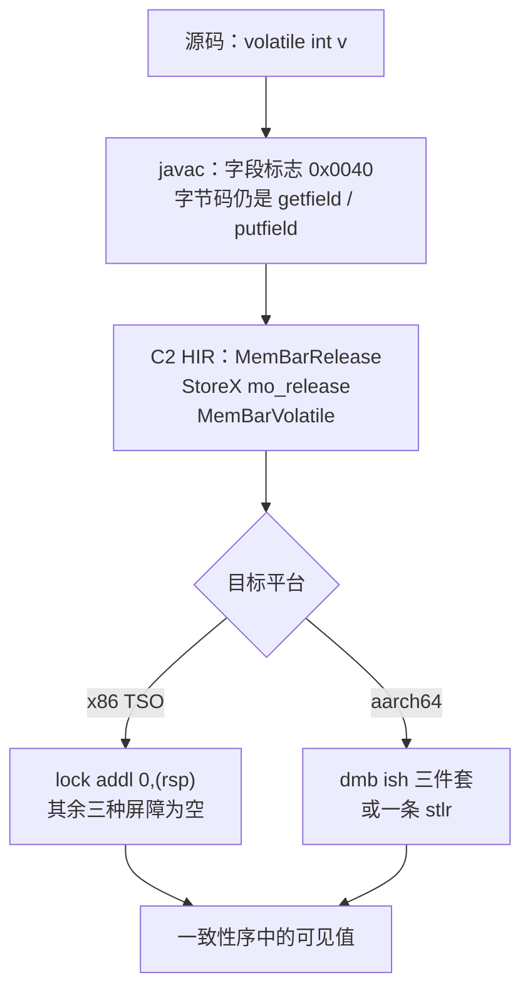
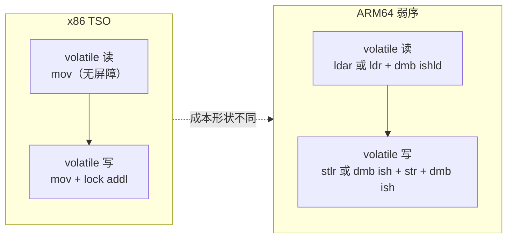
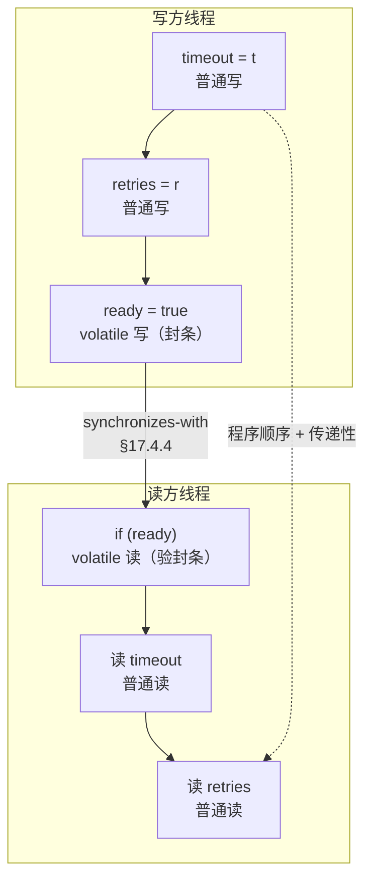
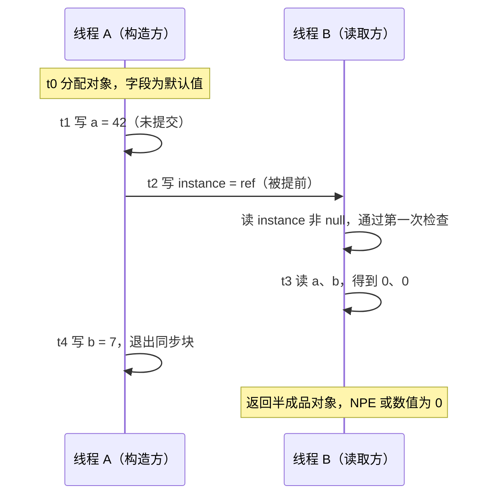
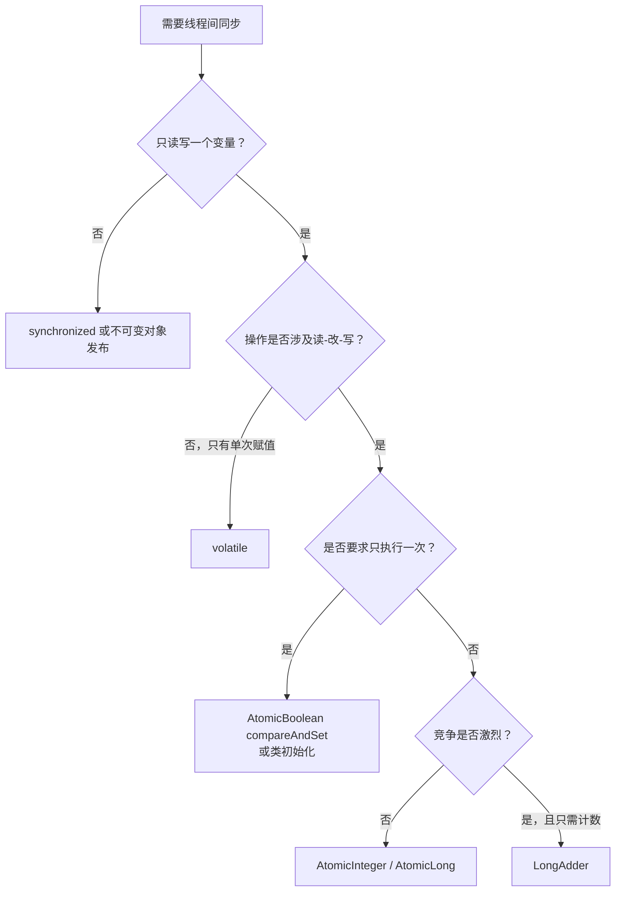
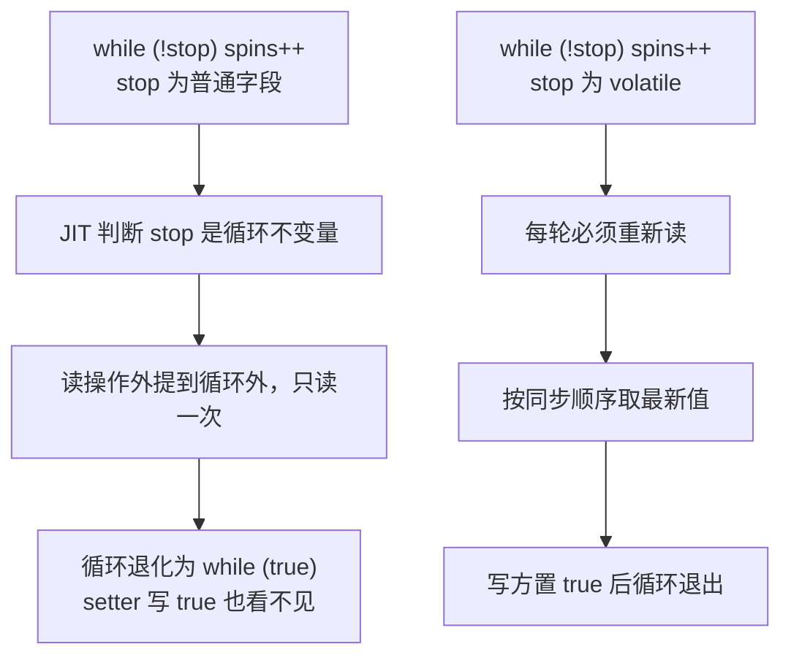

# 03 volatile 的实现原理——内存屏障与禁止重排序

**摘要：**

`volatile` 的语义在 2004 年随 JSR-133 定稿时被重新写过一次。在此之前，它只是一条含糊的"建议直接读写主内存"，既不禁重排序，也不保证 64 位整体读写的原子性；在此之后，它变成了一份精确契约，由四句规范原文、四种内存屏障和若干条机器指令共同兑现。本文沿着"规范 → javac → JIT → CPU"这条链往下走：先拆开 JLS 里那四句话，指出 `volatile` 其实是三条语义而非两条，其中被普遍忽略的第三条是**单次读写的原子性**；再看 `ACC_VOLATILE` 这个 `0x0040` 标志如何一路走到 x86 的 `lock addl` 与 ARM64 的 `dmb ish`，为什么 x86 的四种屏障里有三种在机器码上是空的，而只有 StoreLoad 需要真指令。随后把 happens-before 的建立过程拆成"一条边、两条屏障、四个动作"，给出安全发布的模板；用两次死亡与一次复活的叙事讲清 DCL 为什么在 JDK 5 之前连加 `volatile` 也救不回来，以及今天依赖它的程度为什么降低了、却仍然推荐写。文章的后半段专门处理 `volatile` 的权限边界：读-改-写、检查再执行、多变量不变式这三类失效，`volatile` 数组与 `volatile` 引用只保护引用本身，JIT 在它面前被禁掉的那些优化，`long`/`double` 的撕裂许可，最后给出一份标注为量级判断的成本清单与替代方案选择矩阵。

---

## 第 1 章 三条语义，而不是两条

### 1.1 规范原文比"三条语义"更精确

关于 `volatile` 的通俗说法通常只有两条：可见性与禁止重排序。这个总结不算错，但它漏掉了规范里明确写出的第三条，同时把第一条的强度说高了一档。把 JLS 的相关条文摊开来看，`volatile` 的语义其实是由四句话拼起来的。

第一句在 §8.3.1.4：`A field may be declared volatile, in which case the Java Memory Model ensures that all threads see a consistent value for the variable.` 这里的关键词是 **consistent（一致）**，不是 **immediately（立即）**。规范承诺的是"所有线程看到同一个值"，而不是"写完的下一秒所有线程都能看到"。后者涉及时间，JMM 从头到尾没有给出任何时间上界。

第二句与第三句在 §17.4.4 与 §17.4.5，说的是一回事的两面：对 `volatile` 变量 v 的写 synchronizes-with 此后所有对 v 的读（按同步顺序定义"此后"）；等价地，对 `volatile` 字段的写 happens-before 此后每一次对同一字段的读。这一句话就是 `volatile` 能当信号旗用的全部资本。

第四句藏在 §17.4.7 的良构执行条件里，名字叫同步顺序一致性（synchronization-order consistency）：对任意一次 `volatile` 读 r，它读到的写 W(r) 在同步顺序里必须是该变量在 r 之前最近的那次写，不允许绕过它去读一个更旧的值。这一条才是"`volatile` 读一定能看到最新值"的规范来源，而它的表述对象是同步顺序，仍然与物理时间无关。

这四句话之间还有一个容易被忽略的性质。§17.4.4 规定同步顺序是对一次执行中所有同步动作的全序，`volatile` 读写属于同步动作，所以一次执行里所有 `volatile` 访问共享同一个全序。这意味着程序里即使有多个 `volatile` 变量，它们之间的先后依然可以被完整地排出序来，而不是各排各的。这条性质在推导"用两个 `volatile` 标志互相握手"这类代码时才真正派上用场。

完整的那套 happens-before 规则（程序顺序、监视器锁、线程启动与终止等）已经在 [[02 Java 内存模型（JMM）——happens-before 与可见性保证]] 里列全，这里只取与 `volatile` 直接相关的那一条边。

### 1.2 可见性：一致，而不是即时

把第一句读准，能省掉很多误解。`volatile` 保证的是缓存一致性意义上的可见性：写方的值一旦进入一致性序，后续的读方就不能再看到更旧的值。它没有承诺、也无法承诺"立刻"，因为写方执行 `volatile` 写的那一刻，值可能还躺在 Store Buffer 里，需要被推送到能对其他核心可见的层级，这个推送的时长取决于微架构，而不取决于 Java 规范。

这个区别在排障时会变得很具体。假设一个线程写 `volatile` 标志、另一个线程轮询它，从写返回到读方观察到新值之间的间隔是多少？规范答不上来，它只说一旦观察到，观察到的就一定不是旧值。真正的保证来自实现：x86 上写方执行 `lock addl` 时必须排空 Store Buffer，读方下一次访存就能看到新值，于是时延被压到"流水线深度"的量级，实际工程中几乎可以忽略。若把这段逻辑换到某个不排空写缓冲的实现上，规范依然允许，只是时延变长。

反过来，没有 `volatile` 时的问题不是"慢"，而是"可能永远看不到"。数据竞争下读方看到一个陈旧值的时间没有上界，JIT 甚至可以把读操作整个提到循环外，让它在程序的剩余生命周期里再也不执行。这个差别是可见性讨论的真正重点：`volatile` 把"没有上界的陈旧"变成了"有界的时延"。

### 1.3 有序性：单向的门，不是双向的墙

第二个常见误解是把 `volatile` 当成一道双向全屏障，仿佛它的前后都不能互相穿越。实际语义是**单向的**：写带释放（release）语义，读带获取（acquire）语义。

具体说，`volatile` 写之前的所有内存操作不能挪到写之后，但写之后的普通写可以挪到写之前；`volatile` 读之后的所有内存操作不能挪到读之前，但读之前的普通读可以挪到读之后。四个方向里只有两个被禁止，另外两个被明确允许。这不是规范写得随意，而是刻意为之：禁止两个方向意味着每次访问都要付出全屏障的代价，而绝大多数同步协议只需要单向。

单向不等于没有收益，两个被允许的方向正是调度空间的来源，譬如编译器可以把 `volatile` 写之后的普通写提前合并、把 `volatile` 读之前的普通读推后，只要不跨过那道门即可。用一扇单向门来比喻更贴切：人可以从门里出去，但不能从外面进来；方向不取决于门本身，而取决于"写在前、读在后"的配对关系——释放与获取必须成对出现，缺一半的屏障没有意义。

| 位置关系 | 是否允许重排序 | 由哪条屏障阻止 |
| :--- | :--- | :--- |
| 普通写 → `volatile` 写 | 不允许 | 写前 StoreStore |
| `volatile` 写 → 后续普通写 | 允许 | 无屏障 |
| `volatile` 写 → 后续普通读 | 不允许 | 写后 StoreLoad |
| 普通读 → `volatile` 读 | 允许 | 无屏障 |
| `volatile` 读 → 后续普通读 | 不允许 | 读后 LoadLoad |
| `volatile` 读 → 后续普通写 | 不允许 | 读后 LoadStore |

### 1.4 第三条：单次读写的原子性

第三条语义很少被单独拎出来讲，但它在规范里写得很硬：`volatile` 的 `long`/`double` 读写一律原子，引用的读写一律原子，`volatile` 读必须读到同步顺序中最近的那次写。前两条来自 §17.7，最后一条来自 §17.4.7，三者合起来给出的能力是：一次 `volatile` 访存是不可分割的、且不会读到"半新半旧"的值。

它在 64 位平台上几乎看不见效果，因为硬件本来就用一条指令完成 64 位访存；它在 32 位 JVM 上曾经是实打实的补丁，否则一个 `volatile long` 的写会被拆成两次 32 位写，读方可能读到高 32 位来自新值、低 32 位来自旧值的拼接结果。规范到今天仍然保留这条许可，原因见第 9 章。

第三条语义最容易被误读成"`volatile` 保证原子性"，两者差着一个数量级：它只保证"一次读"或"一次写"这个动作是原子的，不保证"读一次、算一下、再写一次"这个序列是原子的。`i++` 在字节码层面是四条指令，`volatile` 管得住其中两条，管不住它们之间的空隙。这个区分之所以重要，是因为它是 `volatile` 误用里最常见的一类，而错误代码往往在单线程测试中完全正常。

| 语义 | 规范出处 | 实现手段 | 什么情况下不成立 |
| :--- | :--- | :--- | :--- |
| 可见性（一致值） | JLS §8.3.1.4、§17.4.4 | 写后 StoreLoad 排空写缓冲 | 无 `volatile` 时读方可见时间无上界 |
| 有序性（单向屏障） | JLS §17.4.5、§17.4.4 | 写前 StoreStore、写后 StoreLoad、读后 LoadLoad/LoadStore | 与屏障无关的普通变量之间仍可任意重排 |
| 单次读写原子 | JLS §17.7、§17.4.7 | 硬件单指令 + 同步顺序一致性 | 读-改-写、检查再执行、多变量不变式 |

---

## 第 2 章 一次 volatile 访问的四段旅程

### 2.1 第一段：字节码只留下一个 0x0040

`volatile` 在类文件里留下的东西少得令人意外：字段访问标志里的一个比特，别的什么都没有。用一段最小代码配合 `javap -v` 就能看清这一点：

```java
public class Probe {
    volatile int v;
    volatile long vl;
    int n;
    void inc() { v++; }
}
```

对编译产物执行 `javap -p -v`，字段部分输出如下（JDK 17，其余版本一致）：

```text
volatile int v;
  descriptor: I
  flags: (0x0040) ACC_VOLATILE

volatile long vl;
  descriptor: J
  flags: (0x0040) ACC_VOLATILE

int n;
  descriptor: I
  flags: (0x0000)
```

`ACC_VOLATILE` 的值是 `0x0040`，JVMS §4.5 表 4.5-A 给它的解释只有四个单词：`Declared volatile; cannot be cached`。同一个类里的普通字段 `n`，标志位是 `0x0000`，除此之外与 `v` 没有任何差别。

方法体里同样看不出痕迹。`inc()` 的字节码是：

```text
0: aload_0
1: dup
2: getfield      #7    // Field v:I
5: iconst_1
6: iadd
7: putfield      #7    // Field v:I
10: return
```

`getfield` 与 `putfield` 就是普通的字段访问指令，没有 `getfield_volatile` 这样的专用操作码，字节码里也没有任何与屏障对应的指令。`volatile` 的全部信息，就是那个 `0x0040`。

### 2.2 第二段：JVMS 第 6 章里没有 volatile 这个词

把 JVMS 第 6 章（指令集）通读一遍会发现一件更彻底的事：整章正文里一次都没有出现 "volatile"。字段访问指令的语义描述、操作数栈的进出规则、异常与解析行为，全部按普通字段写。顺序性、原子性、可见性这些义务，压根不在字节码这一层。

这不是疏漏，而是分层设计的结果。字节码要保证的是"在各平台上有相同的解释结果"，而这恰恰不能把内存序写进指令集：同一份 `class` 文件要在 x86、ARM64、RISC-V 上跑，各家的弱序程度不同、可用指令不同，把屏障写进字节码等于把某个硬件模型钉进标准。于是 JVMS 只在字段标志上留一个记号，把"这个记号意味着什么"交给 `class` 文件的消费方，也就是 JVM 实现。

这条分层线索解释了几个现象：同一个 `class` 文件在不同 CPU 上生成的机器码完全不同；`volatile` 的成本只能按平台讨论，没有全局结论；以及为什么反编译工具看不出任何"同步代码"，因为同步代码根本不在字节码里。

### 2.3 第三段：C2 的 MemBar 节点

JIT 接手后才真正出现"屏障"这个概念。HotSpot 的 C2 编译器不去动字节码指令，它在自己的中间表示里给 `volatile` 访问套上一串 MemBar 节点。OpenJDK 源码里对这段转换有一段相当罕见的、写得像教程一样的注释（位于 `cpu/aarch64/aarch64.ad`，描述的是平台无关的 HIR 形态）：

```text
// A volatile write is translated to the node sequence
//
//   MemBarRelease
//   StoreX[mo_release] {CardMark}-optional
//   MemBarVolatile
```

读方向的节点序列则是先一个带获取语义的加载，再跟一个 `MemBarAcquire`：

```text
//   LoadX[mo_acquire]
//   MemBarAcquire
```

三种 MemBar 节点分别对应 JSR-133 Cookbook 里的屏障类型：`MemBarRelease` 覆盖 StoreStore 与 LoadStore 的"不能往后挪"，`MemBarAcquire` 覆盖 LoadLoad 与 LoadStore 的"不能往前挪"，`MemBarVolatile` 是那个贵重的 StoreLoad。`{CardMark}` 是 GC 的写屏障，只有分代收集器在跨代引用时才插入，与内存序无关，但它夹在两个屏障之间，读反汇编时容易把两者混淆。

### 2.4 第四段：四种屏障的插入点

到了指令选择阶段，四种屏障各有固定位置。下面这张表把 JSR-133 Cookbook 的规则、C2 的节点和两套目标平台的实际编码对齐，是理解后面两章的地图：

| 屏障类型 | 插入位置 | 阻止的重排序 | x86 实际编码 | aarch64 实际编码 |
| :--- | :--- | :--- | :--- | :--- |
| StoreStore | `volatile` 写之前 | 前面的普通写越到 `volatile` 写之后 | 空（仅有编译器屏障） | `stlr` 自带，或 `dmb ish` |
| StoreLoad | `volatile` 写之后 | 后面的读越到 `volatile` 写之前 | `lock addl $0x0,(%rsp)` | `dmb ish` 或 `stlr` 自带 |
| LoadLoad | `volatile` 读之后 | 后面的读越到 `volatile` 读之前 | 空（仅有编译器屏障） | `ldar` 自带，或 `dmb ishld` |
| LoadStore | `volatile` 读之后 | 后面的写越到 `volatile` 读之前 | 空（仅有编译器屏障） | 同 `dmb ishld` |

有两处不对称值得单独说明。第一，`volatile` 读之前不插任何屏障。读操作不承担"让我的结果被别人看见"的义务，它只需要保证自己不读到旧值、且不把后面的操作吸到前面来，两者都由读后的屏障覆盖。第二，StoreLoad 放在写后而不是读前。两种放法在语义上等价，差别只在把代价记在谁头上：写在典型程序里远比读稀少，把最贵的屏障摊给写方，整体更划算。JMM 最终选了写后，这个选择本身是工程权衡而非逻辑必然。

把这段旅程画成一条纵向链路，各层的义务分工就清楚了。



上图的读法是从上往下：每一层只负责自己的那部分义务，越往下越贴近硬件，也越不可移植。前三层是可移植的契约，最后一层是各厂商自己兑现的方式。

---

## 第 3 章 x86 的 lock addl 与 ARM 的 dmb ish

### 3.1 TSO：三种屏障在机器码里是空的

x86 的内存模型是 TSO（Total Store Order），它对普通访存只留一个口子：写可以被延迟并重排到后面的读之前，其余五种排列组合全部由硬件保证。这与 [[01 并发编程的硬件基础——CPU 缓存、MESI 与内存屏障]] 里对 Store Buffer 的分析对得上——读立即执行，写进入先进先出队列异步串行化，队列里唯一能被后来者超越的排列正是读越过写。于是四种屏障里只有 StoreLoad 需要真指令。

OpenJDK 把这件事写在了头文件里。`os_cpu/linux_x86/orderAccess_linux_x86.hpp` 中：

```text
inline void OrderAccess::loadload()   { compiler_barrier(); }
inline void OrderAccess::storestore() { compiler_barrier(); }
inline void OrderAccess::loadstore()  { compiler_barrier(); }
inline void OrderAccess::storeload()  { fence();            }
inline void OrderAccess::acquire()    { compiler_barrier(); }
inline void OrderAccess::release()    { compiler_barrier(); }
```

`compiler_barrier()` 是一个空的 `asm volatile ("" : : : "memory")`，它告诉 C++ 编译器"别把这些访存挪过这一行"，本身不产生任何机器指令。指令选择层也印证了这一点：`x86.ad` 里 `membar_acquire`、`membar_release`、`membar_storestore` 三条规则的编码都是 `ins_cost(0)` 与 `size(0)`，反汇编列表里会打印成 "(empty encoding)"；只有 `membar_volatile`、`membar_storeload`、`membar_full` 三条给出真指令，成本记为 400、使用 slow 管道。

不过**空的只是机器码**这句话需要一句注脚。编译器屏障虽然不占一个字节，但它拦住的是另一类重排序：JIT 与后端优化器自己产生的指令移动。若把它也去掉，`volatile` 写之前的普通写完全可能被编译器挪到写之后，硬件再有序也救不回来。所以在 x86 上，`volatile` 写前的那道屏障的实质是"给编译器看的"，不是"给 CPU 看的"。

`volatile` 读在 x86 上因此真的几乎免费：`membar_acquire` 是空编码，读本身是一条普通 `mov`，与读普通字段的机器码逐字节相同。成本差异全部体现在编译器不能再对这个读做手脚，也就是第 8 章要展开的那些限制。

### 3.2 为什么偏偏是 lock addl

StoreLoad 在 x86 上有两条路：`mfence` 与带 `lock` 前缀的读-改-写指令。HotSpot 走了后者，理由写在源码注释里，只有一句：

```text
// always use locked addl since mfence is sometimes expensive
__asm__ volatile ("lock; addl $0,0(%%rsp)" : : : "cc", "memory");
```

`lock addl $0,0(%rsp)` 做的是"给栈顶那个 4 字节槽位加 0"，结果不变，但 `lock` 前缀强制这条指令按原子读-改-写执行，实现上要求核对该缓存行取得独占权，同时产生全屏障效果：之前的所有写必须提交到一致性域，之后的读不能提前。选择栈顶作为目标不是随意为之：栈顶几乎总是处于该核独占的 M 态，加锁不必去别处抢缓存行，额外的一致性流量最小。若换一个共享变量做 `lock add`，这条屏障指令本身就会变成缓存行争用的源头。

`mfence` 语义更直接，但在不少微架构上代价更高，源码注释里那句 "sometimes expensive" 说的就是这件事。HotSpot 的取舍由此确定：宁可让反汇编列表里出现一条看起来莫名其妙的 `addl $0x0,(%rsp)`，也不使用 `mfence`。

### 3.3 ARM64：三件套，或一条指令

ARM64 是弱序模型，除依赖关系外几乎所有重排序都被允许，四种屏障都得落地。OpenJDK 在 `aarch64.ad` 里给出了两种编码路径，注释同样写得非常直白：

```text
// for a volatile read we need
//
//   ldar<x>
//
// Alternatively, we can implement them by pairing a normal
// load/store with a memory barrier. For a volatile read we need
//
//   ldr<x>
//   dmb ishld
//
// for a volatile write
//
//   dmb ish
//   str<x>
//   dmb ish
```

也就是说，ARM64 上存在"三件套"与"一条指令"两条路：能识别出 `volatile` 访问的签名时，C2 直接把 `MemBarRelease` 与 `MemBarVolatile` 的翻译抑制掉，改用一条 `stlr`（Store-Release）；识别不出签名时，退回 `dmb ish` + 普通 `str` + `dmb ish` 的保守形态。读方向的 `ldar`/`ldr` + `dmb ishld` 遵循同一逻辑。

`dmb ish` 是"数据内存屏障、内部共享域"（Data Memory Barrier, Inner Shareable），它保证屏障之前的内存访问对同一共享域内的其他核可见之后，屏障之后的访问才能开始；`dmb ishld` 是它的读方向子集，只约束读。`stlr`/`ldar` 则是 ARMv8 新加的"带序访存"，把单向屏障编进访存指令本身，省掉一条独立屏障指令的取指与调度开销。

HotSpot 还会主动合并相邻的 DMB。`MacroAssembler::membar` 里有一段逻辑，若上一条指令也是 DMB 且是紧邻的，就把两个屏障按位或成一个；代码注释里还专门提醒，不能把 `DMB ST` 与 `DMB LD` 合并成完整的 `DMB`，因为那会引入调用方没打算要的 StoreLoad。这类优化说明一件容易被忽视的事：JIT 在插入屏障的同时也在尽力减少屏障，`volatile` 的成本不是一个固定常数。

### 3.4 两种指令集的成本形状完全不同

把两条路径并排看，差异不在"谁更快"，而在成本分布的形状：

| 操作 | x86 机器码 | aarch64 机器码 | 成本分布 |
| :--- | :--- | :--- | :--- |
| `volatile` 读 | 普通 `mov`，无附加指令 | `ldar`，或 `ldr` + `dmb ishld` | x86 近乎零，ARM 每次读都要付 |
| `volatile` 写 | 普通 `mov` + `lock addl` | `stlr`，或 `dmb ish` + `str` + `dmb ish` | 两边都要付，x86 是全屏障 |
| 普通写后读 | 可重排（StoreLoad） | 可重排 | 与 `volatile` 无关 |
| 读多写多的代码 | 读免费、写昂贵 | 读写都收费 | 选型结论不能平移 |

这个形状差异直接决定了一件事：在 x86 桌面上做出来的 `volatile` 性能结论，不能平移到 ARM 服务器或移动端。同一段代码在 x86 上"读几乎免费"是硬件白送的，ARM 没有这份礼物，每次 `volatile` 读都要多一条指令或一次屏障。把读频率高的路径改成"读一次进局部变量"，在 x86 上只省编译器约束，在 ARM 上还能省真指令，两种平台的收益不同，但方向一致。

把两条路径并排放到一张图里，成本落在哪一侧就一目了然。



---

## 第 4 章 happens-before 是怎么被搭出来的

### 4.1 一条边，两条屏障，四个动作

`volatile` 最有价值的能力不是保护自己，而是替别的变量作保。它靠一条 happens-before 边做到这件事，而这条边的物理形态是两条屏障。

规范层面的推导不长：写方先做若干普通写，再做 `volatile` 写；读方先做 `volatile` 读，再做若干普通读。程序顺序给出"普通写 → `volatile` 写"与"`volatile` 读 → 普通读"两条 hb 边，§17.4.4 给出"`volatile` 写 → `volatile` 读"这第三条边，传递性把首尾连起来，于是写方的普通写 happens-before 读方的普通读。

硬件层面的实现是同一件事的另一种说法。写方执行 `volatile` 写前，StoreStore 屏障把之前那些普通写的效果推到一致性域；写后的 StoreLoad 排空写缓冲，确保 `volatile` 写的效果不会比它们更早暴露。读方执行 `volatile` 读后，LoadLoad 与 LoadStore 屏障保证后续的普通读不会用上比 `volatile` 读更旧的缓存副本。两条屏障夹着一个 `volatile` 变量，形成一个"释放—获取"的配对，中间的值就是被安全传递的那批普通变量。

用物流打个比方：普通变量是装在车厢里的货，`volatile` 写是贴封条，`volatile` 读是验封条，之后的普通读是卸货。封条本身不保护货物，它保护的是"验封条的时候货已经装齐"这个顺序关系；封条撕开后货物是否完好，取决于装货时有没有乱塞。这个比喻的边界也需要说明：现实里封条被撕就作废，而 `volatile` 变量可以被反复读写，每一轮都是一次新的封条。

### 4.2 安全发布的模板

把上面的推导写成代码，就是 `volatile` 唯一值得背下来的模板：

```java
final class Config {
    private int timeout;        // 普通字段，多个
    private int retries;
    private volatile boolean ready;   // 信号旗，只有一个

    // 写方：先填数据，最后立旗
    void publish(int t, int r) {
        timeout = t;            // 普通写
        retries = r;            // 普通写
        ready = true;           // volatile 写：封条
    }

    // 读方：先验旗，再读数据
    void consume() {
        if (ready) {            // volatile 读：验封条
            use(timeout, retries);   // 普通读，此时保证看到 t、r
        }
    }
}
```

模板的要点有三个，每一个都能独立地写错。

第一，`volatile` 变量必须放在**最后写、最先读**的位置。写序反过来——先立旗再填数据——所有的屏障都白插了，因为屏障只保证"写之前的东西不会被挪到写之后"，它不检查你写之前到底放了什么。第二，读方必须先读 `volatile` 再读普通字段，顺序反过来同样失效，此时普通读可能取到旧值而 `volatile` 读还没发生，中间没有任何屏障。第三，被传递的普通变量必须有明确的"写完不再改"约束，否则读方拿到的是一个合法但混杂的快照：每个字段的值都来自某次真实写入，但这些值不一定来自同一次发布。

第三点最容易被低估。`volatile` 建立的是顺序，不是快照隔离；多个普通字段在发布之后仍被并发修改时，读方看到的组合可以是任何满足一致性的结果。要得到"整组数据要么全旧、要么全新"，只有把整组数据装进一个不可变对象，再用一个 `volatile` 引用发布它。

把这条链画成一张图，三条边分别来自程序顺序与 §17.4.4 的同步关系。



### 4.3 发布一次，读一次

有一条从上面的约束里长出来的惯用法：`volatile` 引用**读一次就存进局部变量**，后续全部用这个局部变量。

```java
private volatile Snapshot snapshot = Snapshot.empty();

void render() {
    Snapshot s = snapshot;      // 只读一次 volatile
    if (s != Snapshot.empty()) {
        paint(s.width, s.height, s.items);   // 后续都基于同一个快照
    }
}
```

理由有两层。语义层：两次读 `volatile` 字段是两次独立的读，中间可能夹着别处的写，第二次读到的可能是另一个对象，于是 `s.width` 与 `s.height` 可能来自不同快照。性能层：每次 `volatile` 读在 x86 上要付编译器约束、在 ARM 上还要付一条指令，循环条件里反复读同一个字段纯属浪费。

同一个道理在循环条件上更明显。`while (!stopped)` 每轮都要读一次 `volatile`，这是必需的，不能提到循环外，第 8 章会给出反面实验。但循环条件里的其他 `volatile` 字段没有必要每轮重读，先取到局部变量再判断更划算，这一点在缓存行频繁失效时差别明显。

### 4.4 final 字段：另一半保证

`volatile` 不是安全发布的唯一手段，另一半在 `final` 字段语义里。JLS §17.5.1 定义了一个叫冻结（freeze）的动作：对对象 o 的 `final` 字段 f，冻结动作发生在"构造 o 的那个构造函数退出时，无论是正常返回还是异常抛出"。规范随后保证，只要一个线程能看到 o 的引用，并且该引用是在构造完成之后才被它得到的，它就能看到 f 的正确值，哪怕这个引用是通过数据竞争传过来的。

这条保证的分量在 ARM 上才看得出来。`aarch64.ad` 的注释里专门提了一句：构造函数末尾如果写了 `final`/`volatile` 字段，会看到一个 `MemBarRelease`，这个节点必须落成 `dmb ish`，"lest we risk the constructed object being visible without making the final/volatile field writes visible"——否则构造出来的对象可能在字段写入可见之前就被别的核看到。x86 上同一个节点是空编码，因为 TSO 保证了两次写之间的顺序。

于是发布一个对象时的正确性可以拆成两笔账：对象内部 `final` 字段的初始化安全由冻结动作负责，对象引用本身的可见性与"构造完成之后才可见"的顺序由 `volatile` 负责。**两笔账不能互相替代**，`volatile` 管不了非 `final` 字段的初始化次序，`final` 也管不了引用什么时候被看见。

---

## 第 5 章 DCL：两次死亡与一次复活

### 5.1 第一次死亡：二〇〇〇年的联署宣言

双重检查锁定（Double-Checked Locking，DCL）的坏名声来自一份联署声明。Bacon、Bloch、Click、Lea、Pugh 等十余人在《The "Double-Checked Locking is Broken" Declaration》中给出结论：这个惯用法在没有额外同步的前提下，无法在 Java 里做到平台无关地正确工作。宣言里列出的第一条理由，正好落在 `volatile` 的语义缺口上：

```text
// The most obvious reason it doesn't work is that the writes that
// initialize the Helper object and the write to the helper field
// can be done or perceived out of order.
```

同一份宣言接下来把编译器的角色也点明了：如果编译器把构造函数的调用内联进来，那么"初始化对象的那些写"与"给引用赋值的那个写"，只要编译器能证明构造函数不会抛异常、不包含同步点，就可以自由互换顺序。这句话把问题的性质说清楚了——它不是某台机器上的偶发现象，而是一段合法代码允许出现的执行结果。

这里的重排序属于 StoreStore 类型：引用赋值往前挪，挪到字段写入之前。对单线程来说这种移动完全无害，因为构造函数的写与引用的写之间没有依赖，也没有其他线程能观察到中间态；对多线程来说它是致命的，因为另一个线程可能先看到引用、再去看字段。

x86 上这个错误经常"看不见"，这恰好是它流传了五年的原因。TSO 不在两次写之间换序，硬件这一层把它挡住了；只有在编译器层面换序、或者换到弱序平台（当年的 Alpha、PowerPC，今天的 ARM）才会暴露。开发机上永远是对的代码，在生产环境里偶发空指针，诊断难度极高。

### 5.2 第二次死亡：final 语义当时也不存在

在 JDK 5 之前，唯一的"绕过"思路是让被发布的对象不可变：所有字段都是 `final`，那么即使读到引用与字段写入之间的顺序被打乱，字段值也已经定型。这个思路在 1.5 之后确实成立，但在 1.5 之前同样不成立，因为当时 JLS 第 17 章里根本没有冻结动作，没有"只要能看到引用就能看到 `final` 字段正确值"这条保证。JSR-133 才把这条语义补进规范。

于是 1.4 及更早的处境是：`volatile` 不提供释放语义，`final` 不提供初始化安全，两条路同时堵死。这不是"再加一个关键字就能修好"的问题，而是规范层面的缺口，只能等一次完整的 JMM 修订。

### 5.3 错误版本的行为推演

先把错误版本摆出来，注意它长得完全正常：

```java
final class WrongDcl {
    private static WrongDcl instance;      // 没有 volatile
    private final int a;
    private final int b;

    private WrongDcl() {
        a = 42;                            // 字段写
        b = 7;
    }

    static WrongDcl get() {
        if (instance == null) {            // 第一次检查
            synchronized (WrongDcl.class) {
                if (instance == null) {    // 第二次检查
                    instance = new WrongDcl();
                }
            }
        }
        return instance;
    }
}
```

把执行摊在时间轴上，可以看清错在哪个缝里。假设线程 A 首次调用 `get()` 并进入同步块，线程 B 随后调用：

| 时刻 | 线程 A 的动作 | 线程 B 的动作 | B 观察到的对象状态 |
| :--- | :--- | :--- | :--- |
| t0 | 分配对象，字段被清零 | — | 引用尚不可见 |
| t1 | 写 `a = 42`（未提交） | — | 引用尚不可见 |
| t2 | 写 `instance = ref`（被提前，或先被看到） | 读 `instance`，非 null，通过检查 | 引用可见，字段仍为默认值 |
| t3 | 写 `b = 7` | 读 `a`、`b` | 读到 `a = 0`、`b = 0` |
| t4 | 退出同步块 | 返回一个"半成品"对象 | 对象此时才真正完整 |

失败形态不是"读到 null"，而是"读到一个**看起来合法、字段却是默认值**的对象"。调用方拿到它以后，`int` 字段读出 0、`Object` 字段读出 null，崩在离事发地点很远的地方。更麻烦的是它无法稳定复现：只有在 t2 与 t3 之间被另一个线程插进来才会发生，而这个窗口在 x86 上通常只有编译器换序才能撑开。

把上表的执行摊成时序图，错误的来源比文字描述更直接。



### 5.4 复活：两条屏障各管一件事

JDK 5 之后，给引用加上 `volatile` 就修好了这个问题，修好的方式正好对应第 1 章拆出的语义：

```java
final class RightDcl {
    private static volatile RightDcl instance;   // 关键：static 且 volatile
    private final int a;
    private final int b;

    private RightDcl() {
        a = 42;
        b = 7;
    }

    static RightDcl get() {
        RightDcl local = instance;                // 只读一次 volatile
        if (local == null) {
            synchronized (RightDcl.class) {
                local = instance;
                if (local == null) {
                    local = new RightDcl();
                    instance = local;             // volatile 写：封条
                }
            }
        }
        return local;
    }
}
```

写侧起作用的是写前的 `MemBarRelease`：它阻止构造函数里的字段写被挪到 `instance = local` 之后，等于给这段初始化加了一道"先装货、后贴封条"的约束。读侧起作用的是读后的 `MemBarAcquire`：它阻止后续对 `a`、`b` 的读被挪到 `instance` 读之前，等于"先验封条、再卸货"。

两件事需要单独强调。其一，字段必须声明为 `static`，静态工厂方法才能访问，这是把示例从"能编译"变成"能运行"的第一步，实例字段写在静态方法里的版本根本过不了编译。其二，上面这段代码把 `volatile` 读的结果存进了 `local`，这既是 4.3 节的惯用法，也顺手消除了同步块内重复读字段的问题。

`volatile` 在这里承担的是"发布"职责，不是"互斥"职责：保证只构造一次的是 `synchronized` 与第二次检查，`volatile` 只保证"构造完成之后引用才可见、引用可见时字段已写入"。两者分工清晰，少任何一个都不行。

### 5.5 只靠 final 的 DCL：能工作，但缺口在及时性

Pugh 的宣言里还有一段常被引用的话：如果 `Helper` 是不可变对象、所有字段都是 `final`，那么 DCL 不加 `volatile` 也能工作。理由正是 4.4 节的冻结动作——对象一旦被看到，`final` 字段的值就一定是构造完成后的值，不存在"看到引用却看到默认值"的中间态。

"如今 DCL 对 `volatile` 的依赖降低了"这个说法就来自这里：初始化安全多了一个来源，`final` 字段语义。但降低不等于取消，而且这个来源的边界很窄。第一，它要求对象的所有字段都是 `final`；哪怕只多一个非 `final` 字段，保证立刻失效，而现实里的配置对象、缓存条目很少能做到全 `final`。第二，它要求构造期间 `this` 没有泄漏出去（注册回调、放进静态集合、启动内部线程都会泄漏）。第三，也是最容易被忽略的一条：冻结动作只保证"看到引用之后，`final` 字段对得上"，它不承诺引用本身在多长时间内可见。数据竞争下的读没有 hb 边约束，JMM 也没有给任何**时间上界**，读方长期看到 null 是规范允许的行为。

前两条是正确性边界，第三条是性能与活性边界。正因为第三条，即便对象的字段全是 `final`，工程上仍然推荐把那个引用写成 `volatile`：一行关键字的代价换来"写到可见"的有界时延，这笔交易几乎总是划算的。

### 5.6 更省事的写法

如果目标只是"懒加载一个不可变对象"，其实可以完全避开 DCL 与可见性的纠缠，用初始化占位类（lazy initialization holder）惯用法：

```java
final class Holder {
    private Holder() {}

    private static final class Lazy {
        static final Holder INSTANCE = new Holder();   // 类初始化时建立 hb
    }

    static Holder get() {
        return Lazy.INSTANCE;    // 只有第一次访问触发 Lazy 的初始化
    }
}
```

它能工作的机制与 `volatile` 无关，靠的是类初始化锁：JVM 保证类的静态初始化只执行一次，且初始化完成 happens-before 后续对该类的首次主动使用。这条路径没有同步开销，也没有可见性缺口，是懒加载单例的默认答案。若单例本身就允许立即创建，一个 `enum` 或 `static final` 字段更简单。

DCL 值得保留的场景，只剩"初始化代价高、且初始化时机必须延迟到第一次使用"这一类。写它的时候把 `volatile` 写全，成本可以忽略；省掉它换来的是一个只在弱序平台上偶发、且无法复现的缺陷。

---

## 第 6 章 volatile 不能做什么

### 6.1 失效一：读-改-写

`i++` 是最经典的失效样本。除掉把 `this` 压栈的两条，它在字节码层面的核心是四条指令：`getfield` 取值、`iconst_1` 压入常量、`iadd` 相加、`putfield` 写回。`volatile` 让 `getfield` 与 `putfield` 各自成为原子且可见的操作，但中间那条 `iadd` 是在操作数栈与寄存器里完成的，两个线程可以同时取到同一个旧值。

这一点不需要推理，跑一下就看得见。四个线程各做 20 万次自增，合计期望 80 万：

```java
static volatile int counter = 0;   // 四线程各 counter++ 二十万次
```

在 JDK 17、ARM64 macOS 上连续跑三次，实测结果分别是 354971、350345、496487——丢失三成到五成的更新。数字每次不同，正是竞态的特征：读与写之间的空隙越宽，被插入的机会越多。

这里的错误不在于 `volatile` 没生效，它生效了：每次读都拿到"当前最新值"，每次写也都立刻可见。问题在于**"当前最新值"在下一刻就可能过期**，而 `i++` 的语义要求"基于我读到的那个值"完成整个变换。要满足这个要求，要么把三步压成一条原子指令（CAS 或 `lock xadd`），要么用互斥把三步圈起来。原子类的内部机制见 [[05 CAS 与原子类——Unsafe、AtomicInteger 到 LongAdder 的演进]]，这里只给结论与选型：竞争温和时用 `AtomicInteger`，竞争激烈且只需计数时用 `LongAdder`。

### 6.2 失效二：检查再执行

第二类失效是"先检查、再动作"，检查与动作之间没有原子性：

```java
private volatile boolean inited = false;

void initOnce() {
    if (!inited) {          // 两个线程可能同时看到 false
        doInit();           // 于是初始化跑了两遍
        inited = true;
    }
}
```

这段代码的失败方式很隐蔽：如果 `doInit()` 本身幂等，程序行为看起来正确，只是多跑了一遍；如果不幂等（注册监听器、打开文件、递增计数器），就会留下重复的副作用。用 `volatile` 改造这一段的所有尝试都会回到同一个结构性问题——`volatile` 只保证每次读看到的是最新值，不保证"读到 false 之后到你写 true 之前没有别人也读到 false"。

正确的做法是把"检查"和"置位"合并成一个原子操作：`AtomicBoolean.compareAndSet(false, true)`，或者直接 `synchronized`，或者用 5.6 节的类初始化惯用法。三种做法的共同点是把"判断权"与"改值权"绑在一起，而不是分成两次访问。

### 6.3 失效三：多变量不变式

第三类失效涉及成组变量。假设两个 `volatile int` 维护一个不变式：

```java
private volatile int lower = 0;
private volatile int upper = 100;
// 不变式：lower <= upper

void shift(int d) {
    lower += d;    // 与下一行之间没有原子性
    upper += d;
}
```

写方执行 `shift(d)` 时，`lower += d` 与 `upper += d` 各自是"读-改-写"，两次写之间有一个可观察的窗口。读方在这个窗口里读到的组合是 `(lower + d, upper)`，不变式被破坏：

| 时刻 | 写方（d = 200） | 读方看到的 (lower, upper) | 不变式 |
| :--- | :--- | :--- | :--- |
| t0 | — | (0, 100) | 成立 |
| t1 | 写 `lower = 200` | (200, 100) | 破坏：`lower > upper` |
| t2 | — | (200, 100) | 破坏，直到 t3 才有救 |
| t3 | 写 `upper = 300` | (200, 300) | 恢复成立 |

破坏窗口的长度只有两条指令，却足以让读方取到一个**不存在于任何完整状态里**的组合：`(200, 100)` 这个 (lower, upper) 对，在 `shift` 执行前后的任何时刻都不是真实状态。随后基于它做的越界判断、下标计算、区间裁剪都会给出错误结果。这类缺陷的排查难度高于单变量竞态，因为它不表现为某个字段是旧值，而表现为两个字段的**组合自相矛盾**。

修法只有两条：把整组变量封进一个不可变对象、用单个 `volatile` 引用发布；或者用一把锁把两次修改圈进同一个临界区。前者读无锁、写需新建对象，后者通用但读也要加锁。选哪条取决于读写的比例与对象的大小，不存在统一答案。

### 6.4 反例：标志位立早了

第 4 章强调过"`volatile` 放最后写"，实践中仍然高频出错，因为直觉会把"设置标志"当成发布动作的第一步：

```java
private volatile boolean hasResult = false;
private Result result;            // 普通字段

void produce() {
    hasResult = true;             // 错：旗子先立
    result = new Result(...);     // 数据后到
}

void consume() {
    if (hasResult) {
        use(result);              // 可能读到 null
    }
}
```

屏障只约束**写在它之前的操作不许往后挪**，`hasResult = true` 之前什么都没有，屏障无事可做；`result` 的写发生在旗子之后，读方完全可以在旗子为真、数据未写的窗口里读到 `null`。把两行调换即可修好，而这段代码的"错误版本"在无竞争时同样正常，测试再完整也测不出来。

作废路径的顺序恰好相反：要"先撤旗、再清数据"。撤旗保护的不是已经在读的老读者——他们可能刚判定完旗子为真就被切走——而是不让新读者踏进正在被清空的区域。要连老读者一起保证，就不能就地清空数据，只能把数据换成新的不可变快照、靠引用替换完成切换。

### 6.5 反例：volatile 引用与 volatile 数组只保护引用本身

`volatile` 修饰数组引用时，受保护的是那个**引用**，不是数组里的元素：

```java
private volatile int[] table = new int[16];

void set(int i, int v) {
    table[i] = v;     // 等价于 getfield table + iastore，元素访问无 volatile 语义
}
```

`table[i] = v` 先读引用（这一步受 `volatile` 保护），再对元素做普通写。另一个线程即使通过 `volatile` 读拿到了同一个数组引用，也完全可能读到元素的旧值，因为元素访问没有参与同步顺序。对象同理：`volatile` 修饰一个可变对象的引用，只保证"引用指向谁"是可见的，不保证对象内部字段的可见性。

可行的写法有两条。要逐元素原子与可见，用 `AtomicIntegerArray`，或用 JDK 9 起的 `VarHandle` 拿到数组元素的访问句柄：

```java
private static final VarHandle ELEM =
        MethodHandles.arrayElementVarHandle(int[].class);

void set(int i, int v) {
    ELEM.setVolatile(table, i, v);    // 元素级 volatile 语义
}
```

要走"整数组替换"的路线，就把数组当成不可变快照：每次修改都复制出一份新数组，改完之后用 `volatile` 引用整体发布。读方拿到的一定是某一份完整、一致的数组，代价是每次写都要复制，写多读少的场景不划算。

| 想做的事情 | `volatile` 够不够 | 正确工具 |
| :--- | :--- | :--- |
| 发布一个已构造完成的对象 | 够，且是推荐手段 | `volatile` 引用 + 全 `final` 字段 |
| 单次赋值、纯标志位 | 够 | `volatile boolean` |
| 计数、累加 | 不够 | `AtomicInteger`、`AtomicLong`、`LongAdder` |
| 只执行一次 | 不够 | `AtomicBoolean.compareAndSet`、类初始化、`synchronized` |
| 维护多个变量的不变式 | 不够 | 锁，或不可变对象 + `volatile` 发布 |
| 数组元素的并发读写 | 不够 | `AtomicIntegerArray`、`VarHandle`、复制后整体发布 |

---

## 第 7 章 三种替代：原子类、锁、单写者

### 7.1 AtomicInteger：把三步压成一步

原子类解决的是 6.1 节那个空隙：它用一条带 `lock` 前缀的读-改-写指令（或 CAS 重试循环）把"读当前值、算新值、写回"合成一个不可分割的动作，失败就重读重算。对外表现为 `incrementAndGet()` 这类方法，内部机制在 [[05 CAS 与原子类——Unsafe、AtomicInteger 到 LongAdder 的演进]] 里展开，这里只记住它的适用面：单变量、可表示为"基于旧值算新值"的变换。

`compareAndSet(expect, update)` 比自增更通用，它把"检查再执行"也一并解决了——6.2 节的 `initOnce` 用 `AtomicBoolean.compareAndSet(false, true)` 就变成正确的"只执行一次"，因为"比较"与"置位"在同一原子动作里。状态机迁移（`NEW → RUNNING → DONE`）同样适合这种写法。

### 7.2 synchronized：用互斥换不变量

只要操作涉及多个变量、或者需要"读到的值在临界区内不再变化"，`volatile` 与原子类都不够用，得靠互斥。`synchronized` 的语义是进入时获取监视器、退出时释放，临界区内的所有访问对其他线程要么整体可见、要么整体不可见，恰好覆盖 6.3 节的不变式需求。

代价模型与 `volatile` 完全不同：无竞争时它靠锁记录与 CAS 完成，代价在几十个周期量级；一旦出现真实竞争，线程会被挂起、唤醒，代价跳到内核调度量级。锁升级的细节在 [[04 synchronized 的锁升级——偏向锁、轻量级锁与重量级锁]] 里展开，这里的判断只需要一句：`volatile` 买的是"可见与有序"，`synchronized` 买的是"互斥"，后者严格更强，也更贵。

既然 `synchronized` 已经保证临界区内外的可见性，在临界区里再依赖 `volatile` 读并不会更快；同一份状态既加锁又靠 `volatile` 兜底，说明它被两个保护域同时管着，那属于设计问题，不是性能问题。

### 7.3 单写者模式：让 volatile 只负责发布

第三种思路绕开争用本身：让每个线程只写自己的数据，`volatile` 只用来发布不可变快照。

```java
final class Stats {
    private volatile Snapshot latest = Snapshot.empty();

    // 只有一个采集线程调用
    void collect() {
        Snapshot next = latest.extend(readCounters());   // 复制并修改
        latest = next;                                   // 单次 volatile 写
    }

    // 任意多个读线程
    Snapshot current() {
        return latest;                                   // 单次 volatile 读
    }
}
```

这段结构里**没有锁，也没有 CAS 重试**，写方串行、读方无锁，`volatile` 承担的是纯粹的发布职责。它的成本只有一次引用赋值加一道 StoreLoad 屏障，读方几乎零成本。第 6.5 节的"复制后整体发布"是它在数组场景下的变体。

同一种思想在计数场景下的极致形态是 `LongAdder`：把计数拆到多个 Cell 上，每个线程更新自己那个，求和时再合并，把"多核写同一缓存行"的争用消掉。它与单写者模式共享同一个洞察——当"所有线程共享一个变量"成为瓶颈时，让每个线程拥有自己的那份往往是突破口。

### 7.4 选择矩阵

把前面几节的判断压成一张表，按"变量个数 × 操作形态"选工具：

| 场景 | 变量数 | 操作形态 | 推荐工具 | 理由 |
| :--- | :--- | :--- | :--- | :--- |
| 停止标志、开关 | 1 | 单次赋值 | `volatile` | 只需可见性，无复合操作 |
| 发布不可变快照 | 1（引用） | 整体替换 | `volatile` | 引用赋值原子，快照不可变 |
| 计数器、序号 | 1 | 读-改-写 | `AtomicInteger`、`LongAdder` | 需要原子读改写 |
| 只执行一次 | 1 | 检查再执行 | `AtomicBoolean`、类初始化 | 检查与置位必须合并 |
| 多字段不变式 | 多个 | 成组修改 | `synchronized`、不可变对象 | 需要整体原子视图 |
| 高并发计数 | 1 | 读-改-写 | `LongAdder` | 分段消除缓存行争用 |
| 数组元素并发访问 | 多个 | 单元素读写 | `AtomicIntegerArray`、`VarHandle` | 元素级原子与可见 |

把选择过程画成一棵判断树，四个问题足以覆盖绝大多数场景。



---

## 第 8 章 JIT 视角：volatile 抑制了哪些优化

### 8.1 空转死循环：一个可以当场复现的实验

`volatile` 对 JIT 最直观的影响，是一个不加 `volatile` 就会挂死的循环。下面这段程序用看门狗保证实验不会真挂住：

```java
public class SpinProbe {
    static boolean stop = false;      // 改成 volatile 对比

    public static void main(String... args) throws Exception {
        Thread wd = new Thread(() -> {
            try { Thread.sleep(2000); } catch (InterruptedException ignore) {}
            System.out.println("[watchdog] 主线程仍未退出循环");
            Runtime.getRuntime().halt(7);
        });
        wd.setDaemon(true);
        wd.start();

        new Thread(() -> {
            try { Thread.sleep(200); } catch (InterruptedException ignore) {}
            stop = true;
            System.out.println("[setter] stop = true");
        }).start();

        long spins = 0;
        while (!stop) { spins++; }
        System.out.println("[main] 退出循环，自旋 " + spins + " 次");
    }
}
```

在 JDK 17、ARM64 macOS 上分别跑两种声明，输出差异非常干脆。`stop` 为普通字段时，setter 已经把 `stop` 改成 `true` 并打印，主线程仍然在循环里出不来，两秒后被看门狗强行终止：

```text
--- 非 volatile ---
[setter] stop = true
[watchdog] 主线程仍未退出循环

--- volatile ---
[setter] stop = true
[main] 退出循环，自旋 785332739 次
```

原因是最常见的循环不变量外提（Loop-Invariant Code Motion，LICM）：`stop` 在循环体里没有被修改，按单线程语义它的值在循环期间恒定，于是把读操作提到循环外只做一次，剩下的就是一个空转的死循环。这不是 JIT 的缺陷，而是 as-if-serial 语义允许的**合法变换**——单线程下行为完全一致。`volatile` 把这条路堵死：每次读都必须重新执行，因为它必须满足同步顺序一致性。

规范对挂死本身也是宽容的。JLS §17.4.9 把 hang 明确列为一种允许的可观察行为，并说明"程序可以在不产生外部动作的情况下执行无界数量的动作"。换句话说，上面那个两秒后被强行终止的程序，其行为在规范之内。

工程上的推论有两条。第一，任何"由另一个线程修改、当前线程轮询"的变量都必须 `volatile`，没有例外。第二，自旋等待本身要付出 CPU 代价，JDK 9 起可以用 `Thread.onSpinWait()` 提示处理器当前处于忙等状态，在部分平台上会让出流水线资源；等待时间可能较长时，`LockSupport.park`、`Object.wait`、`CountDownLatch` 才是正解。

### 8.2 常量折叠：语言层面就没有这个漏洞

谈到"`volatile` 抑制常量折叠"时，先要确认一个前提：`volatile` 字段不可能是常量。JLS §8.3.1.4 直接规定，一个变量如果已经是 `final`，再声明 `volatile` 就是编译错误。常量折叠的前提是有常量性（`final` + 编译期常量值），`volatile` 与它互斥，所以这个优化在 `volatile` 上根本无从谈起。

真正需要警惕的是反面：把本该 `volatile` 的字段写成 `static final`，JIT 会把它当常量折进指令里，此后无论谁改都改不动。这种写法在"配置项"场景里尤其常见，修改配置的代码看起来生效了，读方拿到的仍是编译期常量。

### 8.3 屏障消除：编译器也在反向省钱

`volatile` 抑制优化的同时，编译器在另一端尽力减少屏障。两处源码细节可以说明这种努力的方向。

x86 上有一个 `unnecessary_membar_volatile` 规则，当 `MemBarVolatile` 之后跟着另一个屏障或一条本身带 `lock` 前缀的指令（CAS、原子读改写）时，前一个屏障可以直接消掉。`Matcher::post_store_load_barrier` 里的注释把这个判据写得很清楚：`We don't need current barrier if we see another or a lock before seeing volatile load.` 于是"连续两次 `volatile` 写"并不等于付两次全屏障，第二次之前的屏障可以省。

ARM64 上则是 DMB 合并：相邻的两条 DMB 可以在指令选择阶段合成一条，只要合并后的屏障集合覆盖原来两条的并集；`MacroAssembler::membar` 的注释还特意提醒，不能把 `DMB ST` 与 `DMB LD` 直接升级成完整 DMB，否则会引入调用方没有要求的 StoreLoad。这两处优化说明，`volatile` 的成本不是一个固定值，它随周边指令而变。

### 8.4 被抑制的优化清单

把可确认的抑制项列成表，比笼统地说"`volatile` 不能被优化"更有用：

| 优化 | 普通字段 | `volatile` 字段 | 依据 |
| :--- | :--- | :--- | :--- |
| 循环不变量外提（LICM） | 允许 | 禁止 | 每轮必须重新读，满足同步顺序一致性 |
| 常量折叠 | `final` + 常量值时允许 | 不适用（`final` 与 `volatile` 互斥） | JLS §8.3.1.4 |
| 读合并 / 反复读视为同值 | 允许 | 禁止 | 两次读之间可能夹着别的写 |
| 屏障消除（相邻屏障） | — | 允许，且编译器主动做 | `x86.ad`、`aarch64.ad` 的选择规则 |
| 指令重排跨越 `volatile` | 允许 | 单向禁止 | 释放/获取语义 |

把两种情况并排画出来，分岔只发生在"读能不能外提"这一步。



---

## 第 9 章 long 与 double 的撕裂

### 9.1 规范明文允许撕裂

JLS §17.7 的标题就是"`double` 与 `long` 的非原子处理"，原文写得毫不含糊：

```text
// For the purposes of the Java programming language memory model,
// a single write to a non-volatile long or double value is treated
// as two separate writes: one to each 32-bit half.
```

于是规范允许一种怪状：一个线程读到的高 32 位来自某次写、低 32 位来自另一次写。规范紧接着补了两条硬性规定，`volatile` 的 `long`/`double` 读写一律原子，引用的读写也一律原子，然后把"是否真的拆分"交给实现自由决定，并建议实现尽量避免拆分、建议程序员对共享的 64 位值声明 `volatile` 或正确同步。

这段措辞的历史痕迹很重。在 32 位处理器年代，一次 64 位写必然拆成两条 32 位存储指令，撕裂不是理论风险而是现实；规范选择把它写进文本，是为了让 32 位实现不必为原子性付出额外代价。

### 9.2 volatile 为什么把这条补上

JSR-133 在重写 `volatile` 语义时，顺手把 `volatile long`/`double` 的原子性也规定了下来。理由与可见性同源：如果一个 `volatile` 字段的写可以被拆成两次，那么"`volatile` 写 happens-before 后续读"这条规则就没有意义了——读方可能拿到两次写的拼接结果，而这个结果不对应任何一次真实的写。原子性是 hb 边能够传递的前提，不是附加福利。

这也是第 1 章把"单次读写原子"单列为第三条语义的原因。它与前两条不是并列关系，而是前两条生效的前提条件。

### 9.3 主流实现不撕裂，但这不是契约

在今天的 64 位 HotSpot 上，普通 `long`/`double` 的读写都是单条 64 位访存指令，撕裂看不到。这属于**实现选择，不是规范承诺**，二者不能混为一谈。判断一个具体实现怎么做，最直接的办法是看反汇编：如果一次 `long` 读被编译成两条 32 位加载（`ldr w0` / `ldr w1` 之类），撕裂就是可能的；如果是一条 64 位加载（`ldr x0`、`mov rax,[...]`），就没有撕裂的物理基础。

规范许可与实现实践之间的这道缝，决定了工程上的正确态度：不要把"在 x86-64 上跑了一万次没出问题"当成"不需要 `volatile`"的证据。32 位 JVM 依然存在（嵌入式、遗留系统），换一个实现就可能踩上规范允许的撕裂；而声明 `volatile` 的成本，在 64 位平台上不过是让那条 64 位访存带上 acquire/release 语义，代价与普通 `volatile int` 同级。

| 类型 | 规范保证 | 主流 64 位 HotSpot 实践 | 工程建议 |
| :--- | :--- | :--- | :--- |
| `int`、`short`、`byte`、`boolean`、`char` | 单次读写原子 | 单条 32 位或更窄访存 | 无需特殊处理 |
| 引用 | 单次读写原子 | 单条指针宽度访存 | 无需特殊处理 |
| `long`、`double`（非 `volatile`） | 可能撕裂，实现自由 | 单条 64 位访存，实际不撕裂 | 共享时声明 `volatile` 或同步 |
| `long`、`double`（`volatile`） | 读写一律原子 | 单条 64 位访存 + 屏障 | 共享 64 位值的默认写法 |
| 数组元素 | 逐元素原子，跨元素无保证 | 同左 | 用 `AtomicLongArray` 或 `VarHandle` |

---

## 第 10 章 性能：量级、构成与测量

### 10.1 成本的三层构成

讨论 `volatile` 的成本时，把三笔账混在一起最容易得出错误结论。

第一笔是指令成本：多出一条 `lock addl`，或多出一条 `dmb`/`stlr`。它按指令周期计价，与代码形态无关，是最容易测的部分。

第二笔是一致性流量：`lock` 前缀要求核取得缓存行的独占权，若该行正被其他核持有，就要发失效请求并等待回复。写同一个 `volatile` 变量的核越多，这笔账越贵，而且它随并发度非线性上升，不是简单的"每条指令多少纳秒"。

第三笔是优化空间：`volatile` 让 JIT 放弃 LICM、读合并、常量折叠等变换，这些变换本来能省掉的指令与内存访问，现在省不掉了。这一笔最难量化，却常常是真实业务代码里最大的一笔——一个在内层循环里被反复读取的 `volatile` 字段，代价远高于那条 `lock` 指令。

### 10.2 量级对照

下面这张表给的是**量级判断，不是基准数据**。具体机器的周期数受微架构、缓存状态、竞争程度影响，任何精确到个位数的对比都需要在目标机器上用 JMH 重测：

| 操作 | 量级 | 主要成本来源 |
| :--- | :--- | :--- |
| 普通字段读（L1 命中） | 一个周期级 | 访存指令本身 |
| `volatile` 读（x86） | 与普通读同量级 | 无附加指令，只有编译器约束 |
| `volatile` 读（ARM64） | 数个到十余个周期级 | `ldar`，或 `ldr` + `dmb ishld` |
| 普通字段写 | 一个周期级 | 写入 Store Buffer 即返回 |
| `volatile` 写（x86） | 数十个周期级 | `lock addl` 排空写缓冲、取缓存行独占 |
| `volatile` 写（ARM64） | 十余个到数十个周期级 | `stlr`，或两条 `dmb ish` |
| CAS 无竞争（x86） | 数十个周期级 | `lock cmpxchg` |
| `synchronized` 无竞争 | 数十个周期级 | 锁记录 CAS、偏向/轻量路径 |
| `synchronized` 有竞争 | 千周期级，可能进入调度 | 线程挂起与唤醒 |
| 同一 `volatile` 变量多核写 | 随核数上升，可达百周期级 | 缓存行在核间来回传递 |

从这张表能读出两条实用的结论。第一，`volatile` 读在 x86 上确实接近免费，把它当作读路径上的性能顾虑基本是错的；真正贵的是写，尤其是在多个核上写同一个变量。第二，`volatile` 写与 `synchronized` 的量级差在无竞争时不大，`volatile` 的优势主要体现在不阻塞、不涉及调度、不要求临界区纪律，而不是绝对速度快多少。

### 10.3 伪共享不是 volatile 的锅

高并发下 `volatile` 表现糟糕，最常见的真实原因不是屏障，而是伪共享：两个互不相关的 `volatile` 变量落在同一条缓存行里，各自被不同的核频繁写，缓存行在两个核之间来回弹跳，双方的 `lock` 前缀都要排队取独占权。此时把 `volatile` 换成原子类或者删掉 `volatile` 都不会好转，因为争用的是缓存行，不是关键字。

处置手段只有一类——把热变量拆到不同的缓存行：调整字段布局、填充无用的占位字段，或者借助 JDK 内部的 `@Contended` 注解（JDK 9 起位于 `jdk.internal.vm.annotation` 包，用户代码要引用它需要 `--add-exports`，JDK 自身的 `LongAdder.Cell` 与 `ConcurrentHashMap` 的 `CounterCell` 都靠它留白）。缓存行与 MESI 的机制见 [[01 并发编程的硬件基础——CPU 缓存、MESI 与内存屏障]]，这里只留判断规则：如果 `volatile` 写的耗时随核数增加而急剧上升，先怀疑伪共享，再怀疑屏障。

### 10.4 怎么测才不算自欺

关于 `volatile` 的性能数字，笔者建议守住三条纪律。

其一，用 JMH，不要用 `System.nanoTime()` 包一个空循环。JIT 会把没有副作用、结果未被使用的循环整个删掉，测出来的可能是"删除代码"的时间；JMH 的黑洞（Blackhole）与预热轮次就是为消掉这类偏差而存在的。

其二，看反汇编再说话。`-XX:+UnlockDiagnosticVMOptions -XX:+PrintAssembly` 需要 hsdis 插件，装配好之后可以直接确认目标平台上 `volatile` 写到底落成了哪条指令、有没有被合并或消除。没有反汇编支撑的性能结论，只能算推测。

其三，别信跨平台平移的数字。网上流传的"`volatile` 写比普通写慢很多""`volatile` 读完全免费"这类结论，几乎都带着隐含的平台前提；x86 的读免费是 TSO 白送的，ARM 没有这份礼物，而 ARM 服务器的占比正在上升。

---

## 第 11 章 收束：把 volatile 放回它该在的位置

把全文压成一份权限清单，`volatile` 能做的只有三件事：让一次读看到最新的一致值、让一组写在跨线程时保持应有的顺序、让单次读写不可分割。这三件事都围绕"访问"展开，没有一件涉及"组合"。

它的边界同样清晰：凡是需要把多个动作合成一个不可分割整体的地方，`volatile` 都无能为力——读-改-写、检查再执行、多变量不变式，三类失效对应三种替代。凡是需要保护"内容"而不只是"引用"的地方，`volatile` 也只覆盖到引用这一层。凡是希望它顺带提升吞吐的地方，多半会失望，因为它买到的是**正确性**，不是速度。

语言层面的故事则更值得记住：同一行关键字，在 2004 年之前和之后是两种东西。前者只是"绕过缓存直接读写"，后者是一份由四条规范、四种屏障、若干条机器指令共同兑现的契约。理解这份契约的分层结构——字节码只留一个标志位，JIT 负责插入屏障，CPU 负责把屏障落成指令——比记住"可见性、有序性、原子性"这六个字有用得多，因为它能解释为什么同一段代码在 x86 上正确、在 ARM 上崩溃，也能解释为什么一次看似无害的循环在加了 `volatile` 之后行为完全不同。

选择工具的次序不妨倒过来想：先问这段状态需要被几个线程同时改，再问每次改动是一个动作还是一串动作，最后才问要不要 `volatile`。三个问题的答案一旦确定，工具基本也就定了；反过来先挑关键字、再补语义，是绝大多数并发缺陷的起点。

---

## 参考资料

1. JLS, Java SE 21, §8.3.1.4 volatile Fields — https://docs.oracle.com/javase/specs/jls/se21/html/jls-8.html
2. JLS, Java SE 21, §17.4.4 Synchronization Order、§17.4.5 Happens-before Order、§17.4.7 Well-Formed Executions — https://docs.oracle.com/javase/specs/jls/se21/html/jls-17.html
3. JLS, Java SE 21, §17.5 final Field Semantics、§17.7 Non-Atomic Treatment of double and long — 同上
4. JVMS, Java SE 21, §4.5 Fields（表 4.5-A，`ACC_VOLATILE` = 0x0040）、§6 指令集 — https://docs.oracle.com/javase/specs/jvms/se21/html/jvms-4.html
5. JSR-133: Java Memory Model and Thread Specification Revision, 2004 — https://www.jcp.org/en/jsr/detail?id=133
6. J. Manson, W. Pugh, S. Adve, "The Java Memory Model", POPL 2005 — https://doi.org/10.1145/1040305.1040336
7. W. Pugh, "The Java memory model is fatally flawed", Concurrency: Practice and Experience 12(1), 2000 — https://doi.org/10.1002/1096-9128(200005)12:6<445::AID-CPE484>3.0.CO;2-A
8. The "Double-Checked Locking is Broken" Declaration（Bacon、Bloch、Click、Lea、Pugh 等联署）— https://www.cs.umd.edu/~pugh/java/memoryModel/DoubleCheckedLocking.html
9. D. Lea, "The JSR-133 Cookbook for Compiler Writers" — https://gee.cs.oswego.edu/dl/jmm/cookbook.html
10. OpenJDK, `src/hotspot/share/runtime/orderAccess.hpp`、`os_cpu/linux_x86/orderAccess_linux_x86.hpp`、`os_cpu/linux_aarch64/orderAccess_linux_aarch64.hpp` — https://github.com/openjdk/jdk
11. OpenJDK, `src/hotspot/cpu/x86/x86.ad`（membar 指令规则）、`src/hotspot/cpu/aarch64/aarch64.ad`（volatile get/put 的两种编码注释）
12. OpenJDK, `src/hotspot/share/opto/matcher.cpp`（`Matcher::post_store_load_barrier`）
13. Intel, "Intel 64 and IA-32 Architectures Software Developer's Manual", Vol. 3A, Chapter 8
14. ARM, "ARM Architecture Reference Manual", B2: The AArch64 Application Level Memory Model
15. A. Shipilev, "Java Memory Model Pragmatics" — https://shipilev.net/blog/2014/jmm-pragmatics/
16. B. Goetz et al., "Java Concurrency in Practice", Chapter 3（Sharing Objects）、Chapter 16（The Java Memory Model）

---

> [!note] 思考题
> 1. `volatile` 的语义在 JDK 5 前后是两种东西，但 `class` 文件格式没有变。如果让你设计一种迁移策略，让同一个 jar 在 JDK 1.4 与 JDK 5 上都能正确工作，你会选择字节码层面的方案还是运行时检测？
> 2. 第 4 章的发布模板要求"`volatile` 最后写、最先读"。如果一段代码同时存在发布与作废两种路径，两边的写序应该分别怎么排，为什么作废路径的顺序看起来是反的？
> 3. 全部字段为 `final` 的对象，DCL 不加 `volatile` 也能保证初始化安全，但仍存在"引用何时可见"的缺口。这个缺口在真实系统里会以什么形态出现，能否用超时或重试掩盖？
> 4. x86 上四种屏障里有三种是空编码，这是否意味着同一段 `volatile` 代码在 x86 上的正确性测试对 ARM 毫无参考价值？如果要设计一个能暴露弱序问题的测试，你会怎么构造？
> 5. 第 10 章把 `volatile` 的成本拆成指令、一致性流量、优化空间三笔账。在你熟悉的某个系统里，哪一笔账占主导？如果只能优化一处，你会先动哪一笔？
