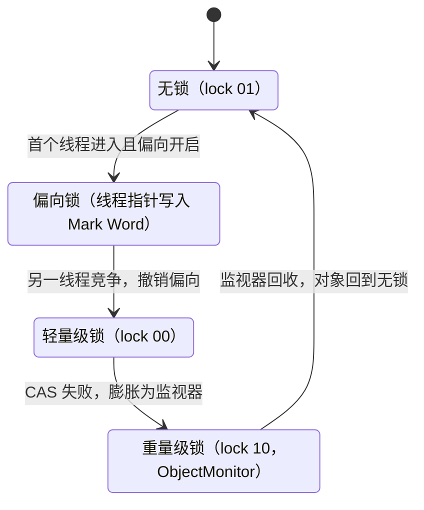
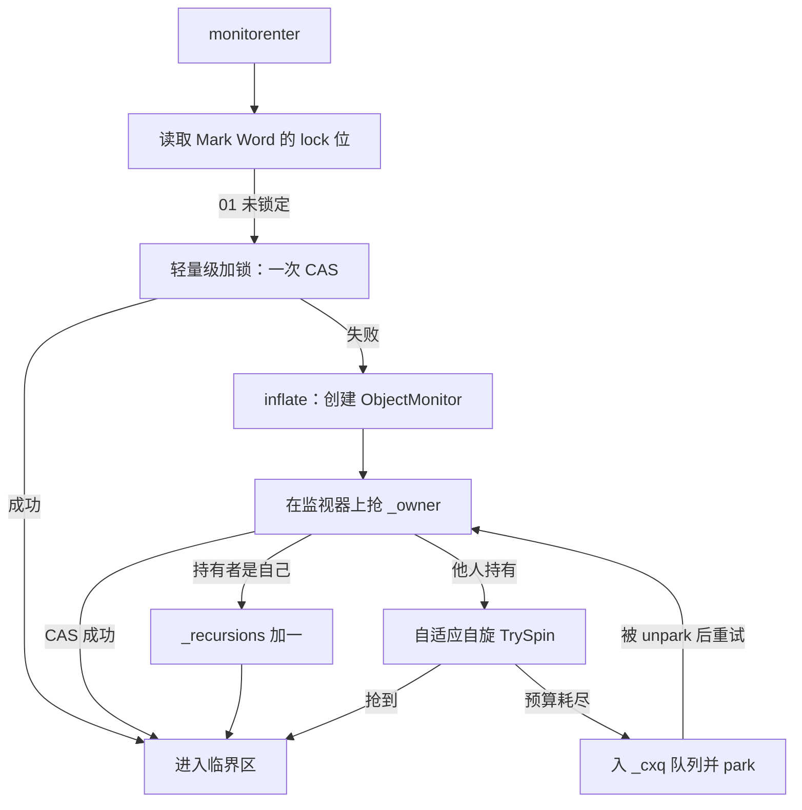
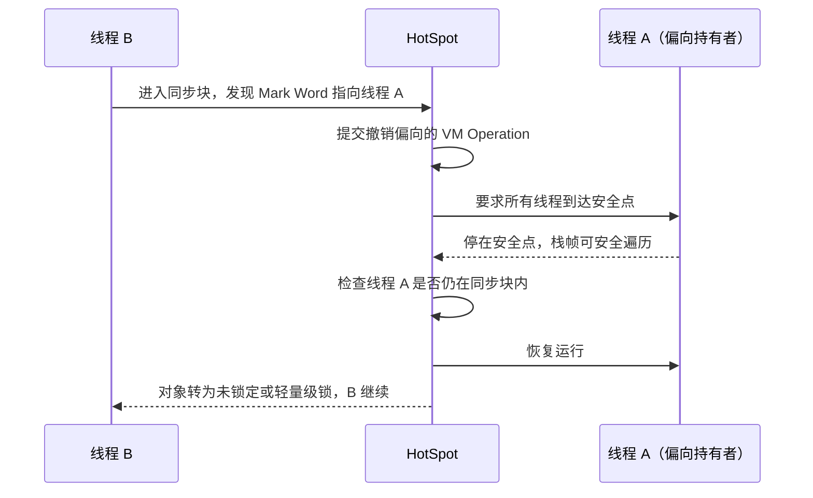
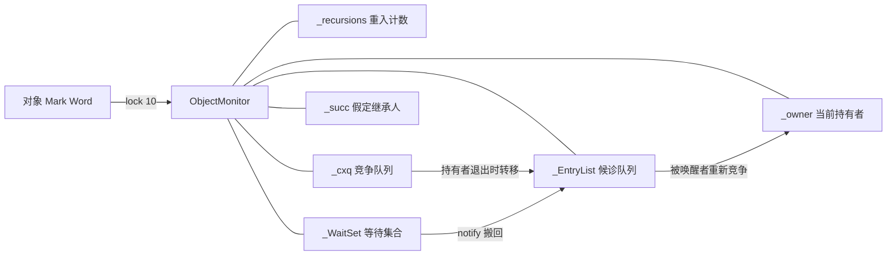
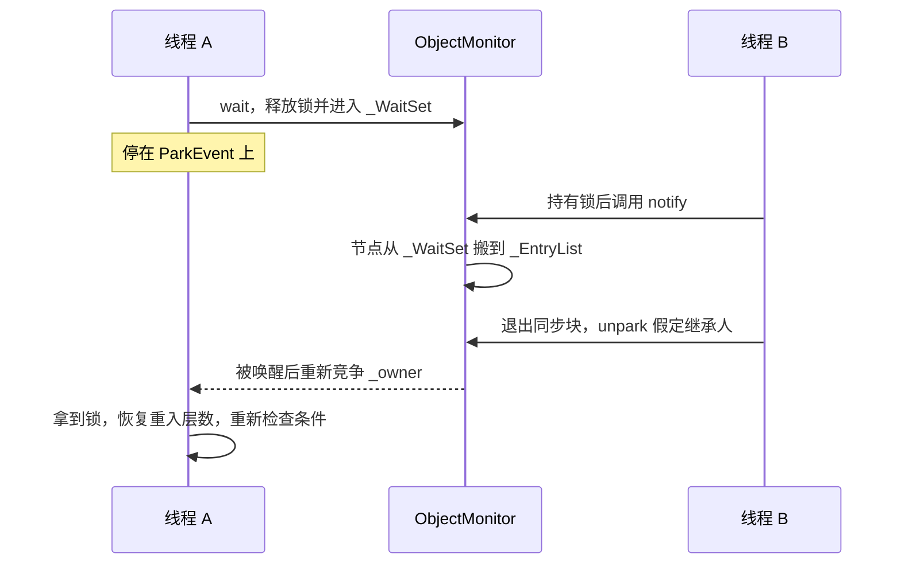

# 04 synchronized 的锁升级——偏向锁、轻量级锁与重量级锁

**摘要：**

`synchronized` 是 Java 最早出现的同步原语，也是被误解最久的一个。二十年来，教程反复讲「无锁 → 偏向锁 → 轻量级锁 → 重量级锁」的升级故事，但偏向锁在 JDK 15（JEP 374）就被默认关闭，JDK 18 连相关开关一并作废，JDK 24 又把轻量级锁换成了线程私有的 lock stack。也就是说，今天跑在 JDK 21 与 JDK 25 上的 `synchronized`，既没有偏向锁，也不再是教科书里那台四状态机，实际只剩「一次 CAS 的轻量级路径」与「竞争时膨胀出的 ObjectMonitor」两条路。本文从对象头（Object Header）中 Mark Word 的位布局讲起，拆开两种路径各自的数据结构与加解锁流程，交代锁升级这套设计为何被弃用，并说明它的代价今天落在了哪里——竞争下的缓存行迁移、`park`/`unpark` 的挂起唤醒，而不是加锁指令本身。落点仍然在工程：自适应自旋的门槛、可重入与异常释放的语义边界、锁消除与锁粗化如何让微基准失真，以及 `synchronized` 与 `ReentrantLock` 之间真正该拿来决策的那几个维度。文中的位段与调用路径以 JDK 21 源码为基线，JDK 24 与 JDK 25 的改动单独标注。

---

2006 年 12 月，Java 6 发布。这个版本没有改动语言语法，却悄悄改写了 `synchronized` 的成本结构：偏向锁（Biased Locking）的论文在同年发表，轻量级锁、自适应自旋（Adaptive Spinning）、锁消除与锁粗化一起进入 HotSpot，把「synchronized 慢」从一句事实变成了一句需要加限定条件的说法。

不过这批优化后来被压缩成了一句口诀，口诀又比代码活得更久。今天在 JDK 21 上启动一个服务，`-XX:+UseBiasedLocking` 早已不在参数表里；JDK 24 起，连「轻量级锁把 Mark Word 换成栈上 Lock Record 指针」这个细节也不成立了。笔者想做的，是把这台机器的零件重新摊开：哪些是历史，哪些是今天的实际行为，哪些代价从来没有消失，只是换了位置。JMM 里的 happens-before 与 `volatile` 的内存屏障另有专文（见 [[02 Java 内存模型（JMM）——happens-before 与可见性保证]] 与 [[03 volatile 的实现原理——内存屏障与禁止重排序]]），这里只在必要处引用结论。

## 第 1 章 一句骂名背了二十年

### 1.1 早期的锁真的进了内核

`synchronized` 最早的实现相当直白：每个 Java 对象背后挂一个监视器（Monitor），加锁就是让当前线程拿到监视器的所有权，拿不到就进操作系统的等待队列。这条路径上最贵的一步不是判断，而是切换——线程从用户态陷入内核、被挂起，锁释放后再被唤醒、重新调度回 CPU。

这一步的代价在 x86 上通常在几百到几千个 CPU 周期的量级（示例量级，具体取决于内核版本、CPU 型号与是否命中缓存）。与之相对，被保护的那段临界区可能只是给一个计数器加一，十几个周期就结束了。于是早期的 Java 程序里经常出现一种荒谬的比例：为了保护三行的临界区，付出上百倍于它的进入与退出成本。

更麻烦的是缓存与调度带来的次生成本。线程被挂起意味着它的工作集可能被换出 CPU 缓存，被唤醒时又要重新预热；大量线程在同一把锁上排队时，调度器还要在它们之间来回搬运。这些成本无法用一个「锁操作耗时多少纳秒」的数字概括，它们表现为吞吐下降、长尾延迟和 CPU 在系统态的空转。

### 1.2 Java 6 的五项动作

Java 6 前后的那批优化，思路分两路：一路是让「没有竞争」的加锁尽量不碰内核，另一路是让编译器直接删掉不必要的加锁。

第一路给出了沿用至今的**锁状态叙事**：对象刚创建时无人加锁；第一个线程反复进入时给它一个几乎零成本的快速通道（偏向锁）；多个线程交替进入、但没有真正同时争抢时，用一次 CAS 把所有权记在栈帧上（轻量级锁）；只有真正发生竞争、或者调用了 `wait`，才膨胀成完整的监视器（重量级锁）。第二路则是 JIT 的手笔：逃逸分析证明锁对象不会被别的线程看到，锁就可以消除；相邻的加解锁可以合并。

把这套设计摊成一张表，就是后来所有面经的源头。

| 锁状态 | 设计假设 | 关键数据结构 | 一次进入的成本量级（示例） |
| :--- | :--- | :--- | :--- |
| 无锁 | 没有线程进入 | Mark Word 里的 hash、GC 年龄 | 一次普通读写 |
| 偏向锁 | 同一个线程反复进入 | Mark Word 里的线程指针与 epoch | 一次指针比较 |
| 轻量级锁 | 多线程交替进入、不同时争抢 | 栈帧里的 Lock Record 与 displaced header | 一次 CAS |
| 重量级锁 | 真实竞争，或调用了 `wait` | 堆上的 ObjectMonitor 与等待队列 | CAS 失败后自旋、必要时 park |

「升级」这个词容易造成两个误解。其一，它暗示每一次加锁都会沿着阶梯往上走，实际上大多数对象一辈子停在最低一级，升级只在特定事件发生时触发。其二，它暗示锁状态会跟着负载反复升降，实际上对象一旦膨胀成 ObjectMonitor，它的 Mark Word 就不再指回栈帧，直到监视器被回收、对象重新变回无锁状态，才可能重新从轻量级锁开始。

### 1.3 三个断点与今天的实际路径

这套叙事在三个时间点上被改写了。

第一个断点是 JDK 15。JEP 374 把偏向锁改成默认关闭，并把 `UseBiasedLocking` 与一组批量重偏向的参数标记为废弃。第二个断点是 JDK 18，JDK-8256425 把这些选项全部标记为 obsolete，配套实现也一并删掉，之后再传 `-XX:+UseBiasedLocking` 只能得到一条「支持已移除」的警告。第三个断点是 JDK 24，HotSpot 把轻量级锁的实现从「栈帧里的 Lock Record」换成了「线程私有的 lock stack」，旧路径保留为被弃用的 `LM_LEGACY`。

| JDK 版本 | 偏向锁 | 轻量级锁实现 | 与本文相关的开关 |
| :--- | :--- | :--- | :--- |
| 6 - 14 | 默认开启，启动 4 秒后生效 | 栈帧 Lock Record + displaced header | `UseBiasedLocking`、批量阈值参数 |
| 15 - 17 | 默认关闭，可手工打开但告警 | 同上 | 相关参数标记 deprecated |
| 18 - 20 | 选项与实现均已移除 | 栈帧 Lock Record + displaced header | 无（`LockingMode` 尚未出现） |
| 21 - 23 | 不存在 | 栈帧 Lock Record，另含实验性的 lock stack 路径 | `LockingMode` 为实验参数，默认 `LM_LEGACY` |
| 24 - 25 | 不存在 | 线程私有 lock stack，默认 `LM_LIGHTWEIGHT` | `LockingMode` 默认 2，0 与 1 已弃用 |

因此，今天描述 `synchronized` 的行为，正确的模型只有两条路径加两种优化：无竞争时走一次 CAS 的轻量级路径；竞争或调用 `wait` 时膨胀为 ObjectMonitor，在监视器上自旋一小段后 park；此外 C2 可能把锁消除，也可能把相邻的锁粗化。所谓「升级树」，**只对 JDK 14 及更早的 JVM 成立**。

下图是历史叙事里的四状态迁移，箭头上的事件决定了升级是否发生。



而今天的实际路径少了偏向锁这一层，也少了「撤销」这个会触发安全点的动作。



## 第 2 章 八个字节里的身家

### 2.1 对象头的三段式布局

要理解锁，先得看清对象在内存里长什么样。一个普通的 Java 对象由三部分组成：对象头、实例数据、对齐填充。对象头里又分两块，Mark Word 与类型指针（Klass Pointer）。开启压缩指针（`-XX:+UseCompressedOops`，堆小于 32 GB 时默认）后，64 位 JVM 上 Mark Word 占 8 字节、类型指针占 4 字节，对象头合计 12 字节；对象起始地址按 8 字节对齐，所以实际还会补上 4 字节填充。

数组对象会多一个 4 字节的长度字段。这三段布局不是 HotSpot 的私有怪癖，而是 Java 对象模型在虚拟机里的具体投影：类型指针回答「我是谁」，实例数据回答「我有什么」，Mark Word 回答「我现在处于什么状态」——这个「状态」既包括 GC 分代年龄、身份哈希，也包括锁的归属。

Mark Word 之所以值得单独讲，是因为它只有 64 位，却被至少三方争用：GC 要存年龄，`Object.hashCode()` 要存哈希，锁要存归属。HotSpot 的做法是让这 64 位在不同状态下被解释成不同的结构，也就是同一块内存的**分时复用**。

### 2.2 Mark Word 的位段

以 JDK 21 的 64 位实现为基线，未加锁对象的 Mark Word 从高位到低位是这样切的。

| 位段 | 宽度 | 含义 |
| :--- | :--- | :--- |
| [63:39] | 25 位 | 未使用 |
| [38:8] | 31 位 | 身份哈希（identity hash），惰性计算 |
| [7] | 1 位 | 空档（历史遗留的对齐位） |
| [6:3] | 4 位 | GC 分代年龄，最大 15 |
| [2] | 1 位 | JDK 15 前是偏向标志位，之后空置；JDK 24 起用作 self-forwarding 位 |
| [1:0] | 2 位 | 锁标志位 |

偏向锁时代的布局要挤两个字段：最高的 54 位放持有线程的指针，紧接着 2 位放 epoch（偏向纪元，批量重偏向时用来判断对象属于哪一代），再往下才是年龄、偏向位与锁标志位。这也是偏向锁与哈希不能共存的原因——54 + 2 + 1 + 4 + 1 + 2 正好 64 位，没有地方再塞 31 位的哈希。

JDK 24 的位段又挪了一次：哈希与年龄之间空出 4 位，锁标志位之上的那一位改作 self-forwarding。这意味着任何按固定位段解析 Mark Word 的工具（调试器、内存分析插件、依赖 JOL 输出的脚本）都必须带上版本判断，不能把某篇老文章里的位图当常量用。

不同状态下这 64 位的解释如下。

| 状态 | 位段构成 | 锁标志位 |
| :--- | :--- | :--- |
| 未锁定 | unused 25 + hash 31 + 空档 1 + age 4 + 空档 1 | `01` |
| 偏向（历史） | 线程指针 54 + epoch 2 + 空档 1 + age 4 + 偏向位 1 | `01` |
| 轻量级锁定（旧实现） | 指向栈上 Lock Record 的指针 62 位 | `00` |
| 轻量级锁定（JDK 24 起） | 对象头原位保留，仅把锁标志位置为 `00`，归属由 lock stack 判定 | `00` |
| 膨胀 | 指向 ObjectMonitor 的指针 62 位 | `10` |
| GC 标记 | 内容为空，由标记位区分 | `11` |
| 膨胀中 | 全零，作为「正在膨胀」的临时标记 | `00` |

全零这个特殊值值得记一笔：它表示某个线程正在把栈锁膨胀成监视器，别的线程看到它只能等待，而不能把它误判成「指针为空的无锁状态」。

### 2.3 锁标志位与状态判定

锁标志位只有两位，却能区分四种状态，靠的是与其它字段的组合。这也是为什么「读 Mark Word 判断锁状态」这件事在实现里必须用一次原子读完成，否则会读到半更新的中间态。

初学者常问：`00` 到底是轻量级锁还是「正在膨胀」？答案是两者都可能，要靠指针是否为零来区分；同理，`01` 在 JDK 15 之前既可能是「可偏向但未偏向」，也可能是「偏向已被撤销后的未锁定」，要靠偏向位区分。所谓「锁状态」从来不是单独两位能表达的东西，而是整块 Mark Word 的联合解释。

### 2.4 哈希、年龄与锁争同一块地

`Object.hashCode()` 的默认实现并不直接返回地址，而是由 JVM 生成一个与该对象绑定的伪随机值（具体算法可用 `-XX:hashCode` 切换），HotSpot 会把它缓存进 Mark Word，避免每次重算。但一旦对象进入轻量级锁定，Mark Word 被换成指针，哈希就没了位置——旧实现的做法是在加锁前把原始 Mark Word 复制到栈上的 displaced header 里，解锁时再原样换回来；膨胀之后，原始头被存进 ObjectMonitor 的 `_header` 字段。

偏向锁时代还有一处更隐蔽的耦合：在偏向状态下，Mark Word 里没有哈希的位置，所以对一个已被偏向的对象调用 `hashCode()` 或 `System.identityHashCode()`，会触发一次偏向撤销。这条规则坑过不少把对象放进 `HashMap` 又同时用 `synchronized` 的代码：看起来只是算了个哈希，实际上把锁的形态改了。

GC 年龄的处境类似。对象在新生代每熬过一次回收年龄加一，超过阈值就晋升老年代；这 4 位与锁标志位始终共享同一字。所以不要把 Mark Word 想成一个「锁的专用字段」，它更像一张只能写一件事的登记表，谁要用就得先把上一位的登记腾走。

### 2.5 从对象头到 ObjectMonitor

当锁膨胀发生时，JVM 会分配一个 ObjectMonitor，把对象头原来的内容搬进 `_header`，再把 Mark Word 改成指向这个监视器的指针（锁标志位 `10`）。从这一刻起，对象本身不再携带锁状态，所有排队、唤醒、重入计数都由监视器维护。

这个「把状态搬出对象」的动作，是重量级锁一切成本的来源：分配监视器要内存，访问监视器要跳一次指针，竞争要维护队列，回收还要判断是否空闲。它也解释了为什么轻量级锁值得存在——在绝大多数没有竞争的场景里，根本不需要付出这笔搬家费。

可以把 Mark Word 比作公寓门口的电子门牌：平时显示住户信息（哈希）与房龄（GC 年龄），有人要办入住（加锁）时就切换到「已占用」，实在要排队登记（膨胀）就把整本登记簿搬到物业办公室（ObjectMonitor），门牌上只留一个「请到物业办理」的编号。比喻到这里要收住：现实中门牌可以同时显示很多信息，而 Mark Word 一次只能容纳一种解释，这正是所有冲突的根源。

## 第 3 章 偏向锁：只认一张熟脸

### 3.1 一个很强的假设

偏向锁押的注很直白：**大多数同步块只被同一个线程进入**，既然如此，连 CAS 都不必做。它把「锁属于谁」写进对象头，之后每一次进入只要比较一下指针是否等于当前线程，相等就直接放行。

这个假设在 2006 年前后相当成立。那时代的 Java 代码大量使用 `Hashtable`、`Vector`、`StringBuffer` 这类每个方法都带 `synchronized` 的集合，而它们经常只在单线程里使用。每一次 `get` 或 `append` 都走一遍原子操作，累加起来就是可观的浪费；偏向锁把「同一个线程的重复进入」压缩成一次指针比较，收益立竿见影。

JEP 374 在回顾这段历史时写得很克制：偏向锁针对的是无竞争加锁的开销，它的收益来自「没有第二个线程来抢」这个前提。

### 3.2 建立偏向与快路径

对象刚分配时，如果偏向锁开启，Mark Word 的偏向位为 1、线程字段为 0，表示「可偏向但尚未偏向任何人」。线程 A 第一次进入 `synchronized (obj)` 时，用一次 CAS 把自己的线程指针写进 Mark Word；此后线程 A 再进入，只要读到的指针等于自己，就直接通过，不需要原子指令，也不需要内存屏障。

解锁则近乎免费：线程 A 退出同步块时什么都不用做，Mark Word 里的指针继续留着。这样设计的意图很明确——让「同一线程反复进入」这条路径的成本趋近于零。

为了让启动阶段的单线程代码也能受益又不留下后遗症，HotSpot 还给偏向锁加了一个启动延迟（`BiasedLockingStartupDelay`，默认 4000 毫秒）。原因不复杂：JVM 启动阶段基本是单线程的，如果此时大量对象被偏向，等应用进入多线程阶段，这些偏向会集中撤销，反而制造停顿。延迟四秒，等于让启动期的对象先以普通锁运行。

### 3.3 撤销：安全点与批量阈值

偏向锁的代价全部集中在「第二个线程出现」的那一刻。线程 B 想进入一个已偏向线程 A 的对象时，不能直接改 Mark Word——它得先确认线程 A 是否还在同步块里，而确认这件事必须遍历线程 A 的栈帧。栈帧在运行中随时变化，所以这个动作必须在安全点（Safepoint）上做：JVM 提交一次撤销偏向的 VM 操作，让所有 Java 线程停在安全点，再检查线程 A 的栈，决定是恢复成未锁定，还是直接升级成轻量级锁。

下图是一次偏向撤销的时序。



单次撤销已经是重操作，更糟的是它可能成批出现：一个类的对象在线程池里被反复传递，每换一个线程就撤销一次。HotSpot 因此加了两个批量机制来摊薄成本。同一个类的对象撤销次数超过 `BiasedLockingBulkRebiasThreshold`（默认 20）时，JVM 认为「这个类更可能被交替使用」，于是把该类所有实例一次性重偏向到当前线程；超过 `BiasedLockingBulkRevokeThreshold`（默认 40）时，直接判定这个类不适合偏向，之后它的实例不再尝试偏向。中间还有一个 `BiasedLockingDecayTime`（默认 25000 毫秒）控制阈值计数的衰减，避免历史计数永久生效。

| 参数（JDK 14 及更早） | 默认值 | 作用 |
| :--- | :--- | :--- |
| `BiasedLockingStartupDelay` | 4000 ms | 启动后延迟多久启用偏向 |
| `BiasedLockingBulkRebiasThreshold` | 20 | 单类撤销次数达到后批量重偏向 |
| `BiasedLockingBulkRevokeThreshold` | 40 | 单类撤销次数达到后关闭该类偏向 |
| `BiasedLockingDecayTime` | 25000 ms | 批量计数衰减窗口 |

### 3.4 为什么被放弃

JEP 374 给出的理由可以归成四层，层层递进。

第一层是**收益面在缩小**。偏向锁最大的受益者是那些「每次访问都同步」的老集合类；新代码用 `HashMap`、`ArrayList` 这些从 1.2 起就不加锁的集合，或者用 `java.util.concurrent` 里的并发容器，根本不会产生偏向的机会。JEP 374 还特别提到，以线程池队列为核心的应用在关闭偏向锁后往往表现更好——因为工作线程轮流取任务，正好是偏向锁最不擅长的工作模式。

第二层是成本面在变化。CAS 在无竞争时的代价随着微架构演进而下降，而偏向锁那套「指针比较 + 偶发撤销」的组合并没有变得更便宜。当一次 CAS 的代价降到与一次比较接近时，偏向锁省下的那点原子操作就不足以覆盖撤销的期望成本。

第三层是复杂度在累积。偏向锁不是一段孤立的代码，它要跟安全点、栈遍历、批量阈值、JIT 的偏向优化（`UseOptoBiasInlining`）耦合在一起，历史上是 HotSpot 同步子系统里缺陷密度较高的区域。JEP 374 原文把「复杂性成为理解与改造同步子系统的障碍」列为动因之一。

第四层是废案的成本可控。JDK 15 到 17 是唯一的窗口期：默认关闭，但仍可用 `-XX:+UseBiasedLocking` 重新打开（会打印废弃告警），等于给存量应用留了一条退路；到 JDK 18 确认无人回头，才把选项与实现一并删掉。

### 3.5 移除之后：代价与证据

**移除偏向锁并非零成本**，这一点值得如实交代。JDK 上有一个被标为「Won't Fix」的缺陷记录（JDK-8329619），报告 Apache Spark 的 ZStandard 压缩微基准在关闭偏向锁后慢了约四倍，受影响版本从 JDK 18 开始。上游没有修，理由通常也站得住：那是一个高度特定的微基准，测的是「同一个线程反复进入同一批同步方法」，恰好是偏向锁的主场，不代表真实作业的吞吐。

这个案例的价值在于它点出了取舍的真实形状：偏向锁不是「没用的旧优化」，而是一个在特定负载上确实有效的优化，只是它的收益不再足以抵消维护成本与偶发停顿。工程决策从来不是「谁更好」，而是「在多大的负载分布上，收益能否覆盖代价」。

对今天写代码的人来说，实际影响只有一条：不要在任何性能模型里假设「单线程反复进入同一把锁是免费的」。JDK 18 之后，这条路径就是一次 CAS，虽然便宜，但不是零；而在高度竞争的路径上，偏向锁的消失反而消除了撤销带来的停顿抖动。

### 3.6 今天还该不该讲偏向锁

该讲，但要讲清它的身份：它是一段历史，也是理解「锁的实现可以针对负载假设做特化」的最好样本。偏向锁把「无竞争」这个假设推到极致，换来了几乎为零的快路径，代价是把「假设被打破」的那一刻做得极其昂贵；当负载分布变化、硬件成本变化之后，这个交换不再划算，于是被移除。

同样的思路今天仍在用，只是换了地方：JDK 24 的监视器在挂起线程前先自旋，赌「持有者很快释放」；Eden 区的分配假设「大多数对象朝生夕死」，于是用指针碰撞而不是空闲链表。读偏向锁的正确方式，不是记住它的位布局，而是理解一种优化如何因为假设失效而退场。

## 第 4 章 轻量级锁：一次 CAS 换来的租约

### 4.1 交替访问的假设

偏向锁处理「同一个线程」，重量级锁处理「真正争抢」，中间还留着一大片场景：多个线程轮流进入同一段同步代码，但同一时刻只有一个线程在跑。典型的例子是生产者与消费者通过一个数组缓冲区交接数据——两个线程交替推进，几乎没有同时争抢的窗口，但如果用重量级锁，每次交接都要走一遍监视器排队。

轻量级锁的假设是：竞争存在，但冲突很少。它不去消除原子操作，而是把原子操作压缩到一次 CAS，并且把「锁被谁持有」记录在持有者的栈上，从而避免了分配监视器。

### 4.2 Lock Record 与 displaced header

旧实现的关键数据结构叫 Lock Record（锁记录），本质是栈帧里的一块空间，里面最重要的字段是 **displaced header**：对象加锁前的原始 Mark Word 副本。加锁时，JVM 在当前线程栈上分配一个 Lock Record，把对象的 Mark Word 复制进去，再用一次 CAS 把对象的 Mark Word 换成指向这个 Lock Record 的指针，锁标志位置为 `00`。

这个设计的巧妙之处在于「谁持有锁」不需要额外存储：Mark Word 指向哪个线程栈上的 Lock Record，锁就属于哪个线程。解锁时，把 Mark Word 从指针换回 displaced header 里保存的原值，对象就恢复成未锁定状态。

可重入在这里表现为「再压一个 Lock Record」：同一个线程再次进入同一对象时，CAS 会成功（期待值就是当前 Mark Word），于是栈上又多一个 Lock Record，但它的 displaced header 设为空，表示「这一层只是重入，没有新的原始头要恢复」。退出时按栈序弹出，遇到空 displaced header 就只减一层，不恢复对象头。

### 4.3 加锁、解锁与膨胀

把上面的动作串起来，轻量级加锁只有三步：读 Mark Word 确认未锁定、在栈上准备 Lock Record 并复制原头、CAS 替换。CAS 成功就进入临界区；CAS 失败说明 Mark Word 已经变了——要么是别的线程抢先加锁，要么对象已经膨胀，两种情况下都会走膨胀路径。**轻量级路径上不存在自旋**：一次 CAS 失败就直接膨胀，自旋是监视器内部的事。

**膨胀的过程本身也要防并发**：JVM 先把 Mark Word 置成全零（表示「正在膨胀」），再分配 ObjectMonitor、把原始头写入 `_header`，最后把 Mark Word 改成指向监视器的指针。别的线程如果在这个窗口里读到全零，就只能自旋等待，而不能贸然 CAS。

解锁同样是一次 CAS：把 Mark Word 从「指向我的 Lock Record」换回 displaced header。如果这次 CAS 失败，说明在持有期间有别的线程尝试加锁并已经把对象膨胀了，当前线程必须转到监视器的退出路径，唤醒等待者。

### 4.4 JDK 24 的 lock stack

从 JDK 24 起，这套「栈帧里的 Lock Record」被换掉了。新的实现给每个线程维护一个 **lock stack**（容量为 8 的对象引用栈），加锁时把对象引用压栈，Mark Word 只保留对象头本身、把锁标志位置为 `00`；判断「这个对象是不是我锁的」不再靠指针落在我的栈区间，而是查我的 lock stack 里有没有它。

这个改动解决了旧实现的两个结构性问题。其一是依赖栈帧布局：旧实现要判断一个指针是否落在当前线程的栈范围内，这让 JIT 对栈帧的排布、以及虚拟线程的栈切换都很难受。其二是重入的表达方式：新实现用 `try_recursive_enter` 在栈上再压一个引用表达重入，压满 8 个之后会把栈底最老的那把锁膨胀成监视器来腾位置——重入深度不再是「无限但每层占一个 Lock Record」，而是「超过容量就退回重量级」。

JDK 21 上这条新路径已经以实验参数的形式存在（需要 `-XX:+UnlockExperimentalVMOptions -XX:LockingMode=2`），但默认值仍是 `LM_LEGACY`；到 JDK 24，`LM_LIGHTWEIGHT` 成为默认，`LM_LEGACY` 与 `LM_MONITOR` 都被标为弃用；JDK 25 沿用了这套实现，没有再次改换。

| 维度 | 旧实现（`LM_LEGACY`） | JDK 24 起（`LM_LIGHTWEIGHT`） |
| :--- | :--- | :--- |
| 持锁记录位置 | 当前线程栈帧中的 Lock Record | 线程私有的 lock stack（容量 8） |
| 锁标志位 `00` 的含义 | Mark Word 是指向 Lock Record 的指针 | 对象头原位保留，归属查 lock stack |
| 可重入表达 | 再压一个 displaced header 为空的 Lock Record | lock stack 再压一个引用 |
| 重入上限 | 受栈空间限制 | 8 层，超出则膨胀栈底那把锁 |
| 身份哈希 | 需搬到 displaced header 或监视器 `_header` | 留在对象头里，不需要搬家 |
| 默认版本 | JDK 21 及更早 | JDK 24 与 JDK 25 |

### 4.5 用字节码确认一次

把 `synchronized` 编译成字节码后，同步块对应 `monitorenter` 与 `monitorexit` 两条指令，同步方法则根本不出现这两条指令，而是靠方法访问标志 `ACC_SYNCHRONIZED` 让 JVM 在调用与返回时隐式加解锁。用 `javap` 看一个同步块，可以看到编译器为异常路径补的那条 `monitorexit`。

```text
public void block();
  Code:
       6: monitorenter
       7: aload_0
       ...
      18: monitorexit
      19: goto          27
      22: astore_2
      23: aload_1
      24: monitorexit
      25: aload_2
      26: athrow
  Exception table:
       from    to  target type
           7    19    22   any
```

异常表里那段 `any` 覆盖了整个临界区，指向偏移 22 的处理块：无论正常返回还是抛出异常，都会执行一次 `monitorexit`。这就是「synchronized 不会因为异常而漏掉解锁」的实现方式，它不依赖 JVM 的某种魔法，而是 javac 在字节码层面写死的兜底。同步方法则不然，它的解锁由 JVM 在方法退出时保证，字节码里看不到痕迹，但语义一致。

## 第 5 章 重量级锁：ObjectMonitor 与挂起

### 5.1 什么时候膨胀

膨胀（inflate）最常发生在两种情况下：加锁时 CAS 失败，说明有真实竞争；或者线程需要在对象上调用 `wait`，因为等待队列必须挂在监视器上。此外 JNI 的 `MonitorEnter` 触到栈锁时也会膨胀，只是业务代码里不常见。极少数情况下，计算身份哈希也会触发膨胀——当对象被另一个线程以栈锁持有时，原始头在对方的栈上，取不到就只能请出监视器。

膨胀之后，对象头指向 ObjectMonitor，后续所有加锁、解锁、等待都由这个监视器承担。监视器不是对象自带的，而是按需从堆上分配（HotSpot 内部有复用与回收机制），这也意味着重量级锁的启动成本包含一次内存分配。

### 5.2 数据结构

JDK 21 的 ObjectMonitor 关键字段如下（简化示意，类型与顺序以对应版本源码为准）。

```java
// ObjectMonitor 的关键字段（JDK 21，简化）
class ObjectMonitor {
    volatile markWord _header;        // 膨胀时被换出的原始对象头
    volatile void*    _owner;         // 当前持有者，靠 CAS 从 null 抢
    volatile intx     _recursions;    // 重入计数
    ObjectWaiter* volatile _cxq;      // 新来的竞争者先挂这里
    ObjectWaiter* volatile _EntryList; // 候诊队列
    ObjectWaiter* volatile _WaitSet;  // 调过 wait 的线程
    JavaThread* volatile _succ;       // 假定继承人，抑制无效唤醒
    volatile int _Spinner;            // 退出与自旋者之间的交接标记
    volatile int _SpinDuration;       // 该监视器的自适应自旋预算
    int _contentions;                 // 活跃竞争者数，供回收判断
}
```

有两个字段经常被老文章写错。其一，表示重入次数的是 `_recursions`，不是 `_count`；`_count` 是更早版本里的入口计数，在 JDK 21 的 ObjectMonitor 里已经不存在了。其二，**`_EntryList` 与 `_WaitSet` 不是一回事**：前者是「想进但进不去」的队列，后者是「已经进来、主动调用 `wait` 让出锁」的集合。混淆这两个队列，后面关于 `notify` 的语义就会全错。

下图是监视器内部各队列与线程状态的关系。



### 5.3 进入协议

进入监视器的第一条路径是 CAS：`try_set_owner_from(nullptr, current)`，成功就直接持有锁。失败时看 `_owner` 是不是自己，是则 `_recursions` 加一，这就是重量级锁的可重入实现。

既不是空也不是自己，说明有竞争。此时 JVM 先做一次自旋尝试（下一节展开），抢不到就把当前线程包装成 ObjectWaiter 节点压入 `_cxq`，然后调用线程自己的 ParkEvent 挂起。被唤醒之后，节点会被搬运到 `_EntryList` 或重新参与竞争，整个过程可能要循环好几轮。

`_cxq` 的入队用的是 CAS 头插，失败就重试，重试时还会顺手再抢一次锁——这是为「锁刚好被释放」这种短窗口准备的优化。竞争激烈时，`_cxq` 会积累一串节点，持有者退出时按策略把它们转移到 `_EntryList`，让队列顺序更接近 FIFO。

### 5.4 退出协议与假定继承人

退出路径比进入路径精细得多，值得逐句读。HotSpot 先执行一次 release 语义的 `_owner` 清零，再补一条 StoreLoad 屏障，然后才检查是否有等待者。这条屏障的位置不是随意安排的：它保证临界区内的写在锁释放之前对其他线程可见，同时又让「释放」与「检查后继者」这两步不会被重排到一起。

如果没有等待者，直接返回，这就是无竞争退出的快路径。如果有等待者，退出线程还要处理一个经典问题：唤醒谁、什么时候唤醒。每次释放都无脑 `unpark` 一个等待者，会造成大量「无效唤醒」——被唤醒的线程抢不到锁，又得重新挂起，纯粹浪费 CPU。HotSpot 用一个 `_succ` 字段做节流：在某个时刻只指定一个「假定继承人」，退出线程只负责让它就绪；如果已经有继承人，其他退出的线程就不再唤醒别人，把责任交接出去。这套机制在竞争激烈时能显著降低唤醒风暴。

负责搬运节点的线程还要重新抢一次 `_owner`，因为只有持有者才能安全地操作 `_EntryList` 与 `_cxq`。抢不到就把责任交给新的持有者，这是分布式思维在单个监视器上的缩影：没有谁能保证自己一定是做最后一步的人，所以每一步都得允许失败并交接。

### 5.5 自适应自旋

先厘清一个常见误解：**自旋不是一种锁状态**，而是监视器 enter 路径里的一段重试——对象该膨胀还得膨胀，自旋只是把「挂起」往后推一小段。线程在挂起之前，会先在监视器上自旋一段时间，赌持有者很快就会释放。自旋的成本是白白占用 CPU，收益是省下一次挂起与唤醒；赌对了赚，赌错了亏，所以自旋的时长必须跟着实际竞争情况调整。

HotSpot 的做法是给每个监视器维护一个 `_SpinDuration`，初始值为 5000 个自旋单位，每次自旋成功加 100，失败减 200，另外还有 10 次不看预算的采样自旋，用来探测环境是否变化。这些常量写死在 C++ 源码里（`Knob_SpinLimit`、`Knob_BonusB`、`Knob_Penalty`、`Knob_PreSpin`），并不是 `-XX` 参数。JDK 6 时代还能用 `-XX:+UseSpinning` 与 `-XX:PreBlockSpin` 干预，JDK 7 之后连开关都撤掉了，自旋策略完全交给 JVM。

自旋期间还会做两件判断：一是持有者是否还在运行（如果它被换出或阻塞了，自旋就是纯浪费），二是自旋是否已经超过预算。前者解释了为什么「临界区里做 I/O」是重罪——持有者一旦阻塞，所有竞争者都在空转。

自旋与挂起的临界判断可以整理成一张表，注意这里的「短」始终是相对于上下文切换成本而言的，不是绝对时间。

| 场景特征 | 更优选择 | 判据 |
| :--- | :--- | :--- |
| 临界区远短于一次上下文切换，竞争者为个位数 | 自旋 | 抢到锁的概率高，收益大于空转 |
| 临界区包含 I/O、锁竞争激烈、线程数远超核数 | 挂起 | 自旋只会浪费 CPU 时间片 |
| 持有者经常被操作系统抢占 | 挂起 | 自旋期间持有者根本不运行 |
| 短临界区但请求频率极高 | 分片或减少临界区 | 把压力从锁上移走，比调自旋更有效 |

### 5.6 wait 与 notify

`wait` 让线程放弃监视器所有权、进入 `_WaitSet`，同时把 `_recursions` 清零；线程挂起前会记住自己原来的重入层数，被唤醒重新拿到锁后再恢复。`notify` 从 `_WaitSet` 里取一个节点，搬到竞争队列，再 `unpark` 它——注意这里没有「把锁直接交给被唤醒者」这回事，被唤醒的线程必须重新参与竞争，竞争中还可能被刚到的线程插队。

这就带来三个必须记住的语义。第一，`wait` 必须放在循环里判断条件，因为**被唤醒不等于条件成立**，可能被别的线程先一步改掉，也可能遇到虚假唤醒。第二，`notify` 只唤醒一个，如果有多个等待者而条件只对其中一个成立，选错人就会丢信号，工程上更稳妥的是 `notifyAll` 或用并发容器。第三，`wait`、`notify`、`notifyAll` 都要求当前线程持有该对象的监视器，否则抛 `IllegalMonitorStateException`。

下图是 wait/notify 的完整往返。



### 5.7 回收：deflation

监视器不会永远跟着对象。当 `_owner` 为空、`_WaitSet` 为空、没有活跃竞争者时，它会被回收（deflate）：原始对象头写回 Mark Word，监视器本身归还给内部池。回收在后台异步进行，用 `jstack` 观察一个现代 JVM，能在守护线程列表里看到专门负责这件事的 Monitor Deflation Thread。

这也回答了「锁能不能降级」这个老问题：对象在膨胀期间确实不会回到轻量级锁，但监视器被回收后，对象重新变成无锁状态，下一次加锁又会从轻量级路径开始。所以严格的表述是「膨胀不可逆，但监视器可回收」，而不是「锁永不降级」。

## 第 6 章 语义边界：它保证了什么，没保证什么

### 6.1 互斥与 happens-before

`synchronized` 的第一层语义是互斥：同一时刻只有一个线程能持有某个对象的监视器。第二层语义是可见性，来自 Java 语言规范里的监视器锁规则——对同一个监视器的解锁 happens-before 后续对它的加锁。这条规则把「临界区内的写」与「下一个进入者的读」串成一条链，所以不需要把临界区里的变量声明为 `volatile`。

在 HotSpot 的实现里，这条规则落地为两条指令序列。解锁时先做 release 语义的所有者清零，保证临界区内的写先于这次清零对别人可见；随后补一条 StoreLoad 屏障，把「释放」与「检查等待队列」隔开，避免后继者的 unpark 被重排到清零之前。加锁时的 CAS 在 x86 上本身就是全屏障，在其它架构上 HotSpot 也保证它具备 acquire 语义，后续读不会飘到加锁之前。这也是为什么 `synchronized` 既能当锁用，也能当内存屏障用。

反过来，如果两个线程用不同的锁保护同一个变量，监视器规则就完全不适用，可见性没有任何保证。这是「锁要保护同一份状态」这句话的真正含义，与锁对象的写法无关。

### 6.2 可重入

可重入指同一个线程可以重复进入自己已持有的锁。轻量级路径上它表现为栈上多压一个 Lock Record（新实现是多压一个 lock stack 引用），重量级路径上表现为 `_recursions` 加一。可重入让「同步方法调用另一个同步方法」这种写法不至于自锁。

但可重入不是免费的。旧实现里每重入一层就占一个 Lock Record 的栈空间，深递归加锁会推高栈占用；新实现里 lock stack 只有 8 个槽位，超过就把栈底最老的锁膨胀成监视器来腾位置——重入深度因此变成了一个会影响锁形态的量。把「重入不影响性能」当默认假设，在两层实现上都不成立。

### 6.3 锁的粒度

`synchronized` **锁的是对象，不是代码**。实例方法上的 `synchronized` 锁的是 `this`，静态方法上锁的是对应的 `Class` 对象，同步块里写什么对象就锁什么对象。这带来一个常被忽略的差异：两个不同实例的同步实例方法可以并行执行，因为锁对象不同；静态同步方法则在整个类上互斥，同一个类加载器下所有实例共用一把锁（多个类加载器各加载一份时，则是各自一把）。

把锁对象暴露出去是另一个常见问题。`synchronized (this)` 等于把锁交给所有能拿到这个对象引用的人，任何外部代码都能用同一个对象当锁，轻易造成意料之外的互斥甚至死锁。更糟的是锁字段被重新赋值——如果锁对象不是 `final` 的，某个线程改了引用，另一个线程锁的还是旧对象，互斥直接失效。

### 6.4 异常路径

第 4 章那段字节码已经说明：同步块的解锁由编译器插入的 `monitorexit` 兜底，异常表覆盖整个临界区，所以抛出异常不会漏掉解锁。同步方法则依赖 JVM 在方法退出时的隐式处理，字节码里没有对应指令，但行为一致。

真正需要小心的是「锁内抛异常」之外的场景：`wait` 被中断会抛 `InterruptedException`，如果没处理好中断标志，唤醒逻辑会乱；`notify` 之前抛异常，等于信号没发出去，等待者永远等下去。异常本身不会破坏锁的释放，但会破坏你自己定义的等待条件。

### 6.5 wait 与 notify 的契约

`wait`/`notify` 与监视器绑定，是 `Object` 上的方法而不是 `Thread` 上的方法，原因很实在：等待必须和「保护条件的那把锁」绑在一起，否则检查条件与进入等待之间会有窗口。调用 `wait` 时线程必须持有监视器，`wait` 会原子地释放它并挂起；被唤醒后重新竞争，拿到锁才从 `wait` 返回。

这套契约有一个天然缺陷：条件队列只有一个。生产者和消费者共用一个 `_WaitSet`，`notify` 可能唤醒「不该醒的人」，被唤醒的线程检查条件不成立又睡回去，极端情况下某个等待者会一直等不到属于自己的信号，形成饥饿。解决方式要么用 `notifyAll` 加循环判断，要么换用 `ReentrantLock` 的多条件队列，要么直接用 `BlockingQueue` 这类封装好的结构。

### 6.6 不保证清单

把「保证」与「不保证」并列，比只讲保证更有用。

| 维度 | `synchronized` 是否保证 | 说明 |
| :--- | :--- | :--- |
| 互斥 | 保证 | 同一监视器同一时刻只有一个持有者 |
| 可见性 | 保证 | 解锁 happens-before 后续加锁 |
| 可重入 | 保证 | 重入计数或栈上记录 |
| 异常时释放 | 保证 | 编译器插入的 `monitorexit` 兜底 |
| 公平性 | 不保证 | 允许插队，等待久的线程可能后拿到 |
| 可中断 | 不保证 | 等锁的线程不能被中断 |
| 超时 | 不保证 | 没有 `tryLock(timeout)` 类似能力 |
| 多条件队列 | 不保证 | 只有一个 `_WaitSet` |
| 跨对象的原子性 | 不保证 | 多把锁的组合不构成事务 |
| 锁外读写的可见性 | 不保证 | 不持锁的访问不受监视器规则约束 |

最后一行值得展开：`synchronized` 不是「给变量加了可见性」，而是「给某把锁的加解锁之间建立了顺序」。**读写跑到锁外面，规则就不适用**，数据竞争依旧存在。想解决「一个写、多个读」的可见性，用 `volatile` 更合适（见 [[03 volatile 的实现原理——内存屏障与禁止重排序]]）；想解决复合操作的原子性，才需要锁。

## 第 7 章 两把剪刀：锁消除与锁粗化

C2 对锁做了两件方向相反的事：一件是让不必要的锁消失，一件是把相邻的锁合并成更大的区间。前者叫**锁消除**，后者叫**锁粗化**，两者的前提相同——编译器必须看得见锁对象的全貌，知道它会不会被别的线程碰到。

### 7.1 逃逸分析

C2 编译器在做优化之前，先要知道一个对象会不会「逃逸」出当前方法或线程。逃逸分析（Escape Analysis）回答三个层次的问题：对象是否只在方法内使用、是否被赋给字段或传入未知方法、是否被其他线程看到。答案决定了后续能做什么：不逃逸的对象可以拆成标量放在寄存器里（标量替换），不逃逸的锁可以直接删掉。

这套分析默认开启（`-XX:+DoEscapeAnalysis`），并且只在 C2 上做。解释器与 C1 阶段没有这层优化，所以同一段代码在刚启动时和跑热之后，锁的成本可能完全不同——这也是很多「启动慢、跑起来快」的现象来源之一。

### 7.2 锁消除

如果编译器证明某个锁对象不可能被其他线程访问，加锁解锁就是纯浪费，直接消除。最经典的例子是方法内部创建的 `StringBuffer`：它的 `append` 方法带 `synchronized` 修饰符，但对象是局部变量，方法返回后只留下字符串，别的线程根本拿不到它。

`StringBuffer` 的同步方法可以用 `javap` 确认，`append(String)` 的签名上明确写着 `synchronized`。但把这段代码交给 C2 跑热之后，锁会被消掉，执行路径与普通方法几乎没有差别。JIT 的消除开关是 `-XX:+EliminateLocks`（默认开启），关掉它就能观察到锁重新出现。

需要注意的是，消除的前提是「不逃逸」。一旦 `StringBuffer` 被作为参数传给一个未知方法、被存进字段、被返回出去，编译器就只能保守处理。这也是为什么「把局部对象传进日志框架」经常让锁消除失效。

### 7.3 锁粗化

锁粗化（Lock Coarsening）处理的是另一个方向的浪费：如果一段代码对同一个对象连续加解锁多次，编译器可以把这些区间合并成一个大的临界区，减少进出次数。

```java
sb.append("a");   // 加锁 → 追加 → 解锁
sb.append("b");   // 加锁 → 追加 → 解锁
sb.append("c");   // 加锁 → 追加 → 解锁
```

合并之后只剩一次加锁解锁，对于重量级锁来说省下的是两次监视器进出。不过粗化不是无条件的优化：它扩大了临界区，意味着别的线程要等更久，如果合并后的临界区变长很多，吞吐可能反而下降。编译器只在能证明中间没有其它同步点、且收益明显时才做这件事。

### 7.4 微基准为什么测不出真实锁开销

理解了上面两把剪刀，就能明白为什么网上那些「synchronized 只要 20 纳秒」或「synchronized 要 100 纳秒」的数字大多不可信。

第一，**锁消除会把测量对象直接删掉**。写一个循环对一个局部对象加锁，C2 编译后锁没了，测出来的是空循环的时间。第二，死代码消除会把整个循环删掉，尤其是结果没有被使用时。第三，常量折叠与内联会让「加锁对象」在编译期就确定，逃逸分析更容易判定不逃逸。第四，单线程测量根本没有竞争，测的是快路径，与真实服务的竞争形态无关。第五，用 `System.nanoTime()` 手工计时，计时本身的开销与测量粒度会污染结果。

要用微基准得到可信数字，至少要满足几条：用 JMH 而不是手写循环；锁对象必须通过 `Blackhole` 或状态对象逃逸，阻止消除；用多个线程与不同的竞争度分别测；预热到 C2 编译完成（配合 `-XX:+PrintCompilation` 确认）；对照组关掉 `-XX:-DoEscapeAnalysis` 或 `-XX:-EliminateLocks` 看差异。即便如此，微基准也只能回答「这段代码在这个机器上多快」，回答不了「线上该不该换锁」。

### 7.5 真正贵的是什么

抛开被优化掉的部分，锁的真实成本集中在三处。第一是缓存行迁移：同一把锁被多个核反复抢，持有者字段所在缓存行在核间来回搬，这种「伪共享式」的争用比 CAS 指令本身贵得多。第二是挂起与唤醒：一旦进入 park，线程让出 CPU，唤醒后还要重新调度，量级是微秒级的。第三是排队带来的尾延迟：竞争越激烈，后到者的等待时间越长，P99 会被拉得很高。

所以优化锁的方向不是「让加锁指令更快」，而是「减少需要抢同一把锁的线程数」：缩小临界区、拆分锁、用无锁数据结构、用线程本地缓冲。第 9 章的反例会反复回到这一点。

## 第 8 章 代价与选型

### 8.1 成本模型

无竞争的 `synchronized` 在 JDK 21 上是一次 CAS 加少量分支，量级在几十纳秒（示例量级）；膨胀之后，一次无竞争的监视器进入也是一次 CAS，成本接近；真正拉开差距的是竞争：CAS 失败、自旋、入队、park，一路下来是微秒级，且随线程数增加而恶化。

`ReentrantLock` 在无竞争时同样是一次 CAS（改 AQS 的 state），差别在于它多一层 `Sync` 的间接调用，竞争时还要分配 Node 节点；公平模式下还要检查队列里有没有前驱，成本更高。所以「ReentrantLock 比 synchronized 快」这个说法在 JDK 6 之后就不再普遍成立，两者在无竞争路径上已经非常接近，竞争路径的差异更多取决于队列策略与唤醒行为，而不是谁用了更高级的原子指令。

### 8.2 差异表

| 维度 | `synchronized` | `ReentrantLock` |
| :--- | :--- | :--- |
| 语法 | 关键字，自动释放 | API，必须 `try/finally` 释放 |
| 可中断 | 不支持 | `lockInterruptibly` |
| 超时 | 不支持 | `tryLock(timeout)` |
| 公平性 | 非公平 | 可选公平或非公平 |
| 条件队列 | 一个 `_WaitSet` | 多个 `Condition` |
| 锁信息 | 仅能看监视器 | `getHoldCount`、`getQueueLength` 等 |
| 无竞争成本 | 一次 CAS | 一次 CAS 加对象簿记 |
| 竞争时 | 监视器队列与假定继承人 | AQS 队列与唤醒 |
| 虚拟线程 | JDK 24 起不再 pin 载体线程 | 一直不 pin |
| 代码可读性 | 高 | 需要显式释放，易漏 |

### 8.3 判据

**选型的正确问法不是「谁更快」**，而是「我需不需要 `ReentrantLock` 的额外能力」。需要可中断的等锁、需要超时放弃、需要公平、需要多个条件队列、需要查看队列长度做监控，这些场景用 `ReentrantLock` 是被迫的，也是正当的；其余场景用 `synchronized`，代码更短、不会漏解锁、JIT 还能做锁消除与粗化。

AQS 的排队、唤醒与条件队列机制见 [[06 AQS 框架——AbstractQueuedSynchronizer 的设计与实现]]；公平锁与非公平锁的实现差异见 [[07 ReentrantLock 深度剖析——公平锁、非公平锁与可中断]]。这里只保留一句结论：`ReentrantLock` 的能力来自 AQS 的队列，代价也来自它——每次竞争都要维护节点，每次唤醒都要处理取消与传播。

### 8.4 虚拟线程带来的变量

JDK 21 的虚拟线程有一个著名的限制：在 `synchronized` 块里阻塞会钉住（pin）载体线程，导致调度器无法复用平台线程。JDK 24 的 JEP 491 解决了这个问题，`synchronized` 里的阻塞操作可以让虚拟线程正常卸载。

这个变化对选型的影响是方向性的：过去「虚拟线程下不要用 `synchronized`，要用 `ReentrantLock`」的建议，在 JDK 24 之后不再成立；反过来，`synchronized` 因为不会漏解锁、JIT 友好，在虚拟线程场景下重新成为默认选择。虚拟线程的调度模型见 [[16 JDK 21 虚拟线程——Project Loom 的协程实现与平台线程的边界]]；锁优化在真实高并发场景里的组合打法见 [[17 实战——高并发场景下的锁优化与无锁编程]]。

## 第 9 章 定位与反例

### 9.1 死锁的定位

监视器死锁的经典形态是**环形等待**：线程 A 持有锁 1 等锁 2，线程 B 持有锁 2 等锁 1。`jstack` 能直接把它识别出来。

```text
"worker-A" #14 prio=5 os_prio=31
   java.lang.Thread.State: BLOCKED (on object monitor)
	at Dead.lambda$main$0(Dead.java:5)
	- waiting to lock <0x000000701061a7a0> (a java.lang.Object)
	- locked <0x000000701061a790> (a java.lang.Object)
  ...

Found one Java-level deadlock:
"worker-A":
  waiting to lock monitor 0x000000748d1490a0 (object 0x000000701061a7a0, a java.lang.Object),
  which is held by "worker-B"
```

每个线程块里 `waiting to lock` 与 `locked` 两行就是证据：它拿着哪把、等哪把。多份 dump 交叉比对更可靠，单份 dump 可能只是恰好卡在短暂等待上。

如果要在程序里自动检测，用 `ThreadMXBean.findDeadlockedThreads()`，它同时覆盖监视器与 AQS 的可拥有同步器（ownable synchronizer），比只查监视器的 `findMonitorDeadlockedThreads()` 更全面。

```java
ThreadMXBean mx = ManagementFactory.getThreadMXBean();
long[] ids = mx.findDeadlockedThreads();
if (ids != null) {
    for (ThreadInfo info : mx.getThreadInfo(ids, true, true)) {
        System.out.println(info);   // 含 lockName 与 lockOwnerName
    }
}
```

线上更推荐用 JFR 持续采样：`jdk.JavaMonitorEnter`（可设阈值）与 `jdk.JavaMonitorWait` 两个事件能还原「谁在等谁、等了多久」，`jcmd <pid> Thread.print` 则是 `jstack` 的等价入口。定位死锁的判据很朴素——看两个以上线程是否互相持有对方需要的锁，且都没有推进；如果只有一个线程卡住，那是阻塞或活锁，不是死锁。

### 9.2 反例清单

真实代码里的锁问题，多数不是「不懂原理」，而是「写法上留了口子」。

| 反例 | 典型症状 | 根因 | 正确做法 |
| :--- | :--- | :--- | :--- |
| 整方法加 `synchronized` | 吞吐随线程数线性下降 | 临界区包含了不共享的计算与 I/O | 只锁共享状态的读写 |
| `synchronized (this)` | 外部代码能抢占同一把锁 | 锁对象泄露到类外 | 用私有 `final` 锁对象 |
| `synchronized ("abc")` | 莫名其妙的互相阻塞 | 字符串常量被 JVM 驻留，全局唯一 | 用私有对象作锁 |
| 锁字段非 `final` | 偶发互斥失效 | 锁引用被替换，线程锁了不同对象 | 锁对象声明为 `final` |
| `wait` 写在 `if` 里 | 条件不成立却继续执行 | 虚假唤醒或信号被抢 | 改成 `while` 循环判断 |
| 锁内做 RPC 或 I/O | 等待时间不可控，线程池打满 | 持有者阻塞，竞争者空转后挂起 | 把 I/O 移到锁外 |
| 多锁嵌套顺序不一 | 偶发死锁 | 环形等待 | 全局统一加锁顺序 |

### 9.3 逐条展开

锁粒度过大是最常见的性能问题，也是最容易改的。一个类里有两个互不相关的计数器，却共用一个 `synchronized` 方法，两个线程本来可以并行更新，现在被迫串行；拆成两把独立的锁，吞吐立刻改善。判断粒度是否合适，看「临界区里有多少操作根本不涉及共享状态」，那部分就应该搬出去。

锁对象暴露的坑更隐蔽，因为它通常不会立刻出问题。`synchronized (this)` 在单测里永远正常，上线后某个外部组件也拿这个对象当锁，两个不相干的模块就开始互相阻塞。把锁收进私有字段（`private final Object lock = new Object()`）能避免绝大多数这类事故。

字符串作锁是另一个经典陷阱。字符串字面量会被驻留（intern），同一个 JVM 里 `"abc"` 只有一份，于是两个完全无关的类只要都用 `"abc"` 当锁，就会互相阻塞。更麻烦的是拼接出来的字符串——`"a" + "b"` 在编译期被折叠成常量，也在常量池里；而 `new String("abc")` 反而每次是新对象，根本起不到互斥作用。这两种行为都违反了「锁对象应当是**私有且稳定**的」这一原则。

Integer 缓存、`Boolean.TRUE` 这类对象同样不适合当锁，原因相同：它们是共享的、全局可得的。任何「从常量池或缓存里取出来的对象」都不该充当锁。

最后一类反例是语义误解：以为 `synchronized` 能解决「可见性以外的问题」。它不保证公平，所以不能拿它做顺序控制；它不保证跨对象的原子性，所以两个账户转账只锁一个账户是错的；它也不能替代 `volatile` 处理「一个写、多个读」的场景。把这些边界想清楚，比记住 Mark Word 的位段更有用。

## 第 10 章 收束

`synchronized` 这二十年的变化，可以概括成一句话：优化的形态在变，权衡的逻辑没变。

偏向锁是一次极端的特化——它把「无竞争」假设做到极致，快路径几乎免费，代价是假设被打破时要用安全点来纠偏；当硬件让 CAS 变便宜、当代码习惯从同步集合转向并发容器，这笔交换就不再划算，于是被移除。JDK 24 的 lock stack 是另一次特化——它把「持锁记录」从栈帧搬到线程私有结构，换来对虚拟线程友好的实现，代价是重入深度受容量约束。

对写业务代码的人来说，真正需要记住的不是状态机，而是三件事：**锁保护的是共享状态，不是代码块**；锁的成本主要在竞争与缓存行迁移，不在指令本身；选型看需要什么语义，而不是猜 JVM 走哪条路径。把这三件事想清楚，`synchronized` 与 `ReentrantLock` 之间的选择就不再需要背结论。

## 参考资料

1. JEP 374: Disable and Deprecate Biased Locking, JDK 15 — https://openjdk.org/jeps/374
2. JDK-8256425: Obsolete Biased Locking in JDK 18 — https://bugs.openjdk.org/browse/JDK-8256425
3. JEP 491: Synchronize Virtual Threads without Pinning, JDK 24 — https://openjdk.org/jeps/491
4. The Java Language Specification, Java SE 21, Chapter 17: Threads and Locks — https://docs.oracle.com/javase/specs/jls/se21/html/jls-17.html
5. OpenJDK HotSpot 源码：`objectMonitor.hpp`、`objectMonitor.cpp`、`synchronizer.cpp`、`lightweightSynchronizer.cpp`、`lockStack.hpp` — https://github.com/openjdk/jdk
6. Bacon, D. et al., "Thin Locks: Featherweight Synchronization for Java", PLDI 1998
7. Russell, K., Detlefs, D., "Eliminating Synchronization-Related Atomic Operations with Biased Locking and Bulk Rebiasing", OOPSLA 2006
8. Kawachiya, K. et al., "Lock Reservation: Java Locks Can Mostly Do Without Atomic Operations", OOPSLA 2002
9. JDK-8329619: Spark compression micros regression about 4x without biased locking — https://bugs.openjdk.org/browse/JDK-8329619
10. JavaDoc: `ThreadMXBean.findDeadlockedThreads()` — https://docs.oracle.com/en/java/javase/21/docs/api/java.management/java/lang/management/ThreadMXBean.html

---

> [!note] 思考题
> 1. 偏向锁已经不在 JDK 21 里了，为什么大量资料仍把它当作默认行为来讲？你在排查线上锁问题时，会如何确认当前 JVM 实际走的是哪条路径？
> 2. JDK 21 与 JDK 24 的 Mark Word 在锁标志位 `00` 上含义不同，这对依赖对象头布局的工具（内存分析、调试器、JOL 脚本）意味着什么风险？
> 3. 自旋与挂起的取舍取决于临界区长度与核数，而不是固定阈值。如果让你设计一个实验来找到当前机器的临界点，你会控制哪些变量？
> 4. 锁消除会让微基准把锁的开销测成零。请设计一个 JMH 实验，既能测出无竞争锁的真实成本，又不会被逃逸分析破坏。
> 5. `synchronized` 不可中断、无超时、非公平，为什么它仍然是多数场景的默认选择？在什么条件下这个默认会被打破？