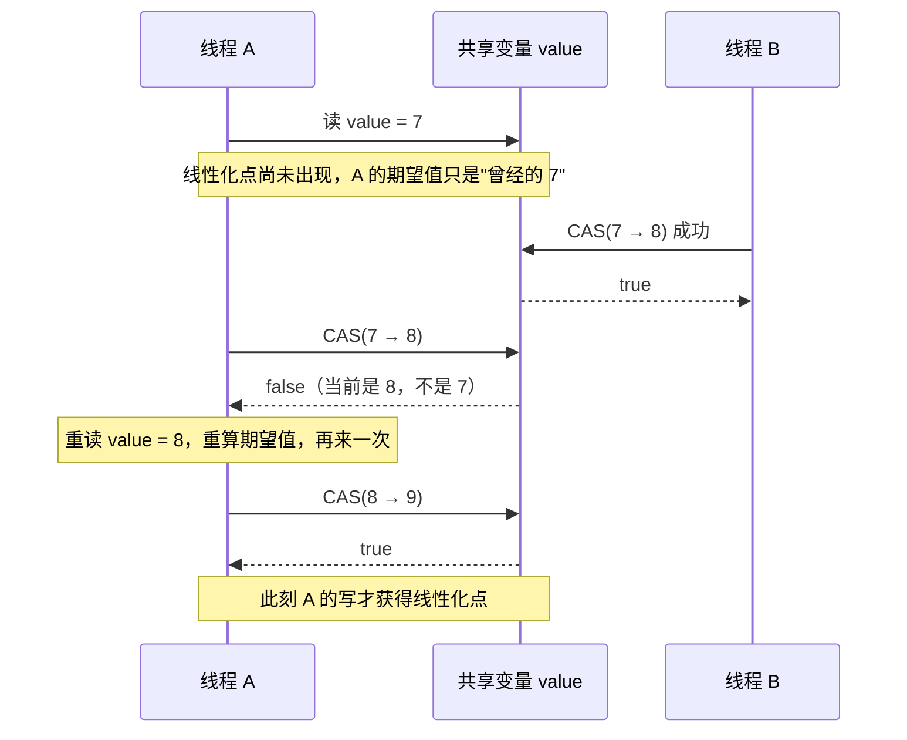
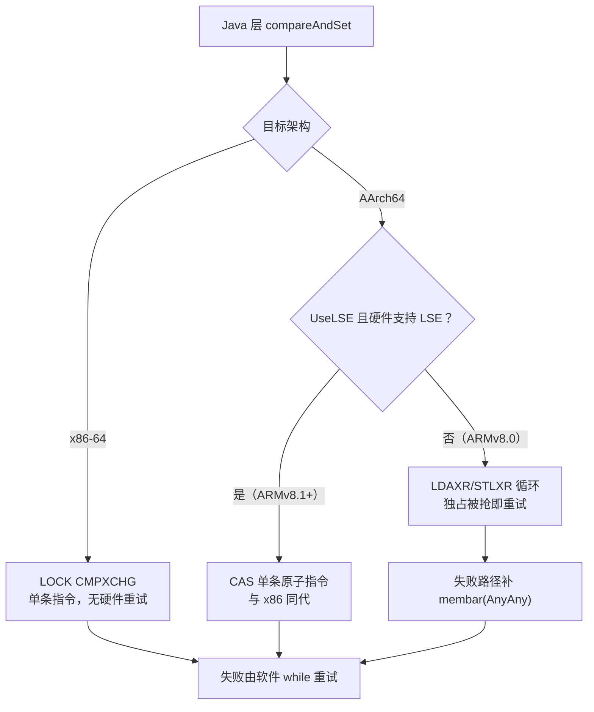
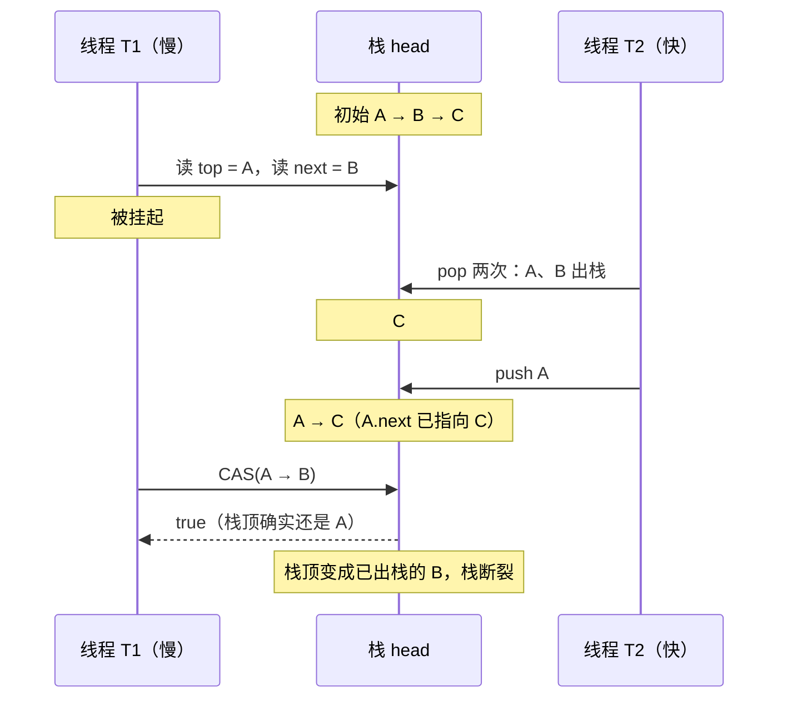
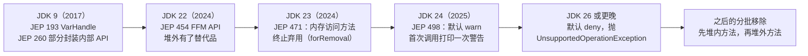
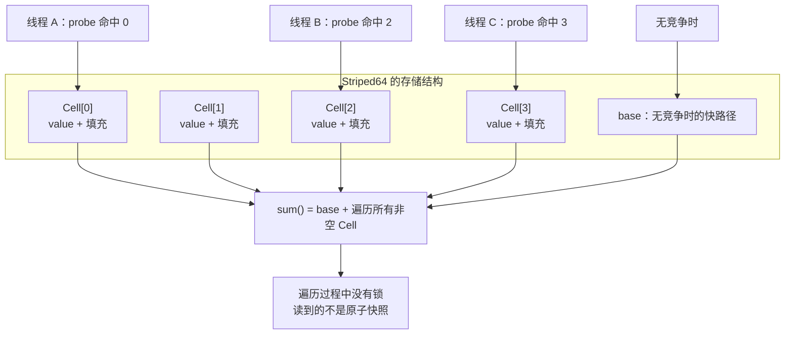
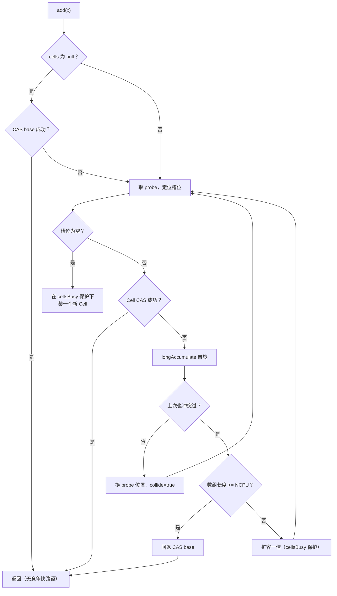

# 05 CAS 与原子类——Unsafe、AtomicInteger 到 LongAdder 的演进

**摘要：**

在锁之外，Java 还有一条"无锁"的并发路线：用一条硬件原子指令完成比较与交换，失败就重试，成功即推进。这条路线的入口是 CAS（Compare-And-Swap，比较并交换），它比锁便宜得多，因为它不进入内核、不调度、不阻塞；但它把代价转移到了三个地方——值从 A 变到 B 又变回 A 时检查会失效（ABA）、高竞争时空转的线程白白烧 CPU、以及一条指令只能管一个变量。本文沿着"三个代价 → 逐个绕过"的顺序展开：先落到指令层，看清 x86 的 `LOCK CMPXCHG` 与 ARM 的 `LDAXR/STLXR` 循环在失败形态上的差别（以及 ARMv8.1 的 LSE 指令如何把循环收回一条指令）；再用无锁栈的现场说明 ABA 为什么在 Java 里表现为"身份混淆"而不是悬垂指针，并给出 `AtomicStampedReference`、`AtomicMarkableReference` 两个版本号方案的源码级代价，以及"大多数场景 ABA 无害"的判据；接着算清自旋的账，把 `Thread.onSpinWait()` 的真实语义（一个空方法体加一条 CPU 提示）和退避阶梯讲透。后半程处理原子类的谱系与演进：`Unsafe` 从 2002 年的内部口子到 JDK 23 终止弃用、JDK 24 默认告警的完整版本线，`VarHandle` 能接住什么、接不住什么，`Atomic*FieldUpdater` 的三条使用约束，以及 `LongAdder` 为什么用"分散热点"在高竞争下跑赢 CAS 循环、代价又是什么。收尾给出"什么时候该换锁"的判据与五个常见反例，回答一个容易走偏的问题：无锁并不等于更快。

---

## 第 1 章 一条指令的重量

### 1.1 从"读改写"的裂缝讲起

原子性问题最早不是 Java 的问题，是硬件的问题。1970 年 IBM System/370 提供了一条 `CS`（Compare and Swap）指令，让"比较内存值与寄存器值、相等则写入"这一串动作在一条指令内完成；1991 年 Maurice Herlihy 在《Wait-free synchronization》里证明，具备这种语义的原语（以及 `LL/SC`）拥有无穷大的共识数（consensus number），足以构造任意线程数的无等待（wait-free）同步——这条定理是二十多年后 Java 敢把 CAS 当作并发基础设施的理论底牌。

Java 把这张底牌用起来是 2004 年的事。JSR-166 随 JDK 5 落地，`java.util.concurrent.atomic` 包一次性引入 `AtomicInteger`、`AtomicLong`、`AtomicReference` 等一批类，它们的公共接口只有寥寥几个方法，背后却都压在那条硬件指令上。再往后是 2014 年的 JDK 8：Doug Lea 把 `Striped64` 与 `LongAdder` 加了进来，绕开 CAS 单点竞争的局限。

为什么一条指令值得这么长的铺垫？因为它换掉的东西很贵。用锁实现 `i++`，代价是内核态与用户态的往返、调度器的介入、以及被唤醒线程的缓存冷启动（锁的升级路径与各层的开销量级在 [[04 synchronized 的锁升级——偏向锁、轻量级锁与重量级锁]] 里拆过，这里取结论：即便是轻量级锁，也至少要付一次 CAS 加一次解锁的写）；用 CAS 实现 `i++`，指令在用户态就结束了，失败者自己重试，没有任何人被打断。这笔账在低竞争时差出两个数量级，在高竞争时又可能反过来，本篇后面的全部内容，本质上都是在给这笔账补上限制条件。

### 1.2 语义：CAS 不是"原子写"，而是"条件写"

很多资料把 CAS 描述成"原子的读-改-写"，这个说法容易让人低估它。CAS 真正做的事是：把一次读、一次比较、一次写压缩成一个不可分割的动作，并对外报告"这次写有没有发生"。它的语义可以写成下面这段伪代码，要害在于三步之间不允许插入任何其他写：

```
CAS(address, expected, new_value):
    current = *address                  // 读
    if current == expected:             // 比
        *address = new_value            // 写
        return true                     // 写发生了
    return false                        // 写没有发生，address 保持原样
```

与"原子写"相比，CAS 多了一件事：它在写入的同时验证了旧值。这一验证把并发控制的推理对象从"值会不会被覆盖"换成"值有没有在我观察之后变过"，于是乐观策略才成立——先假设没人动过，动过就重来。CAS 的线性化点（linearization point）就落在指令成功的那一刻：在此之前所有线程都看到旧值，在此之后所有线程都看到新值，中间没有第三种状态。

失败时返回什么同样重要。`compareAndSet` 只返回布尔值，调用方拿不到"当前值到底是什么"，失败之后只能重读一次再重算；`getAndAdd`、`getAndSet` 这类读改写方法会把旧值一并返回，成功时调用方拿到的就是线性化点上观测到的那个值，不必再取一次。这是很多无锁算法宁愿用读改写方法、也不愿裸写 CAS 循环的原因，也是后面看 `LongAdder` 与 `AtomicInteger` 源码时容易忽略的一处分叉。



上图里线程 A 的第一次尝试没有推进任何状态，这不算浪费——它完成了一次"世界是否如我所见"的探测，代价只是一条指令。CAS 循环的吞吐因此可以这样理解：每次成功的更新背后，都藏着若干次失败的探测。

### 1.3 x86：LOCK CMPXCHG 与缓存锁

x86 上对应的指令是 `CMPXCHG`，从 80486 起提供。它的语义比较别扭，因为比较对象是累加器而不是操作数：

```asm
; 如果 [dst] == EAX，则 [dst] = src 且 ZF = 1
; 否则 EAX = [dst]，ZF = 0
CMPXCHG [dst], src
```

单条 `CMPXCHG` 在多核机器上并不原子：两个核心可以同时命中同一条缓存行。为保证原子性，必须加 `LOCK` 前缀。早年的教科书会说 `LOCK` 会"锁定总线"，这在 386/486 时代大致成立，但现代 CPU 走的是缓存锁（cache locking）：只在目标缓存行上取得独占，通过缓存一致性协议阻止其他核心在指令执行期间拿到该行，只有当操作跨越缓存行边界或落在不可缓存内存上时，才退化为锁总线（这套状态的维护规则与缓存行的物理尺寸，见 [[01 并发编程的硬件基础——CPU 缓存、MESI 与内存屏障]]）。

这条实现细节决定了一个容易被说反的事实：x86 上的 CAS 是一条指令，失败立刻返回，没有硬件层面的重试，所有重试都发生在软件层的 `while` 循环里，因此失败次数对软件可见、可以用退避去干预。但"失败立刻返回"不等于"失败便宜"：`LOCK` 前缀要求指令执行期间独占目标缓存行，比较失败也要先把这一行拿到手里，所以一次失败的 CAS 同样要付所有权转移的时间；失败省下的是写回与后续的失效推送，不是独占本身。

成本量级可以这样估：缓存行已经处于独占状态时，一次 `LOCK CMPXCHG` 约在几十个时钟周期内完成；缓存行在别的核心手里时，要先等缓存一致性协议完成所有权转移，量级升到几百纳秒。作为对照，一次线程挂起加唤醒的上下文切换通常以微秒计，两者差一个数量级以上——这正是 CAS 在低竞争时能赢锁的根本原因。

### 1.4 ARM：LL/SC 循环与 LSE 的两代实现

ARM 没有 `LOCK` 前缀这套东西。AArch64 提供的是加载-链接/条件存储（Load-Linked / Store-Conditional，LL/SC）这一对指令：`LDAXR`（Load-Acquire Exclusive Register）读内存并在目标地址上挂一个"独占监视器"，`STLXR`（Store-Release Exclusive Register）只有在监视器仍然有效时才写入成功。若两次指令之间有其他核心写过同一地址（严格说是同一独占监视单元覆盖的范围，通常是缓存行粒度），监视器被清掉，`STLXR` 失败。

HotSpot 在 AArch64 上的通用 CAS 实现，就是把这个循环摊在汇编里：

```asm
; MacroAssembler::cmpxchg 的 LL/SC 路径（语义简化）
retry_load:
    ldaxr   tmp, [addr]        ; 读并挂独占监视器，acquire 语义
    cmp     tmp, expected
    b.ne    nope               ; 值不等，直接以失败退出
    stlxr   status, new_val, [addr]  ; release 语义的条件写
    cbnz    status, retry_load ; 监视器被清掉，重来
    b       succeed
nope:
    membar  AnyAny             ; 失败路径补一次全屏障
```

这段代码有好几个值得琢磨的地方。其一，失败有两种，`cmp` 不等是"值不匹配"的失败，`cbnz` 跳回是"独占被抢走"的失败，后者发生在 `expected` 明明匹配的时刻——软件层看到的都是返回 false，但代价不同。其二，失败路径上还要补一次全屏障，因为 `LDAXR/STLXR` 只提供单向的 acquire/release 语义，失败返回旧值时若不再补屏障，后续读可能被重排到这次读之前。其三，在值不匹配时它直接退出而不重试，这是"强 CAS"（Java 的 `compareAndSet`）必须的行为：失败要如实报告给上层。

ARMv8.1 引入了 LSE（Large System Extensions）原子指令：`CAS`、`LDADD`、`SWP` 等一批单条原子读改写指令有了硬件支持。HotSpot 用 `-XX:UseLSE` 控制是否启用，启动时按硬件的 `HWCAP_ATOMICS` 自动探测，探测到就切到单条指令路径，探测不到就回退到上面的 LL/SC 循环。这一点对理解"同一段 Java 代码在不同 ARM 机器上表现不同"很关键：ARMv8.0 时代的服务器上，一次 CAS 可能要走 LL/SC 循环，而 ARMv8.1 以后的机型上与 x86 一样是单指令。



### 1.5 两条路线的差别落在哪里

把两条实现路线并排看，差异不只在指令条数上，还在"失败由谁承担""重试发生在哪一层"这些问题上。后面讲自旋与退避时，这些差别会直接变成调优参数。

| 维度 | x86-64 | AArch64（ARMv8.0） | AArch64（ARMv8.1+ LSE） |
| :--- | :--- | :--- | :--- |
| 原子性来源 | `LOCK` 前缀 + 缓存锁 | 独占监视器 + 条件存储 | 单条原子 RMW 指令 |
| 单次 CAS 的指令形态 | 单条 `CMPXCHG` | `LDAXR`/`CMP`/`STLXR` 循环 | 单条 `CAS` |
| 硬件层是否会重试 | 否，失败即返回 | 是，监视器被清即重试 | 否（`LDADD` 无失败概念） |
| 失败时的额外开销 | 仍要独占一次缓存行 | 值不匹配时几乎不付独占代价，独占被抢则重来 | 与成功同价（同样要独占） |
| 是否需要额外屏障 | 否（`LOCK` 隐含全屏障） | 失败路径补 `membar(AnyAny)` | 否 |
| 对高竞争的敏感度 | 中（排队等所有权） | 高（独占反复被抢，重试放大） | 中 |

这张表解释了为什么"同一段 CAS 代码在两台机器上的退化点不一样"。x86 的失败只有一种，且每次都要独占，重试全在软件层——软件可以用退避、用换数据结构去干预。ARMv8.0 的失败分成两种：值不匹配便宜、独占被抢昂贵，而后者每次都要重走循环、失败路径还要补屏障，软件层能干预的只有最外面那层。ARMv8.1 之后两条路线收敛成同一种形态（单条原子读改写），差异退回到微架构的缓存行转移速度上。

---

## 第 2 章 三个代价

### 2.1 代价清单

CAS 的收益很容易说清：不阻塞、不进内核、不做调度。它的代价则分散在三处，而这三处恰好对应 JDK 里三组不同的补救手段。

第一处是语义上的：CAS 只比较"值"，不比较"历史"。值从 A 变成 B 再变回 A，检查会通过，但中间发生过的两次修改被彻底忽略。这叫 ABA 问题，补救手段是给值加版本号或标记位。

第二处是运行时上的：失败者必须重试，高竞争下重试次数暴涨，CPU 时间被烧在"确认自己没抢到"上。补救手段是停顿提示与退避，以及更根本的——换一种数据结构，让竞争根本不发生在同一个地址上。

第三处是能力上的：一条指令只能原子地处理一个机器字。任何需要"两个字段同时生效"的不变量，都无法用单次 CAS 表达。补救手段是把多个字段打包进一个引用做整体替换，或者退回锁。

| 代价 | 触发条件 | 症状 | 主要补救 | 补救的代价 |
| :--- | :--- | :--- | :--- | :--- |
| ABA | 引用会被回收复用，或值会循环回到原值 | CAS 误成功，结构被破坏 | 版本号 / 标记位 | 每次更新多一次对象分配，CAS 变两字比较 |
| 自旋 | 竞争线程数超过缓存行能服务的速率 | CPU 空转，吞吐随线程数下降 | `onSpinWait`、退避、分段 | 增加延迟，逻辑变复杂 |
| 单变量 | 不变量跨越两个以上字段 | 读到"半更新"的组合状态 | 打包成不可变对象 / 加锁 | 分配开销 + 重算；或直接放弃无锁 |

### 2.2 源码里的循环，未必真的存在

几乎所有讲 CAS 的文章都会贴一段 `getAndAddInt` 的循环，然后说"高竞争下这个循环会空转"。这个结论对了一半，但漏掉了一个关键事实：JDK 17 里 `jdk.internal.misc.Unsafe.getAndAddInt` 的循环体确实长这样，

```java
// jdk.internal.misc.Unsafe（JDK 17），带 @IntrinsicCandidate
@IntrinsicCandidate
public final int getAndAddInt(Object o, long offset, int delta) {
    int v;
    do {
        v = getIntVolatile(o, offset);
    } while (!weakCompareAndSetInt(o, offset, v, v + delta));
    return v;
}
```

但 `@IntrinsicCandidate` 意味着 C2 在编译期会把它替换成机器指令序列。在 x86 上，它落到一条 `LOCK XADD`；在支持 LSE 的 AArch64 上，落到一条 `LDADD`。也就是说，`AtomicLong.incrementAndGet()` 在稳定运行阶段并不是一个 CAS 循环，而是一条**原子读改写指令**，循环语义由硬件的缓存一致性协议承担——失败不表现为"重试"，而表现为"这条指令执行得久"。

循环只在两种情况下真实出现：一是 JIT 没有内联（解释执行期、C1 的某些路径），二是代码里**显式写了 `compareAndSet` 的 `while`**。前者的影响在启动阶段，后者才是真正需要盯住的写法。这个区分很重要，因为"空转烧 CPU"这个症状只属于后者；前者表现为吞吐低，后者表现为 CPU 使用率高但吞吐不动。

### 2.3 失败重试次数与竞争度：一组示例测量

理论上的退化方向好说，具体形状值得给个数。笔者在一台 10 核 ARM 机器上用 JDK 17 写了一个显式的 CAS 循环，让 N 个线程各自把一个 `AtomicLong` 自增 2 万次，用 `compareAndSet` 自己数失败次数，量的是"每次成功更新平均要发几次 CAS"：

| 线程数 | 平均 CAS 次数/更新 | 单次更新摊薄耗时（ns） |
| :--- | :--- | :--- |
| 1 | 1.00 | 约 30 |
| 2 | 1.24 | 约 44 |
| 4 | 1.71 | 约 75 |
| 8 | 4.97 | 约 193 |
| 16 | 7.66 | 约 322 |

> [!info] 数据口径
> 这是单机示例测量，不是基准测试：没有预热到稳态、没有用 JMH 消除协调遗漏、机器是 10 核 ARM、线程数超过物理核数时还存在时间片抢占。数值只用来展示趋势的形状，不能作为容量规划输入。正式测量请用 JMH，并且把 GC、线程数、CPU 频率这些变量固定住。

同一台机器上把同样的自增换成 `AtomicLong.incrementAndGet()`，单线程跑下来比这个显式 CAS 循环快出数倍——差距不在指令，而在于前者的循环被 JIT 抹掉了、后者的循环真实存在，这也正是 2.2 节那段区分为什么值得单独讲。

趋势比数值更有价值：从 1 到 4 线程，失败次数增长得比线性慢，说明调度错峰确实在帮忙；从 4 到 8 线程突然跳到 5 倍，正好对应物理核数被吃满、线程开始互相打断的拐点。这个拐点不是 Java 的拐点，是机器争用模型的拐点，任何基于 CAS 的计数器都会在同一位置掉头。

### 2.4 代价三：一条指令只能管一个变量

第三个代价最容易被低估，因为它不在性能层面，而在正确性层面。CAS 的原子性范围严格等于"一个机器字"，所以任何形如"a 与 b 必须同时满足某个关系"的不变量，都无法用单次 CAS 维护。

举个最朴素的例子：统计请求的"总数"与"最大值"。如果分两个 `AtomicLong` 分别更新，那么在任意时刻读到的两个值可能来自不同的时间切片——总数已经含了第 101 个请求，最大值却还停留在第 100 个，两个数拼不出任何一个真实存在的瞬间。这不是精度问题，是可观测性问题：监控面板上的两个指标如果不同步，由它们推导出来的比率、均值就都是错的。

补救只有两条路。一条是把两个字段装进一个不可变对象，用 `AtomicReference` 做整体替换，让"一次替换"承担"两个字段同时生效"；另一条是承认无锁表达不了这个不变量，退回锁。前者在第 6 章展开（它的代价是每次更新分配一个新对象），后者是第 8 章的判据之一。

---

## 第 3 章 ABA：版本号、标记位与判据

### 3.1 无锁栈上的现场

ABA 最著名的现场是用 CAS 实现的无锁栈（Treiber stack）。压栈是标准的 CAS 循环，弹栈则要先读栈顶、再读栈顶的后继、然后 CAS 把栈顶换成后继：

```java
void push(Node n) {
    while (true) {
        Node top = head.get();
        n.next = top;
        if (head.compareAndSet(top, n)) return;   // 期望栈顶仍是 top
    }
}

Node pop() {
    while (true) {
        Node top = head.get();
        if (top == null) return null;
        Node next = top.next;                      // 关键：先读后继
        if (head.compareAndSet(top, next)) {       // 再 CAS 换栈顶
            top.next = null;
            return top;
        }
    }
}
```

危险藏在 `pop()` 的两步之间。设初始栈为 `A → B → C`，线程 T1 读到 `top = A`、`next = B`，随后被挂起；线程 T2 连续做完三件事：弹出 A（栈变 `B → C`）、弹出 B（栈变 `C`）、把 A 重新压回（栈变 `A → C`，此时 `A.next` 指向 C）。T1 恢复后执行 `compareAndSet(A, B)`，栈顶确实还是 A，CAS 成功，栈顶被改成 B——可 B 早已出栈，不再是这个栈的一部分，整个结构就此断链。



### 3.2 Java 里 ABA 的真实后果

照搬 C/C++ 的叙述会得出一个错误结论：说 B "已被释放"所以会踩内存。Java 里没有这个后果——T1 手里的 B 是一个强引用，垃圾回收器不可能在它可达时回收它，`compareAndSet` 成功之后你仍然可以安全地访问 B 的字段。把 C/C++ 的结论直接搬进 Java，是最常见的错误来源：那段叙述里真正致命的 use-after-free 在 Java 里不存在，剩下的只是一个逻辑错误。

Java 里 ABA 的危害换了个形态：不是悬垂指针，而是**身份混淆**。栈顶换成了一个不属于当前栈的节点，后续所有依赖"链表中每个节点只出现一次"的推理全部失效。危害要真正发生，需要同时满足两个条件：一是有代码把已经离开结构的节点重新放回去（重入队、重新压栈），二是该节点在离场期间被改过（后继变了、标记位置了）。只要节点一旦离场就不再用，ABA 就只是"值相同"这个抽象层面的哲学问题，不产生 bug。

这也解释了为什么 `ConcurrentLinkedQueue` 一类结构不去防 ABA：它的节点不复用，队列的操作只做"从 next 指针往前走"这一件事，不依赖"我读到的引用还是原来那个对象"这种假设。反过来，只要实现里出现了对象池、free-list、节点复用，ABA 就从理论问题变成现实问题。

### 3.3 打包成一个 Pair：AtomicStampedReference 的代价

最直接的补救是给值加版本号，CAS 时同时比较"值"和"版本"。JDK 提供 `AtomicStampedReference<V>`，它的关键实现不是"同时 CAS 两个字段"，而是把两个字段装进一个不可变对象，再对这一个引用做 CAS：

```java
// AtomicStampedReference 内部（JDK 17）
private static class Pair<T> {
    final T reference;
    final int stamp;
    private Pair(T reference, int stamp) { ... }
    static <T> Pair<T> of(T reference, int stamp) { return new Pair<T>(reference, stamp); }
}

public boolean compareAndSet(V expectedReference, V newReference,
                             int expectedStamp, int newStamp) {
    Pair<V> current = pair;
    return expectedReference == current.reference &&
           expectedStamp == current.stamp &&
           ((newReference == current.reference && newStamp == current.stamp) ||
            casPair(current, Pair.of(newReference, newStamp)));
}
```

这段代码有三处细节值得记下来。第一，`expectedReference == current.reference` 用的是引用相等而不是 `equals`，所以它比较的是"同一个对象"，不是"相等的对象"——这正是 ABA 想要的语义，也是它不能直接替换普通 `AtomicReference` 的原因。第二，三个条件用 `&&` 短路，读到的 `current` 只要有一项不匹配就直接失败，不做任何写。第三，当新值与旧值完全相同时（引用相同、版本相同）直接返回成功而不再发 CAS，省掉一次无意义的写和一次分配。

代价也在第三处：只要版本号真的变了，就要 `Pair.of(...)` 分配一个新对象。一个流传很广的解释是"引用 8 字节加版本 4 字节超过单条 CAS 的操作宽度，所以无法用单条 CMPXCHG"，这个解释并不准确：x86-64 其实有 `CMPXCHG16B` 可以一次比较交换 16 字节，问题不在硬件宽度，而在于 Java 语言层面没有 128 位原子读写原语，也没有 API 能保证两个字段在对象布局里相邻且 16 字节对齐。JDK 的选择是用一个引用包住两个值，把"两字原子性"降维成"一字引用 + 不可变对象"，代价就是每次成功修改一次分配。写高频路径时这笔分配会变成 GC 压力，这是它通常只出现在"低频但要绝对正确"的场景（锁的释放状态、并发链表删除标记）里的原因。

版本号自身还有一个理论上的回绕问题：`stamp` 是 `int`，改满 2^32 次之后回到原点，ABA 会复活。不过在真实系统里，同一个引用被修改 42 亿次之前，业务早就换了几代了，这个界可以当作不存在——但要知道它存在，因为它是"版本号方案并非数学上绝对"的唯一漏洞。

### 3.4 AtomicMarkableReference：只要一个 bit

很多场景不需要完整的版本追踪，只需要知道"这个节点被标记过没有"。`AtomicMarkableReference<V>` 把 `int` 版本号换成 `boolean` 标记，同样用 `Pair` 包装，`compareAndSet` 同时校验引用和标记。它典型的用法是并发链表的逻辑删除：先 CAS 把节点的 `mark` 从 `false` 改成 `true` 表示"逻辑已删除"，再慢慢做物理摘除；遍历时看到 `mark` 为 `true` 的节点就跳过它。

一个 `boolean` 换掉一个 `int`，省下的内存可以忽略（都要分配一个 `Pair`），真正的差别在语义：`AtomicStampedReference` 能回答"改过几次"，`AtomicMarkableReference` 只能回答"有没有改过"，而后者恰好够用，因为"删除"这个动作不需要次数。选型时用能表达需求的最小工具，而不是直接用版本号——`AtomicMarkableReference` 的 `get(boolean[] markHolder)` 这种 API 形态（用数组搬出标记）也是它在设计上"只打算服务单一场景"的痕迹。

### 3.5 大多数场景 ABA 无害，判断只需看两件事

把 ABA 说成"CAS 的致命缺陷"是过度简化。真实工程里的判断只需看两件事：CAS 的期望值是否代表"对象身份"，以及中间的变化是否携带被后续逻辑依赖的副作用。

| 场景 | 值相等是否等价于状态相同 | ABA 是否有害 | 是否需要版本号 |
| :--- | :--- | :--- | :--- |
| 计数器自增、序号发放 | 是（只关心累积量） | 无害 | 不需要 |
| 状态机推进（`NEW` → `RUNNING` → `DONE`） | 是（相同状态可互换） | 基本无害，除非允许回退 | 一般不需要 |
| 引用整体替换（不可变对象快照） | 是（新对象诞生，旧对象不复用） | 无害 | 不需要 |
| 无锁栈 / 无锁队列 + 节点复用 | 否（同一个引用指向不同拓扑位置） | 有害 | 需要 |
| 对象池 / free-list 的分配与归还 | 否（"可用"状态可能被两次归还覆盖） | 有害 | 需要 |

判据可以浓缩成一句话：如果"值回到 A"真的意味着"世界回到原样"，ABA 就是伪问题；只有当 A 这个**身份**在离场期间被重新赋予了不同含义，才需要版本号。按这个判据，绝大多数业务代码里的 `AtomicInteger`、`AtomicReference` 都是安全的，反过来，所有自己实现的无锁容器都该老老实实做压力测试，而不是靠"Java 有 GC"自我安慰。

---

## 第 4 章 自旋与退避

### 4.1 空转时 CPU 在干什么

一个线程在 CAS 循环里失败，表面上只是"又跑了一圈"，实际上它消耗的是流水线资源，而流水线是被共享的。

先是分支预测。自旋循环的形状高度固定，`CAS 成功/失败` 这个分支在稳定状态下的可预测性却很差，一旦预测失败就要清空流水线重填，代价是十几个到几十个周期。接着是超线程。物理核上的两个逻辑核共享执行单元，一个逻辑核在死循环里跑 CAS，会持续占用发射端口，把同核的另一个线程挤慢——这也是为什么"自旋线程数不多，但整台机器的其他服务也慢了"这种诡异现象会出现。最后是内存序违例惩罚。x86 有一条不太为人所知的规则：自旋等待时如果读到一条正在被其他核改写的缓存行，会触发内存序违例（memory order violation），流水线需要被清空；Intel 的手册因此建议在自旋循环里插入 `PAUSE`，它既能让流水线喘一口气，也能显著降低这种惩罚与功耗。

### 4.2 Thread.onSpinWait：一个空方法体加一条提示

JDK 9 通过 JEP 285 引入了 `Thread.onSpinWait()`。它的源码本体是这个样子：

```java
public static void onSpinWait() {}
```

方法体是空的，全部语义由 JIT 在编译期替换。方法的 javadoc 说得很克制："调用方在每个自旋迭代里调用它，表示自己正在忙等；运行时可以采取行动改善性能"——"可以"两个字是重点，它不是保证，只是一条提示，JVM 完全可以忽略。

在 x86 上，这条提示落到 `PAUSE` 指令：暂停若干周期（不同微架构上是几十个周期量级），同时告诉 CPU"这是一个自旋循环"，从而避免上面说的内存序违例惩罚，也让超线程的兄弟核有机会拿到执行资源。在 AArch64 上，HotSpot 用两个诊断参数控制：`-XX:OnSpinWaitInst` 与 `-XX:OnSpinWaitInstCount`，取值可以是 `none`、`nop`、`isb`、`yield`，默认是 `none`（即什么都不发），只有在部分 CPU 型号上（譬如 Arm Neoverse N1）默认被设成 `isb`。

这带来一个很容易踩的坑：同一段加了 `onSpinWait()` 的自旋代码，在 x86 上确实提速，在 AArch64 上可能一点变化都没有——因为默认什么都没生成。如果确定要在 ARM 上用它，需要显式设置 `-XX:OnSpinWaitInst=isb`（或 `nop`/`yield`），并且在自己的硬件上验证，不能假设"Java 的 API 一致，行为就一致"。

要注意的是，原子类的重试循环里没有 `onSpinWait()`：前面贴过的 `getAndAddInt` 循环体只有一次 volatile 读和一次 weak CAS。原因不难推：这条路径在稳态下被内联成了单条 RMW 指令，循环根本不存在，插提示没有意义。需要手动插提示的是两种情况：自旋等待某个条件成立（`while (!flag) Thread.onSpinWait();`），以及自己写的 CAS 重试循环里重算代价很高的场景。

### 4.3 三级退避与各自的价码

比 `onSpinWait` 更重的手段是退避。三级阶梯从轻到重依次是：

| 手段 | 大致代价 | 适用窗口 | 副作用 |
| :--- | :--- | :--- | :--- |
| `Thread.onSpinWait()` | 几十个时钟周期 | 竞争窗口短，成功在即 | 无，AArch64 上默认可能为空操作 |
| `Thread.yield()` | 一次调度器交互 | 竞争窗口中等，愿意让出时间片 | 可能立刻被再次调度回来，仍在耗 CPU |
| `LockSupport.parkNanos(n)` | 微秒级上下文切换 | 竞争窗口长，或临界区里有 IO | 唤醒延迟叠加，吞吐下降明显 |

真正有效的退避往往要加随机化。如果 N 个线程以相同节奏退避、相同节奏回来，它们会形成"同步起跑"的羊群效应，失败次数不降反升——这也是为什么 `LongAdder` 的扩容策略里用的是一个伪随机的探针哈希，而不是固定索引。退避时长用指数增长、并叠加一个随机抖动（jitter），是工程上的通行做法。

### 4.4 什么时候该换锁

CAS 循环与锁的分界线不在"竞争激烈不激烈"这种模糊判断上，而在几个可观测的信号上。下面这张表是笔者自己用的判据，按优先级排列：

| 信号 | 观察方式 | 含义 | 处置 |
| :--- | :--- | :--- | :--- |
| CAS 失败率持续超过 50% | 自埋点计数失败/总尝试 | 重试放大已超过收益 | 换分段结构或锁 |
| CPU 使用率高但吞吐不涨 | `top` 与 QPS 对照 | 空转，线程在做无用功 | 加退避或换锁 |
| 临界区里有 IO、日志、复杂计算 | 代码审查 | CAS 循环会把这些动作重复执行 | 换锁，把动作放进临界区 |
| 需要公平性或优先级 | 业务语义 | CAS 不提供排队，饥饿无法避免 | 换 `ReentrantLock` 公平模式 |
| 不变量跨多个字段 | 设计评审 | 单次 CAS 表达不了 | 打包成不可变对象或加锁 |
| 低竞争、短临界区 | 压测 | CAS 的最优区间 | 保持无锁 |

反过来也有一个常见误判：看到"高并发"就上无锁，结果临界区里塞了一次 JSON 序列化。CAS 循环失败重来时，整段重算逻辑要重跑一遍，而锁只阻塞不重算——临界区越长，CAS 的相对代价越高。判断标准因此不是并发量，而是"失败重试时会被重复执行的工作量"。

---

## 第 5 章 Unsafe 的退场

### 5.1 2002 年的口子与 2017 年的补丁

`sun.misc.Unsafe` 是 2002 年进 JDK 的，初衷是给 JDK 内部类一个做底层操作的通道：直接读写内存、绕过构造器分配对象、拿到字段偏移量、执行 CAS。它一共 87 个方法，其中 79 个与内存访问有关——这个比例本身就说明了它的性质：一个为内部使用设计的、几乎全是"危险动作"的工具箱。

问题在于它没有访问控制。JDK 5 的原子类把它包了一层，库作者很快发现"自己反射拿 `theUnsafe` 再做 CAS"比走原子类更省一层封装，于是 `Unsafe` 成了整个生态的公共依赖：Netty 用它操作堆外内存，Hadoop、Cassandra 用它避免 `ByteBuffer` 的 2GB 限制，大量序列化框架用它绕过构造器。等到 JDK 9 做模块化（JEP 260）想把内部 API 封起来时，`sun.misc.Unsafe` 因为依赖面太大被封进了 `jdk.unsupported` 模块单独保留——不是因为它安全，而是因为封掉它会炸掉半个生态。

同年 JDK 9 交付了 JEP 193（Variable Handles），`java.lang.invoke.VarHandle` 第一次给 Java 提供了"标准的、类型安全的、可声明五种内存语义的字段/数组元素访问通道"。这条替代路线分两段铺完：2017 年的 JDK 9 有了堆内的替代品，2024 年的 JDK 22 才用 JEP 454（Foreign Function & Memory API）补上堆外的替代品 `MemorySegment` 与 `Arena`。有了替代品，`Unsafe` 的退场才被正式排上日程。

### 5.2 版本线：从"能用"到"默认告警"

这条线的每一步都是可查的，写代码时按版本对号入座即可：



具体到行为差异，有三个节点必须记住。JDK 23 起，`sun.misc.Unsafe` 的内存访问方法（含 `getAndAddInt`、`compareAndSwapInt`、`objectFieldOffset` 等）被标注为 `@Deprecated(since="23", forRemoval=true)`，javac 编译时会给出移除警告，并且新增了一个四值开关 `--sun-misc-unsafe-memory-access={allow|warn|debug|deny}`，默认 `allow`。JDK 24 起，这个开关的默认值改为 `warn`：只要应用（或它依赖的库）第一次调用任一内存访问方法，标准错误上就会打印一条带调用方类名的警告。按 JEP 的路线图，JDK 26 或更晚会把默认值改成 `deny`，彼时这类调用直接抛 `UnsupportedOperationException`，之后再分两批（先堆内、后堆外）真正移除方法。

还有三个方法短期内不会被移除：`allocateInstance`（反序列化框架的刚需）、`throwException`、`pageSize`。它们不在"内存访问"这一类里，会被单独处理。

### 5.3 原子类为什么不受影响

一个自然的疑问是：既然 `Unsafe` 在退场，依赖它做 CAS 的原子类是不是也要跟着退化？

不会，而且原因很直接：`java.util.concurrent.atomic` 用的是 JDK 内部的 `jdk.internal.misc.Unsafe`，不是 `sun.misc.Unsafe`。前者从来没有对外暴露过，也不在弃用清单里——JEP 471 与 JEP 498 管的是 `sun.misc` 那个壳。JDK 17 的 `AtomicInteger` 顶部还留着一句注释，把这段历史交代得很清楚：

```java
/*
 * This class intended to be implemented using VarHandles, but there
 * are unresolved cyclic startup dependencies.
 */
private static final Unsafe U = Unsafe.getUnsafe();
private static final long VALUE = U.objectFieldOffset(AtomicInteger.class, "value");
private volatile int value;
```

意思是：基本类型的原子类本来打算全面改用 `VarHandle`，但类初始化时存在循环依赖（`VarHandle` 的查找机制在启动早期会反过来用到原子类），所以 `AtomicInteger`/`AtomicLong` 的 `getAndAdd`、`compareAndSet` 乃至后来补上的 `getAcquire`、`getOpaque`、`compareAndExchange` 全部仍然走内部 `Unsafe`。而引用型的原子类没有这个包袱，早就改成了 `VarHandle`。同一个包内一半用新接口、一半用旧接口，理由不是性能，是启动顺序——这是演进尚未收尾留下的现场。

把整个包盘一遍：数组型，`AtomicLongArray` 用 `MethodHandles.arrayElementVarHandle(long[].class)` 拿到元素级 `VarHandle`，全部操作走它；引用型，`AtomicReference` 与两个 `Pair` 包装类在静态块里 `MethodHandles.lookup().findVarHandle(...)`；分段型，`Striped64.Cell` 的 `cas` 是 `VarHandle.weakCompareAndSetRelease`。仍留在旧通道上的是基本类型原子类与三个 `FieldUpdater`——后者的 `Impl` 里还留着 `Unsafe.getUnsafe()` 加 `objectFieldOffset` 的老写法。所以正确的说法不是"原子类依赖 `Unsafe`"，而是"原子类是 `Unsafe` 的第一批使用者，也是最后一批还没完全搬走的"。

顺带一个容易忽略的语义变化：JDK 9 起 `AtomicInteger.weakCompareAndSet(expected, new)` 的内存语义被明确为 **plain**（等价于 `weakCompareAndSetPlain`），可能虚假失败且不提供 volatile 语义；JDK 8 时代它的语义是含糊的（既可能虚假失败、实际实现又约等于 `compareAndSet`）。原来的"用 weak 版本换性能"的写法在 JDK 9+ 上需要重新审视——如果调用方依赖它提供与 `compareAndSet` 相同的可见性，那是个隐藏的 bug。JDK 9+ 为此补齐了 `weakCompareAndSetAcquire`/`Release`/`Volatile` 三个变体，按需选用。

### 5.4 VarHandle 接得住什么，接不住什么

`VarHandle` 是 `Unsafe` 内存访问方法的指定替代品，能力覆盖得很完整：字段、静态字段、数组元素三类目标，以及五种访问模式（plain、opaque、acquire/release、volatile、compare-and-set 类读改写），还有 `getAndAdd`、`getAndSet`、`compareAndExchange` 这些复合操作。声明方式是幂等的静态初始化：

```java
private static final VarHandle VALUE;
static {
    try {
        VALUE = MethodHandles.lookup().findVarHandle(Foo.class, "value", int.class);
    } catch (ReflectiveOperationException e) {
        throw new ExceptionInInitializerError(e);
    }
}

// 之后在实例方法里
VALUE.compareAndSet(this, expected, update);   // 字段
VALUE.getAndAdd(this, 1);                      // 读改写
```

接不住的部分，恰好是"用 VarHandle 替代 FieldUpdater、性能更好"这类说法没交代的边界。`VarHandle` 明确不做三件事：

一是**不按偏移量访问**。它通过字段名和类型定位，所以像"拿到偏移量后按任意类型读写"这种玩法（某些序列化框架的核心技巧）无法表达。JEP 471 明确说过，这类用法的本质是在暴露 JVM 实现细节，官方不打算为标准 API 提供支持。

二是**不做堆外内存**。`allocateMemory`、`freeMemory`、`setMemory`、`copyMemory` 这一组要换到 `MemorySegment`/`Arena`（JEP 454），`VarHandle` 只能配合 `MemorySegment` 使用。

三是**不做对象布局黑魔法**。`objectFieldOffset` 这类"看对象长什么样"的能力没有标准替代，`allocateInstance` 也没有。

至于"性能更好"这个说法，需要打个折：`FieldUpdater` 与 `VarHandle` 最终都落到同一类 JIT 内联的原语上，稳态通常没有可测量的差别。`VarHandle` 的真实优势是类型安全（编译器检查字段类型与目标对象类型）、语义可选（五种访问模式），以及不依赖字符串字段名的运行时校验。`FieldUpdater` 的优势是声明简单、不用改字段所在类的代码。把它当成纯粹的"性能更好"，就容易为了并不存在的稳态差距去重构一大片代码。

---

## 第 6 章 原子类的谱系

### 6.1 基本类型与数组

`AtomicInteger`/`AtomicLong` 是最小可用的形态：一个 volatile 字段、一个字段偏移量、几条 CAS 方法。它们的实现形态前面已经拆过，这里只需记住一个差异：`AtomicInteger.value` 之所以声明为 `volatile`，主要不是为了 CAS 循环（循环内部用的是 `getIntVolatile` 显式 volatile 读），而是为了让 `get()`/`set()` 满足 javadoc 里承诺的 volatile 语义——`get()` 就是一次普通的字段读，这个读之所以有 volatile 效果，全靠字段声明上的修饰符。常见的归因是"CAS 不保证读到最新值所以要 volatile"，方向对但归因错了：缺读语义的是那两个普通方法，不是 CAS（volatile 的屏障落在读前还是写后，见 [[03 volatile 的实现原理——内存屏障与禁止重排序]]）。

数组版本 `AtomicIntegerArray`/`AtomicLongArray`/`AtomicReferenceArray` 把同样的能力铺到数组元素上。它省掉的不是锁，而是"为每个元素准备一个原子对象"的内存——一个 `long[]` 加一个 `VarHandle`，就能给一万个槽位提供原子更新，而一万个 `AtomicLong` 要多付一万个对象头。代价有两个：数组长度固定，不能扩容；元素级 CAS 之间没有整体一致性，读取整个数组时业务要自己处理"读到一半被改"的语义。

### 6.2 引用类型：把多个字段塞进一个引用

`AtomicReference` 的用法里最有价值的一种，是把多个字段打包成不可变对象后做**快照替换**。前面说过的"总数 + 最大值"统计，正确写法是把两个数装进一个 `record` 或 `final` 字段的类，每次更新时构造新对象、用 CAS 换取：

```java
record Stats(long count, long max) {}

AtomicReference<Stats> stats = new AtomicReference<>(new Stats(0, 0));

void record(long v) {
    while (true) {
        Stats old = stats.get();
        Stats next = new Stats(old.count() + 1, Math.max(old.max(), v));
        if (stats.compareAndSet(old, next)) return;   // 失败则整段重算
    }
}
```

三点值得说。第一，这里天然没有 ABA：每次替换都是新对象，旧对象不会再被放回去，引用相等的比较与"状态相同"的语义完全等价。第二，失败重来时整个计算要重跑，所以放进 CAS 循环的计算必须便宜——这是它在统计场景能用、在复杂业务场景容易吃亏的原因。第三，读的语义仍然是"读到一个完整快照"，调用方 `stats.get()` 拿到的 `Stats` 一定是某一时刻自洽的一对值，这正是两个独立 `AtomicLong` 做不到的事。

### 6.3 字段更新器：省对象的四条硬约束

`AtomicIntegerFieldUpdater`、`AtomicLongFieldUpdater`、`AtomicReferenceFieldUpdater` 解决的是另一类问题：类里已经有一个 `volatile` 字段，不想为了原子操作把它包装成对象。典型场景是海量小对象（每个连接、每个请求一个），一个 `AtomicInteger` 字段会让每个实例多出一个对象头和一次指针跳转，几百万实例下来就是几十 MB 的额外内存与额外的缓存占用。

```java
class Conn {
    volatile int state = 0;   // 直接是 volatile int，不是 AtomicInteger

    private static final AtomicIntegerFieldUpdater<Conn> STATE =
        AtomicIntegerFieldUpdater.newUpdater(Conn.class, "state");

    boolean cas(int expect, int update) {
        return STATE.compareAndSet(this, expect, update);
    }
}
```

这条省内存的路有四道硬门，都是抛异常而不是静默降级：

| 约束 | 违反时的行为 | 原因 |
| :--- | :--- | :--- |
| 字段必须是 `volatile` | 构造 updater 时抛 `IllegalArgumentException("Must be volatile type")` | 非 volatile 字段的普通读无法保证看到最新值 |
| 字段类型必须精确匹配（`int`/`long`/引用） | 抛 `IllegalArgumentException("Must be integer type")` | updater 按字长选择 CAS 指令，包装类型无法直接 CAS |
| 调用方必须有权访问该字段 | 抛出包着 `IllegalAccessException` 的 `RuntimeException` | updater 构造时做访问检查（`ReflectUtil.ensureMemberAccess`） |
| 只能作用于实例字段 | 构造时 `objectFieldOffset` 拒绝，抛 `IllegalArgumentException` | 静态字段走另一套偏移量 API |

第三条最容易被忽略，也就是常说的"不能是 private 的父类字段"：假设 `Conn` 继承 `Base`，而 `state` 声明在 `Base` 里且是 `private`，那么在 `Conn` 里用 `AtomicIntegerFieldUpdater.newUpdater(Conn.class, "state")` 连字段都拿不到（`getDeclaredField` 找不到父类私有字段），换用 `Base.class` 也会在访问检查处失败。笔者在 JDK 17 上实测，报错形态是这样的：

```
java.lang.RuntimeException: java.lang.IllegalAccessException:
    class Conn cannot access a member of class Base with modifiers "private volatile"
```

而静态字段的失败形态是初始化期的一次 `ExceptionInInitializerError`，根因是 `objectFieldOffset` 拒绝静态字段——这个错误发生在类初始化时，意味着它会让整个类不可用，排查时先看 `Caused by`，不要被 `ExceptionInInitializerError` 这个外壳骗了。

还有一处常被忽略的开销：`newUpdater` 是反射调用，字段查找、访问检查、偏移量计算都发生在类初始化那一刻。这次开销一次性，之后每次 `compareAndSet` 都是一次虚方法调用加一次偏移量寻址，JIT 通常能内联掉，稳态与直接调 `AtomicInteger` 的差别可以忽略。所以"反射开销"不是它的主要成本，主要成本是那三道门带来的设计约束：字段必须暴露成 `volatile`、必须能被调用方访问，这让封装性打了折。

### 6.4 累加器家族

`LongAdder`/`DoubleAdder`/`LongAccumulator`/`DoubleAccumulator` 是 JDK 8 才补上的最后一组。前两个只做加减，后两个接受一个二元函数（`LongBinaryOperator`），可以表达最大值、最小值、按位或这类"可结合、可交换"的聚合。

```java
LongAccumulator maxOf = new LongAccumulator(Long::max, Long.MIN_VALUE);
maxOf.accumulate(v);      // 多线程并发调用
long max = maxOf.get();   // 等价于 sum()，不是原子快照
```

约束在"可结合、可交换"这几个字上：聚合函数必须满足这两条，否则分段汇总的结果取决于线程调度顺序。这恰好也解释了为什么 `LongAccumulator` 不适合做"按到达顺序累加字符串"这类事——它的设计前提就是无序。

### 6.5 谱系全景

| 类 | 更新粒度 | 低竞争表现 | 高竞争表现 | 主要代价 | 典型用途 |
| :--- | :--- | :--- | :--- | :--- | :--- |
| `AtomicInteger`/`AtomicLong` | 单变量 | 最好 | 退化明显 | 单点缓存行热点 | 低竞争计数、序号、状态位 |
| `AtomicLongArray` | 数组元素 | 好 | 取决于访问分布 | 长度固定、无整体一致性 | 分片计数、位图状态 |
| `AtomicReference` | 单引用（可打包多字段） | 好 | 退化明显 | 每次更新分配不可变对象 | 快照替换、无锁结构 |
| `AtomicStampedReference` | 引用 + 版本 | 中 | 退化明显 | 每次成功修改分配 `Pair` | 需要感知 ABA 的引用 |
| `AtomicMarkableReference` | 引用 + 布尔标记 | 中 | 退化明显 | 同上 | 逻辑删除标记 |
| `Atomic*FieldUpdater` | 已存在对象的字段 | 好 | 退化明显 | 字段必须 volatile、访问权限受限 | 海量小对象省内存 |
| `LongAdder`/`DoubleAdder` | 分段累加 | 略差于 `AtomicLong` | 好一个数量级以上 | 汇总非原子、内存更大 | 监控计数、统计打点 |
| `LongAccumulator`/`DoubleAccumulator` | 分段 + 自定义聚合 | 略差 | 好 | 函数须可结合可交换 | 高并发 max/min/求和 |

这张表最实用的一行是 `LongAdder` 那行：它在低竞争下比 `AtomicLong` 慢。这不是实现缺陷，而是它的路径更长（要先检查 `cells` 是否为空、要走探针、要处理 base 与 cells 的切换）。选型时如果业务线程数只有个位数，用 `LongAdder` 是纯粹的负收益。

---

## 第 7 章 LongAdder：把热点拆开

### 7.1 为什么分散能赢

要理解 `LongAdder`，先要接受一个反直觉的事实：高竞争下 `AtomicLong` 慢，慢的不是 CAS 指令本身，而是"所有写都落在同一条缓存行上"这件事。

每次成功的 CAS 都要把这条缓存行从其他核心手里抢过来（拿到 Modified 或 Exclusive 状态），其他核心的副本随即失效。下一个线程要更新，又得再抢一次。于是吞吐被钉死在"缓存行在核心之间搬家的速率"上，而这个速率与核数无关——加核不会让缓存行搬得更快，只会让排队更长。这就是为什么 `AtomicLong` 的吞吐曲线在超过物理核数后不升反降。

`LongAdder` 的解法是**分散写热点**，把一个计数器拆成一组计数器：每个线程尽量只写自己那一格，格子各占一条缓存行，互不失效；需要总数时再把所有格子加起来。竞争从"每次写都抢同一条行"变成"每个线程抢自己那条行"，缓存行搬家的次数从"与更新次数同阶"降到"与线程数同阶"。代价被推迟到读的时候一次性付：`sum()` 要遍历所有格子。

用一个比喻：`AtomicLong` 像全公司共用一个打卡机，`LongAdder` 像每个楼层放一台——打卡不排队了，但月底统计要跑遍所有楼层把数加起来，跑的过程中还会有人在打。这个"跑的过程中有人在打"，就是 `sum()` 不是快照的来源。

### 7.2 Striped64 的结构

`LongAdder` 继承自 `Striped64`，后者是分段累加器的抽象基类，`DoubleAdder`、`LongAccumulator`、`DoubleAccumulator` 与 `ConcurrentHashMap` 的 `CounterCell` 都是同一套机制的不同包装。它的字段只有三个：

```java
// Striped64（JDK 17，节选）
transient volatile Cell[] cells;   // 分段数组，长度是 2 的幂
transient volatile long base;      // 无竞争时直接更新它
transient volatile int cellsBusy;  // 仅保护 cells 结构变更的自旋锁

@jdk.internal.vm.annotation.Contended
static final class Cell {
    volatile long value;
    final boolean cas(long cmp, long val) {
        return VALUE.weakCompareAndSetRelease(this, cmp, val);   // 注意是 release
    }
}
```

三处细节值得停下来看。第一，`base` 与 `cells` 是并存的，`base` 不是"历史遗留"，而是无竞争时的快路径——单线程或低竞争时 `LongAdder` 完全走 `base` 的 CAS，根本不碰 `cells`，这也是它在低竞争下仍能工作的原因（虽然慢一点）。第二，`cellsBusy` 是一把自旋锁，但它只保护"数组的创建与扩容"这类结构变更，不保护值更新；值更新全靠各自格子上的 CAS。第三，`Cell.cas` 用的是 `weakCompareAndSetRelease` 而不是强 CAS、也不是 volatile CAS：格子之间不需要互相看见，写只需要对后续的读（`sum()` 的遍历）保证 release 顺序，用弱版本省掉失败重试和 acquire 侧的屏障。

`@Contended` 是整段设计的地基。它让每个 `Cell` 独占一条缓存行（前后填充，默认填充宽度 128 字节），确保 `Cell[0]` 与 `Cell[1]` 不会落在同一行上——否则相邻格子的写照样互相失效，分段就白分了。这个注解在 JDK 内部类上直接生效；如果读者想在自己的类上用，JDK 9 起需要加 `-XX:-RestrictContended` 才允许，且要接受它的内存代价。



### 7.3 add() 的路径与扩容策略

`LongAdder.add()` 是理解整个算法的入口，它只有几行，但把快路径、慢路径、以及"什么时候交给 `longAccumulate`"都写在了一起：

```java
public void add(long x) {
    Cell[] cs; long b, v; int m; Cell c;
    // 快路径：cells 还是空的时候，直接 CAS base
    if ((cs = cells) != null || !casBase(b = base, b + x)) {
        int index = getProbe();
        boolean uncontended = true;
        if (cs == null || (m = cs.length - 1) < 0 ||
            (c = cs[index & m]) == null ||
            !(uncontended = c.cas(v = c.value, v + x)))
            longAccumulate(x, null, uncontended, index);
    }
}
```

`getProbe()` 是从 `ThreadLocalRandom` 里借来的线程私有伪随机数，用它和数组长度做掩码得到槽位。这一步是整个设计里最巧的地方：它没有用"线程 ID 取模"这种确定性映射（线程 ID 分布不均匀，容易撞车），而是用一个会随冲突推进的哈希，让两个总是撞在同一格的线程在几次冲突之后被分开。

`longAccumulate()` 则是完整的自旋循环，负责四件事：初始化数组、给空槽位装新 `Cell`、在冲突时换槽位、在持续冲突时扩容。源码里有几条硬规则，正好可以用来纠正一些流传的说法：

- 数组初始长度固定是 2（`new Cell[2]`），不是按线程数或核数预分配。
- 扩容不是一冲突就扩，而是要先失败一次（把 `collide` 置 `true`）、换过探针位置再失败一次，才真正扩容。这个"先换槽、后扩容"的顺序，让短时冲突不必付出扩容代价。
- 扩容上限是 `n >= NCPU` 就停止，也就是数组大小不超过 CPU 核心数。流传较广的说法是"最大为 CPU 核心数的两倍"，与源码不符——为什么要卡在核数上，理由也直白：格子数超过能同时并行写它的线程数没有收益，只会让 `sum()` 的遍历变长、内存占用变大。
- 当 `cells` 正在被别的线程扩容（`cells != cs`）或已到上限时，循环会回退去 CAS `base`，所以高竞争下 `base` 仍然会被用到，只是频率低。



### 7.4 sum() 为什么不是快照

`sum()` 的源码比 `add()` 还短：

```java
public long sum() {
    Cell[] cs = cells;
    long sum = base;
    if (cs != null) {
        for (Cell c : cs)
            if (c != null)
                sum += c.value;
    }
    return sum;
}
```

遍历时没有任何锁，也不做两遍读校验，所以它在时间上根本不是原子的：读到 `base` 之后可能有线程往 `base` 加了值，读到 `Cell[2]` 之前可能有线程往 `Cell[2]` 加了值。更微妙的是，遍历开始前抓取的 `cells` 引用可能与遍历中的数组不是同一个（扩容会替换整个数组），源码里 `Cell[] cs = cells` 这一句只是保证"遍历的是同一个数组快照引用"，不保证元素值不变。

这不是实现偷懒，而是它的定位：`LongAdder` 的契约是"多次 `add` 之后 `sum` 返回的值，等于把那些 `add` 按某种顺序全部执行一次的结果"——注意是"某种顺序"，不是"某个时刻的状态"。这比线性一致（linearizable）弱，属于可交换操作的最终汇总。JDK 的 javadoc 也只承诺"返回当前的合计值"，没有承诺快照。

同样的道理适用于 `reset()` 与 `sumThenReset()`：它们不是"原子地清零并取值"。`sumThenReset()` 的做法是先把 `base` 换零、再逐个 `Cell` 换零并把旧值累加，执行期间进来的 `add` 可能落在已经清零的格子上被计走，也可能落在还没清零的格子上被归到上一轮。要"精确的窗口统计"，只能用 `AtomicLong` 或自己加锁做双缓冲。

### 7.5 代价：语义、内存与写倾斜

`LongAdder` 的代价有三层。

语义层最重：`sum()` 不是快照，意味着任何"读出来必须精确"的地方都不能用它——包括限流器的计数、库存扣减、幂等判断。这些场景要么用 `AtomicLong`，要么用锁，不能因为"高并发计数该用 LongAdder"就一律替换。

内存层是明账：每个 `Cell` 占一条缓存行（默认填充 128 字节），数组最多 NCPU 个格子，16 核机器上上限约 2KB 的净开销（实际还要加上数组头与对齐）。相比 `AtomicLong` 的一个 8 字节字段，这是几十倍的空间，在"百万个计数器"的场景里就是几百 MB——[[09 并发容器（上）——ConcurrentHashMap 从 JDK7 到 JDK8 的重构]] 里的 `CounterCell` 之所以要惰性创建，正是为了不在每个桶上都付这笔钱。

写倾斜是隐藏的第三层。分段的前提是"线程写到不同的格子"，如果实际负载是"少数热点 key 被大量线程更新"（譬如某个爆款商品的库存），那么分段会把热点从"一条缓存行"变成"若干个格子同时被抢"，反而多了一层 `sum()` 的遍历开销。这种形状的问题不该用 `LongAdder`，而该用"每个 key 一个 `LongAdder` + 分片"或者直接改数据结构。

### 7.6 量级：两组实测对照

第 2 章那组 CAS 重试次数的测量，在同一台机器上可以顺手补齐另一半：`AtomicLong` 与 `LongAdder` 的吞吐差：N 个线程各自做 50 万次自增，取多轮稳定值。

| 线程数 | `AtomicLong`（Mops/s） | `LongAdder`（Mops/s） | 倍数 | 判读 |
| :--- | :--- | :--- | :--- | :--- |
| 1 | 约 275 | 约 137 | 0.50x | 单线程 LongAdder 更慢，路径更长 |
| 2 | 约 343 | 约 149 | 0.43x | 两个线程时仍在抢 base，慢得最明显 |
| 4 | 约 169 | 约 841 | 5.0x | 拐点，分段开始生效 |
| 8 | 约 45 | 约 1704 | 37x | 缓存行搬家成为主要瓶颈 |
| 16 | 约 36 | 约 1770 | 49x | 已饱和，LongAdder 也接近上限 |

> [!warning] 口径说明
> 同上，单机示例测量（10 核 ARM、JDK 17、50 万次 × 线程数、未用 JMH）。绝对值不可移植，重点在形状：**低线程数时 `LongAdder` 是负收益**，超过物理核数一半之后开始出现一个数量级的差距，饱和后差距稳定在数十倍。这与"高竞争下快一个数量级"的定性判断一致，任何声称"永远快几百倍"的说法都值得怀疑。

这也解释了为什么 JDK 不直接把 `AtomicLong` 实现分段：分段有固定成本（路径变长、内存变大、语义变弱），只有在竞争足够激烈时才摊得平。

---

## 第 8 章 无锁不等于更快

### 8.1 三条曲线的交点

把三种方案的吞吐画在同一张坐标上（横轴竞争线程数，纵轴吞吐），形状大致是：`AtomicLong` 在 1 到 2 个线程时最高，随后掉头向下；`LongAdder` 在 2 到 4 个线程处与它交叉，之后一路向上直到饱和；锁在极低竞争时最差（每次进出都要在对象头上做一次 CAS，竞争起来还要面对调度决策），但它的吞吐在高竞争下保持平稳——因为排队是有序的，线程不会互相打断重试。

交点位置取决于硬件（核数、LSE 是否可用）、临界区长度（锁的代价与临界区长度成正比，CAS 的代价与重算工作量成正比）以及访问分布（是否真的都写同一个地址）。这也是为什么"该用哪个"没有普适答案：只有在自己的负载上压过，才知道交点在哪里。

### 8.2 判据

把前面几章的限制条件收拢成一张决策表，按顺序过一遍，比凭直觉选要可靠：

| 先问 | 若答案是 | 就用 | 若答案为否 |
| :--- | :--- | :--- | :--- |
| 不变量是否只涉及一个字段？ | 是 | 继续问竞争 | 否 → 打包成不可变对象或加锁 |
| 竞争线程数是否 ≤ 2~4？ | 是 | `AtomicLong`/`AtomicInteger` | 否 → 继续问语义 |
| 读是否需要精确快照？ | 是 | `AtomicLong` 或加锁 | 否 → `LongAdder` |
| 临界区里是否有 IO、日志或重计算？ | 是 | 锁（且把动作移出临界区） | 否 → 继续 |
| 是否需要公平性或有序性？ | 是 | 公平锁 / 队列 | 否 → 继续 |
| 是否能用不可变快照表达？ | 是 | `AtomicReference` 整体替换 | 否 → 加锁 |

### 8.3 五个反例

第一个反例：**用 `AtomicInteger` 做高频打点自增**。这是最常见的误用。HTTP 请求计数、方法调用次数、错误计数，写频率随 QPS 线性上升，而读只在监控抓取时发生（十几秒一次）。这种"读少写多、且读不要求精确"的形状，正是 `LongAdder` 的目标场景，用 `AtomicInteger` 相当于把一个免费的优化机会丢掉，还让每次请求都多抢一次缓存行。判断很简单：读到旧值会不会导致业务做错决定？不会就换。

第二个反例：**把 `LongAdder.sum()` 当成一致快照**。典型写法是"每处理一个请求 `+1`、每处理一个错误 `+1`，然后周期性读总数和错误数算错误率"。两个 `sum()` 之间隔着微秒级的时间差，且各自都不是快照，算出来的错误率可能大于 1、也可能是负数——这种面板数据看起来只是"抖动"，实际却会让告警规则误判。要算比率，就在同一个数据源上采样（譬如用一个 `LongAdder` 存"错误数"，另一个存"总数"，接受误差；或者用 `AtomicLong` 的两个字段在同一个锁下更新）。

第三个反例：**`getAndIncrement()` 之后立刻 `get()`，把它当原子读**。`int a = counter.getAndIncrement(); int b = counter.get();` 这两行之间可能插进任意多个其他线程的自增，所以 `b - a` 不一定是 1，也不代表"我拿到之后有多少人更新过"。需要"我这一份的序号"就用返回值；需要"当前总数"就明确接受它是瞬时值。想把两次调用拼成一个原子动作，就得换工具：`AtomicLong.getAndAdd` 的返回值天然代表一笔区间，`LongAdder` 则根本不提供这种语义。

第四个反例：**在 CAS 循环里做昂贵计算**。CAS 失败重来时，循环体内的整段逻辑要重跑。如果把"从数据库读一次配置""序列化一个对象""遍历一个大列表"放进 CAS 循环，那么高竞争下这些动作会被执行几十次，而锁只需要执行一次。正确做法是把可缓存的输入提到循环外，只把"读旧值—构造新值—CAS"这三步留在循环里；如果新值的构造本身就贵到无法重复，那就说明这个不变量不适合无锁。

第五个反例：**用 `AtomicReference` 包一个可变对象**。如果 `AtomicReference` 指向的对象自身还在被并发修改（不是不可变快照），那么 CAS 成功只说明"引用没变过"，不说明"对象内容没被改过"，等价于把 ABA 问题从引用层搬到了对象内部，而且更隐蔽。要么保证被引用对象不可变，要么所有修改都通过"构造新对象 + CAS 替换"完成。

### 8.4 无锁结构的三个前提

如果准备自己写无锁结构，有三个前提必须先想清楚，否则调试成本会远超收益。

一是线性化点。每个操作都必须能找到"某一瞬间，效果等同于它原子地生效"的那个点。`push`/`pop` 的线性化点在 CAS 成功那一刻；如果实现里有两个 CAS（譬如"先把 next 指向新节点，再更新 head"），那它就不是无锁的，而是"两次 CAS 拼起来的、可能被观察到中间态"的结构，需要额外的版本号或标记位来修复。反过来，`AQS` 之所以能用 `volatile int state` 撑起整套同步器，靠的正是"单变量 + 单次 CAS"这个最干净的形状（排队与唤醒的完整机制见 [[06 AQS 框架——AbstractQueuedSynchronizer 的设计与实现]]）。

二是内存回收。Java 有 GC，比 C++ 省了很多麻烦——被摘除的节点不会被 free，正在读它的线程不会崩。但 GC 免费的是"内存安全"，不免费的是"逻辑安全"：只要节点可能被重新挂回结构，ABA 就会回来；只要有线程在读一个已经离场的节点，就要保证读到的状态是可判定的（这也是为什么无锁队列的节点在出队后仍然保留 `next` 指针、并用 `self-link`（把 `next` 指向自己）之类的技巧标记）。

三是可证明的不变量。锁的正确性可以靠"临界区互斥"这个太强的性质兜底，无锁结构的正确性只能靠逐条论证每个不变量在所有交错下成立。这也是实践中无锁代码集中出现在少数几个基础库（`ConcurrentLinkedQueue`、`ConcurrentHashMap` 的桶内链、`LongAdder`）里的原因：它们承担得起这个证明成本，业务代码承担不起——业务侧更常见的选择是按 [[17 实战——高并发场景下的锁优化与无锁编程]] 里的判据先做压测，再决定要不要碰无锁。

---

## 第 9 章 总结

回到开头那笔账。CAS 用一条指令换掉了锁的阻塞与调度，收益来自"不进内核"；它的三个代价分别对应三种不同的补救，而每一种补救都不是免费的：ABA 的版本号要付对象分配，自旋的停顿提示在 ARM 上可能什么也不做，单变量的限制只能靠打包或退回锁来绕开。

原子类的谱系基本就是这张代价表的历史投影。`AtomicInteger` 是最小可用产品；`AtomicStampedReference` 用空间换正确性；`FieldUpdater` 用设计约束换空间；`LongAdder` 用语义与内存换吞吐；`VarHandle` 用一次学习成本换掉整个 `Unsafe` 的版本风险。它们不是"更先进的替代更落后的"，而是各自守着一个不同的取舍点。

`Unsafe` 的退场说明另一件事：基础设施的演进方向往往是"把不安全的自由度收回去，换成受约束的标准接口"。JDK 23 的终止弃用、JDK 24 的默认告警、直到以后的默认拒绝，力度一路收紧，而原子类因为早就站在 `jdk.internal.misc.Unsafe` 这条内部通道后面，几乎不受影响——这本身就是"分层"的价值：把不稳定性挡在库里面，让使用者只看到稳定接口。

最后一条，也是本篇最想留下的判断：**无锁不等于更快**，它只是把"等待"从操作系统层搬到了用户态，把"阻塞"换成了"重试"。等待没有消失，只是换了个地方付费。竞争足够低时这笔置换划算，竞争足够高时它不划算，而临界点只能在自己的负载上量出来——这就是为什么每次看到"高并发就用无锁"这种说法，都该追问一句：并发到底有多高，写的是不是同一个地址，读要不要快照。

---

## 参考资料

1. OpenJDK, "JEP 193: Variable Handles"，JDK 9，https://openjdk.org/jeps/193
2. OpenJDK, "JEP 285: Spin-Wait Hints"，JDK 9，https://openjdk.org/jeps/285
3. OpenJDK, "JEP 471: Deprecate the Memory-Access Methods in sun.misc.Unsafe for Removal"，JDK 23，https://openjdk.org/jeps/471
4. OpenJDK, "JEP 498: Warn upon Use of Memory-Access Methods in sun.misc.Unsafe"，JDK 24，https://openjdk.org/jeps/498
5. OpenJDK, "JEP 454: Foreign Function & Memory API"，JDK 22，https://openjdk.org/jeps/454
6. Maurice Herlihy, "Wait-free synchronization", ACM Transactions on Programming Languages and Systems, 1991
7. JDK 17 源码：`java.util.concurrent.atomic.LongAdder`、`Striped64`、`AtomicInteger`、`AtomicStampedReference`、`AtomicIntegerFieldUpdater`、`jdk.internal.misc.Unsafe`
8. HotSpot 源码：`src/hotspot/cpu/aarch64/macroAssembler_aarch64.cpp` 中的 `MacroAssembler::cmpxchg`（LL/SC 与 LSE 两条路径）
9. Intel, "Intel 64 and IA-32 Architectures Software Developer's Manual", Vol. 2A：`LOCK` 前缀、`PAUSE` 指令
10. Brian Goetz et al., "Java Concurrency in Practice", Ch. 15: Atomic Variables and Nonblocking Synchronization

---

> [!note] 思考题
> 1. 你的服务里有一个"请求总数"计数器，QPS 五万、读只在监控抓取时发生。换成 `LongAdder` 之后，某个依赖"精确总数"做限流的旁路逻辑开始偶发误判，问题出在哪？
> 2. `AtomicStampedReference` 的版本号是 `int`，理论上会回绕。如果让你设计一个"永不回绕"的方案，代价是什么，值不值得？
> 3. 在 AArch64 上 `Thread.onSpinWait()` 默认可能不生成任何指令。这个默认值背后是怎样的取舍，为什么 HotSpot 不默认选 `isb`？
> 4. 手写一个"总数 + 最大值"的统计器，要求读到的两个值来自同一时刻。你能给出几种写法，各自的竞争表现如何？
> 5. 如果 `sun.misc.Unsafe` 在未来的 JDK 里默认 `deny`，你的项目里哪些依赖会先炸？如何在不改库的前提下定位到第一个调用点？