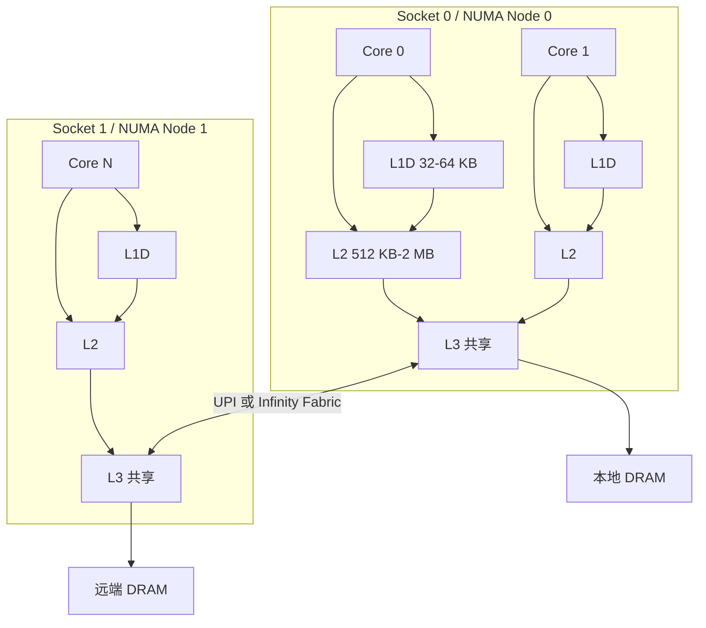
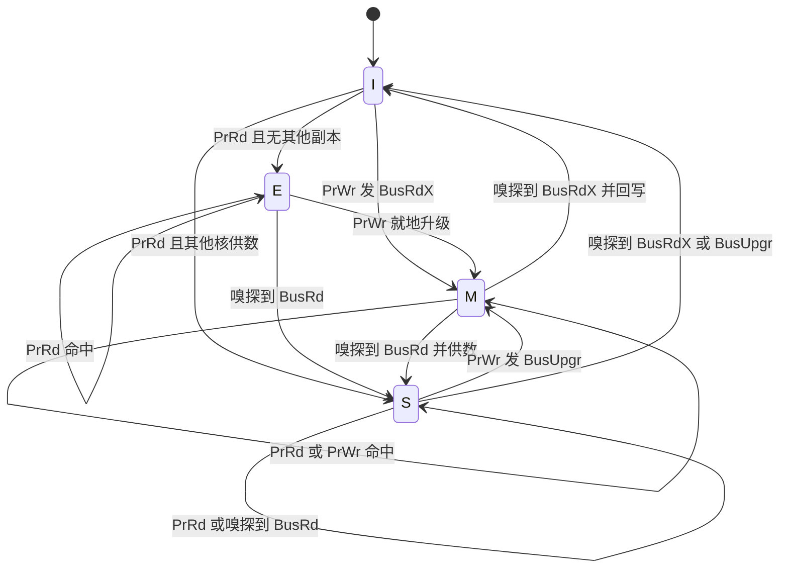
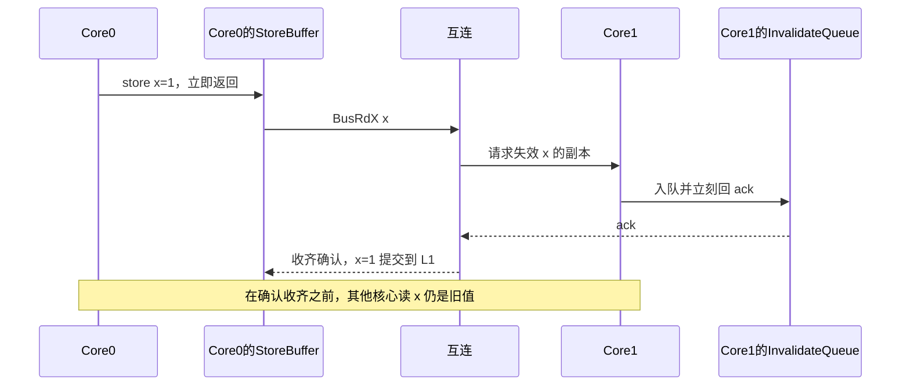
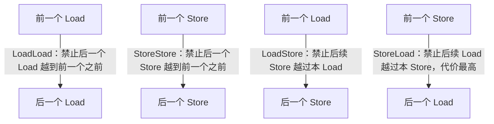
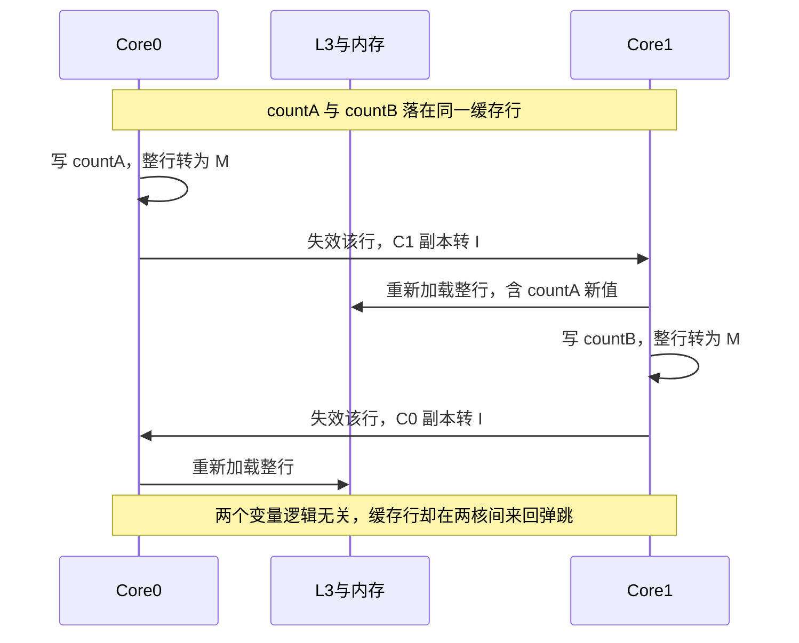
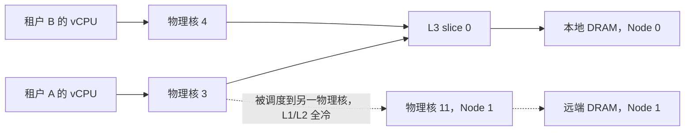

# 01 并发编程的硬件基础——CPU 缓存、MESI 与内存屏障

**摘要：**

Java 的并发语义看上去是由 `volatile` 与 `synchronized` 这两个关键字定义的，但它们只是规范层面的承诺，承诺的兑现地点在硅片上。本文从 2005 年前后主频停涨、多核成为唯一出路讲起，先给出一条"内存墙"下的缓存层次与延迟量级，再逐层拆开硬件的妥协：MESI 协议用四个状态和一套总线事务换取缓存一致性，代价是每次写都要等待其他核心确认，于是硬件又塞进 Store Buffer 与 Invalidate Queue 两个异步缓冲，用"写后读可能读到旧值""本应失效的行还能被读到"两个缺口换回吞吐。这两个缺口正是 StoreLoad 与 LoadLoad 两种重排序的物理来源，也是四种内存屏障各自要堵的那个洞。在此基础上，x86 的 TSO 与 ARMv8 的弱内存模型给出不同的允许集，解释了为什么同一段代码在 x86 上测不出问题、换到 ARM 就会出事。文章后半程把这些硬件事实映射回 Java：缓存行的计费单位如何制造伪共享，HotSpot 的字段重排序又如何让手写 padding 靠不住，`@Contended` 的 128 字节填充与 `-XX:-RestrictContended` 的静默失效分别意味着什么；最后讨论 NUMA、vCPU 超卖与共享 L3 如何让压测结论失去意义，并给出三条反例。

---

## 第 1 章 免费午餐的终结与内存墙

### 1.1 主频停涨之后，并发才成为必修课

2005 年 3 月，Herb Sutter 在 Dr. Dobb's Journal 上发表《The Free Lunch Is Over》，用一组数据说明一个当时尚未被普遍接受的判断：单核主频的提升曲线已经接近功耗与散热的物理上限，处理器厂商的下一步改为在同一块硅片上放进更多的核。此后二十年，服务器 CPU 从双核走到今天的 64 核乃至 128 核，软件却要为这个硬件事实付出代价。

这个代价的性质，在单核时代并不存在。单核上的并发只有时间维度的交错：操作系统在任意指令边界切换线程，共享状态被破坏的原因是"一个操作的中间状态被别人看见"，因此临界区、互斥、原子性构成了全部议题。多核之后多出了一个空间维度的副本问题：同一份数据同时存在于多个核心的私有缓存里，一个核心改了它自己那份，另一个核心手里那份并不会自动跟着变。前者是**原子性（Atomicity）**，后者是**可见性（Visibility）**，而可见性问题在单核时代几乎不可能被观察到，因为只有一个核心在读写缓存。

Java 后来把这件事抽象成 Java 内存模型（JMM，Java Memory Model），用 happens-before 规则来描述"什么样的写对什么样的读可见"。但 JMM 的每一条规则都要落到具体指令上，落点的形状由硬件决定。不理解硬件长什么样，JMM 就只能靠背。

### 1.2 内存墙：一个三十年前就被命名的问题

1995 年，Wulf 与 McKee 在《Hitting the Memory Wall: Implications of the Obvious》中把处理器与内存之间不断拉大的速度差命名为**内存墙（Memory Wall）**。他们的观察很朴素：处理器性能每年提升 50% 以上，DRAM 的访问延迟每年只改善 7% 左右，两个曲线交叉之后，系统性能将不再由计算能力决定，而由等待数据的时间决定。

缓存是唯一在工程上被大规模采用的对策，它的思路是承认"程序访问内存不均匀"这一事实：绝大多数程序在任意时刻只反复触碰一小块地址空间，把这部分数据搬到离核心更近、更快的存储里，等待时间就能被摊薄到可以接受的水平。

### 1.3 缓存层次与延迟量级

现代服务器 CPU 的存储层次大致如下。表中的周期数是量级判断，不同微架构、不同频率、不同代际之间会有明显出入，但相对比例长期稳定。

| 层次 | 典型容量 | 典型延迟 | 归属 | 一致性域 |
| :--- | :--- | :--- | :--- | :--- |
| 寄存器 | 数百字节 | 0-1 周期 | 每核私有 | 不涉及 |
| L1 数据缓存 | 32-64 KB | 4-5 周期 | 每核私有 | 本核 |
| L2 缓存 | 512 KB - 2 MB | 12-14 周期 | 每核私有 | 本核 |
| L3 缓存 | 8-64 MB | 40-70 周期 | 同一 socket 内共享 | 同一 socket |
| 本地 DRAM | GB - TB | 200-300 周期（约 60-100 ns） | 同一 NUMA 节点 | 全机 |
| 跨 socket 内存 | 同上 | 在本地 DRAM 基础上再增加约 50%-100% | 远端 NUMA 节点 | 全机 |

按 3 GHz 折算，一个周期约 0.33 ns，L1 命中在 1.5 ns 量级，DRAM 访问在 70-100 ns 量级，两者差了接近两个数量级。如果每次读写都要走 DRAM，一颗 64 核的处理器会把绝大部分时间花在等内存上，多核带来的吞吐优势会被彻底吃掉。缓存的存在并未让计算本身变快，它只是让多核不至于退化成一堆互相等待的空转单元。

### 1.4 缓存行：以 64 字节为计费单位

缓存管理的最小单位不是变量，而是**缓存行（Cache Line）**。x86 自 Pentium 4 起把 L1 数据缓存的缓存行固定为 64 字节（更早的 P6 系列是 32 字节），ARMv8 的多数实现同样是 64 字节，部分微架构做到了 128 字节甚至 256 字节。读一个 4 字节的 `int`，硬件会把该地址所在的一整行拉进 L1。

这个设计的前提是**空间局部性（Spatial Locality）**：程序访问了某个地址，通常很快会访问它附近。遍历数组、访问对象的多个字段、执行连续的机器码，都符合这个假设。以行为粒度批量搬运，能显著减少后续访问的未命中次数。

为了让局部性假设更精准，硬件又加了两层机制。其一是**扇区（Sector）**，把 64 字节的行再切成两个 32 字节的扇区，未命中时只填需要的扇区，避免为一个字节拉回整行；其二是**相邻行预取（Adjacent Cache Line Prefetch）**，在拉取某一行时顺手把相邻行也拉进来。这两层机制对顺序访问友好，对"两个核心各写自己那一小块"的访问模式则是灾难的放大器——后面讲伪共享时会回到这一点。

### 1.5 一致性域的真实边界

上表里"一致性域"一列值得单独说明。L1、L2 是每核私有的，因此它们之间的一致性必须靠协议维护；L3 在物理上被同一 socket 内的所有核心共享，于是 socket 内部的一致性可以只靠 L3 与互连完成，不需要通知另一个 socket；而跨 socket 的访问要经 UPI（Intel）或 Infinity Fabric（AMD）这样的片间链路，延迟高出一截，带宽也更紧张。

这个分层结构直接决定了一件事：缓存一致性协议的作用范围是"一致性域"，不是"整台机器"。一个 socket 内的失效广播到不了另一个 socket，跨 socket 的可见性需要额外的目录（directory）参与。物理拓扑一旦变化，同一段代码的成本模型就跟着变。下图把这层物理结构画成拓扑。



---

## 第 2 章 一致性问题与 MESI 的四态

### 2.1 一份数据的多个副本

先看一个最小场景。一个对象里有两个字段：生产者写 `data`，写完把 `flag` 置为 1；消费者自旋等 `flag` 变成 1，然后读 `data`。两个线程分别跑在两个核心上，`data` 与 `flag` 初始都是 0。

```java
// 生产者跑在 Core 0
data = 42;
flag = 1;

// 消费者跑在 Core 1
while (flag == 0) { /* 自旋 */ }
assert data == 42;   // 会不会失败？
```

在物理层面，两个字段各自所在的缓存行在 Core 0 与 Core 1 的 L1 里各有一份副本。生产者写 `data` 时，改的是 Core 0 手里那份；消费者读 `flag` 时，读的是 Core 1 手里那份。如果没有协调机制，Core 1 永远看不到 Core 0 的修改，`while` 会一直转下去。这就是可见性问题的物理形态：内存里的值一个字都没变，出问题的是"你读的那个副本"。

### 2.2 为什么不能每次写都写穿到内存

一个直觉方案是写直达（Write-Through）：每次写缓存，同时把新值写进主存。这条路走不通，原因有两条。

第一条是延迟。L1 写命中的成本是 4-5 个周期，如果每次写都要等 200 个周期把数据送到 DRAM，L1 的存在就失去了意义，等效于所有写都直接写内存。第二条是带宽。多核机器的内存带宽是共享资源，把所有写操作放大成内存事务，会把内存总线变成全局瓶颈——核数越多，瓶颈越明显。

于是实际采用**写回（Write-Back）**：写只落在本核的缓存里，把该行标记为"脏"，等这一行被驱逐（Evict）时再写回内存。写回策略把写操作的成本压到了缓存命中的量级，但代价是多核之间出现了不一致的副本，必须额外引入一套协议来维护一致性。

### 2.3 四种状态的语义

**MESI 协议**用四个状态描述一个缓存行在某个核心里的处境：

| 状态 | 全称 | 语义 | 其他核心是否有副本 | 内存中的值是否最新 |
| :--- | :--- | :--- | :--- | :--- |
| M | Modified | 本核独占且已修改 | 无 | 否，本核持有最新值 |
| E | Exclusive | 本核独占但未修改 | 无 | 是 |
| S | Shared | 多核共享，均未修改 | 有 | 是 |
| I | Invalid | 本行已失效，不可读 | 不确定 | 不可信 |

M 与 E 的差别常常被忽略，但它才是这套协议在性能上的关键设计。两者都表示"本核独占"，区别只在于本核是否已经改过。E 态的存在只有一个目的：让独占状态下的第一次写不需要任何总线事务。如果只有 M/S/I 三态，一个核心读完数据后要写，就必须先广播一次"我要独占"，而绝大多数情况下这份数据本来就没别人关心。E 态把这个判断前置到读的时刻，用一次总线探测换来后续一次写的事务豁免。

M 态则承担另一个责任：它是"唯一权威副本"。其他核心要读这一行，不能去内存拿，必须由持有 M 态的核心供数。这条规则保证了写回策略下的正确性，也让 M 态成为伪共享成本的直接来源。

### 2.4 状态迁移：哪些操作触发哪些迁移

MESI 的迁移由两类事件驱动：本地核心的读写请求（PrRd、PrWr），以及总线上嗅探到的其他核心的请求（BusRd、BusRdX、BusUpgr）。完整的迁移关系如下表，其中"总线事务"一列是该次迁移在互连上引发的动作。

| 当前状态 | 事件 | 新状态 | 总线事务与说明 |
| :--- | :--- | :--- | :--- |
| I | PrRd | E | 发 BusRd，无其他核响应，本核独占 |
| I | PrRd | S | 发 BusRd，有其他核供数，转为共享 |
| I | PrWr | M | 发 BusRdX（读并请求独占），其他核副本置 I |
| E | PrRd | E | 命中，无事务 |
| E | PrWr | M | 无总线事务，直接就地升级 |
| E | 嗅探到 BusRd | S | 把数据交给请求方，降为共享 |
| S | PrRd | S | 命中，无事务 |
| S | PrWr | M | 发 BusUpgr，只请求失效不传数据 |
| S | 嗅探到 BusRd | S | 无动作，可能参与供数 |
| S | 嗅探到 BusRdX 或 BusUpgr | I | 副本作废 |
| M | PrRd / PrWr | M | 命中，无事务 |
| M | 嗅探到 BusRd | S | 回写或直传数据给对方，降为共享 |
| M | 嗅探到 BusRdX 或 BusUpgr | I | 先回写数据，再作废 |

表里有两处细节值得停下来说。`BusRdX` 与 `BusUpgr` 的区别是前者要数据、后者只要独占权：从 I 态写必须先把整行读进来（写分配，Write-Allocate），从 S 态写则手里已经有数据，只需要让别人丢掉副本，用 `BusUpgr` 能省掉一次数据搬运。这个区分在高频写的场景里直接体现为带宽差异。把上表收成状态机，就是下面这张图。



### 2.5 写为什么必须走一次总线事务

把上表里所有 `PrWr` 行单独抽出来看，除了 `E → M`，其余每一条都伴随一次总线事务。原因不在"写数据"本身，而在"先取得独占权"这个前置条件。

一份数据同时存在于多个核心的缓存里时，任何一次写都会让其他副本过时。要让写操作合法，写者必须先让所有其他副本失效。失效这件事无法只在本核完成，它需要通知其他核心，而通知在物理上只能经过互连——或在共享总线上广播（snooping），或查询一个记录着行归属的目录（directory）。无论哪种，都是一次跨核通信，这就是"写需要总线事务"的全部含义：需要传出去的是独占权，数据本身并不出本核。

多核时代的总线事务早就不真的是"锁住整条总线"了。x86 的 `LOCK` 前缀在这类场景下做的是**缓存锁（Cache Lock）**：只锁定目标地址所在的缓存行，其他核心访问同一行时被阻塞，访问其他行不受影响。真正回退到总线锁的情况是数据跨越缓存行边界或地址未对齐，这也是为什么对齐的原子变量比未对齐的更便宜。近年的处理器甚至专门检测这种"跨行锁"（split lock）并加以惩罚，把它当作性能事故处理。

### 2.6 MESI 是一个家族，不是一个具体实现

教科书上的 MESI 是教学模型。工程实现通常在这个骨架上做扩展：Intel 在多核互连上使用 MESIF，比 MESI 多一个 F（Forward）态，用于在多个 S 副本中指定一个负责响应读请求，避免所有共享者同时回数据造成互连拥塞；AMD 的 MOESI 多一个 O（Owned）态，允许脏数据在共享状态下由某个核心持有，省掉"先回写内存再共享"的一步；ARM 的 AMBA CHI 走的是基于目录的协议，状态定义与 MESI 一一对应但并不相同。

所以"MESI 是 Intel 与 ARM 都在此基础上实现的协议"这种说法只在教学意义上成立。真正要记住的是这套机制的三条不变式：任何时刻一个缓存行最多只有一个核持有写权限；持有写权限的核是数据的唯一权威副本；其他核的读必须能拿到这个权威副本的值。至于状态到底叫 M、E、S、I 还是 O、F，属于实现细节。

### 2.7 缓存一致不等于内存一致

这里有一个在中文资料里经常被混为一谈的区分。

**缓存一致性（Cache Coherence）** 说的是单个地址的性质：所有核心对同一个地址的读写，看起来像在一条时间线上依次发生，不会出现"核心 A 读到了旧值而核心 B 在同一时刻读到了新值"这种自相矛盾。MESI 保证的就是这一条，而且它保证的粒度是"单个地址"，甚至可以说是"单次访问"。

**内存一致性（Memory Consistency）** 说的是多个地址之间的顺序：如果我在 A 地址写入一个值、再在 B 地址写入另一个值，别的核心看到这两次写的顺序是什么。MESI 对此没有任何承诺——它只保证每个地址各自一致，不保证地址之间的先后。

这个区分是整个并发编程的分水岭。JMM 关心的是内存一致性，而硬件给出的答案是"顺序由内存模型决定，不同架构的答案不一样"。第 6 章的 TSO 与弱内存模型讨论的就是这个问题；JMM 把硬件允许集翻译成程序可推理的规则，具体条目见 [[02 Java 内存模型（JMM）——happens-before 与可见性保证]]。

---

## 第 3 章 两个异步缓冲：性能的解药，语义的毒药

### 3.1 MESI 的同步代价

MESI 保证了正确性，代价是同步阻塞。以 Core 0 写一个处于 S 态的行为例：它必须发出 `BusRdX`，然后等待所有持有该行副本的核心回复"已失效"，收齐之后才能把新值写入缓存。在一个 64 核、L3 被所有核心共享的机器上，这个等待意味着要等 63 份确认；跨 socket 时，还要等片间链路上的往返。

一次写操作的成本从"4 个周期"变成"一次全局往返"，这在写密集的负载下完全不可接受。硬件的应对方式与所有高性能系统一样：把同步等待改成异步投递，用两个缓冲区把"等待"从写路径上摘下来。

### 3.2 Store Buffer 与本核的写前递

**Store Buffer** 是每个核心私有的小缓冲，位于核心的存储单元与 L1 之间。引入它之后，一次写的流程变成：把 `(地址, 值)` 塞进 Store Buffer，立即返回继续执行后续指令；Store Buffer 在后台发出 `BusRdX`、等待失效确认，确认收齐后才把这次写提交到 L1。

对写者来说，写延迟从"一次全局往返"降到"几个周期"，这是数量级的改善。但它打开了一个缺口：Store Buffer 里的内容对其他核心不可见。别的核心只能从缓存读，看不到你手里还没提交的写。

本核自己不受这个缺口影响，硬件用**写前递（Store Forwarding）** 补上了：本核的读操作会先检查 Store Buffer，如果命中了同一个地址，就直接从缓冲区里取值，不读缓存。这保证了单线程视角下的程序顺序语义——写完之后紧接着读，一定能读到刚写的值。

> [!note] 说明
> 写前递只对本核有效。其他核心既看不到 Store Buffer 里的内容，也不参与前递，这正是写后读重排序在物理上的起点。

写前递有一个常被忽略的性能侧面：它的实现依赖地址与宽度的匹配，如果后一次读跨越了前一次写的边界，或者两次访问宽度不同，前递可能失败，硬件只能等 Store Buffer 排空后再读，代价是几十个周期。在 JIT 生成的代码里，字段访问宽度通常一致，这个问题不常见，但手写标量替换、把 `long` 拆成两个 `int` 读的代码会遇到。

### 3.3 Invalidate Queue 与延迟失效

缺口在接收端又被放大了一次。Core 1 收到 `BusRdX` 请求时，理论上要立刻查自己的缓存、把对应行标为失效，然后回复确认。但这个查表动作本身要花时间，如果每个失效请求都同步处理，接收方会成为瓶颈。

**Invalidate Queue** 的作用是把这一步也异步化：收到失效请求先入队，立即回复确认，真正的失效动作推迟到"合适的时候"——通常是队列将满、或者遇到一条内存屏障指令时。发送方因此能很快收齐确认，写吞吐大幅提升。

代价随之而来：Core 1 的缓存里可能存在一个"已经被宣告失效、但队列还没处理"的行。这段时间内，Core 1 的读操作仍然会命中这个行，读到的是应该已经作废的旧值。

严格地说，现代处理器在提交存储时会把"失效"这件事在队列层面处理为对后续读的检查，因此单纯靠 Invalidate Queue 是读不到已经失效的行的——真正的重排序来自"读操作在队列被处理之前就已经发射并完成"。但结果是一样的：从其他核心观察，本核的读可以越过本核已经收到的失效通知，表现为 LoadLoad 与 LoadStore 重排序。

### 3.4 缺口是怎么出现的

把两个缓冲放在一起，StoreLoad 重排序的物理图像就清楚了：



关键在最后一行注释：从执行 `store x=1` 到 `x=1` 对其他核心可见，中间隔着一个长度不确定的窗口。如果这个窗口里 Core 0 执行了一条 `load y`，那么从其他核心的视角看，`store x` 与 `load y` 谁先发生是不确定的——理论上 `load y` 的结果可能已经反映了某个只有 `x=1` 生效之后才可能的状态。这就是 **StoreLoad 重排序**：本核的后续读可以越过本核尚未提交的写。

请注意这个描述的重心：被重排的不是"写"，是"读相对于写的位置"。写只是在本地被延迟提交，读是老实地按顺序读的，但读发生在写提交之前，就没有看到写。硬件没有打乱任何指令，它只是让写的完成时间变得不确定。

### 3.5 用 litmus 测试把重排序钉死

要把这些可能性说清楚，学术界的做法是构造极小的并发测试，称为 **litmus test**，然后枚举所有允许的结果。下表是几个经典测试及其见证的重排序类型。"允许的异常结果"一列，指的是在没有插入任何屏障时，理论上可能出现、但顺序一致性下不可能出现的结果。

| 测试 | 线程 A | 线程 B | 允许的异常结果 | 见证的重排序 |
| :--- | :--- | :--- | :--- | :--- |
| SB（Store Buffering） | `x=1; r1=y` | `y=1; r2=x` | `r1=0 且 r2=0` | StoreLoad |
| LB（Load Buffering） | `r1=x; y=1` | `r2=y; x=1` | `r1=0 且 r2=0` | LoadStore |
| MP（Message Passing） | `data=1; flag=1` | `while(!flag); r=data` | `r=0` | StoreStore 与 LoadLoad 的组合 |
| IRIW | A 与 B 分别写 x、y，两个读者各自读 x 与 y | 同左 | 两个读者看到的两条写顺序相反 | 多副本原子性（Multi-Copy Atomicity） |

SB 的异常结果最容易被忽略：两个线程各自写了不同的变量、各自读了对方写的变量，最终双方都读到了 0。这在顺序一致性下是矛盾的——无论是 A 先写还是 B 先写，总有一个人应该读到 1。一旦允许"写先落进本地缓冲、读先执行"，这个结果就成立了，而这也正是 Store Buffer 单独能造成的唯一一种重排序。

LB 见证的是 LoadStore：本核的写可以越过本核的读。它在 TSO 上不被允许（x86 的写不会越过更早的读），在 ARM 与 POWER 上被允许。

### 3.6 一个必须纠正的流行说法

到这里可以处理一个流传很广、但严格说并不准确的例子。很多资料在讲完 Store Buffer 之后，会立刻拿出第 2 章那段 `data=42; flag=1` 的代码，说"Core 0 的 `flag=1` 先提交到缓存，`data=42` 还在 Store Buffer 里，于是消费者看到 `flag=1` 却读到 `data=0`"，并把这件事当成 x86 上真实发生的现象。

这个推导在 x86 上不成立。x86 的 TSO 模型明确规定存储之间不重排序，而 TSO 的 Store Buffer 是实现这一点的：它是 FIFO 的，先进入的写必须先提交。`data=42` 在 `flag=1` 之前进入缓冲，就必然先提交。于是 MP 测试在 x86 上不可观察，这段代码在 x86 上"看起来是对的"——这是它危险的地方，而不是它安全的地方。

真正会让 MP 违例的有两处来源。第一处是编译器与 JIT：把 `data=42` 挪到 `flag=1` 之后，在单线程语义下完全合法（`as-if-serial` 只要求不改变单线程可观察的行为），而这一步与 CPU 架构无关，x86 一样会中招。第二处是弱内存模型：ARM、POWER 的写缓冲并不承诺跨地址的 FIFO，写可能被合并、提前发出，配合接收端的 Invalidate Queue，MP 的异常结果就出现了。

把这个区分讲清楚的实际价值在于：x86 上测不出问题，并不说明代码正确，只说明 TSO 替你挡住了硬件那一层，而编译器那一层还没被挡住。第 6 章会把这条线索展开成"为什么 x86 验证不能上 ARM"。

### 3.7 两种缓冲与四种屏障的对应关系

两个缓冲各自打开一个缺口，四种屏障就分别去堵这四个缺口。下面这张图把四种屏障放在指令流的两个相邻操作之间，标出它们各自阻止什么。



从成本角度看，前三种屏障与 StoreLoad 完全不在一个量级。LoadLoad 与 LoadStore 只需要让本核的读路径排空——等待已经发射的读完成即可，在 x86 上退化成一条编译器屏障，硬件层面没有任何指令。StoreStore 需要把本核的 Store Buffer 排空到"当前这一行已经进入一致序"的状态，在 x86 上也是一条编译器屏障就够。只有 StoreLoad 既要排空 Store Buffer，又要让后续的读看到其他核心已经发出的写，落到 x86 上必须是一条真正带 `LOCK` 前缀的指令或者 `MFENCE`。

这道屏障之所以贵，是因为它把"写"从"本地完成"提升成了"全局可见"。一笔写要从核心私有的缓冲走到所有核心都能看见的位置，中间要经过互连、要走完失效确认、要让所有其他核心的读路径重新取数。一次同步往返的代价随之出现，而这恰恰是 Store Buffer 当初要消除的那笔开销。

---

## 第 4 章 四种重排序的完整清单

### 4.1 三个发生位置

中文资料里"重排序"这个词被用得过于笼统，经常把三个完全不同层面的现象混在一起。按发生位置拆开，至少有三类。

**编译器重排序**发生在源码到字节码、字节码到机器码这两次翻译里。C2 编译器会把循环内不变的字段读提到循环外、把不相关的赋值调换顺序、把重复的字段读合并成一次，只要单线程可观察行为不变。这一步与硬件无关，也是三层里最难防的：等机器码生成出来，重排已经发生，回头对照源码看不出哪里被动过。

**指令级并行（Instruction-Level Parallelism）** 重排序发生在核心内部。现代乱序执行核心有几十到几百个表项的重排序缓冲区（ROB），指令按程序顺序取指、解码、进入 ROB，然后只要操作数就绪就乱序发射，最后按程序顺序退休。对寄存器依赖的指令，乱序执行不影响语义；对内存访问，只要地址不冲突，硬件的存储队列就允许它们乱序完成。这一层对程序员完全不可见，也完全不可控。

**内存系统重排序**发生在缓存一致性的实现里，就是第 3 章的 Store Buffer 与 Invalidate Queue 制造的两种缺口。这一层的特点是它有清晰的架构定义：x86 允许哪些、ARM 允许哪些，都被写进厂商手册与形式化模型，可被测试与推理。

### 4.2 四类重排序与约束手段

把三个位置与四种屏障交叉起来，得到下面这张表。它回答的是同一个问题：某种重排序该由谁来拦。

| 重排序类型 | 典型发生位置 | 一个具体形态 | 拦住它需要什么 |
| :--- | :--- | :--- | :--- |
| 编译器 LoadLoad / LoadStore | C2、JIT、javac | 把循环内字段读提到循环外；把对象字段写挪到构造之后 | 编译器屏障，靠 `volatile`、`final` 语义或 `Unsafe` 内建方法触发 |
| 指令级乱序 | ROB 与存储队列 | 两个不同地址的 store 乱序完成 | 单靠硬件无法约束，需要架构层面的屏障或依赖链 |
| StoreStore | Store Buffer 跨地址非 FIFO | 两个 store 的可见顺序颠倒 | StoreStore 屏障 |
| LoadLoad / LoadStore | Invalidate Queue | 读命中了一个应已失效的行 | LoadLoad 屏障，或在读之后插入 acquire 语义 |
| StoreLoad | Store Buffer 未提交 | 后续读看不到本核更早的写 | StoreLoad 屏障，且必须是真的全局操作 |

表格里第二行的意思要讲清：指令级乱序是硬件的性能来源，它不可能被"关闭"，只能被屏障约束到"对外表现为有序"。所有屏障的语义都是"在这条指令之前，不允许后续的内存操作对任何人可见"，而不是"禁止核心乱序执行"。

### 4.3 Java 代码里能观察到的形态

四种重排序在 Java 里会呈现为几个具体的失败模式，它们在 x86 上极难复现，在弱内存模型上则很容易出现。

其一，对象逸出与半初始化。构造函数里的字段赋值与把 `this` 引用发布出去，在没有任何同步的情况下，其他线程可能先看到引用、后看到字段值，读到一个所有字段都是默认值的对象。JMM 用 `final` 字段的初始化安全保证来对付这一种。

其二，双重检查锁（Double-Checked Locking）。在 JSR-133 之前，`instance = new Singleton()` 可以被拆成"分配内存""发布引用""调用构造"三步重排，另一个线程在第一次检查时拿到非空引用，却看到一个未构造完成的对象。这正是 JSR-133 强化 `volatile` 语义的直接动因。

其三，非阻塞的发布与订阅。生产者写完数据、置标志位，消费者轮询标志位、读数据。这是 MP 测试的工程版本，也是第 2 章那段代码的真实来源。

这三个形态有一个共同点：它们在 x86 上几乎总是"碰巧正确"。原因不在代码本身，而在 TSO 太强，把四种重排序里的三种直接禁掉了。真正让它们暴露的，除了 ARM 平台，还有编译器优化——HotSpot 的 C2 在某些版本里就曾把构造函数的字段写重新排序到引用发布之后。

---

## 第 5 章 四种内存屏障

### 5.1 屏障的两个职责

**内存屏障（Memory Barrier）** 是一条指令，它的语义是"在此之前的全部内存操作，必须先于在此之后的全部内存操作被观察到"。这句话包含两个职责，中文资料常只讲第一个。

第一个职责是排序：约束本核后续操作的发射与完成，不让它们越过屏障。第二个职责是**传播（Cumulativity）**：让屏障之前已经完成的操作，对屏障之后才发生的观察者也是可见的。后者容易被忽略，但它是"屏障链"能成立的基础——如果屏障只约束本核，那么 A 核的写经过屏障之后，B 核读到了 B 核自己的屏障，B 核是否能看到 A 核的写？答案要靠传播性来保证。

这也是为什么"`volatile` 只是禁止重排序"这个说法不够准确。`volatile` 写之后的 StoreLoad 屏障所做的，是把这次写推到全局可见的位置，而不只是"不许后面的读提前"。

### 5.2 四种屏障的语义

| 屏障 | 阻止的重排序 | 在本核上实际要做的事 | x86 上的实现 | 典型代价 |
| :--- | :--- | :--- | :--- | :--- |
| LoadLoad | Load 与后续 Load | 等待已发射的读完成，处理失效通知 | 编译器屏障，无指令 | 极低 |
| StoreStore | Store 与后续 Store | 把先前的写推出 Store Buffer 到一致序 | 编译器屏障，无指令 | 低 |
| LoadStore | Load 与后续 Store | 等待已发射的读完成 | 编译器屏障，无指令 | 低 |
| StoreLoad | Store 与后续 Load | 排空 Store Buffer 并等待失效传播完成 | `MFENCE` 或带 `LOCK` 前缀的指令 | 高 |

表里"x86 上的实现"一列是这套机制里最反直觉的部分：在 x86 上，前三种屏障在硬件层面是空的，JVM 只需要阻止编译器重排，不必生成任何指令。原因就是 TSO 本身就禁止了这三种重排序，硬件已经替屏障做完了。

### 5.3 x86 的落地：`LOCK` 前缀与 `MFENCE`

x86 提供三条显式屏障指令：`LFENCE` 约束读、`SFENCE` 约束写、`MFENCE` 是完整的读写屏障。但在实际生成的代码里，HotSpot 更常用的是带 `LOCK` 前缀的空操作指令。

HotSpot 在 x86-64 上的 `OrderAccess::fence()`，长期以来的实现是向栈顶地址做一次带 `LOCK` 前缀的加零操作，即 `lock addl $0x0,(%rsp)`。这条指令看起来很怪，原因是 `LOCK` 前缀在微架构上被定义为"全屏障"：任何带 `LOCK` 前缀的指令，都会在指令执行前后形成完整的内存序约束，效果与 `MFENCE` 等价。选择它而不是 `MFENCE`，原因在性能上——在多数微架构上 `LOCK` 加零比 `MFENCE` 便宜，因为它不触发完整的内存子系统清空。

这里要注意一个细节：`lock addl $0x0,(%rsp)` 是"写栈顶"，会占用存储端口并弄脏一个本来就热的缓存行，所以它并非零成本。这也是"`volatile` 写在 x86 上很便宜"这个流行说法的边界——便宜是相对跨核往返而言的，单次仍在几十个周期的量级。

### 5.4 ARMv8 的落地：DMB 与单边屏障

ARMv8 走的是另一条路。它提供 `DMB`（数据内存屏障）、`DSB`（数据同步屏障）、`ISB`（指令同步屏障）三条基本指令，其中 `DMB` 带域参数，可以只约束读或只约束写：`DMB ISH` 是全屏障，`DMB ISHLD` 只约束读，`DMB ISHST` 只约束写。域参数里的 `ISH` 表示"内部共享域（Inner Shareable）"，即同一操作系统管理下的所有核心；跨 hypervisor 的域要用 `OSH` 或 `SY`。

更省的一层是 `LDAR` / `STLR` 这对指令，它们带 acquire / release 语义：`STLR` 之后的写不会越过它，`LDAR` 之前的读写不会被它之前的指令越过。ARMv8 的 release store 有一个很有用的性质：它自身就提供了单向的 StoreLoad 效果，在同一地址上的后续 acquire load 能看到它之前的所有写，因此在 `STLR` 之后通常不需要再补一条 `DMB`。

这就是为什么同一段 `volatile` 写，在 x86 上生成一条 `LOCK` 前缀指令，在 ARMv8 上生成一条 `STLR`，在更老的 ARMv7 上则可能是"`DMB` + 普通 store"两条。差异不在 JVM 的实现水平，在架构提供的原语粒度。

### 5.5 `volatile` 写后面那道屏障，只解决一个问题

把前面所有线索收拢到一个具体的点上：`volatile` 写之后的 StoreLoad 屏障，要解决的问题只有一个——让这次写在本线程继续执行之前，对所有其他线程变成可见的。

为什么非要卡在"写之后"而不是"读之前"？因为两种插入位置在语义上等价、成本上不等价。方案 A 是每次 `volatile` 写后插一道 StoreLoad；方案 B 是每次 `volatile` 读前插一道 StoreLoad。两者都能保证"读到的写之前的所有动作都可见"，但方案 A 只在写路径上付一次同步成本，方案 B 会让每次读都付——读通常比写频繁得多，而且读路径上的屏障会破坏指令级并行的收益。

JMM 选择了方案 A，于是 `volatile` 写的成本里天然包含一次全局可见性的等待，`volatile` 读的成本几乎为零（只需要编译器屏障保证不与后续操作重排）。这个不对称是 Java 并发库里大量使用"单写多读"模式的物质基础。具体的指令序列与初始化安全性的细节，详见 [[03 volatile 的实现原理——内存屏障与禁止重排序]]。

### 5.6 屏障不是锁

最后要划清一条界线：屏障不提供互斥。

一道 StoreLoad 屏障能让写"立刻被看见"，但它不阻止另一个核心在同一时刻写同一个变量。两个线程各自执行 `volatile` 自增，理论上仍然可能丢失更新，因为 `i++` 是"读、加、写"三步，屏障只作用于第三步之后的可见性，管不了前两步之间被插进来。**屏障解决有序性与可见性，锁解决原子性**，两者不能互相替代。这条区分在后面讲原子类与锁时会被反复用到。

---

## 第 6 章 TSO 与弱内存模型

### 6.1 x86 的 TSO 三规则

x86-64 的内存模型是**全存储序（TSO，Total Store Order）**。它的正式定义可以在 Intel 软件开发手册第三卷第八章找到，工程上通常概括为三条规则：

第一，读与读之间不重排序。第二，写与写之间不重排序。第三，读可以越过更早的写，但只限于访问不同地址的情形；访问同一地址时，读必须看到本核更早的写（这就是写前递的语义保证）。

三条规则合起来的效果是：x86 全序中唯一被允许的重排序是**写后读**。这也是 TSO 这个名字的来源——所有写操作在全机范围内有一个总顺序，读可以越过自己前面那次写先执行，但写与写、读与读的相对顺序钉得很死。

TSO 还隐含一条更强的性质：**多副本原子性（Multi-Copy Atomicity）**。一个写一旦对某个其他核心可见，就同时对所有其他核心可见，不存在"先被 A 看到、后被 B 看到"的中间状态。这使得 IRIW 这类测试在 x86 上不可能出现异常结果。

### 6.2 ARMv8 的弱序

ARMv8-A 的模型宽松得多。默认情况下，四种重排序全部允许：写与写之间可以重排（写缓冲不承诺跨地址 FIFO），读与读之间可以重排（读可以在失效通知处理之前发射），读与写之间双向都可以重排。这就是"弱内存模型（Weak Memory Model）"的含义：硬件不替你保证顺序，需要顺序的地方由软件用 acquire / release 或屏障显式声明。

不过 ARMv8 并不是毫无约束。ARM 在 v8 版本强化了模型的多副本原子性，把它做成了"other-multi-copy-atomic"：一个写对所有其他核心同时可见，只有写者自己可以提前看到自己的写。Pulte 等人在 2016 年给出的 ARMv8 形式化模型里把这条性质作为公理，它直接导致 IRIW 在 ARMv8 上也不可出现异常结果。这与 ARMv7 以及 POWER 有明显差别——后两者的模型允许写对不同观察者以不同顺序可见，IRIW 在那里是可以被观察到的。

这条差别值得记住，因为它解释了为什么"ARM 是弱内存模型"这句话不能推到极端：ARMv8 弱在四种重排序上，不强求顺序；但它并不弱在多副本原子性上。一个只在 ARMv7 上成立的直觉，搬到 ARMv8 可能就是错的。

### 6.3 三种架构的允许集

| 重排序 | x86-64（TSO） | ARMv8-A | ARMv7-A / POWER |
| :--- | :--- | :--- | :--- |
| StoreStore | 禁止 | 允许 | 允许 |
| LoadLoad | 禁止 | 允许 | 允许 |
| LoadStore | 禁止 | 允许 | 允许 |
| StoreLoad | 允许 | 允许 | 允许 |
| IRIW 异常结果 | 禁止 | 禁止（多副本原子） | 允许 |

这张表是全篇最实用的一张。它的读法是：如果你在 x86 上写了一段省掉全部屏障的代码，它在 LoadLoad、LoadStore、StoreStore 三处都被硬件保护着；换到 ARMv8，这三处保护同时消失；再换到 POWER，连"所有核心看到同样的写顺序"这条底线也没了。

### 6.4 为什么在 x86 上测不出问题

三件事叠加在一起，让 x86 成为一个极不可靠的验证环境。

第一层是 TSO 把硬件重排序挡掉了四分之三。第 3 章那四个 litmus 测试里，SB 能在 x86 上被观察到，LB 与 IRIW 完全观察不到，MP 则只有在编译器插手重排时才可能出现异常结果。

第二层是屏障退化。JVM 在 x86 上把 LoadLoad、StoreStore、LoadStore 三种屏障编译成空的，于是"少写了 `volatile`"与"写了 `volatile`"在机器码层面的差别可能极小，而"少写的那一半正好被 TSO 兜住"这件事，在压测里表现为"没问题"。

第三层是压测路径太短。多数压测跑几分钟到几小时，覆盖的执行交错极其有限。重排序的异常结果往往需要特定的时序窗口——失效确认比写提交晚一个特定拍数、自旋循环刚好在某个位置被打断。窗口窄到千分之一甚至更低，短时间压测撞不上是常态。这也是并发缺陷的典型特征：探针的长度不足以稳定命中那个窗口。

### 6.5 换到 ARM 的现场

云上 ARM 的普及让这条界线变得现实。AWS Graviton、Ampere Altra、阿里云倚天 710 这些平台上的实例，价格与能效都有优势，Java 在它们上面的兼容性也没有问题——字节码、JIT、GC 全部照常工作。问题只出在依赖"x86 恰好正确"的代码上。

这类问题在现场的表现通常很怪：服务运行几天后偶发一次数据错乱；某个状态机的标志位与载荷不同步；单条记录里出现不可能的组合；日志里两个线程的时间戳看起来互相矛盾。所有这些的共同点是逻辑上没有可复现的 bug，只有在特定架构与特定交错下才会出现的顺序违例。

定位手段只能靠专门设计的测试去撞，读代码读不出这类问题。OpenJDK 的 jcstress 就是为此而生的工具：它把 litmus 测试自动生成成大量变体，在真实 JVM 上跑几十亿次，给出"观察到/未观察到"的统计结论。一个正确的并发实现应该对每一种测试都报告 FORBIDDEN，任何 ALLOWED 都是一条真实的语义漏洞。

---

## 第 7 章 伪共享与 Java 对象布局

### 7.1 计费单位是缓存行，不是变量

MESI 以缓存行为粒度维护一致性，这条事实带来一个与程序逻辑完全脱节的成本模型：两个逻辑上毫无关系的变量，如果落在同一行，就会共享同一个一致性状态。

最典型的形态是两个线程各自累加一个独立的计数器：

```java
final class Counters {
    volatile long countA = 0;   // 线程 A 只写这个
    volatile long countB = 0;   // 线程 B 只写这个
}
```

`countA` 与 `countB` 在逻辑上互不相干，两个线程之间没有任何数据依赖。但只要它们在同一行，Core 0 写 `countA` 就会让 Core 1 手里的整行失效，Core 1 写 `countB` 时就得重新把整行（含 `countA` 的新值）拉回来，同时又让 Core 0 手里的行失效。两个核心之间开始了一来一回的**缓存行弹跳（Cache Line Bouncing）**，每一次弹跳都是一次跨核同步，成本落在几十到上百周期。下面把一次弹跳展开成时序。



这就是**伪共享（False Sharing）**。说它"伪"，因为被共享的只是一个缓存行，而不是数据本身；说它危险，因为它不产生任何错误结果——程序逻辑完全正确，只是慢，慢到加机器都没用，因为瓶颈在一致性流量而不是核数。

> [!info] 核心概念
> 伪共享属于"结果永远正确、吞吐随核数上升而下降"的问题。排查入口是缓存行，不是锁。

### 7.2 Java 对象到底长什么样

要判断"两个字段会不会落在同一行"，得先知道它们在内存里的位置。HotSpot 的对象布局由三部分组成：对象头、字段区、对齐填充。

对象头在最前面，包括 8 字节的 Mark Word（哈希码、GC 年龄、锁标记）和指向类元数据的 Klass Pointer。开启压缩指针（`-XX:+UseCompressedOops`，堆小于 32 GB 时的默认行为）后 Klass Pointer 占 4 字节，对象头是 12 字节；关闭压缩指针则是 16 字节。

字段区按 HotSpot 的字段布局算法（`fieldLayoutBuilder.cpp`）排布，规则有三条：先排父类字段，再排子类字段；在同一个类内部，按类型分组排布，8 字节的 `long`/`double` 优先，接着是 4 字节的 `int`/`float`，然后 2 字节的 `short`/`char`，再是 1 字节的 `byte`/`boolean`，引用放在最后；4 字节字段会优先填进对象头后不足 8 字节的空洞。

这三条规则合起来产生一个反直觉的结论：声明顺序不决定内存顺序。下面是笔者在一个 JDK 17 实例上实测的偏移量（默认参数，压缩指针开启）：

| 字段声明 | 实测偏移 | 说明 |
| :--- | :--- | :--- |
| `long a` | 16 | 8 字节字段要求 8 字节对齐，跳过 12-15 的空洞 |
| `long b` | 24 | 与 `a` 相邻，相距 8 字节 |
| `int c` | 12 | 4 字节字段被塞进对象头后的空洞 |
| `boolean d` | 32 | |
| `Object e` | 36 | 压缩指针下引用占 4 字节 |

整个对象 40 字节，通常落在一个缓存行之内，是否跨行同样取决于起始地址。`c` 排在 `a`、`b` 之前，`d` 和 `e` 排在最后——与声明顺序完全不符。

三个 `long` 的情况更能说明问题。在一个声明为 `volatile long count0; volatile long count1; long p1 ... p7` 的类上，实测偏移是 `p7` 在 16、`count1` 在 24、`p1` 到 `p6` 依次在 32 到 72、`count0` 在 80。填充字段并没有按声明顺序围在 `count` 两侧，而是被重排成了别的样子。这直接说明：靠"在字段后面写几个 `long`"来构造 padding，在 HotSpot 上不可靠，因为你控制不了布局算法的输出。

### 7.3 一行还是两行，取决于对象起始地址

即便两个字段的偏移相距 8 字节，它们是否真的共享一行，还取决于对象本身落在什么地址上。Java 对象按 `-XX:ObjectAlignmentInBytes` 对齐，默认 8 字节，取值范围 8 到 256 且必须是 2 的幂。这意味着对象的起始地址在 64 字节内只有 8 种可能（0、8、16、……、56）。

以偏移 16 和 24 的两个 `long` 为例，做一次示例推算：设对象起始地址对 64 取模为 r，r 取 8 个值等概率。字段占据 `[r+16, r+32)`，跨越 64 字节边界当且仅当 r 落在 32 或 40，即 8 种情形中的 2 种。于是两个字段同处一行的概率约为 75%，分行概率约为 25%。

这个数字本身就是伪共享最讨厌的地方：它的形态是"大概率发生，且随对象分配位置漂移"，而非"一定发生"。同一份代码在第一次运行与第二次运行里可能表现完全不同，因为 GC 把对象挪到了不同的对齐位置。靠运气得到的正确性，在压测里表现为时好时坏。

`@Contended` 的价值就在这里：它不是"减少"伪共享的概率，而是把字段推到相距 128 字节以上的位置，让分行成为确定性事实，与对象起始地址无关。

### 7.4 `@Contended` 的实现与三个陷阱

JDK 8 通过 JEP 142 引入了 `@Contended`，最初的类名是 `sun.misc.Contended`。JDK 9 之后它被迁到 `jdk.internal.vm.annotation.Contended`，`sun.misc.Contended` 在 JDK 9 起已不存在——这一点在很多旧资料里还是错的。

它的作用机制是：JVM 识别到该注解后，在被标注的字段前后各插入一段填充。填充宽度由 `-XX:ContendedPaddingWidth` 控制，默认 128 字节。默认值取 128 而不是 64，原因是它要覆盖的不只是当前的缓存行大小，还有相邻行预取带来的额外影响，以及 L1 行大于 64 字节的微架构。HotSpot 在启动时还会检查 CPU 的实际 L1 数据缓存行大小，如果大于 128 字节（例如某些 ARM 平台的 256 字节行），会自动把填充宽度调整为实际行大小。

三个陷阱必须知道。

第一个是默认不生效，而且不报错。`-XX:RestrictContended` 默认为 `true`，此时 `@Contended` 只对 JDK 内部类生效，用户类上的注解被静默忽略。笔者实测：同一个类，默认参数下被标注字段的偏移是 16，加上 `-XX:-RestrictContended` 后变成 144——多出的 128 字节正是被插入的填充，而对象体积也从二十几字节膨胀到两百多字节。没有任何警告提示你注解没生效，这是排查伪共享时最容易踩的坑。

第二个是不能标在数组元素上。注解作用于字段，数组的每个元素没有"字段"这个概念，`@Contended long[]` 不会让数组元素分行。JDK 内部的做法是用对象数组：`LongAdder` 的 `Cell`、`ConcurrentHashMap` 的 `CounterCell` 都是被标注的类，数组存的是这些对象，每个对象自带填充。

第三个是内存放大是有代价的。128 字节的填充把一个小对象放大到 200 字节以上，缓存能容纳的对象数量下降一个数量级，GC 扫描与复制的工作量同步上升。填充只在"这块数据被高频跨核写"时才划算，用在全量对象上会把缓存容量吃干净。

### 7.5 手动 padding 的取舍

在 `@Contended` 之前，通行的做法是手动填充。LMAX 的 Disruptor 是这一路的代表：它把填充字段放在父类里，通过继承层次把填充与数据字段隔开。之所以要用继承而不是把七个 `long` 和 `volatile long` 写在同一个类里，正是因为 7.2 节实测到的字段重排序——同一个类里的字段顺序由布局算法决定，而父类字段一定排在子类字段之前，把填充放进父类，位置就确定了。

这种做法的可靠性完全依赖实现细节。它在 HotSpot 上有效，在 OpenJ9 上是否有效要看实现，在其他 JVM 上无法保证。而且它同样有内存放大与对象数量膨胀的问题。

| 手段 | 可靠性 | 内存放大 | 适用位置 | 维护成本 |
| :--- | :--- | :--- | :--- | :--- |
| 手动 `long` 填充 | 依赖 HotSpot 布局规则，跨 JVM 不保证 | 7 到 8 倍 | 少数热点类 | 高，字段被优化掉就失效 |
| 继承层次填充 | 在 HotSpot 上稳定，字段位置确定 | 7 到 8 倍 | 同上 | 中，需多一层父类 |
| `@Contended` | 由 JVM 保证，需 `-XX:-RestrictContended` | 约 8 倍，可用参数调 | 字段级 | 低，但要注意静默失效 |
| 线程本地累加 | 不依赖布局 | 无 | 计数器类 | 中，读时需要归并 |
| 改变数据布局，不共享写 | 最强，从根上消除 | 无 | 分片、队列、无锁结构 | 需要重新设计 |

最后一行才是终局方案：伪共享的根源是多个核心写同一行，最彻底的解法是让它们不写同一行。线程本地计数、按核分片、把写操作批量合并成一次，都是从这个方向入手的，具体形态在后面几篇讲原子类与并发容器时展开。

### 7.6 怎么确认伪共享真的存在

不要靠猜。Linux 上最直接的工具是 `perf c2c`（cache-to-cache），它通过采样缓存一致性事件，直接给出哪些缓存行发生过跨核争用，以及争用的类型。关心的指标是 **HITM（Hit Modified）**：一个核心读某个地址时，发现该行处于 M 态，必须从另一个核心那里取数。HITM 的次数高、涉及的行多，基本就是伪共享。

`perf c2c record` 采集、`perf c2c report` 报告，报告里的 `Shared Cache Line Distribution Pareto` 一节直接按缓存行列出了访问它的核心、读写在偏移上的分布。看到一条缓存行上同时有两个核心的高频写，就是它了。除此之外，跨核失效流量的宏观指标（如 Intel 的 `mem_load_l3_hit_retired.xsnp_hitm`）也可以作为辅助判据。

### 7.7 一个量级上的示例推算

伪共享的吞吐损失有多大？这里给一个只作量级参考的推算，不做实测结论。

设在一个紧凑循环里，每次迭代做一次累加。无竞争时，累加在 L1 中完成，成本约 1 个周期；四核各自累加同一行内的不同变量时，每次写都要求该行处于本核的 M 态，而该行刚被别的核抢走，于是每次写前都要经历一次跨核行迁移，同 socket 内约 40 到 100 个周期。

按 60 个周期估算，单次操作的成本上升约 60 倍。四个核心同时这么干，总吞吐不但没有随核数扩展，反而降到单核的几分之一。这只是量级判断：真实值取决于互连延迟、写频率、行迁移的仲裁方式，以及是否有其他访存掩盖了延迟。

比数字更值得记住的是形状：伪共享造成的曲线是"加核反而变慢"，而非"扩展性只是变差一些"。看到一条随并发度上升而下降的吞吐曲线，第一反应应该是查缓存行，而不是查锁。

---

## 第 8 章 从硬件机制到 Java 抽象

### 8.1 一张映射表

把前七章的硬件事实逐条对应到 Java 的抽象，可以看到 JMM 更像一份"把硬件差异收敛到语言层面"的合同，而非一套凭空的规则。

| 硬件事实 | 暴露给程序员的形态 | Java 的抽象与承诺 |
| :--- | :--- | :--- |
| 缓存行是计费单位 | 伪共享，吞吐随并发上升而下降 | 没有直接抽象，靠 `@Contended` 与数据布局规避 |
| MESI 保证单地址一致 | 读总是读到某个完整的值，不会读到半个 | 引用的读写与 32 位基本类型的读写是原子的 |
| Store Buffer 延迟提交 | StoreLoad 重排序 | `volatile` 写后的屏障，`synchronized` 退出的 release 语义 |
| Invalidate Queue 延迟失效 | LoadLoad、LoadStore 重排序 | `volatile` 读的 acquire 语义，`final` 字段的初始化安全 |
| 弱内存模型允许写写重排 | 对象半初始化、DCL 失效 | happens-before 规则，`final` 字段冻结 |
| 不同架构允许集不同 | x86 通过、ARM 失败 | JMM 只规定"允许什么"，不规定"怎么实现" |
| NUMA 与跨 socket 延迟 | 同样的代码在不同机器上成本不同 | `-XX:+UseNUMA`，但对应用层几乎不可见 |

最后一行是 JMM 设计的要害：它是一份**允许集**，不是一份实现指南。它告诉你"如果一段程序的执行结果依赖于某种重排序，那么这个程序是错的"，但不说 JVM 应该在哪插指令。于是同一份字节码在 x86 与 ARM 上生成的机器码可以完全不同，语义却必须一致。

### 8.2 硬件特性的工程化输出

这条链路在后来的并发库里有几个标志性的产物，本篇只给结论与路由。

Disruptor 用缓存行填充保护它的序列号，让生产者与消费者的游标各自独占一行，避免"生产与消费的进度互相踢掉对方的行"；`LongAdder` 用一组 `@Contended` 的 `Cell` 把写分散到不同行，用空间换掉一致性流量；`ConcurrentHashMap` 的 `CounterCell` 是同一思路在容器内的变体。三者的共同前提都是第 7 章的那条事实：缓存行是一致性的最小单位。`LongAdder` 与 `Cell` 的机制详见 [[05 CAS 与原子类——Unsafe、AtomicInteger 到 LongAdder 的演进]]，容器内计数器的形态详见 [[09 并发容器（上）——ConcurrentHashMap 从 JDK7 到 JDK8 的重构]]。

---

## 第 9 章 云环境改变了什么

### 9.1 NUMA：内存不再等距

多路服务器上，每个 socket 挂着本地内存，构成一个 NUMA 节点。核心访问本节点内存与访问另一个节点的内存，延迟差出一截，带宽也不同。JVM 对此有感知：`-XX:+UseNUMA` 会让堆按节点划分，年轻代的对象尽量分配在发起分配的那个线程所在的节点上。

对并发代码的影响是间接但实在的。一个跨节点共享的计数器，其缓存行在节点之间迁移的成本远高于同节点内；一把全局锁的竞争会把线程从一个节点拉到另一个节点；工作窃取算法里，跨节点窃取的代价可能是同节点窃取的数倍。这些都不属于代码正确性问题，它们的表现是"同一段代码在两台拓扑不同的机器上完全不同"。

### 9.2 vCPU 超卖与 steal time

云上的 vCPU 是物理核的分时复用。宿主机超卖时，你的 vCPU 会被调度出去，操作系统层面表现为 steal time（`/proc/stat` 的 `steal` 字段）。对一个自旋等待的线程来说，被调度出去意味着它占着的 CPU 时间片被切走，而它等待的条件可能早就满足了。

更隐蔽的是 vCPU 迁移。宿主机负载均衡可能把一个 vCPU 从物理核 A 迁到物理核 B，此时这个 vCPU 的 L1、L2 全部作废，所有热数据要重新填充。表现出来就是周期性的、与业务无关的延迟尖刺，且尖刺的位置随迁移时机漂移。

### 9.3 共享 L3 与邻居

公有云的物理机上通常混布多个租户的虚拟机，L3 在物理上是共享的（虽然现代 CPU 把它切成多个 slice 并尽量按核簇归属）。邻居的大流量顺序读写会把你的热数据从 L3 挤出去，让你的程序从"L3 命中"退化到"DRAM 访问"。

这条对压测的打击最直接：压测机与生产机的 L3 占用状况不同，测出来的数字就不具备可比性。

### 9.4 容器限流伪装成锁竞争

容器里的 CPU 配额通过 cgroup 施加。当容器用满配额，内核会把线程 throttle 到下一个周期，表现为几百微秒到毫秒级的停顿。这段停顿在应用侧看起来像是"某个操作变慢了"，而如果这个操作正好在锁内，火焰图会把它归到锁竞争上，误导排查方向。

判据很明确：查看 cgroup 的 `cpu.stat` 里的 `nr_throttled` 与 `throttled_time`，如果两者随延迟尖刺同步增长，问题就不在锁上。下图把宿主机内这几层关系画在一起。



### 9.5 为什么压测环境的结论不可信

把上面四条汇总成一张对照表，就能看出压测结论的适用范围有多窄。

| 云上变量 | 与物理机的差异 | 对并发行为的影响 |
| :--- | :--- | :--- |
| CPU 架构 | x86 与 ARM 混布，同代不同型也可能不同 | 重排序允许集不同，屏障成本不同 |
| 物理拓扑 | 核数、socket 数、NUMA 节点数不同 | 跨核同步延迟、伪共享成本不同 |
| L3 容量与归属 | 与邻居共享，切片策略不同 | 命中率不同，延迟分布不同 |
| vCPU 超卖 | 存在 steal time 与迁移 | 周期性延迟尖刺与缓存全冷 |
| cgroup 配额 | 有 throttle | 停顿被误判为锁竞争 |
| 邻居负载 | 不可控、不可见 | 性能数据不可复现 |

结论并不是"压测没用"，而是压测结论的适用范围必须与拓扑绑定。同一 region、同一实例型、同一架构上的对比有意义；跨架构、跨拓扑的外推没有意义。尤其是"在 x86 压测机上验证通过就上线"这个流程，它同时在架构与拓扑两个维度上失去可比性。

---

## 第 10 章 量级、边界与反例

### 10.1 一张延迟量级表

下面这张表把本篇涉及的各类操作放在同一个尺度上。全部为量级判断，用于建立直觉，不用于精确比较。

| 操作 | 量级 | 说明 |
| :--- | :--- | :--- |
| 寄存器访问 | 1 周期以内 | |
| L1 命中 | 4 到 5 周期 | 约 1.5 ns |
| L2 命中 | 12 到 14 周期 | 约 5 ns |
| L3 命中 | 40 到 70 周期 | 约 20 ns |
| 本地 DRAM 访问 | 200 到 300 周期 | 约 70 到 100 ns |
| 跨 socket 内存访问 | 本地 DRAM 的 1.5 到 2 倍 | 依片间链路而定 |
| 同 socket 缓存行迁移 | 40 到 100 周期 | 伪共享的单次成本基数 |
| x86 的 StoreLoad 屏障 | 几十周期，有竞争时更高 | `LOCK` 前缀或 `MFENCE` |
| 一次互斥锁的争用切换 | 数千到上万周期 | 涉及内核调度，微秒量级 |

表里最值得对照的是这几行之间的比例：一次 StoreLoad 屏障相当于十几次到几十次 L1 命中，一次锁争用下的线程切换相当于上千次。这解释了一个在并发优化里反复出现的经验——减少跨核通信比减少指令数重要得多。

### 10.2 反例一：以为 `synchronized` 就是并发的全部

最常见的误解是把并发问题等同于"临界区问题"，于是只在写入口加锁，认为读路径"不加锁也没关系，反正读不会破坏数据"。

这个推理漏掉的是锁的第二个作用。`synchronized` 除了提供互斥，还在进入时建立 acquire 语义、退出时建立 release 语义，从而把锁内的全部写传递到后续获得同一把锁的线程。读路径不加锁，就没有这条传递链，读到的是锁外某个时刻的值——可能是旧的，也可能是一个从未完整构造过的对象。

形态上它有多种变体：只在更新时加锁、读时直接读字段；用 `Collections.synchronizedMap` 包装了 map，却在遍历时不加锁；把 `volatile` 当成"轻量锁"来保护多步操作。它们的共同点是把"原子性"与"可见性"当成同一件事。

### 10.3 反例二：在 x86 上验证之后直接上 ARM

这条反例的现实性在这两年急剧上升。ARM 实例便宜、能效好，迁移的动机很强；而迁移前在 x86 上的验证，恰恰在硬件层面被 TSO 兜住了一大半。

一个具体的形态：某个状态机用两个普通字段传递"状态码 + 载荷"，写线程先写载荷再写状态码，读线程看到状态码后读载荷。这段代码在 x86 上几乎总是对的，因为 TSO 保证写写不重排；换到 ARM，写写可以重排，读线程可能看到新状态码配旧载荷。

判据很干脆：代码里有没有"靠写顺序传递信息"的地方。有的话，要么给状态码加 `volatile`，要么把两个字段合并成一个不可变对象并用 `volatile` 引用发布。后者更好，因为它把"两个字段的原子性"变成了"一个引用的原子性"，而引用的读写本来就是原子的。

> [!warning] 生产避坑
> 在 x86 上验证通过，只能说明 TSO 替这段代码兜了底。上 ARM 之前，把"靠写顺序传递信息"的位置逐个找出来。

### 10.4 反例三：用 `volatile` 保护复合操作

`volatile` 提供可见性与有序性，不提供原子性。`volatile int count` 上的 `count++` 是读、加、写三步，两个线程同时执行会丢失更新。这道屏障插在写之后，管不了读与写之间被别的核心插进来的那次写。

类似的还有 `volatile` 修饰的 `if (a == null) a = create()`、`volatile` 修饰的 `map.get()` 加 `put()` 组合、`volatile` 修饰的"标志位 + 计数器"二段式协议。凡是要"先看后改"的地方，`volatile` 都不够，需要 CAS 或锁。

这条反例与第 5 章最后那节的界线是同一件事：屏障解决有序性，锁解决原子性。把两者混为一谈，就会写出"看起来做了同步、实际上只做了一半"的代码。

### 10.5 收束

把全篇的线索连起来看，硬件与语言之间是一条不断转移复杂性的链条：物理上有多个私有缓存，MESI 用状态机与总线事务换一致性；状态机的同步开销太大，Store Buffer 与 Invalidate Queue 用两个语义缺口换吞吐；缺口让程序失去顺序保证，内存屏障用显式的全局同步把顺序补回来；屏障指令因架构而异，JMM 用一套允许集把差异收敛到语言层；语言层的抽象足够简单，代价是程序员必须理解它背后藏着什么。

每一层都没有消除复杂性，只是把它挪到了下一层，并选择由谁来承担。硬件承担了性能，JMM 承担了可移植性，程序员承担的是"知道哪一层在替自己兜底"的责任。在 x86 上兜底的是 TSO，在 ARM 上没有人兜底，而在任何架构上，编译器那一层从来都不兜底。

---

## 参考资料

1. Intel Corporation, *Intel 64 and IA-32 Architectures Software Developer's Manual*, Volume 3A, Chapter 8 "Multiple-Processor Management"，内存序规则见 8.2 节。https://www.intel.com/content/www/us/en/developer/articles/technical/intel-sdm.html
2. ARM, *Arm Architecture Reference Manual for A-profile architecture*，B2 章 "The AArch64 Application Level Memory Model"。https://developer.arm.com/documentation/ddi0487/latest
3. Oracle, *Java Language Specification*, Java SE 21 Edition, Chapter 17 "Threads and Locks"。https://docs.oracle.com/javase/specs/jls/se21/html/jls-17.html
4. Doug Lea, *The JSR-133 Cookbook for Compiler Writers*。https://gee.cs.oswego.edu/dl/jmm/cookbook.html
5. JEP 142: *Reduce Cache Contention on Specified Fields*。https://openjdk.org/jeps/142
6. Paul E. McKenney, *Memory Barriers: a Hardware View for Software Hackers*, 2010。http://www.rdrop.com/users/paulmck/scalability/paper/whymb.2010.06.07c.pdf
7. Ulrich Drepper, *What Every Programmer Should Know About Memory*, 2007。https://people.freebsd.org/~lstewart/articles/cpumemory.pdf
8. Jade Alglave, Luc Maranget, Michael Tautschnig, *Herding Cats: Modelling, Simulation, Testing, and Data Mining for Weak Memory*, ACM TOPLAS, 2014。https://doi.org/10.1145/2627752
9. Christopher Pulte et al., *Modelling the Armv8 Architecture, Operationally: Concurrency and ISA*, POPL 2016。https://doi.org/10.1145/2837614.2837654
10. Herb Sutter, *The Free Lunch Is Over: A Fundamental Turn Toward Concurrency in Software*, Dr. Dobb's Journal, 2005。http://www.gotw.ca/publications/concurrency-ddj.htm
11. Wm. A. Wulf, Sally A. McKee, *Hitting the Memory Wall: Implications of the Obvious*, ACM SIGARCH Computer Architecture News, 1995。https://doi.org/10.1145/216585.216588
12. OpenJDK 源码：`src/hotspot/cpu/x86/orderAccess_linux_x86.inline.hpp`（`OrderAccess::fence()`），`src/hotspot/share/classfile/fieldLayoutBuilder.cpp`（字段布局）。https://github.com/openjdk/jdk
13. OpenJDK PR #3169，"Fix AOT library loading on CPUs with 256-byte dcache line"，其中记录了 `ContendedPaddingWidth` 默认 128 并在 L1 行更大时被调整的行为。https://github.com/openjdk/jdk/pull/3169
14. `perf-c2c` 手册页，Cache-to-Cache 共享分析。https://man7.org/linux/man-pages/man1/perf-c2c.1.html
15. JEP 345: *NUMA-Aware Memory Allocation for G1*。https://openjdk.org/jeps/345

---

> [!note] 思考题
> 1. MESI 的 E 态只服务于"一次写不需要总线事务"，如果去掉 E 态、只保留 M/S/I，正确性不受影响，但性能会变差。请估算在没有 E 态的情况下，一次"读后紧接写"的序列会多出几次总线事务，并说明这个代价在什么访问模式下可以忽略。
> 2. TSO 允许 StoreLoad 重排序，而 Store Buffer 是 FIFO 的，这两条事实必须同时成立才不矛盾。请从这两条事实出发，说明为什么 SB 测试在 x86 上可以被观察到，而 MP 测试不行。
> 3. `@Contended` 在默认参数下对用户类静默失效，这个设计选择的取舍是什么？如果一个框架依赖 `@Contended` 却忘记加 `-XX:-RestrictContended`，你能设计出什么样的检测手段？
> 4. 伪共享的检测依赖 `perf c2c` 的 HITM 指标。HITM 高为什么就能说明存在伪共享，而真实的跨核数据传递又会让同一指标呈现什么形态？
> 5. 云上压测结论不可信，但生产环境又不能随便做实验。在这两个约束之间，你会如何设计一套能给出可信结论的验证方案？