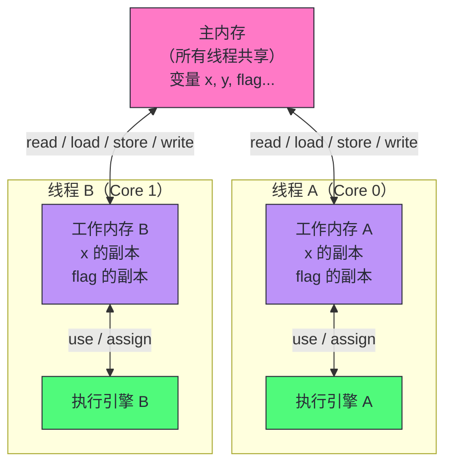
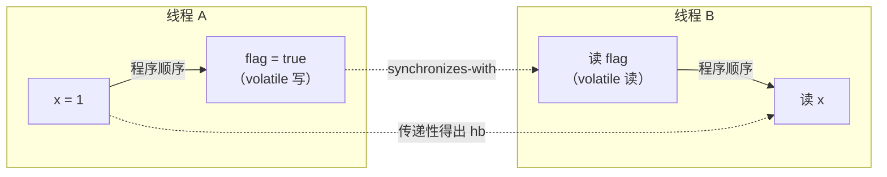
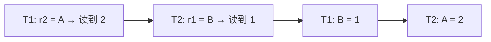
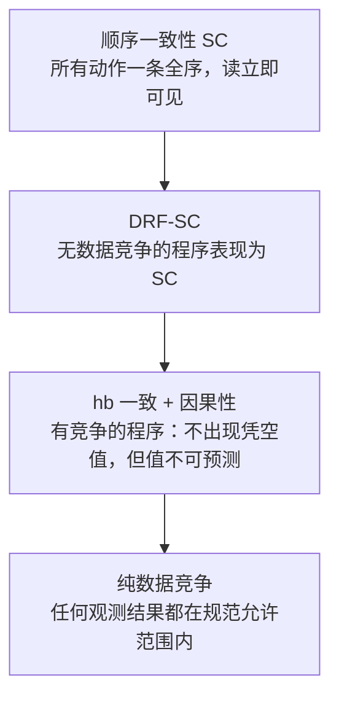
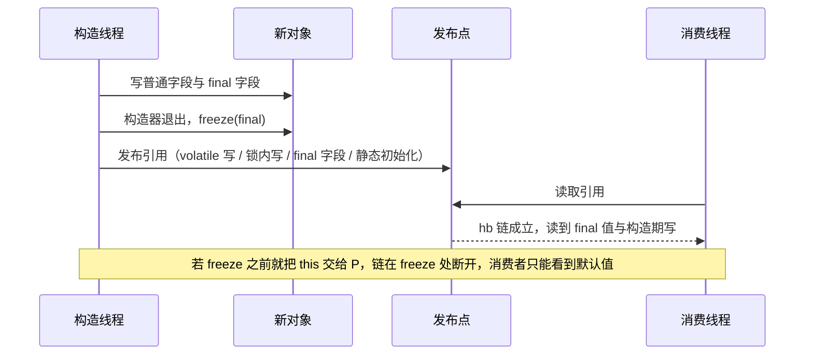

# 02 Java 内存模型（JMM）——happens-before 与可见性保证

**摘要：**

Java 内存模型常被讲成"主内存与工作内存之间的一次数据搬运"，于是 `volatile` 变成"刷缓存"、`synchronized` 变成"抢锁顺便刷一下"，读者记住了一堆动作名词，却仍然无法回答一个具体问题：这段代码到底能不能看到那个值。这篇换个入口——把 JMM 当作一份只规定"程序中的读写允许被怎样重排序、允许表现出哪些执行"的规范来读。先交代它在 JLS 第 17 章里的真实形态（动作、同步顺序、happens-before、因果性），再逐条拆开工程界惯称的八条规则，追问每条"为什么非要这样规定"，并拆解"happens-before 等于时间先后"这个最普遍的误解；随后用 DRF-SC 说明为什么正确同步的程序可以当顺序一致来读，用 `final` 字段的 freeze 语义说明构造期的写凭什么能免同步可见，用四种安全发布方式说明这些规则如何落到对象上。落点是三段式推理范式——标出共享变量、找到 hb 链、判定是否安全——配五个真实片段逐个推演，最后给出一组把规则用错的反例与不同同步手段的开销量级。

---

## 第 1 章 一份规定"可以怎样重排"的规范

### 1.1 先纠正一个流传很广的模型

讲 JMM 的文章几乎都会画一张图：中间一个方块写着"主内存"，两边各一个写着"工作内存"，箭头标着 read、load、use、assign、store、write 六个动作，再配上"线程修改副本后必须刷新回主内存"。这套叙述有历史依据——JSR-133 之前的旧内存模型确实用主内存、工作内存和一组内存动作描述可见性，JLS 前两版也这么写。但 JSR-133 随 JDK 5 落地后，第 17 章被整章重写，规范里已没有"工作内存"概念，也没有这套动作名词，取而代之的是动作（action）、程序顺序、同步顺序、`synchronizes-with`、`happens-before`、数据竞争与因果性要求。

旧模型的问题不在于"错了"，而在于它把推理引向错误的物理图像：一旦相信"写要先 store 到主内存、读要重新 load 回来"，`volatile` 就被理解成"每次都刷主内存"，`synchronized` 就被理解成"进出临界区各刷一次"，接着自然会推出"我写了 `volatile`，所以所有线程立刻都看到新值""等一会儿缓存总会同步"这类结论——它们在现代规范里都没有依据，在弱序架构上还会直接导致错误。旧模型也解释不了 `final` 字段为何能免同步可见，因为它没有"冻结"这种一次性动作的概念。

把图保留下来作为直觉是可以的，但必须贴一张标签：它描述的是"为什么会有可见性问题"，而不是"规范如何判定一个执行合法"。



上图的"主内存"大致对应物理主存与末级缓存，"工作内存"大致对应核心私有的 L1/L2 与 Store Buffer——这层硬件对应在 [[01 并发编程的硬件基础——CPU 缓存、MESI 与内存屏障]] 里已拆得很细；此处只需记住：它能帮你建立直觉，不能当作推理论据。

### 1.2 规范规定的是"允许出现的执行"

JLS 17.4 开篇有一句话值得逐字读：内存模型描述的是"给定一个程序及其执行轨迹，这条轨迹是不是该程序的合法执行"，而 Java 内存模型的做法是逐个检查轨迹里的每次读，确认它观测到的写是否符合规则。同节还有一句更要紧的话：这些语义并不规定多线程程序"应该怎样被执行"，而是描述多线程程序"允许表现出哪些行为"；任何只会产生合法行为的执行策略都是可接受的实现。

这两句话决定了 JMM 的全部性格：它不是教 JVM 如何搬运字节的说明书，而是关于"哪些结果算数"的契约——规范给出合法执行的集合，编译器、JIT、CPU 在集合内任意施展，程序员要证明的是"集合里每一条执行都满足我的不变量"。因此 JMM 的规则天然是**否定式**的：它告诉你哪些可观测结果被排除，而不是字节按什么时刻表流动。理解这一点，后面所有"屏障""刷缓存"的说法都只能算实现手段，不能算规范义务。

从这层意义上说，JMM 更像交通法规里"哪些路口允许掉头"的条款：它规定行为边界，不规定你以多快的速度完成掉头；掉头动作由各家车企的工程实现决定，法规只在出事故时用来判定谁违规。

### 1.3 为什么必须由语言来规定

如果没有语言级的内存模型，Java 的"一次编写，到处运行"会在并发场景里立刻破产，原因有三层。

其一是硬件分裂。x86 属于强序的 TSO，绝大多数重排序被硬件禁止；ARM 与 POWER 属于弱序，允许大量重排序，只在显式屏障处收敛。同一段代码在两种架构上的可观测行为可能完全不同，规范不作统一约束，"跨平台一致"就只是口号。

其二是编译器自由度过大。javac 与 JIT 只被要求维持单线程语义（as-if-serial），常量折叠、公共子表达式消除、标量替换、循环不变量外提、锁消除都可能改变其它线程看到的顺序；没有统一规则，程序员无法判断代码换一个 JIT 版本后是否还正确。

其三是推理成本。让每个并发程序都针对具体 CPU 的重排行为逐条论证，等于要求所有 Java 工程师兼任微架构专家。JMM 把推理对象从"硬件的重排可能性"换成"一小撮 hb 规则"，并额外给出 DRF-SC（第 5 章展开）——只要无数据竞争，就可以假装程序跑在顺序一致的单机上。

### 1.4 三个读者，三种关注点

同一份 JMM，三类使用者的读法并不相同，混淆视角是很多误解的起点。

| 视角 | 关心的问题 | 在规范里对应的部分 | 典型误读 |
| :--- | :--- | :--- | :--- |
| 程序员 | 这段代码有没有数据竞争、能否看到期望值 | `happens-before` 规则、数据竞争定义、DRF 结论 | 把 hb 当作"实际执行时刻的先后" |
| JIT / 编译器作者 | 哪些重排与优化是合法的 | 合法执行的集合、`final` 字段的 dereference chain | 把 hb 当作"必须按此顺序生成指令" |
| JVM 实现者 | 在哪些位置插入屏障才能在目标架构上满足规范 | 同步动作的语义 + 目标架构的内存模型 | 用某一架构的屏障习惯反推规范 |

第三种误读最容易反向传播：某篇讲 `volatile` 的文章说"写后插 StoreLoad"，读者就把"插屏障"当成规范要求，进而认为没有屏障就没有可见性。屏障只是 HotSpot 在特定架构上的实现手段，规范的义务始终是"让每次读观测到的写都合法"。

---

## 第 2 章 happens-before 的精确定义

### 2.1 定义，以及它只由四条规则生成

JLS 17.4.5 给 `happens-before` 的定义只有一句话：如果动作 x happens-before 动作 y，那么 x 对 y 可见，并且在 y 之前有序。这句话的后半段是误解的源头，留到第 4 章专门拆。这里先看它能被哪些规则生成——规范给出的完整清单只有四条：

1. 若 x 与 y 是同一线程的动作，且 x 在程序顺序上先于 y，则 `hb(x, y)`；
2. 存在一条从某对象构造器结束到该对象 `finalize()` 开始的 hb 边；
3. 若 x `synchronizes-with` 后续的 y，则 `hb(x, y)`；
4. 若 `hb(x, y)` 且 `hb(y, z)`，则 `hb(x, z)`。

四条里真正造边的只有两条（程序顺序、构造器到终结器），一条把 `synchronizes-with` 提升为 hb，一条负责拼接。口口相传的"八条 hb 规则"其实是把第 3 条依赖的 `synchronizes-with` 来源与几条推论合并展开的结果，便于记忆，代价是容易让人以为规范里真有八条并列条款。第 3 章给出两套清单的对照。

### 2.2 synchronizes-with：语言层面的 release/acquire

`happens-before` 的跨线程能力全部来自 `synchronizes-with`（简称 sw），后者定义在 JLS 17.4.4，是 JMM 里唯一具备"全局顺序"味道的东西：每个执行都有一个同步顺序（synchronization order），它是该执行中所有同步动作的全序，并且对每个线程而言与该线程的程序顺序一致。注意这个全序的覆盖面——它只排同步动作（volatile 读写、加锁解锁、线程的首末动作、启动与终止检测、中断），普通字段的读写根本不在其中。JMM 承认的"全局时钟"就这么窄。

在同步顺序之上，规范定义了六类 sw 边：

| sw 来源 | 边的方向 | 为什么需要它 |
| :--- | :--- | :--- |
| 监视器 | 对 m 的 unlock → 后续对 m 的 lock | 临界区交接必须连同其写入一起交接，否则互斥失去意义 |
| `volatile` | 对 v 的写 → 后续对 v 的读 | 提供一条显式的、单变量的发布通道 |
| 线程启动 | `start()` → 被启动线程的第一个动作 | 新线程必须继承启动前的世界状态 |
| 默认值写 | 每个变量的默认值写 → 每个线程的第一个动作 | 保证读到的至少是默认值，而不是随机内存 |
| 线程终止 | T1 的最后一个动作 → T2 检测到 T1 已终止 | `join`/`isAlive` 的语义是"等它干完并交接结果" |
| 中断 | T1 的 `interrupt()` → 任何线程检测到 T2 已被中断 | 中断信号往往携带上下文，信号与上下文必须同批到达 |

规范把 sw 边的起点叫 release、终点叫 acquire：它们不是"内存同步开关"，而是"成对的交接动作"，方向永远是单向的——从写者到读者、从解锁者到加锁者（第 9 章展开）。

### 2.3 hb 到底禁止了什么：允许观测的写

把"x 对 y 可见"翻译成可操作判据，要引入两个定义：读 r 被允许观测写 w，当且仅当 hb 偏序中 r 不排在 w 之前，且不存在中间写 w' 使 `hb(w, w')` 与 `hb(w', r)` 同时成立；一组动作若对每个读都满足此条件，就称为 hb 一致。

由此可以说清 hb 的义务：`hb(A, B)` 排除了"B 观测到 A 之前某次写"，却不强迫 B 必须观测到 A 写下的值——若中间还有别的写且 hb 允许，B 看到更新的值也合法。所以"A happens-before B，A 的结果就对 B 可见"这类常见表述，要补上"且其间没有其它被允许观测的写"才严格。一个 `volatile` 标志被反复置位时，读方拿到哪一次置位取决于它读的时刻，但绝不会读到比它已建立 hb 的那次更旧的值。

### 2.4 偏序而非全序，以及数据竞争的定义

同一线程内的动作由程序顺序全序化，跨线程只有同步点能造边。于是 hb 天然不是全序：任意两个来自不同线程、又没有同步关系串起来的动作，可能谁都不 hb 谁。规范把这称为偏序（partial order），并进一步给出了整个 JMM 最实用的一句话定义：若程序里存在两个冲突访问（至少一个为写）且它们之间没有 hb 关系，则程序含有**数据竞争**。



图中实线是程序顺序边，虚线是 sw 边与传递得到的 hb 边。整条链成立靠三件事同时满足：A 线程内 `x = 1` 先于 volatile 写；B 线程的 volatile 读观测到这次写（或更晚的一次）；B 线程内 volatile 读先于读 `x`。任何一处断掉，`x` 的读取就是数据竞争。推理也就是在这张图上找一条从写到读的路径。

---

## 第 3 章 八条规则，逐条追问"为什么这么规定"

工程界把 hb 整理成八条：程序顺序、监视器锁、`volatile`、线程启动、线程终止、中断、终结器、传递性。它对应规范的 4 条生成规则、6 类 sw 来源与若干推论，对照关系如下，后面逐条展开时以工程清单为纲。

| 工程清单 | 规范出处 | 规范中的形态 |
| :--- | :--- | :--- |
| 程序顺序规则 | 17.4.5 第 1 条 | hb 的造边规则 |
| 监视器锁规则 | 17.4.4 监视器 sw + 17.4.5 第 3 条 | sw 边提升为 hb |
| `volatile` 规则 | 17.4.4 volatile sw + 17.4.5 第 3 条 | sw 边提升为 hb |
| 线程启动规则 | 17.4.4 启动 sw | sw 边提升为 hb |
| 线程终止规则 | 17.4.4 终止检测 sw | sw 边提升为 hb |
| 中断规则 | 17.4.4 中断 sw | sw 边提升为 hb |
| 终结器规则 | 17.4.5 第 2 条 | hb 的造边规则 |
| 传递性规则 | 17.4.5 第 4 条 | hb 的拼接规则 |

### 3.1 程序顺序规则：as-if-serial 的边界

规范第 1 条：同一线程内，程序顺序在前的动作 hb 在后的动作。这条规则承担的是单线程语义的兜底——语言要求每个线程单独看必须符合自己的语义（intra-thread semantics），所以线程内的可见性不需要额外保证，`int a = 1; int b = a + 1;` 里 `b` 一定基于 `a = 1` 计算。

但它的边界比多数人以为的窄：程序顺序边只对同一线程的动作有效，跨线程要靠 sw 边"接力"；它也不禁止编译器重排——as-if-serial 允许线程内任意重排，只要不改变本线程能观测到的结果，`hb(x, y)` 在实现层完全可能对应"y 的指令先执行"。它约束的是本线程的可观测语义，不是指令的发射顺序。

### 3.2 监视器锁规则：为什么方向是 unlock 到 lock

`hb` 的常见形态是"对锁 m 的解锁 hb 后续对 m 的加锁"。物理意义很清楚：临界区保护的是一个不变量，而保护不变量要求上一个持锁者的写入与下一个持锁者的读取之间完成交接；若锁只提供互斥而不提供可见性，临界区就退化成"轮流进去踩坏数据"。所以规范必须把可见性与互斥绑在同一对动作上，方向也只能从解锁到加锁——加锁者并没有要向历史交接任何东西。
几个常被忽略的性质："后续"由同步顺序定义而非墙上时钟；中间可隔任意多次加解锁，链条会一直续下去；不同监视器之间没有边，`synchronized(lock1)` 里的写与 `synchronized(lock2)` 里的读之间不存在任何保证。锁的字节码形态、对象头与升级路径属于另一层话题，细节收在 [[04 synchronized 的锁升级——偏向锁、轻量级锁与重量级锁]]，就 JMM 而言只需记住它是"同一把锁上的 unlock→lock 造边"。

### 3.3 volatile 规则：单点双向，但必须配对

`volatile` 的规范形态是：对 v 的写 sw 后续对 v 的读。这条边很特别——它是八条规则里唯一能由程序员零成本"手动放置"在任意两段代码之间的边，既不需要互斥，也不需要额外的锁对象。代价是它只能保护"跨越同一个变量的交接"，其它变量的可见性靠传递性搭便车。

这里要修正常见的一处不精确：一种流行的说法是"volatile 规则生效的前提是后续的读真的读到了写的值"，方向对但太松。规范把 sw 定义在同步顺序上，volatile 写 sw 所有后续的 volatile 读，无论那次读最终观测到哪个写；真正决定链接在哪里的，是读观测到了哪一次写——读到 A 的写就接在 A 上，读到更晚的 C 的写就接在 C 上。准确的判据是"读所观测的那次写在 hb 上先于这次读"。

`volatile` 的物理意义则是单变量信箱：写侧提供 release，读侧提供 acquire，两者配对完成一次投递，所以 volatile 写与 volatile 写之间、volatile 读与 volatile 读之间都没有顺序保证。屏障的具体策略、x86 上读几乎免费而写要付代价的原因属于实现层，见 [[03 volatile 的实现原理——内存屏障与禁止重排序]]。

### 3.4 线程启动规则：新线程继承启动前的世界

`start()` hb 被启动线程的每一个动作。这条规则的物理意义是"新线程必须继承启动前的世界状态"：子线程要读的初始化数据、配置对象、闭包捕获的变量，全都在 `start()` 之前由父线程写好；若没有这条边，新线程连自己依赖的环境都读不到，程序根本无法启动。

方向性值得单独强调：这条边只覆盖 `start()` 之前父线程的动作，之后父线程再写的东西对子线程没有保证；反方向也不成立，子线程的写不会因为"它是子线程"就对父线程可见。另外它绑定的是 `Thread.start()` 这个动作，而非"线程开始干活"——线程池的工作线程早在提交任务之前就 `start()` 过，任务与提交者之间的 hb 来自工作队列的内部同步（第 8 章推这个片段）。

### 3.5 线程终止规则：join 的语义是"干完并交接"

线程内的所有动作 hb 任何其它线程成功从该线程的 `join()` 返回，也 hb 通过 `isAlive()` 检测到它已终止的动作。物理意义与启动规则对称：`join()` 若只保证"它停了"而不保证"它的结果可见"，调用者拿到的是一个空壳结论。这条规则让"分治法"式的并发结构成立——父线程把活分给子线程，`join` 之后能读到子线程算出的所有中间结果。

边界同样在方向与范围上：只覆盖被 `join` 的那个线程，且只对"检测到终止"之后有效；线程池复用线程对象时，`isAlive` 与"任务完成"脱钩，此时只能依靠队列或 `Future` 的交接。

### 3.6 中断规则：一条被低估的边

调用 `interrupt()` hb 其它线程（包括被中断线程自身）检测到该线程已被中断的时点，检测手段包括抛出 `InterruptedException` 与调用 `Thread.interrupted()`/`isInterrupted()`。它是一条正经的 hb 边，理由很实际：中断往往携带上下文——发起方可能先写好取消原因或任务标识再调 `interrupt()`，被中断方捕获异常后要靠这些数据决定如何清理。它管不到线程是否响应、何时响应，也不影响中断标志的清除语义。

### 3.7 终结器规则：一条正在退场的边

规范第 2 条说，存在一条从对象构造器结束到该对象 `finalize()` 开始的 hb 边。这条规则保证终结器能看到构造器写下的字段值——否则终结器连"这是个什么对象、要释放什么资源"都判断不了。

一种常见说法把这条规则写成"`final` 字段安全性保证的基础之一"，这并不成立：`final` 字段的安全发布由 JLS 17.5 的冻结（freeze）语义单独规定，与终结器毫无关系。即便一个类没有重写 `finalize()`，它的 `final` 字段依然享有 17.5 的保证；而一个依赖终结器的类即使有这条边，也照样可能因为 `this` 逸出而破坏 `final` 字段的可见性。

这条规则今天更多是规范完整性的遗留。`Object.finalize()` 自 JDK 9 起标记为废弃，JDK 18 通过 JEP 421 把终结机制标记为"待移除"，并允许用 `--finalization=disabled` 关闭；现代替代方案是 `Cleaner` 与虚引用。在 JDK 21 的代码里，你几乎不会再遇到需要它来推理的场景，但它仍留在 hb 规则集中，读规范时不应把它当成笔误。

### 3.8 传递性：唯一的拼接规则

第 4 条规则说 hb 可传递。它是八条里唯一"不产生新信息、只负责拼接"的规则，但也是实践中最有用的一条——前面所有例子里"A 的普通写 → volatile 写 → volatile 读 → B 的普通读"这条链，最后一步全靠它。没有传递性，`volatile` 就只能保护它自己那个变量，整个"标志位 + 数据"的惯用法都不成立。

传递性有一个容易被忽略的断点：它只能沿已有的 hb 边拼接，不能穿越"没有 hb 关系"的间隙。两个线程之间若只有一次 `x` 的普通读写，没有同步动作，那条链就是断的，再多推理也接不上。另有一处更微妙的限定——第 6 章会看到，`final` 字段语义引入的那条 hb 边明确不与其它 hb 边传递闭包，这是规范有意为之的保守设计。

### 3.9 还有一条常被漏掉的边

除了上面八条，JLS 17.4.4 还定义了一类容易漏掉的 sw 边：**每个变量的默认值写 synchronizes-with 每个线程的第一个动作**。规范的解释带点哲学味道——"在对象分配之前写入默认值"听着奇怪，但概念上每个对象在程序开始时就带着默认值出生；17.4.5 由此推出"任何对象的默认初始化 hb 程序任何其它动作（默认写除外）"。这条边解释了为什么不必担心读到未初始化的内存，也正是"看到部分构造对象"的形态；它同时说明这类边无法提供有用同步：对所有线程都成立、不携带区分信息的边等于没有消息。

### 3.10 规则速查

| 规则 | 触发条件 | 边的形态 | 能推出什么 | 管不到什么 |
| :--- | :--- | :--- | :--- | :--- |
| 程序顺序 | 同线程、代码先后 | 造边 | 本线程可观测语义 | 任何跨线程可见性 |
| 监视器锁 | 同一把锁的 unlock → lock | 区间交接 | 临界区内全部写对下一个持锁者可见 | 不同锁之间、锁外访问 |
| `volatile` | 同一变量的写 → 读 | 单点交接 | 写前全部写对读到该写的线程可见 | 复合操作原子性、其它变量单独可见 |
| 线程启动 | `start()` → 子线程首动作 | 单向 | 启动前的父线程写对子线程可见 | `start()` 之后的写 |
| 线程终止 | 全部动作 → 检测到终止 | 单向 | 子线程结果对 `join` 者可见 | 线程池复用后的"任务完成" |
| 中断 | `interrupt()` → 检测到中断 | 单向 | 中断前的上下文对检测方可见 | 线程是否响应、何时响应 |
| 终结器 | 构造器结束 → `finalize()` 开始 | 单向 | 终结器能读到构造期写 | `final` 字段语义（由 17.5 单独规定） |
| 传递性 | 两条 hb 边首尾相接 | 拼接 | 跨多跳的可见性链 | 穿越无 hb 的间隙 |

---

## 第 4 章 happens-before 不是时间线

### 4.1 规范自己就否认了"按序执行"

把 hb 读成"x 在物理时间上先于 y"，是本章要拆掉的核心误解，而规范原文直接否掉了它。JLS 17.4.5 在给出规则后紧接着写：两个动作之间存在 hb 关系，并不意味着实现中它们必须按这个顺序发生，只要重排后的结果仍与某个合法执行一致；而且它们也不必对"与它们没有 hb 关系的其它代码"表现出这个顺序——处于数据竞争中的读，完全可能看到乱序的结果。

换句话说，hb 是一条**逻辑上的可见性通道**，不是**物理上的时刻表**：A hb B 只约束 B（以及经传递性接到链上的动作）能看到什么，对链外的旁观者没有任何时间约束。这也是"加个 volatile 就有序了"在跨多线程、多变量场景里频繁失效的原因——你建立的是一条边，不是一道全局栅栏。

### 4.2 一个让直觉失效的例子

JLS 17.4 用一张两线程的表开了这一章的场，后来被无数文章引用。初始 `A == B == 0`：

```java
// 线程 1                     // 线程 2
r2 = A;                       r1 = B;    // 3
B = 1;                        A = 2;     // 4
```

直觉会说 `r2 == 2 && r1 == 1` 不可能出现：语句 1 先执行就看不到 4 的写，语句 3 先执行就看不到 2 的写。但这个推理暗含了一个假设——所有线程共享一条全局时间轴。规范不允许这样假设：两个线程的语句之间没有同步动作，谁都不 hb 谁，于是编译器把线程 1 的两条语句对调（对单线程语义无影响）后，可能出现 `B = 1` 先于 `r2 = A`、`A = 2` 先于 `r1 = B` 的交错，两个读都观测到了对方的写。规范的定性也很干脆：一个线程写、另一个线程读同一变量、两者间没有同步顺序，这就是数据竞争，而有数据竞争的程序可以表现反直觉的结果。

这个例子的价值在于它是检验推理方式的试金石：凡是"因为语句 1 在前，所以……"的推理，本质都在使用全局时间轴；正确的推理只能问"这两个动作之间有没有一条 hb 路径"。

### 4.3 偏序、全局时钟与"没有观察者的重排"

hb 是偏序，这在数学上平淡，在工程上却决定了并发程序的可推理边界。顺带一个容易被忽略的现象：如果一次重排没有任何线程能观测到，规范根本不管它——17.4.5 举的例子是"线程构造对象时对每个字段写默认值的动作，不必真的发生在这个线程开始之前，只要没有任何读观测到这个事实"。所以不要用"它到底什么时候刷进缓存"理解 JMM，规范只关心可观测结果。这也回答了"为什么单线程下看不到重排"：不是编译器不想重排，而是程序顺序边保证了本线程的可观测语义；一旦越过线程边界又没有同步点，就没有边来兜底。

### 4.4 两种合法的"反常"

第一类反常是"读到更晚的写"。JLS 17.4.5 的示例给出这样一个轨迹（初始 `A == B == 0`）：

```java
// 线程 1              // 线程 2
B = 1;                 A = 2;      // 3
r2 = A;                r1 = B;     // 4
```

存在一种与 hb 一致的交错：`r2 = A` 读到 `A = 2`，`r1 = B` 读到 `B = 1`，而这两次读在提交顺序上位于两次写之后——读观测到了"执行顺序上更晚"的写，这被 hb 一致性允许，因为不存在 hb 上的理由阻止它。下图展示了这种交错：时间轴上读在前、写在后，逻辑上却完全合法。



第二类反常是"看到更旧的写"：B 线程读 `x` 但没有 hb 路径连过去，就可能一直读到初始值 `0`，哪怕读的时刻远晚于写。`while (!flag)` 死循环、老的可见性问题都是这一类。两类反常合起来说明：hb 只保证"不会看到被 hb 排除的写"，不保证"一定看到最新写"。

### 4.5 常见的错误推理

| 错误推理 | 它在偷偷假设什么 | 反例 | 正确推理 |
| :--- | :--- | :--- | :--- |
| "我先写 x，再写 y，另一个线程一定能先看到 x" | 线程内顺序会自动延伸到线程外 | 另一个线程两次读之间没有 hb 路径 | 线程内顺序只有接上 sw 边才有跨线程意义 |
| "hb 成立，所以 A 一定在 B 之前执行完" | hb 是全局时间轴上的先后 | 规范明确否认实现必须按序执行 | hb 只约束 B 能观测到的写，不约束执行时刻 |
| "A hb B，所以 B 一定读到 A 写的值" | 读一定会观测到最近的那次 hb 写 | 中间存在被允许观测的其它写 | B 不会读到被 hb 排除的写，但可以读到更新的写 |
| "这个值我看到过，说明它当时一定已经写出去了" | 观测即证明因果顺序 | 读可能观测到"执行顺序上更晚"的写 | 只有 hb 路径能证明因果 |
| "没有同步点，那就靠时间顺序保证" | 存在全局时钟 | 4.2 的经典反例 | 没有 hb 路径即数据竞争，行为不受约束 |

---

## 第 5 章 顺序一致、因果性与 DRF

### 5.1 顺序一致性的定义

顺序一致性（Sequential Consistency）由 Lamport 在 1979 年给出，JLS 17.4.3 采纳的版本是：一组动作若存在一个全序，该全序与每个线程的程序顺序一致，且每个读都读到"执行顺序上位于它之前、中间没有其它写"的那次写，则这组动作顺序一致。这是极强的保证：全体共享一条时间轴，每个动作原子生效并立即对全体可见。

如果 JMM 直接采用 SC，前面讨论的所有优化几乎都要作废——一旦某次写发生，后续任何读都必须看到它，缓存不能私有、Store Buffer 不能异步、循环里的字段读不能提到循环外。这正是规范拒绝 SC 的原因：性能代价太大。

### 5.2 JMM 的承诺：不是 SC，而是"正确的程序像 SC"

JLS 17.4.3 有一句分量极重的断言：若程序没有数据竞争，它的所有执行都将表现为顺序一致；17.4.5 补上配套定义——程序正确同步，当且仅当它的所有顺序一致执行都不含数据竞争，紧接着还说，程序员因此不必通过推理重排来判断代码有没有竞争，一旦确认正确同步，就不必担心重排破坏它。这就是 DRF-SC 在 Java 规范里的落地，它的形态是一个两步走的证明结构：

1. 先证"无数据竞争"——对每个共享变量找出所有冲突访问，确认每一对之间都有 hb 路径；
2. 然后**完全停止**推理重排，把这套多线程代码当成顺序一致的单线程程序来读。

第二步是 JMM 送给工程实践的最大礼物：你不必知道目标是 TSO 还是弱序、JIT 会做哪些变换、屏障插在哪里，这些全被"无竞争"一个前提吃掉了。反过来，只要存在一个数据竞争，礼物立即失效，第 4 章那些反直觉执行就全部被放行，"在我机器上跑得好好的"不构成任何证据。

### 5.3 为什么 hb 一致性还不够

如果 JMM 只要求"每个读都能被某次写解释"，会引入荒谬的后果：凭空产生的值（out-of-thin-air）。两个线程各自读写一对变量时，理论上存在一条执行令 `x` 与 `y` 互相"解释"对方，而程序里从来没有人写入过那个值——它从因果真空里冒出来。编译器若被允许做这种推测性传播，任何依赖都可能被凭空满足。

因此 JMM 在 hb 一致性之上又加了因果性要求（17.4.8）：执行必须能被"逐步提交"，每一步提交的动作，其读到的值都要能被此前已提交的写解释。规范用这套机制排除凭空值，代价是形式化异常复杂；学术上对这套表述是否完备长期有讨论，后续研究提出过若干修补方案。对日常编码而言影响有限：只要做到无数据竞争，就完全不必关心这些。

### 5.4 语义强度的阶梯

把第 4、5 章的内容压成一张阶梯图，强弱关系一目了然：



工程上的含义只有一句：**要落在第二层，就必须消灭所有数据竞争；落在第三层以下，任何推理都不成立**。这也是"为什么并发 bug 难以复现"的理论解释——它有竞争，就落在第三、四层，行为不受约束，测试通过只是没踩到而已。

---

## 第 6 章 final 字段：一条只管构造期的规则

### 6.1 freeze：构造器退出的那一刻

`final` 字段的特殊语义写在 JLS 17.5，与 hb 规则集并列而独立。它的核心动作叫冻结（freeze）：设 o 是对象、c 是 o 的一个构造器，若 c 中写了 final 字段 f，则当 c 退出时（正常退出或异常退出都算）发生一次对 f 的 freeze 动作。

规范还专门处理了构造器委派：若一个构造器调用了另一个构造器，而被调用的构造器设置了 final 字段，则 freeze 发生在**被调用构造器退出时**，而不是在外层构造器退出时。这个细节有实际后果——它意味着 final 字段的"冻结"可能早于对象的"构造完成"，而 17.5 的可见性保证以"对象完全初始化"为前提，两者之间的缝隙正是各类逸出问题的温床。

freeze 带来的保证可以用一句话概括：一个线程只有在对象完全初始化之后才看到该对象的引用时，它一定能看到该对象所有 final 字段被正确初始化后的值。这正是不可变对象（如 `String`、`Integer` 以及大量 record）能够免同步安全共享的规范依据。

### 6.2 形式条件，以及一条罕见的"不传递"声明

17.5.1 给这套语义配了形式化骨架：除 hb 外还引入两个偏序——解引用链（dereference chain）刻画"通过哪个引用的读才到达这个字段"，内存链（memory chain）刻画"读到了哪个写、经哪条引用链到达"。判定形式是：给定写 w、freeze f、动作 a、对 f 的读 r1、经 r1 解引用到达的读 r2，若 `hb(w, f)`、`hb(f, a)`、`mc(a, r1)`、`dereferences(r1, r2)` 同时成立，则判定 r2 能看到哪些值时把 `hb(w, r2)` 考虑进去。

紧跟着的括号注释才是精彩处：**这条 hb 排序不与其它 hb 排序做传递闭包**。规范刻意让 final 语义产生的边保持局部有效，不让它与普通 hb 边拼成长链——若允许自由拼接，编译器必须在更多位置插入更昂贵的屏障，收益却不明显。理解这一点，就不会试图用"final 字段 + volatile 标志"去推一条跨三个线程的完整因果链。

### 6.3 读侧的两个反直觉细节

第一，**final 字段的读对同步是免疫的**。17.5.4 在讨论 `System.out` 这类可被改写的特殊 final 字段时点明：普通 final 字段的读"免疫于同步"，锁或 volatile 读所需的屏障不必影响它读到什么值。也就是说，final 字段一旦被构造器赋过值，后续用反射或 `Unsafe` 改写它，别的线程完全可能一直读到构造器里那个旧值——这也解释了 17.5.3 为什么把改写限制在"构造完成后立刻改完，改完之前不发布也不读"这一个模式。

第二，**构造器内读 final 字段走通常的 hb 规则**。17.5.2 说，构造该对象的线程内读它的 final 字段按常规 hb 排序：读在赋值之后则读到赋的值，否则读到默认值。这条平淡的规定解释了一类真实 bug——构造器里把对象传给已启动的线程，那个线程可能读到默认值，而构造器自己读到的是新值，双方对"对象现在什么样"的认知并不一致。

### 6.4 this 逸出如何破坏它

final 的保证有一个隐含前提：对象在完全初始化之前，其引用没有泄漏给别的线程。一旦泄漏，那个线程拿到的引用不是"完全初始化之后才看到"的，17.5 的前提失效，是否能看到正确的 final 值就只取决于运气与架构。工程上常见的逸出形态有五类：

```java
// 形态一：构造器里启动线程，把 this 交给新线程
class Worker {
    final String name;
    Worker(String name) {
        this.name = name;
        new Thread(() -> System.out.println(this.name)).start(); // 逸出
    }
}

// 形态二：构造器里注册回调或监听器
class Listener {
    final Config config;
    Listener(Registry registry, Config config) {
        this.config = config;
        registry.register(this);   // 逸出，注册表可能立刻回调
    }
}

// 形态三：构造器里把自己放进静态容器
class Cache {
    static final Map<String, Cache> POOL = new ConcurrentHashMap<>();
    final byte[] payload;
    Cache(String key, byte[] payload) {
        this.payload = payload;
        POOL.put(key, this);       // 逸出，其它线程可能瞬间取到
    }
}

// 形态四：构造器调用可被覆写的方法
class Base {
    Base() { init(); }             // 子类覆写 init 时可读到未初始化的子类字段
    void init() {}
}

// 形态五：构造器里把捕获 this 的 lambda 交给执行器
class Task {
    final int limit;
    Task(Executor executor, int limit) {
        executor.submit(() -> use(this.limit));  // 任务可能先于赋值可见
        this.limit = limit;
    }
    void use(int v) {}
}
```

五种形态的破坏机理一致：别的线程在 freeze 之前就拿到了引用，它能观测到的只有默认值写那一条边（第 3.9 节），于是 `name` 是 `null`、`payload` 是 `null`、`limit` 是 `0`。更隐蔽的是形态四——它不需要多线程就能出错，只是把问题伪装成初始化顺序问题；在多线程下它的表现才变成"字段值是 0 但对象引用非空"。



### 6.5 反射、反序列化与编译期常量

17.5.3 处理"事后改 final"的场景，结论很克制：只有"构造完成 → 立刻改完 → 改完之前不发布也不读"这一个模式有合理语义，其它用法下规范允许激进优化，甚至允许在同一线程内重排 final 字段的读与那些不在构造器中发生的修改（规范给的例子：中间用反射改值，两次读的差可以是 `-1`、`0` 或 `1`）。更近的一点是，若 final 字段用常量表达式初始化，使用点在编译期就被替换成常量，反射改值读方可能完全观测不到——这也是 `static final` 常量不是同步点的另一层原因。

### 6.6 final 不等于不可变

这是本节最需要说清的一点。final 只保证"构造期赋的值在安全发布后可见"，它不保证这个值指向的对象本身不再变化：

```java
final class Unstable {
    final int[] data;              // 引用冻结了，元素没有
    final java.util.List<String> items;   // 容器引用冻结了，内容没有
    Unstable(int[] data, java.util.List<String> items) {
        this.data = data;
        this.items = items;
    }
}
```

`Unstable` 的引用安全，`data` 与 `items` 的**引用**也安全，但 `data[0]` 与 `items` 的内容随时可能被其它线程改动，这属于数据竞争，与 final 无关。真正可免同步共享的对象，需要 final 字段 + 字段所指向的对象本身也不可变（或至少不再被修改）——这是"不可变对象"与"final 字段"的分界线。

| 命题 | 是否由 final 保证 | 说明 |
| :--- | :--- | :--- |
| 构造器写入的 final 值在安全发布后可见 | 是 | 17.5 的 freeze 语义 |
| 通过 final 引用可达的对象的 final 字段也可见 | 是 | 解引用链与内存链共同保证 |
| 非 final 字段在安全发布后一定可见 | 否 | 需要等价的 hb 边（volatile、锁、启动等） |
| final 引用所指对象的内部状态不再变 | 否 | 那是不可变性，不是 final 的义务 |
| 构造期逸出的对象仍享有完整保证 | 否 | 前提是"完全初始化后才看到引用" |
| 反射改写的 final 值能被所有线程看到 | 否 | final 读免疫于同步，且常量会被编译期内联 |

---

## 第 7 章 安全发布：把 hb 规则用在对象上

### 7.1 不安全发布的症状

"发布"指把一个对象的引用交给其它线程使用。不安全发布的表现不是崩溃，而是**看到部分构造对象**：引用已经非空，字段却还是默认值——`0`、`false`、`null`。这类 bug 的恶劣之处在于它的可观测形态与"业务上确实允许空值"高度相似，排查时容易被当成空指针处理不当。

第 3.9 节那条"默认值写 hb 每个线程首个动作"的边，正好描述了它的形态：消费者能从引用读到对象地址，却没有任何边把构造器里的写接到它的读上，于是看到的是"每个字段都是默认值"的版本。这不是"内存里存在两个对象"，而是一次读的观测结果落在了默认值上。

### 7.2 四种安全发布方式的 hb 来源

安全发布的本质是"让发布动作与获取动作之间产生一条 hb 边"。按边的来源不同，工程上归纳出四种方式，另有一类基于并发容器与交接原语的补充方式。

| 发布方式 | hb 边的来源 | 失效条件 | 相对成本 |
| :--- | :--- | :--- | :--- |
| 静态初始化器（含 Holder 惯用法） | 类初始化锁 LC 上的 lock/unlock，等价于监视器规则 | 发布后再改字段；常量被编译期内联 | 一次性，热路径可被优化掉 |
| `volatile` 字段 / `AtomicReference` | volatile 写 sw 后续 volatile 读 | 消费者不经 volatile 读就到引用 | 每次发布一次写代价 |
| `final` 字段 | 17.5 的 freeze 语义 | `this` 逸出；构造后反射修改 | 构造期一次，读侧几乎免费 |
| 锁保护的发布与获取 | 同一把锁的 unlock → lock | 发布与获取用的不是同一把锁 | 每次进出临界区 |
| 并发容器与交接原语 | j.u.c 各自文档承诺的 hb（队列、`Future.get`、`Executor` 提交） | 把容器当作"顺带同步"用于不相干数据 | 容器自身的同步开销 |

### 7.3 代码对照

```java
// 不安全的发布：普通字段 + 非同步写
class UnsafePublish {
    static Holder holder;      // 普通静态字段，其它线程可读到 null 或半初始化对象
    final static class Holder {
        int value;             // 非 final，构造期赋值
        Holder(int v) { value = v; }
    }
    static void publish(int v) { holder = new Holder(v); }   // 无 hb 边传达给读者
}

// 方式二：volatile 引用
class VolatilePublish {
    static volatile Holder holder;
    static void publish(int v) { holder = new Holder(v); }   // 写前的字段写随边一起可见
}

// 方式三：final 字段 + 无逸出
final class FinalHolder {
    final int value;
    FinalHolder(int v) { value = v; }                        // freeze 后免同步可见
}

// 方式四：锁内发布与获取
class LockedPublish {
    private Holder holder;
    private final Object lock = new Object();
    void publish(int v) { synchronized (lock) { holder = new Holder(v); } }
    Holder acquire()  { synchronized (lock) { return holder; } }   // 同一把锁才有边
}

// 补充方式：静态初始化器 / Holder 惯用法
class HolderSingleton {
    private static class Holder { static final HolderSingleton INSTANCE = new HolderSingleton(); }
    static HolderSingleton get() { return Holder.INSTANCE; }  // 类初始化锁保证一次性且可见
}
```

上面几段代码的差别不在"有没有加关键字"，而在"发布动作与获取动作之间有没有一条边"：`UnsafePublish` 没有；`VolatilePublish` 有 volatile 边；`FinalHolder` 靠 freeze；`LockedPublish` 靠同一把锁。唯一容易被写错的是最后一段——把 `acquire()` 里的锁换成另一把锁，边就断了，代码看起来仍然"很像同步的"。

### 7.4 实践中的发布点

除这四种，工程里还有几处隐式发布通道：线程启动与终止、中断、`join` 已在第 3 章讲过；`java.util.concurrent` 各组件在包文档的"内存一致性属性"里逐项承诺了 hb 关系——放入并发队列与取出之间、提交任务与任务开始执行之间、`Future.get()` 返回与任务内动作之间都有边。线程池复用工作线程时，任务与提交者的可见性靠这条通道，而不是 `Thread.start()`。


### 7.5 不可变对象为什么最省事

反过来看可以得出一个实用判断：越不可变的对象，发布越不容易出错。完全不可变时，唯一的可见性需求是"构造期的写对读方可见"，恰好被 final 的 freeze 覆盖；后续不再有写，也就没有"发布之后还要改"的同步问题。JDK 里 `String`、包装类型、`BigInteger`、`LocalDateTime` 能自由跨线程传递，而可变对象必须每一次传递都配一条边。

---

## 第 8 章 三段式推理：标变量、找链、判安全

### 8.1 范式本身

把前面所有规则压成一个可重复执行的动作序列，就是三段式：

1. **标出共享变量**：逐个确认哪些字段、静态变量、数组元素会被多个线程访问。局部变量与方法参数天然线程私有，不参与推理——这一步最容易被跳过，也最容易出错，因为一个"看起来像局部变量"的字段可能是从外部捕获进来的。
2. **找 hb 链**：对每一对冲突访问（至少一次写），沿程序顺序边、sw 边、传递性找一条从写到读的路径，找不到就是数据竞争。
3. **判定是否安全**：链存在只说明可见性成立，还要单独确认三件事——复合操作是否需要原子性、读侧是否真的按链的入口去读（消费者走的是 volatile 读，还是从字段副本里取）、对象有没有在构造期逸出。

第二段与第三段的分工要理清：hb 只解决"能看到什么"，不解决"看到之后够不够用"。`i++` 可以有完整的 hb 链，同时依然丢失更新，因为它缺的是原子性而非可见性。

### 8.2 案例一：标志位加数据

```java
class Config {
    private int timeout = 3;             // 普通字段
    private volatile boolean ready = false;

    void load() {
        timeout = 30;                    // 1
        ready = true;                    // 2：volatile 写
    }
    int use() {
        if (ready) {                     // 3：volatile 读
            return timeout * 1000;       // 4
        }
        return 0;
    }
}
```

标共享变量：`timeout`、`ready` 都是实例字段，多线程可访问，属于共享变量。找链：`1` hb `2`（程序顺序），`2` sw `3`（volatile 规则，前提是 `3` 观测到 `2` 写的 `true`），`3` hb `4`（程序顺序），传递得 `1` hb `4`。判定：链完整；`4` 是单次读，不需要原子性；读侧确实走了 volatile 读，没有绕开。结论安全。

若把 `ready` 上的 `volatile` 去掉，链就断在 `2-3` 之间，`1` 与 `4` 构成数据竞争；此时 `use()` 可能读到 `ready == true` 却拿到 `timeout == 3`，而这两个值在业务上从未同时成立过。

### 8.3 案例二：双重检查锁定

```java
class Singleton {
    private static volatile Singleton instance;
    static Singleton get() {
        if (instance == null) {                 // 第一次检查，无锁
            synchronized (Singleton.class) {
                if (instance == null) {
                    instance = new Singleton(); // 构造与赋值
                }
            }
        }
        return instance;
    }
}
```

标变量：`instance` 是静态字段。找链：需要分两种读者。持锁路径上的读者靠监视器边拿到完整可见性；**无锁的第一次检查**只能靠 `volatile` 边——`instance` 的写是 volatile 写，读是 volatile 读，`new Singleton()` 里所有字段写都排在这条 volatile 写之前（程序顺序），因此读到非空引用的线程拿到的是完全构造好的对象。判定：安全。

去掉 `volatile` 之后，第一次检查读到的是普通写，与构造器内的字段写之间没有任何边，于是可能出现"引用非空、字段为默认值"。不少人把风险描述成"JDK 5 在某些架构上仍有问题"，这不准确：**问题不在于 JDK 5 之后语义变好了**，而在于非 volatile 的 DCL 从规范上从未被保证过。x86 的 TSO 让这类重排较难观察到，所以这段代码"跑了十年没问题"；换到弱序架构或 JIT 做激进重排，问题才浮现。规范没有给出任何架构豁免。

> [!warning] 生产避坑
> 非 volatile 的 DCL 在规范上从未被保证，x86 上的长期正常只是 TSO 与 JIT 习惯造成的侥幸。需要惰性单例时，优先用静态 Holder 或枚举：把可见性问题交给类初始化锁 LC，比手工摆弄 volatile 更不容易错。

顺带处理一个常见追问：如果构造器里全是 final 字段，DCL 是否还需要 `volatile`？仍然需要。final 只保证"对象完全初始化之后才看到引用"这一种情形，而无锁检查这条路径恰恰可能在初始化完成之前就看到引用；freeze 的前提被绕过，final 也就无从施力。最省事的写法依旧是静态 Holder 或枚举单例——把同步问题交给类初始化锁。

### 8.4 案例三：线程池的任务交接

```java
class Job implements Runnable {
    private int threshold;                 // 非 final，提交后主线程还会改
    private final List<String> input;
    Job(List<String> input) { this.input = input; }

    void setThreshold(int t) { threshold = t; }   // 提交之后再调用

    public void run() {
        process(input, threshold);
    }
}

Job job = new Job(data);
job.setThreshold(10);
executor.submit(job);          // 提交与任务开始执行之间有 hb 边
job.setThreshold(20);          // 提交之后修改，任务可能看不到
```

标变量：`threshold`、`input`。找链：`submit` 之前的写与任务执行之间由 `Executor` 的提交语义建立 hb（j.u.c 包文档的"内存一致性属性"承诺），因此 `setThreshold(10)` 的写对 `run()` 可见；但 `submit` 之后的 `setThreshold(20)` 没有任何边连到任务线程——它要么在任务读完之后发生，要么构成数据竞争。判定：**提交前安全，提交后不安全**。

这个案例专门打掉一种流行误解：以为"任务提交"是一道屏障，之后所有修改都能被任务看到。边只覆盖提交之前的写，提交之后的写是另一件事，需要自己的同步。同样的推理适用于 `CompletableFuture` 回调、`ForkJoinPool` 子任务、消息队列的生产者——边存在于交接动作的两侧，不在动作之后。

### 8.5 案例四：volatile 计数器

```java
class Counter {
    private volatile int count = 0;
    void increment() { count++; }          // 读-改-写，三步
    int get() { return count; }
}
```

标变量：`count`。找链：每次 `count++` 里对 `count` 的读与写是同一线程，靠程序顺序；跨线程读靠 volatile 边。链是完整的。判定：**可见性成立，原子性缺失**。`count++` 展开为"读 `count` → 加一 → 写回 `count`"，两次读之间若插入另一个线程的写，第二次写就会覆盖第一次的结果，表现为典型的丢失更新。

正确做法是用 `AtomicInteger`（CAS 重试，语义与实现见 [[05 CAS 与原子类——Unsafe、AtomicInteger 到 LongAdder 的演进]]），或用 `synchronized` 把三步做成互斥。这里要强调的是推理结论的形态：hb 链只能给出"看得见"，不能给出"算得对"；把可见性问题解决掉之后依然要为原子性单独做设计。

### 8.6 案例五：构造器里注册回调

```java
class Subscriber {
    private final String topic;
    Subscriber(EventBus bus, String topic) {
        bus.register(this);              // 逸出：注册后可能立刻被回调
        this.topic = topic;              // 赋值发生在逸出之后
    }
    void onEvent(Event e) { System.out.println(topic + ":" + e); }
}
```

标变量：`topic`（final）。找链：`bus.register(this)` 把引用交给了事件总线，之后任何线程回调 `onEvent` 时读 `topic`，与构造器里的写之间**没有** hb 边——freeze 发生在构造器退出时，而引用在 freeze 之前就已泄漏。判定：不安全，且 `final` 无法补救。正确写法只有在构造器最后注册，或者干脆把注册动作移到构造完成之后的工厂方法里。

这个案例与 8.3 的结论互相印证：`final` 给你的不是"永远安全"，而是"在对象完全初始化后才被看到"这一前提下的安全；前提不成立，规则就退出。

### 8.7 判定矩阵

| 案例 | 共享变量 | hb 链 | 原子性 | 结论 | 失效点 |
| :--- | :--- | :--- | :--- | :--- | :--- |
| 标志位加数据 | `timeout`、`ready` | volatile 边 + 传递 | 不需要 | 安全 | 去掉 `volatile` 即断链 |
| DCL（有 volatile） | `instance` | volatile 边（无锁路径） | 由锁保证构造 | 安全 | 去掉 `volatile` 后无锁路径断链 |
| DCL（无 volatile） | `instance` | 无锁路径无边 | — | 不安全 | 引用先于字段写可见 |
| 线程池交接 | `threshold` | 提交前有、提交后无 | 不涉及 | 提交前安全 | 提交后修改 |
| volatile 计数 | `count` | 完整 | 缺失 | 不安全 | 读-改-写非原子 |
| 构造期注册 | `topic` | freeze 前断链 | 不涉及 | 不安全 | `this` 逸出 |

---

## 第 9 章 volatile、synchronized、final 在规则中的位置

### 9.1 造边形态完全不同

三者常被并列成"保证可见性的三种手段"，但它们在 hb 规则里的位置差别很大：`volatile` 造的是**点对点的边**（一次写对一次读），`synchronized` 造的是**区间对区间的边**（一次解锁的整个临界区对下一次加锁的整个临界区），`final` 造的是**一次性的冻结**（构造器退出那一刻对所有后续读）。

形态差异直接决定了用法：`volatile` 适合传递"一个状态的跃迁"（标志、引用交接），不适合保护多变量不变量，因为它的边只覆盖"写之前的写"与"读之后的读"，中间没有任何互斥；`synchronized` 适合保护不变量，因为同一个动作里同时给出互斥与可见性；`final` 适合一次性初始化，它根本不管初始化之后的事。

### 9.2 配对要求不同

配对要求也不同：`volatile` 要求两边碰同一变量，且读侧真的走到那个读；`synchronized` 要求两边是**同一把锁**，两把不同的锁之间不存在任何边——这是工程上最隐蔽的错法之一（发布用 `lock1`、获取用 `lock2`，满屏 `synchronized` 却依然有竞争）；`final` 不要求配对，只要求"对象完全初始化后才看到引用"。

### 9.3 各自管不到什么

`volatile` 管不到复合操作原子性、管不到多变量之间的互斥、管不到"两次 volatile 写的先后"（除非同一线程）；`synchronized` 管不到锁外的访问（临界区边界之外仍然是裸的共享内存）、也不解决死锁与锁粒度问题；`final` 管不到非 final 字段、管不到引用所指向对象的内部状态、管不到构造期逸出、也管不到反射改写后的可见性。

### 9.4 规范之外的一层：VarHandle 的五档语义

JLS 17.4 的 hb 规则集只覆盖 volatile、监视器、线程启动与终止、中断、终结器，以及 17.5 的 final 语义。JDK 9 通过 JEP 193 引入的 `VarHandle` 在此之上又提供了一组更细的内存序访问模式——`getPlain`/`setPlain`、`getOpaque`/`setOpaque`、`getAcquire`/`setRelease`、`getVolatile`/`setVolatile`，另有 `fullFence`、`acquireFence`、`releaseFence` 等显式栅栏，`java.lang.invoke.MemoryModel` 也提供 `loadLoadFence()` 一类工具。

这些模式的语言级语义由 API 文档而非 JLS 17.4.5 定义，与 hb 的关系要逐档看：`volatile` 模式等价于 volatile 字段，直接落在现有 hb 规则上；`acquire`/`release` 是单向边，对应"半个 volatile"，能支撑单向发布与获取，不构成双向 hb；`opaque` 只保证变量自身原子性与不被常量折叠，不建立跨线程可见性义务；`plain` 就是普通读写。用之前先确认需要哪一档——把 `acquire` 当成"更快的 volatile"随手替换，单向边用在需要双向语义的地方，链就断了。

### 9.5 三者对比

| 维度 | `volatile` | `synchronized` | `final` |
| :--- | :--- | :--- | :--- |
| hb 边形态 | 点对点（写 → 读） | 区间（unlock → lock） | 一次性冻结（构造器退出 → 后续读） |
| 配对要求 | 同一变量的读写配对 | 同一把锁 | 无，前提是不逸出 |
| 是否互斥 | 否 | 是 | 否 |
| 是否管原子性 | 否 | 是（临界区内） | 否 |
| 生效时机 | 每次读写 | 每次进出临界区 | 构造期一次 |
| 读侧成本 | 接近普通读（x86 无需屏障） | 依赖锁状态，未竞争时很低 | 接近普通读 |
| 主要失效方式 | 复合操作、多变量不变量、读侧绕开 | 用错锁对象、临界区外访问 | `this` 逸出、构造后修改、可变内部状态 |
| 细节落点 | [[03 volatile 的实现原理——内存屏障与禁止重排序]] | [[04 synchronized 的锁升级——偏向锁、轻量级锁与重量级锁]] | 本篇 6 章 |

表中"读侧成本"一列需要限定：`volatile` 读在 x86 上几乎免费，因为 TSO 已禁止相关重排；ARM 上它对应一条加载获取语义的指令，代价虽小却不为零。对象头、锁升级路径、JDK 15 起偏向锁默认禁用（JEP 374）属于 04 的范围，本篇只用到"监视器提供互斥与可见性"这一层。

---

## 第 10 章 反例：五种把规则用错的方式

### 10.1 把 volatile 写当成"全局广播"

这是旧模型残留最深的一处：常见的说法是"`volatile` 写会把工作内存刷回主存，于是所有线程都能看到"。规范里没有"刷回主存"这个动作，也没有"广播给全体线程"的效果——volatile 写只是与后续对同一变量的读建立一条 sw 边，作用范围是从这次写之前的所有普通写，经读方之后的所有普通读。

后果很具体：两个线程都循环读 `volatile flag`，若其中一个的循环体里根本没再碰 `flag`（被提到循环外、或从局部副本读），那条边就接不到它的读上，读到旧值完全合法；另一类后果是以为"写了 volatile 就等于全局屏障"，于是让不相干的线程靠它同步，实际上两条边根本不在同一个变量上。

### 10.2 以为 static 初始化天然线程安全

"静态字段是类加载时初始化的，所以一定安全"——这句话对一半。类初始化确实被 JVM 用一把锁串行化了，JLS 12.4.2 写明：对每个类 C 存在唯一初始化锁 LC，线程"在 LC 上同步"，若发现别的线程正在初始化就释放并阻塞等待，完成后在 LC 上标记已初始化并唤醒等待者。这套流程在语义上就是监视器操作，所以"初始化期间的静态字段写对后续访问者可见"可由监视器规则推出。

但这条保证有三个边界。第一，它只覆盖**初始化期间**的写；`static` 字段在运行期被任意线程修改，仍需常规同步，`static` 这个词不带可见性。第二，它是类初始化的规则而非 hb 规则集里的第九条——Holder 惯用法之所以安全，是因为读 `INSTANCE` 触发 Holder 类初始化，初始化锁把"写"与"读"串了起来。第三，编译期常量会被内联，这类字段根本不参与运行时初始化，改值也不会被读到。规范还留了个优化口子：能判定类已初始化时可省掉锁获取，前提是"原本由加锁产生的所有 hb 排序都仍然存在"——这反过来印证了类初始化的安全来自锁。

### 10.3 依赖 start() 的可见性方向

`start()` 的边是单向的，且只覆盖调用之前。三种常见错法：

其一，父线程在 `start()` 之后继续写共享变量，期待子线程能看到——没有边，不保证；其二，子线程写完后父线程直接读，不用 `join`——没有边，不保证；其三，在线程池场景里套用启动规则的直觉，以为 `submit()` 之后主线程的所有修改都能被任务看到——如 8.4 所示，边只覆盖提交之前。

第三种错法还有一个变体：把"任务被提交"理解成"任务开始时会把主线程的缓存刷一遍"。任务线程确实是通过队列拿到了任务对象（队列内部有自己的同步），但它对对象的**后续字段访问**没有任何额外保护，每次访问都要各自有边。

### 10.4 以为 sleep、yield 与"等一会儿"能建立同步

JLS 17.3 专门用一段话否认这件事：`Thread.sleep` 与 `Thread.yield` 没有任何同步语义，编译器不必在调用前把寄存器里的写刷出去，也不必在调用后重新加载。规范给的反例正是那类经典死循环：

```java
// done 是非 volatile 字段，这段循环可能永远不会退出
while (!this.done) {
    Thread.sleep(1000);
}
```

编译器完全可以把 `this.done` 读一次然后复用缓存值。加 `sleep` 不改变任何事情，"等了一秒"不是一条 hb 边。同理，`System.out.println` 内部的同步只能为它自己建立边，`Thread.onSpinWait()` 只是给 CPU 的提示，也不建立任何跨线程保证。时间流逝在内存模型里不是一个概念。

### 10.5 以为"在我机器上跑通"就是正确

第 4、5 章已经说明：有数据竞争的程序落在"行为不受约束"那一层。x86 的 TSO 加上 HotSpot 的优化习惯，会让一批错误代码长期表现正常，这正是并发 bug 难以复现的原因；反过来，把"某个架构上不出现"当作"规范保证"，是评审时最该警惕的论证。

| 反例 | 症状 | 判据 | 正确做法 |
| :--- | :--- | :--- | :--- |
| `volatile` 当全局广播 | 别的线程读不到，或读到却看不到配套数据 | 消费者的读是否落在同一条边上 | 确认读侧真的读该变量，且数据在边之前写好 |
| static 天然安全 | 运行期改静态字段出现旧值 | 写是否发生在类初始化期间 | 运行期的写按常规同步处理 |
| start 方向搞反 | 子线程读到默认值或旧值 | 写是否在 `start()`/`submit()` 之前 | 交接前写完，或用队列/`Future`/`join` 交接 |
| sleep 当同步 | 循环不退出，或延迟后才"突然"看到 | 是否存在 sw 边 | 用 `volatile`、锁或中断 |
| 以架构表现代规范 | 换机器或换版本后偶发 | 是否有数据竞争 | 消除竞争，再谈性能 |

---

## 第 11 章 量级视角：这些同步手段各要付多少

### 11.1 先声明口径

下面给的是**量级判断**，不是基准测试数据。真实开销取决于 CPU 型号、缓存层级、是否有跨 NUMA 访问、JIT 编译状态、是否被内联、以及具体 JDK 版本；同一操作在不同机器上差一个数量级是常事。这里的用途只是"在几个数量级之间做选择"，不是"证明某个操作快多少倍"。

### 11.2 代价量级

| 操作 | 典型代价量级 | 主要成本来源 | 备注 |
| :--- | :--- | :--- | :--- |
| 普通字段读 | 亚纳秒到纳秒 | 寄存器/一级缓存命中 | 无屏障 |
| 普通字段写 | 纳秒 | 缓存行所属权的迁移 | 跨核共享写会抬高 |
| `volatile` 读 | x86 上接近普通读；ARM 上一条获取指令 | 禁止后续读写上浮 | 高频循环里读 `volatile` 仍有成本 |
| `volatile` 写 | 数十纳秒 | 排空 Store Buffer、禁止后续读写下沉 | 写多时成本线性叠加 |
| 未竞争 `synchronized` | 数十纳秒 | 加解锁的快路径、CAS | JDK 15 起偏向锁默认禁用，可重入仍便宜 |
| 竞争 `synchronized` | 微秒级 | 阻塞/唤醒，可能进内核 | 竞争越激烈尾部延迟越差 |
| `final` 字段读 | 亚纳秒 | 无屏障，靠依赖关系 | 构造后不再变化的语义前提 |
| 类初始化 | 一次性，热路径可优化为零检查 | 初始化锁 LC 上的同步 | 首次触发者付全部成本 |
| 线程上下文切换 | 微秒级 | 调度、栈切换、缓存失效 | 线程池复用比新建线程便宜得多 |

### 11.3 什么时候成本才真正出现

上表容易被误读成"`volatile` 很贵，能不用就不用"。实际情况更接近这样：单线程或无竞争时，volatile 写与普通写的差距常被其它开销淹没；真正让成本跳起来的是**共享写**——多个核心反复写同一缓存行时，行所有权在核间迁移，代价远高于屏障本身。所以"读多写少"的 volatile 标志位非常便宜，而"多线程高频写同一个 volatile 计数器"很贵。

同样的道理适用于锁：未竞争的锁进出只有几十纳秒量级，一旦竞争，进入阻塞路径就是微秒级，尾部延迟急剧恶化。所以锁优化的重点几乎从不是"减少加锁次数里的常数"，而是"缩短临界区、降低竞争概率"——`LongAdder` 之于 `AtomicLong`、`ConcurrentHashMap` 的分段思想、无锁队列的 CAS 循环，都沿着"降低共享写频率"做。

### 11.4 选择顺序

从推理负担与代价两头看，可用的优先级是：能用不可变对象（final 字段、record）就不用同步；能靠一次性安全发布（静态初始化、final、volatile 引用交接）就不用运行期同步；必须共享可变状态时，优先用 `java.util.concurrent` 组件，其次 `volatile` 传状态，最后才用锁保护复合不变量。这不是性能排名，而是"要论证的东西由多变少"的排序。

---

## 第 12 章 结语

JMM 的价值不在于提供一堆关键字，而在于把"并发正确性"变成一道可以现场做出来的证明题：列出共享变量，在 hb 图上找一条从写到读的路径，再单独检查原子性与逸出。这套推理之所以可行，靠的是两件事——hb 规则集本身足够小（四条生成规则加六类 sw 来源），以及 DRF-SC 承诺足够强（无竞争即可当顺序一致来读）。

规则之外的部分同样重要：`final` 的保证以"不逸出"为代价，`volatile` 的边以"必须配对"为条件，锁的可见性以"同一把锁"为前提，类初始化的安全性来自 LC 上的锁而非 `static` 修饰符。这四句里任何一句被读成"无条件成立"，都会在某个架构、某个版本或某个 JIT 状态上被现实纠正一次。

---

## 参考资料

1. Java Language Specification, Java SE 21, Chapter 17: Threads and Locks — <https://docs.oracle.com/javase/specs/jls/se21/html/jls-17.html>
2. JLS SE 21 §17.4.5 Happens-before Order（hb 规则、数据竞争、允许观测的写） — <https://docs.oracle.com/javase/specs/jls/se21/html/jls-17.html#jls-17.4.5>
3. JLS SE 21 §17.4.4 Synchronization Order（synchronizes-with 的六类来源） — <https://docs.oracle.com/javase/specs/jls/se21/html/jls-17.html#jls-17.4.4>
4. JLS SE 21 §17.5 final Field Semantics（freeze、解引用链、构造期读、反射改写） — <https://docs.oracle.com/javase/specs/jls/se21/html/jls-17.html#jls-17.5>
5. JLS SE 21 §17.3 Sleep and Yield（sleep/yield 无同步语义） — <https://docs.oracle.com/javase/specs/jls/se21/html/jls-17.html#jls-17.3>
6. JLS SE 21 §12.4.2 Detailed Initialization Procedure（初始化锁 LC） — <https://docs.oracle.com/javase/specs/jls/se21/html/jls-12.html#jls-12.4.2>
7. Java Virtual Machine Specification, Java SE 21, §5.5 Initialization — <https://docs.oracle.com/javase/specs/jvms/se21/html/jvms-5.html#jvms-5.5>
8. JSR-133: Java Memory Model and Thread Specification Revision（JMM 规范原文） — <https://www.cs.umd.edu/~pugh/java/memoryModel/jsr133.pdf>
9. JSR-133 FAQ（Bill Pugh 等对 final、volatile、DCL 的说明） — <https://www.cs.umd.edu/~pugh/java/memoryModel/jsr-133-faq.html>
10. Jeremy Manson, William Pugh, Sarita Adve, "The Java Memory Model", POPL 2005（ACM DL, DOI 10.1145/1040305.1040336）
11. JEP 193: Variable Handles（VarHandle 的五档访问模式） — <https://openjdk.org/jeps/193>
12. JEP 421: Deprecate Finalization for Removal — <https://openjdk.org/jeps/421>
13. Aleksey Shipilev, "Safe Publication and Safe Initialization in Java" — <https://shipilev.net/blog/2014/safe-public-construction/>
14. java.util.concurrent 包文档"内存一致性属性"一节 — <https://docs.oracle.com/en/java/javase/21/docs/api/java.base/java/util/concurrent/package-summary.html>
15. Doug Lea, "The JSR-133 Cookbook for Compiler Writers"（面向编译器作者的实现笔记，非规范文本） — <https://gee.cs.oswego.edu/dl/jmm/cookbook.html>

---

> [!note] 思考题
> 1. 线程 A 在 `synchronized(lock1)` 中修改 x，线程 B 在 `synchronized(lock2)` 中读 x，B 能看到 A 的修改吗？把答案推广到"发布用 volatile 字段、获取用另一把锁"这种混搭写法上，断在哪一步？
> 2. 如果一个类的构造器全由 final 字段组成、且没有任何 `this` 逸出，那么用 DCL 拿到的实例还需要 `volatile` 吗？请从 freeze 的前提条件出发论证，而不是凭经验回答。
> 3. `VarHandle` 的 `getAcquire`/`setRelease` 只建立单向边。什么场景下单向足够，什么场景下必须退回 `volatile` 的双向语义？举一个用单向边会断链的片段。
> 4. 为什么 `final` 字段的读被称为"免疫于同步"？一个线程先用非安全发布拿到引用、随后又通过 volatile 读拿到同一对象的引用，它能读到正确的 final 值吗？结合 17.5.3 的 final-field-safe context 谈。
> 5. 把本文的三段式范式套到一段你自己项目里的并发代码上：如果第二步找不到 hb 链，你会优先补哪种边，为什么不是直接加 `volatile`？
