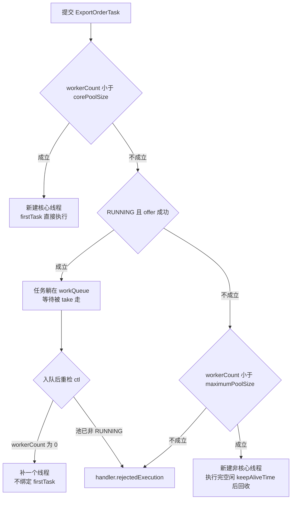
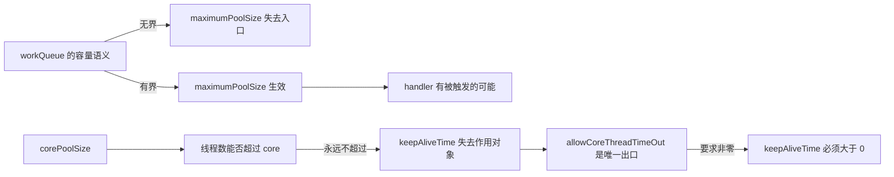
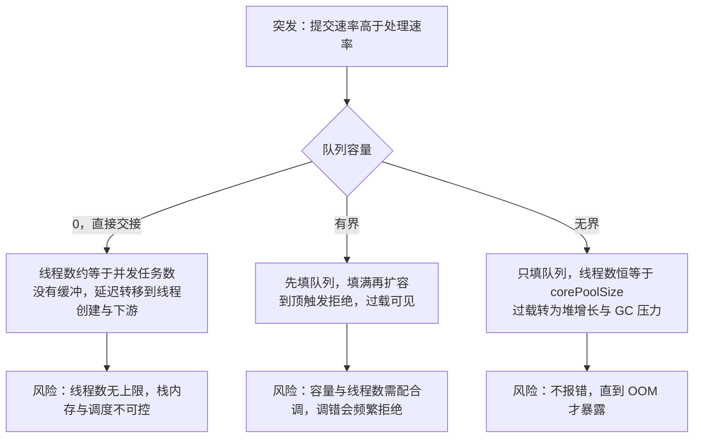
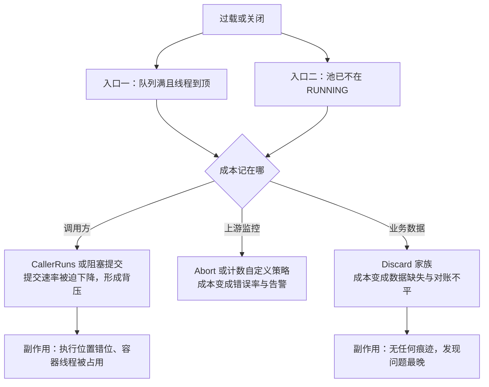
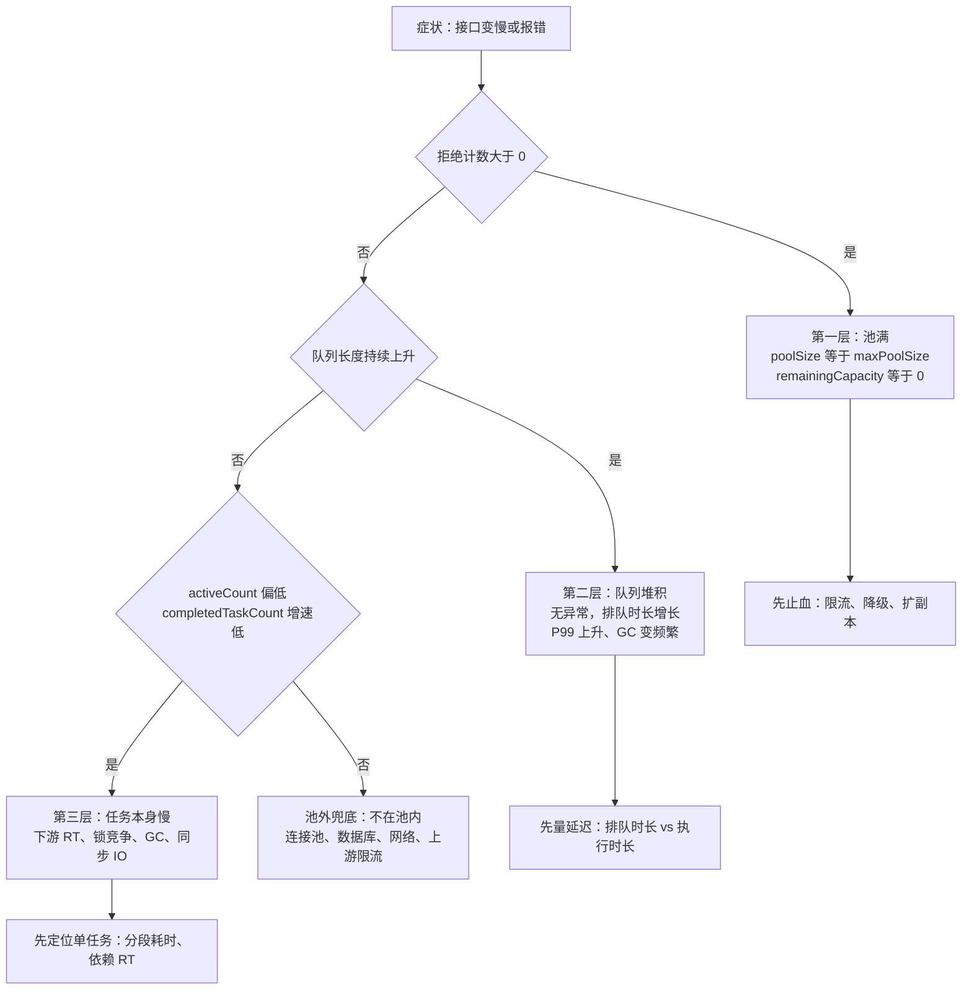
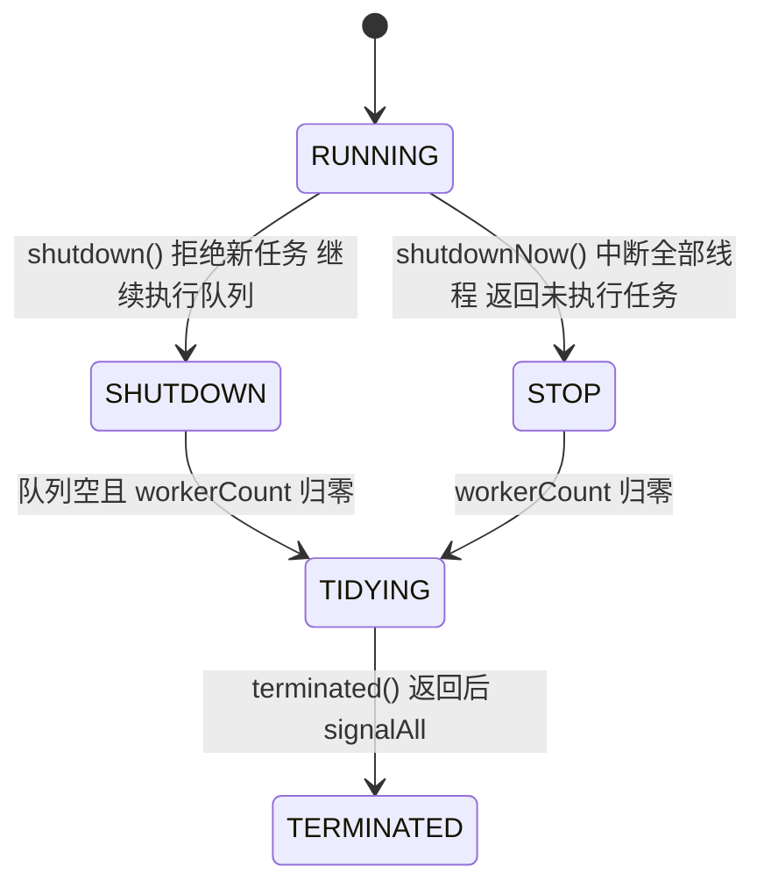

# 11 线程池（上）——ThreadPoolExecutor 的七大参数与执行流程

**摘要：**

线程池的七个构造参数很少单独起作用，它们的相互约束决定了同一条任务最终落在核心线程、工作队列、临时线程还是拒绝策略上。本文从一个「改了 `maximumPoolSize` 却没有效果」的现象切入，沿 `execute` 的四个落点逐条给出判据：不到 `corePoolSize` 就开线程、队列接收就入队、队列拒收才扩容、扩容失败才拒绝，并解释**先入队后扩容**的顺序为何让无界队列下的 `maximumPoolSize` 彻底失效。随后把三种队列容量形态、四种拒绝策略与背压的成立条件串成一条链，给出线程池故障的三层归因——池满、队列堆积、任务本身慢——以及各自的判据指标与互相掩盖的方式。后半程落在可观测状态（六个瞬时值能说明什么、为什么会被误读）、线程工厂与两条提交路径的异常语义、`shutdown` 与 `shutdownNow` 的差别和 `awaitTermination` 的正确写法，最后用 `Executors` 四个工厂方法的参数展开作为反例，并用利特尔定律给出队列容量与池大小之间的量级估算。全文的落点是一句判断——配置线程池的难点不在于记住七个参数的名字，而在于回答「过载时希望它在哪里表现出来」。

---

## 第 1 章 七个参数为什么不能单独看

### 1.1 一个改不动的 maximumPoolSize

先看一段压测代码，它只做了一件事：把 `maximumPoolSize` 从 8 调到 64。

```java
ThreadPoolExecutor pool = new ThreadPoolExecutor(
        8,                                   // corePoolSize
        64,                                  // maximumPoolSize：改了这里
        60L, TimeUnit.SECONDS,
        new LinkedBlockingQueue<>(),         // 无界队列，没改
        new ThreadFactoryBuilder().setNameFormat("export-%d").build());

// 突发 2000 个导出任务全部提交进去，然后连续采样
pool.getPoolSize();   // 从 8 开始，一直停在 8
pool.getQueue().size(); // 一路涨到 1900 以上
```

`getPoolSize()` 一次都没有超过 8，`maximumPoolSize = 64` 这行配置仿佛不存在。原因不在参数写错，而在它没有生效的机会：`execute` 走到扩容那一步的前提是「入队失败」，而 `LinkedBlockingQueue` 不指定容量时默认是 `Integer.MAX_VALUE`，它的 `offer` 从不返回 `false`。

JDK 源码的类注释把这件事写得很直白，原文是使用无界队列时「no more than corePoolSize threads will ever be created. (And the value of the maximumPoolSize therefore doesn't have any effect.)」。所以这不是实现缺陷，而是一个被文档化的设计后果。真正需要回答的问题变成了：七个参数里，哪几个在什么条件下才有资格生效。

### 1.2 线程池其实只分配四样东西

把七个参数按「它们争抢什么资源」重排，会发现线程池管的只有四笔预算。

第一笔是**线程**，每个线程要一块堆外的线程栈，64 位 HotSpot 的默认值在 1 MB 量级，`-Xss` 可调；线程还意味着内核调度实体、上下文切换，以及一段只有它自己用的 TLS 区域。第二笔是**排队容量**，队列里的每个 `Runnable` 都要被强引用持有，任务持有业务对象，于是队列长度直接换算成堆内存与 GC 压力。第三笔是**过载语义**，任务接不下的时候，是抛给调用方、丢掉、丢最老的，还是塞回调用方线程去执行。第四笔是**执行位置**，任务最终在池内线程上跑还是在调用方线程上跑，决定了监控埋点、事务边界、日志 MDC 归属是否正确。

`corePoolSize`、`maximumPoolSize`、`workQueue` 三个参数一起决定前两笔预算的分配比例；`handler` 决定第三笔；`CallerRunsPolicy` 与自定义策略则在特定条件下改写第四笔。`keepAliveTime`、`unit`、`threadFactory` 不直接分配预算，它们分别规定「线程这笔预算在多长时间后归还」和「线程以什么身份出现」。这样看，七个参数不是七个并列的旋钮，而是四笔预算的六个分配规则加一个身份规则。

### 1.3 一条任务的四个落点

后续章节用同一个案例贯穿：订单报表导出。HTTP 接口收到请求后构造一个 `ExportOrderTask`，提交到共享线程池；任务内部按游标分页查 200 条订单，拼成 xlsx，再上传对象存储，单次耗时 200 ms 量级，其中约 150 ms 在等数据库与对象存储，真正占 CPU 的时间不到 50 ms。

这条任务在提交的瞬间会经过四个可能的位置，位置由当时的 `ctl` 与队列状态共同决定，而不是由任何一个参数单独决定。下图把四个落点与它们各自依赖的参数标在一起。



四个落点里有两个是「开线程」，一个是「排队」，一个是「交给 handler」。注意排队那一条还带一次重检：任务已经进队，线程池却可能在这几纳秒里被 `shutdown()`，或者最后一个工作线程恰好退出，于是需要回滚或补人。这个细节说明落点判定不是一次性的判断，而是一段带补偿的临界区。

### 1.4 全文的推进路线

先把七个参数的语义与相互制约讲清楚，重点是哪些参数在什么条件下失效；再把 `execute` 的四步拆到判据一级；然后沿队列与拒绝策略落到故障归因与可观测手段；最后收在停机、工厂方法的反例与量级估算上。分治型任务与工作窃取是另一套模型，见 [[12 线程池（下）——ForkJoinPool 与工作窃取算法]]。

---

## 第 2 章 七个参数是一组相互制约的约束

### 2.1 构造器只校验自洽，不校验合理

最完整的构造器在入口处只做两类检查。

```java
// JDK 21，ThreadPoolExecutor
if (corePoolSize < 0 ||
    maximumPoolSize <= 0 ||
    maximumPoolSize < corePoolSize ||
    keepAliveTime < 0)
    throw new IllegalArgumentException();
if (workQueue == null || threadFactory == null || handler == null)
    throw new NullPointerException();
```

四条不等式检查的是参数之间是否自洽：核心线程数不能为负、最大线程数必须为正、最大不能小于核心、存活时间不能为负。三个空检查挡的是 NPE。除此之外它什么都不管——`maximumPoolSize` 写成 `Integer.MAX_VALUE` 能通过，`workQueue` 用默认容量的 `LinkedBlockingQueue` 也能通过，`handler` 用 `DiscardPolicy` 同样能通过。构造成功只说明这组参数在数学上不矛盾，与它在业务上是否安全毫无关系。

### 2.2 corePoolSize 是阈值与下限的叠加

大多数资料把 `corePoolSize` 解释成「常驻线程数」，这个说法只覆盖了它的一半。它在源码里被读两次，每次扮演不同角色。

第一次读在 `execute` 的第一行判断：`workerCountOf(c) < corePoolSize` 就优先开线程。此时它是**开线程的阈值**，语义是「只要还没到这个数，来了任务就直接开人，不要排队」。第二次读在 `getTask` 里：`boolean timed = allowCoreThreadTimeOut || wc > corePoolSize;`。此时它是**空闲回收的下限**，语义是「不超过这个数的线程不受 `keepAliveTime` 管辖，可以一直阻塞在 `take()` 上」。

两个角色叠加，才能解释为什么这个参数叫「核心」：它既是池子长大的第一道门槛，也是池子缩小时的最后一道堤。也因此它天然是懒的——构造器只把数字记下来，一个线程都不会创建。JDK 注释特意补了一句，用非空队列构造池时最好调用 `prestartCoreThread()` 或 `prestartAllCoreThreads()` 预启动，否则头几个任务还要额外付一次线程创建的钱。

动态调整时两个角色分头生效，这一点常被忽略。`setCorePoolSize` 调小时会因为 `workerCountOf(ctl.get()) > corePoolSize` 而调用 `interruptIdleWorkers()`，把空闲线程的中断打上，让它们从 `take()` 里退出来走回收路径；调大时则按 `Math.min(delta, workQueue.size())` 补线程，队列空了就停手。

```java
// 缩小 corePoolSize 会顺带叫醒空闲线程，它们醒来后发现自己超编，走退出路径
pool.setCorePoolSize(4);
```

### 2.3 maximumPoolSize 是一个从属上界

`maximumPoolSize` 只在 `addWorker(command, false)` 里被读一次，判据是 `workerCountOf(c) >= (maximumPoolSize & COUNT_MASK)` 时返回 `false`。这里有两个细节值得记住。

第一个是 `& COUNT_MASK`。`COUNT_MASK` 是低 29 位的掩码，所以传入超过 2^29−1 的值会被截断成容量上限，`Integer.MAX_VALUE` 的实际含义是「最多 5 亿多个线程」，而不是「无上限」。`Executors.newCachedThreadPool()` 正是这么写的。

第二个是它出现的时机。这个参数不在提交路径的入口处参与判断，只在「队列已经拒收」之后才被查询。换句话说，`corePoolSize` 与 `workQueue` 先决定要不要走到扩容这一步，`maximumPoolSize` 只负责决定走到这一步之后能开几个。本文第 3 章会把这条链路按判据拆开，这里先记住结论：`maximumPoolSize` 是**队列容量的从属参数**。队列不设上限，它就没有生效的入口。

### 2.4 keepAliveTime 与 unit 在内部只留纳秒

构造器接收的 `(keepAliveTime, unit)` 会被立刻归一成纳秒存进字段，之后 `unit` 就不再出现。

```java
// 构造器内部
this.keepAliveTime = unit.toNanos(keepAliveTime);

// getTask 取任务时，用的是存好的纳秒值
Runnable r = timed ? workQueue.poll(keepAliveTime, TimeUnit.NANOSECONDS)
                   : workQueue.take();
```

这条实现细节解释了两个容易踩空的点。一是 `getKeepAliveTime(TimeUnit)` 只是一个换算工具，字段里没有被换算过的「原值」；二是 `setKeepAliveTime` 在缩短存活时间时会立即调用 `interruptIdleWorkers()`，因为阻塞在 `poll()` 上的线程已经带着旧的超时参数睡下了，不打断就不会感知到新值。调大时则什么都不做，反正下一次 `poll` 自然会用新值。

`Long.MAX_VALUE` 纳秒（约 292 年）是事实上的「永不回收」写法，JDK 注释把它作为禁用空闲回收的手段。而 `allowCoreThreadTimeOut(true)` 对 `keepAliveTime` 有硬要求，源码里写得很干脆：

```java
public void allowCoreThreadTimeOut(boolean value) {
    if (value && keepAliveTime <= 0)
        throw new IllegalArgumentException("Core threads must have nonzero keep alive times");
    ...
}
```

这行检查解释了为什么「`newFixedThreadPool(n)` 之后再开核心线程超时」必然失败：那个工厂方法传的 `keepAliveTime` 正是 0。

### 2.5 workQueue 决定另外三个参数是否还有意义

`workQueue` 的类型与容量是唯一能一句话改写整个池行为的选择。三种容量形态对应三种完全不同的参数有效性。

容量为 0 的 `SynchronousQueue` 不存储任务，`offer` 等价于一次超时为 0 的交接尝试：只有恰好有消费者在等，才成功。它成功时任务直接进了线程的手上，失败时立刻触发扩容分支，所以 `maximumPoolSize` 在这里是真正的弹性上限。

有界队列让三个参数同时有用：队列能接就排队，接不下就扩容，扩容到顶就拒绝。此时队列容量与线程数是一对可以互换的预算。

无界队列把扩容分支彻底切断：线程数恒等于 `corePoolSize`，`keepAliveTime` 也基本无用——`getTask` 的 `timed` 判据是 `wc > corePoolSize`，既然线程数到不了这个数，`poll` 从来不会被选中，线程永远蹲在 `take()` 上。唯一能让这类池缩小的开关是 `allowCoreThreadTimeOut(true)`，开了之后 `timed` 恒为真，核心线程也走 `poll`。

### 2.6 threadFactory 决定线程以什么身份出现

线程工厂在整个类里只有一个调用点：`Worker` 的构造器里 `this.thread = getThreadFactory().newThread(this)`。它返回 `null` 时 `addWorker` 会失败，任务被交给 handler，JDK 注释对此的措辞是「executor 会继续工作，但可能再也执行不了任何任务」。

默认工厂 `Executors.defaultThreadFactory()` 的行为值得抄下来看：线程名是 `pool-N-thread-M`，`poolNumber` 与 `threadNumber` 都是静态或实例自增；它对线程做了两处强制修正——`isDaemon()` 为真就改回非守护，优先级不等于 `NORM_PRIORITY` 就改回普通优先级。这两条修正常常被忽略，直到有人用自定义工厂造出**守护线程**，发现 JVM 退出时任务被拦腰斩断。

线程名的价值不在好看。`jstack` 的线程列表、火焰图的纵轴、APM 的线程维度聚合、`ThreadMXBean` 的 CPU 时间统计，全都以线程名为索引。多业务共用一个池时，线程名统一是 `pool-3-thread-7`，现场分析的第一步就变成了猜。

### 2.7 handler 决定过载以什么形式暴露

拒绝策略只在两个入口被调用：线程池已经关闭，或者有界队列满且线程数达到 `maximumPoolSize`。它是七个参数里唯一一个**决定失败长什么样**的参数——抛异常给调用方、静默丢弃、丢弃最老的、还是让调用方自己执行。四种内置策略的语义与代价放在第 5 章展开。

### 2.8 allowCoreThreadTimeOut 是构造之后的额外开关

它不在构造参数里，却会改写 2.2 里 `corePoolSize` 的第二个角色。开关打开后，所有线程都按 `keepAliveTime` 回收，`processWorkerExit` 的补线程逻辑也跟着变：`int min = allowCoreThreadTimeOut ? 0 : corePoolSize;`，所以池可以真的缩到 0。但队列非空时仍会保证至少一个线程——`if (min == 0 && ! workQueue.isEmpty()) min = 1;`，否则队列里的任务就永远没人处理了。

下表把七个参数与它们的读取点、失效条件放在一起，方便对照源码看。

| 参数 | 被读取的位置 | 生效前提 | 失效或退化条件 |
| :--- | :--- | :--- | :--- |
| `corePoolSize` | `execute` 首判、`getTask` 的 `timed` | 始终生效 | 无；但动态调小需等空闲线程被中断才真正缩容 |
| `maximumPoolSize` | `addWorker` 的容量判据 | 队列存在「拒收」的可能 | 无界队列、`DelayedWorkQueue` 等永不拒收的队列下完全失效 |
| `keepAliveTime` / `unit` | `getTask` 的 `poll` | `workerCount > corePoolSize` 或开了核心超时 | 无界队列 + 未开核心超时时，线程数到不了 core 以上 |
| `workQueue` | `execute` 的 `offer`、`getTask` 的取任务 | 始终生效 | 无；容量语义本身会反过来压制上两个参数 |
| `threadFactory` | `Worker` 构造器 | 始终生效 | 返回 `null` 时线程创建失败，任务走拒绝路径 |
| `handler` | `reject` | 存在拒绝的可能 | 无界队列下除「池已关闭」外不会触发 |
| `allowCoreThreadTimeOut` | `getTask` 的 `timed`、`processWorkerExit` 的下限 | `keepAliveTime > 0` | `keepAliveTime == 0` 时直接抛 `IllegalArgumentException` |

把这张表反过来读，就是参数之间的支配关系：队列容量支配 `maximumPoolSize`，线程数上界支配 `keepAliveTime`，`keepAliveTime` 又支配 `allowCoreThreadTimeOut`。下图画出这条支配链，箭头指向「被支配者」，也就是「可能失效的那一方」。



所以调参的先后顺序是固定的：先定队列容量（决定过载往哪走），再定 `corePoolSize` 与 `maximumPoolSize`（决定并行度区间），最后才轮到 `keepAliveTime` 与拒绝策略。倒过来调，前面设的数字会被后面一句悄悄废掉。

---

## 第 3 章 execute 的四步与每一步的判据

### 3.1 ctl 一次读两个状态

`execute` 每一步都在读同一个字段。`ThreadPoolExecutor` 把「线程池状态」与「工作线程数」压进一个 `AtomicInteger`：高 3 位是 `runState`，低 29 位是 `workerCount`，一次 CAS 同时改两者，避免两个独立变量更新之间出现中间态。

```java
private final AtomicInteger ctl = new AtomicInteger(ctlOf(RUNNING, 0));
private static final int COUNT_BITS = Integer.SIZE - 3;       // 29
private static final int COUNT_MASK = (1 << COUNT_BITS) - 1;  // 低 29 位全 1
private static final int RUNNING    = -1 << COUNT_BITS;       // 高三位 111
private static final int SHUTDOWN   =  0 << COUNT_BITS;       // 000
private static final int STOP       =  1 << COUNT_BITS;       // 001
private static final int TIDYING    =  2 << COUNT_BITS;       // 010
private static final int TERMINATED =  3 << COUNT_BITS;       // 011
static int workerCountOf(int c) { return c & COUNT_MASK; }
static boolean isRunning(int c)  { return c < SHUTDOWN; }      // 退化成一次符号判断
```

五个状态值按有符号整数递增排列：`RUNNING` 的高三位是 `111`，于是成了最小的负数，`SHUTDOWN` 为 0，其余依次加 1。这样一来 `runStateAtLeast` 与 `runStateLessThan` 都退化成普通的大小比较，`isRunning` 只剩 `c < 0`。这也解释了 3.2 之后所有判据为什么都能写成一次 `ctl.get()` 加几次位运算：状态与线程数在同一个字里，读到的一定是同一瞬间的组合。

### 3.2 源码只有三段注释，落点却有四个

`execute` 的全文不长，源码注释自称三步（Proceed in 3 steps），但按「任务最终去了哪」来数，答案是四个：核心线程、队列、非核心线程、拒绝。拒绝本身是第三步失败的出口，不算独立判断，却对应独立的一段代码。

```java
public void execute(Runnable command) {
    if (command == null)
        throw new NullPointerException();
    int c = ctl.get();
    // 第 1 步：没到 corePoolSize，优先开线程，不排队
    if (workerCountOf(c) < corePoolSize) {
        if (addWorker(command, true))
            return;
        c = ctl.get();
    }
    // 第 2 步：RUNNING 且队列收下了，任务就算接受了
    if (isRunning(c) && workQueue.offer(command)) {
        int recheck = ctl.get();
        if (! isRunning(recheck) && remove(command))
            reject(command);            // 入队之后池被关了，回滚并拒绝
        else if (workerCountOf(recheck) == 0)
            addWorker(null, false);     // 队列有任务但没人了，补一个线程
    }
    // 第 3 步：队列没收，尝试扩容；扩不动就走拒绝
    else if (!addWorker(command, false))
        reject(command);
}
```

代码里没有一行直接比较 `maximumPoolSize`，这个参数藏在 `addWorker` 内部。理解这一点之后，四个落点的判据就可以逐个写清楚了。

### 3.3 第 1 步：不到 corePoolSize 就开线程

判据是一次快照比较：`workerCountOf(c) < corePoolSize`。它优先于入队，这是 JDK 注释里的第一条排队策略——线程数少于核心数时，执行器总是倾向于加线程而不是排队。

`addWorker(command, true)` 内部做了原子化的双重校验，因为从读到 `c` 到真正加线程之间，别的线程可能已经加了人或者关了池：

```java
retry:
for (int c = ctl.get();;) {
    if (runStateAtLeast(c, SHUTDOWN)
        && (runStateAtLeast(c, STOP) || firstTask != null || workQueue.isEmpty()))
        return false;
    for (;;) {
        if (workerCountOf(c) >= ((core ? corePoolSize : maximumPoolSize) & COUNT_MASK))
            return false;
        if (compareAndIncrementWorkerCount(c))
            break retry;
        c = ctl.get();                 // CAS 失败，重读 ctl
        if (runStateAtLeast(c, SHUTDOWN))
            continue retry;
    }
}
```

外层循环校验运行状态：池已经到 `SHUTDOWN` 时，只有「状态恰好是 `SHUTDOWN`、不绑定初始任务、队列非空」这种为处理存量任务而补线程的情形才允许继续。内层循环用 CAS 自增 `workerCount`，失败就重读 `ctl` 再来一次。两步都通过之后，才在 `mainLock` 保护下把 `Worker` 加进 `workers` 集合并启动线程，加完之后还会重检一次状态，防止刚加完就关池。

`addWorker` 返回 `false` 意味着「没加成」：可能因为池已经不是 `RUNNING`，也可能因为并发竞争下 `workerCount` 已经被别人推到了阈值。`execute` 的处理是重读 `ctl` 然后继续往下走——第 1 步失败不代表任务被拒，它只是说明现在的线程数够了。

### 3.4 第 2 步：队列收下就等于接受了

判据是 `isRunning(c) && workQueue.offer(command)`。前半句是一次廉价的短路判断，`isRunning` 在源码里就是 `c < SHUTDOWN`，因为 `RUNNING` 的高三位是 `111`，作为有符号整数它是最小的那个值。后半句才是真正的落点决定。

`offer` 的返回值在三种队列上含义完全不同。无界队列永远返回 `true`，于是第 2 步几乎必然成功，第三步的扩容分支永远走不到。有界队列在容量耗尽时返回 `false`，任务被推到第 3 步。`SynchronousQueue` 的 `offer` 需要恰好有消费者在 `take`/`poll` 上等待，否则立刻返回 `false`——它的 `offer` 实现就是 `xfer(e, 0L) == null`，一次超时为 0 的交接尝试。

这里有一个容易被忽略的不对称：`addWorker` 失败之后 `execute` 会继续走后续分支，而 `offer` 失败直接跳到扩容。也就是说线程池对「开线程失败」是宽容的（重试一次即可），对「队列拒收」是敏感的（必须改变策略）。

### 3.5 入队之后的两次重检

任务进了队列并不等于尘埃落定。`execute` 拿到 `recheck` 快照之后要做两个补偿判断。

第一个判断处理 `shutdown` 竞态：`! isRunning(recheck) && remove(command)` 成立时，说明任务入队之后池被关掉了，于是把任务从队列里摘出来交给 handler。这里必须 `remove` 成功才拒绝，否则任务可能已经被某个工作线程取走开始执行，再拒绝就会造成「执行了又报拒绝」的重复语义。

第二个判断处理线程见底：`workerCountOf(recheck) == 0` 时补一个线程（`addWorker(null, false)`，不绑定初始任务）。这个分支的存在感很弱，却堵住了一个真实的漏洞：`corePoolSize` 为 0、或核心线程已被 `allowCoreThreadTimeOut` 全部回收的池，在队列里已经有任务的瞬间，如果最后一个线程正好退出，队列就无人消费。`newCachedThreadPool` 用 `SynchronousQueue`，队列永远为空，碰不到这个分支；开了核心超时的池则会碰到。

注意这里用的是 `addWorker(null, false)`，上限是 `maximumPoolSize` 而不是 `corePoolSize`。补线程的目的是「别让队列里的任务饿死」，用哪个上界并不影响正确性，用 max 只是复用同一个方法。

### 3.6 第 3 步：队列拒收之后才轮到扩容

判据只有一句：`! addWorker(command, false)`。`addWorker` 内部比较的是 `workerCountOf(c) >= maximumPoolSize`（精确写法带 `& COUNT_MASK`，第 2.3 节已解释），达到了就返回 `false`，任务落到第 4 步；没达到就新建一个非核心线程，把这个任务作为 `firstTask` 直接执行，不经过队列。

这一步的线程是「临时工」：执行完手上的任务后进入 `getTask`，因为此时 `wc > corePoolSize`，`timed` 为真，于是走 `poll(keepAliveTime, NANOSECONDS)`，超时未取到任务就在下一轮循环里把 `workerCount` 减一然后退出。

```java
// getTask 的回收判断，注意两个条件缺一不可
if ((wc > maximumPoolSize || (timed && timedOut))
    && (wc > 1 || workQueue.isEmpty())) {
    if (compareAndDecrementWorkerCount(c))
        return null;                  // 这个 Worker 结束，runWorker 的 while 退出
    continue;
}
```

`wc > 1 || workQueue.isEmpty()` 这一条保证池里至少留一个线程去消费队列，只有当队列为空时才允许最后一个线程也走掉。

### 3.7 第 4 步：交给拒绝策略

`reject(command)` 只有一行，转调 `handler.rejectedExecution(command, this)`。默认 handler 是 `AbortPolicy`，抛 `RejectedExecutionException`。这一步是线程池唯一对外表达「我接不住」的地方，第 5 章专门拆四种策略。

### 3.8 顺序本身带来的三个后果

第一个后果是 `maximumPoolSize` 的从属地位。因为扩容排在入队之后，任何让 `offer` 永不失败的手段都会让扩容失效。无界队列是最常见的一种，`DelayedWorkQueue`（`ScheduledThreadPoolExecutor` 的实际队列）同理——它的 `add` 基于堆数组，同样不设容量。

第二个后果是**先堆积后扩容**。突发流量到来时，线程池的应对顺序是先把队列填上，填满之后才开始开线程。这意味着扩容发生在延迟已经上升之后，而不是之前。用一条时间线看更清楚：任务到达速率从 50/s 跳到 500/s，前几秒队列从空涨到满，排队延迟从 0 涨到几百毫秒，等队列满了才看到线程数从 8 爬到 64。等到流量回落，那 56 个临时线程还要再挂 `keepAliveTime` 才退场。

第三个后果是 `SynchronousQueue` 的反常表现。它是唯一一种让「入队失败」成为常态的队列，所以它的扩容最灵敏——几乎没有排队，来一个任务开一个线程。代价是没有缓冲：线程数直接等于瞬时并发任务数，而线程创建本身有延迟，于是任务在「创建线程」这件事上排队。

四步的判据与失败去向汇总如下。

| 步骤 | 判据 | 判据读的参数 | 失败后的去向 | 失败原因 |
| :--- | :--- | :--- | :--- | :--- |
| 1 开核心线程 | `workerCount < corePoolSize` | `corePoolSize` | 继续第 2 步 | 并发竞争、池已关闭 |
| 2 入队 | `isRunning && workQueue.offer` | `workQueue` 容量 | 第 3 步 | 队列满、无消费者等待、池已关闭 |
| 2′ 重检 | 入队成功后读 `ctl` | `runState`、`workerCount` | 回滚拒绝或补线程 | `shutdown` 竞态、线程见底 |
| 3 扩容 | `addWorker(command, false)` | `maximumPoolSize` | 第 4 步 | 达到最大线程数、池已关闭 |
| 4 拒绝 | 无判据 | `handler` | 调用方 | 交给策略决定 |

---

## 第 4 章 队列选择如何改写整个池的形状

### 4.1 直接交接：线程数跟着并发任务数

`SynchronousQueue` 的容量是 0，生产者必须撞上一个正在等待的消费者才能把任务递出去。提交路径上的表现是：`offer` 在没有人等的时候立刻返回 `false`，任务被推去扩容，扩容开出的新线程以 `firstTask` 的形式接过任务。等任务执行完，线程回到 `getTask` 里 `poll(60s)`，这时它又变成了「等待中的消费者」，下一个任务可以直接递给它。

于是池的形状是「线程数 ≈ 并发任务数，上限是 `maximumPoolSize`」。JDK 注释对它的评价是：直接交接通常需要无界的 `maximumPoolSize` 才不至于频繁拒绝，而这就允许了线程数无限增长的可能。`newCachedThreadPool` 恰好是这个评价的完整实例。

没有队列，延迟不体现在排队上，而体现在两处：线程创建的那几十到上百微秒，以及瞬时并发涌向下游时下游的排队。它是一个很好的**弹性执行器**，也是一个很差的**限流器**。

### 4.2 无界队列：拒绝被改写成了延迟

无界队列把过载的表达方式整个换掉了。线程数被 `corePoolSize` 钉死，任务只能排队，`maximumPoolSize` 与 `keepAliveTime` 一起失效，`handler` 除了「池已关闭」几乎不会被调用。原本该由拒绝策略暴露的问题，变成了队列长度、堆占用和 GC 时间。

这种形状适合「任务独立、单任务足够短」的场景，JDK 注释举的例子是网页服务器——请求各自独立，短暂突发靠队列吸收是合理的。但它有一个必须自己承担的前提：队列长度得有人看着。无界队列不报错，只会越来越长，直到某次 Full GC 之后 `OutOfMemoryError: Java heap space`，那一刻距离问题真正开始往往已经过去很久。

### 4.3 有界队列：三个参数同时复活

给队列加上容量，第 3 步才第一次有存在意义。此时 `corePoolSize`、`maximumPoolSize`、队列容量三个数字共同决定形状，而它们是一对可以互换的预算——JDK 注释把话说得很清楚：大队列配小池子能压低 CPU 占用、操作系统资源与上下文切换，但可能带来「人为偏低的吞吐」；小队列则通常要求更大的池子，CPU 更忙，调度开销也更大，吞吐反而可能下降。

四组配置的形状差异见下表，并行度均为量级判断，具体数字取决于任务里阻塞时间的占比。

| 配置 | 稳态线程数 | 过载时的第一表现 | 恢复方式 | 主要风险 |
| :--- | :--- | :--- | :--- | :--- |
| 无界队列 + 固定线程 | `corePoolSize` | 队列变长、延迟上升 | 下游降速或扩容 | 堆内存耗尽，问题发现晚 |
| 有界队列 + 大池子 | 靠近 `maximumPoolSize` | 拒绝异常或调用方执行 | 拒绝计数报警 | 线程过多导致切换开销与下游压力 |
| `SynchronousQueue` + 大 `max` | 约等于并发任务数 | 线程创建排队、下游排队 | 流量自愈 | 线程数无上限，栈内存与调度不可控 |
| 有界队列 + 小池子 | 在 `corePoolSize` 与 `maximumPoolSize` 之间摆动 | 拒绝频繁 | 提高队列或池大小 | 吞吐被人为压低 |

### 4.4 特殊队列的形状

`PriorityBlockingQueue` 是无界的，优先级只改变出队顺序，不改变容量语义，所以它和 `LinkedBlockingQueue` 一样会把池钉在 `corePoolSize`。真正的用处是让「高优先级的任务先跑」，代价是低优先级任务可能长期排队——无界队列下这个「长期」没有上限。

`ScheduledThreadPoolExecutor` 用的 `DelayedWorkQueue` 是堆结构的无界队列，`add` 永不满。它的提交路径更特殊：`execute` 被重写成 `schedule(command, 0, NANOSECONDS)`，任务先入队，再由 `ensurePrestart()` 补线程，而 `ensurePrestart` 的判断是 `wc < corePoolSize` 才 `addWorker(null, true)`，否则只在 `wc == 0` 时补一个。也就是说调度池的线程数被 `corePoolSize` 钉死，构造器里那个 `Integer.MAX_VALUE` 的 `maximumPoolSize` 是一次也不会被查询的摆设。

### 4.5 选型判据：过载时你希望它在哪里表现出来

队列选型没有最优解，只有「把过载的代价记在哪个账上」的选择。记在内存上，就要接受 GC 与 OOM 的风险，换来的是不丢任务；记在拒绝上，就要接受调用方收到异常，换来的是过载立刻可见；记在上游延迟上，就用 `CallerRunsPolicy` 或阻塞式提交，让压力沿着调用链往回传；记在 CPU 上，就把线程数放大，用调度开销换取更高的并行度。

这四种「记账方式」并不互斥，一个成熟的配置通常是组合：有界队列兜住短突发、`CallerRunsPolicy` 或自定义策略把手不住的请求压回调用方、线程数按任务里阻塞时间占比配置、拒绝与队列长度都进监控。

三种容量形态下的落点分布如下图所示，中间的「有界」是唯一同时用到四个落点的形态。



---

## 第 5 章 四种拒绝策略与背压成立的条件

### 5.1 两条触发路径

拒绝有两条来路。第一条是饱和：有界队列满、线程数到顶，`addWorker(command, false)` 返回 `false`。第二条是关闭：池已经不在 `RUNNING`，`isRunning(c)` 为假导致 `offer` 被短路，或者入队之后重检发现状态已变。

关闭路径上有一个容易忽略的细节：`addWorker` 对 `runStateAtLeast(c, SHUTDOWN)` 且 `firstTask != null` 的情形一律返回 `false`。所以往一个已 `shutdown` 的池提交任务，一定走拒绝，而不是悄悄排队。这一点直接影响第 8 章的停机模板——`shutdown()` 之后提交的任务不会被执行，也不会被排队等待。

### 5.2 AbortPolicy：默认策略，唯一能立刻报警的一种

```java
public void rejectedExecution(Runnable r, ThreadPoolExecutor e) {
    throw new RejectedExecutionException("Task " + r.toString() +
                                         " rejected from " + e.toString());
}
```

它把失败原样抛给调用方，异常里带着任务与执行器的字符串表示。价值在于「能被感知」：调用方要么处理，要么让异常上抛到统一异常处理器，要么被监控捕获成错误率。风险也在这里——如果调用方包了一层 `catch (Exception e) { log.debug(...) }`，抛异常与静默丢弃就没有区别了，还多了一次异常构造的开销。

### 5.3 CallerRunsPolicy：唯一可能形成背压的一种

```java
public void rejectedExecution(Runnable r, ThreadPoolExecutor e) {
    if (!e.isShutdown()) {
        r.run();      // 注意：池已关闭时任务被丢弃
    }
}
```

在调用方线程上直接执行任务，是四种策略里唯一一个会让「提交速率被迫下降」的。它形成背压需要三个条件同时成立：调用方是提交循环的驱动者（不是异步分发的中间层）；任务的执行时间足够长，长到能实质占用调用方；调用方本身不是稀缺资源。少任何一个，背压就退化成一次「额外的内联执行」。

代价有三笔。第一笔是**执行位置错位**：任务从池内线程跑到了 Web 容器线程，`ThreadLocal` 里的租户上下文、事务同步器、日志 MDC、监控的线程维度归属，全都按调用方的身份记录，事后排查会看到「导出任务」跑在 `http-nio-8080-exec-12` 上。第二笔是资源挤占：Tomcat 的工作线程被一个 200 ms 的导出任务占住，同一时刻的其他请求少了一个处理者；如果导出接口本身流量很大，容器线程池会先被打满，故障从一个接口扩散到全站。第三笔是关闭期间静默丢弃：池已 `shutdown` 时这个策略什么都不做，任务凭空消失，而调用方以为它被执行了。

### 5.4 DiscardPolicy：空实现

```java
public void rejectedExecution(Runnable r, ThreadPoolExecutor e) {
}
```

方法体是空的，没有日志、没有计数、没有异常。JDK 注释说它只适用于「从不依赖任务完成」的极少数场景。用它的池在过载时表现是：一切正常，只是少做了一些事。这类故障最难查，因为没有任何一处会报错，只有业务侧的数据对不上。

### 5.5 DiscardOldestPolicy：丢队头再重试

```java
public void rejectedExecution(Runnable r, ThreadPoolExecutor e) {
    if (!e.isShutdown()) {
        e.getQueue().poll();   // 丢掉队头（通常是最老的任务）
        e.execute(r);          // 重新提交当前任务
    }
}
```

它的语义是「新的比老的更重要」。两处风险需要记住。

一是重试可能再次失败。`e.execute(r)` 会把当前任务重新走一遍完整的四步流程，如果队列又被填满（并发提交时完全可能），就会再次触发 `rejectedExecution`。如果 handler 还是 `DiscardOldestPolicy`，就形成了「poll → execute → 拒绝 → poll → execute」的循环；在 `SynchronousQueue` 上这个循环必然发生，因为 `poll()` 在无人等待时返回 `null`，队列容量也没变，每次 `execute` 都会失败，递归下去直到 `StackOverflowError`。用这个策略必须配一个有界队列，并且清楚它在并发下的重试上限。

二是被丢掉的任务没有痕迹。`poll()` 的返回值被直接丢弃，那个任务对应的 `Future` 永远停在未完成状态，等 `get()` 的线程会一直阻塞（除非带超时）。JDK 注释对此的建议是：几乎所有场景都该同时取消被丢弃的任务，让等待方收到异常，至少也要记日志。

### 5.6 自定义策略的三种形态

生产里更常见的是自定义 handler，形态大致三类。

第一类是**可观测**：计数、打日志、带上队列长度与活跃线程数，然后抛异常或丢弃。它不改变行为，只补上「拒绝这件事本身可被度量」的能力。

```java
RejectedExecutionHandler handler = (task, executor) -> {
    rejectedCounter.increment();                       // 拒绝速率是核心告警指标
    log.warn("rejected, queue={}, active={}, pool={}",
             executor.getQueue().size(), executor.getActiveCount(), executor.getPoolSize());
    throw new RejectedExecutionException("export pool saturated");
};
```

第二类是**持久化重试**：把任务序列化后写进数据库或消息队列，由另一条链路慢慢消费。它把「丢失」换成「延迟」，代价是引入外部依赖，并且在过载时让下游也承压——写库本身可能正是那个慢操作。

第三类是**阻塞提交**：把拒绝改成等待，例如用一个 `Semaphore` 与队列容量对齐，提交前 `acquire()`，任务结束后 `release()`。这是真正的背压，代价与 `CallerRunsPolicy` 同源——提交线程被挂起，如果提交线程本身是稀缺资源，问题只是换了个地方堆积。JDK 的 `RejectedExecutionHandler` 接口没有提供「等待中的任务」这个概念，所以这类实现要自己保证在 `shutdown` 之后能解除阻塞。

换个角度看，四种策略的差别其实是「这笔过载成本记在谁头上」。下图按这个维度重新归类，箭头指向成本的最终承担者。



一个配置是否合理，可以先用这张图回答：你愿意让谁承担过载成本，以及出事之后你希望从哪个信号里看到它。

下表按「异常、丢任务、阻断提交者、能否形成背压」四个维度对照四种内置策略。

| 策略 | 是否抛异常 | 是否丢任务 | 是否阻断提交者 | 能否形成背压 | 过载时的可观测性 |
| :--- | :--- | :--- | :--- | :--- | :--- |
| `AbortPolicy` | 是 | 不丢，交给调用方 | 否 | 否 | 高，异常即信号 |
| `CallerRunsPolicy` | 否 | 关闭期间会丢 | 是，占用调用方线程 | 能 | 中，表现为上游变慢 |
| `DiscardPolicy` | 否 | 是 | 否 | 否 | 无 |
| `DiscardOldestPolicy` | 否 | 丢队头，且可能递归 | 否 | 否 | 无 |
| 自定义：计数 + 抛异常 | 是 | 不丢 | 否 | 否 | 高，带上下文 |
| 自定义：阻塞提交 | 否 | 不丢 | 是 | 能 | 高，但需自建指标 |

---

## 第 6 章 故障归因的三层

### 6.1 同一场过载的三种投影

线程池出问题时，症状几乎总是「慢」或「报错」，但根因分散在三个完全不同的位置：池子满了、队列在堆、任务本身慢。三者不是并列的三个原因，而是同一场过载在不同位置的投影；除此之外还有一个池外兜底，用来把「不在池内」的故障挡在三层之外。分不清层次，处置动作就会打偏——池满时去调大队列，只会把故障推后；任务慢时去调大线程数，只会让下游更堵。

下图给出从「慢」到三个层次的判据路径，每一层都配一个能直接取到的指标。



### 6.2 第一层：池满

判据是三个数字同时成立：拒绝计数大于 0、`getPoolSize()` 等于 `getMaximumPoolSize()`、`getQueue().remainingCapacity()` 等于 0。只满足一个都不算——`poolSize` 到顶但队列还空着，可能是队列容量太小；队列满但 `poolSize` 没到顶，说明提交路径根本没走到扩容（多半是无界队列或核心线程数已足够）。

这一层有两种表现形态，可观测性天差地别。抛异常的那种一眼可见，调用方拿到 `RejectedExecutionException`，接口返回 500，错误率曲线立刻抬头。静默的那种要等到业务数据对不上才会被发现——`DiscardPolicy` 空实现、`DiscardOldestPolicy` 丢队头、`CallerRunsPolicy` 在关闭期间丢弃、调用方 `catch` 掉异常后不处理，四者结果相同：任务消失，监控一片正常。

处置动作取决于业务语义。可丢失的任务（日志上报、埋点）丢就丢了，补个计数即可；不可丢失的任务要么限流让上游慢下来，要么落库重试，要么把线程池按业务隔离，避免一个慢业务拖垮全站。

### 6.3 第二层：队列堆积

这一层的特征是「一切正常但变慢」：没有异常、没有拒绝、线程数也没到顶，队列长度却在稳定增长。判据不能只看 `getQueue().size()` 的绝对值，要看趋势与容量占用率——`size` 除以 `(size + remainingCapacity)`；无界队列上分母是 21 亿，比率永远接近 0，这个指标等于不存在。

更可靠的判据是**排队时长**，也就是任务从「提交」到「开始执行」之间的时间差。JDK 没有提供这个数字，需要自己埋点：提交时把时间戳塞进包装过的 `Runnable`，`beforeExecute` 里取出来做差。

```java
// 排队时长是第二层唯一直接的证据，它无法从任何 getter 里读出来
final long submitNanos = System.nanoTime();
executor.execute(() -> {
    long waited = System.nanoTime() - submitNanos;
    waitTimer.record(Duration.ofNanos(waited));
    exportOrderReport(orderId);
});
```

如果排队时长已经与任务执行时长处在一个量级，第二层就成立了：用户感知到的延迟里有一半在等线程，而不是在干活。此时调大线程数、调小队列容量、给任务加优先级，都比「调大队列」有效——后者只是把堆积的位置换一下。

这一层与第一层的转换关系值得单独记一句：无界队列会把**拒绝**改写成**延迟**。同一个过载事件，在有界队列上表现为第一层的拒绝，在无界队列上表现为第二层的堆积加内存增长，直到 OOM。很多「线程池 OOM」事故的根因不是内存泄漏，而是这一层没人看。

### 6.4 第三层：任务本身慢

第三层的特征正好相反：池没满、队列不涨、线程活跃度也不高，但吞吐上不去。判据是 `getActiveCount() / getPoolSize()` 偏低、`getCompletedTaskCount()` 的增速低于预期、单个任务的耗时分布右移。

这一层要继续往下拆，拆的维度是「任务的时间花在哪」。常见归因有四类：下游依赖变慢（数据库慢查询、对象存储超时、RPC 重试）、锁竞争（同一把业务锁上的串行化）、GC 停顿（任务被 STW 打断）、同步 IO（日志同步刷盘、`FileOutputStream` 未缓冲）。四者都会表现为「任务慢」，但处置完全不同，所以必须靠分段埋点或火焰图区分，而不是靠调池参数。

一个容易混淆的现象：第三层会伪装成第一层。单个任务从 200 ms 变成 2 s，并发度不变的情况下吞吐掉到十分之一，队列很快积压，最终触发拒绝。此时若只看到拒绝就去调大线程数和队列，等于给一条已经堵住的管道加宽入口。

### 6.5 三层如何互相掩盖

第一层被第二层掩盖：无界队列上不会出现拒绝，池满这件事根本不发生。第二层被第三层掩盖：任务变慢导致堆积，根因不在池。第三层被第一层掩盖：拒绝的特征太醒目，分析到此为止。

还有一个反向的掩盖：`CallerRunsPolicy` 会把第一层的拒绝转化成第四层——上游变慢。任务在调用方线程上执行，池子看起来「没有拒绝」，但上游接口的 RT 上升、上游线程池开始积压，故障沿着调用链漂移了一层。此时如果只看下游池的指标，会得出「线程池一切正常」的错误结论。

判据汇总如下，处置动作按「先止血后定位」的顺序列。

| 层次 | 核心症状 | 判据指标 | 判据取不到时的替代证据 | 第一处置 |
| :--- | :--- | :--- | :--- | :--- |
| 第一层 池满 | 拒绝或任务消失 | 拒绝计数、`poolSize == max`、`remainingCapacity == 0` | 业务数据缺失、对账不平 | 限流、降级、按业务隔离池 |
| 第二层 队列堆积 | 延迟上升，无异常 | 队列长度趋势、排队时长、容量占用率 | P99、超时率、GC 频率与堆占用 | 调小队列、加线程、加优先级 |
| 第三层 任务慢 | 池未满但吞吐低 | `active/pool` 偏低、完成速率、单任务分段耗时 | 火焰图、下游 RT、锁竞争剖面 | 优化任务、拆依赖、加超时 |
| 池外兜底 | 池指标正常但上游慢 | 上游线程池、连接池、依赖服务指标 | 全链路 Trace 的耗时归属 | 修依赖、加熔断 |

---

## 第 7 章 可观测状态：六个数字的语义与误读

### 7.1 六个方法各自读的是什么

`ThreadPoolExecutor` 暴露的监控方法不少，但真正有信息量的只有六个，它们的实现方式决定了读到的值能信到什么程度。

```java
pool.getPoolSize();            // workers.size()，TIDYING 之后直接返回 0
pool.getActiveCount();         // 遍历 workers，数 isLocked() 为真的个数
pool.getLargestPoolSize();     // 历史峰值，mainLock 里维护
pool.getQueue().size();        // 队列自己的 size
pool.getCompletedTaskCount();  // 已退出 Worker 的累计 + 在册 Worker 的 completedTasks
pool.getTaskCount();           // 上面这个 + 正在执行的 + 队列里的
```

`getActiveCount` 的实现值得单独看一眼，因为它解释了「为什么它是近似值」：

```java
public int getActiveCount() {
    final ReentrantLock mainLock = this.mainLock;
    mainLock.lock();
    try {
        int n = 0;
        for (Worker w : workers)
            if (w.isLocked())
                ++n;
        return n;
    } finally {
        mainLock.unlock();
    }
}
```

它拿的是 `mainLock`，逐个检查 `isLocked()`。遍历过程中，某个线程可能刚好取到任务把状态从 0 翻到 1，另一个可能刚好执行完把 1 翻回 0，所以最终统计的是「遍历期间某一瞬间的累加」，JDK 注释用的词就是 approximate。`getPoolSize` 与 `getCompletedTaskCount` 同样是近似值，`getLargestPoolSize` 才是精确的历史峰值（因为它在锁内维护）。

### 7.2 为什么它们都是瞬时值

这六个数字都是快照，没有一个是「累计到此刻为止」的稳定量——除了两个计数器。瞬时值的问题在于它不能直接当信号用：`getQueue().size()` 读到 800，可能是刚经历一波突发正在回落，也可能是稳定地在爬。单点值没有方向，方向要靠两次采样之间的差。

还有一个更隐蔽的问题：这些方法之间不构成一致快照，`getPoolSize()` 与 `getQueue().size()` 分别在不同锁或无锁的情况下读取，拼起来的可能来自两个瞬间。这对定位影响不大，对容量规划有影响。

### 7.3 从瞬时值构造四个可用指标

把快照变成指标，需要三类加工：取比率、取差分、自己埋点。

活跃率用 `getActiveCount() / getPoolSize()`，读的是池子内部还有多少余量。队列占用率需要分母 `size + remainingCapacity`，无界队列上这个指标没有意义，只能改用「排队时长」。完成速率用 `getCompletedTaskCount()` 的两次差分除以时间间隔，这是唯一能反映真实吞吐的数字。拒绝速率必须自己埋点——`handler` 是唯一知道拒绝发生的地方，`ThreadPoolExecutor` 不提供拒绝计数器。

排队时长同样必须自己埋，因为队列只存任务、不存时间。第 6 章给过埋点写法；代价是被包装过的任务与原始任务不是同一个对象，`remove(Runnable)` 与 `purge()` 会失效，需要额外保存引用映射。

### 7.4 五个常见误读

把 `getPoolSize()` 小于 `corePoolSize` 当成「池子没配好」是最常见的一个。线程默认是懒创建的，启动后没有任务时 `getPoolSize()` 就是 0，`corePoolSize` 只是上限意义上的「应该有多少」。

把 `getActiveCount() == 0` 当成「没有流量」是第二个。`activeCount` 为 0 时队列里可能还有任务正在被取走，采样恰好落在 `take()` 与 `lock()` 之间的窗口里；`SynchronousQueue` 上更极端，任务一到就被线程拿走，`activeCount` 与 `queue.size()` 都是 0，看起来「什么都没发生」。

把 `getCompletedTaskCount()` 当成「当前吞吐」是第三个。它是累计值，从池创建那天算起，除非做差分，否则它只增不减，无法反映任何变化。

在无界队列上给 `getQueue().size()` 设阈值告警是第四个。分母是 21 亿，任何阈值都形同虚设。这类池要监控的是「队列长度的一阶差分」和「堆内存」，而不是绝对值。

把 `getPoolSize() == getMaximumPoolSize()` 直接等同于「池满」是第五个。池满的完整判据是三个数字同时成立，缺了队列剩余容量这一条，可能只是把 `corePoolSize` 设成了等于 `maximumPoolSize` 的固定池。

| 方法 | 精确度 | 语义 | 典型误读 |
| :--- | :--- | :--- | :--- |
| `getPoolSize()` | 近似（锁内读 `workers.size()`） | 当前线程总数 | 小于 `core` 不代表异常，懒创建 |
| `getActiveCount()` | 近似（遍历时状态在变） | 正在执行任务的线程数 | 为 0 不代表没流量 |
| `getLargestPoolSize()` | 精确 | 历史线程峰值 | 峰值高不代表现在忙 |
| `getCompletedTaskCount()` | 近似累计 | 已完成的累计任务数 | 绝对值不是吞吐，要看差分 |
| `getTaskCount()` | 近似累计 | 提交过的任务总数（含在队与在跑） | 与 `completed` 的差是在途任务数 |
| `getQueue().size()` | 队列自身实现 | 当前排队任务数 | 无界队列上设绝对值阈值无意义 |

---

## 第 8 章 线程工厂、异常与停机

### 8.1 线程名是排障的第一索引

`jstack` 的输出、火焰图的纵轴、APM 的线程维度、`ThreadMXBean` 的 CPU 时间排名，全部以线程名为键。默认工厂给出的 `pool-3-thread-7` 里，`pool-3` 是 JVM 里第 3 个创建的线程池（`poolNumber` 静态自增），`7` 是这个池里的第 7 个线程（`threadNumber` 从 1 开始），除此之外不携带任何业务信息。

自定义工厂的成本极低，收益是把「这个线程在干什么」从一次排查变成一次 `grep`。

```java
ThreadFactory factory = r -> {
    Thread t = new Thread(r, "export-" + SEQ.getAndIncrement());
    t.setDaemon(false);          // 非守护：JVM 退出前必须由你自己停机
    t.setUncaughtExceptionHandler((th, e) ->
            log.error("uncaught in {}", th.getName(), e));
    return t;
};
```

### 8.2 两条提交路径的异常语义完全不同

`execute` 与 `submit` 在异常处理上是两个世界，这是**任务失败无感**最主要的来源。

`execute` 的异常会一路冒出去。`runWorker` 里的 `task.run()` 若抛出 `Throwable`，会先交给 `afterExecute(task, ex)`，然后原样重抛；重抛导致 `runWorker` 的 `while` 循环以 `completedAbruptly = true` 结束，`processWorkerExit` 里补一个新线程顶上，异常最终交给线程的 `UncaughtExceptionHandler`（默认是打印到 `System.err`）。结果是：线程池看起来「少了一个线程又补了一个」，控制台上多了一段堆栈。

`submit` 的异常则被吞进 `Future`。`AbstractExecutorService.submit` 把任务包进 `FutureTask`，`FutureTask.run` 捕获 `Throwable` 存进 `outcome`，方法正常返回。线程池层面看不到任何异常，`afterExecute` 收到的 `Throwable` 是 `null`，只有调用 `future.get()` 才会以 `ExecutionException` 的形式抛出来。如果调用方 `submit` 之后从不 `get`，失败就是完全静默的——任务提交成功、线程没死、队列清了，只有业务结果不对。

```java
// 失败无感的两处典型写法
executor.submit(() -> exportOrderReport(orderId));        // 没保存 Future，异常石沉大海

executor.execute(() -> {
    try { exportOrderReport(orderId); }
    catch (Exception e) { /* 吞掉，连 UncaughtExceptionHandler 都收不到 */ }
});
```

### 8.3 守护线程与 finalize 都靠不住

线程工厂里把线程设成守护线程，会让 JVM 在主线程结束后直接退出，正在执行的任务被拦腰斩断——导出文件写到一半、事务未提交、消息未确认。反过来，默认的非守护线程会阻止 JVM 退出：忘了 `shutdown()` 的线程池，其核心线程一直阻塞在 `take()` 上，主线程结束后进程挂在那里，部署脚本的「平滑重启」变成「等超时强杀」。

也不要指望 GC 兜底。`ThreadPoolExecutor` 的 `finalize()` 在 JDK 21 里是空实现，源码注释写的是「Previous versions of this class had a finalize method that shut down this executor, but in this version, finalize does nothing」，并且它带着 `@Deprecated(since="9", forRemoval=true)`。对象被回收不会停掉线程，线程持有 `Worker` 引用，`Worker` 又持有线程池引用，池根本不会被回收。

### 8.4 shutdown：只中断空闲线程

```java
public void shutdown() {
    final ReentrantLock mainLock = this.mainLock;
    mainLock.lock();
    try {
        checkShutdownAccess();
        advanceRunState(SHUTDOWN);
        interruptIdleWorkers();      // 只打断空闲的
        onShutdown();                // ScheduledThreadPoolExecutor 用它清延迟任务
    } finally {
        mainLock.unlock();
    }
    tryTerminate();
}
```

`interruptIdleWorkers` 的关键在 `w.tryLock()`：`Worker` 是一个不可重入的独占锁（`tryAcquire` 只是 `compareAndSetState(0, 1)`，不检查持有者，所以同一线程重复获取必失败），它被 `runWorker` 在「开始执行任务」时锁住、执行完解锁。因此 `tryLock()` 成功就等于这个 `Worker` 当前空闲，可以安全打断；失败说明它正在执行任务，`shutdown()` 不碰它。这就是**优雅停机**的实现基础——正在跑的任务不被打断，空闲线程被叫醒后从 `take()` 退出，发现 `SHUTDOWN` 且队列为空就返回 `null`，线程结束。

`SHUTDOWN` 状态下队列里的存量任务会继续执行完，这是它与 `shutdownNow` 最重要的语义差别。要注意的是「提交」已经被关闭：`execute` 的 `isRunning(c)` 为假，任务走拒绝路径。

### 8.5 shutdownNow：中断全部线程并交出未执行任务

```java
public List<Runnable> shutdownNow() {
    List<Runnable> tasks;
    final ReentrantLock mainLock = this.mainLock;
    mainLock.lock();
    try {
        checkShutdownAccess();
        advanceRunState(STOP);
        interruptWorkers();          // 不看锁，全部打断
        tasks = drainQueue();        // 把队列里没执行的任务交出来
    } finally {
        mainLock.unlock();
    }
    tryTerminate();
    return tasks;
}
```

三个差别：状态直接跳到 `STOP`（跳过 `SHUTDOWN`，队列里的任务不再执行）；中断范围从「空闲线程」扩大到「全部线程」；返回值是队列里尚未执行的任务列表，调用方可以落盘后重放。`drainQueue` 先 `drainTo` 再用 `toArray` 加 `remove` 兜底，因为某些队列（譬如延迟队列）的 `drainTo` 不能保证搬空。

中断不等于停止。任务如果不响应中断——在 `synchronized` 上阻塞、在不可中断的 IO 上等待、或者 `catch (InterruptedException e)` 之后继续跑——`shutdownNow` 也只能把中断标志打上，线程照跑不误。这类任务需要自己检查 `Thread.currentThread().isInterrupted()` 并主动退出，或者改用支持超时的 API。

### 8.6 awaitTermination 的正确写法

`awaitTermination` 只等待、不发起停机。它必须在 `shutdown()` 或 `shutdownNow()` 之后调用，否则会一直等到超时；返回值 `false` 只表示「等超时了还没终止」，不表示线程已经停。

```java
public void stop() {
    pool.shutdown();                          // 先拒绝新任务，再等存量任务
    try {
        if (!pool.awaitTermination(30, TimeUnit.SECONDS)) {
            List<Runnable> dropped = pool.shutdownNow();   // 超时强制中断
            log.warn("forced stop, {} tasks dropped", dropped.size());
            if (!pool.awaitTermination(5, TimeUnit.SECONDS))
                log.error("pool did not terminate");
        }
    } catch (InterruptedException e) {
        pool.shutdownNow();                   // 自己也被中断了，只能强停
        Thread.currentThread().interrupt();   // 恢复中断位，交给上层
    }
}
```

JDK 19 起 `ExecutorService` 继承 `AutoCloseable`，`close()` 的默认实现是「`shutdown()` + 循环 `awaitTermination(1, DAYS)`」，被中断时改走 `shutdownNow()` 并恢复中断标记。所以在 JDK 21 上可以写 try-with-resources：

```java
try (ExecutorService pool = Executors.newFixedThreadPool(8)) {
    pool.submit(() -> exportOrderReport(orderId));
}   // 离开作用域时 close()，等价于 shutdown + 无限期等待
```

方便，但要清楚它的语义：`close()` 会一直等到所有任务结束，没有超时；一旦某个任务挂死，`close()` 就跟着挂死。需要超时控制时，仍然得写 8.6 节那段模板。

### 8.7 生命周期状态机

五个状态的迁移与两个入口的关系如下图，注意 `SHUTDOWN` 只走「队列空且线程归零」，`STOP` 则只要线程归零就能进 `TIDYING`。



`TERMINATED` 设置完成之后，`tryTerminate` 会执行 `termination.signalAll()`，所有阻塞在 `awaitTermination` 上的线程被唤醒。这张图也解释了为什么「调了 `shutdownNow` 之后 `awaitTermination` 还返回 `false`」：只要有一个线程因为不响应中断而存活，`workerCount` 就减不到 0，状态永远停在 `STOP`。

---

## 第 9 章 Executors 四个工厂方法的陷阱

### 9.1 四个方法，四组展开后的参数

`Executors` 是 JDK 提供的便捷入口，每个方法都只是把一组参数填进构造器。把展开后的参数列出来，陷阱一目了然。

| 工厂方法 | core / max | keepAlive | workQueue | 三个风险点 |
| :--- | :--- | :--- | :--- | :--- |
| `newFixedThreadPool(n)` | `n / n` | `0 ms` | `LinkedBlockingQueue()`（无界） | 队列无界、max 与 core 相等、keepAlive 为 0 导致核心超时开关不可用 |
| `newCachedThreadPool()` | `0 / Integer.MAX_VALUE` | `60 s` | `SynchronousQueue` | core 为 0、线程数无上限、直接交接无缓冲 |
| `newSingleThreadExecutor()` | `1 / 1` | `0 ms` | `LinkedBlockingQueue()`（无界） | 串行加无界、包装后不可重配 |
| `newScheduledThreadPool(n)` | `n / Integer.MAX_VALUE` | `10 ms` | `DelayedWorkQueue`（无界） | 队列无界、max 永不生效、周期任务串行 |

### 9.2 newFixedThreadPool：三个风险叠在一个方法里

它的展开是 `new ThreadPoolExecutor(n, n, 0L, MILLISECONDS, new LinkedBlockingQueue<>())`。`corePoolSize == maximumPoolSize` 意味着没有临时线程，队列无界意味着排队无上限，`keepAliveTime = 0` 让 `allowCoreThreadTimeOut(true)` 也开不了（第 2.4 节那行 `IllegalArgumentException`）。

这三个事实合起来定义了一种非常特定的形状：并行度固定为 n，积压无上限，拒绝只发生在关闭时。它适合「任务独立、单任务短、积压可控」的场景，不适合任何需要「过载时快速失败」的场景。生产事故的典型剧本是：下游变慢、单任务耗时涨十倍，并发度 n 不变，队列以每秒数百的速度增长，堆内存缓慢上升，半小时后 Full GC 频繁，再往后就是 OOM，全程没有任何异常。

### 9.3 newCachedThreadPool：线程数跟着并发任务走

展开是 `new ThreadPoolExecutor(0, Integer.MAX_VALUE, 60L, SECONDS, new SynchronousQueue<>())`。`corePoolSize = 0` 让第一步的判据永远不成立，所有任务都从 `offer` 开始；`SynchronousQueue` 在没有空闲线程时立刻失败，于是开新线程；线程空闲 60 秒后回收。

它是一个「弹性执行器」，不是「限流器」。突发流量下线程数可以一路涨到几千，每个线程 1 MB 量级的栈内存，加上内核调度表与上下文切换，机器很快就不堪重负。更麻烦的是它把压力原样传给下游：线程越多，打到数据库的连接越多，连接池满了之后每个任务都在等连接，而 `SynchronousQueue` 没有缓冲，于是一边开线程一边超时。

### 9.4 newSingleThreadExecutor：串行加无界

它构造 `new ThreadPoolExecutor(1, 1, 0L, MILLISECONDS, new LinkedBlockingQueue<>())`，外面再包一层 `AutoShutdownDelegatedExecutorService`。包装的作用有两个：一是把类型收窄成 `ExecutorService`，调用方拿不到 `setCorePoolSize` 之类的方法（javadoc 的措辞是「保证不可重配」）；二是注册一个 `Cleaner`，在包装对象不可达时调 `shutdown()`。

形状是「完全串行 + 积压无上限」。任何一个慢任务都会阻塞后面所有任务，包括那些本来只需要 1 ms 的。用它做「顺序保证」是合理的，用它做「后台单线程处理器」需要额外监控队列长度——这个池的队列增长是没有任何自然上限的。

### 9.5 newScheduledThreadPool：max 是一个摆设

`newScheduledThreadPool(n)` 展开成 `new ScheduledThreadPoolExecutor(n)`，后者的构造器是 `super(corePoolSize, Integer.MAX_VALUE, DEFAULT_KEEPALIVE_MILLIS, MILLISECONDS, new DelayedWorkQueue())`。

三处值得注意。`maximumPoolSize` 写成 `Integer.MAX_VALUE`，但提交路径被重写成 `schedule(command, 0, NANOSECONDS)`，任务先 `add` 进 `DelayedWorkQueue`（无界，永不失败），再由 `ensurePrestart()` 补线程，而 `ensurePrestart` 只在 `wc < corePoolSize` 时 `addWorker(null, true)`，所以线程数被 `corePoolSize` 钉死，`maximumPoolSize` 一次都不会被查询。

`keepAliveTime` 是 `DEFAULT_KEEPALIVE_MILLIS = 10L` 毫秒，这个值在 JDK 8 的构造器里是 0 纳秒，JDK 10 之后改成了 10 毫秒常量——因为核心线程如果永不回收，调度池的非守护线程会让 JVM 无法退出，一个很小的非零值是比较务实的折中。

`scheduleAtFixedRate` 的周期任务在同一个线程池里是「上一次执行结束后才开始下一轮」，如果任务本身耗时超过周期，实际周期会被拉长，而且这个拉长不会报错。这与「任务被并发执行」的直觉相反，是调度池最常见的误用。

### 9.6 为什么现在推荐手动构造

四个方法的共同问题是把**容量**藏起来了：要么无界，要么无上限，要么 `max` 不生效。手动构造只是逼你回答四个问题——并行度多少、队列多长、满了怎么办、线程叫什么名字。阿里巴巴 Java 开发手册把「不允许用 `Executors` 创建线程池」列为强制项，理由与本节一致。

JDK 21 提供了另一条路：`Executors.newVirtualThreadPerTaskExecutor()` 返回的是每个任务一个虚拟线程的执行器，没有池化、没有队列，容量问题被换成了「虚拟线程的调度与 pinning」问题，见 [[16 JDK 21 虚拟线程——Project Loom 的协程实现与平台线程的边界]]。

---

## 第 10 章 量化形状：队列与池大小的取舍

### 10.1 用利特尔定律估算队列该有多长

排队论里最实用的一个关系是**利特尔定律**（Little's Law）：稳定状态下，系统中的平均任务数等于到达速率乘以平均停留时间，写作 L = λW。把它套到线程池上，可以得到两个有用的估算。

第一，给定 QPS 与单任务耗时估算并发度。峰值 200 QPS、单任务 200 ms 时，稳定状态的在途任务数约 200 × 0.2 = 40，也就是 `corePoolSize` 至少要 40 才能让队列不持续增长。这是示例推算，前提是任务耗时稳定、到达近似泊松。

第二，给定队列容量，估算最坏排队时长。若并发度 40、队列容量 400，满载时排队上限约 400 / 40 × 0.2 = 2 秒。这个数字决定了超时该设多少：调用方超时 1 秒，而队列里可能待 2 秒，那么超时熔断会先于任务执行发生，重试反而加重堆积。

### 10.2 吞吐与延迟的四段形状

线程池在负载上升时的行为可以粗分成**四段**，这是量级判断，具体拐点取决于任务里阻塞时间的占比。

未饱和段：并发任务数小于线程数，任务几乎不排队，延迟约等于服务时间，吞吐随负载线性上升。拐点：并发任务数追上线程数，队列开始积累，延迟开始上升而吞吐仍在缓升。饱和段：线程数到顶、队列稳定增长，吞吐封顶，延迟随负载线性恶化——这一段里加线程通常还有一点点收益，加队列完全没有。崩塌段：队列与线程数同时到顶，再加上下游被打穿、GC 变频繁、上下文切换变多，吞吐开始下降，延迟指数上升。

危险的是第三段到第四段的过渡区：监控上吞吐只是「不再增长」，很像「还能扛」，延迟却已在指数区间。此时唯一有效的动作是限流与降级。

### 10.3 线程数与 CPU 核数的关系

CPU 密集型任务的并行度上限就是核数，超过之后线程只是在争抢时间片，吞吐不升、延迟变高，还多出上下文切换。一次上下文切换的开销在微秒量级，但它换掉的是缓存与 TLB 的局部性，真实代价可能高一个数量级——这是量级判断，不同 CPU 与工作集差异很大。

IO 密集型任务的并行度由「阻塞时间占比」决定。常用估算是 `N × (1 + W/C)`，其中 N 是核数、W 是等待时间、C 是计算时间。以本文的导出任务为例，200 ms 里 150 ms 在等 IO，W/C ≈ 3，核数 8 时估算并行度约 32。这个公式只给起点：它假设任务之间的阻塞互不相关，而真实系统里所有任务往往等在同一个数据库连接池上，此时把线程数从 32 提到 64 只会让 64 个线程一起排队。

### 10.4 队列容量与线程数的互换

同一份「容量预算」可以在队列与线程之间分配，两种分法的行为完全不同，下表给出四组典型配置的形状对比，均为量级判断。

| 配置 | 稳态并行度 | 短突发（1 秒内） | 持续过载 | 内存增长点 |
| :--- | :--- | :--- | :--- | :--- |
| 线程多、队列短（32 / 16） | 高 | 靠线程吸收，延迟略升 | 迅速拒绝，信号明确 | 线程栈 |
| 线程多、队列长（32 / 2000） | 高 | 延迟平稳 | 队列缓慢增长后拒绝 | 队列引用 + 线程栈 |
| 线程少、队列长（8 / 2000） | 低 | 延迟明显上升 | 长时间不拒绝，延迟持续恶化 | 队列引用 |
| 线程少、队列短（8 / 16） | 低 | 立即拒绝 | 立即拒绝 | 无 |

值得注意的组合是「线程多、队列短」：它把过载信号做得最清楚，代价是频繁拒绝会带来重试风暴，需要上游配合限流。「线程少、队列长」是最危险的组合，因为它把过载藏得最深。

---

## 第 11 章 反例清单与边界

### 11.1 固定池加无界队列的 OOM

```java
// 事故配置：并行度 8，队列无界
ExecutorService pool = Executors.newFixedThreadPool(8);
for (ExportRequest req : requests) {
    pool.execute(() -> exportOrderReport(req));   // 任务持有 request 与结果缓冲
}
```

单任务持有 `ExportRequest` 与一份 200 条订单的 xlsx 缓冲，合计几十 KB 量级。队列累积到十万级时，仅任务对象就是几个 GB。堆快照的特征很明确：`LinkedBlockingQueue$Node` 的数量与 retained size 排在前列，每个节点下面是业务任务对象。

修法不是调大堆，而是给队列设上限并给拒绝定语义，让过载在内存耗尽之前先暴露出来。

### 11.2 keepAliveTime 为 0 时开核心超时

```java
ThreadPoolExecutor pool = (ThreadPoolExecutor) Executors.newFixedThreadPool(8);
pool.allowCoreThreadTimeOut(true);   // IllegalArgumentException
```

原因在 2.4 节：那个工厂方法的 `keepAliveTime` 是 0，而 `allowCoreThreadTimeOut(true)` 要求非零。想实现「所有线程都能回收」的形状，正确写法是 `new ThreadPoolExecutor(0, N, 60L, SECONDS, new SynchronousQueue<>())`，或者 `new ThreadPoolExecutor(8, 8, 60L, SECONDS, queue)` 之后再开核心超时——后者保留 8 个线程作为下限，但空闲时也会退到 0。

### 11.3 吞掉异常导致失败无感

三处容易吞异常的地方：`submit` 之后丢弃 `Future`；`execute` 里 `catch (Exception e) {}`；`afterExecute` 写成空方法。三者的共同结果是线程池层面一切正常，业务结果缺失。

可观测的写法是把异常变成指标或状态：

```java
executor.execute(() -> {
    try {
        exportOrderReport(orderId);
    } catch (Throwable t) {
        failureCounter.increment();               // 失败率进监控
        log.error("export failed, orderId={}", orderId, t);
        throw t;                                 // 重抛，让 UncaughtExceptionHandler 与补线程机制介入
    }
});
```

重抛之后 `runWorker` 会以「异常结束」走 `processWorkerExit`，补一个新线程，异常本身交给 `UncaughtExceptionHandler`。如果一个池频繁出现「线程被替换」，这本身就是一条值得告警的信号。

### 11.4 忘记 shutdown 导致进程不退出

默认工厂创建的是非守护线程，核心线程阻塞在 `take()` 上，JVM 的退出条件（只剩守护线程）永远不成立。Spring 环境里对应的做法是用 `@PreDestroy` 或 `DisposableBean` 调停机模板；手工环境里用 `Runtime.getRuntime().addShutdownHook`，注意停机钩子里不能做耗时过长的等待，否则容器会直接 `SIGKILL`。

同一类问题的另一面是类加载器泄漏：线程持有创建它时的 `contextClassLoader`，只要线程活着，那个 `ClassLoader` 及其加载的类都无法回收。Web 应用热部署几次之后 `Metaspace` 撑爆，根源常常是没人停的线程池。

### 11.5 CallerRuns 用错位置

`CallerRunsPolicy` 在两种位置上是有害的：一是调用方本身是稀缺资源，譬如 Web 容器的工作线程、gRPC 的 event loop、消息队列的消费线程——让它们执行长任务会阻塞同一条链路上的其他请求；二是调用方持有锁——在锁内执行任务会把临界区放大到无法预期。

它适合的位置是「提交方就是业务主流程，且慢一点没关系」：批处理循环、离线任务调度、后台导出。判断标准很简单——如果调用方线程被占用 200 ms 会让别人受影响，就不该用 `CallerRuns`，而应该用「拒绝 + 上游限流」。

### 11.6 边界：这套模型不管什么

`ThreadPoolExecutor` 的模型前提是「任务之间独立、粒度适中、阻塞可见」。超出这个前提的三种情况各有归处。

分治型任务（任务内部再提交子任务并等待结果）用 `ThreadPoolExecutor` 会撞上线程饥饿死锁，工作窃取是这个问题的正解，见 [[12 线程池（下）——ForkJoinPool 与工作窃取算法]]。异步编排（回调链、多任务聚合）关心的是「回调跑在哪个线程上」，默认线程池的选择与拒绝行为是另一个话题，见 [[13 CompletableFuture 与异步编程模型——从 Future 到响应式]]。海量短任务、以阻塞等待为主的场景，线程本身成了瓶颈，虚拟线程把「池化」这一步整个去掉，见 [[16 JDK 21 虚拟线程——Project Loom 的协程实现与平台线程的边界]]。

至于阻塞队列本身的实现差异（`ArrayBlockingQueue` 的单锁、`LinkedBlockingQueue` 的双锁、`SynchronousQueue` 的直接交接），见 [[10 并发容器（下）——CopyOnWriteArrayList、BlockingQueue 家族]]；`Worker` 继承 AQS 的那层锁语义，其排队与唤醒机制见 [[06 AQS 框架——AbstractQueuedSynchronizer 的设计与实现]]。

### 11.7 收束：七个旋钮，四笔预算

回到开头那个改不动的 `maximumPoolSize`。它的失效不是 bug，而是「先入队后扩容」的必然推论：缓冲排在扩容前面，任何让缓冲无限的配置都会让扩容失效。想让 `maximumPoolSize` 有用，先要让队列会说「不」。

七个参数最终分配的是**四笔预算**：线程、排队容量、过载语义、执行位置。每一笔都有代价，也都有对应的故障形态。配线程池这件事的难点从来不是记住七个参数的名字，而是回答「过载时我希望它在哪里表现出来」——想清楚这一句，队列容量、拒绝策略、线程数与监控指标会自己排好队。

---

## 参考资料

1. OpenJDK 21 源码 `java.util.concurrent.ThreadPoolExecutor`（`execute`、`addWorker`、`getTask`、`runWorker`、`processWorkerExit`、`shutdown`、`shutdownNow`、`awaitTermination`、四种 `RejectedExecutionHandler` 内部类），<https://github.com/openjdk/jdk21u/blob/master/src/java.base/share/classes/java/util/concurrent/ThreadPoolExecutor.java>
2. OpenJDK 21 源码 `java.util.concurrent.Executors`（`newFixedThreadPool`、`newCachedThreadPool`、`newSingleThreadExecutor`、`newScheduledThreadPool`、`DefaultThreadFactory`），<https://github.com/openjdk/jdk21u/blob/master/src/java.base/share/classes/java/util/concurrent/Executors.java>
3. OpenJDK 21 源码 `java.util.concurrent.ScheduledThreadPoolExecutor`（`DEFAULT_KEEPALIVE_MILLIS`、`DelayedWorkQueue`、`delayedExecute`），<https://github.com/openjdk/jdk21u/blob/master/src/java.base/share/classes/java/util/concurrent/ScheduledThreadPoolExecutor.java>
4. OpenJDK 21 源码 `java.util.concurrent.ExecutorService`（JDK 19 起继承 `AutoCloseable`，`close()` 默认实现），<https://github.com/openjdk/jdk21u/blob/master/src/java.base/share/classes/java/util/concurrent/ExecutorService.java>
5. OpenJDK 21 源码 `java.util.concurrent.SynchronousQueue`（`offer` 委托 `xfer(e, 0L)` 的直接交接语义），<https://github.com/openjdk/jdk21u/blob/master/src/java.base/share/classes/java/util/concurrent/SynchronousQueue.java>
6. JSR 166: Concurrency Utilities，2004 年随 JDK 5 发布，<https://jcp.org/en/jsr/detail?id=166>
7. Java SE 21 API 文档：`ThreadPoolExecutor`、`RejectedExecutionHandler`、`Executors`，<https://docs.oracle.com/en/java/javase/21/docs/api/java.base/java/util/concurrent/ThreadPoolExecutor.html>
8. Brian Goetz 等，《Java Concurrency in Practice》，2006，第 6 章「任务执行」、第 7 章「取消与关闭」、第 8 章「线程池的运用」
9. 阿里巴巴《Java 开发手册》，并发处理章节关于「不允许使用 `Executors` 创建线程池」的强制条款

---

> [!note] 思考题
> 1. 把 `SynchronousQueue` 与 `maximumPoolSize = 64` 组合，池满时 `CallerRunsPolicy` 会让提交线程执行任务，此时提交线程本身可能就是池内的一个工作线程（任务内部再次提交任务）。这种「递归提交」会带来什么后果？
> 2. 有界队列配 `DiscardOldestPolicy` 时，被丢弃的队头任务对应的 `Future` 永远不会完成。如果调用方用不带超时的 `get()` 等待它，会发生什么？如何在拒绝策略里补上这个语义？
> 3. `getActiveCount()` 的近似性来自「遍历期间 Worker 状态在变」。如果把采样频率提高到每秒一百次，近似误差会变小还是变大？为什么？
> 4. 一个池的 `getPoolSize()` 长期等于 `getMaximumPoolSize()`，但 `getQueue().size()` 一直在 10 以下，`getActiveCount()` 却只有 3。这三种数字同时出现，最可能的原因是什么？
> 5. 若把本文的导出任务拆成「查库」与「打包上传」两段，分别提交到两个不同的池，故障归因的三层模型会变成几层？字段边界又在哪里？