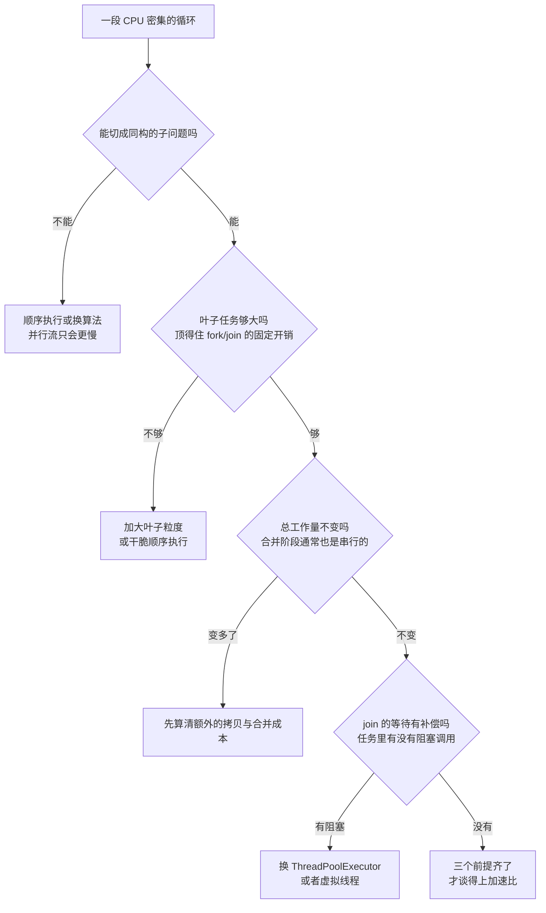
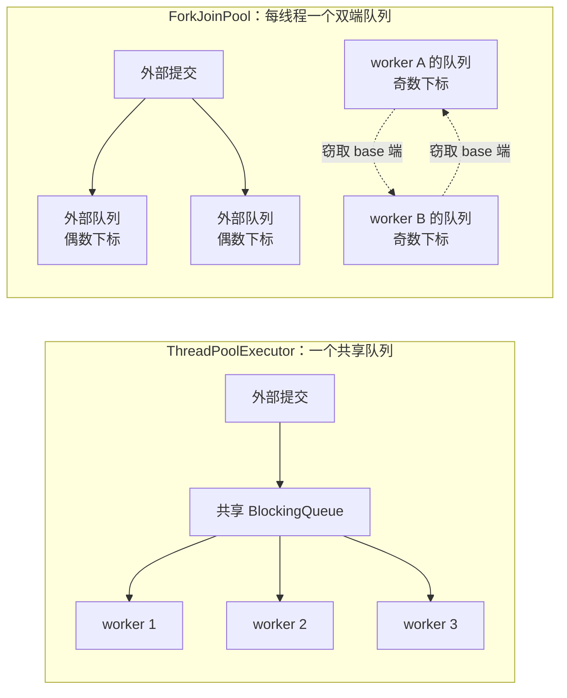
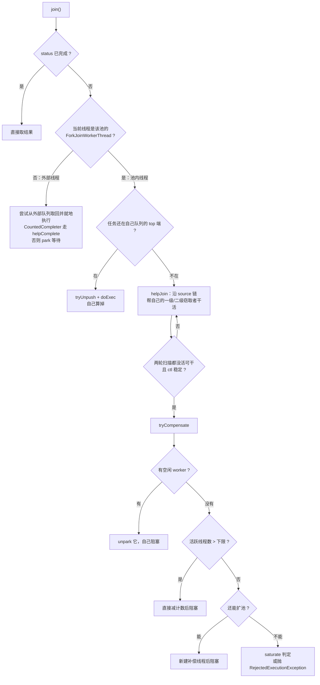
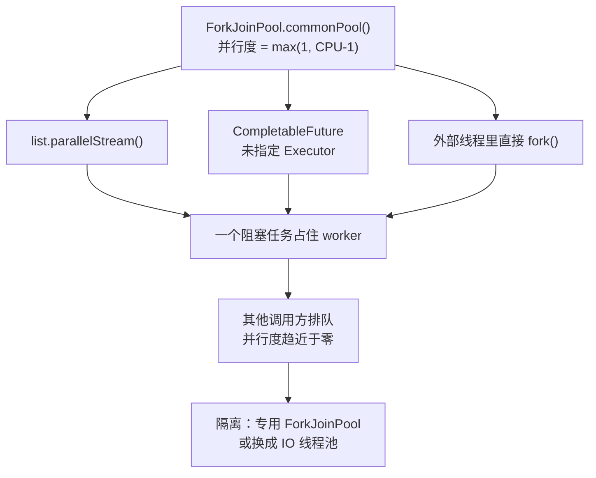

# 12 线程池（下）——ForkJoinPool 与工作窃取算法

**摘要：**

把一个循环改写成 `parallelStream()`，在十六核的机器上只快了 1.2 倍，有时候干脆更慢——这是分治并行最常见的失败形态。`ForkJoinPool` 的调度设计相当精巧：每个工作线程持有自己的双端队列，自己在新任务入队的一端取（后进先出，缓存局部性最好），空闲线程从另一端窃取（先进先出，抢到的是任务树上层那些还能继续分裂的大任务），于是绝大多数操作都落在线程本地的数组上，共享结构上的竞争被压到几乎为零。但精巧的调度只能消除等待，不能凭空造出可并行的部分。分治并行要真正变快，三个前提缺一不可：任务能切成同构的子问题且叶子足够大，切分之后总工作量不增加，`join` 的阻塞有别的任务可以补偿。本文以这三个前提为骨架，拆解 `WorkQueue` 的两端操作、`fork` 与 `join` 的真实语义、`helpJoin` 与 `tryCompensate` 组成的补偿路径，再回到 `commonPool` 的并行度与共享风险、并行流的四个陷阱、三类 `ForkJoinTask` 的差别，最后给出一份关于"什么时候不该用 `ForkJoinPool`"的清单。

---

## 第 1 章 为什么我的并行流没变快

### 1.1 一次改写前后的对照

先看一段几乎人人写过的代码。一个整数列表，先过滤，再映射，最后求和：

```java
long sequential = list.stream()
        .filter(x -> x % 3 == 0)
        .mapToLong(Integer::longValue)
        .sum();

long parallel = list.parallelStream()
        .filter(x -> x % 3 == 0)
        .mapToLong(Integer::longValue)
        .sum();
```

按 CPU 核数来算，第二行应该快出一个数量级。实际测下来，差距常常只有几十个百分点，数据量小的时候甚至反过来。于是问题变成：我们明明让 `parallelStream` 把任务分发到了多个线程，为什么总时间没有同比例缩短？

答案不在流 API 里，而在分治并行的前提里。`ForkJoinPool` 能让任务并行执行，但并行执行只压缩"可以同时做"的那部分时间。剩下三块时间它一点都动不了：串行的那部分代码、切分与合并的开销、以及等待数据源给出下一块数据的时间。三者叠在一起，就把加速比的天花板压了下来。

本章先把三个前提摆出来，后面九章沿着机制、前提、陷阱、边界四条线展开。

### 1.2 加速比的三个天花板

第一重天花板来自**阿姆达尔定律（Amdahl's Law）**。设可并行部分占比为 $p$，并行度为 $n$，加速比的上限是 $1 / ((1-p) + p/n)$。这个式子在任何并行框架上都成立，与实现是否精巧无关。$p = 0.9$、$n = 16$ 时，上限约 6.4 倍；$p = 0.5$ 时，上限不到 2 倍。很多人测出来的"只快了一点点"，本质上是把一段可并行部分本来就不到一半的流程，整体丢给了并行流。

第二重天花板来自切分开销。每次 `fork()` 要分配一个任务对象、往队列里写一个槽位、可能还要唤醒一个空闲线程；每次 `join()` 至少读一次状态，运气不好还要走帮助与补偿的路径。这些开销是固定的，与叶子任务的计算量无关。叶子切得越细，固定开销占总时间的比例越高，加速比被摊薄得越厉害；切到极细处，加速比会掉到 1 以下。

第三重天花板来自数据源本身。并行流的切分粒度不由你决定，而由 `Spliterator` 决定。数组和 `ArrayList` 能按中点均分，`HashSet` 只能按哈希桶区间分，`LinkedList` 只能按迭代器一批一批往外挪，`Files.lines` 这类流根本不支持可靠切分。数据源切不匀，线程之间就会一边闲着一边排队，加速比再次打折。

### 1.3 三个前提

把上面这些收拢，可以给出本篇的骨架——分治并行要变快，需要**三个前提同时成立**。

| 前提 | 缺了会怎样 | 判断依据 |
| :--- | :--- | :--- |
| 任务能切成同构的子问题，且叶子任务足够大 | 固定开销盖过计算量，并行比串行更慢 | 叶子里的基本操作数是否远大于一次 fork/join 的成本 |
| 切分后总工作量不增加 | 多出来的拷贝、合并、装箱把收益吃光 | 合并阶段是否引入了新的 O(n) 串行段或额外内存 |
| `join` 的等待有补偿 | 线程被占住，并行度掉下来，甚至退化 | 任务内部是否有阻塞 I/O、锁等待、远程调用 |

三者的关系是**串联而非并联**：任何一条不成立，加速比的上限就被锁死在那一条上，另外两条做得再好也没用。这也是诊断"并行流没变快"的正确顺序——先看任务里有没有阻塞，再看合并成本，最后才去调粒度。反过来调粒度是最常见的错误做法：粒度只影响开销占比，改不了"总工作量"和"是否有阻塞"这两件事。



图中最上面那个判断最容易被跳过：很多循环的迭代之间共享可变状态，或者下一次迭代依赖上一次的结果，本来就不是同构的子问题，套上并行流只会把顺序语义变成竞态。后面几章先讲清楚调度机制本身，再回到这张图逐条检验前提。

---

## 第 2 章 共享队列的困境

### 2.1 独立任务与依赖任务

`ThreadPoolExecutor` 的模型里，任务之间是没有关系的：提交一个任务，某个工作线程取走、执行、结束，仅此而已。任务从共享的 `BlockingQueue` 里取，队列是唯一的交汇点，线程数、队列长度、拒绝策略这几个参数就能把行为描述清楚。普通线程池的队列结构与拒绝策略，见 [[11 线程池（上）——ThreadPoolExecutor 的七大参数与执行流程]]。

分治任务不是这样。一个父任务在递归分解后，需要等所有子任务完成才能合并结果，也就是任务之间存在等待关系。一旦把带等待关系的任务放进共享队列的池子，就会遇到一个共享队列模型无法解决的问题：**正在等待的线程不肯让出位置**。

### 2.2 用 ThreadPoolExecutor 做归并排序

下面这段代码是典型的反面写法，逻辑上没有错，但在共享队列的池子里会出问题：

```java
class MergeSortTask implements Callable<int[]> {
    private final int[] array;

    @Override
    public int[] call() throws Exception {
        if (array.length <= THRESHOLD) {
            Arrays.sort(array);
            return array;
        }
        int mid = array.length / 2;
        Future<int[]> left = executor.submit(
                new MergeSortTask(Arrays.copyOfRange(array, 0, mid)));
        Future<int[]> right = executor.submit(
                new MergeSortTask(Arrays.copyOfRange(array, mid, array.length)));
        // 两个 get 都会阻塞线程，而线程池里没有别的线程能接手它的子任务
        return merge(left.get(), right.get());
    }
}
```

假设池子里有 4 个线程，递归深度到第 3 层时已经有 4 个任务处在"等子任务"的状态。4 个线程全部占满，子任务排在共享队列里没人取，父任务永远等不到结果。现象是线程池打满、CPU 空转、任务永不结束，也就是**线程饥饿死锁**（thread starvation deadlock）。加大线程数能绕开它，代价是把线程数抬到与任务树规模同阶，线程创建与栈内存的成本又回来咬人。

### 2.3 根因是"等待即占位"

把上面这段代码抽象一下，问题只有一句话：在共享队列模型里，线程既是执行者，也是等待者，而等待期间它并不归还自己的工作位置。池子里的位置是有限的，父任务占住了若干个位置去等子任务，子任务就没有位置可执行。

要打破这个循环，只有两条路。一条是别让线程等——把等待变成"去干点别的"，等目标完成再回来，这正是 `ForkJoinPool` 的做法；另一条是让等待的线程可以被临时替代——把等待显式声明给池子，池子再补一条线程进来，也就是 `ManagedBlocker` 的路线。两者的区别在于谁来承担补偿成本：前者靠调度结构，几乎零成本；后者要真实创建线程，有上限也有代价。

### 2.4 两种结构的差异

把两种池子的结构差异列清楚，后面所有的机制才好定位。

| 维度 | `ThreadPoolExecutor` | `ForkJoinPool` |
| :--- | :--- | :--- |
| 队列 | 所有工作线程共享一个 `BlockingQueue` | 每个工作线程一个双端队列，另有一组外部提交队列 |
| 队列操作 | 全局竞争，靠锁与条件变量 | 本地端无锁，只有窃取端用 CAS |
| 任务关系 | 视为彼此独立 | 显式建模父子关系（`fork`/`join`） |
| 等待行为 | 线程阻塞，占住位置 | 池内线程先去执行别的任务，找不到才补偿阻塞 |
| 负载均衡 | 由共享队列天然均衡，但队列本身是瓶颈 | 由窃取天然均衡，失窃的队列被"抽干"得快 |
| 主要调参 | 核心线程数、最大线程数、队列容量、拒绝策略 | 并行度、叶子粒度 |



图里那句**失窃的队列被抽干得快**值得单独说明。共享队列下，一个线程取走一个任务，其他线程要重新竞争；每线程一队列下，空闲线程从别人的队列端部连续取任务，取到的那一端永远是最早入队的那批，而最早的往往是大任务，取一次能裂出更多活干。这种结构上的自愈能力，是 `ForkJoinPool` 在负载不均时仍然能跑满的根本原因。

---

## 第 3 章 工作窃取：每线程一个双端队列

### 3.1 WorkQueue 的字段

`ForkJoinPool` 内部的队列单元叫 `WorkQueue`，它不是 `java.util.Deque` 的实例，而是一个基于数组、只支持三种端操作的专用结构。在 JDK 17 的源码里，它的关键字段是这样的（只保留与本篇相关的部分）：

```java
static final class WorkQueue {
    int base;                   // 下一个 poll 的槽位，窃取者从这里取
    ForkJoinTask<?>[] array;    // 任务数组，容量是 2 的幂
    final ForkJoinWorkerThread owner;  // 队列归属线程，外部队列为 null

    @jdk.internal.vm.annotation.Contended("w")
    int top;                    // 下一个 push 的槽位，owner 自己在这里读写
    @jdk.internal.vm.annotation.Contended("w")
    volatile int source;        // 来源队列 id、锁标记或哨兵
    @jdk.internal.vm.annotation.Contended("w")
    int nsteals;                // 从别的队列窃取到的次数
}
```

三个 `@Contended("w")` 注解把 `top`、`source`、`nsteals` 单独放进各自的缓存行，与 `base`、`array` 隔开。原因很直接：`top` 只有 owner 线程写、却会被所有扫描者在窃取判断时读，`source` 会被帮助路径反复读，`nsteals` 只有 owner 写。不隔离，就是标准的**伪共享**（false sharing）——owner 每推入一个任务，就要让所有扫描者的缓存行失效。JDK 里把这类字段的布局都当作性能设计的一部分来处理。

### 3.2 三种端操作

`WorkQueue` 只支持三种操作，全部是 O(1) 的数组访问加一次 CAS 或普通写。

```java
// owner 推入任务：先把 top 加一，再写槽位
final void push(ForkJoinTask<?> task, ForkJoinPool pool) {
    ForkJoinTask<?>[] a = array;
    int s = top++, d = s - base, cap, m;
    if (a != null && pool != null && (cap = a.length) > 0) {
        setSlotVolatile(a, (m = cap - 1) & s, task);
        if (d == m)
            growArray();
        if (d == m || a[m & (s - 1)] == null)
            pool.signalWork();     // 队列由空变非空（或刚扩容）才需要唤醒
    }
}

// owner 取出最新任务：后进先出，直接从 top 往下退一格
private ForkJoinTask<?> pop() {
    ForkJoinTask<?> t = null;
    int s = top, cap; ForkJoinTask<?>[] a;
    if ((a = array) != null && (cap = a.length) > 0 && base != s--
            && (t = getAndClearSlot(a, (cap - 1) & s)) != null)
        top = s;
    return t;
}

// 窃取者从 base 端取：先进先出，取到的是最早入队的那个
final ForkJoinTask<?> tryPoll() {
    int cap, b, k; ForkJoinTask<?>[] a;
    if ((a = array) != null && (cap = a.length) > 0) {
        ForkJoinTask<?> t = getSlot(a, k = (cap - 1) & (b = base));
        if (base == b++ && t != null && casSlotToNull(a, k, t)) {
            setBaseOpaque(b);
            return t;
        }
    }
    return null;
}
```

三段代码合起来说明了一件事：`push`/`pop` 只由 owner 调用，`top` 是普通字段，不需要原子操作；`tryPoll` 由其他线程调用，靠对槽位做 CAS 置空来保证同一个任务只会被一个窃取者拿走，`base` 则用 `setBaseOpaque` 推进，省掉多余的重排约束。三种操作的端、顺序、调用者，可以列成一张表。

| 操作 | 调用者 | 端点 | 顺序 | 同步方式 |
| :--- | :--- | :--- | :--- | :--- |
| `push` | owner | `top` 端 | 新任务最先被自己取到 | 普通写，仅跨线程发布靠 `setSlotVolatile` |
| `pop` | owner | `top` 端 | 后进先出（LIFO） | 普通写，无 CAS |
| `tryPoll` | 任意窃取者 | `base` 端 | 先进先出（FIFO） | 槽位 CAS，`base` 走 opaque 写 |
| `tryUnpush` | owner | `top` 端 | 只取走栈顶那一个 | CAS 槽位到 null |

这里要纠正一个常见的命名错位。不少材料把 owner 干活的那一端叫"底部"、把窃取端叫"顶部"，笔者对照源码时发现正好相反：JDK 里 owner 读写的是 `top`，窃取者读的是 `base`。名字本身不重要，重要的是记住两个端点分别归谁、分别是什么顺序；否则看到 `pop` 与 `poll` 两个名字时，很容易把"自己取最新"和"别人取最老"记反。

### 3.3 queues 数组：奇数与偶数

所有 `WorkQueue` 放在一个数组里，按奇偶分工：

```java
volatile WorkQueue[] queues;   // 长度为 2 的幂
```

奇数下标的队列绑定工作线程，`owner` 非空，由该线程 `push`/`pop`；偶数下标的队列是外部提交队列，`owner` 为 null，接收非工作线程提交的任务。外部线程提交时按 `ThreadLocalRandom` 的 probe 值散列到一个偶数槽位，多个提交者被分散到不同队列，避免所有外部提交挤在一个队列上。由于没有 owner，`push` 到这个队列要走 `lockedPush`，用 `source` 字段当锁（0 表示未加锁），这也是 `source` 的第二种用途——它平时记录"这个任务是从哪个队列被窃取来的"，加锁时充当锁标记。

这个布局解释了为什么 `ForkJoinPool` 既有"每线程一队列"又有"外部提交"两个概念：内部产生的子任务进自己的队列，外部提交的任务进共享的偶数队列，再由空闲 worker 窃取走。两条路径分开，外部提交的锁竞争不会污染内部 fork 的热路径。

### 3.4 为什么自己取最新、别人取最老

端点的选择不是随意的，不妨把两个方向各自服务的目标分开看。

owner 从 `top` 取（LIFO），服务的是缓存局部性。父任务 `fork()` 出子任务后立刻 `join()`，子任务刚被推入队列顶端，马上又被自己弹出执行，形同一次函数调用直接下钻；刚刚写过的数据还在 L1 缓存里，递归深度优先的访问模式对缓存最友好。反过来若 owner 也从 `base` 取，刚 fork 的子任务会排在一堆老任务后面，缓存行白写一遍。

窃取者从 `base` 取（FIFO），服务的是负载均衡。最早入队的是任务树上层的大任务，窃取者拿到一个大任务后能继续分裂出更多子任务，自己也就有了持续的工作；若窃取者也取最新的，拿到的往往是叶子任务，干完一次就得再来一次，窃取频率升高，`base` 与 `top` 两端的碰撞概率也变大。

用个粗糙的比喻：一个厨师（owner）把待处理的食材按顺序码在自己案板的一头，永远从最靠近手边的那头开始切，切完一片立刻切下一片；另一个厨师（窃取者）从案板另一头抱走最早放上去的那一整块原料，回去自己分解。两人在案板两端操作，只有案板上只剩一块原料时才会同时伸手——那种情况用一个 CAS 就够了。

### 3.5 竞争面收窄

`ForkJoinPool` 把竞争面压到只有一个端点，效果可以从竞争面上看。设队列长度为 $L$，owner 的 `push`/`pop` 全在自己一端，无锁；窃取者只碰 `base`，且 `base` 的推进是 CAS；队空检测 `base == top` 只是一次普通读。只要 $L > 1$，两端永不重叠，绝大多数窃取尝试一次 CAS 就成功。真正有争用的情形只有 $L = 1$：owner 正要 `pop` 走最后一个，窃取者也正好在 `poll` 它，这时两者在同一个槽位上竞争，由 CAS 裁决，输的一方返回重试。

这与共享队列的 `BlockingQueue` 形成鲜明对比：后者每次 `take` 都要拿锁、检查条件、必要时挂起，锁的空闲与争用决定了吞吐上限。`ForkJoinPool` 把这条路径换成了本地数组的下标运算，这才是"每线程一队列"的真正价值，而不只是"分散了队列"。

### 3.6 scan：随机起点与随机步长

空闲 worker 找活干的过程叫扫描（scan）。它不按顺序遍历数组，而是用 xorshift 生成的随机数作为起点和步长：

```java
// 摘自 JDK 17 runWorker，r 由 xorshift 更新
do {
    r ^= r << 13; r ^= r >>> 17; r ^= r << 5;
} while ((src = scan(w, src, r)) >= 0 || (src = awaitWork(w)) == 0);
```

`scan` 内部从随机下标起步，按 `step = (r >>> 16) | 1` 的步长扫过整个数组，对每个非空队列尝试一次 `tryPoll`。随机化的目的有两个：一是避免所有空闲线程同时扑向同一个队列，造成无谓的争用；二是避免固定扫描顺序在任务树结构规整时形成"总是抢同一批任务"的偏斜。窃取成功后记入 `nsteals`，池子层面聚合成 `getStealCount()`，这个数字后面第 8 章会用到。

扫完一圈没找到活，线程进入 `awaitWork`，把自己挂到 `ctl` 字段维护的等待栈上，然后 `park`。注意它不是立刻睡死：队列由空变非空时 `push` 会调用 `signalWork`，唤醒等待栈顶的线程。所以空闲线程的唤醒是事件驱动的，而不是靠轮询超时，这也是长尾延迟能压住的原因。

---

## 第 4 章 fork 与 join 的真实语义

### 4.1 fork 只是入队

`ForkJoinTask.fork()` 的实现只有几行：

```java
public final ForkJoinTask<V> fork() {
    Thread t; ForkJoinWorkerThread w;
    if ((t = Thread.currentThread()) instanceof ForkJoinWorkerThread)
        (w = (ForkJoinWorkerThread) t).workQueue.push(this, w.pool);
    else
        ForkJoinPool.common.externalPush(this);   // 外部线程一律进 common pool
    return this;
}
```

这段代码有一个容易被忽略的分支：如果调用 `fork()` 的不是工作线程，任务不会进你构造的那个池，而是进 `commonPool` 的外部提交队列。所以在自定义池里执行代码、却在外部线程里提前 `fork()` 出任务，任务很可能跑到公共池里去，用私有池隔离的意图在第一步就破了。要确保落在指定池里，入口必须是 `pool.submit(...)`、`pool.execute(...)` 或 `pool.invoke(...)`，让执行体本身跑在该池的工作线程上。

### 4.2 join 的三段路

`join()` 的骨架很短，真正的工作在 `awaitDone` 里：

```java
public final V join() {
    int s;
    if ((s = status) >= 0)
        s = awaitDone(null, false, false, false, 0L);
    if ((s & ABNORMAL) != 0)
        reportException(s);
    return getRawResult();
}
```

`awaitDone` 在 JDK 17 里同时服务 `join`、`get`、`invoke` 三种入口，路径可以归成三段。第一段是就地执行：如果目标任务还在自己队列的 `top` 端，就 `tryUnpush` 加 `doExec` 直接算掉——刚 `fork()` 出来的任务走的几乎都是这条最短路径。第二段是帮助：若任务已经被别人窃走，池内线程会进 `helpJoin`，扫描其他队列，找那些由自己（或自己的一级、二级间接窃取者）产生的任务，抢过来执行。第三段是补偿：扫描一圈没有活可干、`ctl` 也保持稳定，就调用 `tryCompensate`，以"补偿后阻塞"的方式睡下，醒来再还账。



这张图最重要的分支是"是：池内线程"与"否：外部线程"那条。补偿等待只对池内线程成立；外部线程调用 `join()` 时没有可帮助的上下文，只能把任务从外部队列里取回来自己执行（这是 `externalTryUnpush` 那条路径），取不到就 park。所以"join 不阻塞线程"这句话是有限定条件的，准确说法是**池内线程的 join 会先尝试帮助，外部线程的 join 仍然是阻塞**。

### 4.3 helpJoin 帮的是谁

`helpJoin` 的扫描范围不是所有队列，而是有选择性的：它从自己的 `source` 出发，沿 `source` 链最多看两级间接，只执行那些"由自己或自己的窃取者产生"的任务。这不是为了省事，而是为了不抢别人的活。

理由在类注释里说得很清楚：帮助的目的是让等待中的线程去推进**自己那条因果链**上的计算，这样帮助者做的事与它等待的结果直接相关，做完就有概率让目标前进；如果随便抢别人的任务，帮助者可能抢到与自己等待的任务毫无关系的工作，做完目标还是没完成，白忙一场。两级间接的限制则是因为过长的因果链在成环时难以检测，而环在互相等待的场景下是必须处理的失败模式。

这条设计直接决定了下面这件事：在 `ForkJoinTask` 里做阻塞 I/O 是无效的。I/O 不产生子任务，帮助者找不到与自己相关的活可干，只能去补偿线程；补偿线程的创建有上限，超限就抛异常或者让等待者干等。第 7 章会把这条展开。

### 4.4 补偿的四级优先

`tryCompensate` 是补偿机制的核心，它的顺序很有讲究：

```java
private int tryCompensate(long c) {
    // 1. 有空闲 worker：唤醒它，自己阻塞
    if (sp != 0) { ... LockSupport.unpark(vt); return UNCOMPENSATE; }
    // 2. 活跃线程数高于下限：直接减计数，允许自己阻塞
    else if (active > minActive) { ... return UNCOMPENSATE; }
    // 3. 还能扩池：新建补偿线程
    if (total < maxTotal) { ... return createWorker() ? UNCOMPENSATE : 0; }
    // 4. 到上限：交给 saturate 判定，或直接拒绝
    else if ((sat = saturate) != null && sat.test(this)) return 0;
    else throw new RejectedExecutionException(
            "Thread limit exceeded replacing blocked worker");
}
```

四级优先的意图是把"多占一条线程"的成本尽量往后推。第一级不新建线程，只是把闲置的 worker 叫醒，成本最低；第二级连叫醒都免了，因为活跃线程已经多于下限，少一条不影响并行度；第三级才真的建线程；第四级直接拒绝。`UNCOMPENSATE` 这个返回值的语义是"我以补偿方式睡下了，醒来要还账"，`awaitDone` 收到它之后会在返回前调用 `uncompensate()`，把活跃计数加回去。

| 次序 | 条件 | 动作 | 代价 |
| :--- | :--- | :--- | :--- |
| 1 | 等待栈上有空闲 worker | `unpark` 它，自己阻塞 | 一次唤醒，无新线程 |
| 2 | 活跃线程数高于下限 | 减活跃计数后阻塞 | 并行度暂时下降 |
| 3 | 总线程数未到上限 | 新建补偿线程 | 线程创建与栈内存 |
| 4 | 已达上限 | `saturate` 判定或直接抛异常 | 阻塞得不到补偿 |

第四级要特别注意：`RejectedExecutionException` 的异常消息是 `Thread limit exceeded replacing blocked worker`，意思是"替换被阻塞 worker 的线程数到上限了"。common pool 的 `saturate` 是 null，所以达到上限时会真的抛这个异常；有经验的团队会在自定义池里传入 `saturate` 谓词，把"到上限"变成一个可观测、可降级的条件，而不是一个突然炸出来的异常。

### 4.5 补偿不是无限的

`commonPool` 的补偿线程上限由 `java.util.concurrent.ForkJoinPool.common.maximumSpares` 控制，默认 256。这个数字远大于正常需要，又远小于操作系统的线程上限，Doug Lea 在注释里给的理由是让 JVM 在资源被耗尽之前先抓到滥用。自定义池则由构造参数 `maximumPoolSize` 控制补偿上限。

上限之外还有时间维度：补偿线程用完之后不会立刻销毁，而是按 `keepAlive` 空闲回收，默认 60 秒。一次持续几十秒的阻塞高峰过后，池子会在一段时间里保持着高位线程数，内存与上下文切换的成本要滞后一段时间才回落。

### 4.6 几种提交与等待方式的对照

`invoke`、`fork`+`join`、`invokeAll`、`get` 在语义上并不等价，尤其跨线程、跨池使用时差别很大。

| 写法 | 落在哪个池 | 等待方式 | 适用场景 |
| :--- | :--- | :--- | :--- |
| `pool.invoke(task)` | 指定池 | 调用线程参与执行，再等结果 | 从外部发起一次分治计算 |
| `task.fork()` + `task.join()` | 池内线程：当前池；外部线程：common pool | 池内线程会帮助，外部线程阻塞 | 分治任务内部的递归分解 |
| `ForkJoinTask.invokeAll(a, b)` | 当前上下文 | 等价于 `b.fork(); a.doExec(); b.join()` | 两路分解，不想手写顺序 |
| `task.get()` | 同 `join` | 抛 `ExecutionException`，可中断、可超时 | 需要参与 `ExecutorService` 语义 |
| `task.quietlyJoin()` | 同 `join` | 不抛异常，只看状态 | 批量等待，之后再统一取异常 |

其中 `invokeAll(t1, t2)` 的实现能说明"正确姿势"为什么长那样：它先把 `t2` 推到队列，再在当前线程执行 `t1`，最后等 `t2`。当前线程始终在干活，一条都不闲着。反过来，如果两个子任务都 `fork()` 然后立刻 `join()`，当前线程短暂地没活干，虽然 `join` 会先尝试 `tryUnpush` 把其中一个弹出来执行，但代价还是比手写的顺序高一点。

### 4.7 ManagedBlocker：把阻塞说清楚

若任务里确实有无法回避的阻塞（譬如必须调用的同步 HTTP 客户端），官方给出的出口是 `ForkJoinPool.ManagedBlocker`：

```java
ForkJoinPool.managedBlock(new ForkJoinPool.ManagedBlocker() {
    @Override public boolean block() throws InterruptedException {
        response = httpClient.send(request, BodyHandlers.ofString());
        return true;
    }
    @Override public boolean isReleasable() {
        return response != null;
    }
});
```

`managedBlock` 在真正阻塞前调用 `tryCompensate`，之后在返回时 `uncompensate`。它不能凭空提高上限：补偿线程到 256 就没了，超过上限一样抛异常。所以 `ManagedBlocker` 的正确用法是"少量、可控、有超时"的阻塞，而不是把 `ForkJoinPool` 当作 IO 池来用。真要大量等待，应该换池子。

---

## 第 5 章 前提一：能切分，且叶子够大

### 5.1 叶子的固定成本

分治并行的账，可以用一句话概括：每个叶子任务承担一份固定成本，总收益来自叶子之间的并行。成本项包括一次任务对象分配、一次 `push`、一次 `pop` 或 `poll`、一次 `join` 的状态检查，以及合并结果的开销。收益项是叶子计算量被 $n$ 条线程分摊。

下面这组数字是示例推算，只用于说明量级关系，不是实测基准：一次数组元素累加在纳秒以下到纳秒量级；一次任务对象分配加一次队列入出队，合起来在几十纳秒量级；一次需要走帮助或补偿路径的 `join`，在微秒量级。按这个量级推算，如果叶子只有几十个基本操作，固定成本与计算量同阶甚至更大，加速比必然小于 1；叶子有几千个基本操作时，固定成本占比降到个位数百分比，加速比才开始接近并行度。

| 叶子规模（基本操作数） | 每叶子固定成本的相对占比（示例推算） | 预期表现 |
| :--- | :--- | :--- |
| 几十 | 与计算同阶或更大 | 并行比串行慢 |
| 几百 | 一成到数成 | 收益有限，波动大 |
| 几千 | 个位数百分比 | 接近线性加速 |
| 几万以上 | 可忽略 | 受负载均衡与尾部效应约束 |

"几千个基本操作"这个经验值之所以成立，是因为它对应一个固定的成本比：固定开销几十纳秒，基本操作纳秒级，两者相差两三个数量级，叶子规模取到几千时商就落到了个位数百分比。数据规模、CPU 频率、缓存命中率都会移动这个数字，但不会移动数量级。

### 5.2 动态判据：surplus 阈值

固定阈值（譬如"小于 1024 就直接算"）在负载稳定时够用，负载一变就失准：线程空闲时应该多切，线程忙时应该少切。JDK 为此提供了一个动态判据，`ForkJoinTask.getSurplusQueuedTaskCount()`，返回"当前线程队列里超出均衡所需的剩余任务数"，官方建议把它与一个较小的常数比较，典型取值是 3：超过就不必再 `fork`，就地算完。

```java
@Override
protected Long compute() {
    if (size <= THRESHOLD || getSurplusQueuedTaskCount() > 3) {
        return computeDirectly();     // 队伍已经够长，就地算，别再切
    }
    // ... 继续分裂
}
```

这个判据的含义可以从源码注释里读出来：稳态下每条线程只应该向别人提供常数个可窃取任务，多了是浪费（额外的任务对象、更高的窃取率），少了会让别人没活干。判据本身还带负载修正——队列长度减去一个与空闲线程比例相关的偏置，所以线程都闲着时它会放宽，线程都忙着时它会收紧。

### 5.3 并行流自己的切分口径

并行流不用你算阈值，它内部用的也是同一套逻辑。`AbstractTask` 里定义的目标叶子量是：

```java
private static final int LEAF_TARGET = ForkJoinPool.getCommonPoolParallelism() << 2;
// 在 ForkJoinWorkerThread 里执行时，用当前池的并行度
// return ((ForkJoinWorkerThread) t).getPool().getParallelism() << 2;
```

也就是"每个处理器约四个叶子任务"，源码注释给出的理由是过度切分（over-partition）能对冲叶子任务不均或处理器被别的任务占用的情形。切分目标大小由 `suggestTargetSize(sizeEstimate) = sizeEstimate / (parallelism * 4)` 给出，数据量已知时一次算准，不必递归试探。

这段代码还回答了另一个常见疑问：**把并行流包在自定义池的 `submit` 里为什么能把流赶进那个池**。因为执行体跑在该池的工作线程上，`getLeafTarget()` 走的是"当前池并行度"的分支，叶子目标按新池重算；同时流内部的 `fork()` 也落在当前线程的队列里。两个动作都跟着当前池走，所以这个 idiom 是有效的隔离手段，而不是玄学。

### 5.4 粒度与加速比的形状

把粒度从很细扫到很粗，加速比通常呈现三段形状。


第一段里，加速比随叶子增大而快速上升，因为在摊薄固定成本；跨过拐点后进入平台区，加速比接近并行度，此时再细调粒度收益很小；继续增大叶子，加速比开始下滑，因为任务数少于线程数，最慢的那个叶子决定了总时间，形成**尾部效应**。平台区不是一个点，通常有一到两个数量级的宽度，这也是"粒度调优不必太精确"的原因——只要落在平台区里，具体取值影响有限。

诊断时要先确认自己落在哪一段：落在不同段，改法完全相反，靠猜没有用。落在第一段，症状是并行比串行还慢，`getStealCount` 很高而 CPU 利用率不高；落在第三段，症状是只有少数线程在忙、其余线程扫不到活，`getQueuedTaskCount` 长期接近零。

### 5.5 切不动的情况

切分的前提是同构：每个子问题与父问题形式相同，只是规模缩小。有些计算天然不满足：迭代之间共享可变状态（累加器、计数器）、下一次迭代依赖上一次结果（滑动窗口、递推数列）、数据源只能顺序读取（网络流、压缩包解压）。这些情况下并行框架没有可用的切分点，硬切只会引入竞态或大量中间缓冲。

数据源的切分质量是另一个维度，它由 `Spliterator` 决定，第 9 章会逐类列出来。这里先记住结论：能按索引二分的源切得最匀，只能按迭代器挪的源切不匀，无大小的源常常切不动。

---

## 第 6 章 前提二：总工作量不变

### 6.1 阿姆达尔定律的两种用法

第 1 章用阿姆达尔定律算过上限，这里换一种用法：把它当作工作量核对表。式子里 $1-p$ 是串行部分，$p/n$ 是并行部分被分摊后的时间。若并行化让 $p$ 变大（可并行部分确实变多），加速比上升；若并行化引入了新的串行段（合并、汇总、排序），$1-p$ 变大，上限下降。

分治算法的合并阶段往往就是那个新增的串行段。归并排序的合并是 O(n) 的串行工作，快速排序的合并几乎为零，所以同样的数据量下，并行归并排序的加速比通常不如并行快排。这不是实现问题，是算法结构问题。

### 6.2 分治引入的额外劳动

除了合并，并行化还常常引入几类额外劳动。

第一类是数据拷贝。上面那段归并排序的反例里，`Arrays.copyOfRange` 每次分裂都复制半个数组，分裂深度为 $d$ 时总复制量是 $O(n \log n)$，与排序本身同阶。改成传下标区间、共享同一个数组，复制成本直接消失，这是最容易被忽视的一处。

第二类是装箱与对象创建。`Stream<Integer>` 的并行归约会为每个元素产生中间对象，`mapToInt` 走原始类型流能省掉大部分；`Collectors.toList()` 在并行下会为每个分片建一个中间列表再合并，中间列表的数量与叶子数同阶。

第三类是合并本身的结构成本。`Collectors.toMap` 在并行下按分片建多个 `HashMap`，再逐个 `merge`，分片越多合并越贵；`groupingBy` 同理。这类操作的并行收益取决于中间 Map 的数量与合并成本：并行度调大，中间 Map 变多，合并反而更贵。

| 改写 | 引入的额外劳动 | 何时值得 |
| :--- | :--- | :--- |
| 归并排序并行化，共享数组下标 | 合并阶段的 O(n) 串行段 | 数据量大，合并可向量化 |
| 归并排序并行化，每次复制子数组 | 额外的 O(n log n) 拷贝 | 基本不值得 |
| `map` + `collect(toList())` | 每个分片一个中间列表 | 元素计算重、合并相对便宜时 |
| `groupingBy` 并行 | 多份 `HashMap` 与最终合并 | 分组数少、元素多时 |
| `reduce` 并行 | 无额外结构，但有结合律要求 | 满足结合律的纯计算 |

### 6.3 复杂度被改写的情况

有些流操作在并行下会改变算法复杂度，而不只是常数因子。`findFirst()` 在并行流里不能"找到就立刻全部停止"：它必须先确认在它之前的所有元素都已处理完，才能确定自己真的是第一个，于是短路的收益被吃掉，实际做法是把前缀部分收齐再判断。`limit(n)` 在有序并行流里同样需要缓冲，官方文档明确写了这一点：与遭遇顺序强绑定的操作可能需要缓冲，从而削弱并行的收益。

`sorted()` 是另一种情形：它的并行版本是先分片排、再归并，总比较次数与串行同阶但常数更大，收益完全取决于比较操作是否昂贵。若比较器很便宜、数据量又不大，并行排序不如直接 `Arrays.parallelSort`（它对原始类型数组有专门实现），或者干脆串行。

### 6.4 纯收益的判据

把上面这些反过来，就得到"并行化一个循环是纯收益"的条件：迭代之间完全独立；没有共享可变状态；不需要额外的中间结构；合并阶段是 O(1)，或者满足结合律的运算（求和、求最大值、计数）；叶子足够大。这样的循环在现实中并不少——批量数值计算、图像像素处理、大数组上的逐元素变换——它们才是并行流最合适的用武之地。

一旦发现自己在并行流里加锁、用 `synchronized` 包住整段 lambda、或者靠 `AtomicLong` 累加，就说明**前提二不成立**了：锁把并行重新串行化，原子变量把并行变成了 CAS 争用，两者的开销都比串行更大。这类代码的并行化收益通常是负的。

---

## 第 7 章 前提三：join 的阻塞必须有补偿

### 7.1 补偿覆盖的是"等自己的子任务"

`helpJoin` 的帮助范围限定在"自己因果链上的任务"，这条限制决定了补偿能覆盖什么、覆盖不了什么。

能覆盖的是等子任务：父任务 `join` 子任务时，子任务要么还在自己队列里（就地执行），要么被别人窃走（窃取者一定在处理它，且窃取者的 `source` 指向自己），帮助者顺链下去总有活可干。这就是分治计算能保持高利用率的原因——等待的线程总能找到"与自己相关"的工作。

**覆盖不了的是等外部事件**：IO 完成、锁释放、消息到达、另一个服务的响应。这些等待不产生子任务，帮助者沿链找一圈发现没活，只能去补偿；补偿要么唤醒空闲线程（可能没有）、要么减计数（可能并行度不够）、要么建线程（可能到上限）、要么拒绝。四种情况里只有第三种是"真正的补偿"，其余三种都意味着并行度实打实地下降了。

### 7.2 阻塞 I/O 的三种结局

在 `ForkJoinTask` 里做阻塞 I/O，结局不出三种。

第一种是占满。common pool 的并行度是 CPU 核数减一，所有 worker 都在等 IO，队列里的任务没人取。此时 `getRunningThreadCount` 会趋近于零，`getQueuedSubmissionCount` 持续上涨，外部调用方的并行流或 `CompletableFuture` 全部排队。这不是"退化为单线程"，而是**并行度趋近于零**——比单线程还糟，因为单线程至少不会因为调度而额外抖动。

第二种是补偿到上限。线程陆续阻塞，`tryCompensate` 一路走第三级建线程，直到 `maximumSpares`（common pool 默认 256）。这期间池子线程数暴涨，每条线程都有栈和 TLAB，内存压力与上下文切换一起上来，而真正在做计算的线程数并没有增加。

第三种是抛异常。超过上限后，common pool 的 `saturate` 为空，`tryCompensate` 直接抛 `RejectedExecutionException`。异常从 `join()` 的调用点冒出，栈里几乎看不出与 IO 有关，排查成本很高。这个异常消息值得记住：`Thread limit exceeded replacing blocked worker`，看到它就说明池子里有大量不受管的阻塞。

### 7.3 一个慢任务如何拖住全局

`commonPool` 是 JVM 内的**全局单例**，并行流、不带 `Executor` 的 `CompletableFuture`、以及外部线程里直接 `fork()` 的任务，全都共用它。这个共享关系意味着：任何一处慢任务占住的 worker，都会减少其他调用方可用的并行度。



更麻烦的是隐式依赖：一段代码在单测里跑得飞快，上线后变慢，未必是自己改坏了，可能是同进程里另一个模块往 common pool 里塞了长任务。这类问题的现场特征是"没有死锁、没有异常、线程池也没满，就是慢"，而 `getStealCount` 与 `getActiveThreadCount` 看起来又都正常——因为池子确实在忙，只是忙的不是你的活。

### 7.4 ManagedBlocker 的边界

第 4 章介绍了 `ManagedBlocker`，这里补上它的适用边界。它适合"少量、偶发、有明确超时"的阻塞：一次配置拉取、一次本地文件读、一次带超时的远程调用。它不适合"每个元素都要阻塞一次"的场景：并行度 15 的池子处理 10 万个元素、每个元素阻塞 10 毫秒，每条 worker 阻塞都会触发一次补偿，替换线程很快也阻塞、再触发下一次补偿，线程数一路爬到 256 的上限，然后开始抛异常。

判断标准很朴素：估算一下"同时阻塞的线程数"会不会超过补偿上限。会超过，就不该用 `ForkJoinPool`，而应该用 `ThreadPoolExecutor` 配上与等待时间成比例的线程数，或者用虚拟线程把阻塞的线程成本降下来。虚拟线程的调度模型与平台线程不同，它自己的调度器也是一个 FIFO 模式的 `ForkJoinPool`，但载体线程的阻塞语义与这里讨论的问题不是同一层，细节见 [[16 JDK 21 虚拟线程——Project Loom 的协程实现与平台线程的边界]]。

---

## 第 8 章 commonPool：隐形的全局池

### 8.1 并行度与四个系统属性

`commonPool` 在 `ForkJoinPool` 类初始化时构造，并行度的默认值是 `max(1, availableProcessors - 1)`，比可用处理器数少一个，单核机器上取 1。它支持四个系统属性：

| 属性 | 作用 | 默认值 |
| :--- | :--- | :--- |
| `java.util.concurrent.ForkJoinPool.common.parallelism` | 并行度，非负整数，可为 0 | `max(1, CPU-1)` |
| `java.util.concurrent.ForkJoinPool.common.threadFactory` | 工作线程工厂类名 | JDK 内置工厂 |
| `java.util.concurrent.ForkJoinPool.common.exceptionHandler` | 未捕获异常处理器类名 | 无 |
| `java.util.concurrent.ForkJoinPool.common.maximumSpares` | 补偿线程上限 | 256 |

工厂类与异常处理器按类名用系统类加载器加载，任一属性解析失败都会退回到默认值而不是启动失败。这一点在容器环境里要留意：`availableProcessors()` 自 JDK 10 起感知容器配额，但如果 JVM 启动时配额尚未生效，算出来的并行度可能偏大。

### 8.2 三个容易踩错的细节

第一个细节是生效时机。common pool 在 `ForkJoinPool` 的静态初始化块里构造，属性在那时被读取。这意味着两件事：属性必须用 `-D` 在命令行上给，`System.setProperty` 在运行期改是无效的（除非在第一次触达 `ForkJoinPool` 之前执行）；在应用服务器或 Spring Boot 里通过配置中心下发这个值也不会生效，因为它已经被读走了。

```java
// 无效：commonPool 一旦被初始化，这段代码不会改变它的并行度
System.setProperty("java.util.concurrent.ForkJoinPool.common.parallelism", "16");
```

第二个细节是 0 的语义。并行度设为 0 是合法的，含义是"不用线程，任务在提交者线程里跑"，也就是 caller-runs。此时 `getParallelism()` 仍报告 1，源码里 `COMMON_PARALLELISM = max(mode & SMASK, 1)` 就是为此；而 `tryCompensate` 在并行度为 0 时直接返回 0，意味着补偿机制整体关闭。

第三个细节是 `CompletableFuture` 并不总是用 common pool。它的默认执行器按 `getCommonPoolParallelism() > 1` 判断：并行度大于 1 时用 `commonPool()`，否则退化为"每个任务一条新线程"的 `ThreadPerTaskExecutor`。所以在单核或并行度被设为 1 的环境里，不指定 `Executor` 的异步任务会绕开 common pool，行为与常规认知不同。`CompletableFuture` 的链式调度与线程选择，见 [[13 CompletableFuture 与异步编程模型——从 Future 到响应式]]。

### 8.3 隔离的三种手段

要避免与全局池互相干扰，有三种做法，按侵入性从低到高排列。

最轻的一种是把并行流包进专用池，只影响这一段计算：

```java
ForkJoinPool pool = new ForkJoinPool(4);
try {
    long sum = pool.submit(() ->
            list.parallelStream().mapToLong(Integer::longValue).sum()).get();
} finally {
    pool.shutdown();
}
```

第二种是用专用池执行整个分治任务，入口用 `pool.invoke(task)`，任务内部只在池内 `fork`/`join`，不混外部线程。这种做法的隔离性最好，也便于单独观测这个池的窃取计数与队列长度。

第三种是根本不用并行流。把数据分批，交给 `ThreadPoolExecutor` 或虚拟线程逐批处理，每批内部保持顺序语义。这种做法放弃了工作窃取的自动均衡，但换来了完全可控的线程数与队列，对 IO 密集或需要背压的场景更合适。

### 8.4 监控看什么

`ForkJoinPool` 的监控接口不多，够用的有三个。

`getStealCount()` 是窃取成功次数，官方文档对它的解读是"窃取次数应当高到让线程都忙起来，又低到不产生过多开销与争用"。持续接近零说明任务太大、根本没人需要窃取，粒度可以再细；极高且伴随加速比下降，说明任务太碎，粒度要变大。

`getQueuedSubmissionCount()` 是尚未开始执行的外部提交任务数，它持续上涨说明外部提交速度超过了池子的处理能力，要么并行度不够，要么 worker 被阻塞住了。

`getPoolSize()` 与 `getParallelism()` 的差值说明补偿线程的数量，差值长期为正说明池子里有持续阻塞。再配合 `getRunningThreadCount()`（未阻塞的线程数）和 `toString()` 的快照，基本能把现场定性。

### 8.5 版本口径

JDK 19 起 `ForkJoinPool.setParallelism(int)` 可以在运行期调整目标并行度，对容器配额变化这类场景终于有了官方接口；但 common pool 若并行度由系统属性指定，调用会抛 `UnsupportedOperationException`。JDK 20 起增加了 `externalSubmit`，语义是"即使当前线程在池内，也按外部客户端的方式提交"，用于需要显式模拟外部提交的框架代码。JDK 21 的虚拟线程调度器本身是一个 FIFO 模式的 `ForkJoinPool`，并行度默认等于可用处理器数，可用 `jdk.virtualThreadScheduler.parallelism` 调整，与 common pool 是两个不同的实例，不要混为一谈。

有一处版本差异会直接影响阅读旧代码的体验：帮助与补偿的方法名在 JDK 8 里是 `awaitJoin`、`tryHelpStealer`，在 JDK 17 里重构成 `ForkJoinTask.awaitDone` 加 `ForkJoinPool.helpJoin`。看 2015 年前后的分析文章时对不上源码是正常的，机制没变，名字与调用链结构变了。

---

## 第 9 章 并行流的四个陷阱

### 9.1 陷阱一：默认共用池

第一个陷阱在第 8 章已经展开：不指定池，就是 common pool。所有没指定池的地方都在竞争同一批线程，一个模块的慢任务会让另一个模块的并行流变慢。隔离手段见 8.3，这里只补一句判断：从外部线程调用 `parallelStream()` 时，**调用线程自己也参与执行**——终止操作在调用线程上 `invoke` 根任务，根任务的 `compute` 先切出一块自己处理，把其余子任务 `fork` 进 common pool 的提交队列，之后调用线程在 `awaitDone` 里对 `CountedCompleter` 走 `helpComplete` 继续帮忙。所以并行流实际可用的执行者是 $n$ 条 worker 加一条调用线程，后者常被忽略，这也解释了为什么"并行流比专用池慢一点"的观测经常出现。

### 9.2 陷阱二：切分质量由 Spliterator 决定

第二个陷阱最隐蔽：同样写 `parallelStream()`，数据源不同，**切分质量**差出几个数量级。

| 数据源 | 切分方式 | 切分质量 |
| :--- | :--- | :--- |
| 数组、`ArrayList`、`IntStream.range` | 按索引中点二分，大小已知 | 最好，天然均分 |
| `HashMap`、`HashSet` | 按哈希桶区间分 | 较好，依赖哈希分布 |
| `TreeMap`、`TreeSet` | 按子树分 | 较好，依赖树平衡 |
| `LinkedList`、`Iterator` 包装的流 | 按迭代器批量预取，批量递增（起始 1024） | 差，切不匀且要顺序走 |
| `Files.lines`、`BufferedReader.lines` | 无大小估计，只能按批读 | 差，还受 IO 限制 |
| `Stream.iterate` | 迭代器包装，切分只能按批预取 | 并行收益有限 |

`LinkedList` 那一行值得多说一句。它是 `Collection`，所以 `parallelStream()` 合法，但它没有随机访问能力，`trySplit` 只能按迭代器的批量往前"预取"：先取 1024 个，再取 2048 个，再 4096 个，形成算术递增的批次。这种切法的后果是分片大小不均、切分本身还要走一遍链表，并行收益常常被吃掉。真要在链表上并行，第一步通常是 `new ArrayList<>(linkedList)`。

### 9.3 陷阱三：forEach 的顺序与副作用

第三个陷阱是 `forEach` 的语义。并行流的 `forEach` 不保证遭遇顺序，也不保证副作用对其他线程可见。官方文档对带副作用的 lambda 列了三条"不保证"：副作用的可见性不保证；同一元素的不同操作不保证在同一线程；行为参数甚至不保证一定被调用（实现可能消除不影响结果的操作）。

```java
// 错误：ArrayList 非线程安全，并行 add 会丢数据或抛异常
List<String> results = new ArrayList<>();
list.parallelStream().filter(...).forEach(results::add);

// 正确：用归约，让框架负责合并
List<String> results = list.parallelStream().filter(...).toList();
```

需要顺序时用 `forEachOrdered`，代价是并行收益被削弱；需要收集时用 `collect` 或 `toList`；需要计数用 `count` 而不是 `AtomicInteger` 自增。一条经验：并行流的 lambda 里出现任何赋值给外部变量的动作，都值得停下来重写。

### 9.4 陷阱四：嵌套并行与共享状态

第四个陷阱是嵌套。在一个 `ForkJoinTask` 里再开并行流，内层流的任务会落在同一个池里（因为当前线程是该池的 worker），任务数放大而线程数不变，调度开销上升、窃取率上升，收益却不会翻倍。若外层是 IO 池的 `submit`，内层并行流又落回 common pool，两个池的并行度互相不可见，很容易把机器压出过载。

共享可变状态是嵌套的近亲问题：两个并行流同时写一个 `HashMap`、同时更新一个 `AtomicLong`，表面上是"并行"，实质是"用并行框架做串行争用"。`AtomicLong` 在高争用下比 `LongAdder` 慢一个量级，原因与并行流无关，是 CAS 重试的固有成本；但把这种代码放进并行流，会让问题被归因到"并行流性能差"上，方向就偏了。

### 9.5 一个补充：有序性与短路的代价

并行流的多数"反直觉"现象都能用**遭遇顺序**（encounter order）解释。`findFirst`、`limit`、`skip`、`forEachOrdered` 都与顺序绑定，并行实现要么缓冲、要么放弃提前终止，收益被削弱。若业务并不在意顺序，显式调用 `unordered()` 能让 `distinct`、`groupingBy` 这类操作走更高效的路径；若不确定是否在意，就不要为了"看起来更快"而加上它——顺序语义一旦丢了，下游逻辑可能出现难以复现的差异。

---

## 第 10 章 三种任务类型、适合与不适合

### 10.1 RecursiveTask、RecursiveAction 与 CountedCompleter

JDK 提供三种任务基类，选择它们的关键不在"有没有返回值"，而在完成机制。

| 类型 | 返回值 | 完成机制 | 适用场景 |
| :--- | :--- | :--- | :--- |
| `RecursiveTask<V>` | 有 | 子任务 `join` 后显式合并 | 求和、最大值、计数等有结果的分治 |
| `RecursiveAction` | 无 | 子任务 `join` 后原地写回 | 排序、遍历、就地修改 |
| `CountedCompleter<V>` | 可有可无 | `tryComplete` 递减计数，归零时触发 `onCompletion` | 任务数量动态、需要统一收尾的归约 |

`CountedCompleter` 的存在理由不是"更底层"，而是避免大量 `join` 形成的等待链。它用 `pendingCount` 计数，最后一个完成的子任务负责触发 `onCompletion`，父任务不必挂在那里等；类注释对它的定位是"在子任务停顿与阻塞的情形下比其他 `ForkJoinTask` 更健壮，但编程模型不够直观"。并行流自己就是用 `CountedCompleter` 实现的——`AbstractTask` 直接继承了 `CountedCompleter`，这也解释了为什么并行流的终止操作能高效地把结果归约起来，而不是靠一棵 `join` 树。

选择建议很直接：有清晰的两路或多路分解、需要显式合并结果，用 `RecursiveTask`；没有返回值、就地修改，用 `RecursiveAction`；任务数量在运行中动态变化、或者归约结构复杂（树形聚合、需要"全部完成后再做一件小事"），才值得上 `CountedCompleter`。

### 10.2 不适合的四类场景

`ForkJoinPool` 不擅长的事情，比它擅长的事情更值得记住。

| 场景 | 症状 | 替代方案 |
| :--- | :--- | :--- |
| 阻塞 I/O、远程调用 | 并行度趋零、补偿线程暴涨、偶发 `RejectedExecutionException` | `ThreadPoolExecutor` 或虚拟线程 |
| 海量微小任务 | 固定开销主导，并行比串行慢 | 本地批处理，一批算完再提交 |
| 需要严格顺序 | 执行顺序不可预测，依赖顺序的逻辑出错 | 顺序流或单线程执行 |
| CPU 已被打满 | 并行只增加上下文切换与内存带宽争用 | 减少线程数，优化单线程路径 |

最后一条常被误解。CPU 已经满载时，再加并行度不会让总吞吐上升，只会让每条线程的缓存局部性变差、上下文切换变多。此时的正确做法是降低并发、减少数据搬运，而不是"再并行一点"。性能问题的一半答案在"少做点"，不在"多做点"。

### 10.3 反例清单

把散在各章的失败形态收成一张清单，便于对照排查。

| 反例 | 后果 | 修法 |
| :--- | :--- | :--- |
| 并行流里调远程接口 | common pool 被阻塞，全局变慢 | 换 IO 池或虚拟线程 |
| 用 common pool 跑长任务 | 其他模块的并行流排队 | 专用 `ForkJoinPool` 隔离 |
| 外部线程先 `fork()` 再进池 | 任务落进 common pool，隔离失效 | 入口改用 `pool.invoke`/`submit` |
| 任务切到单个元素 | 固定开销压倒计算，加速比小于 1 | 用 `getSurplusQueuedTaskCount` 收紧叶子 |
| `fork` 两个子任务后立刻 `join` | 当前线程空转，浪费一条并行度 | `invokeAll` 或先执行一个再等另一个 |
| 在 FJ 任务里 `synchronized` 等待外部事件 | 补偿耗尽后抛异常 | `ManagedBlocker` 或换池 |
| 并行流里写共享集合 | 数据丢失或并发异常 | `collect`/`toList` |
| 期望 `join()` 从不阻塞 | 外部线程 `join` 仍然阻塞 | 明确等待发生在哪个线程 |

### 10.4 小结

`ForkJoinPool` 的机制可以压成三句话：每线程一个双端队列，自己在新任务一端后进先出地取，空闲线程从另一端先进先出地窃取，竞争被收窄到一个端点上；`fork` 只是入队，`join` 先就地执行、再沿因果链帮助、最后才补偿阻塞，三段路径保证了分治计算的高利用率；`commonPool` 是全局共享的默认池，并行流与未指定执行器的 `CompletableFuture` 都落在它上面，隔离必须显式做。

但机制只能解释"为什么不慢"，解释不了"为什么没变快"。加速比由三个前提决定：叶子够大、总工作量不变、等待有补偿。三者中任意一条不成立，调粒度、换线程数、加监控都不会有用。笔者见过的大多数"并行流没用"的案例，问题都出在第二条和第三条——合并阶段悄悄引入了 O(n) 的串行段，或者 lambda 里藏了一次数据库查询。先把这两条排掉，再谈粒度与并行度，顺序反了就是白费功夫。

---

## 参考资料

1. Doug Lea, "A Java Fork/Join Framework", Proceedings of the ACM 2000 Conference on Java Grande, 2000.
2. OpenJDK, `java.util.concurrent.ForkJoinPool` 源码（JDK 17/21），https://github.com/openjdk/jdk/blob/master/src/java.base/share/classes/java/util/concurrent/ForkJoinPool.java
3. OpenJDK, `java.util.concurrent.ForkJoinTask` 源码，https://github.com/openjdk/jdk/blob/master/src/java.base/share/classes/java/util/concurrent/ForkJoinTask.java
4. Java SE 21 API 文档：`ForkJoinPool`，https://docs.oracle.com/en/java/javase/21/docs/api/java.base/java/util/concurrent/ForkJoinPool.html
5. Java SE 21 API 文档：`CountedCompleter`，https://docs.oracle.com/en/java/javase/21/docs/api/java.base/java/util/concurrent/CountedCompleter.html
6. Java SE 21 API 文档：`java.util.stream` 包说明（无状态性、副作用、顺序三节），https://docs.oracle.com/en/java/javase/21/docs/api/java.base/java/util/stream/package-summary.html
7. OpenJDK, `java.util.stream.AbstractTask` 源码（叶子切分目标 `LEAF_TARGET`），https://github.com/openjdk/jdk/blob/master/src/java.base/share/classes/java/util/stream/AbstractTask.java
8. Chase 与 Lev, "Dynamic Circular Work-Stealing Deque", SPAA 2005.
9. Herlihy 与 Shavit, *The Art of Multiprocessor Programming*, 第 16 章 "Futures, Scheduling, and Work Distribution".
10. JEP 444: Virtual Threads（虚拟线程调度器为 FIFO 模式的 `ForkJoinPool`），https://openjdk.org/jeps/444

---

> [!note] 思考题
> 1. `WorkQueue` 的 owner 从 `top` 端后进先出地取任务，窃取者从 `base` 端先进先出地取任务。若把两端调换——owner 取最老的、窃取者取最新的——缓存局部性与负载均衡分别会怎样变化？
> 2. `helpJoin` 只帮助"自己因果链上"的任务，而不去随便抢别人的活。这个限制在什么情况下会让帮助失效，进而触发补偿？
> 3. `commonPool` 的并行度默认是 `max(1, CPU-1)`，而 `CompletableFuture` 在并行度不大于 1 时会改用每任务一条线程的执行器。这两条规则叠在一起，会让单核容器中的异步代码表现出什么异常现象？
> 4. 一段并行流在 16 核机器上只快了 1.5 倍。你会按什么顺序排查：粒度、总工作量、阻塞、数据源切分？每一步用什么指标确认？
> 5. 若业务确实需要"分治 + 阻塞 I/O"，`ManagedBlocker`、专用 `ThreadPoolExecutor`、虚拟线程三种方案各自的失效边界在哪里？