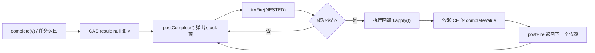
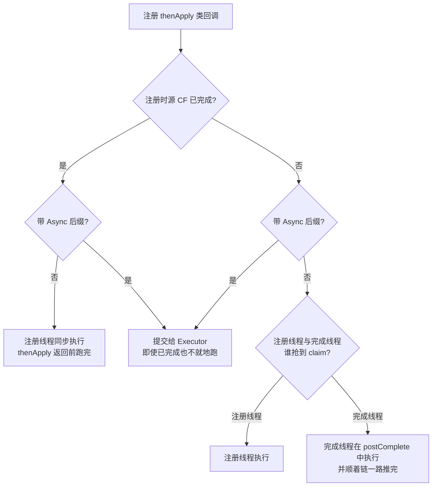
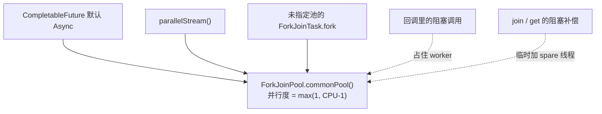
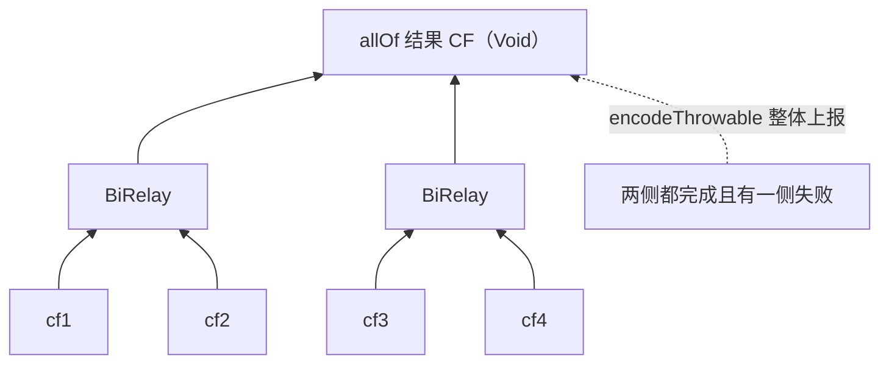
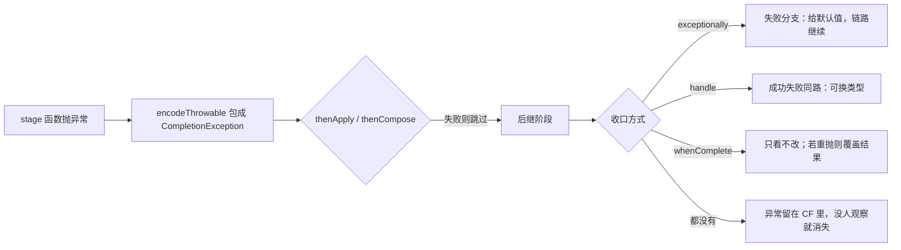

# 13 CompletableFuture 与异步编程模型——从 Future 到响应式

**摘要：**

2004 年 JSR-166 随 JDK 5 落地时，`Future` 只是那批并发工具里最不起眼的一个；十年之后，JDK 8 的 `CompletableFuture` 补上了它缺的那一半能力——结果就绪时主动通知，而不必让调用方守着 `get()` 干等。这一补，补出了一个新问题：通知发生在谁的线程上。真正在线上咬人的，往往不是 `thenApply` 的返回值，而是这个回调悄悄抢占了 Netty 的 EventLoop、Kafka 的 poll 线程或某个数据库驱动的工作线程，一个本该几十微秒的函数在里面阻塞了几百毫秒。本篇先拆 `CompletableFuture` 的完成机制（`result` 字段的 CAS、`AltResult` 的编码、`stack` 上的 `Completion` 链表），再把"回调跑在哪个线程"拆成三条可判定的规则，并给出源码与实测；随后讨论 `commonPool` 的并行度来源与共享代价、编排 API 在 `map`/`flatMap`/合流/择一上的语义差异、`CompletionException` 的三层包装、`cancel` 只能改状态而不能停计算、超时落在"等待"而非"计算"上，最后划清它与虚拟线程、响应式流之间的边界。两个问题在全篇收口：回调究竟落在哪个线程，以及编排 API 的语义该怎么选才不会被返回值类型骗过去。

---

## 第 1 章 只会等的把手：Future 的三处缺口

2004 年，JSR-166 随 JDK 5 一起进入标准库，`ExecutorService`、`Future`、`ConcurrentHashMap`、`ReentrantLock` 都出自这一批。二十年后的今天回头看，`Future` 的接口只有五个方法，语义干净得近乎贫瘠：

```java
public interface Future<V> {
    boolean cancel(boolean mayInterruptIfRunning);
    boolean isCancelled();
    boolean isDone();
    V get() throws InterruptedException, ExecutionException;
    V get(long timeout, TimeUnit unit) throws InterruptedException, ExecutionException, TimeoutException;
}
```

这五个方法的共同点是：它们全都站在调用方一侧。提交任务、问一句"好了没有"、伸手去取结果，主动权始终在取结果的线程手里。任务完成的那一刻，没有任何机制把"我好了"这件事推给谁——`FutureTask` 内部的 `finishCompletion()` 唤醒的是排在同一把锁上的 `get()` 等待者，而不是一组待执行的后续动作。接口里根本没有"注册回调"的位置。

### 1.1 一次提交，一次等待

最典型的用法是这样：

```java
ExecutorService pool = Executors.newFixedThreadPool(8);

Future<Order> future = pool.submit(() -> orderService.load(orderId));
// 做点别的事
auditLog.record(orderId);

Order order = future.get();   // 到这里为止，前面的"别的事"只是拖延，不是并发
```

这段代码在单次调用上没有问题，但它把并发收益压缩到了一个很窄的区间：`submit` 到 `get` 之间那几行代码。如果那几行只是写一条审计日志，那么整个方法在时间轴上仍然是一个"提交—等待"的串联结构，线程数增加只提高了吞吐上限，没有改变单次调用的时延构成。更麻烦的是，一旦这个方法本身运行在请求处理线程上（Servlet 线程、RPC 工作线程、gRPC 的 handler 线程），等待期间那根线程就被占着。Tomcat 默认 200 个工作线程，意味着同时最多有 200 个请求在等结果，第 201 个请求开始排队——这跟同步调用没有任何区别，只是把"等数据库"换成了"等线程池里的另一个线程"。

### 1.2 三处缺口

第一处是 `get()` 的阻塞语义。阻塞本身不是错，错在它把"等待"变成了调用方必须亲自承担的动作。线程是昂贵的，一个阻塞线程占着栈、占着调度实体，却不做任何有用的计算；异步的价值本该是把这段时间还回去，让同一根线程去服务别的请求。

第二处是无法组合。现实中的业务很少只有一个异步动作，更常见的是"查用户 → 用用户 ID 查订单 → 用订单里的商品 ID 查详情 → 拼响应"这样的链条。用 `Future` 写出来是这样：

```java
Future<User> userFuture = executor.submit(() -> getUser(userId));
User user = userFuture.get();                          // 阻塞一

Future<Order> orderFuture = executor.submit(() -> getOrder(user.getId()));
Order order = orderFuture.get();                       // 阻塞二

Future<Product> productFuture = executor.submit(() -> getProduct(order.getProductId()));
Product product = productFuture.get();                 // 阻塞三
```

每一步都必须等上一步的结果才能提交下一步，因为参数依赖是真实的。于是这段代码在物理上是串行的，三段时延相加；异步只剩下"提交动作本身不阻塞"这一点点好处，而调用方还多付了三次线程切换。真正需要的表达是"当 A 完成时，用 A 的结果去启动 B"，而这在 `Future` 的类型系统里写不出来——它没有"完成之后"这个概念。

第三处是没有回调入口。想在结果就绪时做点什么，只剩下轮询一条路：

```java
while (!future.isDone()) {
    Thread.sleep(10);          // 睡多久？睡短了浪费 CPU，睡长了增加时延
}
```

轮询的问题不在于写法难看，而在于它的两个参数（轮询间隔、超时上限）没有任何取值能让所有场景都满意：间隔取 10ms，高并发下就是每秒上百次无意义的唤醒；取 1s，本来 5ms 就绪的结果要等到 1s。轮询是把"通知"这件本该由完成方承担的事，硬塞回给等待方，代价从"一次唤醒"变成"持续打扰"。

| 缺口 | 具体表现 | 不补会怎样 | `CompletableFuture` 的补位 |
| :--- | :--- | :--- | :--- |
| 无法在完成时通知 | 只能 `get()` 或轮询 `isDone()` | 请求线程被占满，异步退化为同步 | `thenApply`/`thenAccept`/`whenComplete` 注册回调 |
| 无法组合 | 多步依赖只能逐段 `get()` | 时延相加，线程切换翻倍 | `thenCompose`/`thenCombine`/`allOf`/`anyOf` |
| 无统一异常出口 | 每处 `get()` 都要解包 `ExecutionException` | 异常处理散落，容易漏 | `exceptionally`/`handle`/`whenComplete` 在链上传播 |

### 1.3 为什么 JDK 5 只能长成这样

`Future` 的形态是它的时代决定的。2004 年的主流并发模型是"线程池 + 阻塞队列"，`ExecutorService` 的抽象目标是"把任务交给池子、把结果拿回来"，`Future` 就是这个交接单。它假设调用方是一个线程，而线程会等。`CompletionService` 在 JDK 5 的后续版本里出现过一次改良：它把"等多个结果"变成"按完成顺序取一个"，`take()` 拿到的总是最先完成的那一个。但 `take()` 依旧阻塞，依旧要求调用方主动去取，只是把"按提交顺序等"改成"按完成顺序等"，没有跳出"取"这个动作。

真正缺的东西是**完成通知的挂载点**：一个可以被注册、被排队、在完成的瞬间被触发的对象。等到 JDK 8，`CompletionStage` 把这层抽象补上，`CompletableFuture` 同时实现 `Future` 与 `CompletionStage`，旧的阻塞式接口保留下来做兼容，新的回调式接口承载编排。这份兼容是理解后文许多诡异行为的前提：同一个对象，既可以被 `get()` 阻塞地读，也可以被 `thenApply()` 注册回调，两种用法共享同一个 `result` 字段。

> [!info] 版本锚点
> `CompletableFuture` 与 `CompletionStage` 自 JDK 8 引入；JDK 9 补上了 `orTimeout`、`completeOnTimeout`、`delayedExecutor`（JEP 266 的时间能力），同批还加入了 `completeAsync`、`failedFuture` 等 `@since 9` 的方法；JEP 266 的"可继承性增强"还开放了 `defaultExecutor()` 与 `newIncompleteFuture()` 两个子类钩子，让框架可以定制默认执行器与返回类型。本篇以 JDK 21 LTS 为基线，涉及 JDK 25 的地方会单独标注。

### 1.4 本篇要回答的两个问题

第一个问题是回调的线程归属：`thenApply` 与 `thenApplyAsync` 差的不是"异步不异步"，而是"由谁决定执行线程"，而这个决定的后果常常在故障现场才显现。第二个问题是编排语义：`thenApply` 与 `thenCompose` 的差别像 `map` 与 `flatMap`，`thenCombine` 与 `thenAcceptBoth` 的差别在返回值，`allOf` 返回 `Void` 而 `anyOf` 返回 `Object`——这些类型签名背后的语义差异，决定了异常能不能传出去、结果要不要自己收、失败时其它分支会不会被取消。

---

## 第 2 章 完成即触发：一个字段撑起的通知机制

要把回调的线程讲清，笔者得先看清回调是怎么被存下来、又是被谁抽出来执行的。`CompletableFuture` 的内部状态只有两个字段，JDK 21 的源码注释写得很直白：

```java
volatile Object result;       // Either the result or boxed AltResult
volatile Completion stack;    // Top of Treiber stack of dependent actions
```

`result` 非 `null` 就表示已完成，`stack` 是依赖动作组成的 Treiber 栈（一种用 CAS 维护的无锁栈）。整个类的并发正确性就压在这两个字段上：一次 CAS 决定"谁完成了它"，随后一趟栈遍历决定"哪些回调该跑"。

### 2.1 `result` 的多态编码

只有一个字段，就得让它同时表达"有没有结果"和"结果是什么/异常是什么"。做法是用一个内部类 `AltResult` 做包装：

| `result` 的取值 | 含义 |
| :--- | :--- |
| `null` | 未完成 |
| `AltResult(null)`（单例 `NIL`） | 已完成，结果就是 `null` |
| `AltResult(ex)` | 异常完成，原因是 `ex` |
| 非空对象 `T` | 正常完成，值是 `T` |

`null` 结果必须被包装，否则"完成且结果为 `null`"与"未完成"在字段上无法区分；异常也塞进同一个包装，于是"完成"这件事只需要一次 CAS。这个设计带来的直接好处是：`complete()` 的返回值天然回答了"我是不是那个赢家"——CAS 成功者为真，失败者为假，不需要额外的状态机。

### 2.2 `Completion`：挂在源上的回调节点

每个 `thenApply`、`thenAccept`、`whenComplete` 调用都会产生一个 `Completion` 子类实例，挂到源 `CompletableFuture` 的 `stack` 上：

```java
abstract static class Completion extends ForkJoinTask<Void>
        implements Runnable, AsynchronousCompletionTask {
    volatile Completion next;          // 栈里的下一个节点
    abstract CompletableFuture<?> tryFire(int mode);
    abstract boolean isLive();
    public final void run()  { tryFire(ASYNC); }
    public final boolean exec() { tryFire(ASYNC); return false; }
}
```

继承 `ForkJoinTask` 不是为了被 fork，而是为了白拿两个能力：一是它的 `tag` 字段，可以拿来做"这个回调是否已被某个线程认领"的标记，不额外占内存；二是它同时是 `Runnable`，可以直接交给任意 `Executor` 执行。认领逻辑就是 `claim()`：

```java
final boolean claim() {
    Executor e = executor;
    if (compareAndSetForkJoinTaskTag((short)0, (short)1)) {   // 抢占标记
        if (e == null)
            return true;                                      // 没有执行器：就地跑
        executor = null;                                      // 只能提交一次
        e.execute(this);                                      // 把节点自己丢给执行器
    }
    return false;
}
```

这段不到十行的代码解释了 `Async` 变体的全部秘密：它并不是把用户的 lambda 单独包一层任务提交，而是把整个 `Completion` 节点当作任务提交。执行器线程跑的是 `run()`，`run()` 转调 `tryFire(ASYNC)`，`tryFire` 再去调用那个 lambda。也因此，`thenApplyAsync` 的任务在监控里会以 `AsynchronousCompletionTask` 的身份出现，而不是一个普通的 `Runnable`。

### 2.3 `tryFire` 的三种模式

`tryFire(int mode)` 的 `mode` 有符号之分，符号本身就是分支条件：

| 常量 | 值 | 谁在调用 | 语义 |
| :--- | :--- | :--- | :--- |
| `SYNC` | 0 | 注册回调的线程（`unipush` 之后的重试） | 尝试抢占，抢到就地跑 |
| `ASYNC` | 1 | 执行器线程（`Completion.run()`） | 已经在执行器里了，直接跑 |
| `NESTED` | -1 | 完成线程的 `postComplete()` 循环 | 顺着链往下推，把下一个依赖交回循环 |

`UniApply.tryFire` 里的关键两行是：

```java
tryComplete: if (d.result == null) {
    if (mode <= 0 && !claim())
        return null;                       // SYNC/NESTED 抢不到，交给别人
    else
        d.completeValue(f.apply(t));       // 回调在这里执行
}
```

`mode <= 0` 覆盖 `SYNC` 与 `NESTED`：这两种情况下，如果配了执行器，`claim()` 会把节点提交出去并返回 `false`，当前线程立刻退出；如果没配执行器，`claim()` 返回 `true`，当前线程就地执行。而 `mode == ASYNC` 时干脆跳过 `claim()`，因为它已经在执行器线程上了。

### 2.4 `complete()` 的完整路径

外部的 `complete(v)`、任务正常返回、`completeExceptionally(ex)`、`cancel()`，最终都汇合到同一条路径上。以 `complete()` 为例，JDK 21 的实现只有三行：

```java
public boolean complete(T value) {
    boolean triggered = completeValue(value);   // CAS: null → value（或 NIL）
    postComplete();                             // 注意：不管 CAS 成不成功都会走
    return triggered;
}
```

`postComplete()` 是传播的核心，它的源码注释把设计意图写得比任何二手解释都清楚：

```java
final void postComplete() {
    /* On each step, variable f holds current dependents to pop
     * and run.  It is extended along only one path at a time,
     * pushing others to avoid unbounded recursion. */
    CompletableFuture<?> f = this; Completion h;
    while ((h = f.stack) != null ||
           (f != this && (h = (f = this).stack) != null)) {
        CompletableFuture<?> d; Completion t;
        if (STACK.compareAndSet(f, h, t = h.next)) {
            if (t != null) {
                if (f != this) { pushStack(h); continue; }   // 分叉先挂回去
                NEXT.compareAndSet(h, t, null);
            }
            f = (d = h.tryFire(NESTED)) == null ? this : d;   // 沿一条路径推进
        }
    }
}
```

三个动作需要说明。第一，"沿一条路径推进"意味着一条 `thenApply` 直线链是被**同一个循环**从头推到尾的，不是递归，栈深不随链长增长，这一点后面第 8 章会用实测数字展开。第二，`f != this` 时把分叉的 `Completion` 用 `pushStack(h)` 挂回栈顶，避免一次性递归展开所有分支。第三，`tryFire(NESTED)` 的返回值是"下一个该处理的 `CompletableFuture`"，这个返回值由 `postFire` 决定：

```java
final CompletableFuture<T> postFire(CompletableFuture<?> a, int mode) {
    if (a != null && a.stack != null) { ... a.postComplete(); }
    if (result != null && stack != null) {
        if (mode < 0)
            return this;        // NESTED：交回调用者的循环
        else
            postComplete();     // SYNC/ASYNC：自己开一趟
    }
    return null;
}
```

把这条路径画成图，完成、传播、回收三件事的关系就清楚了：



### 2.5 一个结论先立在这里

`postComplete()` 是由"完成这个 `CompletableFuture` 的线程"执行的，而 `tryFire(NESTED)` 又在这个线程的循环里直接调用回调函数。所以完成动作会顺着链一路执行下去，占用的始终是完成者那一根线程。这条路径是第 3 章全部规则的来源：不是文档写得含糊，而是实现本来就把回调放在了完成者的调用栈上。要理解"回调跑在哪"，只需要沿着这条路径问三个问题——注册时它完成了没有、有没有 `Async` 后缀、有没有显式执行器。

---

## 第 3 章 回调跑在哪个线程

这是本篇的骨架。绝大多数教程讲到 `thenApply` 与 `thenApplyAsync` 的差别，会给出"同步执行"与"异步执行"这种说法，然后补一句"生产环境建议都用 Async"。这句话方向上没错，但它没有回答工程师在故障现场真正要问的问题：我这段代码现在跑在哪根线程上，为什么它会把 EventLoop 卡住。

### 3.1 官方口径：一个刻意保留的不确定

`CompletableFuture` 的类级 Javadoc 里有一句被反复引用的话：

> Actions supplied for dependent completions of *non-async* methods may be performed by the thread that completes the current CompletableFuture, or by any other caller of a completion method.

笔者把这句话的每个词都咬一遍：不带 `Async` 的从属动作，"可能"由完成当前 `CompletableFuture` 的那根线程执行，"也可能"由任何调用完成方法的线程执行。`may` 不是文档的软弱，它是实现中真实存在的竞态：回调究竟落在哪根线程，取决于注册与完成这两个动作的时间先后，而这个先后在并发下不确定。

需要强调的是"任何调用完成方法的线程"这半句。看 `complete()` 的实现就知道它不是修辞——`postComplete()` 在 CAS 失败之后照样会执行，也就是说，一个线程即使没有赢下完成权，只要它调用了 `complete`、`completeExceptionally`、`cancel`、`obtrudeValue` 中的任何一个，它都会顺手把栈上剩下的回调抽出来跑。这就是"any other caller"的物理来源。

### 3.2 三条可落地的规则

把源码展开，可以得到三条互不重叠、可以逐条判定的规则。

规则一：注册时源已完成，且不带 `Async` 后缀，回调在注册线程上同步执行。JDK 21 的 `thenApply` 走 `uniApplyStage`，一进去就先看 `result`：

```java
private <V> CompletableFuture<V> uniApplyStage(
    Executor e, Function<? super T,? extends V> f) {
    if (f == null) throw new NullPointerException();
    Object r;
    if ((r = result) != null)
        return uniApplyNow(r, e, f);                    // 已完成：立即算
    CompletableFuture<V> d = newIncompleteFuture();
    unipush(new UniApply<T,V>(e, d, this, f));
    return d;
}
```

`uniApplyNow` 在 `e == null` 时直接 `d.result = d.encodeValue(f.apply(t))`。这里连 CAS 都不用，因为新造出来的 `d` 还没被任何人看见，是线程私有的。这解释了一个常见现象：`CompletableFuture.completedFuture(x).thenApply(f)` 里的 `f` 会在你调用 `thenApply` 的那行代码上跑完，`thenApply` 返回之前它已经结束了。这也意味着，如果 `f` 里抛异常，异常不会传到你的调用点，而是被写进返回的那个 `CompletableFuture`——调用点看起来一切正常。

规则二：注册时源未完成，则先入栈，然后由"抢到的人"执行。`unipush` 的实现是：

```java
final void unipush(Completion c) {
    if (c != null) {
        while (!tryPushStack(c)) {
            if (result != null) { NEXT.set(c, null); break; }
        }
        if (result != null)
            c.tryFire(SYNC);       // 入栈之后发现已完成，注册线程自己抢一次
    }
}
```

`tryFire(SYNC)` 这一行是竞态窗口的补丁。假设注册线程刚把节点入栈，源就在另一根线程上完成了，那么完成者会在 `postComplete` 里抽到这个节点；与此同时注册线程也会尝试 `tryFire(SYNC)`。两边都调用 `claim()`，CAS 只有一方成功：成功者执行回调，失败者返回 `null` 退出。所以规则二更准确的说法是"由完成者或注册者中先抢到 `claim` 的那一个执行"。

规则三：一旦完成，完成者的线程会把整条非 `Async` 链一路推完。因为 `postComplete` 是循环推进、`tryFire(NESTED)` 就地调用函数、`postFire` 把下一个依赖交回循环，所以一条由 `thenApply`/`thenAccept`/`thenCompose` 串起来的链，实际上是被同一根线程从头执行到尾的。实测可以看得很清楚：把三个 `thenApply`/`thenAccept` 挂在一个手工创建的 `CompletableFuture` 上，用一根名为 `io-worker` 的线程去 `complete`，三个阶段全部打印 `io-worker`（本机 JDK 17，10 核 arm64，默认栈）。



`Async` 变体在"已完成"这一分支上的行为需要单独说一句：`uniApplyNow` 里 `e != null` 时执行的是 `e.execute(new UniApply<T,V>(null, d, this, f))`，即使源早就完成了，也照样往执行器里丢一次。所以 `thenApplyAsync` 的线程归属是确定的（执行器的某根线程），而 `thenApply` 的线程归属取决于时序。这一点在初始化代码里很实用：想在启动阶段就把某个回调跑完，用非 `Async` 版本；想确保它不在当前线程跑，必须用 `Async`。

### 3.3 为什么"不确定"是可复现的

规则二里的竞态不是理论上的小概率事件。同一段代码在一个紧循环里跑 300 次：

```java
CompletableFuture.supplyAsync(() -> "v")
    .thenApply(s -> { record(Thread.currentThread().getName()); return s; })
    .join();
```

实测分布是 272 次落在 `ForkJoinPool.commonPool-worker-N`，28 次落在 `main`。原因很朴素：`supplyAsync` 把任务丢进池子后立刻返回，主线程紧接着注册 `thenApply`；如果池子里的 worker 在这几微秒内已经跑完并 `complete`，主线程注册时看到的就是"已完成"，于是回调在主线程执行；反之则由 worker 执行。同一份代码，在不同的机器负载、不同的 JIT 状态下，比例还会变。把它当成"随机"是危险的，正确的做法是按最坏情况设计：假设这个回调可能跑在任何一根调用过该 `CompletableFuture` 完成方法的线程上。

### 3.4 代价：完成线程被回调拖住

既然非 `Async` 的回调跑在完成者的栈上，那么回调里的耗时就直接算在完成者的账上。实测：给一个手工 `CompletableFuture` 挂一个 `thenApply`，回调里 `Thread.sleep(200)`，然后在另一根线程里 `complete`，从进入 `complete()` 到它返回，耗时约 210ms。`complete()` 的返回值要等回调跑完才拿得到，调用者在这段时间里被完全占住。

这个机制在很多框架里会变成故障：完成动作常常发生在框架自己的关键线程上，而这些线程往往是被复用的、数量有限的、不能阻塞的。

| 完成动作发生的位置 | 非 Async 回调实际落在 | 典型后果 |
| :--- | :--- | :--- |
| Netty `ChannelFuture` 的监听器里 `cf.complete(...)` | EventLoop 线程 | 该 EventLoop 上所有连接的处理被推迟，心跳超时、写缓冲堆积 |
| gRPC `StreamObserver` 回调里 `cf.complete(...)` | gRPC 的 handler 执行器线程 | 该线程上的其它 RPC 排队，P99 抖动 |
| Kafka `Consumer.poll()` 循环里 `cf.complete(...)` | poll 线程 | 消费停滞，触发 rebalance |
| JDBC 驱动/连接池回调里 `cf.complete(...)` | 驱动工作线程或池的归还线程 | 连接归还变慢，池耗尽 |
| `orTimeout` 的定时器线程 | `CompletableFutureDelayScheduler` 单线程 | 所有超时判定被一起推迟 |

表的最后一行常被忽略：`orTimeout` 的超时判定跑在一根名为 `CompletableFutureDelayScheduler` 的守护线程上（源码里是一个单线程的 `ScheduledThreadPoolExecutor`），如果某个 `orTimeout` 链上的非 `Async` 回调阻塞了，后面所有排队的超时都会被推迟，表现为"超时时间不准"。反过来，这个定时线程只负责触发，不负责跑回调——回调若带 `Async` 就会被转交出去。

> [!warning] 现场判据
> 看到"异步了但还是慢"或"某个线程 CPU 不高却在排队"，先抓一次 `jstack`，在可疑回调所在的方法上找线程名：如果它出现在 `ForkJoinPool.commonPool-worker-*`、`nioEventLoopGroup-*`、`grpc-default-executor-*`、`kafka-consumer-*` 这类名字里，基本可以确认是非 `Async` 回调借了完成者的线程。

### 3.5 上下文为什么传不过去

`ThreadLocal` 是线程私有的，回调换了一根线程，自然读不到原线程的值。实测：主线程 `set` 一个 `ThreadLocal`，然后在 `supplyAsync` 的任务里读，得到 `null`。这不是 `CompletableFuture` 的缺陷，而是"回调可能在任何线程执行"这条规则的必然推论。MDC（日志上下文）同理，链路追踪的 traceId 断在异步边界上，多数是这个问题。

两条出路。一条是把上下文变成显式参数，沿链传递，代价是函数签名变长，好处是没有任何隐式依赖；另一条是包装 `Executor`，在提交任务时把当前线程的上下文快照拷进去、在执行时恢复、执行完清理，`TransmittableThreadLocal` 走的就是这条路（线程封闭与 `ThreadLocalMap` 的细节见 [[15 ThreadLocal 的实现原理与内存泄漏——线程封闭的正确姿势]]）。需要提醒的是，第二条路只在 `Async` 变体上有效——非 `Async` 回调根本没有经过执行器，包装执行器对它无效。

### 3.6 该不该加 `Async`

判断依据不是"异步好不好"，而是"这段代码能不能允许占用完成者的线程"。

| 回调内容 | 建议 | 理由 |
| :--- | :--- | :--- |
| 纯内存变换（拼字段、算长度、格式转换） | 可以不 `Async` | 微秒级，省一次任务提交与线程切换 |
| 需要读完成者线程的上下文（请求作用域、事务绑定） | 视框架而定，慎用 `Async` | `Async` 会切走上下文，需显式传递 |
| 任何阻塞调用（JDBC、HTTP、文件、锁、`sleep`） | 必须 `Async` + 专用池 | 否则拖住完成者，且线程归属不可控 |
| 需要在固定线程执行（如 EventLoop 亲和的资源） | 显式传该线程的 `Executor` | 不能靠默认值碰运气 |
| 需要可观测（线程名、指标、限流） | 显式传专用池 | `commonPool` 的线程名不带业务语义 |

---

## 第 4 章 `commonPool`：全 JVM 共用的一口井

不带 `Executor` 的 `Async` 方法用哪个池，答案是 `ForkJoinPool.commonPool()`，但有条件。JDK 21 的类级文档写得很清楚：

> All *async* methods without an explicit Executor argument are performed using the `ForkJoinPool.commonPool()` (unless it does not support a parallelism level of at least two, in which case, a new Thread is created to run each task).

这段话说出了两件事：默认执行器是 `commonPool`；当 `commonPool` 撑不起至少两个并行度时，每个任务新建一根线程。第二件事在源码里是两个静态字段：

```java
private static final boolean USE_COMMON_POOL =
    (ForkJoinPool.getCommonPoolParallelism() > 1);
private static final Executor ASYNC_POOL = USE_COMMON_POOL ?
    ForkJoinPool.commonPool() : new ThreadPerTaskExecutor();

private static final class ThreadPerTaskExecutor implements Executor {
    public void execute(Runnable r) { new Thread(r).start(); }
}
```

### 4.1 并行度是从哪来的

`commonPool` 是 `ForkJoinPool` 的静态实例，默认并行度在私有构造器里算出来：

```java
int parallelism = Math.max(1, Runtime.getRuntime().availableProcessors() - 1);
...
String pp = System.getProperty("java.util.concurrent.ForkJoinPool.common.parallelism");
if (pp != null) parallelism = Integer.parseInt(pp);
```

也就是说，**并行度等于核数减一**，下限为 1，并且可以被系统属性覆盖。减一的理由与 `ForkJoinPool` 的设计有关：调用 `fork` 的那个线程本身也会参与计算，池子里少留一根线程，整体更接近"用满所有核"（工作窃取的细节与双端队列的设计见 [[12 线程池（下）——ForkJoinPool 与工作窃取算法]]）。

核数在容器里不等于宿主机核数。从 JDK 10 起，JVM 会读取 cgroup 的 CPU 配额，`Runtime.getRuntime().availableProcessors()` 返回的是折算后的值，`commonPool` 的并行度跟着这个值走。这一条在 Kubernetes 里很要紧：一个 `limits.cpu: 500m` 的 Pod 在 64 核宿主机上，`availableProcessors()` 可能只有 1，此时 `getCommonPoolParallelism()` 为 1，`USE_COMMON_POOL` 为 `false`，所有不带 `Executor` 的 `Async` 方法都变成"每个任务新建一根平台线程"——既没有复用，也没有上限，与 `new Thread` 无异。这一点在排查"异步方法为什么创建了这么多线程"时是首要嫌疑。

`getCommonPoolParallelism()` 还有另一种取值 1 的路径：显式把属性设成 0。此时池子以 `mode = 0` 构造，没有任何 worker，`getParallelism()` 依然返回 1。实测（本机 JDK 17）：

```text
-Djava.util.concurrent.ForkJoinPool.common.parallelism=0
  getCommonPoolParallelism() = 1
  默认 async 任务线程 = Thread-1 / Thread-2（每个任务一根新线程）
默认参数
  getCommonPoolParallelism() = 9
  默认 async 任务线程 = ForkJoinPool.commonPool-worker-1
```

### 4.2 共享的代价

`commonPool` 的问题不在它慢，而在于它是全 JVM 共享的：`CompletableFuture` 的默认 `Async`、`parallelStream()`、以及所有没有指定池的 `ForkJoinTask.fork()`，都往这同一口井里取水。



代价可以用一组实测数字看清（本机 10 核，`commonPool` 并行度 9）：18 个各阻塞 300ms 的任务，落在默认执行器上总耗时约 911ms，接近三批；同样的 18 个任务交给一个 72 线程的专用池，总耗时约 303ms，一批跑完。差别的来源很直接：并行度是 9，阻塞任务不释放 worker，第 10 个任务只能等前 9 个之一结束。而 `commonPool` 的并行度是**固定的**，它不像 `ThreadPoolExecutor` 那样可以配置"核心 8、最大 200"的弹性区间。

更麻烦的是这口井无法关闭。`ForkJoinPool.shutdown()` 的源码里有一行判断：

```java
public void shutdown() {
    checkPermission();
    if (this != common)
        tryTerminate(false, true);
}
```

对 `commonPool` 调用 `shutdown()` 或 `shutdownNow()` 都没有效果，它一直活到 JVM 退出。这意味着你在应用里没法"隔离"它：一个模块里的阻塞任务可以拖慢另一个模块的 `parallelStream`，两者之间没有任何边界。

### 4.3 阻塞补偿不是免费的

`commonPool` 对阻塞并非毫无办法。当 `join()`/`get()` 在 ForkJoin 工作线程上阻塞时，`CompletableFuture` 会走 `ForkJoinPool.managedBlock(q)`，`ForkJoinPool` 则尝试 `tryCompensate` 起一根 spare 线程来补上并行度；`waitingGet` 里还有一步 `helpAsyncBlocker`，在排队前先帮别人干点活。这套机制的预算由 `java.util.concurrent.ForkJoinPool.common.maximumSpares` 控制，默认 256（源码常量 `DEFAULT_COMMON_MAX_SPARES = 256`）。

量级上可以这样估：当一堆 `commonPool` 任务互相 `join` 阻塞时，池子最多再多造 256 根线程；超过这个量级，补偿失效，剩下的任务只能排队。它不是死锁免疫，只是把死锁的概率往后推了 256 层。而且 spare 线程同样是平台线程，同样占栈、同样受调度，冲高之后再回落需要时间，期间的延迟抖动是真实存在的。想彻底绕开这套机制，办法只有一个：不要让阻塞任务进 `commonPool`。

### 4.4 为什么应当始终显式传 `Executor`

四条理由，逐条都与线上可运维性有关。

其一，**可观测**。专用池的线程名可以带业务语义（`order-async-*`、`pay-callback-*`），`jstack` 一眼能定位；`commonPool-worker-3` 这个名字不告诉你任何事。其二，**可隔离**。支付模块的异步任务和导出报表的异步任务放在同一个池里，前者会被后者拖慢；分开两个池，故障就不再横向传染。其三，**可控**。`ThreadPoolExecutor` 能配有界队列和拒绝策略，能观测活跃线程数与队列长度，`commonPool` 什么都没有（线程池参数与拒绝策略见 [[11 线程池（上）——ThreadPoolExecutor 的七大参数与执行流程]]）。其四，**可关闭**。应用下线、灰度回滚、测试用例之间清理，都需要能停掉的池。

还有一个容易踩的细节：即使你显式传入 `ForkJoinPool.commonPool()`，在并行度不大于 1 的情况下也会被 `screenExecutor` 替换成 `ThreadPerTaskExecutor`：

```java
static Executor screenExecutor(Executor e) {
    if (!USE_COMMON_POOL && e == ForkJoinPool.commonPool())
        return ASYNC_POOL;
    if (e == null) throw new NullPointerException();
    return e;
}
```

也就是说，"显式传了 `commonPool`"并不等于"一定跑在 `commonPool` 上"，它的行为随并行度而变。判断执行器选型时，把这一条算进去：

| 执行器 | 适用场景 | 风险 |
| :--- | :--- | :--- |
| 不传（默认 `commonPool`） | 原型验证、纯 CPU 的短任务 | 全局共享、无法关闭、并行度固定、阻塞即拖累 |
| 自建 `ThreadPoolExecutor` | 生产默认选择：I/O 型异步、需要隔离与限流 | 队列与拒绝策略要自己配好，否则一样会出问题 |
| 每个任务一根虚拟线程（JDK 21+） | 大量阻塞 I/O、需要"同步写法" | 不限制并发度，需要信号量之类的上限保护 |
| `delayedExecutor` | 延迟执行、与超时配合 | 底层仍是单线程定时器，回调要 `Async` 出去 |
| 单线程 `Executor` | 需要串行化、保序的副作用 | 吞吐上限低，容易成为瓶颈 |

---

## 第 5 章 编排语义：map、flatMap、合流与择一

链式 API 有四十多个方法，名字相似、参数相似、返回值却各不相同。按语义归类只有五组：变换、展平、二元合流、择一、聚合。把它们放进函数式编程的坐标系里，`CompletableFuture` 就是一个"最多一个元素"的容器，`thenApply` 是 `map`，`thenCompose` 是 `flatMap`。

### 5.1 `thenApply` 与 `thenCompose`：嵌套从哪里来

`thenApply` 接收 `Function<? super T, ? extends U>`，把 `T` 变成 `U`，返回 `CompletableFuture<U>`。如果这个函数本身又要发起一次异步调用，它返回的就是 `CompletableFuture<U>`，于是外层得到 `CompletableFuture<CompletableFuture<U>>`。实测打印类型，`thenApply` 之后 `join()` 拿到的是一个 `CompletableFuture` 实例：

```java
// 错的写法：拿着异步调用当同步变换用
CompletableFuture<CompletableFuture<Order>> nested =
    getUserAsync(userId).thenApply(user -> getOrderAsync(user.getId()));

// 对的写法：thenCompose 把内层 CF 接上来，展平成一层
CompletableFuture<Order> flat =
    getUserAsync(userId).thenCompose(user -> getOrderAsync(user.getId()));
```

嵌套的危害不只是类型难看。`nested.join()` 返回的是内层那个尚未完成的 `CompletableFuture`，调用方以为拿到了订单，实际拿到的是一个"还没开始的订单"。真正的等待要么藏在下一层 `join()` 里，要么被静默吞掉——如果没人去 `join` 内层，那个异步调用就在后台跑完然后被丢弃，异常也随之消失。`thenCompose` 的实现把内层 `CF` 的 `result` 直接搬到外层（`internalComplete(gr)`），或者把外层的依赖挂到内层上，语义上等价于"等内层完成再算外层完成"。

`thenCompose` 还有一个容易被忽略的约束：函数返回 `null` 会得到 `NullPointerException` 的异常完成，而不是"没有后续"。用 `thenCompose` 表达"可选分支"时，要返回 `completedFuture(null)` 而不是 `null`。

### 5.2 二元合流与择一

两个 `CF` 合成一个是另一组。区别全在返回值与触发条件上：`thenCombine` 用 `BiFunction` 把两个结果合成一个新值，返回 `CF<U>`；`thenAcceptBoth` 用 `BiConsumer` 消费两个结果、不求返回值，返回 `CF<Void>`；`runAfterBoth` 连结果都不看，等两个都完成后跑一个 `Runnable`。择一那一组对应 `applyToEither`、`acceptEither`、`runAfterEither`，语义是"先完成的那一个的结果"。

`applyToEither` 有个容易被忽略的细节：它传进来的 `Function` 只收到赢家的结果，输家的结果被丢弃，而且输家的任务并不会因此被取消。如果两个分支都是昂贵的远程调用，用 `applyToEither` 做"快速失败"只会省下等待时间，不会省下资源——想省资源，得自己持有句柄并在赢家出现时取消输家，而 `cancel` 能不能真的停下来，是第 7 章的话题。

### 5.3 `allOf`：返回 `Void` 的那个聚合

`allOf` 是编排里用得最多、误解也最多的一个。它的签名是：

```java
public static CompletableFuture<Void> allOf(CompletableFuture<?>... cfs)
```

返回类型是 `CompletableFuture<Void>`，不携带任何结果。这不是设计疏忽，而是泛型的限制：N 个 `CF` 的结果类型各不相同，Java 的类型系统没法表达"一个由 N 个异构结果组成的元组"。所以 `allOf` 只负责"都完成了吗"这个布尔问题，结果要自己从各个 `CF` 上收。

它的实现不是"给 N 个 `CF` 挂同一个计数器"，而是递归地两两合并成一棵树：

```java
static CompletableFuture<Void> andTree(CompletableFuture<?>[] cfs, int lo, int hi) {
    CompletableFuture<Void> d = new CompletableFuture<Void>();
    if (lo > hi)                      // 空数组：直接完成
        d.result = NIL;
    else {
        int mid = (lo + hi) >>> 1;
        if ((a = (lo == mid ? cfs[lo] : andTree(cfs, lo, mid))) == null ||
            (b = (lo == hi ? a : (hi == mid + 1) ? cfs[hi] : andTree(cfs, mid + 1, hi))) == null)
            throw new NullPointerException();
        if ((r = a.result) == null || (s = b.result) == null)
            a.bipush(b, new BiRelay<>(d, a, b));
        else if (...) d.result = encodeThrowable(x, z);   // 两侧都完成且有一侧失败
        else d.result = NIL;
    }
    return d;
}
```

这棵树的形状与失败上报的方向，可以用一张图收住：



这棵树有三个可观察的后果。其一，N 个 `CF` 只产生 N-1 个 `Completion` 节点，深度约 log₂N，完成传播发生在最后完成的那条分支上，不会出现 N 个线程抢同一个计数器的热点。其二，空数组直接返回已完成的 `CF`，而数组里有 `null` 元素会立刻抛 `NullPointerException`（不是异常完成，是同步抛出）。其三，失败不会让 `allOf` 提前结束。`BiRelay` 的 `tryFire` 要求两侧的 `result` 都非 `null` 才继续往下走，所以整棵树必须等所有子 `CF` 都完成之后，才把其中一个失败包成 `CompletionException` 上报；已经成功的结果被丢弃，也不会取消任何分支。实测：一个已经失败的 `CF` 配一个 300ms 的后台任务，`allOf().join()` 要到约 311ms 才抛出，同样的组合交给 `anyOf().join()` 立刻返回——前者等齐，后者只看谁先完成。这条差异在故障时很要命：一个卡住的分支会把失败信号无限期押后。

失败发生时，`join()` 只会告诉你"有人失败了"，不会告诉你是谁、也不会告诉你其它分支的结果。这是"忘了处理失败"这类 bug 的温床：外层看到异常，能做的只有打日志，而那些已经成功的结果、那些还在跑的任务，都失去了上下文。

### 5.4 `anyOf`：返回 `Object` 的那个择一

`anyOf` 的签名与 `allOf` 对称，但实现与语义都不同：

```java
public static CompletableFuture<Object> anyOf(CompletableFuture<?>... cfs) {
    int n; Object r;
    if ((n = cfs.length) <= 1)
        return (n == 0) ? new CompletableFuture<Object>() : uniCopyStage(cfs[0]);
    for (CompletableFuture<?> cf : cfs)
        if ((r = cf.result) != null)
            return new CompletableFuture<Object>(encodeRelay(r));
    cfs = cfs.clone();
    CompletableFuture<Object> d = new CompletableFuture<>();
    for (CompletableFuture<?> cf : cfs)
        cf.unipush(new AnyOf(d, cf, cfs));       // 共享同一个数组
    ...
}
```

四件事需要记住。第一，空数组返回的是一个永远不会完成的 `CF`，不是已完成；第二，单元素数组返回的是 `cfs[0]` 的拷贝阶段，不是原对象；第三，注册前先扫一遍已完成的，有就直接用它的结果造一个新 `CF`；第四，`AnyOf` 节点共享同一个数组，任一源完成就触发，并顺带清理其它源上已经失效的节点（源码注释的原话是"completion of any source should trigger a cleanStack of other sources"）。

`anyOf` 的返回类型是 `Object`，因为编译器无法知道哪个分支会赢，取回后必须自己判型。另一个细节：赢家如果异常完成，`anyOf` 也是异常完成——"先完成"不等于"先成功"。所以用 `anyOf` 实现"多副本取最快"时，必须自己过滤失败分支，否则一次超时就会把整体的结果带偏。

`anyOf` 返回的是拷贝阶段，这一点与取消语义相关：对返回值 `cancel()` 不会影响赢家，赢家照跑不误。

### 5.5 收口写法

把 `allOf` 用对，关键是把"聚合等待"与"结果收集"分成两步，并在收集时逐个子 `CF` 判断状态：

```java
public CompletableFuture<Response> build(long userId) {
    CompletableFuture<User>    uf = getUserAsync(userId);
    CompletableFuture<Order>   of = getOrderAsync(userId);
    CompletableFuture<Product> pf = getProductAsync(userId);

    return CompletableFuture.allOf(uf, of, pf)
        .thenApply(v -> new Response(uf.join(), of.join(), pf.join()))
        .exceptionally(ex -> {
            // 到这一步，三个 CF 都已经完成（成功或失败），逐个记录才能定位
            log.error("aggregate failed, user={} {}, order={} {}, product={} {}",
                uf.isCompletedExceptionally(), uf.isDone(),
                of.isCompletedExceptionally(), of.isDone(),
                pf.isCompletedExceptionally(), pf.isDone(), ex);
            return Response.error("aggregate_failed");
        });
}
```

`allOf` 完成之后，子 `CF` 里已经就绪的 `join()` 不会阻塞，这一点是成立的；但如果某个子 `CF` 是异常完成，`join()` 会立刻抛 `CompletionException`，于是 `thenApply` 整体失败，转去 `exceptionally`。这个写法比起"只 `join` 第一个"的好处是：失败时你至少知道哪些分支成功了、哪些失败了，能补采或降级。

| API | 入参形态 | 返回 | 失败时 | 典型用途 |
| :--- | :--- | :--- | :--- | :--- |
| `thenApply` | `Function<T,U>` | `CF<U>` | 传播，跳过 | 同步变换 |
| `thenCompose` | `Function<T,CF<U>>` | `CF<U>` | 传播，跳过 | 串联异步调用 |
| `thenCombine` | `BiFunction<T,U,V>` | `CF<V>` | 任一侧失败即失败 | 两个结果合成 |
| `thenAcceptBoth` | `BiConsumer<T,U>` | `CF<Void>` | 任一侧失败即失败 | 双结果副作用 |
| `applyToEither` | `Function<T,V>` | `CF<V>` | 赢家失败即失败 | 快速取一个 |
| `allOf` | `CF<?>...` | `CF<Void>` | 等齐后若有失败则整体异常，不取消其余 | 扇出等齐 |
| `anyOf` | `CF<?>...` | `CF<Object>` | 赢家失败即整体异常 | 多副本竞速 |

---

## 第 6 章 异常：三层包装与三种收口

`CompletableFuture` 的异常模型比 `try-catch` 复杂，原因在于异常要跨线程传递，而跨线程传递必然经过"存"与"取"两个动作，每个动作都可能加一层包装。

### 6.1 存进去的那一层

阶段函数里抛出的异常不是原样存进 `result` 的。`tryFire` 的 `catch (Throwable ex)` 走的是 `completeThrowable(ex)`，而它调用的是：

```java
static AltResult encodeThrowable(Throwable x) {
    return new AltResult((x instanceof CompletionException) ? x
                                                           : new CompletionException(x));
}
```

也就是说，阶段函数抛出的异常会被包成 **`CompletionException`** 再存，除非它本来就是 `CompletionException`。而公开的 `completeExceptionally(ex)` 走的是另一条路：

```java
public boolean completeExceptionally(Throwable ex) {
    if (ex == null) throw new NullPointerException();
    boolean triggered = internalComplete(new AltResult(ex));   // 原样存
    postComplete();
    return triggered;
}
```

同一个 `CompletableFuture`，失败来源不同，`exceptionally` 和 `handle` 看到的对象就不同。实测：

```text
supplyAsync 里抛 IllegalStateException  → exceptionally 收到 CompletionException，cause = IllegalStateException
手工 completeExceptionally(IllegalStateException) → exceptionally 收到 IllegalStateException
```

这就是为什么很多人在 `exceptionally` 里判断异常类型总判不中：他们按"业务异常"写分支，拿到的却是 `CompletionException`。稳妥的做法是统一解一层：

```java
Throwable root = (ex instanceof CompletionException && ex.getCause() != null)
    ? ex.getCause() : ex;
```

### 6.2 取出来的那一层

`get()` 与 `join()` 的差别不只是受检与否，取异常时的行为也不一样。`reportJoin` 的逻辑是：`AltResult` 里如果是 `CancellationException` 就原样抛，如果是 `CompletionException` 就原样抛，否则新包一层 `CompletionException`。`reportGet` 则会把 `CompletionException` 拆开，取出 cause，再包成 `ExecutionException`。

实测同一份失败的 `CF`：

```text
get()  → ExecutionException，cause = IllegalArgumentException
join() → CompletionException，cause = IllegalArgumentException
```

于是有一个常被忽略的后果：如果业务代码在链里调用了 `join()` 并让它抛出去，这层 `CompletionException` 会被 `tryFire` 的 `catch (Throwable)` 接住，由于它本身已是 `CompletionException`，存进去的还是它——下游的 `exceptionally` 于是看到的是一个"看起来像业务异常"的包装。包装层数之所以不稳定，在于存储时会包一层、`get` 会拆开再包成 `ExecutionException`、`join` 可能原样保留也可能再包一层，同一个失败经过几次读取与再包装，层数就不一样。`CancellationException` 是例外，`get` 与 `join` 都原样抛出，因为它需要被调用方识别成"取消"而不是"故障"。

### 6.3 三种收口

`exceptionally`、`handle`、`whenComplete` 三者都能接住失败，但语义不同。

`exceptionally` 只在失败时触发，函数收到 `Throwable`，返回一个同类型的值，于是链路可以继续。它是"降级"：失败被替换成一个正常结果，下游完全感知不到曾经失败过。这既是它的用处，也是它的危险——把失败变成正常值，等于把故障的可见性也一起消灭了。

`handle` 成功与失败都触发，函数收到 `(结果, 异常)`，返回一个新类型的值。它是唯一能"换类型"的收口：`CF<String>` 失败后 `handle` 可以返回 `Response`，链路的类型随之改变。因为成功分支也会进来，`handle` 里必须显式判断 `ex == null`，否则容易在成功路径上误用结果。

`whenComplete` 成功与失败都触发，函数收到 `(结果, 异常)`，**返回值类型不变**（仍是 `CF<T>`），结果也不变。它被设计成"看一眼就走"的副作用位：记日志、打指标、释放资源。但"结果不变"有一个例外：如果函数抛出异常，返回的 `CF` 会以这个异常完成，原始结果（或原始异常）被覆盖。实测：对一个已成功完成的 `CF` 调用 `whenComplete` 并在里面抛 `IllegalStateException`，`join()` 拿到的是 `CompletionException(cause = IllegalStateException)`，原来的成功值消失了。

| 方式 | 触发时机 | 能否改结果 | 能否换类型 | 失败被覆盖的风险 |
| :--- | :--- | :--- | :--- | :--- |
| `exceptionally` | 仅失败 | 能（给默认值） | 不能 | 低，但会隐藏故障 |
| `handle` | 成功与失败 | 能 | 能 | 低，需判断 `ex == null` |
| `whenComplete` | 成功与失败 | 不能（但可被抛出的异常覆盖） | 不能 | 高，重抛会抹掉原始异常 |

### 6.4 "异常被吞"的两种真实形态

第一种是没人观察返回的 `CompletableFuture`。`runAsync` 里的任务抛异常，异常被存进返回的 `CF`，既不打印、也不进 `Thread.UncaughtExceptionHandler`。实测：给 `runAsync` 装了默认的未捕获异常处理器，任务抛 `RuntimeException`，处理器一次都没有被调用；异常只在那个没人持有的 `CF` 里。`ForkJoinPool` 的 worker 不会因为这类异常而告警，因为它压根没抛到线程层面。这就是"异步任务失败了但日志里什么都没有"的原因。

第二种是在 `whenComplete` 里重抛。本意是"记录并继续抛"，实际效果是原始异常被新异常替换，栈上再也看不到第一现场。如果这个新的 `CF` 又没人观察，那就连新异常也一起消失。想同时保留两者，应该在同一个异常对象上 `addSuppressed`，或者把原始异常作为字段记进日志，而不是抛一个新的。

把异常在链上的走向画成一条路径：



> [!warning] 收口原则
> 每个"扇出"出来的异步任务，都要有一条明确的观察路径：要么挂在某个会被 `join` 的父 `CF` 上，要么在顶层 `whenComplete` 里记录并上报。`exceptionally` 返回默认值是可以的，但默认值不能让链路在半途变成 `null`，否则下游会以 `NullPointerException` 的形式二次失败，掩盖真正的第一现场。

---

## 第 7 章 取消与超时：`cancel` 取消的是状态，不是计算

### 7.1 `cancel` 能做什么

`CompletableFuture.cancel` 的实现只有几行：

```java
public boolean cancel(boolean mayInterruptIfRunning) {
    boolean cancelled = (result == null) &&
        internalComplete(new AltResult(new CancellationException()));
    postComplete();
    return cancelled || isCancelled();
}
```

参数 `mayInterruptIfRunning` 完全没有被使用，Javadoc 也明说了"this value has no effect in this implementation because interrupts are not used to control processing"。所以 `cancel` 做的事情只有一件：如果还没完成，把 `result` 置成一个 `CancellationException` 的 `AltResult`，然后把依赖回调抽出来跑。它**只改状态**，不碰正在执行的任务，任务该跑多久还跑多久，该做什么还做什么，只是它结束时的 `complete` 会 CAS 失败，结果被丢弃。

实测可以看得很清楚：一个 `supplyAsync` 的任务里 `sleep(400)` 后置一个标志位，启动 50ms 后 `cancel(true)`，600ms 后检查，标志位为真——底层任务完整跑完，`isCancelled()` 为真，`join()` 抛 `CancellationException`。

取消会向下游级联，但级联出来的不是取消：依赖阶段 `thenApply` 的 `CF` 会成为异常完成，异常是 `CompletionException(cause = CancellationException)`，而它自己的 `isCancelled()` 返回 `false`、`isCompletedExceptionally()` 返回 `true`。这个细节在埋点时很有用：想知道"这个阶段是被取消的，还是自己失败的"，看 `isCancelled()`；下游永远看到 `false`，只有被直接取消的那个 `CF` 才是 `true`。

### 7.2 超时打在"等待"上

JDK 9 的 `orTimeout` 与 `completeOnTimeout` 用法简单，实现同样简单：

```java
public CompletableFuture<T> orTimeout(long timeout, TimeUnit unit) {
    if (result == null)
        whenComplete(new Canceller(Delayer.delay(new Timeout(this), timeout, unit)));
    return this;
}
```

三个细节。第一，返回的是 `this`，不是新阶段：超时标记打在原来的 `CF` 上，其它持有这个 `CF` 的代码会一起看到超时结果。如果这个 `CF` 被多处共享，一处设超时会污染所有观察者，这是编排里典型的"共享可变状态"问题。第二，超时由一个单线程的 `ScheduledThreadPoolExecutor`（线程名 `CompletableFutureDelayScheduler`，守护线程）触发，`setRemoveOnCancelPolicy(true)` 保证在原 `CF` 先完成时把定时任务从队列里移除，不会堆积。第三，`Timeout.run()` 在 `!f.isDone()` 时调用 `completeExceptionally(new TimeoutException())`，同样只是改状态。

实测：对一个 500ms 才返回的任务 `orTimeout(100)`，`join` 抛 `CompletionException(cause = TimeoutException)`；再等 600ms，原 `CF` 已完成、任务体内的标志位为真——超时只是提前结束了等待，计算照旧跑完。这意味着超时的副作用仍然会发生：已经发出去的请求不会撤回，已经写入的数据不会回滚，已经扣掉的库存不会自动加回来。要处理这个落差，任务本身必须响应取消，或者操作必须幂等。

### 7.3 `get`、`join`、`cancel` 的差别

| 方法 | 异常类型 | 是否受检 | 是否响应中断 | 取消语义 |
| :--- | :--- | :--- | :--- | :--- |
| `get()` | `ExecutionException`（拆开 `CompletionException`） | 是 | 是，抛 `InterruptedException` | 不适用 |
| `get(timeout, unit)` | 同上，另加 `TimeoutException` | 是 | 是 | 只结束等待 |
| `join()` | `CompletionException`（原样） | 否 | 否，不抛 `InterruptedException` | 不适用 |
| `cancel(true/false)` | 由调用方观察 | 否 | 否，参数无作用 | 只改状态 |

`join()` 不响应中断这一点在优雅停机时很要命：线程池 `shutdownNow()` 之后，卡在 `join()` 上的线程不会被唤醒，只能等被等的那个任务自己结束。

### 7.4 想真正停下来，只能靠任务自己

Java 没有安全的"从外部杀死线程"的能力，`Thread.stop()` 自 JDK 18 起被标记为待移除，JDK 20 起改为无条件抛 `UnsupportedOperationException`，不再真的停止线程，后续版本里这个方法已被移除，`suspend`/`resume` 更早就废弃了。所以"取消一个正在执行的任务"只有两种实现：任务周期性地检查中断标志或取消标志，或者在阻塞调用上使用可中断的 API（`InterruptibleChannel`、`Lock.lockInterruptibly()`、带超时的 `await`）。

把这个结论映射回 `CompletableFuture`：`cancel` 只能取消"还没开始的结果"，取消不了"已经开始的计算"。要得到真正可取消的编排，任务内部必须与一个取消信号建立联系，例如传入一个 `AtomicBoolean` 或 `volatile` 标志，在关键步骤之间检查；对于 HTTP 客户端这类支持取消的组件，要拿到它的请求句柄并显式取消。这也是响应式框架把"取消"做成一等公民的原因：`Subscription.cancel()` 会一路传下去，让真正的 I/O 层知道可以停。

---

## 第 8 章 四个把异步写回同步的写法

### 8.1 反例一：不传 `Executor`

```java
CompletableFuture.supplyAsync(() -> jdbcTemplate.queryForList(SQL));   // 落在 commonPool
```

这是最常见的一种。任务本身是阻塞的 JDBC 调用，落在并行度固定的 `commonPool` 上，几秒内就把池子占满；同一时刻，另一处用一个无关的 `parallelStream()` 做报表聚合，两边互相拖累，因为它们是同一口井。第 4 章的实测已经给出量级：18 个阻塞任务在 9 并行度的池上要 911ms，在专用池上 303ms。

在容器里情况更糟。若 `availableProcessors()` 折算为 1，`USE_COMMON_POOL` 为 `false`，每个 `Async` 任务都会 `new Thread` 一根平台线程，没有复用、没有上限，线程数随任务数线性增长，直到把内存和调度器压垮。

### 8.2 反例二：在 `thenApply` 里做阻塞调用

```java
CompletableFuture.supplyAsync(() -> userId)
    .thenApply(id -> jdbcTemplate.queryForObject(SQL, id));   // 非 Async，跑在完成者线程上
```

问题不在于"阻塞"本身，而在于阻塞发生在谁的线程上不可控。如果 `supplyAsync` 跑在 `commonPool`，回调占的是 worker；如果上游是 Netty 的 `ChannelFuture` 回调里 `complete` 的，占的就是 EventLoop，一个连接的处理卡住会连带影响这个 EventLoop 上所有连接。第 3 章的实测表明，非 `Async` 回调会把完成者线程一直占到自己返回为止（200ms 回调对应 210ms 的 `complete` 耗时）。

### 8.3 反例三：`allOf` 之后忘了处理失败

```java
CompletableFuture.allOf(a, b, c).join();     // 只要一个失败，这里直接抛
List<Result> results = List.of(a.join(), b.join(), c.join());   // 根本走不到这行
```

这段代码在全部成功时表现完美，一旦失败就在 `join` 处抛出，`a`/`b`/`c` 里已经算出来的结果全部丢弃，而 `b`、`c` 若还在跑，也不会被取消。更隐蔽的是异常只包含"某一个"失败原因：`allOf` 并不快速失败，它等所有分支都结束，再按树遍历顺序挑一个失败上报，其它分支的失败与成功都没有记录。线上的表现是"偶发失败、日志里只有一个孤零零的异常、不知道另外两个分支是成功还是失败"；如果那个失败的分支恰好很快、另一个分支很慢，失败信号还会被慢分支拖到很晚才出现，所以 `allOf` 通常要配一个整体超时。

正确的写法是分层：先 `allOf` 等齐，再逐个检查，把每个分支的状态都记下来（第 5.5 节的模板），必要时给每个分支单独包一层 `handle` 把失败转成"带错误标记的结果"，让聚合阶段永远能拿到完整的三份状态。

### 8.4 反例四：`whenComplete` 里重抛，或者干脆不持有返回值

```java
public void fireAndForget() {
    CompletableFuture.runAsync(() -> doWork(), pool)
        .whenComplete((v, ex) -> {
            if (ex != null) throw new RuntimeException("async failed", ex);   // 覆盖原始异常
        });                                                                  // 返回值被丢弃
}
```

两个错误叠在一起。`whenComplete` 里抛出的异常会把返回的 `CF` 变成异常完成，原始异常降级成 cause 的一层，如果原始异常本身已经是 `CompletionException`，栈上就会出现两层同样的包装。更致命的是返回值被丢弃：没有任何人观察这个 `CF`，异常既不打日志也不进 `UncaughtExceptionHandler`，整个系统安静地失败。修法是把 `whenComplete` 换成 `handle` 并在里面记录，或者至少把返回值存下来、在合适的时机 `join` 观察。

### 8.5 量化：并行度、任务数与栈深

笔者先看吞吐。假设一批 N 个任务，每个任务阻塞 `T` 毫秒，执行器并行度为 `P`，忽略调度开销时总耗时约为 `ceil(N/P) × T`。这是一条纯算术的估算，不含任何基准测试结论：

| 场景 | N | T (ms) | P | 批次 | 估算总耗时 |
| :--- | :--- | :--- | :--- | :--- | :--- |
| 默认 `commonPool`（8 核机器） | 1000 | 50 | 7 | 143 | 约 7.2 s |
| 同一批任务，专用池 200 线程 | 1000 | 50 | 200 | 5 | 约 0.25 s |
| 默认 `commonPool`，容器折算 1 核 | 1000 | 50 | 1（退化为每任务新线程） | 1000 | 线程创建开销主导，可能比串行更慢 |

前两行是示例推算，用于说明"并行度决定批次数"这个关系；第三行提醒的是退化路径：并行度降到 1 之后，`Async` 不再复用线程，公式里的 `P` 失去意义，实际耗时由线程创建与销毁决定。

再看栈深。第 2 章引用过 `postComplete` 的注释："It is extended along only one path at a time, pushing others to avoid unbounded recursion"。这段话的效果可以实测：一条 20 万级的 `thenApply` 直线链，由另一根线程 `complete` 头部，完整跑完、没有 `StackOverflowError`，因为推进靠的是循环而不是递归。真正会加深调用栈的是"在回调里再完成另一个 `CompletableFuture`"这种交叉：实测中，把 4000 个 `CF` 用 `thenAccept` 串成"回调里 `complete` 下一个"的形状，链条在 2000 到 2700 层之间触发 `StackOverflowError`，而这个错误被 `tryFire` 的 `catch (Throwable)` 接住，写进了 `thenAccept` 返回的那个没人持有的 `CF`——链条静默断掉，完成线程毫无感知，也不会打印任何堆栈（本机 JDK 17、默认栈，深度随栈大小与 JIT 状态浮动，属于**量级判断**）。

这两个实测的对照说明：编排层次深并不必然导致栈问题，直线链是安全的；把编排写成"回调里再嵌套完成"的递归形状才危险。用 `thenCompose` 串联几十层是安全的，因为它仍然走 `postComplete` 的循环，不会形成递归调用栈。

---

## 第 9 章 边界：一次性完成、无背压，以及虚拟线程改写了什么

### 9.1 形状决定能力

`CompletableFuture` 的抽象是**一次完成、最多一个值**。它没有"再给一个值"的概念，也没有"消费者要慢一点"的概念。这两个缺失不是待补的 TODO，而是它与响应式流的根本分野。

`CompletionStage` 里所有方法都以"完成"为触发点，一个阶段只能完成一次，所以它天然适合请求-响应式的编排：查一次、算一次、返回一次。它不适合表达"流"：一百条消息、一个持续的事件序列、一个分页游标。硬要用它表达流，只能为每条消息造一个 `CF`，于是失去了流的两个关键能力——背压与有序性。

### 9.2 与响应式流的判据

| 维度 | `CompletableFuture` | Reactive Streams（Reactor/RxJava） |
| :--- | :--- | :--- |
| 数据基数 | 0 或 1 | 0 到 N |
| 完成次数 | 一次 | 流结束一次，元素可达 N 个 |
| 背压 | 无 | 有（`request(n)` 协议） |
| 取消传播 | `cancel` 只改状态 | `Subscription.cancel()` 传到源头 |
| 线程调度 | 执行器（`Async` 或非 `Async`） | `publishOn`/`subscribeOn` 显式切换 |
| 错误处理 | `exceptionally`/`handle` 终止链 | `onErrorResume`/`retry`，可对每个元素处理 |
| 组合算子 | 几十个 | 上百个（`buffer`、`window`、`debounce`、`throttle`） |
| 复杂度 | 低，学习曲线平缓 | 高，调试与栈追踪更难 |

判据可以压成三句话：数据是一次性的、并发度不高、不需要限速，用 `CompletableFuture`；数据是流式的、需要按消费能力限速、需要在流上做窗口与节流，用响应式流；两者混用时，在边界上转换而不是层层嵌套。转换本身是标准动作：`Mono.fromFuture(cf)`、`Mono.fromCompletionStage(cs)`、`cf` 交给 `Mono.fromCallable(...).toFuture()`。要避免的是在响应式链里调用 `join()`——那会把事件循环线程阻塞住，正是第 8.2 节那个反例的另一种形态。

### 9.3 虚拟线程改写了什么

一句话：虚拟线程让"同步阻塞写法"重新变得可行，从而减少了对 `CompletableFuture` 编排的需求（调度模型、`Continuation` 与载体线程的关系见 [[16 JDK 21 虚拟线程——Project Loom 的协程实现与平台线程的边界]]）。JDK 21 起，`Executors.newVirtualThreadPerTaskExecutor()` 返回的 `Executor` 可以直接传给 `supplyAsync`/`thenApplyAsync`，异步阶段就跑在虚拟线程上；`Thread.ofVirtual().factory()` 也可以直接当线程工厂用。

但虚拟线程不会自动修复这些坑：非 `Async` 回调依然跑在完成者线程上，`commonPool` 依然是平台线程池，`cancel` 依然不停计算，`ThreadLocal` 依然不跨线程传递。变化在于"要不要用 `CompletableFuture` 来等"这个决策：如果一段逻辑是纯粹的阻塞 I/O 串联，用虚拟线程写成顺序代码，可读性和可调试性都更好，出问题时的栈也完整。只有当逻辑是真的并行扇出、需要在多个独立结果之间做组合与择优时，`CompletableFuture` 的组合能力才有不可替代的价值。

### 9.4 结构化并发：补的是取消与作用域

`CompletableFuture` 最薄弱的一环是"一组成员的生命周期"。`allOf` 等齐了，但没有"如果其中一个失败就把其余全部取消"的语义，也没有"这个作用域结束时所有子任务都必须结束"的保证。结构化并发补的正是这块：JDK 21 以 JEP 453 引入预览，到 JDK 25 仍是预览（JEP 505，第五次预览），核心是 `StructuredTaskScope` 的 `fork`/`join`/`shutdown`，让一组子任务与一个词法作用域绑定，失败即取消其余，作用域退出时保证没有遗留任务（JDK 25 的第五次预览把"失败即取消"与"成功即取消其余"这两种策略收敛成了显式的 `Joiner`）。它不替代 `CompletableFuture` 的链式变换，而是替代"用 `allOf` 加一堆手工取消"的编排形状。

### 9.5 选型收束

回到工程判断。一次请求要串三四个远程调用、需要在其中做降级与并发扇出，`CompletableFuture` 是合适的工具，前提是每个扇出都显式指定执行器、失败都有观察路径；一次请求只是把几个阻塞调用按顺序走完，虚拟线程加顺序代码更简单；处理的是消息流或事件流，该用响应式流，`CompletableFuture` 在这里只能当边界适配器。三种选择的分界线不在 API 的好坏，而在"数据的形状"与"并发的形状"。

---

## 第 10 章 收束：账单落在谁身上

异步编程的收益是显性的——线程不再干等，吞吐上去了；代价是隐性的，而且常常由别人承担：完成者的线程被别人写的回调占用，共享的 `commonPool` 被别人的阻塞任务拖慢，异常被别人的 `whenComplete` 覆盖。`CompletableFuture` 把这些责任都留给了使用者，它只提供机制，不提供纪律。

于是判断一段异步代码写得好不好，看的不是它用了多少个 `thenCompose`，而是三个问题能不能回答清楚：这个回调跑在哪根线程上，如果它阻塞了会拖住谁；失败发生后，谁在观察、谁在记录、谁负责降级；超时与取消发生时，已经发生的副作用靠什么收敛。答得出来，异步就是能力；答不出来，异步只是把同步的问题挪到了一根看不见的线程上，等它在某个流量高峰的夜里一起还回来。

---

## 参考资料

1. OpenJDK，`java.util.concurrent.CompletableFuture` 源码（JDK 21，`jdk21u` 仓库 `src/java.base/share/classes/java/util/concurrent/CompletableFuture.java`）：`AltResult` 编码、`Completion` 链表、`postComplete`/`postFire`、`USE_COMMON_POOL`、`andTree`、`AnyOf`、`Delayer`。
2. OpenJDK，`java.util.concurrent.ForkJoinPool` 源码（JDK 21）：`COMMON_PARALLELISM` 与 common pool 私有构造器的并行度推导、`DEFAULT_COMMON_MAX_SPARES`、`managedBlock`/`helpAsyncBlocker`、`shutdown` 对 common pool 的无效处理。
3. Java SE 21 API 文档：`CompletableFuture`、`CompletionStage`、`ForkJoinPool` 的类级说明（非 `Async` 回调的线程归属、默认异步执行器、`cancel` 的参数语义）。
4. JEP 266: More Concurrency Updates（JDK 9）：`orTimeout`、`completeOnTimeout`、`delayedExecutor` 与 `CompletableFuture` 的可继承性增强。
5. JEP 444: Virtual Threads（JDK 21）：虚拟线程的调度与 `Executors.newVirtualThreadPerTaskExecutor()`。
6. JEP 453: Structured Concurrency (Preview)（JDK 21）与 JEP 505: Structured Concurrency (Fifth Preview)（JDK 25）：作用域化的子任务生命周期与失败取消。
7. Doug Lea, *Scalable IO in Java*, 2002：Reactor 模式与事件驱动 I/O 的线程模型，理解"完成回调运行在 I/O 线程上"的历史来源。
8. Project Reactor Reference Documentation：`Mono`/`Flux`、`Subscription` 与背压协议、`publishOn`/`subscribeOn` 的调度语义。

---

> [!note] 思考题
> 1. 一个 `CompletableFuture` 被 `cancel(true)` 之后，底层正在跑的任务并不知道自己已被取消。如果这个任务的副作用是"转账"，你会用什么机制保证最终状态一致？
> 2. `allOf` 要等所有分支结束，才把其中一个失败报出来，其余分支照跑。如果三个分支里有两个失败、一个成功，你在日志里能还原出全部信息吗？需要补什么。
> 3. 把 `thenApply` 改成 `thenApplyAsync` 之后，某段代码开始读不到 `ThreadLocal` 里的请求上下文，但另一段仍然读得到。请从"回调线程归属"的角度解释这个差异。
> 4. `orTimeout` 返回的是 `this` 而不是新阶段。当同一个 `CompletableFuture` 被两个模块共享、其中一个模块调用了 `orTimeout`，另一个模块会观察到什么？如何避免这种污染。
> 5. 在容器里 `availableProcessors()` 可能远小于宿主机核数，这会让 `commonPool` 的并行度退化到 1，进而让默认 `Async` 方法变成"每任务一根线程"。这个链条上任一环节你能在启动日志或运行指标里观察到吗？