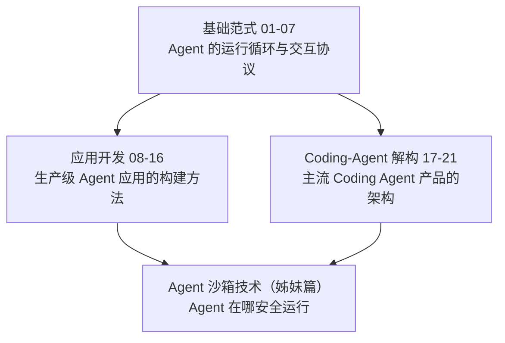

# Agent 技术 专栏导览

> [!abstract] 专栏定位
> 本专栏把「AI Agent 的工程实现」讲透——从 Agent 的**运行范式与交互协议**（ReAct 循环、Tool Use/Function Calling、MCP、Context Engineering、权限模型），到**通用 Agent 应用开发**（Prompt 工程、RAG、Agent 核心能力、记忆、框架选型、多 Agent 协作、评估与实战），再到 **Coding Agent 产品的架构解构**（Claude Code、Devin、OpenHands、Cursor 与操作系统交互接口）。
>
> 本专栏由原「Agent 开发技术」与「Coding-Agent 运行范式」两个系列合并而来：两者同属 Agent 工程的不同侧面，过去存在篇目重叠（MCP 协议、ReAct 各自一篇）与边界模糊的问题，合并后按"基础范式 → 应用开发 → Coding Agent 解构"三个层次重新组织，共 21 篇正文。

## 三部分结构

### 第一部分：基础范式（01-07）——Agent 怎么"转起来"

| 序号 | 标题 | 核心内容 |
| :--- | :--- | :--- |
| **01** | [[LLM/Agent技术/基础范式/01 Agent 运行范式全景——从 ReAct 到 Production Agent 的演进\|Agent 运行范式全景]] | Agent 与 Chatbot 的本质区别、ReAct 范式的提出背景、从 ReAct 到 Reflexion/Plan-and-Execute/ToT/LATS/LLMCompiler 的演进脉络、主流框架的范式选择 |
| **02** | [[LLM/Agent技术/基础范式/02 ReAct 架构深度解析——Thought-Action-Observation 循环的本质\|ReAct 架构深度解析]] | ReAct 论文核心思想、为什么交替推理和行动优于纯 CoT、ReAct 的 prompt 模板设计、ReAct 的局限性、Reflexion 的自反思改进、生产环境中的 ReAct 变体 |
| **03** | [[LLM/Agent技术/基础范式/03 Tool Use 与 Function Calling——三大厂商的标准化博弈\|Tool Use 与 Function Calling]] | OpenAI/Anthropic/Gemini 三家 function calling 规范对比、tool_choice 语义、并行调用、Tool Search 动态加载、从 function calling 到 MCP 的演进动机 |
| **04** | [[LLM/Agent技术/基础范式/04 MCP 协议深度解析——Agent 与工具的标准化连接\|MCP 协议深度解析]] | MCP 诞生背景、JSON-RPC 2.0 基础、Host-Client-Server 三层架构、能力协商、三类 Server 原语（Tools/Resources/Prompts）、三类 Client 原语（Sampling/Roots/Elicitation）、传输层演进（stdio→HTTP+SSE→Streamable HTTP） |
| **05** | [[LLM/Agent技术/基础范式/05 MCP 生态与实践——Server 开发、集成与生产部署\|MCP 生态与实践]] | 官方/社区 Server 实现、主流 Host 集成方式、自定义 MCP Server 开发、MCP vs Function Calling vs LangChain Tools 选型、MCP 安全边界 |
| **06** | [[LLM/Agent技术/基础范式/06 Prompt 上下文管理——Context Engineering 的艺术\|Prompt 上下文管理]] | Context Engineering vs Prompt Engineering、Just-in-Time Context、Context Editing、Memory Tool、Context Degradation、长时任务的上下文策略 |
| **07** | [[LLM/Agent技术/基础范式/07 Agent 权限与审批模型——人在环路的工程实践\|Agent 权限与审批模型]] | Human-in-the-loop 模式、interruptions/审批原语、Claude Code 权限模式、工具权限策略、权限传播的工程难点 |

### 第二部分：应用开发（08-16）——Agent 应用怎么"造出来"

| 序号 | 标题 | 核心内容 |
| :--- | :--- | :--- |
| **08** | [[LLM/Agent技术/应用开发/08 Prompt 工程——从零样本到思维链\|Prompt 工程]] | Zero-Shot/Few-Shot Prompting、Chain-of-Thought 思维链推理、Self-Consistency、Tree-of-Thought、System Prompt 与输出格式控制、Structured Output、Prompt 注入攻击与防御 |
| **09** | [[LLM/Agent技术/应用开发/09 RAG 架构——核心原理与工程实践\|RAG 架构]] | RAG 的核心动机（解决幻觉/时效性/领域知识）、文档加载→分块→Embedding→向量检索→Rerank→生成的完整 Pipeline、分块策略、Embedding 模型选型、评估指标 |
| **10** | [[LLM/Agent技术/应用开发/10 高级 RAG——查询改写、图谱检索与多跳推理\|高级 RAG]] | Naive RAG 的局限、Query 改写与 HyDE、Self-RAG 自适应检索、Multi-Query RAG、Graph RAG、Corrective RAG、Agentic RAG 的动态路由与工具选择 |
| **11** | [[LLM/Agent技术/应用开发/11 Agent 核心能力——推理、规划与工具调用\|Agent 核心能力]] | Agent 的核心循环（感知→推理→行动→观察）、五种规划方法、ReAct 的交替推理、Reflexion 自我反思、LATS 蒙特卡洛树搜索、Plan-and-Execute、PLaG 并行任务图 |
| **12** | [[LLM/Agent技术/应用开发/12 Agent 记忆体系——从短期缓冲到长期知识\|Agent 记忆体系]] | 短期记忆、工作记忆（Scratchpad）、长期记忆（向量数据库持久化）、情景记忆、记忆的检索与遗忘机制、MemGPT 虚拟内存分页思想 |
| **13** | [[LLM/Agent技术/应用开发/13 Agent 框架选型——LangChain、LlamaIndex 与 LangGraph\|Agent 框架选型]] | LangGraph 的状态图编排、CrewAI 的角色-任务-流程范式、OpenAI Agents SDK 托管运行时、AutoGen 多轮对话协作、LlamaIndex RAG-First 设计、选型决策矩阵 |
| **14** | [[LLM/Agent技术/应用开发/14 多 Agent 系统与 A2A 协议——协作、通信与特化\|多 Agent 系统与 A2A 协议]] | 多 Agent 设计动机（专业化分工/并行执行/对抗性验证）、Supervisor vs Decentralized、Google A2A 协议（Agent Card/Task/Message/Streaming）、MCP 与 A2A 的互补关系 |
| **15** | [[LLM/Agent技术/应用开发/15 Agent 应用实战——从零构建生产级 Agent\|Agent 应用实战]] | 企业知识库 Agent 完整实现、代码生成 Agent（Sandbox 执行/测试验证/迭代修复）、数据分析 Agent、自动化工作流 Agent、生产部署的安全与监控 |
| **16** | [[LLM/Agent技术/应用开发/16 Agent 评估与可靠性工程\|Agent 评估与可靠性]] | Agent 评估框架、幻觉检测与 Grounding、Guardrails 输入/输出过滤、Prompt 注入与越狱防御、Token 成本优化、Agent 可观测性 |

### 第三部分：Coding-Agent 解构（17-21）——主流 Coding Agent 怎么"拆开看"

| 序号 | 标题 | 核心内容 |
| :--- | :--- | :--- |
| **17** | [[LLM/Agent技术/Coding-Agent解构/17 Claude Code 架构解构——Anthropic 的 CLI Agent 设计哲学\|Claude Code 架构解构]] | 多表面架构、文件读写/Bash 执行/Git 操作机制、Subagent 与 Dynamic Workflows、权限模型、Session 持久化、已知 bug 与生产避坑 |
| **18** | [[LLM/Agent技术/Coding-Agent解构/18 Devin 与 ACI 设计——为 Agent 认知而生的计算机接口\|Devin 与 ACI 设计]] | Devin 架构、ACI（Agent Computer Interface）概念、Computer Use 能力、长时任务执行、Interactive Planning、Confidence Reporting |
| **19** | [[LLM/Agent技术/Coding-Agent解构/19 OpenHands 与 Aider——开源 Coding Agent 的两种哲学\|OpenHands 与 Aider]] | OpenHands Event Stream 架构、Runtime 沙箱、AgentSkills、多 Agent 委托；Aider 单进程架构、Repo Map（Tree-sitter + PageRank）、Architect/Editor Pattern |
| **20** | [[LLM/Agent技术/Coding-Agent解构/20 Cursor 与 IDE 类 Agent——从补全到自主编码的跨越\|Cursor 与 IDE 类 Agent]] | Cursor Agent 架构（Planner/Worker）、Composer、Cloud Agent；IDE Agent vs Terminal Agent 的设计差异 |
| **21** | [[LLM/Agent技术/Coding-Agent解构/21 Agent 与操作系统的交互接口——Bash、文件与 Git 的工程化\|Agent 与操作系统的交互接口]] | Bash 执行的 shell wrapping/超时/输出截断/两阶段终止、文件读写的原子写入/大文件/二进制/文件锁、Git 工作流、多 Agent 协调 |

## 推荐阅读路径

**基础范式路径**：01 → 02 → 03 → 04 → 05（先理解 Agent 的运行循环与工具协议）

**应用开发路径**：08 → 09 → 10 → 11 → 12 → 16（构建生产级 Agent 应用）

**Coding Agent 解构路径**：17 → 18 → 19 → 20 → 21

**完整路径**：01 → 02 → 03 → 04 → 05 → 06 → 07 → 08 → 09 → 10 → 11 → 12 → 13 → 14 → 15 → 16 → 17 → 18 → 19 → 20 → 21

**快速上手**：只想知道"Agent 怎么造"→ 读 08-16；只想知道"Coding Agent 怎么工作"→ 读 17-21；想系统理解 → 按完整路径。

## 前置知识

- LLM 基础概念（Prompt、Token、上下文窗口），建议先阅读 [[LLM/LLM原理/00 专栏导览|LLM 原理]] 专栏
- Linux 命令行与 Git 基础操作
- 应用开发篇需要 Python 编程和 REST API 调用基础

---

## 关联专栏

- [[LLM/LLM原理/00 专栏导览|LLM 原理]]：Transformer 与 LLM 的底层原理，Agent 的地基
- [[LLM/Agent沙箱技术/00 专栏导览|Agent 沙箱技术]]：解决"Agent 在哪安全运行"，与本专栏 21 篇（Bash/文件/Git 接口）互为姊妹篇
- [[LLM/Hermes-Agent/00 专栏导览|Hermes-Agent]]：长驻自改进个人 Agent 的产品深度拆解，与 Coding Agent 互补
- [[中间件/Milvus/00 专栏导览|Milvus]]：RAG 场景的向量检索引擎
- [[中间件/Elasticsearch/00 专栏导览|Elasticsearch]]：RAG 场景的文本检索引擎
- [[中间件/Redis/Redis进阶教程/00 专栏导览|Redis]]：Agent 的会话缓存与状态存储