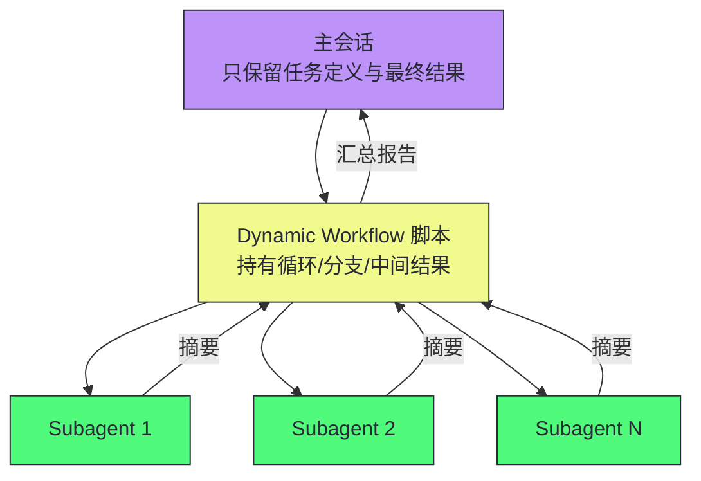
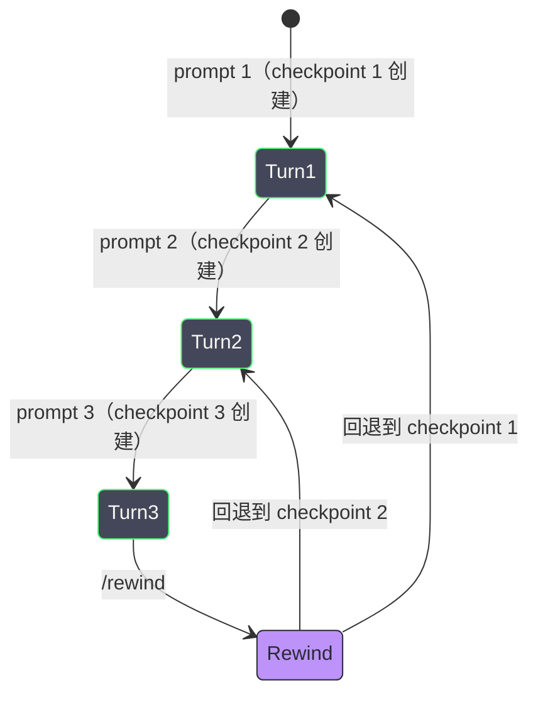
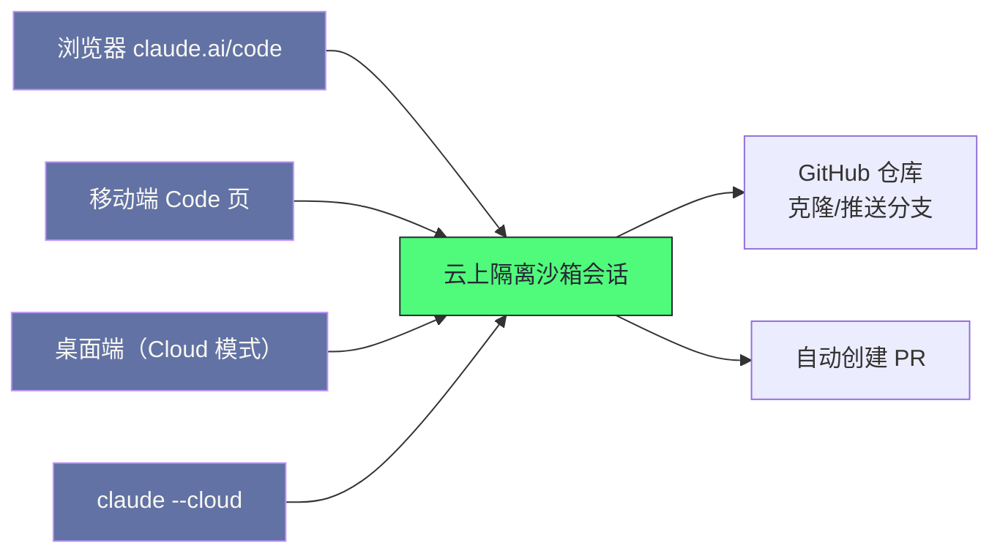

# 17 Claude Code 架构解构——Anthropic 的 CLI Agent 设计哲学

**摘要：**

本文解构 Anthropic 的 Claude Code——2025 年 2 月以研究预览身份随 Claude 3.7 Sonnet 一同亮相、三个月后转正为 1.0 的终端 Coding Agent，如今已长成横跨终端、IDE、桌面、浏览器、移动端的多表面平台，也沉淀出"默认信任、异常拦截"的成熟形态。文章先梳理它的版本演进主线（2025-02 预览 → 2025-05 GA → 2025-09 2.0 → 2025-10 Web 与 Agent Skills → 2025-11 桌面 → 2026 插件生态与云会话 GA），再从八个层次拆解架构：核心工具集（为 LLM 认知而设计的文件/Bash/搜索工具与 Bash 沙箱）、Agent Skills（过程性知识的可组合封装）、Subagent 与四种并行模式、会话与 Checkpoint（checkpointing/rewind、resume/分支/遥控）、Hooks 确定性控制、六种权限模式与规则优先级、MCP 与插件体系（含 Mods）、云会话/桌面/企业版治理。随后给出已知限制与生产避坑清单，并与 GitHub Copilot 的 coding agent 做了路线对照。行文中也反复指出这些能力的边界——沙箱默认静默降级、插件以你的身份运行、checkpoint 不追踪 Bash 编辑、Subagent 权限继承的历史 bug，等等。核心认知：Claude Code 的设计哲学是**渐进式授权 + 上下文外化**——从权限模式的分级授权，到 Subagent/Skills/Dynamic Workflows 把中间状态从上下文里搬出去，再到沙箱与 managed settings 把安全边界交给操作系统与组织策略，整条演进都围绕"让 Agent 真正做事，同时让失控的代价可承受"展开。

---

## 第 1 章 版本演进——从 Terminal 工具到多表面平台

### 1.1 一条可以被精确标注的演进时间线

2025 年 2 月 24 日，Anthropic 发布 Claude 3.7 Sonnet 的同时，把一个命令行工具以"limited research preview"的名义放了出来，它就是 Claude Code。彼时的它只有一个形态——终端里的 `claude` 命令，能力是搜索并阅读代码、编辑文件、运行测试、提交并推送 GitHub，Anthropic 在公告里给出一个流传很广的说法：内部测试中，它一次通过就能完成通常需要 45 分钟以上的手工工作。

三个月后的 2025 年 5 月 22 日，Claude Code 1.0.0 随 Claude 4（Opus 4 / Sonnet 4）转正为通用可用（General Availability，GA），同时交付了 VS Code 与 JetBrains 的 beta 扩展和 Agent SDK——产品开始从"终端里的一个命令"向外长出手脚。

随后的一年半里，演进明显加速，笔者按官方文档与发布日志整理如下：

| 时间 | 版本/事件 | 意义 |
| :--- | :--- | :--- |
| 2025-02-24 | 研究预览（随 Claude 3.7 Sonnet） | 终端形态，读文件/跑命令/改代码 |
| 2025-05-22 | 1.0.0 GA（随 Claude 4） | VS Code/JetBrains beta 扩展、Agent SDK、GitHub Actions 后台任务 |
| 2025-09-30 | 2.0（随 Sonnet 4.5） | 原生 VS Code 扩展、Checkpoint/rewind、重绘终端 UI |
| 2025-10-16 | Agent Skills 工程博客 | Skills 成为一等公民的扩展机制 |
| 2025-10-20 | Claude Code on the web（研究预览） | 浏览器里跑云上会话、iOS 预览 |
| 2025-11-24 | 桌面应用（研究预览，随 Opus 4.5） | 桌面端多会话并行、worktree 隔离 |
| 2025-12-18 | Agent Skills 开放标准 | 跨平台可移植的 Skills 格式 |
| 2026 上半年 | 2.0.x 系列 | 插件系统（v2.0.12 起）、Skills 进 CLI（v2.0.20 起）、Bash 沙箱落地 |
| 2026-05-22 | claude-plugins-official 官方插件目录 | 插件生态从社区散落走向官方审核 |
| 2026-09-23 | 云会话（Cloud Sessions）GA | 浏览器/手机/桌面/终端四端统一的云运行 |
| 2026-09-09 / 10-01 | Mods 系统发布（v2.1.287 进 release notes） | 用 TS/JS 定制 Claude Code 行为与界面 |
| 2026-10-23 | v2.1.310（撰稿时最新） | Monitor 工具等持续迭代 |

这张时间线值得玩味的地方在于：它不像传统软件那样"1.0 定型功能、2.0 换内核"，而是功能与版本号交错生长——2.0 的大版本号是 2025 年 9 月 30 日伴随 Sonnet 4.5 一起抬上去的，可它带来的主要是"原生 VS Code 扩展 + checkpoint/rewind + 终端 UI 重绘"这类体验重构，真正标志性的插件系统与 Skills 反而是此后 2.0.x 小版本里陆续补上的。产品迭代的驱动力不是"某个大版本的预定路线图"，而是模型能力与使用场景每几个月就换一茬的现实。

> [!note] 设计哲学：演进节奏跟着模型走
> 把这张表再读一遍，能读出另一层意思：Claude Code 的每次大版本几乎都与一次模型发布绑定——1.0 随 Claude 4，2.0 随 Sonnet 4.5，桌面版与 Opus 4.5 同日亮相。Coding Agent 的能力上限由底座模型决定，产品层做的所有工作——工具设计、上下文管理、权限边界——都是在把模型的能力"安全地放大"到真实仓库里。这种耦合在商业上合情合理，在架构上也解释了一件事：为什么 Claude Code 的工具集敢做得如此"激进"——因为它的系统提示、工具输出格式、权限模型都是围绕自家模型的认知模式调校过的，换一个模型的团队照搬这套工具集，未必得到同样的效果。

### 1.2 六个表面与一个核心

Claude Code 如今有六个主要使用表面：Terminal CLI、VS Code 扩展、JetBrains 扩展、桌面应用（Claude Desktop 的 Code 页）、Web（claude.ai/code）与移动端（iOS/Android 的 Code 页）。它们的共同点是共享同一套底层推理引擎与工具集，区别只在于入口与交互载体：

| 表面 | 形态 | 适用场景 |
| :--- | :--- | :--- |
| **Terminal CLI** | 命令行交互 | 核心入口，脚本/管道/CI 可调用 |
| **VS Code 扩展** | IDE 内嵌 | 内联 diff、@-mention、计划评审 |
| **JetBrains 扩展** | IDE 内嵌 | IntelliJ/PyCharm/WebStorm 等 |
| **桌面应用** | 独立桌面窗口 | 多会话并行、侧边栏管理、内置终端与编辑器 |
| **Web（claude.ai/code）** | 浏览器 | 云上会话，关掉电脑也能跑 |
| **移动端** | iOS/Android App | 发起、监控、遥控会话 |

Terminal CLI 至今仍是核心入口。为什么从 Terminal 开始而不是从 IDE 插件开始？这个选择并非偶然——Terminal 提供了几个 IDE 难以复制的优势：

**完整的系统能力**。Terminal 可以访问完整文件系统、执行任意 shell 命令、操作 Git，没有 IDE 的沙箱限制。这让 Claude Code 从一开始就拥有完整的"行动能力"，而非受限的"建议能力"。

**开发者自然工作流**。重度开发者早已习惯在 Terminal 中工作——`git`、`npm`、`docker` 都在 Terminal 里跑。Claude Code 作为 Terminal Agent 自然融入这个工作流，而不是要求开发者换个界面。

**管道与脚本集成**。Terminal 工具可以被管道组合、被脚本调用、被 CI/CD 集成。`claude -p "fix the bug"` 这样的一行命令可以被塞进 GitHub Actions、GitLab CI、定时任务，这是 IDE 插件形态难以做到的事——Agent 需要的"无人值守"能力，终端形态天然具备。

> [!note] 设计哲学：Terminal 优先 = 能力优先
> 从 Terminal 开始的设计选择，反映了 Claude Code 的核心定位——它不是"代码补全工具"，而是"能做事的 Agent"。Terminal 给了它完整的系统能力，让它真正读写文件、执行命令、操作 Git，而非只在 IDE 里建议改动。这种"能力优先"贯穿了后续几乎所有决策：工具集、权限模型、Subagent、插件体系，都是为了支撑"让 Agent 真正做事"这个核心目标。打个比方，很多产品把 Agent 做成坐在驾驶座旁的"导航员"——只报路况，方向盘还在人手里；Claude Code 则是让 Agent 坐上驾驶座，人在副驾看它开，给它设限速、装护栏。两者的分工截然不同，前者怕它撞车所以不给方向盘，后者给了方向盘再配一套刹车与保险。

---

## 第 2 章 核心工具集——为 LLM 认知设计的文件、Shell 与搜索能力

### 2.1 工具分类与权限

Claude Code 的内置工具分四类：

| 类别 | 工具 | 权限要求（Manual 模式） |
| :--- | :--- | :--- |
| **文件操作** | Read, Write, Edit, NotebookEdit, Glob, Grep, LSP | Read/Glob/Grep/LSP 免权限；Write/Edit/NotebookEdit 需权限 |
| **Shell 执行** | Bash, PowerShell, Monitor | 需权限（内置只读命令集除外） |
| **Web** | WebFetch, WebSearch | 需权限 |
| **MCP** | MCP 工具, ListMcpResources, ReadMcpResource | 需权限 |

这套工具集的设计贯穿一个原则——文件操作优先使用专用工具（Read/Edit/Write/Glob/Grep），而不是等价的 Shell 命令（cat/sed/find/grep）。理由有三：其一，**更细粒度的权限控制**。可以为 `Read(/secrets/**)` 设置 deny 规则，却很难为 `cat /secrets/*` 设置等价规则——Shell 命令的字符串形态让规则匹配天然脆弱。其二，**更清晰的审计日志**。工具调用记录显示的是 `Read(path)` 而非 `Bash(cat path)`，出了事容易追。其三，**输出格式更适合 LLM 消费**。结构化输出而非原始终端输出，这是"为 LLM 认知设计接口"思想的具体体现（[[LLM/Agent技术/Coding-Agent解构/18 Devin 与 ACI 设计——为 Agent 认知而生的计算机接口|下一篇]]将详细展开 ACI）。

### 2.2 文件工具：为什么不是 cat 的包装

**Read**：支持文本、图片、PDF、Jupyter notebook 的多模态读取，支持 `offset`/`limit` 参数做大文件分页读取——这直接呼应 [[LLM/Agent技术/基础范式/06 Prompt 上下文管理——Context Engineering 的艺术|第 6 篇]]讨论的 Observation 治理策略，防止大文件毒化上下文。

**Edit**：精确字符串替换——`old_string` 必须在文件中唯一匹配。这不是"让 LLM 生成整个文件然后覆盖"的粗暴方式，而是"让 LLM 指出确切位置和内容"的精准方式。它同时解决两个问题：减少 LLM 需要生成的 token 量，以及避免覆盖时引入非预期改动。

**Write**：创建新文件或完全覆盖现有文件。安全机制：如果文件已存在，必须先 Read 过该文件——确保 LLM "知道自己在覆盖什么"。

**Glob**：基于模式匹配的文件查找（如 `**/*.ts`、`src/**`），比 `find` 更 LLM 友好——模式语法更简洁，输出更结构化。

**Grep**：基于 ripgrep 的正则搜索，三种输出模式（`content` 显示匹配行 / `files_with_matches` 只给文件路径 / `count` 给匹配数）。Claude Code 的系统提示明确指示"**ALWAYS** use Grep for search tasks. **NEVER** use grep or rg as a Bash command"——因为 Grep 工具被优化了权限处理，输出格式也更适合 LLM 消费。

**LSP**：通过语言服务器获取代码智能——跳转定义、查找引用、类型错误。这是与 IDE 集成时的独特能力：直接利用语言服务器，而不是自己重新解析代码。

> [!info] 核心概念：专用工具优于 Shell 命令
> 专用工具之于 LLM，像高铁站台的屏蔽门之于乘客——开口是限定的，人只能从特定闸口进出，想乱穿轨道很难。Shell 命令是"平地"——路径无数、副作用不明、输出不可控；专用工具把 LLM 的每一次文件操作收敛到少数几个定义清晰的闸口上，权限、审计、输出格式三个问题一并解决。当然，屏蔽门也意味着灵活性损失——真正需要任意命令行的场景，仍要靠 Bash 工具兜底，两者是分工而非替代。

### 2.3 Bash 工具的行为边界

Bash 工具是 Claude Code 最强大也最危险的工具——它可以执行任意 shell 命令。

**内置只读命令集**：在 Manual 模式下，部分只读命令（如 `ls`、`cat`、`git status`、`git diff`、`git log`）不需要权限提示，减少常用只读操作的交互摩擦。

**命令模式匹配权限**：`allow`/`deny`/`ask` 规则可以用模式匹配控制 Bash 命令：
- `Bash(npm run *)`：允许 `npm run` 开头的命令
- `Bash(rm *)`：deny 规则阻止所有 `rm` 命令
- `Bash(git push *)`：ask 规则要求 `git push` 前确认

**Windows 支持**：Windows 上使用 PowerShell 或 Git Bash，PowerShell 工具有独立的权限规则格式（如 `PowerShell(Get-ChildItem *)`）。

**Monitor 工具**：在后台运行命令并逐行把输出反馈给 Claude——适用于长时间运行的命令（如 `npm run dev`、`tail -f`），长期前台睡眠的命令在此模式下会被阻断。

### 2.4 Bash 沙箱——从"问人"到"问系统"

如果说权限模式解决的是"要不要问人"，Bash 沙箱解决的则是"能不能不问了还安全"。沙箱（sandbox）是 2.0.x 系列引入的能力，它让操作系统在命令执行时强制限定文件与网络边界，沙箱内的命令可以免审批直接跑。

沙箱基于 Anthropic 开源的 `@anthropic-ai/sandbox-runtime` 构建，macOS 上依赖系统自带 Seatbelt 框架，Linux/WSL2 上依赖 bubblewrap 与 socat。它管住四条边界：

| 边界 | 默认 | 可配置项 |
| :--- | :--- | :--- |
| **写入** | 工作目录、每用户临时目录、已添加目录 | `filesystem.allowWrite` / `filesystem.denyWrite` |
| **读取** | 几乎整台机器（含 `~/.ssh`、`~/.aws/credentials`） | `filesystem.denyRead`、凭据保护开关 |
| **网络** | 无直连出口，走本机代理逐域名校验 | `network.allowedDomains` / `network.deniedDomains` |
| **环境变量** | 继承 Claude Code 的环境 | 凭据清洗（`CLAUDE_CODE_SUBPROCESS_ENV_SCRUB`） |

网络边界是其中最有意思的设计——沙箱内的命令没有直连出口，所有连接都经过本机一个代理，代理按允许域名列表逐条校验，首次遇到新域名时提示批准（auto 模式下则由分类器连同命令一起审查）。用"海关"来比喻很贴切：命令是出境的货物，每件都要报关，报关单上没有的收货地址一律不放行，而允许域名列表就是那本不断更新的"常往来客户名单"。

沙箱只包裹 shell 命令——文件工具（Read/Edit/Write）、MCP 服务器、Hooks 都在沙箱之外，各自遵循自己的权限规则。这意味着沙箱不是全能保险，而是一层专门针对"命令执行"的隔离。若是要连文件工具一起锁死，官方建议把整个 Claude Code 进程放进容器或虚拟机，这也是 [[LLM/Agent沙箱技术/00 专栏导览|Agent 沙箱技术专栏]] 讨论的主题。

> [!warning] 生产避坑：沙箱失败默认静默降级
> 默认情况下，如果沙箱因依赖缺失或平台不支持而无法启动，Claude Code 会直接不加沙箱运行命令——静默降级。对个人使用这是体贴，对强制合规场景则是漏洞：某台开发机没装 bubblewrap，团队以为开着沙箱，实际命令裸奔。解决方案是把 `sandbox.failIfUnavailable` 设为 `true`，让沙箱起不来时直接拒绝启动，并用 managed settings 在全组织强制。另外，沙箱有"unsandboxed retry"逃生口——命令在沙箱里失败后可以申请免沙箱重试，这个口子默认开着，需要时可以关掉。

---

## 第 3 章 Agent Skills——过程性知识的可组合封装

### 3.1 从"写在 CLAUDE.md 里"到"用时才加载"

很长一段时间里，让 Claude Code 记住团队规范的方式是 CLAUDE.md——把约束、约定、流程写进项目根目录的记忆文件，会话开始时整份加载进上下文。这个方案在小项目里够用，可一旦 CLAUDE.md 膨胀到几千行——接口规范、部署流程、代码风格、测试套路全塞进去——问题就来了：**与当前任务无关的内容也在每轮推理中占用上下文**。前文反复强调的"最小的高信号 token 集合"，CLAUDE.md 恰恰是反例。

Agent Skills（2025 年 10 月 16 日随工程博客发布，同年 12 月 18 日作为开放标准公开）解决的就是这个问题。一个 Skill 是一个目录，核心是一份 `SKILL.md`，里面是结构化指令，可以附带脚本与资源文件。它平时不占上下文——只有 Claude 判断当前任务相关时才加载正文。官方给出的判断标准非常干脆：**当 CLAUDE.md 里某一段从"事实"长成了"流程"时，就该把它挪进 Skill**。在笔者看来，这个判断标准比任何 API 手册都更能说明 Skills 的定位——它针对的不是"知识太少"，而是"知识放错了地方"。

```markdown
# 技能目录结构示例
.skills/pdf-helper/
├── SKILL.md          # 指令本体：何时用、怎么用、注意事项
├── scripts/
│   └── fill_form.py  # 附带的可执行资源
└── templates/
    └── form.yaml     # 结构化参考数据
```

Skill 的 `SKILL.md` 头部 frontmatter 里的 `name` 与 `description` 决定了"何时被触发"——Claude 扫描可用 Skills 时靠 description 判断相关性。这也带来了一个与 Subagent 相似的分层：**description 永远在上下文里**（让模型知道有这个东西），**正文只在被选中时加载**（加载了才花 token）。

### 3.2 Skills 与 CLAUDE.md、命令的分工

把三者放一起看，边界就清晰了：

| 载体 | 加载时机 | 适合内容 |
| :--- | :--- | :--- |
| **CLAUDE.md / AGENTS.md** | 每次会话开始 | 事实性约束：目录结构、代码风格、禁止事项 |
| **Skill** | 按需触发 | 过程性知识：多步流程、带脚本的专门任务 |
| **自定义命令** | 显式调用 `/command` | 固定格式的短指令 |

2025 年底之后，自定义命令（`.claude/commands/*.md`）与 Skill 合并为一个体系——`.claude/skills/deploy/SKILL.md` 会创建 `/deploy` 命令，与旧的 `.claude/commands/deploy.md` 行为一致，但 Skill 多了目录、frontmatter 与自动触发能力。Claude Code 自带的 bundled skills（`/doctor`、`/code-review`、`/batch`、`/debug`、`/loop`、`/claude-api`）本质上都是"提示型"Skill——它们不给模型硬编码逻辑，而是给详细指令让 Claude 用工具自己编排。

> [!note] 设计哲学：把"怎么做"外化成可复用资产
> Skills 像老匠人书架上按标签分类的私藏配方——平时不占台面，遇到对应的活儿才抽出来照着做。它的意义不在于"多了一种配置文件"，而在于改变了过程性知识的生命周期：过去"怎么做部署"这种知识活在个别工程师的脑子里，或者臃肿的 CLAUDE.md 里，人走了知识就散；现在它可以被封装、被版本管理、被跨项目共享、甚至跨工具移植（Agent Skills 是开放标准，官方明确表示同一格式可用于 Claude 各端与 API）。但配方也有配方的代价——描述与正文的分层让模型可能"不知道该用"或"用错"，所以 description 的写作质量直接决定 Skill 的命中率，这是把知识外化后转移给模型的"维护税"。

### 3.3 Skills 的边界与反例

Skills 不是万能的。它的适用前提是"知识可以写成指令"。以下情况它并不合适：

- **需要确定性执行而非模型发挥**的逻辑，应该用 Hook（第 6 章详述）——Hook 是死的，Skill 是活的
- **需要独立上下文窗口的长任务**，应该用 Subagent——Skill 在主上下文里运行，读大文件一样污染上下文
- **需要与其他工具系统交互**的能力，应该用 MCP Server——Skill 附带的脚本只能自己跑，接不了外部服务

这个边界在插件时代变得更加微妙：一个插件可以把 Skill、Agent、Hook、MCP Server 打包在一起，但打包不等于混用——组件各自的服务对象与执行时机仍然泾渭分明。

---

## 第 4 章 Subagent 与并行模式——把工作拆出去

### 4.1 Subagent 的核心机制

Subagent 是 Claude Code 最早确立的架构特性之一——主 Agent 可以委派子任务给一个拥有**独立上下文窗口**的 Subagent。

工作方式：
1. 主 Agent 通过 `Agent` 工具调用一个 Subagent
2. Subagent 在自己的独立上下文窗口中运行
3. Subagent 有自己的系统提示、工具集和权限
4. 完成任务后，只把**精炼的摘要结果**返回给主 Agent
5. Subagent 的中间过程（Thought-Action-Observation 链）不进入主 Agent 的上下文

内置 Subagent 包括：

| Subagent | 模型 | 工具权限 | 用途 |
| :--- | :--- | :--- | :--- |
| **Explore** | 继承主对话 | 只读工具（Write/Edit 被 deny） | 代码库探索、信息收集 |
| **Plan** | 继承主对话 | 跳过 CLAUDE.md 和 git status | 规划模式下的上下文收集 |
| **general-purpose** | 继承主对话 | 继承主对话工具 | 通用子任务 |

自定义 Subagent 定义在 `.claude/agents/` 目录的 Markdown 文件里：

```markdown
---
name: code-reviewer
description: Use this agent for code review tasks. Specializes in identifying bugs, security issues, and style violations.
tools: [Read, Grep, Glob, Bash]  # 限制可用工具
---

You are a code review specialist. When reviewing code:
1. Check for common bug patterns...
2. Verify error handling...
3. Look for security vulnerabilities...
```

`description` 字段让 Claude 知道"什么时候该委派"；`tools` 字段限制可用工具——只读 Subagent 就算主 Agent 有写权限，委派过去的任务也写不了文件，这是权限最小化原则的直接体现。

### 4.2 上下文隔离的实际效果

[[LLM/Agent技术/基础范式/06 Prompt 上下文管理——Context Engineering 的艺术|第 6 篇]]已经分析过 Subagent 的上下文隔离效果，在 Claude Code 里它的价值具体化为三点：

- **代码库探索不污染主上下文**：Explore Subagent 可以读 20 个文件理解结构，主 Agent 只收到一份几百 token 的结构摘要
- **并行搜索**：多个 Subagent 可同时搜索代码库不同部分，各自有独立上下文
- **权限隔离**：只读 Subagent 不能修改文件，即使主 Agent 有写权限

> [!warning] 生产避坑：Subagent 权限继承的已知 bug
> 截至 2025 年的已知问题包括：1）Subagent 不继承 `bypassPermissions` 模式（Issue #37442）——bypassPermissions 会话里 Subagent 仍可能要求权限确认；2）运行时 UI 接受的权限不传播给子 Subagent（Issue #51289）；3）Workflow Subagents 不继承 settings.local.json 的 allow-rules（Issue #73633）。这些 bug 意味着高度自动化场景里 Subagent 可能意外要求权限确认——依赖 bypassPermissions 做无人值守运行时，需要把这些限制写进预案，而不是假设"主会话怎么配、子代理就怎么跑"。

### 4.3 四种并行模式

Claude Code 提供四种不同层级的并行执行模式：

| 模式 | 并行单元 | 上下文关系 | 适用场景 |
| :--- | :--- | :--- | :--- |
| **Subagent** | 单会话内的子任务 | 独立上下文，返回摘要 | 副任务会淹没主对话（搜索结果、日志、文件内容） |
| **Agent View** | 多个独立后台会话 | 完全独立的完整会话 | 多个独立任务，想统一派发和监控 |
| **Agent Teams** | 多个协调会话 | 共享任务列表 + 消息传递 | 让 Claude 自己拆分项目、分配任务、保持同步 |
| **Dynamic Workflows** | 脚本编排的大量 Subagent | 脚本持有循环和中间结果 | 任务超出单会话可协调的 Subagent 数量 |

**Subagent**：单会话内的并行。主 Agent 委派子任务，Subagent 独立上下文完成，返回摘要。适合"副任务会淹没主对话"的场景。

**Agent View**（`claude agents`）：一个屏幕统管所有后台会话。每个后台会话是完整的 Claude Code 对话，无终端连接时也持续运行；查看每个会话状态（运行中/需要输入/已完成），只在需要你时介入。Agent View 自动为每个派发的会话创建独立 Git worktree，解决并行会话编辑同一文件的问题。

**Agent Teams**（实验性）：多个 Claude Code 会话相互通信——共享任务列表、Agent 间消息传递。一个 lead Agent 管理工作者们，协调任务分配与同步。

**Dynamic Workflows**：最高层级的并行模式——Claude 编写一个 JavaScript 脚本来编排大量 Subagent，脚本在后台执行，主会话保持响应。与 Subagent/Agent Teams 的关键区别：前者 Claude 是编排者，逐轮决定下一步 spawn 什么，每个结果都进入上下文；后者**脚本持有循环、分支和中间结果**——Claude 的上下文只保留最终答案。



内置 Workflow 示例是 `/deep-research`——编排多个 Agent 跨多个来源调查一个问题，后台分阶段执行，最终返回报告而非逐步转录。

> [!info] 核心概念：Dynamic Workflows 把编排从"对话"移到"代码"
> Subagent 模式下，编排逻辑存在于 Claude 的上下文中——每一步"接下来做什么"都是 Claude 基于当前上下文动态决定的，编排本身消耗上下文 token，50 个 Subagent 的编排历史会占据大量空间。Dynamic Workflows 把编排逻辑外化到 JavaScript 脚本里——循环、分支、中间结果都在脚本中，Claude 的上下文只保留"任务是什么"和"最终结果是什么"。这是 Context Engineering 的"Just-in-Time"原则在编排层面的应用：把中间状态外化到代码，而不是塞进窗口。代价是编排失去了临场灵活性——脚本是预写的，遇到脚本没预料到的情况，需要"回调 Claude 做决策"的机制来弥补。

---

## 第 5 章 会话、Checkpoint 与上下文管理

### 5.1 会话的生命周期

Claude Code 的会话可以命名、续接（`--continue`/`--resume`）、分支（fork）。跨多日的长任务可以在每次会话中继续，而非从头开始。会话转录（transcript）保存在本地，可以导出。2025 年底之后新增的 Remote Control 让本地会话可以从手机、平板或任意浏览器继续——会话不再绑定于启动它的那台终端的物理存在。

会话持久化与 [[LLM/Agent技术/基础范式/06 Prompt 上下文管理——Context Engineering 的艺术|第 6 篇]]讨论的 Memory Tool 配合——Claude Code 在会话间使用文件系统记忆保存关键发现与项目状态，下次会话开始时读取恢复上下文。Claude Code 还支持 CLAUDE.md 与 AGENTS.md 双记忆文件，以及"auto memory"——让 Claude 在会话中自动把值得记住的东西写进记忆，不需要人手动维护。

### 5.2 Checkpointing 与 /rewind——可回退的 Agent

2025 年 9 月的 2.0 版本带来的 Checkpointing 是 Claude Code 最值得称道的可靠性设计之一。它的机制是：**每个你发送的、开启一轮对话的 prompt 都会创建一个 checkpoint**，记录当时文件的快照；Claude 的文件编辑工具产生的所有改动都会被持续追踪。会话中保留最近 100 个 checkpoint 的文件快照，更老的会被清理（除非被其他 checkpoint 引用）。

`/rewind` 菜单（或空输入时按两次 Esc）列出本次会话发送过的所有 prompt，选择任意一个时间点后有四档动作：

| 动作 | 行为 |
| :--- | :--- |
| **Restore code and conversation** | 代码与对话同时回退到该点 |
| **Restore conversation** | 只回退对话，保留当前代码 |
| **Restore code** | 只回退文件改动，保留对话 |
| **Summarize from here** | 从该点起压缩对话，保留近期轮次 |

Checkpoint 与对话一起保存，所以 resume 之后仍然可以 `/rewind`。文件快照在会话最后保存约 30 天后被清理（`cleanupPeriodDays` 可调），清理后回退可能失败并提示 "No files were restored"。



> [!note] 设计哲学：Checkpoint 是 Agent 的"存档点"
> 玩过单机游戏的人都知道存档的意义——不是"一定会死"，而是"死了不用从头再来"。没有 checkpoint 的 Agent 一旦改错了方向，代价是全量回滚（git revert 一整批改动）或人工清理（把夹在正确改动里的错误改动挑出来删掉），这两种都痛苦。Checkpoint 把"撤销"的粒度从"整个 commit"细化到"每一轮 prompt"，让开发者敢放手让 Agent 连续干很多轮——这是"让自主性可被信任"的又一个实例。但要注意它与 git 的关系：checkpoint 追踪的是 Claude 的文件编辑工具改动，`sed -i` 这类 Bash 编辑默认不进入 checkpoint，也不会被 `/rewind` 恢复——边界必须清楚，否则会误以为"什么都能回退"。

### 5.3 上下文管理

Claude Code 虽然内置了 Context Editing 与 Memory Tool，极长会话仍可能遇到上下文退化。可用的手段包括：

- 使用 Subagent 隔离大探索任务（第 4 章）
- 定期 `/compact` 手动触发上下文压缩（服务器端压缩，将早期历史摘要化）
- 跨日任务使用 Memory Tool 保存关键状态
- 通过 `/model` 在会话中切换模型、调整 effort 级别
- `/clear` 清空会话、`/rewind` 回到更早时间点、fork 分支会话

Claude Code 还自动管理 prompt caching——模型切换后第一次调用会经历未缓存的慢轮次，之后命中缓存；`/compact` 也会打断缓存，这些都是成本侧要预判的细节。这些机制共同指向同一个原则：**上下文是预算，不是仓库**——能把中间状态外化的（Subagent、脚本、记忆文件）就不要留在窗口里。

### 5.4 会话的遥控与跨会话协作

2026 年的 Remote Control 与跨会话消息把"会话"从终端进程升格为可寻址的对象：本地会话可以从手机、平板或任意浏览器继续（claude.ai/code 与 Claude 移动应用），发起方与接管方看到的上下文完全一致；`claude agents` 派发的后台会话、Agent Teams 里的成员会话都支持跨会话消息，Claude 可以列出本机其他会话并给它们发消息，甚至触达其他机器或云上的会话。对多 Agent 协作而言，这意味着会话已经具备了进程间通信的雏形——每个会话既是任务执行单元，也是可被寻址、可被投递消息的工作节点。本地与云端会话通过 `--teleport` 迁移时，对话、checkpoint、文件快照随之一并搬迁，这让"换台机器继续干"不再是手工拷贝目录的游戏。

### 5.5 Git 操作集成与 Worktree 隔离

Claude Code 的 Git 操作不是通过独立的"Git 工具"实现的——它通过 Bash 工具执行 `git` 命令，但系统提示里内置了 Git 操作的最佳实践，把"怎么用 Git"训练成模型的行为惯性：

- **Commit**：使用 Conventional Commits 格式（`feat:`/`fix:`/`refactor:` 前缀），自动 `git add -A`，提交前检查无敏感文件（`.env`/`.pem`/`.key`）
- **Branch**：命名规范 `username/type/slug`，保持与 `origin/main` 同步
- **PR**：使用 `gh` CLI 创建 PR，支持 Draft PR
- **Worktree**：`git worktree add` 用于并行开发的文件隔离

其中 worktree 与并行会话的关系最值得展开：当多个 Claude Code 会话并行运行时（如 Agent View 模式），如果在同一个仓库工作，可能产生文件冲突。Git worktree 解决了这个问题——每个会话在独立的 worktree（独立的工作目录 + 独立的分支）中工作，互不干扰。Agent View 自动为每个派发的后台会话创建独立的 worktree；手动并行运行时，则需要开发者自己创建。worktree 与 checkpoint 共享同一条设计意图：**让并行与回退都不需要人为协调**。Bash/文件/Git 三者的更底层工程细节（原子写入、文件锁、两阶段终止等）留给 [[LLM/Agent技术/Coding-Agent解构/21 Agent 与操作系统的交互接口——Bash、文件与 Git 的工程化|第 21 篇]] 单独展开。

---

## 第 6 章 Hooks——确定性控制的自动化层

### 6.1 从"模型自律"到"规则保障"

Agent 体系里有一个天然矛盾：模型的每个动作都带概率性，而工程上有些动作必须"必然发生"——每次编辑后格式化、每次推送前跑测试、危险命令执行前拦截。靠系统提示让模型"记得"做这些事，等于把关键路径押在概率上。Hooks 解决的就是这个问题：它是用户定义的 shell 命令，Claude Code 在生命周期特定节点触发它们——**确定性执行，不依赖模型判断**。

```json
{
  "hooks": {
    "PostToolUse": [
      {
        "matcher": "Edit|Write",
        "hooks": [{ "type": "command", "command": "jq -r '.tool_input.file_path' | xargs npx prettier --write" }]
      }
    ],
    "Notification": [
      {
        "matcher": "",
        "hooks": [{ "type": "command", "command": "osascript -e 'display notification \"Claude Code needs your attention\" with title \"Claude Code\"'" }]
      }
    ]
  }
}
```

上面这段配置干了两件事：每次 Edit/Write 之后自动跑 prettier 格式化（PostToolUse + matcher 限定事件类型），以及 Claude 需要输入时发桌面通知（Notification 事件）。

### 6.2 事件与决策

Hooks 覆盖 Claude Code 生命周期的关键节点：`PreToolUse`（工具调用前，可拒绝）、`PostToolUse`（工具调用后）、`UserPromptSubmit`（用户提交 prompt 后）、`Notification`、`Stop`（Claude 完成回合）、`SubagentStop`（Subagent 结束）、`PreCompact`（压缩前）、`SessionStart`/`SessionEnd`、`PermissionRequest`（权限请求）。其中 `PreToolUse` 与 `PermissionRequest` 是权限评估顺序的第一环——它们可以拒绝或放行，权限评估顺序为：Hooks → deny 规则 → ask 规则 → 权限模式。

Hooks 的触发时机是"事件"而非"轮次"，matcher 用正则匹配工具名或事件子类型。除了纯 shell 命令型 hook，2026 年的 Hooks 体系还扩展出两类更"智能"的变体：**prompt-based hooks**（用一个 Claude 模型评估条件后决定放行与否）与 **agent-based hooks**（交给一个 Agent 判断），用于"需要判断而非死规则"的场合——判断交给模型，触发仍然确定。Hooks 支持异步执行与 MCP 工具钩子，事件模型已经相当完整。

> [!warning] 生产避坑：Hooks 在沙箱之外
> 一个重要的事实：Hooks 与 MCP 服务器、LSP 服务器一样，**运行在沙箱之外**，拥有与 Claude Code 进程相同的权限。这意味着一个被注入到 hook 配置里的恶意命令拥有完整系统权限——hook 配置文件的来源必须可信。组织层面用 managed settings 限定哪些 hook 被允许，个人层面至少别把不受信任的仓库的 hook 配置随便应用。另外，PreToolUse/PermissionRequest hook 在 Windows 上曾有绕过漏洞（v2.1.310 修复了 Git Bash 缺失时仅含引号字符串的 hook 命令放行问题），这类"hook 本意是拦，结果反而放行"的边界情况值得在关键场景里做回归测试。

---

## 第 7 章 权限模式、沙箱与安全边界

### 7.1 六种权限模式——渐进式授权

Claude Code 的权限系统是两层结构：**模式（Mode）** 设置基线（多少操作可以不经询问执行），**规则（Rules）** 在基线上覆盖特定工具的允许/拒绝/询问行为。

六种权限模式按自动化程度递增排列：

| 模式 | 不经询问可执行的操作 | 适用场景 |
| :--- | :--- | :--- |
| `default`（Manual） | 仅读取 | 入门使用、敏感操作 |
| `acceptEdits` | 读取 + 文件编辑 + 常见文件系统命令（mkdir/touch/mv/cp 等） | 正在审查的代码迭代 |
| `plan` | 读取 + 分类器批准的只读命令（配合 auto 模式时） | 修改前的代码库探索 |
| `auto` | 一切操作，但有后台安全分类器审查 | 长任务，减少提示疲劳 |
| `dontAsk` | 仅预批准的工具 | 锁定的 CI 和脚本 |
| `bypassPermissions` | 一切操作，无任何检查 | 仅限隔离容器和 VM |

会话中通过 `Shift+Tab` 在 `default` → `acceptEdits` → `plan` 之间循环切换，状态栏显示当前模式。`auto` 与 `bypassPermissions` 不在默认循环里。一个重要的时效性变化：**2025 年 9 月的 2.0 是"default 起步"，2026 年的版本（v2.1.283+）已把 auto 设为内置默认起始模式**——随着分类器成熟，Anthropic 显然认为"默认信任、异常拦截"比"默认询问、异常放行"更符合长任务的现实。这一变化值得使用者注意：如果你第一次打开会话什么都不做，它现在默认可能已经在 auto 模式下干活了。

### 7.2 auto 模式——分类器驱动

auto 模式不是"允许一切"（那是 bypassPermissions），而是用一个后台分类器（历史上为 Sonnet 4.x 系列模型）评估每个工具调用：

- 分类器判断操作是否**不可逆、有破坏性、或目标在环境之外**
- 安全操作自动执行，危险操作被阻止
- `deny` 和 `ask` 规则优先于分类器评估

`autoMode.environment` 配置告诉分类器"哪些仓库、云存储桶和域名是可信的"——默认只信任工作目录和当前仓库的配置 remote。推送到公司源代码组织、写入团队云存储桶等操作，在配置前会被阻止。

> [!warning] 生产避坑：auto 模式会拦截"工作目录之外的首读"
> 一个容易踩的细节：auto 模式下，第一次读取工作目录之外的文件前，分类器会提示；如果阻止了这次读取，后续相关 shell 命令就可能逐个弹权限确认（v2.1.310 专门改进了这条提示的措辞）。也就是说"一次拒绝"可能滚雪球成"一堆询问"——遇到这种情况，别急着把模式调到 bypassPermissions，先用 `/permissions` 把该目录加进信任范围，或者重新审视那条命令本身是不是真的该跑。

### 7.3 bypassPermissions——仅限隔离环境

bypassPermissions 跳过所有权限检查——包括受保护路径的检查。这个模式的设计意图是**仅在隔离容器和 VM 中使用**——Docker 容器、CI/CD 临时环境等"即使出问题也不会影响真实系统"的场景。组织管理员可以通过 managed settings 的 `disableBypassPermissionsMode: "disable"` 禁用此模式。

> [!warning] 生产避坑：bypassPermissions 的安全风险
> bypassPermissions 模式下 Claude Code 可以执行**任何**操作——包括 `rm -rf /`、`git push --force`、读取 `~/.ssh/` 下的私钥并写入网络。在有真实凭证和真实文件系统的工作站上使用它是极其危险的——一次 Prompt Injection 攻击就可能导致密钥泄露或数据销毁。正确使用场景仅限于：1）Docker 容器（文件系统隔离）；2）临时 VM（可随时销毁）；3）CI/CD 临时环境（无敏感凭证）。即使在这些环境中，也应配合 Egress 网络过滤（[[LLM/Agent沙箱技术/00 专栏导览|Agent 沙箱技术专栏]]的主题）防止数据外泄。

### 7.4 权限规则的评估顺序

当 Claude 请求调用工具时，权限检查按以下顺序执行：

1. **Hooks**：自定义钩子可以拒绝或放行
2. **deny 规则**：如果匹配，直接阻止（即使在 bypassPermissions 模式下）
3. **ask 规则**：如果匹配，转交 `canUseTool` 回调做人工确认（即使在 bypassPermissions 模式下）
4. **权限模式**：根据当前模式决定是否自动批准

关键设计：**deny 和 ask 规则优先于权限模式**——即使在 bypassPermissions 模式下，deny 规则仍然阻止操作，ask 规则仍然要求确认。这确保了"无论如何都不能执行的操作"始终被阻止。

> [!note] 设计哲学：分级授权像银行的柜台体系
> 六种模式像银行的柜台分级授权——小额存取免密（default 的只读）、普通转账要验证（acceptEdits/plan）、大额或有风险的操作必须人工复核（ask 规则）、而对绝对信任的通道（内部系统间）才放开免密接口（bypassPermissions）。银行不会因为"免密方便"就给所有客户开免密——它会先评估渠道隔离程度。Claude Code 的渐进式授权同理：信任度高的环境给高自动化，信任度低的环境收窄权限，而"规则永远优先于模式"则相当于银行里"任何通道都不能违规转账"的硬底线。

### 7.5 Subagent 权限的特殊行为

Subagent 的 `tools` 字段限制了可用工具集，但权限规则（allow/deny/ask）的传播在 Subagent 中有特殊行为——某些规则可能不按预期工作（见第 4 章已知 bug）。在依赖细粒度权限规则的关键场景中，应测试 Subagent 的实际权限行为。另外 2.x 起子代理可以从 `skills` 字段预加载最多 32 个 Skill（每个一次），Skill 的 `allowed-tools` 与 `effort` 在流式响应结束前可能被丢弃，曾导致 `-p` 运行模式下 Skill 的 Bash 命令被拒绝——这类跨机制交互的边界案例，是生产使用中最容易踩坑的地方。

---

## 第 8 章 MCP 与插件体系——从"接工具"到"装生态"

### 8.1 MCP 原生集成

Claude Code 原生支持 MCP（Model Context Protocol，[[LLM/Agent技术/基础范式/04 MCP 协议深度解析——Agent 与工具的标准化连接|第 4 篇]]详述），通过命令行或 `.mcp.json` 配置添加 MCP Server：

```bash
# 添加 stdio MCP Server
claude mcp add filesystem -- npx -y @modelcontextprotocol/server-filesystem /path

# 添加远程 HTTP MCP Server
claude mcp add --transport http my-service https://mcp.example.com/mcp
```

MCP Server 暴露的工具自动成为 Claude Code 可用的工具——与内置工具一样受权限规则管控，并支持 `ListMcpResources` 与 `ReadMcpResource` 访问 Resources 原语。远程 MCP 的 OAuth 凭据、MCP 工具搜索（动态加载工具定义）等细节在 [[LLM/Agent技术/基础范式/05 MCP 生态与实践——Server 开发、集成与生产部署|第 5 篇]]已有展开，笔者此处不重复。

一个常被忽视的坑：Claude Desktop 时代的 MCP Server PATH 问题在 Claude Code 中依然存在——配置里的命令不在 Claude Code 的 PATH 中会报 "command not found"。解决方案是用绝对路径或在配置里显式设置 PATH。另外，非交互会话（`-p`、SDK）里 MCP 工具调用超时且服务端 elicitation 无人应答时，Claude 会收到明确提示"没有收到答案、不要重复调用"——这类面向模型的错误措辞，本身就是 ACI 设计的一部分。

还有两个 2.x 起的重要机制值得单独说明。其一是 **MCP tool search**——当 MCP Server 数量增多时，工具定义不再每轮全量进上下文，而是按需动态加载，这正是第 3 章 Skills"描述常驻、正文按需"同款策略在工具层的复用，MCP 工具的数量因此可以扩展到数百而不撑爆窗口。其二是 **MCP elicitation**——MCP Server 可以在会话中向用户弹出表单、或要求打开浏览器完成 OAuth 授权，Claude Code 的 Notification hook 甚至为 elicitation 单独定义了事件子类型，无人值守时还能触发提醒。远程 MCP 的凭据管理与 OAuth device flow 是 [[LLM/Agent技术/基础范式/05 MCP 生态与实践——Server 开发、集成与生产部署|第 5 篇]] 的完整主题，这里只需记住一个结论：Claude Code 把 MCP 当成"一等公民"，MCP 工具与内置工具共享同一套权限与审计管线，而不是作为旁路接入——旁路接入是安全事件最常见的来源，把新工具纳入既有治理管道，是 MCP 集成最不该省略的一步。

### 8.2 插件——把扩展打包成单位

MCP 解决的是"接外部工具"，Skills 解决的是"教 Claude 做事"，Subagent 解决的是"派独立的人手"，Hooks 解决的是"保证必然发生"——但当一个团队想把这些组合起来分发给同事时，需要一种"打包"机制。插件（Plugin）就是这个打包单位：一个目录，包含 manifest（`.claude-plugin/plugin.json`）与若干组件——Skills、Agents、Hooks、MCP 服务器，作为一个整体安装、更新、共享。

```text
my-plugin/
├── .claude-plugin/
│   └── plugin.json        # 插件名、版本、描述
├── skills/
│   └── review/SKILL.md    # 技能组件
├── agents/
│   └── reviewer.md        # 子代理组件
├── hooks/
│   └── hooks.json         # 钩子组件
└── .mcp.json              # MCP 服务器组件
```

安装一条命令：`/plugin install {plugin-name}@claude-plugins-official`。插件从 marketplace（目录仓库，含 `.claude-plugin/marketplace.json`）拉取；官方 marketplace 在首次启动交互会话时自动预注册。

插件体系的关键事实与边界：

- **启用即常驻**：启用插件后，其每个可自动触发的 Skill/Agent 的名称与描述每轮都在上下文里（Claude 需要知道它们存在），只是正文按需加载——所以官方会给出插件的 "Context cost" 估算，装了不用也有开销
- **以你的身份运行**：插件运行的代码拥有你的权限，安全审查对象是插件的每个组件，不只是名字
- **官方目录的两级审核**：2026 年 5 月 22 日上线的 `claude-plugins-official` 把插件分为内部（Anthropic 自研，覆盖 LSP 支持、PR 审查、Git 工作流自动化等）与外部（GitHub、GitLab、Linear、Playwright、Terraform 等伙伴作品）两类，外部插件需通过质量与安全筛查，"Anthropic Verified" 徽章代表更严格的复核——但官方明确警告，即便目录内插件也可能加载未经验证的第三方软件

> [!warning] 生产避坑：插件不是"装了就安全"
> 官方文档在插件页面上反复强调的一句话是：插件"以你的身份运行"。这跟手机应用商店的哲学很不一样——应用商店好歹有沙箱隔离，Claude Code 插件直接继承你的 shell 权限。组织层面的对策是 managed policy：只允许官方 marketplace 与内部自建 marketplace，禁止社区源；个人层面则是安装前读 manifest、检查 hooks 与 MCP 服务器组件，而不是只看 star 数。**能力越强的扩展点，越需要独立的信任决策**——这是插件体系给所有 Agent 平台出的共同考题。

### 8.3 Mods——用代码改 UI 与行为

2026 年 9 月 9 日发布的 Mods 是插件体系之上更激进的一层：hooks 用 JavaScript 函数编写（hooks module），能绘制面板、添加命令、改变 Claude Code 的界面与行为。随附的内置 mods 包括 `sec-default`（保护组织的 managed 规则不被后装插件覆盖）、`diff`（为 `/diff` 提供实时未保存改动视图）、`telemetry`、`agents-md`（把 AGENTS.md 作为项目指令加载）等。

Mods 的发布节奏本身就说明生态的演化方向：插件把"扩展能力"标准化，Mods 把"改造产品本身"也标准化了——但 hook API 仍是 Early Access，可能随版本变化，生产使用需记录版本依赖并保留快速关闭通道。

---

## 第 9 章 云会话、桌面与企业版——从开发工具到组织基建

### 9.1 云会话：关掉电脑，任务继续

2025 年 10 月 20 日发布的 Claude Code on the web 曾以 research preview 形式开放浏览器运行编码任务，2026 年 9 月 23 日，云会话（Cloud Sessions）正式 GA。它的本质是把 Claude Code 会话搬到云基础设施上运行——默认跑在 Anthropic 托管的隔离沙箱里，也可以路由到组织自托管环境。



云会话的关键特性：

- **多端统一**：浏览器、手机、桌面（选 Cloud 而非 Local）、终端（`claude --cloud`）四端可发起；`--teleport` 把会话搬到另一台机器
- **关闭电脑不停**：会话在云上持续运行，任意设备可查看与干预
- **GitHub 深度集成**：连接 GitHub 后自动克隆、推送分支、创建 PR，并支持 auto-fix PR
- **定时任务**：scheduled tasks（原 routines）以云会话形式按计划、API 调用或 GitHub 事件触发
- **可用范围**：Pro/Max/Team 与 Enterprise 的 premium 席位；自托管环境（self-hosted environments）支持把 runner 部署在自有基础设施上，会话路由过去

云会话把"Agent 必须在你的电脑上跑"这个前提彻底取消了。对架构认知而言，它回答了 Coding Agent 规模化部署的一个关键问题：**算力与网络在云上，代码与凭据的管控也在云上**——本地模式里"代码在本地、推理在云端"的割裂被抹平了，安全边界也从"每台开发机"收敛到"一个可审计的环境"。

> [!note] 设计哲学：云会话像无人值守的夜班施工队
> 本地会话像白天你盯着施工的装修队——师傅干活你看着，随时叫停。云会话则像夜班施工队——你睡你的觉，队按图纸干，早上起来看验收报告（PR）。能放心把工地交给夜班的前提是：图纸明确（任务描述）、有监理（GitHub 集成与 PR 审查）、出问题不会砸穿邻居家（隔离沙箱与网络限制）。缺了任何一条，夜班施工就是事故预演。这也是为什么 Anthropic 把沙箱隔离与网络限制列为云会话的"security-first"卖点。

### 9.2 桌面应用：多会话并行的指挥台

2025 年 11 月 24 日（随 Opus 4.5）桌面应用进入 research preview，2026 年经历了一次面向并行 Agent 的重设计。桌面的 Code 页把会话管理从终端提升到图形界面：侧边栏管理所有活动/历史会话，按状态、项目、环境过滤；拖拽式面板布局（聊天、diff、浏览器、终端、文件编辑器并排）；集成终端与文件编辑器，可在应用内评审、微调、交付；side chat（⌘+;）允许在会话中途开旁路提问而不污染主线程；iOS Simulator 面板让 Claude 构建并运行 iOS 应用时可直接被观察；app 预览面板可打开 HTML/PDF 或运行本地服务。

桌面端也继承了终端的能力边界：每个会话独立 chat 历史与项目目录、Git worktree 隔离并行会话、connectors 连接 GitHub/Slack/Linear、computer use 让 Claude 打开应用并控制屏幕（macOS，Pro/Max）。会话可以选择运行在本地、云上或 SSH 远程——三种执行环境共用一套 UI。

### 9.3 企业版：从个人效率到组织治理

如果说云会话解决的是"跑在哪"，企业版（Claude Enterprise）解决的是"怎么管"。2025 年 Claude for Enterprise 已把 Claude Code 纳入企业套餐，2026 年转向 self-serve 自助购买。企业版治理能力的核心组件：

| 能力 | 解决的问题 |
| :--- | :--- |
| **Server-managed settings** | 管理员在管理面板集中配置权限模式、文件访问限制、MCP 白名单、Bash 黑名单（如 `Bash(curl:*)`、`Bash(sudo:*)`），无需 MDM 推送 |
| **贡献度指标与分析** | 团队使用模式、PR 与提交代码中 Claude Code 的贡献占比 |
| **SSO / SCIM / 审计日志 / Compliance API** | 身份、自动供给、行为审计、合规数据接口 |
| **Zero Data Retention** | 符合资质的账户可选择零数据保留（需单独启用） |
| **Code Review** | Claude 审查 GitHub PR、逐行内联评论并验证结论（Team/Enterprise） |
| **自托管环境与 Claude apps gateway** | 把云会话与推理路由到自有基础设施，集中凭据与预算控制 |

企业版最值得注意的设计是 **managed settings 把"权限策略"从开发者的 settings.json 提升为组织的强制约束**——开发者本地可以自由配置自己的偏好，但组织级策略是叠加层，工具、文件、网络、MCP 的边界由管理员定义。这与第 7 章"deny/ask 规则优先于模式"是同一条哲学在不同层级的延伸：**个体可以给信任加分，组织只负责给边界画死线**。

> [!info] 核心概念：个人产品与组织治理的张力
> 有意思的是，Claude Code 的个人产品形态越激进（bypassPermissions、Mods、插件以你的身份运行），企业版对治理的需求就越刚性。这不是产品分裂，而是同一能力的一体两面——没有纵深防御的企业根本不敢放开 Mods 和插件，所以 Anthropic 必须同时交付"最大自由度"与"最强约束力"。对架构师而言，这提示了一个一般规律：任何让 Agent 获得更多系统权限的产品，都必须同步提供组织级的策略注入点，否则它就永远走不进合规要求严格的行业。

### 9.4 Slack 与 CI——把 Agent 接进既有工作流

企业版之外，Claude Code 还有两条面向"日常协作流"的通道。其一是 Slack 集成（Claude Tag）——把 Claude 带进团队的 Slack 频道，在频道里直接委派编码任务，管理员可以配置频道范围、connectors 与花费上限，避免"每个开发者各开一个会话、各花各的预算"的失控局面；其二是 GitHub Actions / GitLab CI 集成——`claude -p` 的无交互形态天然适配 CI，官方 GitHub Actions 支持响应 @claude 提及、把 Issue 变成 PR、执行自动化任务，也可以把推理路由到 Bedrock、Google Cloud 或 Foundry 而非 Claude API，满足企业"模型也要走自有渠道"的约束。

这两条通道与云会话拼在一起，勾勒出 Claude Code 的完整部署图谱：本地跑交互、云端跑长任务、Slack 跑委派、CI 跑自动门禁——同一套 Agent 引擎以不同身份嵌进工程组织的最日常环节。不过接入面越广，凭据的分布就越散，这正是企业版坚持"SSO + server-managed settings + 审计日志"三件套的根本原因：**多一个入口，就多一份需要集中治理的信任面**。

---

## 第 10 章 已知限制、生产避坑与设计哲学

### 10.1 已知限制清单

综合前文，把 Claude Code 的已知限制与坑汇总如下：

| 限制/坑 | 表现 | 应对 |
| :--- | :--- | :--- |
| Subagent 权限继承 bug | bypassPermissions 下 Subagent 仍问权限（#37442）；UI 授予的权限不传播（#51289）；Workflow Subagent 不继承 allow-rules（#73633） | 无人值守场景做回归测试，把权限显式配置在 Subagent 定义里 |
| 上下文退化 | 极长会话推理质量下降 | Subagent 隔离、`/compact`、Memory Tool、fork 分支 |
| MCP PATH 问题 | 配置命令不在 PATH 报 command not found | 绝对路径或显式 PATH |
| 沙箱静默降级 | 依赖缺失时无沙箱运行 | `sandbox.failIfUnavailable: true` + managed settings 强制 |
| Hook 配置注入风险 | Hooks 在沙箱外、以你的身份运行 | 只信任可信来源的 hook 配置，managed policy 限定 |
| 插件上下文开销 | 启用插件的描述常驻上下文 | 参考 Context cost 估算，关闭不用的插件 |
| Checkpoint 清理 | 快照约 30 天后清理，回退报 "No files were restored" | 需要长期回退时调大 `cleanupPeriodDays` |
| Bash 编辑不进 checkpoint | `sed -i` 等命令的改动不被 `/rewind` 恢复 | 重要改动走 Edit 工具 |

### 10.2 与 GitHub Copilot 的对照——两条产品路线的分野

把 Claude Code 放进竞争坐标里看，最有参照价值的是 GitHub Copilot 的 coding agent。微软系的 Copilot 优势在"原生生态"——它长在 GitHub 与 VS Code 的血缘里，PR、Issue、编辑器数据天然可得，走的是"平台内闭环"路线。Claude Code 的优势则在"模型 + 纵深能力"——它的工具集、上下文管理、权限模型全部围绕自家模型调校，而 Anthropic 在 2025 年 10 月的公开数据是：Claude Code 自 5 月 GA 以来用户增长 10 倍，年化收入超过 5 亿美元，这还没有算上 2026 年云会话与企业版带来的增量。

不过笔者想强调的是，两家在"权限与安全的工程深度"上已经拉开可观察的差距：Copilot 的 agent 更强调与既有开发流程的无缝衔接，Claude Code 则在 Agent 原生安全（权限分级、沙箱、managed settings、checkpoint 回退）上投入了不成比例的力量。这背后是两种产品哲学——前者认为"Agent 应该像一名新工程师那样进入团队"，后者认为"Agent 是一种新的执行主体，需要一套专门为它设计的信任边界"。两种路线没有高下之分，但看 Claude Code 的演进，至少可以说：**把"失控的代价"设计得可承受，正在成为 Coding Agent 的分水岭竞争力**。

### 10.3 设计哲学总结——渐进式授权与上下文外化

把全文收拢成两条主线：

**第一条主线是渐进式授权**。从 default 到 bypassPermissions 的六档权限、deny/ask 规则优先于模式、Bash 沙箱把安全交给操作系统、managed settings 把策略交给组织——整条权限链路的每一层都在回答同一个问题："在信任度给定的前提下，如何让 Agent 做最多的事，同时让每一次失控都可控、可回退、可审计？"权限不是对自主性的阻碍，而是让自主性可以被规模化信任的基础设施。

**第二条主线是上下文外化**。Subagent 把中间推理搬出主上下文，Dynamic Workflows 把编排搬进脚本，Skills 把过程性知识搬进按需加载的文件，Memory Tool 把记忆搬进文件系统，Checkpoint 把状态搬进快照——Claude Code 的一切设计几乎都在对抗同一个敌人：**上下文窗口的物理上限**。它不像某些竞品那样靠"更大的窗口"硬扛，而是把"该留在窗口里的"与"不该留在窗口里的"切开，前者精打细算，后者统统外化。这是 Context Engineering 思想在产品层面最完整的落地。

> [!info] 专栏导航
> 本文是 [[LLM/Agent技术/00 专栏导览|Agent 技术专栏]] 的**第 17 篇**（Coding-Agent 解构部分第 1 篇）。前 16 篇建立了 Agent 范式、ReAct 循环、Function Calling、MCP 协议、Context Engineering、权限模型的技术基础，本文把这些理论落地到 Claude Code 的具体架构。上一篇 [[LLM/Agent技术/应用开发/16 Agent 评估与可靠性工程|第 16 篇 Agent 评估与可靠性]] 讨论了如何度量与保障 Agent 的行为质量，本文展示了这套可靠性思想在一个产品里的工程实现。下一篇 [[LLM/Agent技术/Coding-Agent解构/18 Devin 与 ACI 设计——为 Agent 认知而生的计算机接口|第 18 篇]] 将转向 Cognition 的 Devin——一个走完全不同路线的 Coding Agent，它的核心创新不是工具集或权限模型，而是 ACI（Agent Computer Interface）概念，以及沙箱化计算环境、Computer Use、长时任务执行机制。

---

## 参考资料

1. Claude Code Documentation. https://code.claude.com/docs/en
2. Claude Code Subagents. https://code.claude.com/docs/en/sub-agents
3. Claude Code Agent View. https://code.claude.com/docs/en/agent-view
4. Claude Code Dynamic Workflows. https://code.claude.com/docs/en/workflows
5. Claude Code Permission Modes. https://code.claude.com/docs/en/permission-modes
6. Claude Code Auto Mode Config. https://code.claude.com/docs/en/auto-mode-config
7. Claude Code Tools Reference. https://code.claude.com/docs/en/tools-reference
8. Claude Code Agents Overview. https://code.claude.com/docs/en/agents
9. Claude Code Permissions (SDK). https://code.claude.com/docs/en/agent-sdk/permissions
10. "Claude Code Permissions Explained." ClockedCode. https://clockedcode.com/blog/claude-code-permissions
11. Claude Code Changelog（含 v2.1.310，2026-10-23）. https://code.claude.com/docs/en/changelog
12. Claude Code Checkpointing. https://code.claude.com/docs/en/checkpointing
13. Claude Code Hooks 指南. https://code.claude.com/docs/en/hooks-guide
14. Claude Code Sandboxing（沙箱 Bash 工具）. https://code.claude.com/docs/en/sandboxing
15. Claude Code Skills. https://code.claude.com/docs/en/skills
16. Claude Code Plugins 概览. https://code.claude.com/docs/en/plugins/overview
17. Claude Code Desktop. https://code.claude.com/docs/en/desktop
18. Claude Code in the cloud（云会话）. https://code.claude.com/docs/en/claude-code-on-the-web
19. Claude Code Feature availability. https://code.claude.com/docs/en/feature-availability
20. "Claude Code on the web." Anthropic, 2025-10-20（云会话 GA 更新，2026-09-23）. https://claude.com/blog/claude-code-on-the-web
21. Anthropic. "Equipping agents for the real world with Agent Skills", 2025-10-16（2025-12-18 更新为开放标准）. https://www.anthropic.com/research/equipping-agents-for-the-real-world-with-agent-skills
22. Anthropic. "Introducing Agent Skills." https://claude.com/blog/skills
23. Anthropic. "Claude 3.7 Sonnet and Claude Code", 2025-02-24. https://www.anthropic.com/research/claude-3-7-sonnet
24. Anthropic. "Introducing Claude 4", 2025-05-22（Claude Code GA）. https://www.anthropic.com/research/claude-4
25. TechCrunch. "Anthropic brings Claude Code to the web", 2025-10-20（10x 用户增长与 $500M 年化收入）. https://techcrunch.com/2025/10/20/anthropic-brings-claude-code-to-the-web/
26. 9to5Mac. "Anthropic reveals new Opus 4.5 model, brings Claude Code to the Mac app", 2025-11-24. https://9to5mac.com/2025/11/24/anthropic-reveals-new-opus-4-5-model-brings-claude-code-to-the-mac-app/
27. Claude Enterprise 自助购买. https://claude.com/resources/articles/self-serve-enterprise
28. claude-plugins-official 官方插件目录（2026-05-22）. https://github.com/anthropics/claude-plugins-official
29. SmartScope. "Claude Code 2.0: VS Code Extension + 30h Autonomous Coding (Sep 2025)", 2025-09-30. https://smartscope.blog/en/generative-ai/claude/claude-code-2-0-release/
30. "Redesigning Claude Code on desktop for parallel agents." https://claude.com/resources/articles/claude-code-desktop-redesign

---

> [!note] 思考题
> 1. **Claude Code 的 auto 模式用分类器（历史上为 Sonnet 4.x 系列模型）判断每个工具调用的安全性。用 LLM 做安全决策有什么风险和优势？** 提示：考虑 LLM 的不确定性——误拒与误放，与基于规则的安全检查相比，精度与可预测性如何取舍。
> 2. **Dynamic Workflows 把编排逻辑从"Claude 的上下文"移到"JavaScript 脚本"。这是否意味着 Claude 失去对任务执行的控制？** 提示：脚本中能否包含"回调 Claude 做决策"的机制——遇到预定义条件时暂停并请求 Claude 决策。
> 3. **bypassPermissions 模式"仅限隔离容器和 VM 使用"，但 Claude Code 不检测自己是否运行在隔离环境中——限制完全依赖用户自律。这是否是设计缺陷？** 提示：能否检测 `/.dockerenv`？是否应在非隔离环境拒绝该模式？
> 4. **Checkpoint 追踪的是 Claude 的文件编辑工具改动，Bash 里的 `sed -i` 不进 checkpoint。这条边界合理吗？** 提示：如果把所有 Bash 写操作也纳入快照，存储与性能代价是什么？
> 5. **Skills 的 description 常驻上下文、正文按需加载。description 写得太泛会误触发、写得太窄会漏触发——如何设计描述文本？**
> 6. **云会话把代码与凭据管控收敛到云端环境，本地模式里"代码在本地、推理在云端"的割裂被抹平。但云上跑 Coding Agent 的新风险是什么？** 提示：供应链攻击面、托管环境的数据合规、GitHub 凭据的集中化。
> 7. **插件以你的身份运行，官方目录也明确警告未经验证的第三方组件。组织级对策是 marketplace 白名单，个人开发者呢？** 提示：读取 manifest、审查 hooks/MCP 组件、最小安装。