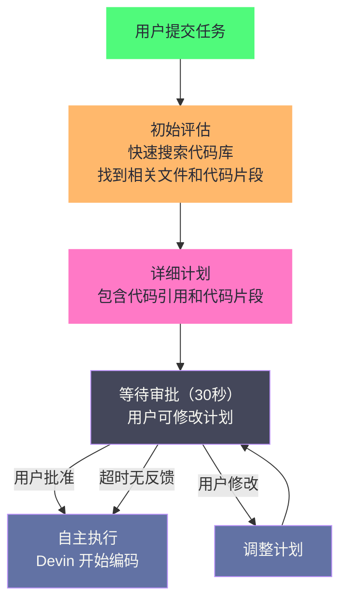

# 18 Devin 与 ACI 设计——为 Agent 认知而生的计算机接口

> [!abstract] 摘要
> [[LLM/Agent技术/Coding-Agent解构/17 Claude Code 架构解构——Anthropic 的 CLI Agent 设计哲学|上一篇]]解构了 Anthropic 的 Claude Code——一个从 Terminal 出发、用专用工具集和渐进式权限模型构建的 CLI Agent。本文转向 Cognition 的 Devin，一条完全不同的路线：不为"人类在终端里怎么用"做优化，而是为 Agent 的认知模式重新设计计算机接口。文章先回到 Princeton SWE-agent 论文提出 ACI（Agent Computer Interface）概念的起点，用"同样的 LLM、接口不同、SWE-bench pass@1 相差六倍"的对比实验说明接口设计为什么是 Coding Agent 性能的关键变量；再拆解 Devin 的沙箱化计算环境（shell + editor + browser）、Computer Use（完整桌面环境的鼠标键盘操作）与 2026 年的 microVM 基础设施；随后梳理 2025 到 2026 年的产品演进——Interactive Planning 与 Confidence Reporting 解决"对齐"与"过度自信"两个老大难问题，Devin 2.2 把桌面端到端测试与自动修复关进 Agent 循环，SWE-1.5 到 SWE-2 的模型线把竞争从接口推向"模型 × 接口 × harness"的联合优化，收购 Windsurf 之后形成的 Desktop/CLI/Cloud 多表面，以及 Devin Oncall 向运维闭环的延伸。核心认知：ACI 不是一次性的设计冲刺，而是随模型能力、成本结构与使用场景持续演进的工程变量——2024 年的六倍差距证明了它的力量，2026 年的演进则展示了它的边界。

---

## 第 1 章 ACI 概念——Agent Computer Interface 的提出

### 1.1 人类有 IDE，Agent 有什么

人机交互（Human-Computer Interaction, HCI）这门学科走到今天，绕不开一个朴素的判断：接口是为使用者量身定做的。1984 年 Macintosh 把图形界面（Graphical User Interface, GUI）带给大众之前，电脑的默认交互方式是命令行——那套接口本来就不是为普通人设计的，它假定使用者愿意背命令、忍受逐字符的精确性；图形界面把"菜单、窗口、图标"这套隐喻搬到屏幕上，才让没有受过专业训练的人也能操作电脑。人类软件开发者今天的 IDE（集成开发环境）是这条演进路线的终点站——语法高亮、代码补全、跳转定义、查找引用、调试器、Git 集成，每一项都是为**人类的认知模式**优化的：人类视觉系统擅长阅读高亮代码、人类记忆需要面包屑导航、人类手指习惯键盘快捷键。

但 LLM Agent 是一种全新的"用户"——它没有视觉系统（只有文本输入）、没有手指（只有工具调用）、注意力机制与人类完全不同。让 Agent 使用为人类设计的工具（譬如直接用 `cat` 看文件、用 `sed` 编辑文件），就像让一个色盲用户使用依赖颜色区分的界面——不是不可能，但效率极低；又譬如把一位只能用放大镜逐行读报的读者扔进满是整版小字的阅览室，信息都在，就是读不进来。这里有个容易被忽略的要点：IDE 之所以好用，背后是几十年的 HCI 积累；而"Agent 的界面"该长什么样，在 2024 年以前几乎没有系统的研究。

### 1.2 Princeton SWE-agent 的 ACI 概念

2024 年 4 月，Princeton 大学的 John Yang、Ofir Press 等人在 arXiv 上发布了 SWE-agent 论文（同年被 NeurIPS 2024 接收），正式提出了 **Agent-Computer Interface（ACI）** 概念：

> LM agents represent a new category of end users with their own needs and abilities, and would benefit from specially-built interfaces to the software they use.

核心论点：**LLM Agent 是一种新型终端用户，有自己的需求和能力，需要专门为其设计的计算机接口**——就像人类需要 IDE 一样，Agent 需要 ACI。这句话的激进之处在于，它把 Agent 从"工具的使用者"升格为"产品的使用者"：此前所有编码 Agent 的默认假设都是"Agent 会用人类已有的工具，只是用得不够好"，SWE-agent 把这个假设倒了过来——工具应该迁就 Agent，而不是让 Agent 迁就工具。

### 1.3 ACI 设计的量化影响

SWE-agent 论文最有力的证据是一个对比实验：

| 配置 | SWE-bench pass@1 |
| :--- | :---: |
| 基线 Agent（无优化 ACI，直接用 shell 命令） | ~2% |
| SWE-agent（定制 ACI） | **12.5%** |
| 前SOTA（即使给定确切文件，"assisted"模式） | 4.80% |

从 ~2% 到 12.5%——**6 倍的性能提升完全来自 ACI 设计，而非模型能力的变化**。论文还在 HumanEvalFix 上拿到 87.7% 的 pass@1，同样是当时的 SOTA。这证明了一个关键认知：**Coding Agent 的性能瓶颈往往不在 LLM 本身，而在 LLM 与计算机环境的接口设计**。

不过笔者要提醒一句：pass@1 是"给 Agent 一次完整尝试、成功解决问题的比例"，不是生产环境里的成功率——真实世界的任务更长、干扰更多、验收标准更模糊。用"六倍差距"说明接口的重要性是成立的，但别把它误读成"好接口能解决 12.5% 之外的一切"。

### 1.4 ACI 的四条设计原则

SWE-agent 论文总结了 ACI 设计的关键经验，四条原则可以说是"认知工程"的教科书案例：

**原则一：集成 Linter**。编辑命令发出时自动运行 linter——如果代码有语法错误，编辑命令不通过。这防止了 Agent 在代码中引入语法错误后继续基于错误代码推理——一个小的语法错误可能在后续步骤中被放大为严重的逻辑错误。注意这里的机制不是"提示错误"，而是"阻止执行"：把错误消灭在动作层面，而非反馈层面。人类 IDE 里的 linter 是"建议"，Agent 的 linter 却必须是"闸门"，因为 Agent 没有人类那种"看到红线就停手"的直觉。

**原则二：专用文件查看器而非 `cat`**。SWE-agent 为 Agent 设计了专门的文件查看器，每轮只显示 100 行。这直接呼应了 [[LLM/Agent技术/基础范式/02 ReAct 架构深度解析——Thought-Action-Observation 循环的本质|第 2 篇]]讨论的 Observation 治理——防止大文件毒化上下文。文件查看器还支持滚动和文件内搜索，比 `cat` 更适合 Agent 的分步消费模式。人类可以把整个文件尽收眼底、凭视觉扫读，Agent 的注意力却会被长文本稀释，分页消费反而更符合它的处理方式。

**原则三：简洁的搜索输出**。搜索命令只列出有匹配的文件名，不显示匹配行的上下文。SWE-agent 团队发现"给模型展示更多关于每个匹配的上下文"反而让模型更困惑——简洁的输出让 Agent 先定位文件，再决定是否深入查看。这条原则的反直觉之处值得琢磨：人类在搜索结果里希望看到 snippet 来快速判断相关性，Agent 却会被 snippet 里的噪声带偏，两阶段的"先定位、再细读"才是它的最优路径。

**原则四：明确的空输出反馈**。当命令执行没有输出时，返回"Your command ran successfully and did not produce any output"而非空字符串。空输出会让 Agent 不确定"是命令失败了还是成功了但没有输出"——明确的反馈消除了这种不确定性。对人类来说这是冗余信息，对 Agent 来说却是消除歧义的关键信号，因为 Agent 没有"经验"可以推断空输出的含义。

> [!info] 核心概念：ACI 设计是"认知工程"而非"软件工程"
> ACI 设计的本质不是"让工具更好用"（这是软件工程的目标），而是"让工具更适配 LLM 的认知模式"（这是认知工程的目标）。人类觉得好用的工具（如显示完整文件内容的 `cat`），对 LLM 来说可能恰恰是"毒化上下文"的坏工具。人类觉得冗余的反馈（如"命令成功但无输出"），对 LLM 来说可能是消除不确定性的关键信息。ACI 设计要求开发者"站在 LLM 的角度思考"——不是"人类会怎么用这个工具"，而是"LLM 的注意力机制会怎么处理这个工具的输出"。

### 1.5 从"固定接口"到"学习出来的接口"——SWE-grep

四条原则有一个共同点：它们都是人手写出来的规则。2025 年 10 月，Cognition 发布的 SWE-grep 与 SWE-grep-mini 把这件事推进了一步——用强化学习训练专门的检索模型，把"接口该怎么做"交给训练过程本身。Cognition 观察到，Agent 轨迹里超过 60% 的第一个回合时间都花在检索上下文上；SWE-grep 通过"每个回合并行 8 个工具调用、限制 4 个串行回合"的设计，把检索从常见的 10-20 个串行回合压到 4 个，再配合 Cerebras 的推理服务，让 SWE-grep-mini 达到每秒 2800+ token 的吞吐。这是 ACI 演化的重要信号：接口设计从"手写 prompt 与工具规范"走向"用 RL 训出专门的接口组件"——搜索输出该多简洁、并行度该多大，不再靠人拍脑袋，而是由训练信号决定。

### 1.6 ACI 的边界——接口不是银弹

但接口设计有一个天然的上限：它是放大器，不是发动机。SWE-agent 的 12.5% 建立在 GPT-4 之上，换一个更弱的模型，再好的 ACI 也到不了这个分数；反过来，模型能力本身也在改写接口的权衡——2026 年 Cognition 的 SWE-2 模型把"第一次真正编辑代码的时机"从 SWE-1.7 的中位数第 48 步提前到第 18 步，一个更愿意早动手的模型，对"文件查看器要显示多少行""搜索输出要多简洁"这类接口参数的需求就完全不同。由此可见，ACI 与模型是两条必须协同演进的曲线，把它当成一次性设计冲刺，是 2024 年的视角，不是 2026 年的。

---

## 第 2 章 Devin 的架构——沙箱化计算环境

### 2.1 Devin 的核心设计

Cognition 在 2024 年 3 月发布 Devin 时，称其为"第一个 AI 软件工程师"。Devin 的核心设计包含三个要素：

**长时推理和规划**：Devin 可以规划和执行需要数千次决策的复杂工程任务——这超越了 ReAct 的"走一步看一步"模式，更接近 [[LLM/Agent技术/基础范式/01 Agent 运行范式全景——从 ReAct 到 Production Agent 的演进|第 1 篇]]讨论的 Plan-and-Execute 范式。如果说 ReAct 是"走到哪儿看到哪儿"，Devin 的设计更像是"先看完整张地图再出发"，尽管它同样会在执行中不断修正路线。

**沙箱化计算环境**：Devin 在一个沙箱化的计算环境中工作——包含 shell、code editor 和 browser。这个环境是"完整的开发者工作站"——Devin 可以像人类开发者一样在 shell 中执行命令、在 editor 中修改代码、在 browser 中查阅文档。

**常见开发者工具**：Devin 被配备了"人类开发者工作所需的一切工具"——这是 ACI 理念的实践。不是给 Agent 简化的"玩具工具"，而是给 Agent 真实的"开发者工具"。这跟 SWE-agent 的"给 Agent 定制简化工具"形成有趣的对照：SWE-agent 的 ACI 是"减法"（把 shell 能力收敛成少量专用动作），Devin 的 ACI 是"加法"（把完整桌面交还给 Agent）。两条路线在 2024 年都各自证明了价值，2025 年之后则开始合流——Devin 的 IDE 里同样出现了面向认知友好的 file viewer 与代码库搜索组件。

### 2.2 SWE-bench 的突破性表现

Devin 在 SWE-bench 上的表现是里程碑式的：

| 系统 | SWE-bench pass@1 | 备注 |
| :--- | :---: | :--- |
| 前SOTA（unassisted） | 1.96% | 不告诉 Agent 要改哪些文件 |
| 前SOTA（assisted） | 4.80% | 即使告诉确切文件 |
| **Devin** | **13.86%** | unassisted，Agent 自己导航文件 |

Devin 在"不告诉要改哪些文件"的更难设定下，超越了"告诉确切文件"的前SOTA 2.9 倍。这个突破的核心不是模型更强（Devin 使用的也是 GPT-4 级别的模型），而是 ACI 设计和长时规划能力的结合。

**评估设定**：
- Devin 收到 GitHub issue 描述后端到端运行
- 运行期间不接收任何额外用户输入
- 仓库被 clone 到 Agent 环境中，git remote 被移除（防止 `git pull` 信息泄漏）
- Python conda 环境预先设置
- 限制 45 分钟运行时间（Devin 有能力无限运行，但评估设了时限）

理解这张表，我们不妨先补一点 SWE-bench 的背景。SWE-bench 由 Princeton 团队 2023 年提出，从真实 GitHub 仓库的 12 个 Python 项目中挑选了 2294 个 issue（官方子集 SWE-bench Verified 为 500 个，由人工过滤掉含糊 issue，成为后来各家厂商引用最多的口径），把"issue 描述 + 对应代码库"交给 Agent，要求它产出能通过隐藏测试的 patch。它的价值在于"真实"：任务来自真实仓库、验收由测试决定、模型难以作弊；它的局限在于"窄"：只覆盖 Python、只测单次尝试、只测代码修改而不测完整工程。到了 2025-2026 年，业界已经习惯用 Terminal-Bench、SWE-bench Verified 与厂商自建基准交叉验证，单一数字不再具有决定性——Cognition 自己后来也转向了以"合并率"为目标的 FrontierCode 基准，这是后话。

### 2.3 沙箱环境的隔离需求

Devin 的沙箱化计算环境是一个关键架构决策——Agent 在隔离环境中执行代码，而非直接在用户的机器上执行。这呼应了 [[LLM/Agent沙箱技术/00 专栏导览|Agent 沙箱技术]]专栏的主题——当 Agent 有完整的 shell、代码执行和浏览器能力时，沙箱隔离不再是"可选的安全增强"，而是"必需的安全基础"。

Devin 的沙箱环境需要隔离：
- **文件系统**：Agent 不能访问宿主机的文件系统
- **网络**：Agent 的网络访问需要受控（Egress 过滤）
- **进程**：Agent 执行的代码不能影响宿主机进程
- **凭证**：宿主机的 API Key、SSH Key 不能被 Agent 访问

### 2.4 2026 年的基础设施复盘——从容器到 microVM

Devin 的沙箱不只是"安全加分项"，它直接决定了产品能跑多大。2026 年 4 月，Cognition 在《What We Learned Building Cloud Agents》里复盘了两年多的基础设施建设，几个细节值得单独拿出来说。

第一是隔离级别。直觉上，把 CLI Agent 容器化、塞进 Docker 就能得到一个"云 Agent"——Cognition 明确说这条路走不通：**容器共享内核，一个会话被攻破，就能摸到同一宿主上所有其他会话的文件系统、凭证与网络连接**。Agent 会自己写代码、跑任意命令、以不可预测的方式探测环境，内核逃逸不是理论风险而是工作假设。行业对"运行不可信代码"的共识是 VM 级隔离——每个会话拥有独立内核。Cognition 自研的 microVM 隔离花了一年多的 hypervisor 工程，保证每个 Agent 会话运行在独立内核上，存储、网络、计算完全隔离。打个比方，容器方案像是把几十个互不认识的租客塞进同一间公寓的合租房，共用一道门；microVM 方案则是给每个租客一间带独立门锁的房间——门锁的代价是贵，但合租房里任何一个租客翻脸，所有人都得跟着遭殃。

第二是快照。异步 Agent 的会话经常闲置（等用户审批、等测试跑完），一直占着 VM 是巨大的浪费。Cognition 做了 hypervisor 级的整机快照——空闲会话关掉计算、保存状态，恢复时从快照继续；2025 年 6 月他们还发布了 Blockdiff，自研的 VM 磁盘快照文件格式，把快照的存储成本压下来。这跟 [[LLM/Agent技术/基础范式/06 Prompt 上下文管理——Context Engineering 的艺术|第 6 篇]]讨论的 Context Engineering 是一体两面：上下文要压缩，计算状态也要能压缩。

第三是编排。管理数千个并发 VM 的编排层，Cognition 花了超过三个季度才做稳。这些代价解释了为什么"自建云 Agent"看起来容易、做起来难——也解释了为什么 Devin 的商业模式是"托管服务"而非"你下载一个二进制"。基础设施的隐性成本，最终都会写进产品的架构里。

### 2.5 从 Linux 到 Windows 与 Android——沙箱的多平台化

2026 年 5 月，Cognition 宣布 Devin 支持 Windows VM（Devin is Getting a Windows PC）与 Android 模拟器（AVD）。Windows 支持意味着 Agent 能构建、运行、测试原生 Windows 应用（WPF、WinForms，乃至 .NET Framework 到 .NET Core 的迁移），因为 .NET Framework 只在 Windows 上能跑——此前 Devin 能生成迁移代码却无法编译验证，现在能在真实 Windows 环境里迭代到通过；Android 模拟器则意味着移动端开发进入自主循环。加上 macOS 会话与面向数据驻留场景的 Outposts（客户自持硬件，会话跑在客户机房里），Devin 的沙箱从"一个 Linux 容器"扩张成"可以落在任意平台的计算租户"。Outposts 的细节值得一提：它是 Cognition 为数据驻留（data residency）与隔离网络场景提供的自托管部署——Agent 的 VM 跑在客户的数据中心里，代码与日志不出企业边界；对金融、政务这类监管严格的行业，"Agent 能跑在哪"和"Agent 能做什么"同样重要。沙箱的边界在哪里，Agent 的能力边界就在哪里——这是理解 Devin 架构的一条主线。

---

## 第 3 章 Computer Use——完整桌面环境操作

### 3.1 超越浏览器自动化

Devin 2.0/2.1 引入了 Computer Use 能力——不仅仅是浏览器自动化，而是**完整的桌面环境操作**：

- **鼠标操作**：点击、拖拽、滚动
- **键盘操作**：输入文字、快捷键
- **截图**：查看屏幕当前状态
- **1024×768 像素显示**：Devin 看到的屏幕分辨率

**可交互的应用类型**：
- Web 应用（Chrome 中的网页——点击按钮、填表单、导航页面）
- 桌面应用（Electron 应用、IDE、平台原生 GUI）
- 终端 UI 程序（TUI 程序、交互式 CLI）
- 任何能在桌面上渲染的视觉界面

### 3.2 Computer Use 的工程价值

Computer Use 让 Devin 能做到传统 Coding Agent 做不到的事情：

**视觉验证**：Devin 可以运行修改后的代码，截图查看 UI 效果，确认修改是否正确呈现——而非仅靠代码逻辑推断。

**GUI 测试**：Devin 可以像人类 QA 一样，点击应用的各个功能、填表单、验证响应——这是传统基于代码的测试无法覆盖的。

**非代码文档查阅**：有些文档只有 Web 界面或 PDF 阅读器才能正确显示——Devin 可以打开浏览器查阅，而非只能 `curl` 获取 HTML。

到了 2026 年，这第三条的用途又向外扩了一圈：Cognition 在《Verifying Agentic Development at Scale》里提到，Devin 用 Computer Use 在浏览器里下单、在桌面上跑游戏，但真正让团队兴奋的是"测试自己的工作"——Devin 启动应用、点一遍、确认改动真的生效，工程师们常常一次跑 10 到 20 个 Devin，每个都带着自己的 dev server 并行验证。

### 3.3 平台支持

| 平台 | Computer Use 支持 |
| :--- | :--- |
| Linux（默认） | ✅ 完整 Linux 桌面环境 |
| Windows | ✅ 完整 Windows 桌面环境（2026-05 起原生 Windows VM） |
| macOS | ✅ 完整 macOS 桌面（含 iOS Simulator） |

值得说明的是，2025 年初的文档里 macOS 还写着"不支持"——当时 Devin 的会话默认跑在 Linux VM 上，macOS 桌面没有对应的宿主环境；2026 年随着 Windows VM 与 macOS 会话陆续落地，三大平台全部打通。Linux 作为默认平台的原因与沙箱技术生态有关——Linux 有成熟的容器隔离技术（[[LLM/Agent沙箱技术/00 专栏导览|Agent 沙箱技术专栏]]的主题），适合作为 Devin 沙箱环境的底层。

### 3.4 端到端测试与视觉验证的闭环

Devin 2.2（2026-02-24）把 Computer Use 从"能力"变成了"工作流"：PR 创建后，Devin 会主动建议"在它的桌面环境里跑一遍你的应用"，审批后它启动应用、操作界面、录制屏幕，把录屏发回来供人工复核。这解决了"改完代码不知道界面长什么样"的经典盲区——传统 Coding Agent 只能靠代码逻辑推断 UI 是否正确，Devin 可以直接看。同年 5 月的《Verifying Agentic Development at Scale》进一步总结了在 VM 里做端到端测试的经验，核心判断是"验证必须成为 Agent 循环的一部分，而不是事后动作"。

Cognition 内部甚至养了一支"测试模式的 Devin 大军"：团队把 Devin 切到 test mode，去验证自家的 Slack 集成、测试复杂的 Windsurf 功能，一次并行跑 10 到 20 个 Devin，每个自带 dev server。人类工程师要花一上午手工点验的回归，Agent 用几十分钟在云端并行跑完。这套做法反过来又变成了产品能力——2.2 之后，每个 PR 都可以带着"已在我的桌面上测过"的录屏证据提交，评审者看到的不是"代码看起来对"，而是"运行起来确实对"。

### 3.5 Computer Use 的工程边界

但"看屏幕"是有代价的。屏幕分辨率只有 1024×768，视觉信息要转成 token 进入上下文，每张截图都是成本，而且截图反映的是"过去的状态"——界面变化后，Agent 的屏幕记忆可能过期。更微妙的问题是交互的脆弱性：GUI 元素定位、弹窗时序、动画竞态，任何一个都可能让"点击"落空。Cognition 的解法是把验证做成闭环——测试失败就截图、读日志、修正、再试，同时用确定性断言（检查 DOM、检查状态）而不是纯视觉判断。这些工程细节提醒我们：Computer Use 是 ACI 的又一种形态，它同样服从"接口设计决定上限"的规律，只是把接口从"文本命令"换成了"屏幕与鼠标"。

> [!note] 设计哲学：Computer Use 是"人类工作方式的模拟"
> Devin 的 Computer Use 设计哲学是"让 Agent 像人类开发者一样工作"——人类开发者不只是写代码，还会运行应用、看 UI 效果、用浏览器查文档、点击按钮做测试。传统 Coding Agent 只覆盖了"写代码"这一环，Devin 通过 Computer Use 覆盖了"写代码→运行→看效果→调试"的完整循环。这种"完整工作循环"的能力，是 Devin 在 SWE-bench 上表现优异的重要原因——很多 bug 的修复需要"运行代码→观察错误→修改→再运行"的迭代，而非仅靠静态代码分析。

---

## 第 4 章 Devin 2.0——Agent-Native IDE 与 Interactive Planning

### 4.1 Devin 2.0 的三大新特性

2025 年 4 月 3 日，Cognition 发布了 Devin 2.0——一个重大的架构升级，同时把入门定价从 $500/月降到 $20 起（按 Agent Compute Unit 计量，下文会展开），包含三个核心特性。定价降幅的意义不亚于架构升级：按 ACU 计量之后，个人开发者第一次能以近乎免费的门槛试用完整的自主 Agent，Devin 的讨论重心也从"企业专属工具"转向"个人也可以雇一个异步同事"。

**Interactive Planning（交互式规划）**：每次启动会话时，Devin 主动研究代码库并在数秒内生成详细计划——包含相关文件、关键发现和实现问题。开发者可以在 Devin 开始自主工作前审查和调整计划。

**Devin Search（代码库搜索）**：一个 agentic 工具，用于探索和理解代码库。可以直接问代码库问题，获得带代码引用的详细回答。深度查询可以开启 Deep Mode。

**Devin Wiki（代码库文档）**：自动索引仓库（约每几小时一次），生成代码库的文档、架构图与导航。

### 4.2 Interactive Planning 的工作流程

Interactive Planning 的核心价值是**"先对齐再执行"**——在 Devin 开始自主工作前，确保它对任务的理解与开发者的预期一致。这解决了 Coding Agent 的一个常见痛点：Agent 基于对任务的误解做了大量工作，最终结果完全不对——浪费了时间和计算资源。这有点像建筑施工先出图纸再动工：图纸阶段改一版只要一晚上，主体结构封顶之后再改就要拆墙。

**初始评估**：Devin 对代码库做快速搜索（利用预索引），找到相关文件和代码片段。可能包含代码引用，开发者可以点击深链直接跳转到 Devin IDE 中查看。

**详细计划**：基于初始评估，Devin 生成包含代码引用和代码片段的详细实现计划。开发者可以检查这些引用，确认 Devin 找到的是正确的代码。

**等待审批**：默认等待 30 秒。如果开发者无反馈，Devin 自动开始执行。如果开发者提供反馈，Devin 调整计划后再次等待。

### 4.3 Devin IDE——Agent-Native 的 VSCode 环境

Devin 2.0 引入了 Devin IDE——一个基于 VSCode 的云端 IDE，Devin 在其中完成工作：

- **实时查看**：开发者可以实时查看 Devin 的编辑
- **直接修改**：开发者可以用熟悉的 VSCode 工具和快捷键（如 Cmd+I、Cmd+K）直接修改 Devin 的代码
- **多并行 Devin**：可以同时运行多个 Devin，每个有自己的云端 IDE

这种"Agent-Native IDE"设计与 Claude Code 的"Terminal 优先"形成鲜明对比——Devin 选择了 IDE 作为核心界面，因为 IDE 提供了代码编辑的可视化反馈，适合 Computer Use 的"看屏幕"能力。

### 4.4 Devin Search 与 DeepWiki

Devin Search 是一个 agentic 代码库探索工具——不是简单的关键词搜索，而是"Agent 驱动的代码库问答"。你可以问"这个项目的认证机制是怎么实现的？"，Devin Search 会探索代码库并返回带代码引用的详细回答。

DeepWiki 将这种代码库理解能力产品化——2025 年 5 月公开发布，免费为公开 GitHub 仓库生成文档和导航（把 github.com 换成 deepwiki.com 就能访问），并提供了 MCP Server 接口，让其他 AI 应用可以通过 MCP 协议访问 DeepWiki 的文档与搜索能力。到 2025 年底，DeepWiki 已经能在 500 万行 COBOL 或 500GB 体量的仓库上生成文档，一家银行用它给 40 万+ 个仓库生成了文档。代码库理解从"Devin 的私有能力"变成了"开放基础设施"，这本身也是 ACI 思想的外溢：好的 Agent 接口，最终会变成所有人都能用的接口。

### 4.5 Planning 的边界——计划只是起点

Interactive Planning 解决的是"任务理解对齐"，但它对两类情况无能为力。一是**需求中途变化**：Devin 2025 年度复盘明确承认，Devin 对"清晰的前置 scope"表现好，但对"任务进行中不断追加要求"表现差——计划一旦批准，中途的反复会打乱执行节奏，这与人不同：你可以辅导一位初级工程师在迭代中学习，却很难这样辅导一个 Agent。二是**计划质量的天花板**：计划建立在代码库理解之上，代码库理解越浅，计划越容易"看起来合理、实际上跑偏"。2.1 版本把 DeepWiki 的代码库理解能力内置进 Devin，正是为了压低这条天花板——计划的质量，说到底取决于 Agent"读得懂代码库"的质量。

---

## 第 5 章 Devin 2.1——Confidence Reporting

### 5.1 Coding Agent 的"过度自信"问题

Coding Agent 有一个普遍问题：**过度自信**。Agent 在收到任务后，往往直接开始执行，不评估自己能否成功——即使任务实际上超出了它的能力范围。结果是浪费了大量时间和计算资源后，产出了一个无法合并的 PR。Devin 2.1 的发布说明里还点出了另一个根源：许多失败的会话，问题出在初始 prompt 本身含糊不清——需求没说清楚，Agent 却在"不知道要什么"的情况下硬着头皮开工。

过度自信的机制也不难理解：LLM 的训练目标是预测下一个 token，不是判断"我该不该接这个任务"。在没有评估信号的情况下，模型倾向于把任务当作可完成来推理——"继续做下去"在概率上总是比"承认做不到"更顺，于是 Agent 一路埋头狂奔，直到耗尽预算或产出废品。Confidence Scores 要对抗的，正是这个"训练目标与工程目标错位"的底层结构。

### 5.2 Confidence Scores 机制

2025 年 5 月 15 日发布的 Devin 2.1 引入了 Confidence Scores——在会话的多个时间点报告信心度：

**报告时机**：
- 会话开始时
- 创建计划后
- 回答代码相关问题时

**三级信心度**：

| 信心度 | 含义 | 行为 |
| :--- | :--- | :--- |
| 🟢 绿色 | 高信心 | 自动执行，不需审批 |
| 🟡 黄色 | 中等信心 | 等待用户审批后才执行 |
| 🔴 红色 | 低信心 | 等待用户审批，可能提出澄清问题 |

**关键数据**：Cognition 报告称，🟢 评分的 PR 合并率是 🔴 的**两倍**——信心度与实际成功率高度相关。这意味着 Devin 的自我评估是准确的——它不是"假装有信心"，而是真的能区分"能做"和"可能做不了"的任务。

### 5.3 自动评分与批量 Issue 处理

Devin 2.1 的 Confidence Scores 可以与 Linear/Jira 集成——批量给多个 Issue 评分，且**不需要启动实际 Devin 会话**：

- 在 Linear/Jira 中给 Issue 添加 "Devin" 标签
- Devin 自动扫描所有标记的 Issue，为每个提供信心度评分
- 开发者根据评分决定让 Devin 优先处理哪些 Issue

这种"先评分再执行"的工作流避免了在低成功率任务上浪费资源——一个团队可能有几十个待办 Issue，但只有部分适合 Agent 自动处理。Confidence Scores 让团队可以快速识别哪些值得交给 Devin。把"评分"与"执行"拆开还有一层成本上的好处：批量评分不需要启动 VM 会话，几十个 Issue 的排序成本趋近于零，而真正启动 Devin 跑一个任务要消耗 ACU——先花接近免费的钱筛一遍，再花真金白银执行，这个顺序本身就是成本意识。

> [!info] 核心概念：自我评估能力是 Agent 可靠性的关键
> Devin 的 Confidence Scores 揭示了一个重要的工程认知：Agent 的可靠性不仅取决于"做事情的能力"，还取决于"知道自己做不了什么的能力"。一个"什么都敢试但不告诉你成功率"的 Agent，比一个"明确告诉你这个任务它只有 30% 信心"的 Agent 更危险——前者让你在不可能的任务上浪费时间，后者让你可以做出明智的决策。Confidence Reporting 是 Agent 可靠性工程的重要组成部分——它让 Agent 从"黑箱执行者"变成"可评估的合作者"。

### 5.4 信心度不足时的行为

当 Devin 的信心度不是 🟢 时，它会：
- **提出澄清问题**：通过回答这些问题，开发者可以帮助 Devin 提高理解度和信心度
- **等待用户审批**：不自动执行计划，而是等开发者确认

开发者可以通过提供更多上下文、回答问题或调整计划来帮助 Devin 达到 🟢 信心度。这种"人机协作提升信心度"的设计，把"Agent 信心度不足"从"任务失败"变成了"人机沟通机会"。

### 5.5 校准度——自我评估的可靠性工程

Confidence Scores 的价值取决于一个隐含假设：评分与真实成功率相关。Cognition 报告 🟢 的合并率是 🔴 的两倍，2025 年度复盘进一步给出整体数据——Devin 的 PR 合并率从去年的 34% 提升到 67%，合并的 PR 总量达到数十万量级。但"相关"不等于"校准"：如果 🟢 评分的任务实际只有 40% 成功，说明模型系统性地高估了自己；如果所有任务都评 🟢，评分就失去了排序能力。工程上要盯的是每个评分桶的实际成功率曲线，而不是评分分布本身。另一个隐患是激励漂移：如果低信心评分会让 Agent 被派更少的活，模型在训练阶段就可能被"教"出虚高的信心——把"诚实报告"写进训练目标，比事后校准更根本。

---

## 第 6 章 2025-2026 的演进——自主验证、模型线与多表面

2025 到 2026 年的 Devin 演进，可以压缩成三个关键词：**自主验证、模型线、多表面**。如果说第 1 到第 5 章讲的是 Devin 在 2024-2025 年确立的骨架——ACI、沙箱、Computer Use、Interactive Planning、Confidence Reporting——那么这一章要回答的问题是：这套骨架在接下来一年多里长成了什么。答案藏在三条线索里：Agent 如何学会验证自己、模型如何接管接口的一部分职责、产品如何从单点形态长成多表面矩阵。

### 6.1 Devin 2.2——把验证闭环关进 Agent

2026 年 2 月 24 日，Cognition 发布 Devin 2.2，官方口径是"发布以来最重要的更新"。三个要点：

**桌面端到端测试**：Devin 拥有完整 Linux 桌面访问权，PR 创建后主动建议"在桌面上测试"，批准后它启动应用、录制屏幕，把录屏交回人工复核；新用户默认开启桌面支持。

**Review Autofix**：Devin 不再只是"写完代码交差"——它规划、编码、审查自己的输出、发现问题、修复，全部发生在 PR 打开之前。官方总结为"完整的循环，都替你处理好了"。往前追溯，2 月 10 日的《Closing the Agent Loop》已经先放出关键一环：Devin 会自动响应 PR 上的 review 评论、修完再推，把"收到评论→修改→重新推送"这段人工接力自动化——Autofix 正是这条线的延伸。

**启动提速 3 倍**：从任务到 PR 的时间显著缩短，界面整体重做，把规划到代码审查的整个生命周期统一进一个视图。

2.2 的实质是把"人在环路上的验证环节尽量自动化"——如果说 2.0 解决"对齐"、2.1 解决"信心"，2.2 解决的是"闭环"：Agent 不再依赖人类去发现它的问题，而是自己验证、自己修复。

### 6.2 模型线——从 SWE-1.5 到 SWE-2

2025 年 10 月起，Cognition 把注意力从"接口"转向"模型 × 接口 × harness"的联合优化，模型线快速成型：

- **SWE-grep / SWE-grep-mini**（2025-10-16）：专门的快速上下文检索模型，即 1.5 节讨论的"学习出来的 ACI"
- **SWE-1.5**（2025-10-29）：快速 Agent 模型，主打"便宜好用"
- **SWE-1.6**（2026-04）：改进模型 UX，把"读代码—编辑"的节奏当作训练与评测的关注点
- **SWE-1.7**（2026-07-08）：以远低于前沿模型的价格达到前沿级智能；但其行为有个模式——读代码读得很深，第一次真正编辑文件的中位数在第 48 步
- **SWE-2**（2026-09-10）：从 Moonshot 的 Kimi K3（2.8 万亿参数）post-train 而来，首次把强化学习规模化到 multi-trillion 参数级别。奖励函数设计为 R = S − λ_e·C——成功率减去按推理档位（effort level）加权的成本，一次 RL run 同时优化所有推理档位。结果：FrontierCode 1.1 Main 上 50.0%（Anthropic 的 Fable 5.1 为 50.9%），成本低 64%；DeepSWE 1.1 上 73.0%，Terminal-Bench 2.1 上 92.8%。SWE-2 还改变了一个行为指标：medium 档位下第一次真正编辑代码的中位数步骤从 SWE-1.7 的 48 步降到 18 步——模型从"读得多"转向"边读边改"，这正是 1.6 节说的"模型能力改写接口权衡"的活例证。

基准本身的变化同样值得留意。2026 年 6 月 Cognition 发布 FrontierCode，衡量标准从"能不能通过隐藏测试"改为"**maintainer 是否真的会合并这个 PR**"——把"合并率"而不是"通过率"当作第一指标，与 5.5 节"校准度"的讨论一脉相承：Agent 的产出要被真实工程流程接纳，才算数。基准本身也在自我迭代：7 月的 FrontierCode 1.1 修订了方法论，专门区分"合理的联网查资料"与"作弊式联网查答案"——这些基准已经从"测模型"进化到"测 Agent 的真实工作方式"。

这个转变对"ACI 叙事"的意义在于：接口设计的边际收益递减之后，模型本身的效率（多少步开始编辑、每一步花多少钱、检索多快）成了新的主战场。2024 年"同样的 LLM、不同的接口"能差出 6 倍；2026 年"同样的任务、不同的模型"在成本上能差出 64%——两条曲线合在一起，才是 Coding Agent 竞争的完整图景。

### 6.3 收购 Windsurf 与多表面——Desktop、CLI 与 Cloud

2025 年 7 月 14 日，Cognition 宣布收购 Windsurf（agentic IDE），交易包含其 IP、产品、商标与品牌，Windsurf 彼时已有 8200 万美元 ARR、350+ 企业客户与数十万日活用户。这笔交易的背景颇具戏剧性：几天前 Google 刚刚以约 24 亿美元"反向收购"挖走了 Windsurf 的 CEO 与多位核心成员，OpenAI 4 月的 30 亿美元报价则刚刚告吹——Cognition 接手的是"被抽走大脑但留下产品和队伍"的 Windsurf。

收购之后的整合节奏，本身就是 2026 年 Coding Agent 产品形态演进的缩影：

- **2026-04-15**：Devin in Windsurf——把 Devin 的云 Agent 能力嵌入 Windsurf IDE
- **2026-04-27**：Devin CLI——用 Rust 写了终端渲染库，本地终端里跑 Agent，工作超出笔记本能力时用 `/handoff` 把会话无缝移交到云端继续，回来时是一个完成的 PR；支持 Opus、GPT、Gemini、SWE 系列等多模型，且明确兼容 Claude Code 的 skills、hooks、plugins
- **2026-06-02**：Devin Desktop——Windsurf 的更名与升级，加上了"Agent Command Center"，在一个 IDE 里统一管理本地、云端与 CLI 的所有 Agent

于是 Devin 的产品形态从"一个云端 IDE"变成"Desktop 本地 IDE + CLI 本地终端 + Cloud 异步 Agent + Oncall 运维"的多表面矩阵。收购一周年时，Cognition 在《One Year of Building Together》里回顾了整合成果：Windsurf 的 IDE 基础被完整吸收进 Devin Desktop，Codemaps 之类的代码理解能力成为新产品的底层。有意思的是，Devin CLI 宣称 Claude Code 插件"开箱即用"——不同产品的 ACI 正在互相渗透，接口的护城河，比想象中浅。

### 6.4 从 PR 到 Oncall——运维闭环

2026 年，Devin 的边界从"仓库内"推向了"生产环境"。代码审查先一步产品化：1 月的 Devin Review 把"第一遍审查"交给 Agent，定位是"AI 拦下明显问题、人看第二遍"——这与 2025 复盘里"代码质量不可直截了当验证、人工复查仍然必要"的结论一致。随后是运维侧的三个动作：

- **Auto-Triage**（2026-05）：Devin 监控 bug、告警与事故流，收到信号就调查、用你的工具定位、关联同类报告，然后开 PR
- **Devin Security Swarm**（2026-07）：跨代码库找漏洞、在运行时验证可利用性、直接产出修复 PR
- **Devin Oncall**（2026-10-15）：Responders（盯着告警源逐个调查）、Incidents（加入事故通道、找根因、驱动解决）、Reports（输出告警阈值调优与重复问题类别的洞察）三个产品；官方称在 SRE 基准 SREGym 上取得 100% 端到端成功率，日处理数千条真实生产告警，集成 Datadog、Dynatrace、Sentry、Grafana、PagerDuty、Slack、Teams 等

把 Oncall 看作 ACI 就清楚了：告警流、日志、追踪、runbook、历史事故，都是"生产环境"这台计算机为 Agent 提供的接口。Cognition 在《Verifying Agentic Development at Scale》里记录过一个转折点：2026 年，通过事件、自动化、调度与其他 Devin 异步触发的 Devin 数量，第一次超过了人工发起的会话——Agent 开始"主动"工作，而不是等人下命令。我们不妨把这个转折点当作 Agent 产品形态分期的标尺：1.0 时代是"人发起、Agent 执行"，2.x 时代是"人审批、Agent 提议"，2026 年则是"Agent 发现问题、Agent 修复、人只审 PR"。Cognition 前一年还在《Don't Build Multi-Agents》里反对多 Agent，2026 年 4 月的《Multi-Agents: What's Actually Working》修正为"更窄的一类多 Agent 有效——Agent 贡献智能，但写入保持单线程"。Oncall 里"Devin 盯着告警、人类盯着 Devin"的结构，正是这条原则的落地。

### 6.5 Devin for Teams 与企业落地

Devin 的定价与商业化，2024 到 2026 年走了一条陡峭的曲线：

| 时期 | 定价结构 | 说明 |
| :--- | :--- | :--- |
| 2024-03 起 | Team $500/月 | 只对企业开放，需排队 |
| 2025-04（2.0） | Core \$20 起（ACU 计量，\$2.25/ACU） | 首次向个人开放 |
| 2026-04 | Free / Pro $20 / Max $200 / Teams（$80/月 + $40/座） | 取消旧 Core 与 Team，Ask Devin、DeepWiki、Devin Review 开始收费 |
| 2026-04 起 | Enterprise 按 ACU 计费 | 面向大规模组织，含 SSO 与专用部署 |

企业侧的信号同样密集：客户名单从 Goldman Sachs、Palantir、NVIDIA、Cloudflare 扩展到 Mercedes-Benz、NASA、Santander、Citi、Dell，乃至美国陆军与海军；2026 年 4 月 Cognition 还专门发文讲 Devin 如何在财富 500 强里现代化 COBOL 系统——这类"老而不死"的遗留代码，恰恰是"初级执行、无限规模"能力的最佳战场。2026 年 7 月整个平台进入 FedRAMP High In-Process 流程，为联邦政府场景铺路。规模数字上，Cognition 称 Devin 使用量在 2025 年每两个月翻一番、13 个月约 65 倍增长，2026 年企业用量年内增长超过 10 倍、连续 6 个月月增 50%；年化收入运行率从 2025 年 6 月的 7300 万美元涨到 2026 年 5 月的 4.92 亿美元，2026 年 9 月突破 10 亿美元。融资节奏与之呼应：2025 年 3 月估值 40 亿美元 → 2025 年 9 月 102 亿美元 → 2026 年 5 月 260 亿美元 → 2026 年 9 月 Series E 480 亿美元。

Cognition 甚至在 2026 年 6 月推出"AI 生产力保证"：如果 Devin 交付的工程价值低于付费，Cognition 补足差额、最多 1000 万美元——把"Agent 的价值可度量"当成卖点本身。而《How Cognition Uses Devin to Build Devin》则展示了内测的极端形态：自家 web app 大约三分之一的 commit 由 Devin 推送。这些数字单看都有宣传成分，但放在一起，指向一个事实：**Coding Agent 已经从"演示品"变成了"组织级基础设施"，ACI 也从"论文里的概念"变成了"决定成本与吞吐的工程变量"**。

生态与集成是"组织级落地"的另一半。2025 年 7 月 Devin 上线 MCP Marketplace，让企业按 MCP 协议接入自己的内部工具；2026 年 9 月把原生支持铺到 Microsoft Teams（私聊、群聊、频道自动化）与 Microsoft 365（Outlook、Calendar、OneDrive、SharePoint、To Do、Teams、Entra ID 六套 MCP Server），理由很直白：90% 以上的财富 500 强在用 Teams，bug 报告与需求讨论发生的地方，就是 Agent 该出现的地方。2026 年 9 月 Cognition 又与 AWS 签下多年战略合作协议，帮助企业把自主工程师部署进生产环境、加速遗留系统上云。需要留意的是，这些集成的实现方式几乎全部走 MCP 与公开 API——Agent 的工具生态正在标准化，ACI 的"私有地带"在缩小。笔者以为，这是 ACI 概念两年来最容易被忽略的副产品：接口研究一开始是每家厂商的护城河，最终却把整个行业的 Agent 都推上了同一条标准化轨道。

### 6.6 "Devin 不只写代码"——从数据助手到生产力度量

Devin 的产品边界在 2025-2026 年也向非工程场景外溢。2025 年 8 月，Cognition 发布《Build Your Own AI Data Analyst》，把 Devin 定位成数据助手——在 Slack 里 @Devin 就能拉"昨天的分渠道销售额"、查"这个数字为什么不对"、建仪表盘，客户 Eight Sleep 用上之后数据功能与调查的交付量翻了三倍。2026 年 6 月的《Estimating the Productivity of an Autonomous AI Software Engineer》更进一步：Cognition 搭建了一套系统，把 Devin 的工作量折算成"人类等效工时"卖给工程管理者——管理者真正要回答的问题是"这笔 Agent 预算到底省了多少人力"。

这一节的伏笔在于，无论是数据查询还是工时度量，本质上都是在给 Agent 添加新的接口：Slack 是对话接口，数据源是查询接口，度量系统是价值接口。ACI 的思路一旦立住，就会顺着每个能接入的通道生长出去。

---

## 第 7 章 Devin vs Claude Code——两种设计哲学

讲完 Devin 自身的演进，再把镜头拉回来做横向比较。Devin 与 Claude Code 的对比之所以有代表性，是因为它们恰好站在同一张光谱的两端：一个把 Agent 装进云端的 VM、异步交付成果，一个把 Agent 塞进开发者的终端、实时结对。2026 年它们各自补上了对方的形态，但出发点的差异仍然决定了两套 ACI 设计的分野——接口从来不是孤立的技术选择，而是产品定位的投影。

### 7.1 架构对比

| 维度 | Devin | Claude Code |
| :--- | :--- | :--- |
| **核心界面** | Devin Desktop（本地 IDE）+ Devin CLI + Cloud | Terminal CLI（多表面扩展） |
| **执行环境** | 云端 VM（microVM 隔离），本地 CLI 可 `/handoff` | 用户本机（需自行隔离） |
| **ACI 理念** | 模拟人类完整工作循环（写代码+运行+看UI+调试） | 专用工具集优化 LLM 认知效率 |
| **Computer Use** | ✅ 完整桌面（Linux/Windows/macOS），端到端测试 | 浏览器工具为主，非核心 |
| **规划模式** | Interactive Planning + 动态重规划 | Plan mode（探索不修改） |
| **信心度报告** | ✅ 🟢🟡🔴 三级信心度 | ❌ 无显式信心度 |
| **模型策略** | 多模型 + 自研 SWE 系列（SWE-1.5 → SWE-2） | 自家 Claude 系列（Sonnet/Opus） |
| **并行模式** | 多并行 Devin、Devin 管理/调度 Devin、Oncall | Subagent / Agent View / Dynamic Workflows |
| **沙箱** | 沙箱化计算环境（内置） | 在用户机器上运行（需用户自行隔离） |
| **定价** | Free / Pro $20 / Max $200 / Teams / Enterprise | API 使用量计费 |
| **开源** | 闭源（CLI 兼容 Claude Code 插件） | 闭源（但有详细文档） |

### 7.2 设计哲学差异

**Devin 的哲学：模拟人类**。Devin 的设计核心是"让 Agent 像人类开发者一样工作"——有 IDE、有浏览器、有桌面环境、能看屏幕、能点按钮。这种哲学的优势是 Agent 可以覆盖"写代码→运行→看效果→调试"的完整循环；劣势是资源开销大（每个 Devin 需要一个完整的云端 VM 与桌面环境）。

**Claude Code 的哲学：优化 LLM**。Claude Code 的设计核心是"为 LLM 的认知模式优化工具"——专用工具集（Read/Edit/Grep）、渐进式权限、Subagent 上下文隔离。这种哲学的优势是轻量高效（直接在终端运行，不需要云端环境）；劣势是缺少"看屏幕"和"操作 GUI"的能力。

两种哲学还有一个经常被低估的差异：资源模型。Devin 的每个会话都要起一台 VM、跑一个完整桌面，成本天然地高，但换来的是"独立于用户机器"的确定性；Claude Code 跑在用户本机，边际成本趋近于零，但能力受限于本机环境与网络。这个差异最终会写进定价——Devin 按 ACU 计量、按会话消耗，Claude Code 按 API token 计量，两种计费方式其实是两种架构的投影。

> [!note] 设计哲学：两种哲学不是优劣之分，而是场景之分
> Devin 的"模拟人类"哲学更适合需要完整开发循环的复杂任务——如修复需要运行应用才能复现的 UI bug、需要浏览器查阅多个文档的跨系统集成。Claude Code 的"优化 LLM"哲学更适合在开发者本地环境中的快速迭代——如修改代码、运行测试、提交 PR。选择哪个，取决于任务是否需要"完整桌面环境"和"视觉验证"。对于不需要 GUI 的纯代码任务，Claude Code 的轻量方案更高效；对于需要"运行+看效果"的任务，Devin 的完整环境更可靠。

### 7.3 2026 年的收敛——三种路线相互逼近

2026 年的竞争格局，与其说是"Devin vs Claude Code vs Cursor"的对立，不如说是三种出发点的相互逼近。Devin 从云端异步 Agent 出发，往回补了 Desktop（收购 Windsurf）与 CLI；Claude Code 从 Terminal 出发，向前扩到 Web、IDE、Slack 与 GitHub；Cursor 从 IDE 出发，往外加了 Cloud Agent。产品表面在收敛——大家都在做"终端 + IDE + 云"的多表面矩阵，而内核定位仍有差别：Devin 的隐喻是"外包给一位异步的同事"，Claude Code 是"在本地结对编程"，Cursor 是"在 IDE 里自治"。

同样值得记录的是两家在 Agent 架构认知上的公开碰撞。2025 年 6 月，Cognition 的 Walden Yan 发文《Don't Build Multi-Agents》，明确反对 OpenAI Swarm、Microsoft AutoGen 这类多 Agent 框架，提出两条 Context Engineering 原则：其一"共享上下文"，单个长上下文 Agent 的可靠性来自所有决策共享同一份记忆，拆成多个 Agent 就把上下文切碎了；其二"动作蕴含决策"，每一步工具调用都隐含了模型当时的判断，动作序列本身就该保持单一演进线。Anthropic 同期发布了自家多 Agent 研究系统的文章，两种立场针锋相对。到 2026 年 4 月，Cognition 自己发文修正："更窄的一类多 Agent 有效——Agent 贡献智能，但写入保持单线程"，即并行只发生在读与推理侧，写操作（改文件、推 commit、合 PR）始终串行。这套"读可并行、写必单线程"的约束，某种意义上也是 ACI 设计在组织层面的一次外推——接口要管住的，不只是工具，还有"多个 Agent 之间的协作边界"。

---

## 第 8 章 边界、反例与总结

把六章的技术细节铺完之后，本文的最后一步是后退一步看全局：Devin 这套设计在真实世界里的边界到底画在哪，以及两年演进留给读者的核心认知是什么。这一章先用官方复盘划边界，再浓缩要点，最后预告下一篇。

### 8.1 Devin 的边界——来自官方复盘

写到这里，值得把 Devin 2025 年度复盘里"自我批评"的部分单独摆出来——官方对自身边界的陈述，比任何第三方评测都更能划清适用前提。复盘先给 Devin 画了张画像：**代码库理解是高级工程师水平，执行是初级工程师水平**——它"无限产能、永不睡觉"，但"软技能很差"。具体到数字：一年里 Devin 的问题求解速度提高 4 倍、资源消耗效率提高 2 倍，PR 合并率从 34% 升到 67%，合并总量数十万；安全漏洞修复平均 1.5 分钟/个（人类 30 分钟），某大银行的专有 ETL 框架迁移从人均 30-40 小时/文件压到 3-4 小时/文件，测试覆盖率从 50-60% 普遍拉到 80-90%。这些正是"初级执行、无限规模"的注脚。

**需求模糊时表现平庸**。复盘原话是"像大多数初级工程师一样，Devin 在需求清晰时表现最好"：视觉设计需要给出组件结构、色号、间距值；当结果无法直截了当地验证时，必须有人工复查。**任务中途改需求时表现更差**——这恰恰是 4.5 节讨论过的 Interactive Planning 边界。**软技能为零**——它不会管理干系人、不会照顾队友情绪，但"无限耐心、无限友好、随叫随到"。**成本不可忽视**——ACU 计量下，长时间自主会话的费用可能快速累积（第三方测算约 8-9 美元/小时的活跃工作）。

这些边界共同指向一个判断：Devin 的甜蜜点，是"需求清楚、可验证、可并行"的中小型工程任务——迁移、漏洞修复、测试补全、小票处理；而"开放式架构决策、模糊需求下的自主推进"仍是人的主场。2026 年的技术演进（动态重规划、自我验证、模型线）在往这个方向推，但边界本身没有消失，只是移动了。

### 8.2 本文核心要点

1. **ACI 是 Coding Agent 性能的关键变量**：Princeton SWE-agent 证明，同样的 LLM，好的 ACI 设计可以让 SWE-bench pass@1 从 ~2% 提升到 12.5%——6 倍提升完全来自接口设计
2. **ACI 四条设计原则**：集成 Linter（防语法错误传播）、专用文件查看器（100 行/轮，防上下文毒化）、简洁搜索输出（只列文件名）、明确空输出反馈
3. **ACI 在演化**：从 SWE-agent 的手写规则，到 SWE-grep 用 RL 学习出来的检索接口，再到与模型线（SWE-1.5 → SWE-2）的联合优化——接口与模型必须协同演进
4. **Devin 的沙箱化计算环境**：shell + code editor + browser；2026 年的复盘把隔离级别从容器推到 microVM，配合 hypervisor 快照与多平台（Windows/macOS/Android）
5. **Computer Use 超越浏览器自动化**：完整桌面环境的鼠标键盘操作；Devin 2.2 把它变成"PR 后自动端到端测试 + 屏幕录制"的工作流
6. **Interactive Planning**：先对齐再执行——主动研究代码库、生成详细计划、等审批后执行；但对中途改需求无能为力
7. **Confidence Reporting**：🟢🟡🔴 三级信心度，🟢 评分的 PR 合并率是 🔴 的两倍；校准度与激励漂移是持续课题
8. **2025-2026 演进主线**：2.2 的验证闭环、SWE 模型线、Windsurf 收购后的多表面（Desktop/CLI/Cloud）、Oncall 运维闭环、从 $500 到 $20 起的定价革命与组织级落地
9. **两种设计哲学**：Devin 模拟人类（完整工作循环+视觉验证）、Claude Code 优化 LLM（专用工具+轻量高效）——2026 年表面收敛，内核定位仍然分明，只有选择没有高下

把全文收束到一句话：ACI 的价值在于它把"模型会不会"与"系统能不能"分开——接口决定 Agent 能把既有模型能力兑现多少，而兑现的代价（token、时间、VM、人工复核）由接口与模型的共同演进决定。Devin 的两年说明，接口设计不是一次性冲刺，而是随模型、成本与使用场景持续演化的系统工程；对使用者而言，更重要的判断是弄清楚自己的任务落在哪一段能力区间——需求清楚、可验证、可并行，交给 Agent；开放式、模糊、需要人际协调，留给人。复杂的从来不是"Agent 能不能替代工程师"，而是把每一段工作放在它最适合的轨道上。

### 8.3 下一篇导读

本文解构了 Devin——一个"模拟人类开发者"的 Coding Agent。下一篇 [[LLM/Agent技术/Coding-Agent解构/19 OpenHands 与 Aider——开源 Coding Agent 的两种哲学]] 将转向开源世界——OpenHands（原 OpenDevin）和 Aider 两个开源 Coding Agent。OpenHands 用 Event Stream 架构和 Docker 沙箱 Runtime 实现"开源版 Devin"；Aider 用单进程架构和 Repo Map（Tree-sitter + PageRank）实现"轻量级 Terminal Agent"。两者代表了开源 Coding Agent 的两种截然不同的设计哲学，也正好回应本文的一个伏笔：当 ACI 从闭源产品走向开源社区，接口设计会如何分化——是继续堆完整工作循环，还是坚持"最小接口 + 最大模型"。

> [!info] 专栏导航
> 本文是 [[LLM/Agent技术/00 专栏导览|Agent 技术专栏]] 的第 18 篇。上一篇第 17 篇解构了 Claude Code——一个"优化 LLM"的 Terminal Agent；本文解构了 Devin——一个"模拟人类"的云端异步 Agent，并梳理了 ACI 概念从 SWE-agent 到 2026 年的演化；下一篇第 19 篇将继续解构 OpenHands 与 Aider 两个开源 Coding Agent。

---

## 参考文献

1. Yang, J. et al. "SWE-agent: Agent-Computer Interfaces Enable Automated Software Engineering." NeurIPS 2024 / arXiv:2405.15793. https://arxiv.org/abs/2405.15793
2. SWE-agent ACI Documentation. https://github.com/SWE-agent/SWE-agent/blob/main/docs/background/aci.md
3. Cognition. "Introducing Devin, the first AI software engineer." 2024-03. https://cognition.com/blog/introducing-devin
4. Cognition. "SWE-bench technical report." https://cognition.com/blog/swe-bench-technical-report
5. Cognition. "Devin 2.0." 2025-04-03. https://cognition.com/blog/devin-2
6. Cognition. "Devin 2.1." 2025-05-15. https://cognition.com/blog/devin-2-1
7. Cognition. "Introducing Devin 2.2." 2026-02-24. https://cognition.com/blog/introducing-devin-2-2
8. Cognition. "Cognition's acquisition of Windsurf." 2025-07-14. https://cognition.com/blog/windsurf
9. Cognition. "What We Learned Building Cloud Agents." 2026-04-23. https://cognition.com/blog/what-we-learned-building-cloud-agents
10. Cognition. "Devin CLI: Start Local, Hand Off to the Cloud." 2026-04-27. https://cognition.com/blog/devin-for-terminal
11. Cognition. "Introducing Devin Desktop." 2026-06-02. https://cognition.com/blog/introducing-devin-desktop
12. Cognition. "Introducing SWE-2: Pushing the Pareto Frontier." 2026-09-10. https://cognition.com/blog/swe-2
13. Cognition. "Introducing SWE-grep and SWE-grep-mini: RL for Multi-Turn, Fast Context Retrieval." 2025-10-16. https://cognition.com/blog/swe-grep
14. Cognition. "DeepWiki: AI docs for any repo." 2025-05-05. https://cognition.com/blog/deepwiki
15. Cognition. "Devin's 2025 Performance Review: Learnings From 18 Months of Agents At Work." 2025-11-14. https://cognition.com/blog/devin-annual-performance-review-2025
16. Cognition. "Don't Build Multi-Agents." 2025-06-12. https://cognition.com/blog/dont-build-multi-agents
17. Cognition. "Multi-Agents: What's Actually Working." 2026-04-22. https://cognition.com/blog/multi-agents-working
18. Cognition. "New self-serve plans for Devin." 2026-04-14. https://cognition.com/blog/new-self-serve-plans-for-devin
19. Cognition. "Funding, growth, and the next frontier of AI coding agents." 2025-09-08. https://cognition.com/blog/funding-growth-and-the-next-frontier-of-ai-coding-agents
20. Cognition. "More Devins in More Places." 2026-05-27. https://cognition.com/blog/series-d
21. Cognition. "Do it all with Devin: Announcing our Series E." 2026-09-08. https://cognition.com/blog/series-e
22. Cognition. "Introducing Devin Oncall." 2026-10. https://devin.ai/blog/introducing-devin-oncall
23. Cognition. "Devin is Getting a Windows PC." 2026-05-21. https://cognition.com/blog/devin-is-getting-a-windows-pc
24. Cognition. "Verifying Agentic Development at Scale." 2026-05-29. https://cognition.com/blog/testing-development
25. Devin Computer Use Documentation. https://docs.devin.ai/work-with-devin/computer-use
26. Devin Oncall Documentation. https://docs.devin.ai/product-guides/devin-oncall
27. Devin Self-serve Plans. https://docs.devin.ai/admin/billing/self-serve
28. Cognition. "How Cognition Uses Devin to Build Devin." 2026-02-27. https://cognition.com/blog/how-cognition-uses-devin-to-build-devin
29. Cognition. "Estimating the Productivity of an Autonomous AI Software Engineer." 2026-06-04. https://cognition.com/blog/ai-productivity

---

## 思考题

1. **SWE-agent 的 ACI 设计发现"给模型展示更多关于每个搜索匹配的上下文"反而让模型更困惑。这与人类直觉相反——人类通常希望看到更多上下文来理解搜索结果。为什么 LLM 的"上下文偏好"与人类不同？** 提示：考虑 LLM 的注意力机制——过多的上下文会稀释对关键信息的注意力（Context Rot），而人类可以通过视觉快速扫描和忽略无关内容。

2. **Devin 的 Confidence Scores 与 Devin 的实际成功率高度相关（🟢 是 🔴 的两倍）。但这种自我评估能力本身是否可靠？如果 Devin 系统性地高估自己的能力（所有评分都偏向 🟢），Confidence Scores 就失去了价值。如何验证 Agent 自我评估的校准度？** 提示：考虑"校准评估"——不仅看"🟢 评分的 PR 合并率是否高于 🔴"，还要看"🟢 评分中实际合并的比例是否接近 100%"——如果 🟢 评分的 PR 只有 40% 合并，说明 Devin 高估了自己。

3. **Devin 的 Computer Use 让它可以"看屏幕、点按钮"。但这引入了一个新的安全风险——Agent 可以通过 GUI 绕过命令行的权限控制（如通过文件管理器 GUI 访问命令行被禁止的路径）。如何在 Computer Use 场景下做权限控制？** 提示：考虑操作系统级的权限控制——无论是命令行还是 GUI，最终都通过 syscall 访问文件系统。seccomp 和 namespaces 等 OS 级隔离对 GUI 操作同样有效，因为 GUI 最终也是 syscall。

4. **2026 年 Cognition 把 SWE-2 的奖励函数设计为 R = S − λ_e·C（成功率减去按档位加权的成本），一次训练同时优化所有推理档位。这套"成本感知"的训练思路，如何反向影响 ACI 设计？** 提示：当模型被训练成"更早开始编辑、更少无谓检索"时，原来为"防止 Agent 走神"设计的接口约束（如限制每轮文件查看行数、要求先定位再细读）是否还需要？接口设计是否应该随模型行为一起进入训练目标？

5. **Devin 从 $500/月（2024）走到 Free/Pro $20/Max $200（2026-04），同时把 DeepWiki、Devin Review 等"免费能力"改为收费。定价结构变化的背后，是 ACU 成本结构的变化还是竞争格局的变化？** 提示：对比 2025 年 Claude Code、Cursor 的定价——当所有 Coding Agent 都变成"多表面 + 按量计费"，产品差异化还剩下什么？