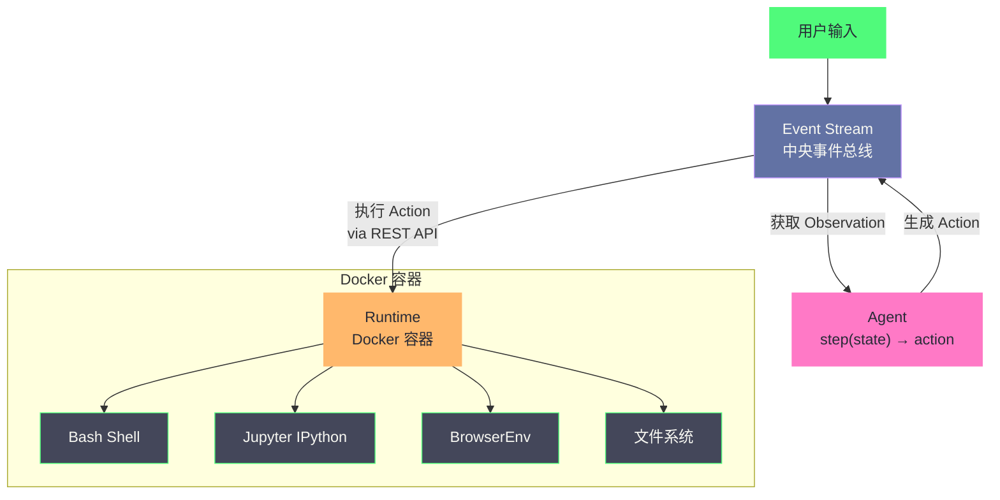
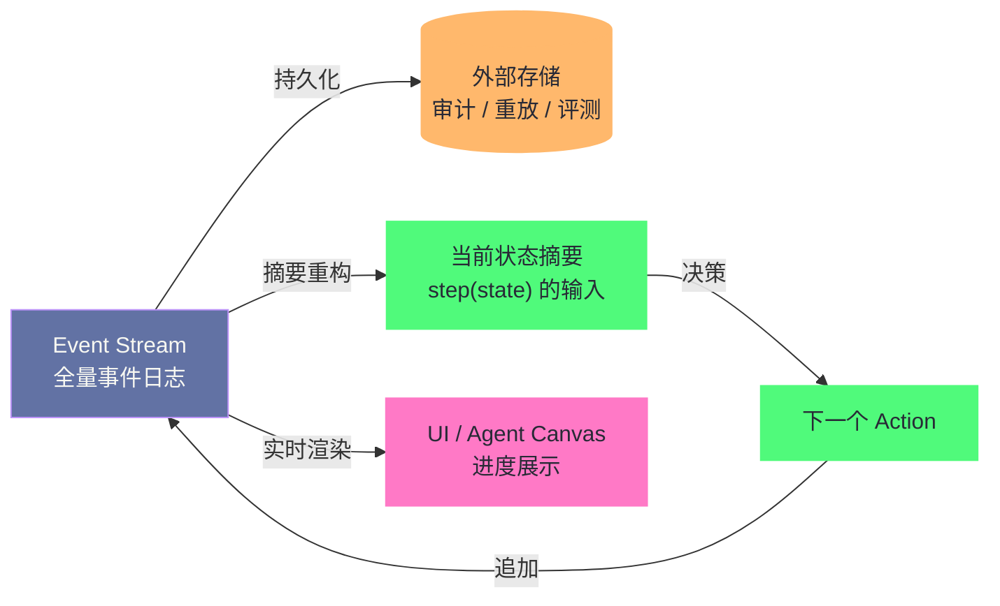

# 19 OpenHands 与 Aider——开源 Coding Agent 的两种哲学

> [!abstract] 摘要
> 前两篇解构了 Claude Code（Anthropic 的 CLI Agent）与 Devin（Cognition 的沙箱化 Agent），本文转向开源世界——OpenHands（原 OpenDevin）与 Aider 两个开源 Coding Agent，它们代表了两种截然不同的设计哲学。OpenHands 用 Event Stream 架构与 Docker 沙箱 Runtime 实现"开源版 Devin"——可审计、可重放、可隔离的完整 Agent 平台；Aider 用单进程架构与 Repo Map（Tree-sitter + PageRank）实现"轻量级 Terminal Agent"——无 Docker、无 daemon、Git 原生。文章按"是什么→为什么出现→不这样会怎样→如何落地→边界与反例"的主线展开：先讲两个项目的起源与 2026 年现状——All Hands AI 完成 1800 万美元 A 轮、OpenHands 版本线推进到 v1.33、Agent Canvas 与 Agent Control Plane 落地、GitHub Actions 与 ACP 协议接入，Aider 停在 v0.86 系列、靠 polyglot 基准与 Architect/Editor 模式持续打磨认知优化；再深入两边的机制细节——Event Stream 的事件模型与上下文管理、四种 Runtime、AgentSkills 与多 Agent 委托、Repo Map 的动态 token 预算、三层模型系统与模型路由；最后把两者放进 Cline、Codex CLI、OpenCode 等构成的生态格局里横向对比，并用 SWE-bench 与 polyglot 两种尺子的差异说明"基准数字"该怎么读。核心认知：**开源 Coding Agent 没有唯一的正确路线，"安全隔离"与"认知优化"不是高下之分，而是场景之分**——OpenHands 的可信度来自隔离与审计，Aider 的可信度来自上下文与基准，二者各自的代价（平台化的重量、无沙箱的风险）恰好决定了它们适合完全不同的工作流。

---

## 第 1 章 起源——两条开源道路的分岔

### 1.1 两个起点，两种出身

2023 年 5 月 9 日，Paul Gauthier 在 GitHub 上创建了一个名为 aider 的仓库，用它做"终端里的 AI 结对编程"——启动命令、直接读写当前目录下的文件、把每次改动自动提交成一次 Git commit。这个仓库后来成为 Apache-2.0 协议下最有生命力的轻量 Coding Agent 之一，截至 2026 年 10 月已积累约 5 万星标，GitHub 上显示的最新 release 标签停在 v0.86 系列，版本号多年保持在 0.8x 的区间内。

将近一年之后，2024 年 3 月，一个与 CMU 研究社区关系密切的开源团队发布了 OpenDevin——一个目标直指"软件开发者代理"（Software Developer Agent）的项目，论文《OpenHands: An Open Platform for AI Software Developers as Generalist Agents》（arXiv:2407.16741）随后在 7 月公开。同年 8 月项目更名为 OpenHands，背后的公司 All Hands AI 在 9 月宣布了由 Menlo Ventures 领投的 500 万美元种子轮，2025 年 11 月又完成由 Madrona 领投、Menlo、Pillar VC、Obvious Ventures、Fujitsu Ventures 与 Alumni Ventures 参与的 1800 万美元 A 轮融资，并与 AMD 达成硬件合作（Lemonade Server 项目），把"本地推理 Agent"的性能优化绑定到 AMD 平台上。到 2026 年 10 月，OpenHands 仓库（MIT 协议）的星标数已经涨到约 9.2 万，叉数约 1.2 万，软件包累计下载超过 400 万次，贡献者数百人。

两个项目几乎在同一条赛道上起步，却走向了完全不同的建筑形态。笔者不妨打一个比方：**OpenHands 像一座可以搬进你机房里的完整工坊——车床、通风橱、质检台一应俱全，门禁森严；Aider 像一把随身携带的瑞士军刀——轻、快、随时可用，但每一刀都直接落在你自己的桌面上**。工坊的比喻背后是"环境即产品"的设计观：Agent 的能力边界由它所在的沙箱环境决定，所以 OpenHands 把大半精力花在容器、浏览器、Jupyter、事件总线上；军刀的背后是"上下文即产品"的设计观：Agent 的能力边界由它看到的信息决定，所以 Aider 把大半精力花在 Repo Map、编辑格式、模型路由上。两种出身决定了两种取舍，而这两种取舍恰好对应着开源 Coding Agent 世界的两条主线。

### 1.2 为什么开源这件事重要

在 Claude Code 与 Devin 都闭源的背景下，开源 Coding Agent 承担了一个特殊角色——它把"Agent 内部到底怎么工作"摊开在所有人面前。Devin 的 ACI 设计是论文里描述的黑盒，OpenHands 的 Event Stream 却是可以逐行阅读的代码；Claude Code 的上下文管理是文档里的白描，Aider 的 Repo Map 却是可以用 `--map-tokens` 反复实验的参数。开源意味着评估标准不再依赖厂商自述，任何人可以 fork、审计、改造，甚至可以拿一个仓库去驱动另一个仓库——2026 年 6 月 OpenHands 宣布支持 Agent Client Protocol（ACP）之后，用 OpenHands 的界面去驱动 Claude Code、Codex、Gemini CLI 成了官方文档里的常规操作，这正是开源生态独有的"互相引用"能力。

但开源也意味着取舍与代价：**开源项目的维护者要同时伺候三个用户——终端开发者、企业采购者与学术研究者，三者的诉求常常互相打架**。OpenHands 在 2025 到 2026 年间的演化轨迹，本质上是"从服务终端开发者，转向服务企业舰队"的一次大型转向，这一转向既带来了融资与商业化，也带来了架构与形态上的持续膨胀；而 Aider 则近乎固执地守住了"终端里的单进程工具"这一原教旨，几乎不为商业场景改变形态。两条路孰优孰劣，现在下结论为时尚早，但理解它们各自的前提，是理解整个开源 Coding Agent 生态的钥匙。

---

## 第 2 章 OpenHands 的 Event Stream 架构

### 2.1 为什么需要一条中央事件总线

传统 Agent 架构里，Agent 与执行环境之间的通信是直接的——Agent 调用 Runtime 的方法，Runtime 返回结果。这种方式有两个与生俱来的问题：其一，交互只发生在内存里，没有持久化的痕迹，会话结束之后想回溯"Agent 当时到底执行了什么命令、为什么失败"，只能靠日志碎片去猜；其二，Agent、Runtime、UI 三者紧耦合，UI 要看到 Agent 的中间步骤、Runtime 要独立于 Agent 部署，几乎都要重写通信层。

OpenHands 用一条中央事件总线（Event Stream）来回答这两个问题：**所有 action 与 observation 按时间顺序追加进同一条事件流，Agent、Runtime、UI 三方都只与事件流对话，彼此不直接持有对方的引用**。这好比给一次 Agent 会话配了一位全程在场的会议速记员——谁说了什么、谁做了什么、结果如何，全部按时间戳记录在案，事后任何一方都可以回放整场会议。速记员的代价是记录本身有开销，事件流会持续增长，这也是后文要讨论的 Context Engineering 问题。

### 2.2 事件模型——Action 与 Observation 两类原语

OpenHands 的事件（Event）分为两大类，这一点是整个架构的心智模型：

**Action（行动）**——Agent 发出的操作请求，是"想做什么"。常见的有 `CmdRunAction`（在沙箱里执行 shell 命令）、`FileWriteAction`（写文件）、`FileEditAction`（精确编辑文件中的一段文本）、`BrowseURLAction`（用浏览器打开一个 URL）、`AgentDelegateAction`（把子任务委托给另一个 Agent）等。

**Observation（观察）**——Runtime 执行 Action 之后返回的结果，是"发生了什么"。常见的有 `CmdOutputObservation`（命令的标准输出与退出码）、`FileWriteObservation`（写文件的结果）、`BrowserObservation`（浏览器当前页面的截图或 DOM 摘要）等。

每个事件都带时间戳与唯一 ID，按时间顺序追加到事件流里。Agent 的 `step(state)` 函数从事件流重构出当前状态，决定下一个 action，再写回事件流；Runtime 从事件流取出 action 执行，把 observation 写回；UI 订阅事件流，把进度渲染给用户。三方之间唯一的契约就是事件流本身，这就是事件流架构的**解耦价值**。

### 2.3 三个工程价值——可审计、可重放、可解耦

**可审计（Auditable）**：所有操作按时间顺序留痕，任何一步出了问题都能回溯——是哪个 Agent、在哪条命令、看了哪个页面之后做出了错误决定。对于企业场景，这份审计日志本身就是合规资产。

**可重放（Replayable）**：事件流可以整体保存，之后重放整场会话，用于调试、评估、训练数据采集。OpenHands 的评测体系就建立在这个能力之上——把一次 SWE-bench 任务的完整事件流存下来，用不同模型、不同 prompt 重放对比，是开源社区做 Agent 实验的常规玩法。

**可解耦（Decoupled）**：Agent、Runtime、UI 各自独立演化。Runtime 从 Docker 换成 Remote、Modal、Local，Agent 代码不用改；UI 从 Web 换成 CLI、桌面端，Agent 与 Runtime 也不用改。2026 年 OpenHands 长出 Agent Canvas 桌面端、CLI、Web 三个界面，底层仍是同一条事件流，靠的正是这份解耦。

### 2.4 从 SSH 到 EventStream 的架构演进

早期版本的 OpenHands（当时还叫 OpenDevin）用 SSH 连接 Docker 容器执行命令。SSH 方案有四个绕不开的麻烦：其一，连接管理复杂——超时、重连、密钥认证都要自己处理；其二，任意 Docker 镜像都需要预装 SSH server，用户不能随便拿一个基础镜像就用；其三，难以扩展到非 Docker 的 Runtime——Remote、Modal 这类外部沙箱没有稳定的 SSH 入口；其四，SSH 通道只适合"命令-输出"这种窄交互，承载不了浏览器截图、文件编辑这类富事件。

后续版本迁移到 EventStream + REST API 架构：backend 通过 HTTP 调用容器内 Action Execution Server 的 `/execute_action` 端点，发送 action、接收 observation。这一迁移消除了 SSH 依赖，runtime client 随镜像自动安装，任意 Docker 镜像都可以作为沙箱底座，也顺带打开了 RemoteRuntime、ModalRuntime 等非本地实现的大门。即便到了 2026 年，事件流仍是 OpenHands 的核心——v1.27.0 之后的 UI 里那个"实时活动指示器"（live activity chip），官方实现说明就是直接读取未处理完的原始会话事件（unresolved raw conversation events）来推断 Agent 正在做什么。架构的历史包袱被清掉了，架构的核心思想被留了下来，这是技术演进里最理想的剧本。

### 2.5 事件流与 Context Engineering——数万条事件怎么办

事件流的价值建立在"记录一切"之上，但"记录一切"本身会带来一个新问题：一个长时会话可能累积数万条事件，如果把这些事件全部塞进 Agent 的上下文，第一步就把 [[LLM/Agent技术/基础范式/06 Prompt 上下文管理——Context Engineering 的艺术|第 6 篇]] 讨论的上下文退化（Context Degradation）问题引爆了。OpenHands 的解法是给事件流做分层：**完整事件日志持久化到外部存储，供审计、重放与评估按需读取；Agent 的 `step(state)` 函数接收的并不是完整事件历史，而是从事件流重构出来的"当前状态摘要"——文件树、会话目标、最近几步的关键 observation**。UI 与审计端可以按需深挖任意细节，Agent 却只看到被压缩过的"此刻发生了什么"。这就像一个高效的团队周报——仓库里的详细记录一分不少，但送到决策者桌上的永远是提炼过的摘要。用一张图来表达事件流的这套分层消费：

这套分层还有一个 2026 年的新搭档：v1.7.0 加入的持久化 Agent 记忆（persistent agent memory）。事件流解决"这一次会话内发生了什么"，持久化记忆解决"之前的会话积累了什么经验"，两者一横一纵，把 Coding Agent 从"每次从零开始"的失忆状态里捞出来。不过要注意，摘要与记忆都是损失性压缩——被摘要掉的历史细节在推理时是拿不回来的，所以"哪些信息值得保留在摘要里"本身就是一个需要按任务类型调优的 Context Engineering 决策，这也是思考题 1 留给读者继续探索的地方。

### 2.6 循环的控制——最大步数与卡死检测

事件流解决了"Agent 与环境的通信"，但没解决"Agent 会不会永远转下去"。LLM Agent 的循环在两种情况下会变成烧钱的永动机：一种是任务过于开放，Agent 在一个接一个地尝试无意义的方案；另一种是卡死——反复执行同一条命令、反复读同一个文件，输出却毫无进展。第三方对 OpenHands 源码的阅读显示，当前版本对 Agent 循环有两道保险：一是 **最大迭代步数（max_iterations）**，默认上限通常设在几百步的量级，到顶即停，防止单任务无限消耗预算；二是**卡死检测（stuck detection）**，当 Agent 的 action 序列呈现重复模式时主动介入，尝试把 Agent 从死循环里拽出来。这两道保险的价值在无人值守场景（CI、批量任务）里尤其重要——有人盯着的会话里，人类会喊停；没人盯着的会话里，只能靠机制喊停。**事件流在这里再一次立功：卡死检测之所以可行，正是因为重复模式就明明白白地躺在事件流里可被程序化分析**。

> [!info] 核心概念：事件流是 OpenHands 一切能力的底座
> 可审计、可重放、可解耦三个价值，共同支撑了 OpenHands 后来的所有产品动作。没有事件流，Agent Canvas 就无法在 Web 端实时渲染 Agent 的中间步骤；没有事件流，Agent Control Plane 就无法给出"完整的 agent 活动记录"；没有事件流，GitHub Actions 里的 PR 评审就无法把 inline comment 挂到正确的代码行上。**架构不是为某个单一功能服务的，而是为一批功能共享的地基**——这是 OpenHands 与 Aider 在工程组织方式上最根本的分歧。

---

## 第 3 章 Runtime——Docker 沙箱与四种实现

### 3.1 构建过程与通信方式

OpenHands 的 Runtime 是它与 Claude Code、Aider 最大的分野——它默认在 Docker 容器里执行一切代码，而不是直接在用户机器上跑。构建过程分四步：用户提供自定义 base Docker 镜像；OpenHands 在此基础上构建 OH Runtime Image，把 runtime client 代码装进去；启动 Docker 容器；容器内初始化 `ActionExecutor`，设置 bash shell、浏览器与插件。之后 backend 通过 RESTful API 与容器内的 Action Execution Server 通信，发送 action、接收 observation，全程不碰用户的文件系统。

这个"一切发生在容器里"的决定，把 Coding Agent 的安全问题从"宿主机的裸奔"降级为"容器内的可控风险"——prompt injection 导致的恶意命令、一个写错了的 `rm -rf`，都被关在容器墙内。但容器隔离不是绝对安全，容器逃逸（container escape）攻击在 2026 年依然是真实存在的威胁面，需要更强隔离的场景应选用 RemoteRuntime 连接 Kata Containers、gVisor 等更强隔离的运行时。笔者把这个设计比作实验室的通风橱——**危险实验必须在一个既透明又封闭的罩子里做，罩子挡不住所有伤害，但它把大多数伤害挡在了操作者之外**；同理，Docker 沙箱挡不住所有恶意代码，但它把"误操作"这一最常见的伤害来源隔离在外。

### 3.2 四种 Runtime 实现

| Runtime | 适用场景 | 特点 |
| :--- | :--- | :--- |
| **DockerRuntime** | 本地开发、单机部署 | 在本地 Docker 容器中运行，默认选项 |
| **RemoteRuntime** | 连接外部管理的沙箱 | 通过自定义 HTTP API 创建/暂停/恢复/停止 |
| **ModalRuntime** | Serverless 执行 | 通过 Modal 平台按需拉起，用完即走 |
| **LocalRuntime** | 无 Docker 环境 | 直接在本地运行，放弃沙箱隔离 |

四种实现共享同一条事件流接口，区别只在"执行环境在哪里、隔离强度多高"。DockerRuntime 适合个人开发者；RemoteRuntime 适合企业把沙箱托管在自建的强隔离集群上（2026 年的 Agent Canvas 支持"isolated Docker runtimes"，就是这条路线在产品层的落地）；ModalRuntime 适合按调用计费的 Serverless 场景；LocalRuntime 则是为没有 Docker 的环境准备的逃生舱——它明确放弃了沙箱隔离，把安全责任交还给用户。这个"同接口、多实现"的设计，让 OpenHands 可以在"隔离强度"与"部署成本"之间滑动，而不是把用户钉死在某一种选择上。

> [!info] 核心概念：Docker 沙箱是 OpenHands 的安全基石
> OpenHands 选择 Docker 作为默认 Runtime，核心原因是安全隔离——Agent 执行的任意代码都在容器内运行，不会影响宿主机。这呼应了 [[LLM/Agent沙箱技术/00 专栏导览|Agent 沙箱技术专栏]] 的主题。但 Docker 容器隔离不是绝对安全的——容器逃逸攻击仍然可能（详见 [[LLM/Agent沙箱技术/生产化/14 沙箱安全体系——三层防护、短期凭据与多租户|沙箱专栏第 14 篇]]）。对于需要更强隔离的场景，可以使用 RemoteRuntime 连接 Kata Containers 或 gVisor 等更强隔离的沙箱。

### 3.3 沙箱的边界：什么能信，什么不能信

关于沙箱，笔者想提醒一个经常被忽略的边界：**沙箱隔离的是"代码执行的破坏力"，隔离不了"信息的外泄"**。容器内的 Agent 如果能访问网络，它就能把读到的代码、密钥、数据库内容通过外发请求传出去——OpenHands 的 RemoteRuntime 为此要求 Egress 过滤与短期凭据（8 小时过期的 GitHub token 就是例子），企业版把 secrets 访问收敛到最小权限策略。换言之，沙箱是"防破坏"的盾，不是"防泄漏"的墙，两者必须配套建设。这个边界在 Aider 那边正好是反过来的——它完全没有盾，但也没有墙，安全完全依赖"Agent 不犯错、prompt 不被注入"这两个假设，而这两个假设在真实世界里都靠不住。

### 3.4 沙箱的启动成本与暖池

沙箱不是免费午餐，它最大的代价是"每一次想跑点什么，都得先穿过一道启动闸门"。Docker 容器从拉镜像、构建 OH Runtime Image 到真正就绪，在个人电脑上通常要十几秒到几十秒；而 Aider 的启动是秒级甚至亚秒级。这个差异在交互式场景里会变成体感鸿沟——**人类开发者对"等一个工具准备好"的耐心大约只有几秒，一旦超过，就会下意识地绕开这个工具**。OpenHands 缓解这个问题的工程手段是预热（Warm Pool）：预先把容器拉起、把 Runtime Image 构建缓存好，Agent 真正要跑时直接复用现成的容器，把冷启动摊到"闲时"。这与 [[LLM/Agent沙箱技术/工程实践/12 沙箱性能工程——Runtime 基准与 WarmPool 容量管理|沙箱专栏第 12 篇]] 讨论的 WarmPool 容量管理是同一套思想——**延迟不是被消灭的，而是被转移到别处（预热期、缓存、容量规划）**。理解了这一层，就理解了 OpenHands 为什么天然更适合"批量、无人值守、可排队"的任务，而不适合"坐下来马上改一行代码"的场景——后者的等待成本在沙箱路线里是结构性的。

---

## 第 4 章 AgentSkills 与多 Agent 委托

### 4.1 AgentSkills——把能力包装成可加载的技能

OpenHands 的 Agent 通过 AgentSkills 获得与环境交互的能力。技能（Skill）可以理解为一份"结构化的职业培训手册"——它包含一段说明（这个技能解决什么问题）、一组步骤（怎么做）、以及可选的脚本、模板与参考资料（用什么做）。2026 年的 OpenHands 支持业界通行的 AgentSkills 标准：每个技能是一个目录，入口是带 frontmatter（name、description、triggers）的 `SKILL.md`，采用渐进式披露（progressive disclosure）——初始 prompt 里只列出技能的名字与一句话描述，Agent 觉得需要时才调用 `invoke_skill()` 读入完整内容。带 `triggers` 关键字的技能还能在匹配到关键词时自动注入。这套机制与 [[LLM/Agent技术/基础范式/06 Prompt 上下文管理——Context Engineering 的艺术|第 6 篇]] 讨论的 Just-in-Time Context 一脉相承：**技能的存在性是廉价的，技能的内容是昂贵的，所以只把廉价的部分预先暴露给模型**。

OpenHands 官方扩展仓库里躺着几十个开箱技能：`jupyter`（数据分析与算法验证）、`code-review` 与 `github-pr-review`（代码评审）、`slack-standup-digest`（站会摘要）、`incident-retrospective`（事故复盘）、`dependency-upgrade`（依赖升级）等。技能体系的价值在于把"一次性 prompt"沉淀为"可复用的组织资产"——同一个技能在不同仓库、不同项目里复用，行为的一致性大幅提升。

**Jupyter IPython 环境**是 Agent 的另一个关键能力：Agent 可以在 IPython 中执行 Python 代码，适合数据分析、算法验证、快速原型。相比纯 bash 执行 Python 脚本，IPython 的交互式环境天然适配 Agent 的"执行→观察→调整"循环——变量留在内存里，上一次的运行结果可以被下一次引用，这比反复用 `python3 script.py` 重跑整个脚本高效得多。

**BrowserGym 原语**通过 Playwright 控制的 Chromium 浏览器，让 Agent 可以打开网页、点击、输入、截图，具备了类似 Devin Computer Use 的浏览器操作能力——但不如 Devin 的完整桌面环境操作。SDK 侧则在 2026 年提供了基于 browser-use 库的 BrowserToolSet，进一步把浏览器能力组件化。对于需要"打开文档查 API、填表单、看渲染结果"的任务，这一能力是纯命令行 Agent 给不了的。

### 4.2 多 Agent 委托——上下文隔离的工程实现

OpenHands 支持 `AgentDelegateAction`——主 Agent 可以把子任务委托给 specialist agent（如 BrowsingAgent 专门处理浏览器交互任务）。这与 [[LLM/Agent技术/Coding-Agent解构/17 Claude Code 架构解构——Anthropic 的 CLI Agent 设计哲学|Claude Code 的 Subagent 机制]] 类似，动机都是**上下文隔离**：子任务在自己的独立上下文里执行，中间过程不污染主 Agent 的上下文，主 Agent 只接收最终结果摘要。这就好比项目经理把活儿外包给专业团队——外包团队在自己的办公室里干活，项目经理只收到交付物，不会因为盯着施工细节而丢了自己的主线。

2026 年的 OpenHands 把委托能力进一步泛化：Agent Canvas 与 Software Agent SDK 支持 ACP 协议后，委托对象不再局限于 OpenHands 自家的 specialist agent，而是可以是任何实现 ACP 的 Agent——Claude Code、Codex CLI、Gemini CLI 都可以被 OpenHands 的界面接管执行。这种"开放委托"是闭源产品做不到的，也是开源生态里"互相引用"能力的一个缩影。

### 4.3 技能、AGENTS.md 与仓库上下文的分工

技能体系很容易被误解为"给 Agent 塞更多 prompt"，实际上 OpenHands 对"仓库级指令"与"任务级技能"做了严格分工。官方文档的建议是这样的：**仓库级的通用约定（代码风格、目录结构、测试要求）放进仓库根目录的 `AGENTS.md`，随初始 system prompt 全文注入，每个任务都生效；任务级的专业知识与工作流放进 `.agents/skills/` 下的 `SKILL.md`，先只暴露名字与描述，Agent 按需加载**。前者是"这个仓库的规矩"，后者是"这件事怎么做"。这套分工的工程含义是：全量注入的内容要极简，否则每轮对话都在为无关约定付 token 费；按需加载的内容可以很厚，反正只在需要时才进上下文。OpenHands 还顺带兼容了 `CLAUDE.md`、`GEMINI.md` 这类模型特定的仓库上下文，让同一个仓库在不同 Agent 之间迁移时，规矩不至于散架。理解了这层分工，再看 AgentSkills 的渐进式披露，就能明白它不是在堆 prompt，而是在替 Agent 做上下文预算的长期管理。

---

## 第 5 章 2026 的 OpenHands——从开源项目到商业平台

行文至此，前四章讲的还是 OpenHands 的"骨架"——事件流、Runtime、技能、委托。但骨架撑起来的身体，在 2025 到 2026 年间经历了一场剧烈的生长，不把这个"现状"讲清楚，读者对 OpenHands 的理解就会停在 2024 年的论文里。本章的素材全部来自官方博客、GitHub release 与公开报道，截至 2026 年 10 月。

### 5.1 版本线与交付形态

OpenHands 的版本线在 2026 年保持约每四天一个小版本的高频迭代：从 1.0 一路推进到 **v1.33.0（2026-10-23）**，同时维护一条 `cloud-1.4x` 的云端版本线。需要澄清的是，截至本文写作时并没有公开的"OpenHands 2.x"大版本——1.x 的节奏本身已经足够快，官方把架构升级分散在小版本里推进，譬如 v1.7.0 加入持久化 agent 记忆与 LLM 选择器改版，v1.24.0 落地对话自动化（cron 定时与事件触发）。

交付形态也从单一的 Web 界面扩展为三端：Web（云上 `app.openhands.ai` 或自托管）、CLI（2026 年提供，与 GUI 共享会话，官方 roadmap 上还挂着"会话在 CLI 与 GUI 之间共享"的开放项）、以及 **Agent Canvas** 桌面端（2026-06-16 正式发布，提供 deb/dmg/exe/AppImage 四类安装包）。Agent Canvas 被官方定位为"自托管的 Coding Agent 自动化工作区"——把 Slack、GitHub、Linear 接进来，按计划或按事件运行工程工作流，这让 OpenHands 从"你和 Agent 聊天"的形态，变成了"Agent 替你值班"的形态。

Agent Canvas 在 2026 年夏天的迭代节奏同样快得惊人：8 月的月度更新补上了自动化模板、实时 Agent 活动展示、模型配置与评审工作流，还引入了 Canvas Apps（在 Agent Canvas 里扩展自定义应用的机制）；9 月的月度更新加入了 scoped Agent Profiles（限定 Agent 权限边界的角色配置）、persistent automations（可持续运行的自动化）与 isolated Docker runtimes（隔离的 Docker 运行时）。注意这里反复出现同一个词——**自动化（Automation）**：2026 年的 OpenHands 把自己重新定义为"工程组织的自动化基础设施"，而"聊天式的 Agent 会话"只是这盘棋的第一格。

### 5.2 公司化：All Hands AI 与 1800 万美元

All Hands AI 的公司化路径是理解 OpenHands 现状的关键。2024 年 9 月种子轮 500 万美元之后，2025 年 11 月 18 日宣布 **1800 万美元 A 轮**（Madrona 领投），同时官宣与 AMD 的合作。CEO Robert Brennan 在融资稿里的表述很直白："运行单个 Agent 很简单，运行成百上千个就需要一个系统。"这句话几乎预告了 OpenHands 之后一年的产品主线——从单 Agent 工具走向 Agent 舰队管理。

随之而来的是商业形态的分层：本地开源部署完全免费；云上 Teams 套餐约 499 美元/月起（10 席位，超出按 50 美元/席位，月会话上限 5000 次）；企业版自托管、按需定价。免费开源 + 付费云/企业，是开源商业化的标准配方，但 OpenHands 的特殊之处在于它的免费层并不是"阉割版"——核心 Agent、Docker 沙箱、事件流都在开源仓库里，付费买的是托管、治理与规模化能力。

### 5.3 三大新支柱——SDK、控制平面与自动化

**Software Agent SDK（v1.0，2025-11）**：把 OpenHands 的 Agent 循环封装成可编程 SDK，官方公布发布两个月下载量就超过 50 万次。SDK 意味着 OpenHands 可以被嵌入任意工程流程——不一定要打开界面，写几行 Python 就能让 Agent 在 CI 里跑一次代码评审。**它把"OpenHands 是产品"改写成了"OpenHands 是运行时"**。

**Agent Control Plane（2026-05-06）**：面向企业的新治理层，统一管理多 Agent 的 LLM 路由策略、MCP 访问、secrets 访问、预算、用户与认证，并给出"全景审计"视图。官方推荐 Kubernetes 承载运行时，每个 Agent 一个容器，可定时或按事件触发。这层的东西对单人开发者没什么用，但对"几百个 Agent 同时跑在几十个仓库上"的工程组织，几乎就是必需品。笔者愿意把它比作航空管制塔台——**每一架飞机都能自己飞，但要让几十架飞机在同一片空域里不撞机、不迷航、可追溯，必须有统一的调度与监控**；控制平面解决的不是"让 Agent 能飞"，而是"让 Agent 舰队能飞"。

**Automations（自动化，v1.24.0 起逐步成形）**：把 Agent 工作流定义为 cron 定时或事件触发——PR 打开时自动评审、依赖发版时自动升级、监控告警时自动排查。官方列举的用例包括漏洞批量修复、跨仓库依赖升级、PR 评审与反馈、告警驱动的故障响应、跨数百仓库的大规模迁移。这与 CEO 在 2026 年 3 月访谈里描述的路线图一致：OpenHands 的下一个主战场是技术债与大规模代码维护——譬如"一个组织有一千个 Java 仓库，八成还停在 Java 8，需要统一升到 Java 21"，这类可重复、可编码、可规模化的迁移任务。

### 5.4 GitHub 生态与 SWE-bench 成绩

**GitHub Actions** 是 OpenHands 进入工程流程的另一条通道。官方提供基于 Software Agent SDK 的 composite actions，最典型的是 **PR 评审工作流**（`OpenHands/extensions/plugins/pr-review`）：PR 打开、draft PR 转为 ready、打上 `review-this` 标签或直接把 `openhands-agent` 添加为 reviewer 时触发，Agent 读取整个仓库的上下文与完整 diff，用 `/codereview` 技能做质量与安全分析，再用 `/github-pr-review` 技能把带优先级标签（🔴 严重、🟠 重要、🟡 建议、🟢 细节）的 inline comment 挂到具体代码行，通常 2-3 分钟出结果。评审 Agent 还会参考上一轮评审的 comment、批准状态与线程解析情况，避免对同一个问题反复唠叨。此外还有自动更新文档、从 DataDog 告警诊断错误、管理 TODO 技术债等官方示例。GitHub resolver 则让用户在 issue 或 PR 里 @openhands 就能把任务交给 Agent——`@openhands` 触发后机器人先回一句"I'm on it!"，实际仓库操作以请求用户的 GitHub 身份执行，凭据走 8 小时短效 token，最小权限原则。这套"人在 GitHub 里，Agent 在 CI 里"的协作形态，正是 OpenHands 与 Aider 最显著的使用方式差异——**前者把 Agent 放进流水线，后者把 Agent 放进你的终端会话**。

**SWE-bench Verified 成绩**方面，需要小心区分口径。官方博客（2025-04-17）宣布 OpenHands 登顶 SWE-bench Verified，当时的数字是单次轨迹 60.6%、用自研 critic 模型（基于 Qwen 2.5 Coder 32B 微调，TD 学习目标，γ=0.99）做 inference-time scaling 五次重试后提升到 **66.4%**，同时是 LiveSWEBench 与 Multi-SWE-Bench（8 种语言）的头部选手。2026 年第三方聚合口径（如 aifoss.dev 与 SkillPack）多引用 70% 上下甚至更高的厂商自报数字（72% 到 77.6%，取决于模型配置），官方还维护着一个 OpenHands Index（HuggingFace 上的模型×基准持续评测看板）。笔者的提醒是：**SWE-bench 这类基准衡量的是"给定 issue 的描述能否修出通过测试的 patch"，衡量不了"在真实组织里能否产出可合入、可维护的代码"**——OpenHands 官方自己也承认，基准高分只是起点，真正稀缺的是验证（Verification）能力。2026 年 6 月官方博客《The Verification Stack》有一句话说得很好："Agent 让代码生成变便宜了，真正的瓶颈变成了验证——确认改动正确、符合仓库约定、值得团队信任与合入。"这句话值得每个认真使用 Coding Agent 的人记住。

### 5.5 平台化的代价

平台化不是免费的。第一重代价是学习曲线与部署复杂度——想真正用上 OpenHands 的沙箱与自动化，Docker 几乎是绕不开的前提，这对只想"改个文件"的开发者是沉重的。第二重代价是形态的膨胀——从开源 Agent 到 SDK、控制平面、企业版，OpenHands 的边界越来越宽，其"极简可用"的原始卖点正在被稀释。第三重代价是商业模式与开源的张力——免费开源的核心承诺（"for free, forever"）与付费企业功能之间需要一条清晰的线，线的位置稍有闪失，社区信任就会流失。这些代价并非 OpenHands 独有，而是"平台化"这条路的普遍宿命，后文对比 Aider 时还会回来。

### 5.6 一个贯穿案例：PR 评审工作流全链路

把前几章的机制串起来看，最直观的样本是官方 PR 评审工作流跑完一次的全过程：

1. **触发**：PR 打开（或打上 `review-this` 标签、被请求 review），GitHub Actions 工作流被拉起，把 `LLM_API_KEY` 作为仓库 secret 注入
2. **启动沙箱**：Agent 在 Docker 容器里就绪，拥有整个仓库的读权限与 PR 写权限——这里用到的正是第 3 章的 Runtime 与第 2 章的事件流
3. **分析**：Agent 读取完整 PR diff 与仓库上下文，调用 `/codereview` 技能做质量、安全、数据结构与最佳实践分析——这里用到的是第 4 章的技能体系
4. **产出**：Agent 用 `/github-pr-review` 技能调用 GitHub API，把带优先级标签的 inline comment 挂到具体代码行——评审结论落在"代码行"而非"一段总结"上，方便开发者原地讨论
5. **闭环**：评审记录进入 Agent 的记忆与事件流，下一轮评审可以引用上一轮的评论、批准状态与线程解析，避免重复唠叨

这个流程把 OpenHands 的全部核心资产——事件流、Runtime、技能、GitHub 集成——拧成了同一个动作。开发者要做的事只剩两件：把工作流文件放进 `.github/workflows/`，把 API key 配成仓库 secret。**对比 Aider 的"你发起对话、Agent 改文件、你 review commit"，OpenHands 的 PR 评审是"你写配置、Agent 全程无人值守、你只 review 结果"**——两种形态对"人在环"的依赖程度完全不同，这正是两种哲学最直观的分水岭。

---

## 第 6 章 Aider——单进程、Git 原生与 Repo Map

### 6.1 设计哲学：极简单进程

Aider 的设计哲学与 OpenHands 完全相反——**单 Python 进程，无 build step，无 daemon，无 Docker**。`aider` 命令启动后，在当前目录工作，直接读写本地文件，直接调用 Git，没有容器、没有事件总线、没有 REST API，一切都在一个进程内完成。

这种极简设计带来四个直接优势：**零配置启动**（`pip install aider-install` 后一条命令即可使用）；**低资源开销**（没有容器启动延迟、没有进程间通信开销，启动按秒计）；**直接操作本地文件**（没有沙箱隔阂，Agent 看到的就是你看到的）；**Git 原生的工作流**（每次改动自动提交为一次带语义化 message 的 commit，`git diff HEAD~1` 就能看到 Agent 改了什么，`git reset` 就能撤销——Git 本身就是 Aider 的审计日志与回滚机制）。

代价同样明确：**无安全隔离**——Agent 执行的任何代码直接跑在你的机器上，一个错误的 `rm -rf` 会真的删掉你的文件；**无法并行隔离**——多个 Aider 实例在同一仓库工作要手动用 Git worktree 隔离。Aider 的取舍是"把安全责任交还给用户，把工程精力全部花在让模型更聪明地上"——它赌的是：对大多数个人开发者，精心设计的上下文比 Docker 沙箱更能提升产出质量。

关于 Aider 的"零膨胀"，还有一个佐证：2026 年它的 GitHub 星标约 5 万，版本号还停在 v0.86 系列，README 首页仍写着"AI pair programming in your terminal"。它的发布节奏同样克制，0.86.0 的 release note 里有一句很有意思的自述——"本次 release 里 88% 的代码由 Aider 自己编写"。**用自己写的代码改进自己，这大概是"极简单进程"路线最浪漫的注脚**。

"单进程"并不意味着与编辑器老死不相往来。Aider 的 watch mode 可以监听外部编辑器的改动：你在 VS Code 或任何编辑器里手动改了文件，Aider 会感知这次带外修改（out-of-band edit），把最新版本同步进对话上下文，避免"你改了文件、Agent 还拿着旧版本"的经典错位。它甚至允许一种很自然的协作方式——在代码里写下"帮我实现这个函数"之类的注释，Aider 看到后直接开工。这些能力都没有改变"一切发生在一个进程里"的事实，只是让这个进程与开发者既有的工作台保持呼吸同步。**Aider 的"轻"不是功能的贫乏，而是形态的克制**——它把所有交互收拢到终端与 Git 这两个开发者最熟悉的地带，拒绝再造第三个界面。

### 6.2 Repo Map——Tree-sitter + PageRank

Aider 最独特的技术创新是 **Repo Map**——用 Tree-sitter AST 解析和 PageRank 图排序，在 token 预算内为 LLM 提供整个代码库的"高密度地图"。

**问题**：LLM 的上下文窗口有限，不可能把整个代码库塞进去。但如果不给 LLM 全局视图，它就理解不了"要修改的函数与代码库其他部分的关系"，容易写出与现有抽象不一致的代码。这个矛盾在大型代码库上尤其尖锐——一边是上下文窗口这个硬约束，一边是"看得见全局"这个软需求。

**Aider 的解决方案分三步**：

**第一步：Tree-sitter AST 解析**。Aider 用 Tree-sitter（一个增量解析库）解析代码库中的每个文件，提取类、方法、函数等符号的定义与签名，产生"符号到文件"的映射——知道每个文件里有哪些符号、每个符号的定义长什么样。Tree-sitter 的增量特性让解析可以随文件改动局部重算，而不是每次全量重扫，这是 Aider 能在大型仓库上保持低延迟的关键。得益于 Tree-sitter 语言文法的覆盖面，Aider 官方宣称支持 100+ 种编程语言，从 Python、JavaScript、Rust 到 HTML、CSS，repo map 都能给出可用的符号地图——语言覆盖广这件事，在"代码库理解"这个环节比大多数 Agent 依赖的文件名嗅探要可靠得多。

不过 Repo Map 也有它的适用边界。对只有几百行的仓库，repo map 的符号摘要反而可能不如"直接看全部代码"来得准确——上下文放得下的时候，全量就是最好的摘要；只有上下文放不下时，摘要才成为必要的妥协。Repo Map 的另一个前提是代码要"可解析"——重度依赖动态特性、元编程、代码生成的语言，AST 提取的符号与真实语义之间会有偏差。更准确地说：**Repo Map 是"中等以上规模、静态特征明显"的代码库的良配，对小仓库与高度动态的代码库，它只是锦上添花而非雪中送炭**。

**第二步：PageRank 图排序**。Aider 构建一个图——每个源文件是一个节点，文件间的 import 依赖关系是边。然后在这个图上运行 PageRank 算法（就是 Google 排序网页的算法），计算每个文件的重要性分数。核心思想是"被重要文件引用的文件也是重要的"——如果一个文件被很多重要的文件 import，它的分数就高。这好比口碑传播：被重要人物引荐的人，通常也被认为更重要。

**第三步：Token 预算内选择**。根据当前聊天状态相关的文件，结合 PageRank 分数，在 `--map-tokens` 预算（默认 1K token）内选择最重要的符号放入 repo map。这个 map 随聊天动态调整——如果你在讨论认证模块，认证相关的符号会获得更高权重。Paul Gauthier 本人的描述是"token budget for the repository map……用图优化算法选出预算内最相关的部分"，而这个"动态"正是 Aider 与"整库塞进上下文"方案的本质区别。

**Repo Map 的价值**：**全局视野**（LLM 看到整个代码库的类/函数签名，理解现有抽象，避免写出平行宇宙式的风格）、**Token 高效**（只发最重要的符号签名，而非完整文件）、**动态调整**（随聊天上下文变化，讨论哪个模块就突出哪个模块）。

> [!info] 核心概念：Repo Map 是 Context Engineering 的代码库特化
> Aider 的 Repo Map 是 [[LLM/Agent技术/基础范式/06 Prompt 上下文管理——Context Engineering 的艺术|第 6 篇]] 讨论的 Context Engineering 原则的一个精妙实践——"在 token 预算内提供最高信号的上下文"。不同于 Claude Code 的"按需 read_file 加载"策略（Just-in-Time），Aider 的 Repo Map 是"主动提供精炼全局视图"——在每轮对话就附带一个代码库的"高密度摘要"，让 LLM 有全局视野而不需要主动探索。两种策略各有优势：Claude Code 的策略更节省 token（不看不用的文件），Aider 的策略更全面（LLM 知道代码库有什么，即使没主动看）。选择哪种取决于代码库大小和任务类型——大代码库适合 Just-in-Time，中小代码库适合 Repo Map。

### 6.3 Repo Map 的边界与反例

PageRank 有一个需要警惕的假设——"被重要节点链接的节点也重要"。在代码库里这个假设经常成立，但也经常被打破：一个被全项目 import 的 `utils.py`，PageRank 分数会很高，但它的业务重要性可能远不如一个只被少数文件引用的核心业务逻辑文件；工具函数文件"重要"是因为被广泛使用，而不是因为它承载核心决策。Aider 的处理方式是用"与当前聊天相关的文件"修正纯图排序——相关性权重可以在一定程度上对冲 PageRank 的"大众化偏差"。但读者应当理解，**repo map 是启发式的地图，不是权威的地图**——它告诉你哪些符号大概率重要，不保证所有重要符号都在场。遇上 map 里没有的符号，Aider 的编辑指令会要求模型显式读取文件，这正是 Just-in-Time 策略作为兜底存在的意义。

### 6.4 自动 commit 策略与撤销

Git 原生不是一句口号，而是一套被反复打磨的默认行为。Aider 默认在每次改动后自动提交一次 commit，message 由 Weak Model 依据 diff 生成——这带来三个直接好处：其一，**历史即审计**，每一条对话请求对应一次提交，`git log` 就是你和 Agent 的对话记录；其二，**撤销即对话回滚**，`/undo` 可以把最后一次改动连同 commit 一起退回，不需要手动 diff 恢复文件；其三，**并行即 worktree**，多个 Aider 实例在不同分支并行推进，最后按需合并，互不踩踏。习惯手动控制节奏的开发者可以关掉自动提交（`--no-auto-commits`），把"何时提交"的决定权拿回自己手里。这套设计把"Agent 改了代码"这个高风险动作，降级为"一次随时可回滚的 Git 操作"——**风险没有被消灭，但被移到了开发者最熟悉、最有把握的管理工具里**，这恰恰是"认知路线"处理风险的一贯方式：不建墙，但把退路修得足够宽。

---

## 第 7 章 Architect/Editor 与多模型路由

### 7.1 从单模型到双模型——规划与编辑分离

Aider 的另一个核心创新是 **Architect/Editor Pattern**——把"代码规划"与"代码编辑"分离到两个 LLM 调用中。工作方式：**Architect 阶段**，主模型（如推理型模型）分析请求，用自然语言或伪代码描述"如何解决这个问题"，但不直接生成文件编辑指令；**Editor 阶段**，Editor 模型接收 Architect 的提案，把它翻译为符合 Aider 编辑格式的具体文件编辑指令。

为什么这个拆分有效？因为某些任务对模型能力的需求是撕裂的：推理模型（如 o1、DeepSeek R1 这类 thinking 模型）擅长理解复杂需求、规划多文件修改，但经常不擅长生成精确的编辑格式；而编辑格式的精确性是决定"改动能否被正确应用"的关键。把两件事拆给两个模型，等于**让总建筑师专心画蓝图，让施工队专心按图施工**——各司其职，各自把注意力花在最擅长的事上。

代价是两次 LLM 调用——更慢、更贵。第三方实测（2025-01 的 GitHub issue #2969）也提示：用长思考模型做 Architect 可能让单任务耗时放大数倍，而收益未必同步放大。所以 Architect/Editor 是"质量优先"模式的选项，不是默认行为——Aider 的默认模式仍是单模型一步到位。

值得补充一个机制细节：即便在单模型模式里，Aider 的编辑循环也不是无限重试的。第三方对源码的阅读显示，一次消息处理里只有失败的反省（failed SEARCH block、lint 报错）会回环重试，且最多三轮——超出即停止，把"模型反复糊同一块墙"的开销封顶。这与 OpenHands 的 max_iterations、stuck detection 是同一个设计直觉：**Agent 循环必须内置"止损线"，否则成本与延迟都会失控**。只是 Aider 的止损粒度更细（单条消息内），OpenHands 的止损粒度更粗（整个任务），这又呼应了两者"单进程工具"与"长时任务平台"的定位差异。

### 7.2 三种聊天模式与三层模型系统

Aider 的聊天模式有四种：`code`（默认，直接改代码）、`ask`（只讨论不改代码）、`architect`（Architect/Editor 双模型）、`help`（Aider 使用问答）。用户可以用 `/code`、`/architect`、`/ask` 按消息切换，也可以用 `--architect` 启动参数固定模式。

更细看，Aider 不是简单的"两个模型"，而是**三层模型系统**，按任务复杂度分配不同能力的模型：

| 层级 | 用途 | 典型模型 | 成本 |
| :--- | :--- | :--- | :--- |
| **Main Model** | 聊天交互和代码编辑 | GPT-5 / Claude Sonnet | 高 |
| **Weak Model** | commit message 生成、聊天历史摘要 | 便宜快速的小模型 | 低 |
| **Editor Model** | Architect 模式中的文件编辑 | DeepSeek / GPT-4o 等 | 中 |

设计动机很朴素：不是所有任务都需要最强模型。commit message 的生成、聊天历史的摘要不需要复杂推理，用便宜快速的模型即可；只有核心的代码编辑才动用 Main Model。这套"按任务难度分配模型"的策略显著降低了总体成本，对应 `--weak-model` 与 `--editor-model` 两个配置项。**它把"模型"从单一名词变成了一个可路由的资源池**，这也正是本系列第 13 篇框架选型里反复出现的"成本-质量权衡"在工具层面的具体实现。

### 7.3 模型路由——自动选模与按需切换

Aider 的"多模型路由"还体现在三个层面。其一，**自动选模**：不显式指定模型时，Aider 会根据你已配置的 API key 自动选择默认模型——有 Anthropic key 用 Sonnet，有 DeepSeek key 用 DeepSeek，有 OpenAI key 用 GPT-4o，有 Gemini key 用 Gemini；什么都没配置时引导接 OpenRouter，并按免费/付费档位挑选模型。其二，**会话内切换**：`/model` 命令可以在会话中随时换模型，换模型的理由通常很现实——主任务遇到瓶颈换更强的思考模型，简单收尾换更便宜的模型。其三，**供应商路由**：通过 `.aider.model.settings.yml` 可以控制 OpenRouter 的 provider 选择顺序、是否允许回退、是否允许训练数据采集——这层路由是企业合规场景（数据不能用于训练）的硬需求。

从近期的版本迭代（0.85、0.86 系列）清单里，可以读出"认知路线"的重心始终没变。v0.86.0（2025-08）一口气支持 GPT-5 全系、Grok-4、Moonshot Kimi K2，更早的 0.85.0 跟进 Gemini 2.5 系列与 OpenAI o3-pro；0.86.1 为 GPT-5 家族增加了 `reasoning_effort` 设置并默认关闭 temperature——推理型模型不需要随机性，这是对模型特性的精细适配；`/model` 无参调用会展示新模型公告；commit message 默认带上 co-authored-by 署名，新增 `--commit-language` 让提交信息用指定语言书写。这些改进几乎全部落在"模型支持、编辑质量、Git 工作流"三个点上，没有任何一条涉及沙箱、远程执行或平台化——**Aider 的路线图从来不是"扩展边界"，而是"加深单点"**。

### 7.4 polyglot 基准——Aider 给行业立的一把尺

Aider 对开源生态的另一个贡献是它的 **polyglot 基准**（polyglot benchmark）。2024 年 12 月发布时，它从 Exercism 六个语言轨道（C++、Go、Java、JavaScript、Python、Rust）的 697 道题目里，选出"当时 7 个主流模型里只有 3 个或更少能解出"的 **225 道难题**作为测试集，评测模型"把自然语言需求转成能通过单测的代码编辑"的能力。这个基准后来成为业内评估编码模型的常用标尺，Aider 官方维护着持续更新的 LLM leaderboard——2025 年 8 月的榜首是 GPT-5（high 推理档）88.0% 的通过率，而 2025 年 1 月时 DeepSeek R1（Architect）+ Claude Sonnet（Editor）以 64.0% 刷新过当时的 SOTA，成本只有前任的十四分之一。值得一提的细节是：**Aider 的基准评测要在 Docker 容器里跑**——因为模型生成的代码会被无人值守地直接执行，官方文档提醒这可能是危险的，这大概是"极简路线"里少有的、不得不拥抱沙箱的时刻。

### 7.5 五种编辑格式与已知风险

Aider 支持多种代码编辑格式——模型返回编辑指令的语法：

| Format | 方式 | 适用模型 |
| :--- | :--- | :--- |
| **search/replace blocks** | 指定要查找的文本和替换文本 | 大多数模型 |
| **whole-file rewrites** | 生成整个文件的新内容 | 小文件场景 |
| **unified diffs** | 标准 diff 格式 | 支持 diff 的模型 |
| **patch format** | patch 文件格式 | 特定场景 |
| **architect-delegated** | Architect 提案，Editor 执行 | Architect 模式 |

Aider 会根据模型自动选择编辑格式——不同模型对格式的遵循度差异巨大，选错格式的典型后果是"模型输出了内容但无法被解析应用"，这在基准里被单独统计为 malformed responses。**编辑格式是 Aider 与模型之间最容易被忽视的契约**，也是它能保持"编辑成功率"高水准的原因之一。

Aider 并非没有安全瑕疵。2026 年 5 月 31 日，GitHub Advisory Database 发布了针对 Aider 的两条低危公告：CVE-2026-10175（`editor_coder.run` 函数的代码注入）与 CVE-2026-10177（经 AWS EC2 Metadata 端点的 SSRF），受影响版本直到 0.86.2。两条都是低危，但它们的含义值得留意——**一个默认无沙箱、直接改你文件的工具，任何输入侧的漏洞都会被放大成"代码执行"级风险**。对使用 Aider 的读者，笔者的建议是：固定较新版本、不要在不可信输入驱动的场景（如 CI 里自动处理外部提交）里裸跑 Aider，把它当作"信任边界内的结对工具"而非"可自动化的执行器"。

---

## 第 8 章 两种哲学的对比——安全优先与认知优化

### 8.1 架构对比

| 维度 | OpenHands | Aider |
| :--- | :--- | :--- |
| **进程模型** | 多进程（Backend + Docker 容器） | 单进程 |
| **沙箱隔离** | Docker 容器 | 直接在本地运行 |
| **事件架构** | Event Stream 中央总线 | 无（直接函数调用） |
| **浏览器能力** | BrowserGym (Playwright) | 无 |
| **Jupyter** | IPython 环境 | 无 |
| **代码库理解** | 按需探索 | Repo Map（Tree-sitter + PageRank） |
| **规划模式** | Agent 的 step() 函数 | Architect/Editor Pattern |
| **模型系统** | 单模型（可配置） | 三层（Main/Weak/Editor） |
| **部署复杂度** | 需要 Docker | pip install 即可 |
| **安全风险** | 低（沙箱隔离） | 高（无隔离） |
| **适用场景** | 需要安全隔离的复杂任务 | 本地快速迭代 |

### 8.2 设计哲学差异

**OpenHands 的哲学：安全优先 + 完整环境**。OpenHands 认为 Coding Agent 必须在沙箱中运行——Agent 执行的代码可能是错误的、甚至是恶意的（Prompt Injection 导致的代码执行），Docker 沙箱提供了基本的安全保障。同时，沙箱内的完整环境（bash + browser + Jupyter）让 Agent 能覆盖"写代码→运行→测试→调试"的完整循环。2026 年这套哲学进一步外推——控制平面、短期凭据、最小权限、审计追踪，都是在"安全优先"这条路上的延展。

**Aider 的哲学：效率优先 + 认知优化**。Aider 认为对本地开发场景，Docker 的开销不值得——开发者需要几秒内启动 Agent、快速迭代、直接看到文件变化。Aider 把工程精力放在"让 LLM 更好地理解代码库"（Repo Map）和"让 LLM 更好地规划编辑"（Architect/Editor Pattern）上，而非安全隔离。2026 年这套哲学也没有松动——版本号、形态、部署方式几乎没变，变的只有模型支持与编辑格式。

> [!note] 设计哲学：安全与效率的取舍
> OpenHands 和 Aider 的对比，本质上是"安全隔离"与"运行效率"之间的取舍。OpenHands 选择安全——Docker 容器提供了隔离，但引入了启动延迟和资源开销。Aider 选择效率——直接在本地运行，零开销，但用户需要自己承担"Agent 执行错误命令"的风险。这个取舍没有对错——它取决于使用场景。在企业的生产环境中，安全隔离是不可妥协的（OpenHands 更合适）。在个人开发者的本地快速迭代中，Docker 的开销可能让人抓狂（Aider 更合适）。理想情况下，一个成熟的 Coding Agent 生态应该提供两种模式——"安全模式"用沙箱，"快速模式"直接运行——让用户根据场景选择。

如果一定要给两种哲学找一个共同的衡量维度，笔者会选"**它们各自把哪一类失败当作最不可接受的失败**"：OpenHands 最不可接受的是"Agent 伤害了宿主机"，所以一切围绕隔离与治理；Aider 最不可接受的是"模型在无知的情况下乱改代码"，所以一切围绕上下文与编辑质量。**这两种恐惧都是真实的，两种解药也都是真实的**——差别只在于，你更怕哪一种失败发生在你的工作流里。

### 8.3 两种哲学的失效场景

把各自的优势放到对方的赛道上，两种哲学都会熄火，看清这些失效场景，比记住各自的卖点更有用。

**OpenHands 在交互式快速迭代里的失效**：想"坐下来改一行代码，马上看效果"的开发者，会遇到沙箱启动的等待、Docker 依赖的安装、以及"改个文件还要经历完整事件流"的体感笨重。OpenHands 不是为这种场景设计的——它为无人值守与规模化而生，把等待成本前置到容器与平台的启动里，这在"批量"语境下是划算的，在"即兴"语境下是灾难。笔者见过不少开发者装了 OpenHands 之后很快就放弃，原因往往不是能力不足，而是"太慢了"。

**Aider 在无人值守与多租户场景里的失效**：让 Aider 在 CI 里自动处理外部提交，等于把"信任边界内的结对工具"放进"不可信输入驱动的执行器"位置——没有隔离、没有审计设施，CVE-2026-10175 这类输入侧漏洞会被放大成代码执行。同样，多人在同一台机器上共享一个 Aider 工作区，基本等于把整台机器的写权限摊给所有会话。**哲学没有失效，失效的是"把工具放进它哲学之外的场景"**——这恰好印证了本系列反复出现的那个认知：方案没有绝对优劣，只有是否匹配场景。

---

## 第 9 章 开源 Coding Agent 的生态格局（2026）

把 OpenHands 与 Aider 放进整个开源生态，才能看清它们各自的位置。2026 年的开源 Coding Agent 已经不是"二选一"的局面，而是一个功能分层、各有领地的光谱。

### 9.1 全景对比

| Agent | 协议 | 形态 | 主打能力 | 定位 |
| :--- | :--- | :--- | :--- | :--- |
| **OpenHands** | MIT | Web / 桌面 / CLI / SDK | Event Stream、Docker 沙箱、Agent 舰队管理 | 自主执行 + 平台化 |
| **Aider** | Apache-2.0 | 终端 | Repo Map、Architect/Editor、Git 原生 | 结对编程 + 认知优化 |
| **Cline** | Apache-2.0 | VS Code / JetBrains / 终端 | 人类在环的逐次审批、多 provider | IDE 内多文件编辑 |
| **Codex CLI** | Apache-2.0 | 终端 | OpenAI 模型、沙箱化执行、`--oss` 本地模型 | 终端 Agent |
| **OpenCode** | MIT | 终端 TUI / 桌面 | 75+ provider、Claude Code 式循环 | 可审计的终端 Agent |
| **Gemini CLI** | Apache-2.0 | 终端 | Gemini 模型优先、MCP 集成 | Google 生态终端 Agent |
| **Goose** | Apache-2.0 | 桌面 / CLI / API | 通用自动化（不止编码） | Block 的本地 Agent |

星标量级（2026 年 10 月，来源见文末）：OpenCode 约 16 万、Codex CLI 约 8.5 万、OpenHands 约 9.2 万、Cline 约 6 万、Goose 约 4.6 万、Aider 约 5 万。这个排名本身说明一件事：**终端 Agent（Codex CLI、OpenCode、Aider、Gemini CLI）与 IDE/平台 Agent（Cline、OpenHands）分属两个不同的用户群**——前者服务"命令行原生、追求轻量与可控"的开发者，后者服务"在既有工具链里嵌入 Agent"的团队。

### 9.2 三条路线与它们的根据地

从架构角度，2026 年的开源 Coding Agent 大致可以归纳为三条路线：

**路线一：环境路线（沙箱优先）**。以 OpenHands 为代表，核心命题是"Agent 在哪安全运行"。它的根据地是自动化场景——GitHub Actions、CI、批量迁移、值班机器人——因为这些场景要求 Agent 无人值守地执行，无人值守的前提就是隔离。这条路线 2026 年的演进方向是控制平面、治理、审计，重心从"Agent 本身"移向"Agent 舰队"。

**路线二：认知路线（上下文优先）**。以 Aider 为代表，核心命题是"Agent 如何看得更清楚"。它的根据地是交互式结对编程——开发者坐在终端前，边看边改边批准。这条路线 2026 年的演进方向是模型路由、编辑格式、基准评测，重心始终在"单次对话的质量"。

**路线三：宿主路线（IDE 优先）**。以 Cline 为代表，核心命题是"Agent 如何融入开发者既有的工作台"。Cline 在 VS Code 里逐次请求人类批准（human-in-the-loop），把"信任"做成显式的交互流程。这条路线与 [[LLM/Agent技术/Coding-Agent解构/20 Cursor 与 IDE 类 Agent——从补全到自主编码的跨越|下一篇 Cursor 与 IDE 类 Agent]] 的主题直接衔接。

三条路线不是竞争关系，而是互补关系——同一个开发者完全可能白天在 IDE 里用 Cline 改代码、晚上用 OpenHands 在 CI 里跑批量任务、周末用 Aider 做个人项目。**开源生态的价值正在于此：它不承诺"一个工具解决所有问题"，而是让每个问题都有人提供一个足够好的解法**。

### 9.3 生态层面的共同演进

有几条横跨整个生态的趋势值得记录。其一，**"Agent 执行"正在变成基础设施**：SDK 化、协议化（ACP、MCP）让 Agent 从"应用"变成"服务"，OpenHands 驱动 Claude Code、Codex 互相协作就是例证。其二，**验证正在取代生成成为瓶颈**：代码生成已经廉价，真正的难点是确认改动的正确性——OpenHands 的 Verification Stack、Aider 的基准评测、各家都在卷的"测试先行"都是这个趋势的注脚。其三，**企业与个人的需求正在分化**：企业要治理、审计、最小权限，个人要轻量、快速、可控，两个市场在同一份开源代码上并行演化，这是 2026 年开源 Coding Agent 生态最显著的张力。

### 9.4 两种尺子——SWE-bench 与 polyglot 到底在测什么

谈论开源 Coding Agent 时，最常见的争论是"谁在基准上更高"，但多数人没有意识到，OpenHands 与 Aider 各自选择的尺子本身就反映了哲学差异：

| 维度 | SWE-bench Verified（OpenHands 的主场） | polyglot（Aider 的主场） |
| :--- | :--- | :--- |
| **任务形态** | 端到端：读 issue → 探索仓库 → 改代码 → 跑测试 | 单步：给一段需求 → 产出可应用的文件编辑 |
| **被测对象** | 完整 Agent 系统（循环 + 工具 + 上下文管理） | 模型的"需求→编辑"转化能力 |
| **模型无关性** | 强（同一脚手架可换模型） | 强（聚焦单次生成质量） |
| **成本** | 高（一次任务可能数十分钟、数次 LLM 调用） | 较低（单轮对话为主） |
| **典型分数** | OpenHands 官方 60.6%→66.4%，2026 第三方口径 70%+ | 榜首 GPT-5 88.0%（2025-08），R1+Sonnet 64.0%（2025-01） |

理解这张表的关键是：**SWE-bench 考的是"一个 Agent 系统在没人盯的情况下能否把 issue 修完"，polyglot 考的是"模型在拿到明确编辑任务后能否改对"**。前者是工程能力的考卷，后者是模型能力的考卷。所以拿这两个数字直接比大小没有意义——OpenHands 的 66% 不是 Aider 的 66%，Aider 的 88% 也不是 OpenHands 的 88%。给读者的建议是：读任何基准数字前，先问一句"这个数字测的是系统还是模型、有没有厂商自报成分、任务形态和我的使用场景是否一致"，否则很容易被数字误导——这是 2026 年读 Coding Agent 评测最需要的一课。

### 9.5 选型决策矩阵

最后把本章的分析落成一张可操作的选型表。判断的顺序是：先定"人在不在环"，再定"要不要隔离"，最后看"要不要平台化"：

| 你的场景 | 推荐起点 | 关键理由 |
| :--- | :--- | :--- |
| 坐在终端前的结对编程、个人项目 | **Aider** | 秒级启动、Repo Map 上下文质量、Git 原生可回滚 |
| IDE 里多文件改动、逐次审批 | **Cline** | human-in-the-loop 显式审批，与编辑器深度集成 |
| CI 里的 PR 评审、批量任务 | **OpenHands（GitHub Actions / SDK）** | 无人值守需要沙箱隔离与自动化编排 |
| 企业合规、多团队、多 Agent 治理 | **OpenHands（Enterprise / Agent Control Plane）** | 审计、短期凭据、最小权限、预算与路由策略 |
| 只想要 OpenAI 模型的终端体验 | **Codex CLI** | OpenAI 官方终端 Agent，`--oss` 可跑本地模型 |
| 想换模型自由的终端 Agent | **OpenCode** | 75+ provider、MIT 协议、桌面端 beta |
| 本地模型优先、数据不出机器 | **Aider（本地端点）/ OpenHands（LocalRuntime）** | 都支持本地模型，取舍回到隔离与轻量 |

这张表不是"定论"，而是"起点"——2026 年的开源生态变化太快，真正重要的不是记住某一个工具的答案，而是掌握那一套判断维度：**人在不在环、需不需要隔离、要不要平台化、模型从哪来**。把这四个问题想清楚，任何新工具出现时，你都能在两分钟内把它放对位置。

---

## 第 10 章 总结与下一篇导读

### 10.1 本文核心要点

1. **OpenHands = 开源版 Devin + 平台化**：Event Stream 架构（中央事件总线，可审计可重放可解耦）+ Docker 沙箱 Runtime（四种实现）+ AgentSkills + 多 Agent 委托；2025-2026 年公司化后长出 SDK、Agent Canvas、Agent Control Plane、自动化与 GitHub Actions 生态
2. **Event Stream 的价值**：可审计（所有操作按时间记录）、解耦（Agent/Runtime/UI 互不直接依赖）、可重放（会话可回溯和重放）——这是 OpenHands 后来一切产品能力的底座
3. **Aider = 轻量级 Terminal Agent**：单进程、无 Docker、无 daemon——极简部署，直接操作本地文件，Git 原生（自动 commit 即审计与回滚）
4. **Repo Map = Tree-sitter + PageRank**：AST 解析提取符号 + 图排序计算重要性 + token 预算内动态选择——Context Engineering 的代码库特化，但有"被引用=重要"的启发式偏差
5. **Architect/Editor Pattern**：规划与编辑分离——推理模型做规划，编辑模型做编辑；三层模型系统（Main/Weak/Editor）按任务难度路由模型，控制成本
6. **polyglot 基准**：基于 Exercism 225 道难题、覆盖 6 种语言，是 Aider 给行业立下的编码模型标尺
7. **两种哲学**：OpenHands 安全优先（沙箱、完整环境、平台化，但开销大、形态重）；Aider 效率优先（零开销、认知优化、形态稳定，但无隔离、有注入风险）
8. **生态格局**：环境路线（OpenHands）、认知路线（Aider）、宿主路线（Cline）三足鼎立，终端 Agent（Codex CLI、OpenCode）与平台 Agent 分属不同用户群；2026 年的共同主题是"验证取代生成成为瓶颈"
9. **两种尺子要分开读**：SWE-bench Verified 测"Agent 系统端到端修 issue"，polyglot 测"模型单步编辑质量"——拿两个数字直接比大小是 2026 年读 Coding Agent 评测最常见的错误
10. **可信度来源不同**：OpenHands 的可信度来自隔离与审计（防伤害），Aider 的可信度来自上下文与基准（防无知）——它们各自害怕的失败类型不同，适用的工作流也因此不同

### 10.2 选择建议

给读者的选择建议，笔者愿意落在权衡上：如果你要的是**无人值守的自动化**——CI 里的 PR 评审、批量依赖升级、大规模迁移、企业合规环境——OpenHands 是更合适的地基，Docker 与平台化的开销是买安全的门票；如果你要的是**坐在终端前的结对编程**——快速改文件、看 diff、提交 commit、反复试 prompt——Aider 的轻量与上下文质量是更合适的选择，前提是你接受"Agent 与你的机器零距离"。两者之间没有银弹，**因地制宜才是唯一有效的做法**；而如果你恰好两个场景都要，2026 年的生态已经允许你同时拥有它们——用 OpenHands 管舰队，用 Aider 做个人战场，它们甚至可以通过 ACP 互相驱动。

### 10.3 下一篇导读

本文解构了两个开源 Coding Agent。下一篇 [[LLM/Agent技术/Coding-Agent解构/20 Cursor 与 IDE 类 Agent——从补全到自主编码的跨越]] 将转向 IDE 类 Agent——Cursor 的 Agent Swarm 架构（Planner/Worker 分层）、Composer 模型、Cloud Agent；以及 Gemini Code Assist 的 Agent Mode。IDE 类 Agent 与 Terminal Agent 有本质差异——它们嵌入在开发者的编辑器中，需要在"自主性"和"不干扰开发者当前工作"之间找到平衡。

> [!info] 专栏导航
> 本文是 [[LLM/Agent技术/00 专栏导览|Agent 技术专栏]] 的第 19 篇，也是「Coding-Agent 解构」部分（17-21）的第三篇。上一篇 [[LLM/Agent技术/Coding-Agent解构/18 Devin 与 ACI 设计——为 Agent 认知而生的计算机接口|18 Devin 与 ACI 设计]] 解构了闭源的沙箱化 Agent Devin；本文转向开源世界，解构了 OpenHands 与 Aider 两种哲学。下一篇 [[LLM/Agent技术/Coding-Agent解构/20 Cursor 与 IDE 类 Agent——从补全到自主编码的跨越|20 Cursor 与 IDE 类 Agent]] 将补齐 IDE 类 Agent 的视角。

---

## 参考文献

1. OpenHands. "Runtime Architecture." https://docs.openhands.dev/openhands/usage/architecture/runtime
2. OpenHands. "Backend Architecture." https://docs.openhands.dev/openhands/usage/architecture/backend
3. OpenHands Runtime README. https://github.com/OpenHands/OpenHands/blob/main/openhands/runtime/README.md
4. OpenHands System Architecture. https://github.com/OpenHands/OpenHands/blob/1.6.0/openhands/architecture/system-architecture.md
5. OpenHands Paper. arXiv:2407.16741. https://arxiv.org/pdf/2407.16741
6. Aider. "Repository map." https://aider.chat/docs/repomap.html
7. Aider Modes Documentation. https://github.com/paul-gauthier/aider/blob/main/aider/website/docs/usage/modes.md
8. Aider Three-Tier Model System. https://deepwiki.com/Aider-AI/aider/7.4-three-tier-model-system
9. Aider Architect Mode. https://deepwiki.com/Aider-AI/aider/5.5-architect-mode
10. Aider RepoMap Source. https://github.com/Aider-AI/aider/blob/main/aider/repomap.py
11. All Hands AI. "We've Just Raised $18.8M to Build the Open Standard for Autonomous Software Development." 2025-11-18. https://www.openhands.dev/blog/weve-just-raised-18-8m-to-build-the-open-standard-for-autonomous-software-development
12. OpenHands Releases (v1.33.0, 2026-10-23). https://github.com/OpenHands/OpenHands/releases
13. Xingyao Wang et al. "SOTA on SWE-Bench Verified with Inference-Time Scaling and Critic Model." OpenHands Blog, 2025-04-17. https://www.openhands.dev/blog/sota-on-swe-bench-verified-with-inference-time-scaling-and-critic-model
14. OpenHands. "Introducing Agent Canvas: From Coding Agents to Org-wide Automation." 2026-06-16. https://www.openhands.dev/blog/agent-canvas
15. OpenHands. "Controlling any Coding Agent with the OpenHands Agent Canvas and SDK." 2026-06-18. https://www.openhands.dev/blog/agent-canvas-and-sdk
16. Business Wire. "OpenHands Launches an Agent Control Plane to Manage Software Agents." 2026-05-06. https://www.businesswire.com/news/home/20260506314667/en/OpenHands-Launches-an-Agent-Control-Plane-to-Manage-Software-Agents
17. OpenHands. "From Agents to Systems: Introducing OpenHands Enterprise, the Agent Control Plane." 2026-05. https://www.openhands.dev/blog/openhands-enterprise-agent-control-plane
18. OpenHands Docs. "Automated Code Review (GitHub Actions)." https://docs.openhands.dev/openhands/usage/use-cases/code-review
19. OpenHands Docs. "Skills Overview (Agent Skills Standard)." https://docs.openhands.dev/overview/skills
20. Aider. "Chat modes (code / ask / architect / help)." https://aider.chat/docs/usage/modes.html
21. Aider. "o1 tops aider's new polyglot leaderboard." 2024-12-21. https://aider.chat/2024/12/21/polyglot.html
22. Aider. "R1+Sonnet set SOTA on aider's polyglot benchmark." 2025-01-24. https://aider.chat/2025/01/24/r1-sonnet.html
23. Aider. "Separating code reasoning and editing." 2024-09-26. https://aider.chat/2024/09/26/architect.html
24. Aider LLM Leaderboards. https://aider.chat/docs/leaderboards/
25. Caprock. "Open-source AI coding agents: which are open, where they run, and what they cost per call." 2026-10-20. https://caprock.dev/guides/open-source-ai-coding-agents/
26. aifoss.dev. "Open-Source Coding Agents 2026: Which One to Run." 2026. https://aifoss.dev/blog/open-source-coding-agents-state-2026/
27. GitHub Advisory Database. CVE-2026-10175 / CVE-2026-10177 (Aider). 2026-05-31. https://github.com/advisories
28. OpenHands. "The Verification Stack." 2026-06-22. https://www.openhands.dev/blog/verification-stack
29. OpenHands GitHub API (stars/forks/license/created) 与 Aider GitHub API (stars/forks/license/created)，2026-10 抓取. https://api.github.com/repos/OpenHands/OpenHands / https://api.github.com/repos/Aider-AI/aider

---

## 思考题

1. **OpenHands 的 Event Stream 架构让所有操作可审计、可重放。但 Event Stream 本身会持续增长——一个长时会话可能产生数万条事件。Event Stream 的存储和检索如何管理？它本身是否也需要 Context Engineering？** 提示：考虑 Event Stream 的分层——完整事件日志可以持久化到外部存储，Agent 的 `step(state)` 函数接收的是从 Event Stream 重构的"当前状态摘要"，而非完整事件历史。

2. **Aider 的 Repo Map 用 PageRank 排序文件重要性。但 PageRank 假设"被重要节点链接的节点也重要"——在代码库中，这个假设成立吗？被很多文件 import 的文件一定"重要"吗？有没有反例？** 提示：考虑"工具函数文件"——一个 `utils.py` 可能被整个项目 import，但它的重要性可能不如一个只被少数文件引用的核心业务逻辑文件。PageRank 的"被引用=重要"假设在代码库中可能不完全成立。

3. **OpenHands 用 Docker 做沙箱，Aider 不做沙箱。如果 Aider 想增加沙箱能力但又不引入 Docker 的重量级开销，有什么轻量级替代方案？** 提示：考虑 [[LLM/Agent沙箱技术/00 专栏导览|Agent 沙箱技术专栏]] 讨论的技术——namespaces + seccomp 可以在不启动完整容器的情况下提供进程级隔离；或者用 Bubblewrap（Flatpak 的沙箱工具）做轻量级沙箱。

4. **OpenHands 2026 年的 Agent Control Plane 把 secrets、预算、MCP 访问、审计集中到统一治理层。但"集中治理"本身引入了新的单点——控制平面一旦被攻破，所有 Agent 的凭据都暴露。集中控制与分散风险之间如何权衡？** 提示：考虑控制平面自身的加固——它与执行沙箱的信任边界怎么划分？审计日志的完整性如何保证（防止攻击者销毁日志）？是否应该对 secrets 做数据面/控制面分离？

5. **Aider 的 polyglot 基准评测要在 Docker 容器里运行，因为"模型生成的代码会被无人值守地直接执行"。而 Aider 产品本身恰恰是无沙箱的。工具在最危险场景（评测）里拥抱沙箱、在日常场景（结对编程）里放弃沙箱——这个反差说明了什么？** 提示：考虑"危险程度"与"可监督性"的关系——结对编程有人盯着，评测无人值守；沙箱的必要性是否取决于"有没有人在环"？这能否倒推出 Coding Agent 沙箱需求的通用判据？