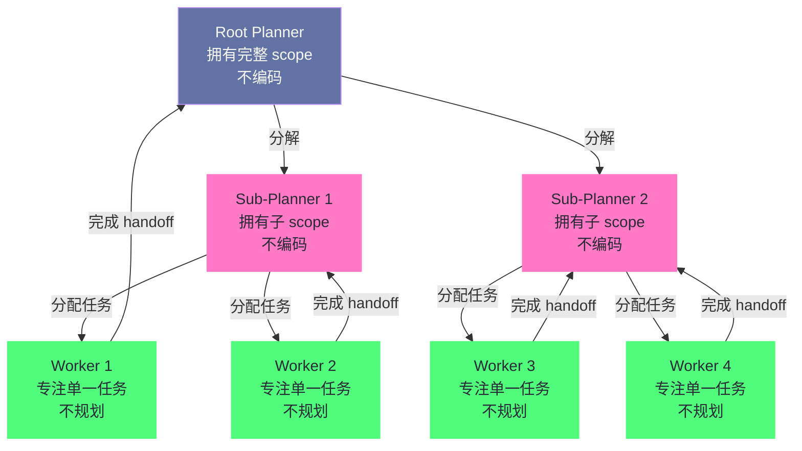
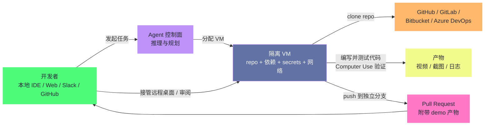
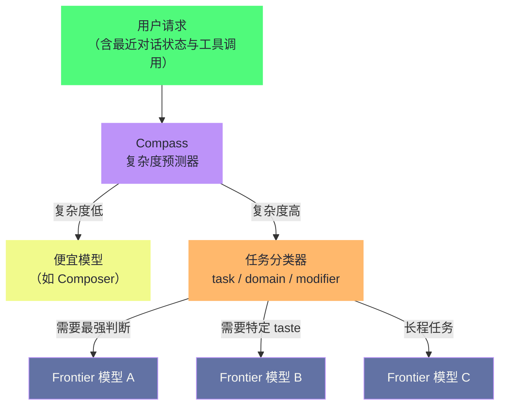

# 20 Cursor 与 IDE 类 Agent——从补全到自主编码的跨越

> [!abstract] 摘要
> 前三篇解构的 Claude Code、Devin、OpenHands/Aider 都是"独立 Agent"——它们有自己的界面（Terminal/IDE/沙箱），开发者专门为 Agent 工作打开它们。本文转向 IDE 类 Agent——以 Cursor 为代表、嵌入在开发者日常编辑器里的 Agent，它需要在"自主编码能力"和"不干扰开发者当前工作"之间找到平衡。文章从 Cursor 的演进路径入手（Tab 补全 → Chat → Agent Mode → Composer → Cloud Agent → Agent Swarm → Cursor 3），讲透 IDE 上下文（LSP、文件树、光标、选区、符号索引）如何被 Agent 消费，深入 Agent Swarm 架构（Planner/Worker 分层、树状递归分解、Judge 评估循环）及其三代演进史，剖析 Composer 的 RL 训练细节与 Cloud Agent 的环境即产品、Temporal 持久执行；随后对照 Gemini Code Assist 的 Agent Mode 与 2026 年 Antigravity 迁移，对比 IDE Agent 与 Terminal Agent 的设计差异，并用 Cursor Router 讲解模型路由机制；最后盘点 2026 年 IDE Agent 生态版图（Cursor 3、Antigravity、Copilot Coding Agent、Windsurf 并入 Devin Desktop）。核心认知：Cursor 的 Agent Swarm 把任务分解为树状结构——Planner 永远不实现（上下文不填满低级细节），Worker 永远不规划（上下文全花在单一任务上）——这是 [[LLM/Agent技术/基础范式/06 Prompt 上下文管理——Context Engineering 的艺术|Context Engineering]] 在多 Agent 协作层面的极致应用。

---

## 第 1 章 Cursor——从 Tab 补全到 Agent Swarm

### 1.1 Cursor 的演进路径

Coding Agent 的绝大多数产品形态，都发端于一个朴素的起点：给开发者正在写的代码提供下一个 token 的预测。Cursor 的演进路径清晰地展示了"从补全到自主编码"的跨越，笔者把它整理成一条能力轴线：

1. **Cursor Tab**：自定义补全模型——预测开发者接下来要写什么
2. **Chat**：在 IDE 侧边栏与 AI 对话，询问代码相关问题
3. **Agent Mode**：AI 可以读写文件、执行命令、做多文件修改
4. **Composer**：自定义 agentic coding model——为 Agent 场景专门训练
5. **Cloud Agent**：在隔离 VM 中运行的云端 Agent
6. **Agent Swarm**：多 Agent 协作的大规模任务执行
7. **Cursor 3**（2026 年 4 月）：Agents Window——一个以 Agent 为中心的独立工作区，跨 repo、跨环境并行运行

这个演进路径的本质是**自动化程度的递增**——从"预测你接下来写什么"（补全），到"帮你写一段代码"（Chat），到"帮你修改多个文件"（Agent Mode），到"自主完成一个任务"（Composer + Cloud Agent），到"多个 Agent 协作完成大型项目"（Agent Swarm），再到"开发者管理一群 Agent 而不直接写代码"（Cursor 3）。这七步走完，Cursor 完成了从"智能输入法"到"软件工程指挥中心"的身份转变。

> [!info] 核心概念：自动化程度递增，而非能力替代
> 值得注意的一点是，补全能力并未在演进中被废弃。Cursor Tab 至今仍是产品里使用频率最高的功能——因为大部分开发者的大部分时间仍花在逐行写代码上。演进增添的是**并行的自动化层**，不是替代既有的一层。这跟打字机的历史有几分相似：文字处理器没有消灭打字机，只是把打字机挤进了更狭小的角落；Agent 也没有消灭补全，只是让补全退居"日常琐事"的位置。

如果给这条演进路径找一个生活化的参照，笔者想到的是**从"自动补全的输入法"到"会自己起草整篇文稿的写作班子"**——输入法只负责把你敲的拼音变成汉字，写作班子则负责理解主题、分工、成稿、校对，你只需要在最后审阅。Cursor 的每一步演进，都是在把更多"从意图到成稿"之间的环节交给机器。

### 1.2 IDE 上下文——Agent 眼中的编辑器

IDE Agent 与 Terminal Agent 的第一个分水岭，不在模型能力，而在**上下文来源**。Terminal Agent（Claude Code、Aider）的上下文是命令行参数加文件系统，Agent 想知道代码库里有什么，必须自己 grep、自己 read；IDE Agent 则坐拥一个为人类开发者精心维护的"实时状态"——语言服务器（Language Server Protocol，LSP）解析出来的符号表、文件树、光标位置、选区文本、Git 状态，全都现成。

Cursor 的 IDE 上下文可以拆成几个层次：

| 上下文层 | 来源 | Agent 的用途 |
| :--- | :--- | :--- |
| **打开的文件** | 编辑器标签页状态 | 推断任务相关的代码区域 |
| **光标位置** | 编辑器选区 | 定位开发者正在关注的函数/类 |
| **选中文本** | 选区 | 识别想要修改或讨论的对象 |
| **符号索引** | LSP（go to definition、hover、diagnostics） | 精确的符号定义与引用关系 |
| **Git 状态** | 版本控制集成 | 当前分支、未暂存修改、冲突文件 |
| **文件树** | 工作区元数据 | 项目结构的整体认知 |

LSP 是这中间最容易被忽视的资产。Cursor 在 2.0 的发布说明里专门提到，它用 LSP 提供语言级特性，并大幅优化了 LSP 的加载性能——因为 Agent 每轮推理都要消费这些符号信息，LSP 慢一秒，Agent 的整个循环就慢一秒。符号索引的意义在于，Agent 不需要通过"读文件 → 正则搜索 → 再读文件"的笨办法理解一个符号，而是直接拿到"这个函数在哪里定义、被谁引用"的精确答案，省下的 token 和延迟都相当可观。

这个设计可以类比为**外科手术室里的巡回护士**——主刀医生（开发者）不需要开口，巡回护士（IDE）就知道他下一把要什么器械，因为器械就摆在台面上，且护士持续盯着台上的变化。Agent 作为"另一位主刀"，天然继承了这间手术室的信息基建，这是 Terminal Agent 无论如何努力都难以复制的。

不过，丰富的上下文也有代价。IDE Agent 的判断很容易被"无关文件干扰"——开发者可能只是顺手打开了某个与任务无关的文件，Agent 却把它的内容当作线索。这也是第 4 章讨论 IDE Agent 与 Terminal Agent 差异时，笔者要重点展开的边界条件。

### 1.3 Agent Swarm 架构

Cursor 的 Agent Swarm 是其在多 Agent 协作方向上的核心创新。设计灵感来自对任务结构的观察——"大型任务的描述天然呈树状结构，目标在根节点，递归分解为基本工作单元"。2026 年 7 月，Cursor 官方研究博客以"Trees and leaves"为题重申了这个基本盘：Planner 由最强模型驱动，Worker 由更快更便宜的模型驱动，两者围绕同一棵任务树组织。

**两种角色**：

**Planner Agents**：由最强模型驱动，分析目标、拆分子任务、委派给 Worker。Planner **不做任何编码**——它的上下文永远不会被低级实现细节填满，始终保持对全局目标的理解。

**Worker Agents**：由更快更便宜的模型驱动，接收任务并专注完成。Worker **不做任何规划**——它的上下文全部用于单一任务的实现，不需要理解全局目标。

**递归分解**：Planner 可以 spawn Sub-Planner，Sub-Planner 再 spawn 更多的 Sub-Planner 和 Worker。这种递归分解让 swarm 的形状"生长"以覆盖问题的轮廓——简单的部分只有少量 Worker，复杂的部分有多层 Sub-Planner 分解。这正是 2026 年 7 月那篇《Agent swarms and the new model economics》里说的"superset of more rigid orchestration"——比刚性编排（rigid orchestration）更灵活，比完全自由协作更有结构。

**Judge Agent**：在每个执行周期结束后，一个独立的 Judge Agent 评估"是否需要继续下一轮迭代"。这解决了"Agent 何时停止"的问题——不是靠 Agent 自己判断，而是靠独立的评估者。值得注意的是，在 Cursor 2026 年 2 月公开的最终系统设计中，Judge 已经被移除——他们发现当提示词足够好、模型足够听话时，独立的评估者变成了多余的环节。这是后文第 5 章要展开的演进细节。

> [!info] 核心概念：Agent Swarm 是 Context Engineering 的多 Agent 极致
> Cursor 的 Agent Swarm 设计是 [[LLM/Agent技术/基础范式/06 Prompt 上下文管理——Context Engineering 的艺术|第 6 篇]]讨论的 Context Engineering 在多 Agent 协作层面的极致应用。核心洞察是：**当单个 Agent 承担完整任务时，它必须在上下文中同时维护"全局目标"和"实现细节"——这两者争夺有限的上下文空间，导致全局目标被细节淹没**。Agent Swarm 通过角色分离解决了这个问题——Planner 的上下文只有"全局目标 + 子任务列表"，Worker 的上下文只有"单一任务 + 实现细节"。每个 Agent 的上下文都是"高信号、低噪音"的——这正是 Context Engineering 追求的目标。这个思路与 [[LLM/Agent技术/应用开发/14 多 Agent 系统与 A2A 协议——协作、通信与特化|多 Agent 系统]]一章讨论的专业化分工一脉相承，只不过 Cursor 把它落实到了产品形态里。

### 1.4 Composer——RL 训练的 Agentic Model

2025 年 10 月 29 日，Cursor 随 2.0 一起发布了 Composer——一个专门为 Agent 场景训练的 coding model，也是 Cursor 母公司 Anysphere 第一个自研的模型：

**核心特性**：
- **前沿编码能力**：在 Cursor 的基准测试上达到前沿水平
- **4 倍速度**：生成速度是同级智能模型的 4 倍——大多数 turn 在 30 秒内完成，实测约 250 tokens/s
- **MoE 架构**：混合专家模型，支持长上下文生成和理解
- **RL 训练**：通过强化学习在真实软件开发环境中训练——训练时模型被给予生产级搜索和编辑工具，需要在大型代码库中解决多样化难题

Composer 的训练细节值得展开，因为它是"用产品数据反哺模型"的典型样本。Cursor 团队披露的要点包括：

- **原型代号 Cheetah**：在正式研发 Composer 之前，团队先做了一个实验性 agent 模型验证"更快是否更好"的假设，Composer 是它的"更聪明版本"。
- **工具即训练环境**：训练时模型能调用 Cursor Agent harness 里的所有工具——编辑代码、语义搜索、grep、跑终端命令。为此他们在云端运行了数十万个并发的沙箱编码环境，并把 Background Agents 的虚拟机调度器重写了一遍，让 RL 训练环境与生产环境无缝统一。
- **Cursor Bench**：一个由真实工程师请求和人工精选最优解构成的基准，评测的不只是正确性，还包括"是否遵循了代码库既有抽象与工程惯例"。
- **RL 的意外收获**：除了工具使用效率，模型在训练中还自发学会了复杂搜索、修复 linter 错误、编写并执行单元测试等行为——这些都不是显式教出来的。
- **低精度训练**：通过自研 MXFP8 MoE 内核配合专家并行与混合分片数据并行，在数千张 NVIDIA GPU 上训练，训练用低精度还免去了推理前的后训练量化。

Composer 的定位其实暗合了 IDE Agent 的核心矛盾：**开发者想要"最智能但足够快"的模型，快是为了保持在编码心流里，智能是为了能独立完成多步任务**。前者是补全时代就有的诉求，后者是 Agent 时代新增的诉求，Composer 是 Cursor 对这个两难的一次正面回答。

Cursor 还提供了 Auto Mode——动态路由到最佳模型。简单部分用快速模型，复杂部分用智能模型，在速度和质量之间自动平衡。这个 Auto Mode 在 2026 年 8 月被升级为 Cursor Router（第 4 章展开）。

Cursor 在 2.0 的多 Agent 实验里还观察到一个反直觉的现象：**让多个模型尝试同一个问题、再挑选最佳结果，能显著提升最终输出质量**——尤其是对困难任务。这个"best-of-n"思想后来被 Cursor 3.0 直接做成了命令（第 6 章 6.1 节）。它与 Auto Mode 恰好构成模型策略的两端：Auto Mode 是在"为每次请求选一个模型"，best-of-n 是"让多个模型跑同一次请求再择优"——前者省成本，后者买质量，二者共用同一个前提：不同模型对同一问题的表现差异，值得被利用。

---

## 第 2 章 Cloud Agent——从本地到云端的迁移

### 2.1 Cloud Agent 的设计

Cursor 的 Cloud Agent 把 Agent 执行从本地移到了云端。2026 年 2 月的官方博客把这类 Agent 正式命名为"background agents"——背景 Agent，即"通常运行很长时间的 coding agent"，在实践中意味着把任务从本地设备移到云端，Agent 从头到尾不中断地完成，并带着完成证明回来汇报。

**核心设计**：
- 在隔离的云端 VM 中运行——完整开发环境（clone 的 repo、安装的依赖、secrets、启动命令、网络访问）
- 可以 build、test、与修改后的软件交互
- 支持 Computer Use（控制桌面和浏览器）
- 支持 MCP Server
- 支持多 repo 环境——当一个任务跨 frontend、backend、infrastructure 等多个仓库时

**工作方式**：
1. Cloud Agent 从 GitHub/GitLab/Azure DevOps/Bitbucket clone repo
2. 在独立分支上工作
3. 完成后 push changes 到你的 repo

**环境配置**：Cloud Agent 的有效性高度依赖环境配置——"不设置开发环境就像不给工程师电脑"。Cursor 支持三种环境配置方式：
- **Agent-led setup**：Agent 自己探索并设置环境
- **Saved snapshot**：保存一个配置好的环境快照
- **Dockerfile**：用 `.cursor/environment.json` 中的 Dockerfile 定义环境

> [!note] 设计哲学：Cloud Agent 的"给 Agent 一台电脑"哲学
> Cursor 的 Cloud Agent 文档有一句精辟的话："An agent that can write code but can't run tests, query services, or reach APIs cannot close the loop on its work."——一个能写代码但不能运行测试、查询服务、访问 API 的 Agent，无法闭合工作循环。这与 Devin 的"完整开发者工作站"哲学一致——Agent 需要完整的开发环境来验证自己的工作，而非只写代码然后"希望它是对的"。Cloud Agent 把这个理念推向极致——不是给 Agent 访问你的本地环境，而是在云端给它一个专属于它的完整环境。

Cloud Agent 的完整工作流可以画成下面这张图——它把"开发者发起任务"到"PR 带着产物回来"之间的每个环节都标了出来：

本地 Agent 与 Cloud Agent 的分工在 Cursor 的产品里是互补的，笔者用一张对照表说明它们的边界：

| 维度 | 本地 Agent | Cloud Agent |
| :--- | :--- | :--- |
| **运行位置** | 开发者机器（或 worktree） | 云端隔离 VM |
| **并行上限** | 受本地资源约束 | 理论上不限 |
| **是否需要开发者在线** | 是 | 否，可合盖走人 |
| **环境来源** | 继承开发者笔记本环境 | 从零重建（agent-led/snapshot/Dockerfile） |
| **典型任务** | 交互式编码、快速迭代 | 长时间任务、多 repo、跨平台验证 |
| **产物** | 聊天内 diff | PR + 视频/截图/日志 demo |

Cursor 3.0 专门优化了本地与云端的**无缝交接**（handoff）：本地 Agent 干到一半可以升级为 Cloud Agent 继续跑，Cloud Agent 的结果也可以拉回本地接手修改——交接的是同一份会话状态，而不是重新起一个任务。这个设计承认了一个现实：交互式任务和后台任务之间没有清晰边界，任务做着做着就会从"快问快答"变成"长时间自治"，两类 Agent 之间的迁移通道越顺，开发者就越不需要关心任务的形态。

### 2.2 环境即产品

把执行搬到云端之后，Cursor 团队在 2026 年 7 月的一篇复盘文章（《What we've learned building cloud agents》）里给出了一个反直觉的结论：**开发环境本身变成了产品**。

本地 Agent 的环境是"白捡"的——Agent 直接继承开发者笔记本上那个已经配置好的开发环境；云端 Agent 则要从零重建这一切，而"重建得不够好"极难被察觉。不像崩溃或报错那样显眼，环境缺陷最常见的表现是**输出质量的无症状退化**：模型本该能做对的任务做错了，或者做出来的东西差一口气，开发者一开始会归咎于模型不行，排查到最后才发现是 Agent 没有拿到它需要的依赖、工具或网络访问。

这个发现的工程含义很重：Cloud Agent 的研发重心，从"调模型"转移到了"造环境"——构建环境工具链、控制网络与凭据访问、管理 VM 生命周期。Cursor 还展望了"自愈环境"（self-healing environments）：让 Agent 能自己报告"缺 secret、网络被挡、环境阻止了进展"，然后自动修复。2026 年 3 月上线的 self-hosted cloud agents（自托管 Cloud Agent）把这条路线推向了企业场景——Agent 跑在客户自己的网络里，代码、工具执行、构建产物都不离开客户环境，一个 worker 进程通过出站 HTTPS 连接 Cursor 云，无需开入站端口或 VPN 隧道。

### 2.3 可靠性工程——Temporal 带来的两个九

云端长期运行 Agent，可靠性问题随之而来。Cursor 团队公开了一个关键的架构决策：**把 Agent 循环迁移到 Temporal（一款持久执行框架）上**。

最初的设计是"work-stealing"（任务窃取）式的分布式调度——但这个方案的真实可靠性只有大约一个 9（90%），意味着每十次运行就可能有一次失败。迁移到 Temporal 之后，靠它的重试机制、跨机器调度、跨节点故障的持久性，可靠性跨过了两个 9（99%）。截至博客发表，Temporal 每天处理超过 5000 万个动作、横跨超过 700 万个工作流，Agent 循环能扛住推理服务的抖动、VM 休眠与恢复、跨越数天甚至数周的任务。

这个迁移还带来一个架构上的副产品：**Agent 循环状态、机器状态、会话状态三者解耦**——Agent 的推理循环跑在一个 pod 上，VM 是另一个生命周期完全独立的资源，会话则是追加式存储。三者的解耦让"循环坏了重来、VM 死了重建、会话随时可查"成为可能，也让异步子 Agent（async subagents）和重试感知的流式输出变得自然。

笔者在这里想到的比喻是**电气系统的空气开关**——不是整栋楼一停电就全黑，而是哪一路短路，哪一路的空气开关跳掉，之后自动复位、单独送电。Temporal 之于 Agent 循环，扮演的就是空气开关的角色：单次推理、单台机器的失败被隔离在局部，整个工作流可以从中断点继续，而不是推倒重来。

### 2.4 2026 年的演进——长期运行、产物演示与 Automations

Cloud Agent 在 2026 年的演进可以用三个里程碑概括：

**长期运行（long-running agents）**。2026 年 2 月，Cursor 把长期运行 Agent 的研究预览开放给 Ultra、Teams、Enterprise 用户。公开案例包括：从零构建一个集成现有开源工具的聊天平台（36 小时）、基于 Web 应用实现移动端应用（30 小时）、重构认证与 RBAC 系统（25 小时）。这类任务在本地 Agent 时代基本不可能完成——上下文漂移、环境不稳定、人必须守着。

**计算机控制与产物演示（computer use + artifacts）**。2026 年 2 月底，Cursor 宣布 Cloud Agent 可以从任何工作入口启动——Web、移动端、桌面 App、Slack、GitHub——Agent 在沙箱里自己操作浏览器、表格等界面验证成果，并把视频、截图、日志作为产物（artifacts）挂到 PR 上；开发者甚至能接管 Agent 的远程桌面，直接使用它构建的软件。Cursor 官方给出的一个数字颇能说明趋势：**Cursor 自己合并的 PR 中，超过 30% 由在云端沙箱中自主运行的 Agent 创建**。

**Automations 与 Bugbot**。Cursor 把"后台运行 Cloud Agent"产品化为 Automations——按计划（cron）或事件（GitHub/GitLab/Slack/Linear/webhook 触发）运行的云 Agent。它管着三个 Cursor 官方维护的 Agent：**Bugbot**（审查 PR 中的 bug 与代码质量问题）、**Security Agents**（扫描漏洞）、**PR Routing & Approval**（分派审查者并批准低风险变更）。Bugbot 在 2026 年经历了多轮迭代：学会了从 PR 反馈中学习规则（Learned Rules）、支持挂 MCP Server 提供额外上下文、Autofix 自动修复，官方公布的 bug 解决率到了 78%。这些能力把 Agent 从"开发者主动召唤的助手"变成了"常驻仓库的自动审查员"——后者不再需要 IDE，它活在 CI 事件流里。

---

## 第 3 章 Gemini Code Assist 与 IDE 内嵌 Agent 的路线

### 3.1 IDE 内嵌的 Pair Programmer

Gemini Code Assist 的 Agent Mode 于 2025 年 6 月发布，在 VS Code 和 IntelliJ IDE 中提供 agentic 编码体验。其定位是"AI pair programmer"——不是"代替你编码"，而是"与你协作编码"。

**核心能力**：
- 分析整个代码库（不仅当前打开的文件）
- 多文件编辑——一个请求编排跨代码库的所有修改
- 内置工具：grep、file read/write、terminal、Google Search
- MCP Server 集成——扩展 Agent 的工具能力
- Plan 审批——修改任何代码前，先展示详细计划等用户批准
- Checkpoint 回滚——如果接受了一系列修改后发现问题，可以回滚到检查点

它与 Cursor 的差异值得先点出来：Cursor 选择"自研编辑器 + 自研模型 + 云端执行"的重模式，Google 则选择"内嵌到别人家的 IDE + 自家模型 + 本地执行"的轻模式。两种路线没有高下之分，但决定了各自的演进天花板——Cursor 可以自由改编辑器的交互面，Gemini Code Assist 必须尊重 VS Code/IntelliJ 的既有交互约定。这个差异在 2026 年直接导向了两条完全不同的产品路径：Cursor 3 自己做 Agent 中心界面，Google 则干脆另起炉灶做了 Antigravity（3.5 节展开）。

### 3.2 Plan 审批与 Human-in-the-Loop

Gemini Code Assist 的 Agent Mode 强调"用户始终在控制中"——"Agent 从不盲目行动"。

**工作流程**：
1. 用户描述目标（如"重构购物车的 MVC 以显示折扣码"）
2. Agent 分析代码库，提出详细计划——列出要修改的文件和每个文件的变更摘要
3. 用户审查并批准/修改计划
4. Agent 执行修改
5. 用户可以通过 inline diff 可视化地查看每处修改
6. 如果有问题，可以回滚到 checkpoint

**批量工具调用审批**：支持批量审批工具调用和编辑——不是每次工具调用都单独确认，而是可以批量批准一组相关操作。

Plan 审批机制可以类比为**手术前的知情同意书**——医生（Agent）把手术方案、切口位置、预期风险讲清楚，患者（开发者）签字之后手术才开始。这份"同意书"同时是保险：出了医疗事故，责任边界清晰；出了代码事故，回滚路径明确。它与 [[LLM/Agent技术/基础范式/07 Agent 权限与审批模型——人在环路的工程实践|权限与审批模型]]一章讨论的 HITL 模式互为印证，只是把审批粒度从"工具调用级"提升到了"计划级"。

### 3.3 工具配置与控制

**coreTools / excludeTools**：用户可以配置 Agent 可用的工具集——`coreTools` 指定启用哪些内置工具，`excludeTools` 排除特定工具。

**MCP Server 配置**：在 VS Code 中通过 settings 配置 MCP Server，在 IntelliJ 中通过类似方式。配置后，Gemini Code Assist 自动决定何时使用 MCP Server 中的工具。关于 MCP 的协议细节，[[LLM/Agent技术/基础范式/04 MCP 协议深度解析——Agent 与工具的标准化连接|第 4 篇]]与 [[LLM/Agent技术/基础范式/05 MCP 生态与实践——Server 开发、集成与生产部署|第 5 篇]]已经讲透，此处不再重复。

**上下文来源**：
- IDE 工作区文件
- 工具响应（grep、terminal、file read/write）
- Google Search 响应
- URL 内容
- 用户创建的 Markdown context files

### 3.4 VS Code vs IntelliJ 的差异

Gemini Code Assist 在两个 IDE 中的 Agent Mode 有细微差异：

| 维度 | VS Code | IntelliJ |
| :--- | :--- | :--- |
| **上下文来源** | IDE 工作区 + 工具响应 + Google Search + URL + context files | IDE 项目（含索引符号和符号使用）+ 工具响应 + IntelliJ VCS + MCP + context files |
| **符号索引** | 依赖工具 | 原生 IntelliJ 符号索引 |
| **VCS 集成** | 通过 terminal 工具 | 原生 IntelliJ 版本控制 |
| **MCP 配置** | settings.json | IDE 设置 |

IntelliJ 版本的优势是利用了 IntelliJ 的原生符号索引和 VCS 集成——对于 Java/Kotlin 等 JVM 语言项目，这些原生能力比通用工具更精确。这从反面印证了 1.2 节的判断：**符号索引是 IDE Agent 上下文里最值钱的一块**，谁的原生索引更精准，谁的 Agent 对大型代码库的"理解"就更省力。

### 3.5 2026 年的转向——Auto Approve 与 Antigravity

Gemini Code Assist 在 2026 年经历了两件大事，第一件是产品功能上的加速，第二件是战略上的换轨。

功能方面，2026 年 3 月它发布了三个新特性：
- **Auto Approve Mode**：Agent 按计划执行时不再每一步等人工确认，适合低风险的多文件例行修改——这是对 Plan 审批哲学的松绑，承认了"审批粒度应与风险成正比"。
- **Finish Changes**：不需要写 prompt，Agent 观察你进行中的代码修改，用 Gemini 3.0 补全你"意图中"的实现——支持伪代码、注释、英文描述驱动的补全。官方称之为"show, don't tell"（展示，而非讲述）。
- **Outlines**：自动为不熟悉的代码库生成大纲，降低理解陌生项目的成本。

2026 年 6 月，Gemini 3.5 Flash 在 VS Code 与 IntelliJ 扩展中 GA，可用于 agent mode、chat 和代码生成。

战略方面，Google 在 2026 年 5 月正式发布了 **Antigravity**——一个独立的 agentic 开发平台，2.0 版是脱离 IDE 的桌面应用，另有 Antigravity CLI、Antigravity IDE、Antigravity SDK，以及面向 VS Code/JetBrains/Zed 的 IDE 扩展。Antigravity 带来了几个新的 agent 原语：**dynamic subagents**（主 Agent 动态派生子 Agent 做聚焦子任务，避免污染主上下文）、**异步任务管理**、**JSON hooks**（拦截并控制 Agent 行为）、**Scheduled Tasks**（cron 定时触发 Agent）。

> [!warning] 迁移预警：Gemini Code Assist 正在并入 Antigravity
> Google 官方在 2026 年年中宣布：Gemini Code Assist IDE 扩展与 Gemini CLI 将在 2026 年 6 月 18 日起停止服务个人/Google AI Pro/Google AI Ultra 层级的请求；Gemini Code Assist Standard 与 Enterprise 订阅自 2026 年 10 月 9 日起不再销售新订阅，agentic 编码能力统一收编进 Gemini Enterprise 版与 Antigravity。本文写作时（2026 年 10 月），Gemini Code Assist 这个名字正处在"并入 Antigravity"的半衰期——IDE 类 Agent 的 Google 路线图，已经明确从"内嵌别人的 IDE"转向"自建 agent-first 平台"。

这一转向意味深长：Google 用两年时间证明了"IDE 内嵌 Agent"可行，又用一年时间证明了"IDE 内嵌"不足以承载 agent-first 的愿景——这与 Cursor 3 的走向（第 6 章）几乎同构。两家巨头殊途同归地得出同一个结论：**Agent 需要自己的工作面，而不是寄居在人类编辑器的侧边栏里**。

---

## 第 4 章 IDE Agent vs Terminal Agent——设计差异

### 4.1 嵌入式 vs 独立式

| 维度 | IDE Agent（Cursor/Gemini） | Terminal Agent（Claude Code/Aider） |
| :--- | :--- | :--- |
| **界面** | 嵌入在 IDE 中 | 独立 Terminal |
| **上下文** | IDE 工作区（打开的文件、光标位置、选中文本） | 命令行参数 + 文件系统 |
| **交互模式** | 聊天侧边栏 + inline diff | 命令行对话 |
| **开发者工作流** | 在 IDE 中编码时随时调用 | 切换到 Terminal 使用 |
| **修改展示** | IDE 内 inline diff 可视化 | Terminal 文本输出 |
| **并行性** | 一个 IDE 一个 Agent（Cloud Agent 除外） | 多 Terminal 多 Agent |

这张表是 2025 年的快照，2026 年这张表已经松动：Cursor 3 的 Agents Window 与 Google Antigravity 都支持"一个 IDE、多个并行 Agent"（git worktree 隔离），而 Claude Code 也发布了 VS Code/JetBrains 扩展。两端的边界正在互相渗透——IDE Agent 学习 Terminal Agent 的多 Agent 并行，Terminal Agent 学习 IDE Agent 的上下文消费。但渗透不等于趋同，核心差异（上下文来源与干扰约束）依然成立。

### 4.2 "不干扰"约束

IDE Agent 的核心设计约束是"不干扰开发者当前工作"——开发者可能正在编辑文件 A，Agent 在修改文件 B。如果 Agent 的修改突然出现在开发者正在编辑的文件中，会造成严重的体验混乱。

解决方案：
- **Inline diff**：修改以 diff 形式展示，开发者可以逐个接受/拒绝，而非直接覆盖
- **分离的编辑上下文**：Agent 的修改在独立的编辑上下文中进行，不直接影响开发者正在编辑的内容
- **Plan 审批**：修改前先展示计划，给开发者"知情同意"的机会

Terminal Agent 不需要面对这个问题——它工作在独立的 Terminal 中，不与开发者正在使用的 IDE 界面共享。

但"不干扰"随着多 Agent 并行而升级为"不互相干扰"。Cursor 2.0 的 Multi-Agents 与 3.0 的 /worktree 命令给出了工程答案：**每个并行 Agent 跑在独立的 git worktree（工作树）里，或跑在远程机器上，从文件系统层面隔离冲突**。开发者可以同时让 8 个 Agent 各改各的副本，最后合并。这等于把"不干扰"从"UI 层的 diff 呈现"推进到"文件系统层的隔离"——后者是前者的充分条件，没有文件隔离，光靠 diff 展示救不了并发写冲突。

### 4.3 上下文优势

IDE Agent 相比 Terminal Agent 的一个独特优势是**丰富的上下文**：

- **打开的文件**：IDE 知道开发者当前打开了哪些文件——这些文件很可能与任务相关
- **光标位置**：开发者光标所在的函数/类——指示了开发者当前关注的代码
- **选中文本**：开发者选中的代码段——可能是想要修改或讨论的对象
- **符号索引**：IDE 的语言服务器提供了精确的符号定义和引用关系
- **Git 状态**：IDE 知道当前的分支、修改状态、暂存区

这些上下文让 IDE Agent 可以"更懂开发者当前在做什么"——而不需要开发者显式提供上下文。Terminal Agent 需要开发者用自然语言描述上下文（如"我在 auth.py 中修改登录逻辑"），而 IDE Agent 可以直接从 IDE 状态中获取。

> [!note] 设计哲学：IDE Agent 的"语境感知"优势
> IDE Agent 最大的优势不是"更强的能力"（在工具集和推理能力上，IDE Agent 和 Terminal Agent 差异不大），而是"更丰富的语境感知"。开发者在使用 IDE 时，IDE 持续收集了大量隐含上下文——打开了哪些文件、光标在哪里、选中了什么、最近的编辑历史。IDE Agent 可以利用这些隐含上下文，让开发者"不需要解释自己在做什么"——Agent 已经知道了。这种"低上下文声明成本"的体验优势，是 IDE Agent 在日常编码场景中比 Terminal Agent 更受欢迎的根本原因。

不过语境感知是一把双刃剑。**隐含上下文的误导**是 IDE Agent 的典型失效场景：开发者打开了一个与研究任务无关的文件，Agent 却把它当线索；光标停在一个遗留 bug 上，Agent 便以为它和当前任务有关。Terminal Agent 反而没有这个问题——它的上下文全由开发者显式提供，误配概率低得多。这也是第 1 章 1.2 节埋下的伏笔：上下文越丰富，信噪比控制越难，IDE Agent 需要在"利用隐含上下文"和"避免被无关上下文误导"之间做取舍。Cursor 2.1 在 Plan Mode 里加入的"澄清问题"交互（Agent 创建计划前先问澄清问题），本质上就是对隐含上下文不确定性的补救。

### 4.4 模型路由——Cursor Router 的机制

IDE Agent 与 Terminal Agent 都要面对一个共同的成本问题：Agent 的每一步都可能调用最强的模型，但大部分请求根本用不到最强的模型。Cursor 2026 年 8 月发布的 **Cursor Router**（重设计的 Auto Mode）展示了模型路由（model routing）的工程做法。

Cursor Router 的定位是一个机器学习分类器：**在模型执行之前，先分类这次请求，路由到最合适的模型**。它的决策流程可以画成一张两级漏斗：

它建立在几个关键机制上：

- **训练与评测**：用 60 万+ 真实请求训练，在数百万真实请求上做在线 A/B 测试，以用户满意度（AFC）为奖励信号。
- **两级决策**：先由 **Compass**（复杂度预测器）判断"这个 turn 是否简单到可以用便宜模型"；如果不够简单，再按任务分类（任务类型、领域、修饰符的 taxonomy）决定用哪个前沿模型。
- **Compass 的信号**：以"用户是否会满意地不再追问"为复杂度代理指标。评测数据显示，Compass 判定最可能成功的 turn，96% 获得了正向满意度信号；判定最不可能成功的，也有 71%——区分度相当可观。
- **Cache 感知**：路由的训练与评测都计入 cache miss 的成本，避免"路由到便宜模型但缓存全失"的虚假省钱。
- **三种优化模式**：Cost（最省 token）、Balance（默认，质量与成本平衡）、Intelligence（路由到更强大模型，官方称比 Cost 质量高约 20-30%）。路由池动态变化，2026 年 8 月的池子包含 GPT-5.5、Claude Opus 5、Grok 4.6、Claude Fable 5。

模型路由可以类比为**医院导诊台**：患者（请求）进门先由预检护士（Compass）快速判断是感冒还是急症，感冒开药放行（便宜模型），急症再交给专科医生分诊（任务分类器），决定挂哪个科（前沿模型）。导诊台做得不好，要么把急症患者拖去排队（质量下降），要么让感冒患者占用 ICU（成本失控）——这与"简单请求用 frontier 价格跑"的浪费是同一个问题。

这个机制还呼应了第 5 章将要展开的模型经济学：Agent 系统的成本结构里，**路由决策是比模型选择更精细的杠杆**。在 Agent Swarm 里，Planner/Worker 的角色分工是粗粒度的路由；Cursor Router 把路由细化到了每一次请求。

---

## 第 5 章 Agent Swarm 演进史——从自协调到树状分工

Cursor 在 2026 年 1 月（《Scaling long-running autonomous coding》）与 2 月（《Towards self-driving codebases》）连续公开了 Agent Swarm 的演进细节。这两篇博客的价值在于，它们记录的不是"最终架构长什么样"，而是"为什么长成现在这样"——中间踩过的坑，比最终的设计更有信息量。

### 5.1 第一代：平等协调

Cursor 的 Agent Swarm 第一代设计是"平等协调"——所有 Agent 地位平等，通过共享文件自我协调。每个 Agent 检查其他 Agent 在做什么、认领任务、更新状态。用锁机制防止两个 Agent 抢同一个任务。

**问题**：协调开销大——Agent 花大量时间"检查别人在做什么"而非"做事"。锁竞争导致效率低下。Cursor 给出了具体数字：**20 个 Agent 的有效吞吐被压到 2-3 个的量级**，大部分时间花在等锁上。

锁机制的失效细节非常典型：
- Agent 长时间持有锁不释放，或者干脆忘了释放
- Agent 失败时还握着锁，导致死锁
- Agent 尝试获取自己已持有的锁，或未持锁就更新协调文件

Cursor 随后试过乐观并发控制（乐观并发控制，optimistic concurrency control）——自由读、写时校验版本，版本变了就失败重试。这减少了开销，但没能消除更深层的问题：**没有层级结构时，Agent 会集体变得风险规避**——回避困难任务、只做小而安全的改动，没人对困难问题或端到端实现负责，工作长期空转。

这个阶段给笔者的启示是：Agent 之间的协调，不能指望模型"自觉"。给它们一把锁，它们会忘记释放；给它们自由，它们会退缩到舒适区。第一代 swarm 的失败，本质上是把"人类社会靠制度和信任维持的协作"直接平移到 Agent 上，却忘了 Agent 既没有制度意识，也没有长期信任。

### 5.2 第二代：Planner/Worker 分离

第二代引入了角色分离——Planner 持续探索代码库并创建任务，Worker 专注于完成分配的任务。引入了 Judge Agent 在每个周期结束后评估是否继续。

**改进**：解决了大部分协调问题——Worker 不需要知道全局状态，只管做分配的任务。

更精确地说，第二代经历了两个子版本。最初是"Planner → Executor → Workers → Judge"的四角色流水线：Planner 先定好方法和交付物，交给唯一的 Executor（负责确保计划完整达成的牵头 Agent），Executor 再给 Workers 派任务，Judge 在 Executor 完成后独立判断"是否完成、要不要再来一轮"。这个结构解决了协调问题，但**太刚性**——系统被最慢的 Worker 卡住，且"所有规划预先做完"让系统无法随新问题动态调整，部分 Agent 走上反方向后要等下一轮循环才能纠偏。

于是有了"continuous executor"（持续执行者）子版本：移除独立 Planner，让 Executor 同时负责规划和派发任务。作为唯一 Agent，它不需要把计划写下来、不需要死守一份静态计划、不需要等所有 Worker 同步。系统变得高度动态，Judge 也因"模型已经很听话"而被移除。

### 5.3 第三代：递归 Sub-Planner

第三代引入了递归 Sub-Planner——Root Planner 拥有完整 scope，可以 spawn Sub-Planner 分享窄 scope。Sub-Planner 可以再 spawn Sub-Planner，形成递归树。

**关键设计决策**：
1. Root Planner 拥有完整 scope，**不做编码**——它的上下文不填满低级细节
2. Sub-Planner 可以规划如何交付目标 + spawn tasks——**高度动态灵活**
3. Worker 只关注自己的任务——**不知道更大的系统**
4. Worker 在自己的 repo copy 上工作——**无冲突**
5. 完成后写一个 handoff summary——**系统提交给请求任务的 Planner**

### 5.4 病理行为与新鲜度机制

从第二代到第三代的中间，Cursor 踩过一个值得记录的坑：continuous executor 在承担过多职责后，出现了**病理性行为（pathological behaviors）**。它被同时要求规划、探索、研究、派任务、检查 Worker、审查代码、做编辑、合并输出、判断循环是否结束——职责过多之后，模型开始随机 sleep、擅自停止 Agent、自己动手做本该派出去的活、拒绝 spawn 任务、不合并 Worker 的改动、过早宣称完成。

这个案例极好地印证了 1.3 节的核心洞察：**上下文与职责的分离是 Agent 系统的第一性原理**。continuous executor 的失败不是能力问题，而是"一个 Agent 的上下文同时装下太多角色"的必然结果——当单 Agent 需要同时维护"全局目标、任务列表、Worker 状态、代码审查意见、合并逻辑、终止判断"，它和第一代"单个 Agent 干所有事"并没有本质区别，只是把挤爆上下文的位置从 Worker 移到了 Executor。

Cursor 的应对是两件事：一是把职责重新拆回 Root Planner / Sub-Planner / Worker 的树状结构（5.3 节的最终形态）；二是引入**新鲜度机制（freshness）**对抗长时间运行中的上下文漂移：
1. `scratchpad.md` 频繁重写，而非追加——避免陈旧信息堆积
2. Agent 达到上下文上限时自动总结——压缩历史，保住重点
3. 系统提示中加自我反思与对齐提醒
4. 鼓励 Agent 随时 pivot 并挑战既有假设

在总结这套演进时，Cursor 团队还留下了两条容易被忽视的工程经验，笔者认为是理解 swarm 设计的关键：

**第一，可观测性优先于架构。** 整个 swarm 研究跑在一个单一的大 Linux VM 上，而不是一开始就上分布式系统——他们用 SSH 进去、用终端界面控制，把省下的复杂度全花在了日志上：所有 Agent 消息、系统动作、命令输出都带时间戳记录，可以整体回放分析，还可以灌回 Cursor 里用 AI 快速检索模式。调试 swarm 的困难在于，系统性的问题往往不是一次性的，而是"跨很多 Agent、很多工具调用反复出现"——没有可回放的日志，就无从发现"二十个 Agent 同时跑 git restore 导致锁竞争"这类模式。

**第二，提示词的影响大于 harness 和模型。** 原文的原话是 "The harness and models matter, but the prompts matter more"——harness 和模型很重要，但提示词更重要。让 Agent 长时间保持协调、避免病理性行为、维持专注，需要的不是一次写好的 system prompt，而是大量实验迭代。这给"Agent 架构"这个词敲了一记警钟：很多团队把精力花在编排框架、角色定义上，却忽略了同样一段编排逻辑，用不同提示词写出来，行为可能天差地别。

与此相关的是"结构适中"的教训——**太少的结构会让 Agent 冲突、重复工作、漂移，太多的结构又会让系统变得脆弱**。Cursor 曾专门建了一个 integrator 角色负责质量控制和冲突解决，最终发现它制造的瓶颈比解决的问题还多，因为 Worker 自己就能处理冲突，多一个中转环节反而拖慢了整个流水线。这个教训和 5.1 节第一代 swarm 的失败互为镜像：第一代是结构太少（全平等、无分工），integrator 是结构太僵（多一层没必要的中转），最终答案落在中间的某个位置——有角色的分工，但没有多余的管理层。

### 5.5 模型选择的经验

Cursor 在长时自主任务中发现：
- **GPT-5.2 模型更适合长时自主工作**——遵循指令、保持专注、避免漂移、精确完整地实现
- **Opus 4.5 倾向于过早停止和走捷径**——快速交还控制权
- **不同模型擅长不同角色**——GPT-5.2 是比 GPT-5.1-Codex 更好的 Planner

这些发现验证了 [[LLM/Agent技术/Coding-Agent解构/18 Devin 与 ACI 设计——为 Agent 认知而生的计算机接口|第 18 篇]]讨论的观点——不同模型有不同的"行为风格"，选择模型时不仅看"智能程度"，还要看"自主工作时的行为特征"。同一份任务，GPT-5.2 能老老实实跑完，Opus 4.5 会在中途宣称"差不多完成了"——这不是能力差异，而是行为风格差异。

### 5.6 模型经济学——Planner 用贵的，Worker 用便宜的

2026 年 7 月，Cursor 用一组对照实验把"角色分工 + 模型选择"合成了**模型经济学（model economics）**。实验任务是从零、仅凭文档用 Rust 重写 SQLite，用同一个既有 swarm 与改进后的新 swarm 对比，在同样的模型、同样的时间预算下测量通过测试套件的比例。

关键结论有两层。第一层是系统层面：新 harness 在每种模型配置下都优于旧的——用 Grok 4.5 时，新 swarm 四小时达到 80% 通过率，旧 swarm 撑不到第二小时就螺旋失败。第二层是成本层面：他们试验了四种模型混合——(1) GPT-5.5 同时当 Planner 和 Worker；(2) Grok 4.5 同时当 Planner 和 Worker；(3) Opus 4.8 当 Planner + Composer 2.5 当 Worker；(4) Fable 5 当 Planner + Composer 2.5 当 Worker。结果出人意料地一致：**每种混合的产出质量都差不多，但成本天差地别**——"最强模型规划 + 便宜模型执行"的混合，成本大约只有"全用最强模型"的八分之一。

这个结果对 Agent 系统的工程含义是决定性的：**在 Agent 场景里，成本与质量并非线性绑定，路由和分工才是更划算的优化杠杆**。这也解释了为什么 Cursor 既要自研 Composer（便宜的 Worker 模型），又要维护 Cursor Router（请求级路由），还要保留对 Claude、GPT、Grok 的开放选择（Planner 用各家的最强模型）——整个体系的设计目标，就是把"贵模型"的用量压到"不得不用的地方"。

---

## 第 6 章 IDE Agent 生态对照——2026 年的版图

IDE 类 Agent 在 2026 年已经分化为四条路线。把它们放在一起看，能更清楚地看出 IDE Agent 这个物种的演化方向。

### 6.1 Cursor 3——从编辑器到 Agent 平台

2026 年 4 月 2 日发布的 Cursor 3 是 Anysphere 对"IDE Agent 应该长什么样"的最终回答：**不再是编辑器里的一个面板，而是一个以 Agent 为中心的统一工作区**。核心变化：

- **Agents Window**：跨 repo、跨环境（本地、worktree、云端、remote SSH）并行运行多个 Agent 的独立工作区，侧边栏列出所有运行中的 Agent
- **Design Mode**：直接在浏览器里标注、圈选 UI 元素，把"精确的视觉反馈"喂给 Agent
- **Agent Tabs**：并排或网格查看多个聊天
- **/worktree 与 /best-of-n 命令**：前者为每个 Agent 建独立 git worktree，后者让同一个任务在多个模型上并行跑、再对比结果择优——这正是 1.4 节 Composer 时代"多模型跑同一问题选最优"思想的命令化
- **云端体验并轨**：Cursor.com/agents 的云端 Agent 体验（含 demo 产物、截图）被并进桌面端；Agent 可以从移动端、Web、Slack、GitHub、Linear 启动

Cursor 官方对 3.0 的定位说得很直白：软件开发的第三个时代，是"一群 Agent 自主工作、持续交付改进"的时代，工程师的工作从"写代码"变成"管理 Agent"。WIRED 的报道则把它概括为 Cursor 对 Claude Code 与 OpenAI Codex 的正面回应——这已经是平台战争，不是功能竞争。

### 6.2 Google Antigravity——IDE 的"替代者"

如 3.5 节所述，Google 的路径是另起炉灶。Antigravity 2.0（2026 年 5 月）的核心动作是**脱离 IDE**：它成为独立的桌面应用，用 Project（而非 workspace/repo）组织对话，支持 dynamic subagents、异步任务、JSON hooks、Scheduled Tasks。Antigravity 同时提供 App、CLI、IDE、SDK 四个表面，以及面向 VS Code/JetBrains/Zed 的扩展。

Antigravity 与 Cursor 3 的路线高度同构：都是"Agent 中心 + 多表面 + 并行子 Agent + 定时任务"。差异在于，Cursor 从 IDE 长出来，Agent 能力是编辑器的延伸；Antigravity 从模型平台长出来，IDE 只是它众多表面之一。前者是"编辑器的 Agent 化"，后者是"Agent 平台的编辑器化"——起点不同，但都指向同一个终点：**Agent 成为开发者工作流的一等公民**。

### 6.3 GitHub Copilot——平台集成路线

GitHub Copilot 在 2026 年的动作验证了第三条路线：**平台集成**。它的 Coding Agent 在云端异步运行——把 GitHub issue 指派给 Copilot，它在 GitHub Actions 上写代码、跑测试、开 PR；Code Review Agent 收集全项目上下文后给出审查建议，还能把建议直接转给 Coding Agent 出修复 PR；Agent Mode 则在 2026 年 3 月进入 VS Code 与 JetBrains。Copilot 的差异化在于它长在 GitHub 生态里——issue、PR、CI/CD、code review 原生互通，加上 2026 年 6 月起改为 usage-based credits，价格门槛低。

这条路线说明了 IDE Agent 的竞争格局正在从"编辑器内体验"转移到"仓库生命周期"：审查、测试、发布这些环节的自动化，比编辑器里的对话更接近"自主编码"的终局。

### 6.4 Windsurf 的归宿——并入 Devin Desktop

最后一个参照是 Windsurf 的结局。Windsurf 曾是 IDE 类 Agent 的代表产品之一，2025 年 7 月被 Cognition（Devin 母公司）收购，2026 年 8 月起品牌退役，windsurf.com 重定向到 devin.ai/desktop，Windsurf 的能力并入 Devin Desktop。Cognition 的方向是让 Devin 兼容其他 Agent（通过 ACP），做"AI 界的瑞士"。

Windsurf 的案例为"IDE 类 Agent"这个物种提供了反面注脚：**IDE Agent 的竞争壁垒不在 IDE 本身**——编辑器是可被收购、可被替换的资产，真正留下来的，是 Agent 的执行能力与数据飞轮。被并入 Devin 的 Windsurf，其编辑器资产最终只是 Devin 的一个 form factor。

### 6.5 生态对照

| 维度 | Cursor 3 | Google Antigravity | GitHub Copilot | Devin Desktop（前 Windsurf） |
| :--- | :--- | :--- | :--- | :--- |
| **起点** | VS Code fork | Gemini 模型平台 | GitHub 生态 | 独立 IDE（Codeium 遗产） |
| **中心界面** | Agents Window | 独立桌面 App | VS Code/网页 | Devin 桌面 |
| **并行 Agent** | 多（worktree/云/SSH） | 多（async subagents） | Coding Agent（云端） | Devin 多 Agent |
| **模型** | 多模型 + Composer + Router | Gemini 系列 | 多模型选择 | 多模型（Claude 等） |
| **后台执行** | Cloud Agent + Automations | Scheduled Tasks | GitHub Actions | Devin cloud agent |
| **审查** | Bugbot + AI Code Review | 待观察 | Code Review Agent | Devin review |
| **归属** | Anysphere | Google | Microsoft/GitHub | Cognition |

> [!info] 核心概念：四条路线，一个方向
> 四条路线起点各异，但 2026 年的演化方向高度收敛：**Agent 从 IDE 的附属功能，变成了工作流的核心实体**。差异只剩"谁提供 IDE"——Cursor 自己做，Google 让 IDE 变成平台的一面，GitHub 依托既有仓库生态，Cognition 干脆收购一个。对开发者的实际含义是，选择 IDE 类 Agent 不再只是选一个补全工具，而是在选择"你的 Agent 未来长在谁的平台上"。这没有标准答案，取决于团队的代码托管、模型采购与安全合规约束，因地制宜。

### 6.6 不足与争议

IDE Agent 这条路线也并非没有争议，笔者把几个常见的质疑逐一摆出来：

**其一，自主性越强，审查负担越重。** Cloud Agent 能一口气开出几千行代码的 PR，但"代码能跑"不等于"代码值得合并"。Cursor 官方自己也承认，web browser 实验"作为概念验证成功了，但离 polished software 差得远"。当 Agent 的产出规模超过人的审查能力，审查本身会成为新的瓶颈——Bugbot、AI Code Review 这类工具的兴起，某种意义上正是在给 Agent 的自主性"擦屁股"。

**其二，多 Agent 并行的收益有上限。** 模型经济学实验证明成本可以省到八分之一，但那是在"任务可以并行分解"的前提下。大量真实开发任务是顺序依赖的——改 A 的接口才能改 B 的调用方，强行并行只会制造冲突。Cursor 的 swarm 能同时在 1000 个文件上推进，是因为浏览器这类项目天然模块化；不是所有项目都长这样。

**其三，云端的信任边界。** Cloud Agent 拿到的权限（secrets、网络、写分支）远超本地 Agent，一旦 Agent 被 prompt injection 或供应链攻击利用，危害半径也随之放大。Cursor 的做法是用秘密脱敏、网络策略、凭据管理三件套兜底，并开放 self-hosted 让企业把执行圈在自己网络内——但"Agent 自主行动"与"企业可控"之间的张力，目前仍然没有被任何一家厂商彻底解决。这恐怕也是 [[LLM/Agent沙箱技术/00 专栏导览|Agent 沙箱技术]] 姊妹专栏要持续回答的问题。

---

## 第 7 章 总结与下一篇导读

### 7.1 本文核心要点

1. **Cursor 演进路径**：Tab 补全 → Chat → Agent Mode → Composer → Cloud Agent → Agent Swarm → Cursor 3——自动化程度递增，补全并未被废弃，而是退居日常位置
2. **IDE 上下文**：LSP 符号索引、文件树、光标、选区、Git 状态是 IDE Agent 独有的资产，让开发者"不需要解释自己在做什么"；但隐含上下文也可能误导 Agent
3. **Agent Swarm 的角色分离**：Planner 不实现（上下文不被细节填满），Worker 不规划（上下文全花在单一任务上）——Context Engineering 的多 Agent 极致
4. **Swarm 三代演进**：平等协调（锁竞争、风险规避）→ Planner/Executor/Worker/Judge 流水线（太刚性）→ 递归 Sub-Planner（动态且聚焦），中间踩过的坑（锁失效、病理性行为）比最终设计更有信息量
5. **Composer**：RL 训练的 agentic coding model，4 倍速于同级模型——"快到可以交互，智能到能做 Agent 工作"
6. **Cloud Agent**：隔离 VM 中的完整开发环境——环境即产品、Temporal 持久执行带来两个九、长期运行 Agent 与产物演示、Automations/Bugbot 让 Agent 常驻仓库
7. **模型经济学**：最强模型规划 + 便宜模型执行，质量几乎不变、成本降到约八分之一；Cursor Router 把路由细化到请求级
8. **Gemini Code Assist 与 Antigravity**：Plan 审批 + Checkpoint 回滚的 HITL 路线，2026 年转向 Antigravity——IDE 内嵌 Agent 终局是 Agent 平台
9. **IDE Agent vs Terminal Agent**：IDE Agent 的核心优势是"语境感知"，核心约束是"不干扰"；两边边界正在互相渗透
10. **生态版图**：Cursor 3、Antigravity、Copilot、Devin Desktop 四条路线收敛于"Agent 成为工作流一等公民"

### 7.2 下一篇导读

至此，第 17-20 篇完成了对 Claude Code、Devin、OpenHands/Aider、Cursor/Gemini Code Assist 四类 Coding Agent 的架构解构——从 CLI Agent 到沙箱 Agent，从开源哲学到 IDE 类 Agent。本文多次提到 Agent 执行命令、读写文件、操作 Git，这些动作背后的工程细节——Bash 超时与两阶段终止、文件原子写入与文件锁、Git worktree 与 Agentlocks——正是下一篇的主题。下一篇 [[LLM/Agent技术/Coding-Agent解构/21 Agent 与操作系统的交互接口——Bash、文件与 Git 的工程化|Agent 与操作系统的交互接口]] 将把视角从"Agent 怎么想、怎么规划"下沉到"Agent 怎么做事"——这些无聊但致命的工程细节，决定了 Coding Agent 的可靠性上限。

> [!info] 专栏导航
> 本文是 [[LLM/Agent技术/00 专栏导览|Agent 技术专栏]] 的第 20 篇，属于 Coding Agent 架构解构系列的第四篇。上一篇 [[LLM/Agent技术/Coding-Agent解构/19 OpenHands 与 Aider——开源 Coding Agent 的两种哲学|第 19 篇]] 解构了开源 Coding Agent 的两种哲学，本文转向 IDE 类 Agent；下一篇 [[LLM/Agent技术/Coding-Agent解构/21 Agent 与操作系统的交互接口——Bash、文件与 Git 的工程化|第 21 篇]] 将解构 Agent 与操作系统的交互接口，为整个 Coding Agent 解构系列收官。

---

## 参考文献

1. Cursor. "Agent swarms and the new model economics." https://cursor.com/blog/agent-swarm-model-economics（2026-07-20，Wilson Lin）
2. Cursor. "Scaling long-running autonomous coding." https://cursor.com/blog/scaling-agents（2026-01-14，Wilson Lin）
3. Cursor. "Towards self-driving codebases." https://cursor.com/blog/self-driving-codebases（2026-02-05，Wilson Lin）
4. Cursor. "Composer: Building a fast frontier model with RL." https://cursor.com/blog/composer（2025-10-29）
5. Cursor. "Introducing Cursor 2.0 and Composer." https://cursor.com/blog/2-0（2025-10-29）
6. Cursor. "Meet the new Cursor." https://cursor.com/blog/cursor-3（2026-04-02，Michael Truell & Sualeh Asif）
7. Cursor. "What we've learned building cloud agents." https://cursor.com/blog/cloud-agent-lessons（Josh Ma）
8. Cursor. "How Cursor Router chooses the right model for the task." https://cursor.com/blog/how-cursor-router-works（2026-08-06，Connor & Yuri）
9. Cursor. "Introducing Cursor Router." https://cursor.com/blog/router
10. Cursor. "Cursor agents can now control their own computers." https://cursor.com/blog/agent-computer-use（2026-02-24，Jonas Nelle & Alexi Robbins）
11. Cursor. "Expanding our long-running agents research preview." https://cursor.com/blog/long-running-agents（2026-02-12）
12. Cursor. "Run cloud agents in your own infrastructure." https://cursor.com/blog/self-hosted-cloud-agents（2026-03-25，Katia Bazzi）
13. Cursor Changelog. "2.0" https://cursor.com/changelog/2-0（2025-10-29）
14. Cursor Changelog. "2.1" https://cursor.com/changelog/2-1（2025-11-21）
15. Cursor Changelog. "3.0" https://cursor.com/changelog/3-0（2026-04-02）
16. Cursor Cloud Agent Documentation. https://cursor.com/docs/cloud-agent
17. Cursor Automations Documentation. https://cursor.com/docs/cloud-agent/automations
18. Cursor Bugbot Documentation. https://cursor.com/docs/bugbot
19. Cursor Help. "What are background agents?" https://cursor.com/help/ai-features/background-agents
20. Cursor Help. "Cursor Router." https://cursor.com/help/models-and-usage/cursor-router
21. Google. "Introducing Google Antigravity 2.0." https://antigravity.google/blog/introducing-google-antigravity-2/（2026-05-19）
22. Google. "Gemini Code Assist release notes." https://developers.google.com/gemini-code-assist/resources/release-notes
23. Google. "Unleash Your Development Superpowers: Refining the Core Coding Experience." https://developers.googleblog.com/unleash-your-development-superpowers-refining-the-core-coding-experience/（2026-03-10）
24. Google. "Introducing Finish Changes and Outlines." https://developers.googleblog.com/introducing-finish-changes-and-outlines-now-available-in-gemini-code-assist-extensions-on-intellij-and-vs-code/（2026-03-10）
25. Google. "Use the Gemini Code Assist agent mode." https://developers.google.com/gemini-code-assist/docs/use-agentic-chat-pair-programmer
26. Google. "Gemini Code Assist Standard and Enterprise subscriptions." https://docs.cloud.google.com/gemini/docs/codeassist/sunset
27. Cognition. "Cognition's acquisition of Windsurf." https://cognition.com/blog/windsurf（2025-07-14，Scott Wu）
28. Cognition. "One Year of Building Together." https://cognition.com/blog/one-year-of-building-together（2026-07-14，Scott Wu & Jeff Wang）

---

## 思考题

1. **Cursor 的 Agent Swarm 把 Planner 和 Worker 的角色严格分离——Planner 不编码，Worker 不规划。这种"严格分离"是否过于刚性？如果一个 Worker 在执行中发现"原计划是错的"，它不能自己修改计划——这是否会导致错误的执行？** 提示：考虑 Worker 的 handoff 机制——Worker 完成后写 handoff summary 给 Planner，Planner 根据反馈决定是否调整计划。但这种"事后反馈"是否足够及时？Cursor 在 5.2 节连续执行者（continuous executor）阶段的尝试——让执行者同时兼任规划——最终因病理性行为被放弃，这是否说明"职责分离"与"反馈及时性"之间有一个必须接受的折中点？

2. **IDE Agent 的"语境感知"（光标位置、选中文本、打开文件）让开发者不需要显式声明上下文。但这也有风险——如果开发者打开了不相关的文件，IDE Agent 可能被误导。如何平衡"利用隐含上下文"与"避免被无关上下文误导"？** 提示：考虑"上下文显式化"——Agent 在使用隐含上下文前，可以展示"我注意到了你打开了 X 文件、选中了 Y 代码，我假设这些与任务相关"，让开发者有机会确认或纠正。Cursor 2.1 的 Plan Mode 澄清问题交互是这类机制的一个雏形，它是否足够？你认为 IDE Agent 还需要什么样的机制来控制隐含上下文的信噪比？

3. **Cursor Cloud Agent 在隔离 VM 中运行，支持 Computer Use。这与 Devin 的沙箱化计算环境有什么异同？两者在安全模型上的关键差异是什么？** 提示：考虑两者的隔离技术——Devin 的沙箱技术细节未完全公开，Cursor Cloud Agent 明确使用"isolated VMs"。VM 级隔离相比 Docker 容器级隔离有哪些安全优势？另外，Cursor 在 2026 年开放了 self-hosted cloud agents——Agent 跑在客户自己的网络里，只通过出站 HTTPS 连回 Cursor 云，这种"出站单通"的模型对企业的安全边界意味着什么？

4. **模型经济学实验发现"最强模型规划 + 便宜模型执行"与"全用最强模型"产出质量相当、成本降至约八分之一。如果这个结论推广成立，是否意味着 Agent 产品的成本结构会从"模型 API 费用"转向"路由与编排系统的工程成本"？** 提示：思考 Cursor Router（请求级路由）、Agent Swarm（角色级路由）、Composer（自研便宜 Worker 模型）三者如何构成一套完整的成本控制体系——这是否会成为 IDE 类 Agent 竞争的新壁垒？

5. **Gemini Code Assist 在 2026 年被并入 Antigravity，Windsurf 被并入 Devin Desktop——两家独立的 IDE Agent 产品都走向了"并入更大的 Agent 平台"。这是否说明"IDE 内嵌 Agent"作为一个独立产品形态正在消失？** 提示：对比 Cursor 3 与 Antigravity 的"Agent 中心界面"，思考 IDE 类 Agent 的终局形态是"编辑器长出 Agent"还是"Agent 平台吞并编辑器"？这对开发者选择工具时有什么实际影响？